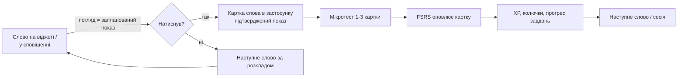

# SPEC. «Реп'ях» (Burdock) — основна специфікація продукту

| Поле | Значення |
|---|---|
| Статус | Approved (v0.1, фаза 0) |
| Дата | 2026-09-27 |
| Власник | Власник продукту |
| Джерела рішень | [Журнал рішень 2026-09-25](decisions/2026-09-25-interview.md) (Q1-Q38, T1-T23) |
| Довідка | [Дослідницький звіт](research/2026-09-25-research-brief.md) |
| Деталізація | [Специфікації напрямків](#12-специфікації-напрямків) |

## 1. Бачення

Людина вчить англійські слова не тоді, коли «сідає вчити», а тоді, коли просто дивиться на телефон. «Реп'ях» показує слова на віджетах головного екрана та екрана блокування, у сповіщеннях і в Live Activity-сесії, рахує, скільки разів кожне слово було показане, а потім пропонує закріпити його короткими вправами в застосунку. Слова чіпляються, як реп'яхи.

Продукт україномовний, зроблений для українців в Україні та за кордоном, із грайливим сучасним інтерфейсом і маскотом Реп'яшком. Якість інтерфейсу є пріоритетом продукту нарівні з методикою.

## 2. Проблема і цінність

| Проблема користувача | Як розв'язує «Реп'ях» |
|---|---|
| Немає часу на «уроки» | Пасивні покази на поверхнях телефона без відкриття застосунку; сесія на 3-5 хвилин |
| Слова забуваються | Інтервальні повторення FSRS-6, активне пригадування в тестах, статистика показів і «шансу пригадати» |
| Загальні курси не дають потрібної лексики | Вибір рівня CEFR і 9 категорій (Спілкування, Подорожі, Робота і бізнес, IT та програмування, Їжа, Здоров'я, Місто й транспорт, Покупки, Військова справа) |
| Мотивація згасає | Серія, щоденний вхід, мікрозавдання, косметичні нагороди, маскот; без тиску й маніпуляцій |
| Недовіра до збору даних | Анонімний акаунт без email, мінімум даних, ЄС-хостинг, жодних сторонніх аналітичних SDK |

## 3. Аудиторія та ринки

- Українськомовні користувачі 12+ в Україні та діаспорі (Польща, Німеччина, Чехія та інші). Застосунок доступний у всіх країнах, маркетинг спрямований на Україну.
- Персони та сценарії: див. [03. UX-потоки та екрани](specs/03-ux-flows-screens.md).
- Інтерфейс лише українською у v1; архітектура закладає інші мови інтерфейсу та інші пари мов вивчення.

## 4. Обсяг першого релізу (v1)

### 4.1. Входить

| Область | Обсяг v1 |
|---|---|
| Платформи | iPhone, iPad (iOS 16+); Android (API 26+) зі спільної бази, реліз через 1-2 місяці після iOS |
| Поверхні iOS | Віджети systemSmall/Medium/Large, accessoryRectangular/Circular/Inline, StandBy (iOS 17+); локальні сповіщення; Live Activity «сесія» (запускає користувач, 1-8 год) |
| Поверхні Android | Віджети 2x2/4x2/4x4 з Material You; сповіщення; сесія як ongoing-сповіщення або Live Update |
| Зміна слова | За інтервалом (15/30/60/120/240 хв), кнопка «наступне» у віджеті (iOS 17+), при відкритті застосунку |
| Налаштування | Рівень A1-C2, категорії (8), нових слів/день (3-30), показів слова/день (1-10), інтервал, тихі години, кількість і зміст сповіщень, тема, гейміфікація увімк./вимк. |
| Навчання | Життєвий цикл слова New → Introduced → Learning → Review → Learned; FSRS-6; сесія з трьома режимами: вибір відповіді EN→UK і UK→EN, пари, набір слова |
| Статистика | Покази (заплановані/підтверджені), вивчено, серія, прогрес за рівнями та категоріями (Pro) |
| Нагороди | Серія з заморозкою, щоденний календар входу, 3 щоденні + 1 тижневе мікрозавдання, XP і рівні, валюта «колючки», магазин косметики (теми віджетів, вбрання Реп'яшка, рамки), досягнення |
| Акаунт | Анонімний з автогенерованим нікнеймом; прив'язка Apple (і Google з релізом Android) для синхронізації; видалення акаунта |
| Монетизація | Тріал 7 днів через магазин; Free (5 слів/день) і Pro (місяць/рік) |
| Контент | Власна база: 9 категорій × 6 рівнів, безкоштовний пул A1-B1 (~600 слів, 100% ручна перевірка); пакети контенту з CDN |
| Сервер | Ідентичність, маніфест контенту, синхронізація прогресу і налаштувань, звірка нагород, entitlement-и, APNs для Live Activity, opt-in аналітика |
| Локалізація | UI uk; інфраструктура для en/pl/de |

### 4.2. Не входить у v1 (заплановано або відкладено)

Push-оновлення контенту (v1.1), серверно-авторитетні нагороди (v1.1), реклама (дослідження), Android «режим при розблокуванні» (оцінка після Android-релізу), Apple Watch, клавіатурне розширення, Mac Catalyst, соціальні функції, дитяча версія, друга мова вивчення, аудіювання та cloze-вправи, довічна й сімейна підписки, власні записи вимови.

## 5. Ключовий сценарій (core loop)



Пасивний показ ніколи не оцінює картку; він лише переводить слово у стан «знайомство» (≥3 покази у ≥2 дні) і впливає на порядок показу. Пам'ять формує активне пригадування в тестах.

## 6. Вимоги верхнього рівня

Ідентифікатори `FR-00-x` є «парасольковими»; деталізація у специфікаціях напрямків має власні ідентифікатори.

### 6.1. Функціональні

| ID | Вимога | Пріоритет | Деталі |
|---|---|---|---|
| FR-00-1 | Показувати актуальне слово на всіх підтримуваних поверхнях відповідно до налаштувань темпу, інтервалу й тихих годин | Must | 04, 05, 06 |
| FR-00-2 | Дати користувачу обрати рівень CEFR, категорії, темп, інтервал і зміст сповіщень під час онбордингу і в налаштуваннях | Must | 03 |
| FR-00-3 | Вести облік показів кожного слова у двох величинах (заплановані/підтверджені) і показувати підтверджені | Must | 06, 04, 05 |
| FR-00-4 | Планувати повторення за FSRS-6 і проводити сесії з трьома режимами тестів із негайним зворотним зв'язком | Must | 06 |
| FR-00-5 | Створювати анонімний акаунт автоматично та дозволяти прив'язку Apple/Google лише для синхронізації | Must | 09, 10 |
| FR-00-6 | Кешувати контент після першого запуску за налаштуваннями та оновлювати його з маніфесту сервера | Must | 08, 09 |
| FR-00-7 | Синхронізувати прогрес, налаштування та журнал нагород між пристроями без втрат | Must | 09, 06, 07 |
| FR-00-8 | Реалізувати серію, щоденний календар, мікрозавдання, XP, «колючки» і магазин косметики з етичними обмеженнями | Must | 07 |
| FR-00-9 | Надавати тріал через магазин, безкоштовний режим 5 слів/день та Pro (місяць/рік) із серверною валідацією | Must | 11, 09 |
| FR-00-10 | Live Activity-сесія, яку запускає користувач, зі зміною слів за розкладом та ручним «далі» | Must | 04 |
| FR-00-11 | Власні списки слів (Pro) з імпортом | Should | 08, 03 |
| FR-00-12 | Повідомлення про помилку в контенті з екрана слова | Should | 08, 09 |
| FR-00-13 | Режим «без гейміфікації» | Should | 07, 03 |
| FR-00-14 | Видалення акаунта в застосунку та через веб-посилання, експорт власних даних | Must | 10 |

### 6.2. Нефункціональні

| ID | Вимога | Мета |
|---|---|---|
| NFR-00-1 | Приватність: мінімізація даних, жодних сторонніх аналітичних/рекламних SDK, дані в ЄС, opt-in аналітика | 10, 13 |
| NFR-00-2 | Доступність: WCAG 2.2 AA, Dynamic Type до AX5, цілі 44pt/48dp, Reduce Motion, читачі екрана | 02 |
| NFR-00-3 | Продуктивність: холодний старт < 2 с на iPhone 12, генерація таймлайну віджета < 50 мс для 5 тис. карток, пам'ять розширення < 30 МБ | 01, 04 |
| NFR-00-4 | Надійність офлайн: віджети, сповіщення, тести й нагороди працюють з кешу; синхронізація при появі мережі | 01, 09 |
| NFR-00-5 | Безпека: OWASP MASVS v2.1 L1 + MASVS-PRIVACY, ротація refresh-токенів, секрети поза репозиторієм | 10 |
| NFR-00-6 | Якість коду: Clean Architecture з архітектурними тестами, `TreatWarningsAsErrors`, покриття Domain/Application ≥ 80% | 01, 15 |
| NFR-00-7 | Локалізація: жодного UI-рядка поза `.resx`, правильні форми множини, апостроф U+2019 | 12 |
| NFR-00-8 | Дизайн: усі візуальні значення з токенів, усі стани компонентів, знімки світлої/темної теми у PR | 02 |
| NFR-00-9 | Доступність сервера 99.5% на місяць, p95 API < 300 мс, резервні копії з тренуванням відновлення щомісяця | 09, 14 |
| NFR-00-10 | Сумісність: iOS 16+, Android 8+ (API 26), iPad-макети, .NET 10 LTS із міграцією на .NET 11 у 2027 | 01, 17 |

## 7. Платформові обмеження, що визначають продукт

| Можливість | iOS | Android | Рішення |
|---|---|---|---|
| Малювати поверх інших застосунків | Ні | Так, але політика Play і батарея | Не використовуємо |
| Реагувати на розблокування/свайп | Ні | Лише через постійний foreground-сервіс | Тригери: час, кнопка, відкриття застосунку |
| Оновлення віджета | Таймлайн, бюджет ~40-70 перезавантажень/день | WorkManager ≥15 хв | Планувальник на 48 год наперед |
| Знати, що віджет побачили | Ні | Так на Android 16.1+ | Два лічильники показів |
| Live Activity без події | Заборонено HIG | Live Updates лише для ongoing-активності | Сесія, яку запускає користувач |
| Локальні сповіщення | Ліміт 64 очікуваних | Дозвіл з API 33 | Переплановувати при кожному відкритті |

Джерело: розділ 1 [дослідницького звіту](research/2026-09-25-research-brief.md).

## 8. Архітектура (огляд)

```mermaid
flowchart TB
    subgraph Mobile["Мобільний застосунок (.NET MAUI)"]
        P[Burdock.Presentation<br/>XAML + ViewModels] --> A[Burdock.Application<br/>use cases, порти]
        I[Burdock.Infrastructure<br/>SQLite, HTTP, платформа] --> A
        A --> D[Burdock.Domain<br/>сутності, FSRS, планувальник, правила економіки]
        W[BurdockWidgets (Swift)<br/>WidgetKit + ActivityKit] -. App Group JSON .- I
        AW[Android widgets (C#)] -. RemoteViews .- I
    end
    subgraph Server["Сервер (ASP.NET Core 10, модульний моноліт)"]
        API[Burdock.Server.Api] --> M1[Identity]
        API --> M2[Content]
        API --> M3[LearnerProgress]
        API --> M4[Rewards]
        API --> M5[Entitlements]
        API --> M6[SettingsSync]
        API --> M7[Notifications/APNs]
        API --> M8[Analytics opt-in]
        M1 & M2 & M3 & M4 & M5 & M6 & M7 & M8 --> PG[(PostgreSQL 18)]
    end
    I <-->|HTTPS, Burdock.Contracts| API
    M2 --> CDN[(Object Storage + CDN<br/>пакети контенту)]
    I --> CDN
    Pipeline[Burdock.ContentPipeline<br/>генерація, рецензування, пакети] --> CDN
    Pipeline --> M2
```

Правило залежностей, порти та композиція: [01. Архітектура](specs/01-architecture.md). Пакет `Burdock.Domain` лежить у `src/shared/` і використовується і клієнтом, і сервером (сервер лише `EconomyRules`, схему контенту та value objects; T23).

## 9. Бізнес-модель

| Рівень | Що отримує |
|---|---|
| Тріал (7 днів, через магазин) | Усе |
| Free | 5 випадкових слів на день з пулу A1-B1; віджети, сповіщення, тести на цих словах; серія, щоденні нагороди, мікрозавдання |
| Pro (місяць/рік) | Вибір рівня, категорій, темпу; усі слова; статистика; історія; власні списки; теми віджетів як нагороди доступні всім |

Деталі, стани entitlement-ів, paywall: [11. Монетизація](specs/11-monetization.md).

## 10. Принципи дизайну (витяг)

1. Віджет — герой. Проєктуємо від найменшої поверхні до екрана, а не навпаки.
2. Грайливо, але спокійно: емоція в моменти нагород і порожніх станів, тиша в щоденному використанні.
3. Один погляд, одна дія: кожен екран має одну головну дію.
4. Українська типографіка з повагою: Fixel, правильний апостроф, лапки «», ґ.
5. Доступність за замовчуванням, а не як режим.
6. Жодних маніпуляцій: без таймерів тиску, без «ти втратиш», без купівельної валюти.

Повна дизайн-система, токени, компоненти, макети віджетів: [02. Дизайн-система](specs/02-design-system.md), прев'ю `design/preview/index.html`.

## 11. Ризики верхнього рівня

| Ризик | Ймовірність | Вплив | Пом'якшення |
|---|---|---|---|
| Розробка iOS без Mac: повільний цикл, віджети «наосліп» | Висока | Високий | CI зі знімками симулятора, TestFlight, погодинний хмарний Mac; переоцінка купівлі Mac mini через місяць |
| App Review відхилить Live Activity | Середня | Середній | Лише сесія, запущена користувачем, з прогресом і кнопкою завершення; нотатки для рев'ю |
| Якість українських перекладів ШІ | Середня | Високий | ШІ-рецензент, 100% ручна перевірка безкоштовного пулу, скарги в застосунку, журнал рецензування |
| Бюджет оновлень віджета вичерпується | Середня | Середній | Планувальник на 48 год, перезавантаження лише за подіями, статичний стан «відкрийте застосунок» |
| Конверсія у Pro нижча за очікувану | Середня | Високий | Тріал через магазин, чесний paywall, метрики; дослідження реклами як план Б |
| Соло-розробник: перевантаження | Висока | Високий | Жорсткий обсяг v1, дорожня карта з чекпоінтами, ШІ-агенти з чіткими промтами |

## 12. Специфікації напрямків

| № | Документ | Напрямок | Статус |
|---|---|---|---|
| 01 | [01-architecture.md](specs/01-architecture.md) | Архітектура рішення, Clean Architecture, порти | Draft |
| 02 | [02-design-system.md](specs/02-design-system.md) | Дизайн-система, токени, компоненти, віджети | Draft |
| 03 | [03-ux-flows-screens.md](specs/03-ux-flows-screens.md) | Персони, потоки, екрани, мікрокопі | Draft |
| 04 | [04-ios-surfaces.md](specs/04-ios-surfaces.md) | Віджети, сповіщення, Live Activity на iOS | Draft |
| 05 | [05-android-surfaces.md](specs/05-android-surfaces.md) | Віджети, сповіщення, сесія на Android | Draft |
| 06 | [06-learning-engine.md](specs/06-learning-engine.md) | Вибір слів, покази, FSRS, тести | Draft |
| 07 | [07-gamification.md](specs/07-gamification.md) | Серія, календар, мікрозавдання, колючки | Draft |
| 08 | [08-content-pipeline.md](specs/08-content-pipeline.md) | База слів, генерація, рецензування, пакети | Draft |
| 09 | [09-backend.md](specs/09-backend.md) | Сервер, модулі, API, синхронізація | Draft |
| 10 | [10-security-privacy.md](specs/10-security-privacy.md) | Безпека, приватність, модель загроз | Draft |
| 11 | [11-monetization.md](specs/11-monetization.md) | Free, тріал, Pro, paywall | Draft |
| 12 | [12-localization.md](specs/12-localization.md) | Локалізація та інтернаціоналізація | Draft |
| 13 | [13-analytics-observability.md](specs/13-analytics-observability.md) | Аналітика, Sentry, спостережуваність | Draft |
| 14 | [14-devops-ci.md](specs/14-devops-ci.md) | CI/CD, інфраструктура, середовище розробки | Draft |
| 15 | [15-testing-quality.md](specs/15-testing-quality.md) | Тестування та якість | Draft |
| 16 | [16-documentation-plan.md](specs/16-documentation-plan.md) | План документації, ADR-процес | Draft |
| 17 | [17-roadmap.md](specs/17-roadmap.md) | Дорожня карта та чекпоінти | Draft |

Допоміжні: [Глосарій](glossary.md), [ADR](adr/README.md), [Промти для агентів](prompts/README.md), [Шаблон специфікації](specs/_TEMPLATE.md).

## 13. Критерії готовності v1 до релізу в App Store

1. Усі вимоги Must із таблиці 6.1 реалізовані й закриті тестами з посиланням на ідентифікатори.
2. Дизайн-QA пройдено для кожного екрана у світлій і темній темі, на iPhone SE/15/Pro Max та iPad, з Dynamic Type до AX5.
3. Віджети перевірені на реальному пристрої через TestFlight: усі сімейства, tinted-режим, після перезавантаження до розблокування, режим енергозбереження.
4. Безкоштовний пул контенту (A1-B1) пройшов 100% ручну перевірку; решта має ≥10% стратифікованої перевірки; екран «Джерела та ліцензії» заповнений.
5. Privacy-пакет узгоджений: перелік даних = privacy manifest = App Privacy labels = політика приватності; видалення акаунта працює в застосунку і через веб.
6. Сервер у продакшені на Hetzner з резервними копіями, перевіреним відновленням, моніторингом і алертами.
7. Підписки перевірені в sandbox: покупка, тріал, відновлення, скасування, повернення коштів, оновлення entitlement-у на другому пристрої.
8. Архітектурні тести, лінт локалізації, аудит залежностей і перевірка контрасту токенів проходять у CI без винятків.
