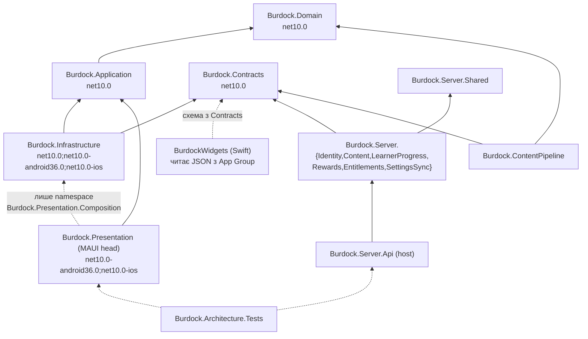
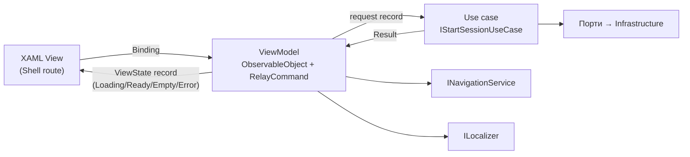
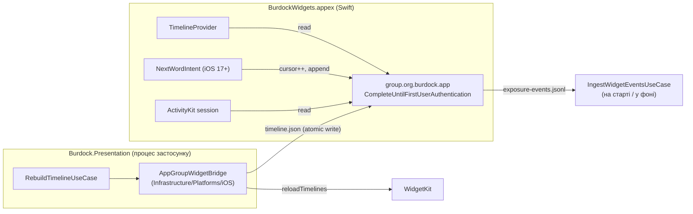
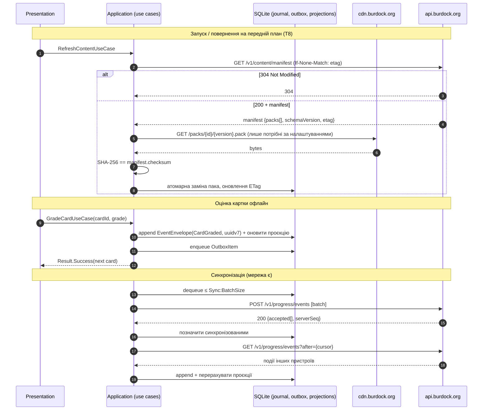
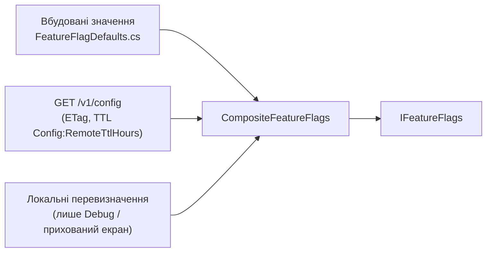

# 01. Архітектура рішення

| Поле | Значення |
|---|---|
| Статус | Draft |
| Версія | 0.1 |
| Дата | 2026-09-27 |
| Власник | Архітектор |
| Джерела рішень | [Журнал рішень](../decisions/2026-09-25-interview.md): Q3, Q4/Q13, Q6/Q16, Q7, Q9, Q11, Q17, Q22, Q23, Q25, Q26, Q27, Q29, Q35, Q36; T1-T5, T8, T12-T16, T18, T20 |
| Пов'язані специфікації | [02-design-system.md](02-design-system.md), [14-devops-ci.md](14-devops-ci.md), [15-testing-quality.md](15-testing-quality.md), [16-documentation-plan.md](16-documentation-plan.md) |

## 0. Контекст для ШІ-агента

Ти працюєш над архітектурним каркасом застосунку «Реп'ях» (Burdock): .NET MAUI 10 (iOS 16+, Android API 26+), Swift-розширення WidgetKit/ActivityKit, сервер ASP.NET Core 10 Minimal APIs на Hetzner. Перед будь-якою зміною структури проєктів або міжшарових контрактів прочитай: цей документ, `docs/decisions/2026-09-25-interview.md` (джерело істини), `docs/specs/15-testing-quality.md` (архітектурні тести), `docs/specs/02-design-system.md` (токени для будь-якого UI).

Правила, які не можна порушувати:
1. Правило залежностей Clean Architecture: `Burdock.Domain` не посилається ні на що; `Burdock.Application` лише на Domain; `Burdock.Infrastructure` і `Burdock.Presentation` на Application; композиційний корінь лише в `MauiProgram.cs` (мобайл) та `Program.cs` (сервер).
2. Бізнес-правила живуть у Domain (сутності, доменні сервіси) та Application (use case-и). У ViewModel-ах, обробниках ендпоінтів, віджетах бізнес-правил немає.
3. Жодних захардкоджених мов «англійська/українська» в Domain (Q11): лише `LanguagePair`.
4. Очікувані помилки повертаються як `Result<T>`, винятки лише для дефектів та інфраструктурних збоїв (розділ 3.10).
5. Час береться лише через `IClock`; зберігається в UTC; навчальний день починається о 04:00 локального часу (розділ 3.11).
6. Кожна зміна рішення з розділу 4 оформлюється як ADR у `docs/adr/`.

Де лежить код: `src/mobile/*`, `src/mobile/ios-extensions/BurdockWidgets`, `src/server/*`, `src/shared/Burdock.Contracts`, `content/pipeline/Burdock.ContentPipeline`. Перевірка результату: `dotnet build Burdock.Mobile.slnx` і `dotnet build Burdock.Server.slnx` без попереджень; `dotnet test tests/Burdock.Architecture.Tests` зелений; нових проєктів поза схемою розділу 3.1 немає.

## 1. Мета й межі

**Мета.** Зафіксувати структуру монорепозиторію, шари, межі модулів, порти, платформову стратегію та інженерні стандарти так, щоб соло-розробник із ШІ-агентами (Q29) міг паралельно розвивати мобільний застосунок, сервер і контент-пайплайн без архітектурної ерозії.

**Входить у v1:**
- Монорепозиторій з двома рішеннями (`Burdock.Mobile.slnx`, `Burdock.Server.slnx`) і спільними властивостями збірки.
- Чотири мобільні шари + Swift-розширення; шість серверних модулів у модульному моноліті (T13).
- Офлайн-кеш контенту, append-only журнал подій, outbox-синхронізація (Q4/Q13, T14).
- Абстракції: годинник, навігація, фіче-флаги, логування, локалізація, аналітика (opt-in, Q9).
- Архітектурні тести як fitness functions.

**Явно не входить:** соціальний модуль (Q24, лише зарезервоване місце), push-тригери оновлення контенту (T8, v1.1), серверно-авторитетне нарахування нагород (T18, v1.1), шифрування локальної БД (T15), NativeAOT для iOS (Mono full-AOT за замовчуванням), Mac Catalyst / watchOS (Q12).

**Відкладено:** міграція на .NET 11 у Q1 2027 (T1, деталі в 14-devops-ci.md, розділ «Контрольна точка .NET 11»).

## 2. Вимоги

### 2.1 Функціональні

| ID | Вимога | MoSCoW |
|---|---|---|
| FR-01-1 | Монорепозиторій має структуру розділу 3.1; нові проєкти додаються лише в передбачені каталоги | Must |
| FR-01-2 | Мобільний код розділено на `Burdock.Domain`, `Burdock.Application`, `Burdock.Infrastructure`, `Burdock.Presentation` з правилом залежностей розділу 3.4 | Must |
| FR-01-3 | Кожен use case реалізовано як інтерактор з явним вхідним портом (request record) і вихідним результатом (`Result<TResponse>`) | Must |
| FR-01-4 | ViewModel-и (CommunityToolkit.Mvvm) викликають лише use case-и та Presentation-сервіси (навігація, локалізація, діалоги); прямого доступу до репозиторіїв і HTTP немає | Must |
| FR-01-5 | Domain організовано за обмеженими контекстами розділу 3.6; посилання між контекстами лише через ідентифікатори або спільне ядро | Must |
| FR-01-6 | Усі зовнішні залежності Application виражені портами розділу 3.7 з адаптерами в Infrastructure або Presentation | Must |
| FR-01-7 | iOS-розширення отримує дані лише з файлів у контейнері App Group, записаних застосунком; токенів у контейнері немає | Must |
| FR-01-8 | Android-віджет реалізовано в C# (`AppWidgetProvider` + `RemoteViews`) у `Platforms/Android`, оновлення через WorkManager | Must |
| FR-01-9 | Прогрес зберігається як append-only журнал подій із клієнтськими UUIDv7; синхронізація через outbox; налаштування за LWW (T14) | Must |
| FR-01-10 | Контент-паки завантажуються за маніфестом з ETag; віджети та сповіщення працюють лише з локального кешу (Q4/Q13, T8) | Must |
| FR-01-11 | Навігація виконується через `INavigationService`; параметри передаються через `IQueryAttributable` | Must |
| FR-01-12 | Фіче-флаги читаються через `IFeatureFlags` із трьох джерел: вбудовані значення, віддалена конфігурація сервера, локальні перевизначення (Debug) | Should |
| FR-01-13 | Мобільний застосунок повідомляє серверу версію застосунку та підтримувані версії контент-схеми; сервер повертає `minSupportedAppVersion` | Must |
| FR-01-14 | Сервер побудовано як модульний моноліт із модулями Identity, Content, LearnerProgress, Rewards, Entitlements, SettingsSync; кожен модуль має власну PostgreSQL-схему | Must |
| FR-01-15 | Модуль соціальних функцій зарезервовано (порожній каталог `Social` з README), не реалізується (Q24) | Could |

### 2.2 Нефункціональні

| ID | Вимога | MoSCoW |
|---|---|---|
| NFR-01-1 | Архітектурні тести блокують злиття при порушенні правила залежностей (див. 15-testing-quality.md) | Must |
| NFR-01-2 | `Burdock.Domain`, `Burdock.Application`, `Burdock.Contracts` компілюються під `net10.0` без платформових TFM і з `IsAotCompatible=true` | Must |
| NFR-01-3 | Бюджети продуктивності розділу 3.17 вимірюються в CI та не перевищуються | Should |
| NFR-01-4 | `Nullable`, `TreatWarningsAsErrors`, `AnalysisLevel=latest-Recommended` увімкнено для всіх проєктів | Must |
| NFR-01-5 | Жодних статичних сервіс-локаторів; усі залежності через конструктор | Must |
| NFR-01-6 | Domain і Application детерміновані: жодного `DateTime.Now`, `Random.Shared`, `Guid.NewGuid()` поза інжектованими портами | Must |
| NFR-01-7 | Локальні дані без PII; токени лише в SecureStorage `ThisDeviceOnly`; кеш і прогрес виключені з iCloud/Auto Backup (T12, T15) | Must |
| NFR-01-8 | Міграція хостингу з Hetzner на Azure не потребує зміни коду модулів (Q17): лише конфігурація й інфраструктурні адаптери | Should |

## 3. Проєктування

### 3.1 Структура монорепозиторію

```text
Burdock/
├── Burdock.Mobile.slnx                # мобайл + shared + мобільні тести
├── Burdock.Server.slnx                # сервер + shared + пайплайн + серверні тести
├── Directory.Build.props              # спільні MSBuild-властивості (розділ 3.16)
├── Directory.Packages.props           # Central Package Management, усі версії NuGet
├── global.json                        # SDK 10.0.1xx, rollForward: latestPatch
├── .editorconfig
├── .github/workflows/                 # див. 14-devops-ci.md
├── src/
│   ├── mobile/
│   │   ├── Burdock.Application/       # use case-и, порти, application-моделі
│   │   ├── Burdock.Infrastructure/    # SQLite, HTTP, контент-паки, Sentry, платформові адаптери
│   │   ├── Burdock.Presentation/      # MAUI head: Views, ViewModels, Shell, Resources, Platforms/, MauiProgram.cs
│   │   └── ios-extensions/
│   │       └── BurdockWidgets/        # Xcode-проєкт: WidgetKit + ActivityKit таргети (Swift)
│   ├── server/
│   │   ├── Burdock.Server.Api/        # хост Minimal APIs, Program.cs (композиційний корінь)
│   │   ├── Burdock.Server.Shared/     # ядро: Result, ProblemDetails, IClock, outbox
│   │   ├── Burdock.Server.Modules.Identity/        # у кожному модулі: Domain/ Application/ Infrastructure/ Endpoints/
│   │   ├── Burdock.Server.Modules.Content/
│   │   ├── Burdock.Server.Modules.LearnerProgress/
│   │   ├── Burdock.Server.Modules.Rewards/
│   │   ├── Burdock.Server.Modules.Entitlements/
│   │   ├── Burdock.Server.Modules.SettingsSync/
│   │   ├── Burdock.Server.Modules.Notifications/   # APNs для Live Activity (v1), push оновлень контенту (v1.1)
│   │   ├── Burdock.Server.Modules.Analytics/       # opt-in агрегати (Q9)
│   │   └── Burdock.Server.Modules.Social/          # зарезервовано, лише README (Q24)
│   └── shared/
│       ├── Burdock.Domain/            # сутності, value objects, доменні сервіси, Result; спільний для клієнта й сервера (T23)
│       └── Burdock.Contracts/         # DTO API v1, схема контент-пака, схема App Group bridge
├── content/
│   ├── pipeline/Burdock.ContentPipeline/   # консоль: імпорт джерел, генерація, валідація, збирання паків
│   ├── sources/                       # сирі відкриті джерела (CEFR-J, OEWN, CMUdict) з LICENSE поруч
│   └── own-lists/                     # власні списки власника (status: reviewed)
├── design/
│   ├── tokens/tokens.json             # єдине джерело токенів (T20); tokens/generate.py — генератор (02-design-system.md)
│   ├── mascot/                        # Реп'яшок: стани, вихідні файли
│   └── preview/                       # HTML-прев'ю екранів
├── infra/                             # docker-compose, Caddyfile, sops-секрети, скрипти деплою
├── tests/
│   ├── Burdock.Domain.Tests/
│   ├── Burdock.Application.Tests/
│   ├── Burdock.Architecture.Tests/
│   ├── Burdock.Infrastructure.Tests/
│   ├── Burdock.Contracts.Tests/
│   ├── Burdock.Server.Tests/          # інтеграційні з Testcontainers
│   ├── Burdock.ContentPipeline.Tests/
│   ├── Burdock.UiTests/               # Appium smoke
│   ├── Burdock.TestKit/               # FakeClock, in-memory порти, builders (спільно для всіх тестів)
│   └── fixtures/                      # golden-вектори FSRS, снапшоти, тестові паки
└── docs/                              # decisions, research, specs, adr, prompts, glossary
```

### 3.2 Файли рішень

Обрано **два рішення** замість одного `Burdock.slnx`:

| Критерій | Одне `Burdock.slnx` | Два рішення (обрано) |
|---|---|---|
| Робочі навантаження | Linux-агент сервера має встановлювати MAUI workloads або фільтрувати проєкти | Серверне рішення збирається чистим SDK без workloads |
| Час завантаження IDE | Усі 25+ проєктів завжди | Розробник відкриває лише потрібну половину |
| Випадкові посилання | Легко додати `ProjectReference` із сервера на мобільний Infrastructure | Фізично неможливо без правки другого рішення |
| Спільний код | Прямо | `Burdock.Contracts` входить в обидва рішення; властивості збірки спільні через `Directory.Build.props` |

`Burdock.Mobile.slnx` містить: Domain, Application, Infrastructure, Presentation, Contracts, тести Domain/Application/Architecture/Infrastructure/Contracts/UiTests. `Burdock.Server.slnx` містить: Api, Shared, вісім модулів (Identity, Content, LearnerProgress, Rewards, Entitlements, SettingsSync, Notifications, Analytics), Domain (спільний, T23), Contracts, ContentPipeline, тести Server/ContentPipeline/Contracts. Формат `.slnx` (XML) обрано, бо він читабельний у diff і підтримується `dotnet` CLI та VS 2026 (припущення щодо повної підтримки в Rider).

### 3.3 Граф залежностей проєктів



Пунктир позначає залежності, які дозволені лише у визначеному просторі імен або лише на рівні схеми даних. Мобільний код ніколи не посилається на серверні збірки; серверний код ніколи не посилається на `Burdock.Application` мобайла.

### 3.4 Чотири мобільні шари

| Шар | Відповідальність | Дозволені посилання | Заборонено |
|---|---|---|---|
| `Burdock.Domain` | Сутності, value objects (records), доменні сервіси (`TimelinePlanner`, `EconomyRules`, `Fsrs6Scheduler` або порт до нього), доменні події, `Result`/`Error`, інваріанти | Лише BCL | Будь-який NuGet, `Microsoft.Extensions.*`, MAUI, System.Text.Json-атрибути (серіалізація в Infrastructure) |
| `Burdock.Application` | Use case-и (інтерактори) за фічами, порти (інтерфейси), application-моделі запит/відповідь, валідація вводу, оркестрація транзакцій | Domain; `Microsoft.Extensions.Logging.Abstractions`, `Microsoft.Extensions.DependencyInjection.Abstractions` (метод `AddBurdockApplication`) | Contracts, Infrastructure, MAUI, HTTP, SQLite, платформові API |
| `Burdock.Infrastructure` | Адаптери портів: sqlite-net-pcl репозиторії, `IHttpClientFactory` шлюзи, контент-паки, outbox, Sentry, аналітика, `SystemClock`, платформові мости (App Group, WorkManager) через `Platforms/` і partial classes | Application, Contracts, NuGet-адаптери | Presentation, ViewModel-и, XAML |
| `Burdock.Presentation` | MAUI head: Views (XAML), ViewModels (CommunityToolkit.Mvvm), Shell, `INavigationService`, конвертери, ресурси (`.resx`, `Colors.xaml` з токенів), `Platforms/Android/Widgets` (RemoteViews), `MauiProgram.cs` | Application; Infrastructure лише з `Burdock.Presentation.Composition` | Прямі виклики репозиторіїв/HTTP з ViewModel-ів; бізнес-правила; `DateTime.Now` |

Каталоги всередині шарів іменуються за фічами («screaming architecture»): `Burdock.Application/Learning/StartSession/StartSessionUseCase.cs`, а не `Services/SessionService.cs`.

### 3.5 MVVM як адаптер Presentation



Правила відображення:
- ViewModel отримує use case-и через конструктор, конвертує `Result` у явний `ViewState` (`Loading | Ready | Empty | Error`), щоб порожні та помилкові стани були частиною дизайну (кольори `color.feedback.error`, `color.text.primary`, ілюстрації Реп'яшка з 02-design-system.md), а не винятком.
- `[ObservableProperty]` і `[RelayCommand]` з CommunityToolkit.Mvvm 8.4.2 [https://www.nuget.org/packages/CommunityToolkit.Mvvm]; `AllowConcurrentExecutions=false` для команд, що викликають use case-и.
- Логіка, яку хочеться протестувати без MAUI, за визначенням належить use case-у або Domain, а не ViewModel-у.
- Один use case може обслуговувати кілька ViewModel-ів; ViewModel ніколи не викликає інший ViewModel.

### 3.6 Обмежені контексти в Domain

| Контекст (каталог) | Ключові типи | Інваріанти та примітки |
|---|---|---|
| `Vocabulary` | `Lexeme`, `Sense`, `Translation`, `Example`, `Pronunciation`, `Topic`, `CefrLevel` (A1..C2), `LanguagePair` (`Native`, `Target`), `LexemeId` | Контент незмінний на пристрої; апостроф нормалізується до U+02BC при імпорті; жодних припущень про конкретні мови |
| `Learning` | `LearnerCard`, `ReviewLog`, `Grade` (Again/Hard/Good/Easy), `ExerciseType`, `ISpacedRepetitionScheduler` (порт FSRS-6), `DesiredRetention` | Одна картка на слово; пасивні покази ніколи не оцінюють картку (T4); `ReviewLog` append-only для переоптимізації |
| `Exposure` | `WordTimeline`, `TimelineEntry`, `ExposureRecord` (`Scheduled` / `Confirmed`, T5), `Surface` (HomeWidget, LockWidget, StandBy, Notification, LiveActivity, InApp), `RotationPolicy` (інтервал 15/30/60/120/240 хв, Q36), `IWordRotationTrigger`, `TimelinePlanner` | Записи не ближче `Timeline:MinEntryGapMinutes`; тихі години; фаза «знайомство» = ≥3 покази у ≥2 дні (T4) |
| `Rewards` | `Ledger`, `LedgerEvent` (append-only, підписаний), `EconomyRules` (чиста функція згортання), `ThornBalance` («Колючки», Q34), `Streak`, `StreakFreeze`, `Xp` | Баланс ніколи від'ємний; денні ліміти; той самий код згортання використовує сервер (T18) |
| `LearnerSettings` | `LearnerSettings`, `DailyLimits`, `QuietHours`, `NotificationPlan`, `SettingsVersion` (LWW) | Діапазони Q30 як інваріанти; значення за замовчуванням у таблиці констант |
| `Entitlements` | `Entitlement`, `Plan` (Free/Pro), `EntitlementSnapshot` (з `ExpiresAt`), `FeatureGate` | Клієнт кешує снапшот із терміном дії (Q23); межі безкоштовної версії Q14/Q32 як `FeatureGate` |
| `Identity` | `LearnerIdentity`, `InstallationId` (UUIDv4, не IDFV), `Nickname`, `LinkedProvider` (Apple/Google), `MergePolicy` | Анонімний акаунт з першого запуску (Q3); об'єднання з провайдером спроєктовано |
| `Sync` | `EventEnvelope` (UUIDv7, тип, версія схеми, `OccurredAtUtc`, `TzOffsetMinutes`), `OutboxItem`, `SyncCursor` | Ідемпотентність за `EventId`; порядок за `ServerSeq` |
| `SharedKernel` | `Result`, `Result<T>`, `Error`, `LearningDay`, базові `Id`-типи, `DomainEvent` | Без залежностей |

Контексти спілкуються лише через ідентифікатори (`LexemeId`, `LearnerId`) та доменні події; наприклад, `Learning` не знає про `Ledger`, а use case `GradeCardUseCase` після успіху публікує `CardGraded`, який обробляє `Rewards`.

### 3.7 Порти Application

| Порт | Призначення | Адаптер (де) |
|---|---|---|
| `IClock` | `UtcNow`, `LocalTimeZone`; єдине джерело часу | `SystemClock` (Infrastructure); `FakeClock` (тести) |
| `IIdGenerator` | UUIDv7 для подій, UUIDv4 для installation id | Infrastructure (`Guid.CreateVersion7()`) |
| `ILexemeRepository` | Читання контенту з локальної БД за рівнем/темою/`LanguagePair` | sqlite-net-pcl (Infrastructure) |
| `ILearnerCardRepository` | Картки, `ReviewLog` | sqlite-net-pcl |
| `IExposureStore` | `ExposureRecord`, поточний `WordTimeline`, курсор «наступне слово» | sqlite-net-pcl + читання `exposure-events.jsonl` з App Group |
| `IEventJournal` | Append-only запис `EventEnvelope`, читання незсинхронізованих | sqlite-net-pcl |
| `ISettingsStore` | `LearnerSettings` з версією LWW | sqlite-net-pcl |
| `IWidgetBridge` | Публікація timeline у платформове сховище та запит перемальовки | iOS: файл у App Group + `WidgetCenter.reloadTimelines` через WidgetKit.WidgetCenterProxy; Android: `AppWidgetManager` + WorkManager |
| `INotificationScheduler` | Перепланування локальних сповіщень (≤ 64 на iOS), скасування | iOS `UNUserNotificationCenter`; Android `WorkManager`/`setWindow` |
| `ILiveActivityController` | Старт/оновлення/завершення сесії Live Activity (Q35) | iOS ActivityKit через App Group + інтенти; Android: no-op |
| `IContentPackStore` | Маніфест з ETag, завантаження, перевірка SHA-256, атомарна заміна паків | HTTP + файлова система |
| `ISyncGateway` | `PushEvents`, `PullEvents(afterSeq)`, `PushSettings`, `PullSettings` | HTTP через `IHttpClientFactory` + Resilience |
| `IEntitlementGateway` | Отримання снапшота, передача чеків StoreKit 2 / Play Billing на валідацію (Q23) | HTTP |
| `IStoreBilling` | Нативні покупки | iOS StoreKit 2; Android Play Billing |
| `IAuthSession` | Токени, оновлення (single-flight), вихід | SecureStorage `ThisDeviceOnly` + HTTP |
| `IFeatureFlags` | `IsEnabled(FeatureFlag)`, `Get<T>(key)` | Композитний адаптер (розділ 3.14) |
| `IAnalytics` | Анонімні події, лише після згоди (opt-in, Q9) | Власний HTTP-адаптер; `NullAnalytics` без згоди |
| `ICrashReporter` | Контекст крашів без PII | Sentry.Maui 6.11.1, EU, `SendDefaultPii=false` [https://www.nuget.org/packages/Sentry.Maui/6.11.1] |
| `ILocalizer` | Рядки й множини (`_one/_few/_many/_other`) за ключем | `.resx` + `LocalizationResourceManager.Maui` (Presentation) |
| `ISpeech` | Системний TTS (T7) | MAUI `TextToSpeech` |
| `IConnectivity` | Стан мережі для UX-станів «офлайн» | MAUI `Connectivity` |

Порти визначаються там, де використовуються (Application), а не там, де реалізуються. Порт із одним методом не варто дробити далі; порт понад ~7 методів розділяється за фічею.

### 3.8 Платформово-специфічний код

**Принципи.** Спільний код у `net10.0`; платформовий у `Platforms/iOS` та `Platforms/Android` через partial classes із однаковими сигнатурами; реєстрація в DI через `#if IOS` / `#if ANDROID` лише в `Composition`. Жодних `DeviceInfo.Platform` розгалужень у Domain/Application.

**iOS: міст App Group.**



- Формат мосту: JSON, а не спільна SQLite. Розширення має жорсткий ліміт пам'яті та не повинно знати схему БД; JSON із `bridgeVersion` дає незалежну еволюцію (ADR-007).
- `timeline.json`: горизонт `Timeline:HorizonHours`, для кожного запису `at`, `lexemeId`, `word`, `translation`, `ipa`, `topic`, `cefr`, `themeId`; окремо `privacySensitive` блок (серія, прогрес) для `.privacySensitive()` на екрані блокування.
- Запис атомарний (тимчасовий файл + `rename`), клас захисту `CompleteUntilFirstUserAuthentication`, щоб віджет читав після перезавантаження до розблокування [https://support.apple.com/guide/security/widgetkit-security-secbb0a1f9b4/web].
- Кнопка «Наступне слово» (iOS 17+, `#available`): `AppIntent` у розширенні збільшує курсор у App Group `UserDefaults` (причина `1C8F.1` у `PrivacyInfo.xcprivacy`) і дописує рядок у `exposure-events.jsonl`; застосунок інгестує ці події як `ExposureConfirmed` [https://learn.microsoft.com/en-us/dotnet/maui/ios/privacy-manifest]. На iOS 16 натискання відкриває застосунок (Q25).
- Розширення підключається через `AdditionalAppExtensions`, збирається `xcodebuild` у CI; перемальовка через NuGet WidgetKit.WidgetCenterProxy 10.0.0 [https://devblogs.microsoft.com/dotnet/how-to-build-ios-widgets-with-dotnet-maui/].

**Android.** `WordWidgetProvider : AppWidgetProvider` і `WordRefreshWorker : Worker` у `Burdock.Presentation/Platforms/Android/Widgets`; `RemoteViews` рендерить поточний запис timeline; `updatePeriodMillis = 0`, періодичність через WorkManager (≥ 15 хв) [https://devblogs.microsoft.com/dotnet/how-to-build-android-widgets-with-dotnet-maui/]. `PendingIntent` завжди `Immutable` (API 31+). Material You дозволено перефарбовувати віджет (T19). Дані для віджета читаються через `IExposureStore` у процесі застосунку (той самий APK), тому окремого мосту не потрібно.

### 3.9 Офлайн-кеш і синхронізація

Три незалежні потоки: **контент** (сервер → клієнт, незмінні паки), **прогрес** (двонаправлений журнал подій), **налаштування** (LWW).



Ключові правила:
- Журнал append-only; проєкції (`learner_cards`, `ledger_balance`, `streak`) завжди можна перебудувати з журналу. Сервер ідемпотентний за `EventId` і повертає монотонний `serverSeq` на користувача [https://learn.microsoft.com/en-us/dotnet/api/system.guid.createversion7].
- Outbox відправляється при появі мережі, після сесії та у фоновому оновленні; backoff експоненційний із jitter через Microsoft.Extensions.Http.Resilience 10.10.0 [https://www.nuget.org/packages/Microsoft.Extensions.Http.Resilience/10.10.0]; `DisableForUnsafeHttpMethods` вимкнено для `POST /events`, бо запит ідемпотентний за дизайном.
- Сервер авторитетний для нагород і entitlement-ів (Q4/Q13): клієнтська проєкція балансу є оптимістичною і коригується відповіддю сервера (`LedgerReconciled`).
- Паки незмінні (`{packId}/{version}`), тому CDN кешує їх безстроково; лише маніфест має ETag і не кешується CDN.
- Локальна БД: sqlite-net-pcl 1.11.285, WAL, `[Preserve(AllMembers = true)]` [https://www.nuget.org/packages/sqlite-net-pcl/1.11.285]; міграції за `PRAGMA user_version`.

### 3.10 Політика обробки помилок

**Обрано `Result<T>` для очікуваних відмов, винятки для дефектів.**

| Категорія | Приклад | Механізм | Хто обробляє |
|---|---|---|---|
| Очікувана бізнес-відмова | Ліміт нових слів вичерпано; entitlement не дозволяє; пак не завантажено | `Result.Failure(Error)` з кодом `learning.daily_limit_reached` | ViewModel → `ViewState.Error` або спеціальний стан з підказкою |
| Валідація вводу | Інтервал поза діапазоном Q30 | `Result.Failure(ValidationError[])` | ViewModel, підсвічування поля кольором `color.feedback.error` |
| Інфраструктурний збій | Немає мережі, 5xx, пошкоджений файл | Адаптер ловить виняток на межі, повертає `Result.Failure(Error.Transient/Permanent)` | Use case вирішує: fallback на кеш чи повернути відмову |
| Дефект програміста | `null` там, де не може бути; порушений інваріант | Виняток (`InvalidOperationException`, `ArgumentException`) | Глобальний обробник → `ICrashReporter`; користувач бачить екран «Реп'яшок здивований» з кнопкою повтору |

`Error` є `record Error(string Code, string MessageKey, ErrorKind Kind, IReadOnlyDictionary<string,string>? Data)`; `MessageKey` є ключем локалізації, текст не зашитий у Domain. Власний мінімальний тип у `SharedKernel` замість зовнішньої бібліотеки, бо Domain не має NuGet-залежностей (ADR-003). Обґрунтування: явні стани помилок є частиною дизайну (акцент власника на UX), винятки як керування потоком погано трасуються під AOT і в тестах, коди помилок потрібні аналітиці.

### 3.11 Час і часові пояси

| Правило | Деталь |
|---|---|
| Джерело | `IClock.UtcNow` (`DateTimeOffset`), `IClock.LocalTimeZone` (`TimeZoneInfo`) |
| Зберігання | UTC як ISO 8601 текст у SQLite; поряд `TzOffsetMinutes` події для аудиту |
| Навчальний день | `LearningDay.From(utc, tz, rolloverHour: 4)`: день змінюється о 04:00 локального часу; серія, ліміти нових слів і показів рахуються в цих межах [https://github.com/open-spaced-repetition/awesome-fsrs/wiki/The-Algorithm] |
| Подорожі | Межі дня обчислюються в поточному поясі пристрою; проєкції серії перераховуються при зміні поясу > 2 год, щоб не карати користувача |
| Тихі години | Зберігаються як локальний час (`22:00-08:00`), застосовуються при плануванні в локальному поясі |
| FSRS | Працює в UTC; `due` порівнюється з `UtcNow`; fuzz детермінований через інжектований `IRandom` із seed від `EventId` |
| Заборонено | `DateTime.Now`, `DateTime.UtcNow`, `DateTime.Today` поза `SystemClock` (аналізатор Meziantou MA0132/Sonar) |

### 3.12 Навігація

`INavigationService` у `Burdock.Presentation/Navigation` обгортає Shell [https://learn.microsoft.com/en-us/dotnet/maui/fundamentals/shell/navigation?view=net-maui-10.0]:

```csharp
public interface INavigationService
{
    Task GoToAsync(Route route, IReadOnlyDictionary<string, object>? parameters = null, CancellationToken ct = default);
    Task GoBackAsync(CancellationToken ct = default);
    Task ShowModalAsync(Route route, IReadOnlyDictionary<string, object>? parameters = null, CancellationToken ct = default);
}
```

- `Route` є `readonly record struct` з константами (`Routes.Learning.Session`), рядки маршрутів існують лише в `AppShell.xaml` і `Routes`.
- Параметри приймаються через `IQueryAttributable` (trim-safe), не через рефлексію `[QueryProperty]`.
- Анімації переходів згідно з `motion.duration.base` із 02-design-system.md; Reduce Motion вимикає кастомні переходи.
- ViewModel не знає про `Shell`, `Page`, `Window`.

### 3.13 DI та композиційний корінь

`MauiProgram.cs` єдине місце, де зустрічаються всі шари:

```csharp
builder.Services
    .AddBurdockApplication()                 // use case-и (Transient), доменні сервіси (Singleton, без стану)
    .AddBurdockInfrastructure(builder.Configuration)  // репозиторії (Singleton над одним SQLiteAsyncConnection), шлюзи, годинник
    .AddBurdockPlatform()                    // partial: iOS/Android адаптери IWidgetBridge, INotificationScheduler
    .AddBurdockPresentation();               // ViewModels + Pages (Transient), Shell (Singleton), INavigationService
```

Правила: конструкторна ін'єкція; `IServiceProvider` не інжектується в бізнес-код; фабрики через `Func<T>` лише в Presentation; час життя описано в коментарі кожного `Add*`. Сервер робить те саме в `Program.cs` через `IModule.Register(services)` та `IModule.MapEndpoints(app)`.

### 3.14 Конфігурація та фіче-флаги



Пріоритет: локальне перевизначення > віддалене > вбудоване. Флаги v1: `live_activity_session`, `android_unlock_mode` (завжди off, Q36), `push_content_refresh` (off, T8), `no_gamification_mode`, `analytics_optin_prompt`, `flexible_streak`. Віддалений конфіг кешується локально; без мережі діє останнє відоме значення. Конфігурація застосунку (URL-и, TTL) через `appsettings.{Environment}.json`, вбудований як `EmbeddedResource`; секретів у мобільному клієнті немає.

### 3.15 Логування

- `Microsoft.Extensions.Logging` з `[LoggerMessage]` (source-generated) у Application та Infrastructure; Domain не логує.
- Provider-и: Debug-консоль у Debug; Sentry у Release як приймач крашів і breadcrumbs. Рівень за замовчуванням `Information` для Application, `Warning` для HTTP.
- Заборонено логувати: тексти слів разом з ідентифікаторами користувача, токени, IP, email, тіла запитів. `EnableRedaction()` + `AddRedaction()` на сервері з HMAC для ідентифікаторів [https://learn.microsoft.com/en-us/dotnet/core/extensions/data-redaction].
- Кожен use case логує початок/кінець на `Debug` та відмови на `Information` з кодом `Error.Code` (декоратор `LoggingUseCaseDecorator`).

### 3.16 Стандарти кодування

| Параметр | Значення (у `Directory.Build.props`) |
|---|---|
| `LangVersion` | latest (C# 14) |
| `Nullable` | enable |
| `ImplicitUsings` | enable |
| `TreatWarningsAsErrors` | true |
| `AnalysisLevel` | latest-Recommended |
| `EnforceCodeStyleInBuild` | true |
| `IsAotCompatible` | true для Domain, Application, Contracts, SharedKernel |
| `ManagePackageVersionsCentrally` | true (`Directory.Packages.props`) |
| `NuGetAudit` | увімкнено, `NuGetAuditLevel=moderate` [https://learn.microsoft.com/en-us/nuget/concepts/auditing-packages] |
| Аналізатори | SonarAnalyzer.CSharp 10.34.0.3385, Meziantou.Analyzer 3.0.290 |
| `.editorconfig` | file-scoped namespaces; `var` коли тип очевидний; приватні поля `_camelCase`; асинхронні методи із суфіксом `Async`; `CancellationToken` останнім параметром |
| Типи | `sealed` за замовчуванням; value objects як `readonly record struct` або `record`; сутності як класи з приватними сеттерами |
| Заборонено | статичні сервіс-локатори, `async void` (крім обробників подій), `Task.Result`, `#region`, публічні мутабельні колекції |
| Коментарі й коміти | англійською (Q7); Conventional Commits |

### 3.17 Бюджети продуктивності

| Метрика | Бюджет | Як вимірюється |
|---|---|---|
| Холодний старт до першого кадру (iPhone 12 / Pixel 6a класу, припущення щодо еталонних пристроїв) | ≤ 1500 мс | `adb shell am start -W` в CI; Sentry app-start у проді |
| Теплий старт | ≤ 500 мс | те саме |
| Генерація `WordTimeline` на 48 год | ≤ 150 мс на пристрої; ≤ 20 мс у бенчмарку на CI | тест із порогом (15-testing-quality.md) |
| Запис `timeline.json` + reload | ≤ 50 мс | інструментація `IWidgetBridge` |
| Перепланування 64 сповіщень | ≤ 100 мс | те саме |
| Локальна БД з усіма 48 паками (8 тем × 6 рівнів) і 12 місяцями подій | ≤ 60 МБ | тест заповнення |
| Один контент-пак | 100-500 КБ | валідація пайплайну |
| Пам'ять розширення WidgetKit | триматися значно нижче системного ліміту; орієнтир ≤ 20 МБ (припущення, перевірити на хмарному Mac) | Instruments |
| Кадри анімацій | 60 fps, без jank > 16 мс на переходах | ручна перевірка + профілювання |

### 3.18 Версіонування та сумісність

| Артефакт | Схема | Правило сумісності |
|---|---|---|
| Застосунок | SemVer `MAJOR.MINOR.PATCH`, build = номер запуску CI | Заголовок `X-Burdock-Client: ios/1.4.0+512` |
| API | Префікс `/v1/`; `Burdock.Contracts` версіонується SemVer, major = версія API | Зміни лише адитивні в межах v1; видалення поля = v2 |
| Мінімальна версія клієнта | `GET /v1/config` → `minSupportedAppVersion`, `recommendedAppVersion` | Нижче мінімальної: екран «Оновіть застосунок» без доступу до синхронізації; кеш працює |
| Контент-схема | Ціле `contentSchemaVersion` у маніфесті та в кожному паку | Клієнт оголошує `[minSchema, maxSchema]`; сервер віддає останній сумісний маніфест |
| Події журналу | `EventType@Version` (`CardGraded@1`) | Сервер зберігає невідомі версії як є; up-caster при читанні |
| App Group bridge | `bridgeVersion` у `timeline.json` | Swift ігнорує невідомі поля; при більшій major показує «Відкрийте застосунок» |
| Локальна БД | `PRAGMA user_version` | Міграції лише вперед; відкат = переінсталяція кешу, журнал зберігається |
| Дизайн-токени | `tokensVersion` у JSON | Генератор фейлить збірку при несумісності (02-design-system.md) |

### 3.19 Fitness functions архітектури

Реалізуються в `tests/Burdock.Architecture.Tests` (NetArchTest.Rules, обґрунтування в 15-testing-quality.md):
1. `Burdock.Domain` не має посилань на збірки поза `System.*`.
2. `Burdock.Application` не посилається на `Burdock.Infrastructure`, `Burdock.Presentation`, `Burdock.Contracts`, `Microsoft.Maui.*`, `SQLite*`.
3. Типи в `Burdock.Presentation.*`, крім `Burdock.Presentation.Composition`, не залежать від `Burdock.Infrastructure`.
4. ViewModel-и (`*ViewModel`) не залежать від `*Repository`, `HttpClient`, `SQLiteAsyncConnection`.
5. Use case-и (`*UseCase`) є `sealed`, мають один публічний метод `ExecuteAsync`.
6. Серверні модулі не посилаються один на одного напряму (лише `Burdock.Server.Shared`, `Burdock.Domain` без `Scheduling`, `Contracts`, in-process події).
7. У просторах імен `*.Domain` немає типів з атрибутами `System.Text.Json` або `SQLite`.
8. Жоден тип, крім `SystemClock`, не використовує `DateTime.Now/UtcNow` (Roslyn-аналізатор + тест).

### 3.20 Сервер (стисло; деталі в специфікаціях модулів)

- ASP.NET Core 10 Minimal APIs, кожен модуль реєструє `MapGroup("/v1/{module}")` [https://learn.microsoft.com/en-us/aspnet/core/fundamentals/apis].
- Модулі: Identity (OpenIddict 7.7.1, PKCE, ротаційні refresh-токени [https://github.com/openiddict/openiddict-core]), Content (маніфести, підпис паків), LearnerProgress (журнал подій, проєкції), Rewards (звірка ledger), Entitlements (App Store Server API / Play Developer API), SettingsSync (LWW).
- PostgreSQL 18 (`uuidv7()`), EF Core 10.0.12 + Npgsql 10.0.3, схема на модуль, міграції expand/contract [https://www.postgresql.org/docs/18/release-18.html].
- Внутрішня комунікація модулів через in-process доменні події; брокера немає.
- Aspire ServiceDefaults лише для OTel/health/resilience [https://learn.microsoft.com/en-us/dotnet/core/diagnostics/observability-with-otel].
- Одна збірка на модуль із каталогами `Domain/Application/Infrastructure/Endpoints`; шари всередині збірки охороняються архітектурними тестами за просторами імен; розділення на окремі збірки можливе без зміни коду.

### 3.21 Таблиця констант

| Параметр конфігурації | Значення v1 | Джерело |
|---|---|---|
| `LearningDay:RolloverHour` | 4 | дослідження, розділ 6 |
| `Timeline:HorizonHours` | 48 | припущення |
| `Timeline:MinEntryGapMinutes` | 5 | WidgetKit, записи ≥ ~5 хв |
| `Rotation:IntervalMinutes` | 60 (варіанти 15/30/60/120/240; діапазон 15-240) | Q30, Q36 |
| `Exposure:MaxPerWordPerDay` | 5 (діапазон 1-10) | Q30 |
| `Notifications:PerDay` | 3 (діапазон 0-8) | Q30, T17 |
| `Notifications:QuietHours` | 22:00-08:00 | Q30 |
| `Learning:NewWordsPerDay` | 10 (діапазон 3-30) | Q30 |
| `Sync:BatchSize` | 200 подій | припущення |
| `Sync:MaxBackoffSeconds` | 300 | припущення |
| `Content:ManifestMinCheckIntervalMinutes` | 15 | припущення (T8) |
| `Config:RemoteTtlHours` | 24 | припущення |
| `Entitlement:CacheGraceHours` | 72 | припущення |
| `Auth:AccessTokenMinutes` | 15 | дослідження, розділ 5 |
| `Ios:MaxPendingNotifications` | 64 | ліміт платформи |

## 4. Рішення та компроміси

| Рішення | Варіанти | Обрано і чому | ADR |
|---|---|---|---|
| Файли рішень | одне `.slnx`; два `.slnx`; `.slnx` + фільтри | Два: різні workloads і раннери, менше випадкових посилань (3.2) | ADR-001 |
| Помилки | винятки; `Result<T>` власний; бібліотека (ErrorOr/FluentResults) | Власний `Result<T>` у SharedKernel: Domain без NuGet, явні UX-стани | ADR-003 |
| Міст до віджета iOS | спільна SQLite; JSON у App Group; UserDefaults | JSON-файл + UserDefaults для курсора: мінімальна пам'ять, незалежна еволюція | ADR-007 |
| Локальна БД | sqlite-net-pcl; EF Core; LiteDB | sqlite-net-pcl 1.11.285 (T15; EF Core AOT на пристрої експериментальний) | ADR-004 |
| FSRS | Fsrs.Sharp 2.0.0 як адаптер; власний порт у Domain | Порт `ISpacedRepetitionScheduler`; адаптер Fsrs.Sharp після аудиту, власний порт як запасний (T3) | ADR-005 |
| Синхронізація прогресу | LWW рядків; журнал подій | Журнал подій + проєкції (T14) | ADR-006 |
| Порти в Application, не в Domain | Domain-порти; Application-порти | Application: Domain лишається чистими функціями з `now` як параметром | ADR-002 |
| Application не бачить Contracts | пряме використання DTO | Мапінг в Infrastructure: незалежне версіонування API | ADR-002 |
| Сервер: Minimal APIs без шаблону | ardalis (FastEndpoints); jasontaylordev (MediatR ліцензія); власний каркас | Власний каркас Minimal APIs за T13; шаблони як довідник | ADR-008 |
| Одна збірка на серверний модуль | 3 збірки на модуль | Одна збірка + тести просторів імен: менше проєктів для соло-розробника | ADR-008 |
| Presentation містить композиційний корінь | окремий `Burdock.App` | 4 проєкти, як вирішено; ізоляція через простір імен `Composition` | ADR-002 |

### 4.1 Перелік ADR до написання

| ADR | Тема | Строк |
|---|---|---|
| ADR-001 | Монорепозиторій і два файли рішень | до першого коміту коду |
| ADR-002 | Clean Architecture: шари, порти, композиційний корінь у MAUI head | до першого коміту коду |
| ADR-003 | `Result<T>` проти винятків | до першого use case |
| ADR-004 | sqlite-net-pcl без шифрування (T15) | до першого репозиторію |
| ADR-005 | FSRS-6: Fsrs.Sharp чи власний порт (T3) | після аудиту бібліотеки |
| ADR-006 | Append-only журнал і outbox (T14) | до реалізації Sync |
| ADR-007 | Формат мосту App Group | до першого Swift-коміту |
| ADR-008 | Модульний моноліт Minimal APIs, одна збірка на модуль | до першого серверного коміту |
| ADR-009 | OpenIddict як сервер токенів | до модуля Identity |
| ADR-010 | Політика часу та навчального дня | до модуля Learning |
| ADR-011 | Фіче-флаги та віддалена конфігурація | до v1 beta |
| ADR-012 | NetArchTest.Rules для архітектурних тестів | разом з ADR-002 |
| ADR-013 | Дизайн-токени: JSON → XAML/Swift/XML (T20) | разом з 02-design-system.md |
| ADR-014 | Підпис контент-паків (SHA-256 у v1, ECDSA пізніше) | до релізу пайплайну |
| ADR-015 | Міграція на .NET 11 | грудень 2026 |

## 5. Критерії приймання

- [ ] `dotnet build Burdock.Mobile.slnx -c Release` та `dotnet build Burdock.Server.slnx -c Release` завершуються без попереджень на Linux (мобайл: лише `net10.0`-проєкти) і на Windows (Android).
- [ ] `dotnet test tests/Burdock.Architecture.Tests` містить щонайменше 8 правил розділу 3.19 і всі зелені.
- [ ] Given `Burdock.Domain.csproj`, When переглянути `PackageReference`, Then їх нуль.
- [ ] Given будь-який `*ViewModel`, When шукати `ILexemeRepository|HttpClient|SQLite`, Then збігів нуль.
- [ ] Given застосунок в авіарежимі після першого запуску з кешем, When відкрити віджет і сесію повторення, Then слова показуються, оцінки записуються в журнал, outbox містить події.
- [ ] Given мережа повернулася, When застосунок виходить на передній план, Then outbox порожній протягом 30 с, а `serverSeq` оновлено.
- [ ] Given `timeline.json` у контейнері App Group, When відкрити файл, Then у ньому немає токенів, email, installation id.
- [ ] Given зміну часового поясу на +3 год, When настає 04:00 нового поясу, Then серія не втрачена і ліміти дня скинуті один раз.
- [ ] Given `GET /v1/config` повертає `minSupportedAppVersion` більшу за поточну, When застосунок запускається, Then показано екран оновлення, кеш і віджети працюють.
- [ ] Given сервер, When змінити рядок підключення на Azure PostgreSQL, Then модулі не потребують змін коду.

## 6. Ризики

| Ризик | Ймовірність | Вплив | Пом'якшення |
|---|---|---|---|
| Ерозія меж шарів під тиском швидкості (агенти «зрізають кути») | Висока | Високий | Архітектурні тести як обов'язковий чек; промти агентів посилаються на розділ 0 |
| Дублювання логіки timeline у Swift і C# | Середня | Середній | Swift лише рендерить готовий JSON; жодних обчислень слів у розширенні |
| Перевищення пам'яті розширення WidgetKit | Середня | Високий | JSON замість SQLite, без зображень у v1, вимірювання на хмарному Mac |
| Розсинхрон `Burdock.Contracts` між клієнтом і сервером | Середня | Високий | Спільна збірка, OpenAPI-diff у CI, `minSupportedAppVersion` |
| Втрата подій при краші до запису в outbox | Низька | Високий | Запис події та outbox в одній SQLite-транзакції |
| Fsrs.Sharp виявиться несумісним або покинутим | Середня | Середній | Порт-інтерфейс і golden-тести дозволяють замінити реалізацію |
| Мульти-TFM Infrastructure сповільнює збірку | Середня | Низький | Платформовий код мінімальний; Linux CI збирає лише `net10.0` |
| Різна семантика часу між клієнтом і сервером | Середня | Середній | Сервер ніколи не обчислює навчальний день сам; використовує `TzOffsetMinutes` події |

## 7. Відкриті питання та припущення

| # | Питання / припущення | Хто вирішує | До коли |
|---|---|---|---|
| 1 | (припущення) `.slnx` повністю підтримується Rider; інакше паралельно генерується `.sln` | Архітектор | перший тиждень розробки |
| 2 | (припущення) Application може посилатися на `Microsoft.Extensions.*.Abstractions` | Архітектор, ADR-002 | разом з ADR-002 |
| 3 | (припущення) Порти `IClock`, `IIdGenerator` живуть в Application, Domain отримує `now` параметром | Архітектор, ADR-010 | разом з ADR-010 |
| 4 | (припущення) Ідентифікатор валюти в коді `Thorn` для «Колючок» | Власник (глосарій) | до першого коміту Rewards |
| 5 | (припущення) Значення констант `Timeline:HorizonHours=48`, `Sync:BatchSize=200`, `Config:RemoteTtlHours=24`, `Entitlement:CacheGraceHours=72`, `Content:ManifestMinCheckIntervalMinutes=15` | Архітектор | під час реалізації |
| 6 | (припущення) Еталонні пристрої бюджетів: iPhone 12 / Pixel 6a | Власник | до beta |
| 7 | (припущення) Орієнтир пам'яті розширення ≤ 20 МБ | Архітектор після вимірювань | перша iOS-збірка |
| 8 | Підпис контент-паків ECDSA у v1 чи лише SHA-256 (дослідження, п. 50 списку рішень власника) | Власник | до релізу пайплайну |
| 9 | Fsrs.Sharp 2.0.0 адаптер чи власний порт (T3) | Архітектор після аудиту | ADR-005 |
| 10 | Чи виносити Domain серверних модулів в окремі збірки, коли з'явиться друга команда | Архітектор | не раніше v1.1 |
| 11 | Розміщення генератора токенів (T20): у `design/tokens/generator` чи `src/shared` | Автор 02-design-system.md | разом з 02 |
| 12 | Чи потрібен `IRandom` порт окремо від `IIdGenerator` для fuzz FSRS | Архітектор | ADR-005 |

## 8. Джерела

- Журнал рішень: [docs/decisions/2026-09-25-interview.md](../decisions/2026-09-25-interview.md)
- Дослідницький звіт: [docs/research/2026-09-25-research-brief.md](../research/2026-09-25-research-brief.md)
- Robert C. Martin, «Clean Architecture» (2017): правило залежностей, use case-и як інтерактори, «screaming architecture» (книга, без URL)
- WidgetKit, оновлення віджетів: https://developer.apple.com/documentation/widgetkit/keeping-a-widget-up-to-date
- iOS-віджети з .NET MAUI: https://devblogs.microsoft.com/dotnet/how-to-build-ios-widgets-with-dotnet-maui/
- Android-віджети з .NET MAUI: https://devblogs.microsoft.com/dotnet/how-to-build-android-widgets-with-dotnet-maui/
- Безпека WidgetKit і App Group: https://support.apple.com/guide/security/widgetkit-security-secbb0a1f9b4/web
- Privacy manifest у MAUI: https://learn.microsoft.com/en-us/dotnet/maui/ios/privacy-manifest
- Shell-навігація: https://learn.microsoft.com/en-us/dotnet/maui/fundamentals/shell/navigation?view=net-maui-10.0
- CommunityToolkit.Mvvm: https://www.nuget.org/packages/CommunityToolkit.Mvvm
- sqlite-net-pcl 1.11.285: https://www.nuget.org/packages/sqlite-net-pcl/1.11.285
- EF Core NativeAOT: https://learn.microsoft.com/en-us/ef/core/performance/nativeaot-and-precompiled-queries
- Microsoft.Extensions.Http.Resilience: https://www.nuget.org/packages/Microsoft.Extensions.Http.Resilience/10.10.0
- Sentry.Maui: https://www.nuget.org/packages/Sentry.Maui/6.11.1
- Guid.CreateVersion7: https://learn.microsoft.com/en-us/dotnet/api/system.guid.createversion7
- PostgreSQL 18: https://www.postgresql.org/docs/18/release-18.html
- Minimal APIs: https://learn.microsoft.com/en-us/aspnet/core/fundamentals/apis
- OpenIddict: https://github.com/openiddict/openiddict-core
- Спостережуваність з OTel: https://learn.microsoft.com/en-us/dotnet/core/diagnostics/observability-with-otel
- Редагування даних у логах: https://learn.microsoft.com/en-us/dotnet/core/extensions/data-redaction
- NuGet audit: https://learn.microsoft.com/en-us/nuget/concepts/auditing-packages
- FSRS алгоритм: https://github.com/open-spaced-repetition/awesome-fsrs/wiki/The-Algorithm
- Політика підтримки MAUI: https://dotnet.microsoft.com/en-us/platform/support/policy/maui
