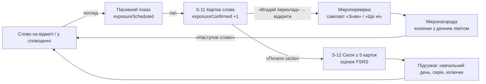
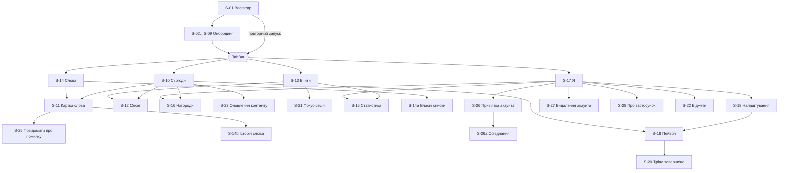
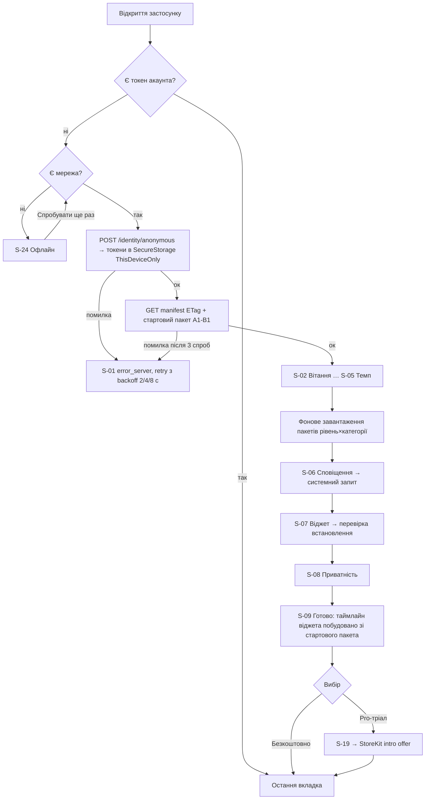
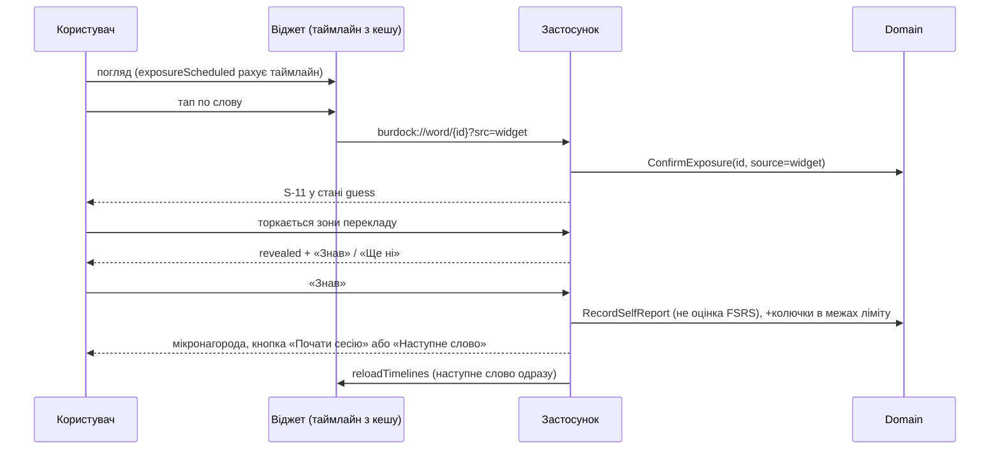
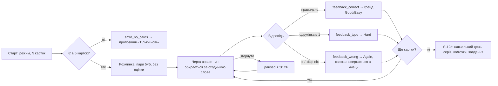
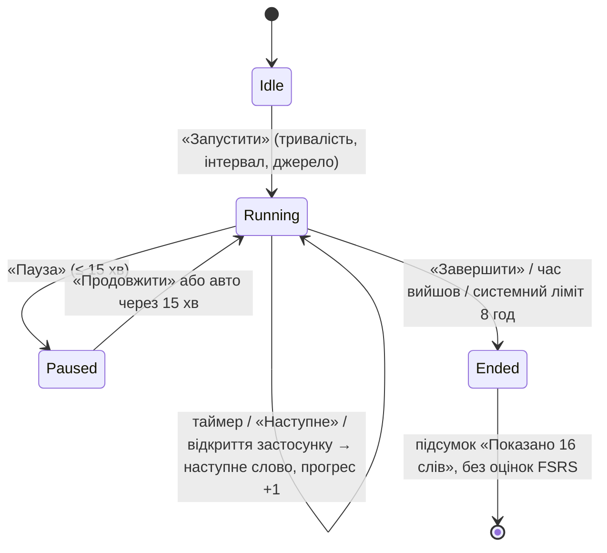
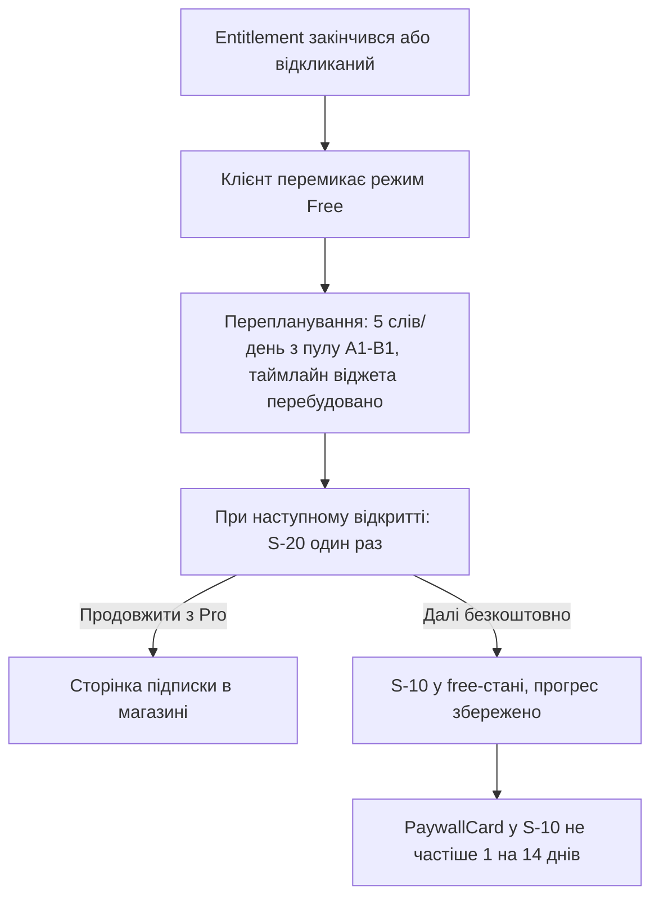
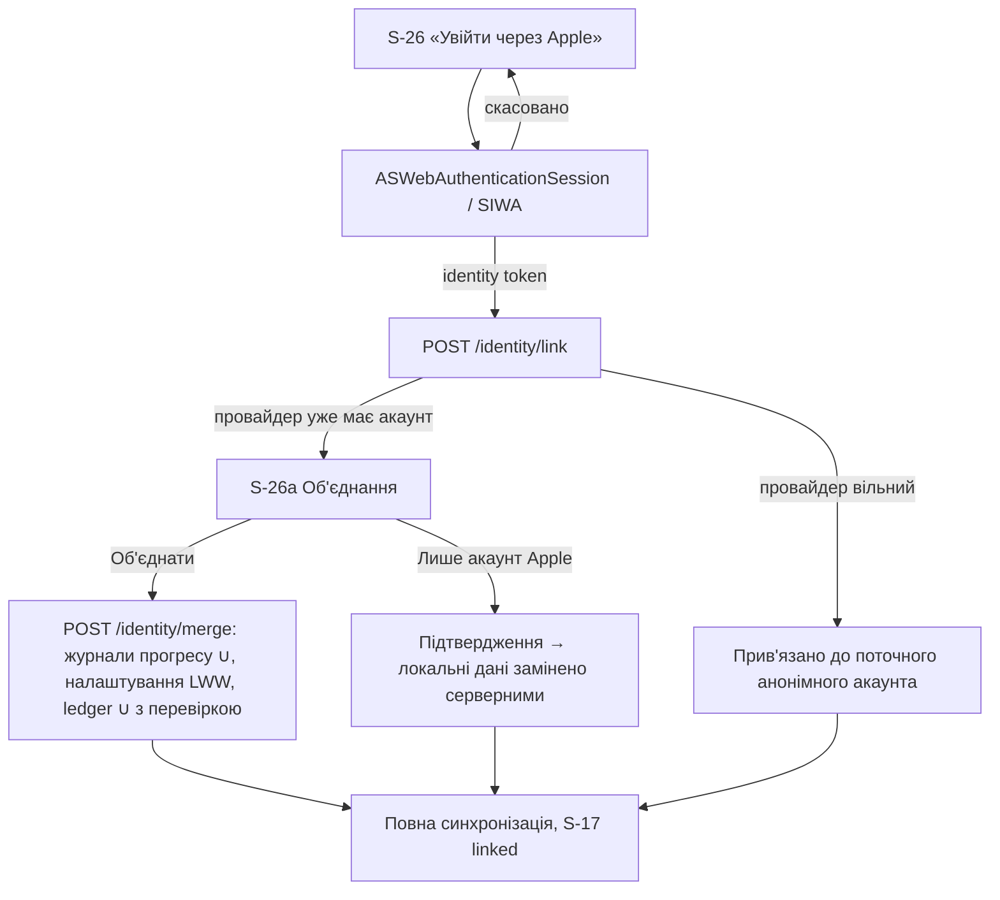
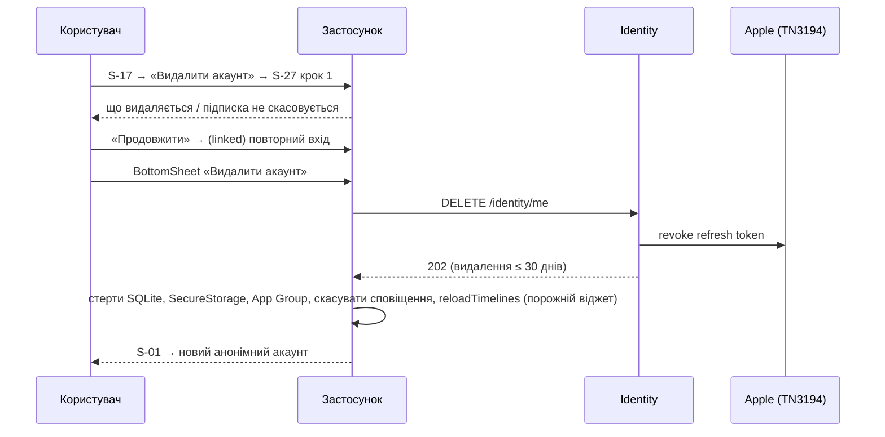
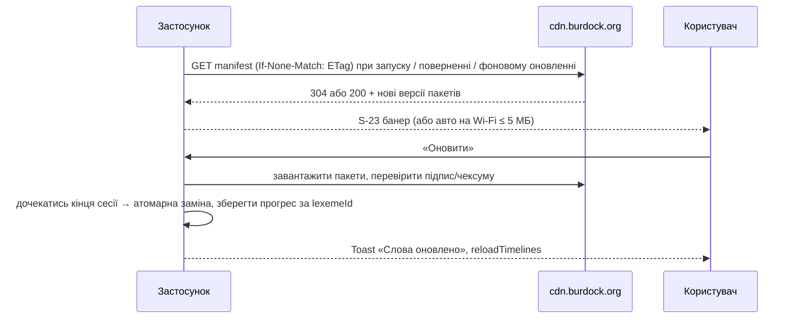

# 03. UX: потоки та екрани

| Поле | Значення |
|---|---|
| Статус | Draft |
| Версія | 0.1 |
| Дата | 2026-09-27 |
| Власник | Провідний UX-дизайнер / Власник продукту |
| Джерела рішень | [Журнал рішень](../decisions/2026-09-25-interview.md): Q1, Q3, Q8, Q12, Q14, Q18, Q19, Q20, Q21, Q24, Q25, Q30, Q31, Q32, Q33, Q34, Q35, Q36; T4, T5, T10, T11, T17, T18 |
| Пов'язані специфікації | [02-design-system.md](02-design-system.md) (токени, компоненти); 04 «Віджети та сповіщення», 06 «Навчальна модель і нагороди», 07 «Акаунти, синхронізація, приватність», 08 «Підписки та entitlement-и» (нумерація сусідніх специфікацій — припущення, уточнити в індексі `docs/specs/`) |

## 0. Контекст для ШІ-агента

Ти працюєш над інтерфейсом застосунку «Реп'ях» (.NET MAUI, iPhone + iPad першими, Android пізніше). Цей документ описує **що бачить і робить користувач**: персони, інформаційну архітектуру, кожен екран, ключові потоки, мікрокопі та UX-метрики. Він не описує візуальні токени й компоненти (це `02-design-system.md`) і не описує алгоритм повторень чи економіку нагород (це специфікації 06 і 07).

Перед роботою прочитай: `docs/decisions/2026-09-25-interview.md` (джерело істини), `docs/specs/02-design-system.md` (імена токенів і компонентів), цей файл, `docs/glossary.md` (терміни інтерфейсу). Правила, які не можна порушувати:

1. Терміни UI вживай точно як у глосарії: «Реп'яшок», «колючки», «серія», «знайомство», «Фокус-сесія».
2. Жодного loss framing, фейкової терміновості, confirmshaming, таймерів на пейволі (розділ 3.8 та NFR-03-6).
3. Пасивні покази (віджет, сповіщення) ніколи не оцінюють картку й не зараховують навчальний день (T4).
4. Нагороди не залежать від дозволу на сповіщення чи від згоди на аналітику (Apple 5.1.2(i)).
5. Усі рядки в `.resx` (нейтральна мова `uk`) з формами множини `One/Few/Many`; ідентифікатори екранів `S-NN`, маршрути Shell, події аналітики та ключі resx — англійською.
6. Кожен екран має стани: loading, empty, error, offline, free / trial / Pro, а також «без гейміфікації».

Код напрямку: `src/mobile/Burdock.App/Features/<Screen>` (View + ViewModel), маршрути в `AppShell.xaml`, `INavigationService`. Перевірка результату: знімки екранів у CI (симулятор iOS + емулятор Android) для кожного стану, VoiceOver/TalkBack чекліст із розділу 5, HTML-прев'ю в `design/preview/`.

## 1. Мета й межі

**Мета.** Спроєктувати досвід, у якому слово з віджета за один тап перетворюється на короткий навчальний акт, а щоденне повернення тримається на звичці й дружньому маскоті, а не на тиску. Власник наголосив на **сильному акценті на якості інтерфейсу** (Q8/Q19): кожен екран проєктується з порожніми станами, анімаціями з повагою до Reduce Motion і повною доступністю.

**Входить у v1:** онбординг (8 кроків), 4 вкладки (Сьогодні, Вчити, Слова, Я), картка слова, змішана сесія з трьох типів вправ (Q21), бібліотека слів, нагороди й крамниця косметики (Q34), профіль з анонімним акаунтом і прив'язкою Apple (Q3), налаштування за діапазонами Q30, пейвол з тріалом через магазин (Q33), Фокус-сесія на Live Activity для iOS (Q35), режим «без гейміфікації», адаптивні макети для iPad (Q12).

**Не входить у v1:** соціальні функції, ліги, друзі (Q24); аудіювання та cloze (Q21); Apple Watch, клавіатурне розширення (Q1); режим «при розблокуванні» на Android (Q36); реклама (Q14); вибір мови інтерфейсу (лише `uk`, Q11); Android-варіант Фокус-сесії (Live Updates не в v1 за дослідженням, розд. 1).

**Відкладено:** push-тригер оновлень контенту (T8, v1.1); Google-вхід (з релізом Android, Q3); серверно-авторитетні нагороди (T18, v1.1).

## 2. Вимоги

### 2.1 Функціональні

| ID | Вимога | MoSCoW |
|---|---|---|
| FR-03-1 | Перший запуск створює анонімний акаунт без жодного введення від користувача (Q3, T10); користувач бачить лише екран завантаження з маскотом і прогресом. | Must |
| FR-03-2 | Онбординг має не більше 8 кроків, кожен крок після «Рівня» можна пропустити; прогрес кроків видно постійно. | Must |
| FR-03-3 | На кроці «Рівень» доступна необов'язкова самооцінка з 8 запитань (≤ 60 с), яка пропонує рівень CEFR. | Should |
| FR-03-4 | Системний запит дозволу на сповіщення показується лише після власного пояснювального екрана з рівноцінними кнопками «Увімкнути» / «Пізніше». | Must |
| FR-03-5 | Крок «Віджет» містить анімовану інструкцію для поточної платформи та визначає факт встановлення віджета (iOS: `WidgetCenter.getCurrentConfigurations`; Android: `AppWidgetManager.getAppWidgetIds`), змінюючи стан на «Готово». | Must |
| FR-03-6 | Екран згоди на анонімну аналітику показується всім (Apple 5.1.1(ii)); варіанти рівноцінні, за замовчуванням вимкнено, змінюється в налаштуваннях. | Must |
| FR-03-7 | Панель вкладок із 4 пунктів (Сьогодні, Вчити, Слова, Я); стан кожної вкладки відновлюється після перезапуску. | Must |
| FR-03-8 | Підтримуються deep links `burdock://today`, `burdock://word/{lexemeId}`, `burdock://session`, `burdock://focus`, `burdock://paywall`, `burdock://settings/{section}`, `burdock://widgets`; невідомий шлях відкриває «Сьогодні». | Must |
| FR-03-9 | «Сьогодні» показує слова дня, стан серії, тайл календаря входу, до 3 мікрозавдань, CTA «Почати сесію», картку Фокус-сесії (iOS) і банер оновлення контенту. | Must |
| FR-03-10 | Картка слова показує слово, IPA, частину мови, приховану до тапу відповідь-переклад, приклад, лічильник підтверджених показів (заплановані — як оцінку, T5), дії «Знаю» / «Вчити», «Повідомити про помилку», «До списку» (Pro). | Must |
| FR-03-11 | Сесія змішує вправи: вибір EN→UK, вибір UK→EN, пари, набір слова; має індикатор прогресу, миттєвий зворотний зв'язок, підсумок із нагородами. | Must |
| FR-03-12 | Перервана сесія відновлюється з тієї ж картки протягом 30 хв; після — пропонується почати заново з тими ж картками. | Should |
| FR-03-13 | Бібліотека фільтрує за рівнем, категорією, статусом (New / Introduced / Learning / Review / Learned), має пошук; власні списки та історія слова — Pro. | Must |
| FR-03-14 | Статистика — Pro; у безкоштовному режимі показується розмитий прев'ю зі справжніми числами користувача під замком. | Should |
| FR-03-15 | «Нагороди» містить календар входу, мікрозавдання, крамницю (теми віджетів, вбрання й емоції Реп'яшка, рамки аватара, заморозка серії) та інвентар; без випадкових нагород і без купівлі колючок за гроші (Q34). | Must |
| FR-03-16 | Профіль дозволяє редагувати нікнейм, обирати рамку, прив'язати Apple (Google — з Android-релізом), бачити статус Pro, відкрити налаштування, «Про застосунок», видалити акаунт. | Must |
| FR-03-17 | Налаштування покривають діапазони Q30: 3-30 нових слів, інтервал 15 хв - 4 год, 1-10 показів, 0-8 сповіщень, тихі години, режим перекладу в сповіщенні, тему, гейміфікацію, дані. | Must |
| FR-03-18 | Пейвол відповідає Apple 3.1.2: назва підписки, тривалість, ціна за період, умови автопродовження, посилання на Умови та Політику, «Відновити покупки», чіткий опис безкоштовного режиму. | Must |
| FR-03-19 | Завершення тріалу перемикає застосунок у безкоштовний режим без втрати прогресу; користувач бачить один пояснювальний екран без повторних нагадувань частіше 1 разу на 14 днів. | Must |
| FR-03-20 | Фокус-сесія (iOS 16.1+): старт на 1-8 год з екрана «Вчити», перегляд поточного слова, «Наступне», «Завершити» в застосунку та в Live Activity; на Android картка прихована фіче-флагом. | Must |
| FR-03-21 | Банер оновлення контенту неблокуючий; оновлення не перериває активну сесію і застосовується між сесіями. | Must |
| FR-03-22 | Офлайн: усе, крім першого запуску, зміни рівня/категорій, покупок, прив'язки та видалення акаунта, працює з кешу; недоступні дії пояснюються на місці, а не помилкою. | Must |
| FR-03-23 | Аркуш «Повідомити про помилку» надсилає `lexemeId`, версію пакета, причину та необов'язковий коментар; без PII. | Must |
| FR-03-24 | Прив'язка акаунта показує екран об'єднання, якщо провайдер уже пов'язаний з іншим акаунтом; за замовчуванням — об'єднання журналів прогресу. | Must |
| FR-03-25 | Видалення акаунта доступне в застосунку за ≤ 3 тапи від «Я», з поясненням, що видаляється, і без confirmshaming. | Must |
| FR-03-26 | Перемикач «Без гейміфікації» приховує серію, колючки, календар, завдання, крамницю та святкові анімації на всіх поверхнях (розд. 3.7). | Must |
| FR-03-27 | На iPad (regular width) використовується бічна панель замість нижніх вкладок і двопанельні макети для Слова, Налаштування, Нагороди. | Must |
| FR-03-28 | Сповіщення про слово має дії «Показати переклад» і «Знаю»; «Знаю» виконується без відкриття застосунку. | Must |
| FR-03-29 | Усі порожні стани мають ілюстрацію Реп'яшка у відповідному емоційному стані, один рядок тексту та одну дію. | Should |

### 2.2 Нефункціональні

| ID | Вимога | MoSCoW |
|---|---|---|
| NFR-03-1 | Медіанний час від першого відкриття до першого слова на віджеті < 3 хв (вимірюється між `first_open` і `widget_detected`). | Must |
| NFR-03-2 | Мінімальна ціль дотику 44 pt / 48 dp; макети виживають при Dynamic Type AX5 та Android 200 % без обрізання тексту (`FontAutoScalingEnabled`). | Must |
| NFR-03-3 | Контраст тексту ≥ 4.5:1, графіки ≥ 3:1 (WCAG 2.2 AA), у темній темі ціль 7:1 для кастомних кольорів. | Must |
| NFR-03-4 | Усі анімації мають статичну альтернативу при Reduce Motion; жодного мерехтіння > 3 разів/с; нагороди ніколи не позначаються лише кольором чи звуком. | Must |
| NFR-03-5 | Відкриття будь-якої вкладки з кешу ≤ 300 мс; зворотний зв'язок у сесії ≤ 100 мс після тапу; skeleton через `Shimmer` після 300 мс очікування. | Should |
| NFR-03-6 | Чекліст темних патернів (розд. 3.8.2) є воротами релізу: жоден екран не проходить рев'ю з порушенням. | Must |
| NFR-03-7 | Кожен екран проходить VoiceOver і TalkBack: порядок фокуса зверху вниз, зліва направо; іконки без тексту мають `SemanticProperties.Description`; групи оголошуються як одне (`SemanticProperties.HeadingLevel`). | Must |
| NFR-03-8 | Події аналітики не збираються і не зберігаються до явної згоди (перемикач вимкнений за замовчуванням); після відкликання згоди локальна черга видаляється. Жодних PII або ідентифікаторів пристрою в payload. | Must |
| NFR-03-9 | Усі рядки інтерфейсу в `.resx` з ключами `{Screen}_{Element}[_{Variant}]`, множина через `_One/_Few/_Many`. | Must |
| NFR-03-10 | Стан застосунку (вкладка, відкрита картка, поточна сесія) відновлюється після вбивства процесу системою. | Should |
| NFR-03-11 | Час без відповіді сервера не блокує UI довше 2 с: далі показується офлайн-стан або кешовані дані з міткою «оновлено N хв тому». | Must |

## 3. Проєктування

### 3.1 Персони

| | Соломія, 21, студентка (B1) | Тарас, 34, бекенд-розробник (A2) | Оксана, 42, мама у Вроцлаві (A1) |
|---|---|---|---|
| Мета | Підтягнути лексику до B2 перед IELTS і поїздкою за обміном | Впевнено читати документацію та говорити на стендапах англійською | Розуміти листи зі школи дитини, лікаря, оголошення; не соромитись у крамниці |
| Категорії | Подорожі, Спілкування, Робота і бізнес | IT та програмування, Робота і бізнес | Здоров'я, Покупки, Місто й транспорт, Їжа |
| Темп | Інтенсивний (20 слів/день) | Помірний (10) | Легкий (5), 2 сповіщення |
| Контекст | Черга, метро, перерви між парами; телефон завжди в руці, дивиться на екран блокування десятки разів на день | Робочий стіл iPad поруч із ноутбуком, StandBy на зарядці; сесії ввечері по 3-5 хв | Черга в Biedronka, дитячий майданчик, вечір після укладання дитини; часто без Wi-Fi |
| Обмеження | Змагальна, але швидко перегорає від тиску; вимикає сповіщення, якщо їх забагато | Не любить «дитячих» ігор, цінує статистику й контроль над налаштуваннями; готовий платити за Pro одразу | Невпевнена в собі, боїться помилок; великий шрифт; безкоштовний режим — імовірно назавжди |
| Що має спрацювати | Швидкий цикл віджет → тап → перевірка; серія як особистий рекорд, не як загроза | Тихі години, Фокус-сесія на 4 год з iPad, Pro-статистика | Порожні стани без сорому, «Ще ні» замість «Неправильно», 5 слів на день як достатня перемога |

### 3.2 Jobs-to-be-done і базовий цикл

| Робота користувача | Коли | Поверхня | Успіх |
|---|---|---|---|
| «Побачити нове слово, не відкриваючи нічого» | Кожне розблокування | Віджет екрана блокування / StandBy | Слово змінюється за інтервалом (Q36), переклад видно без тапу (за налаштуванням) |
| «Перевірити себе за 10 секунд» | У черзі | Тап по віджету → картка слова | Вгадав → підтвердив → повернувся |
| «Позайматись 3 хвилини як слід» | У транспорті, ввечері | Сесія | ≥ 5 карток, підсумок з нагородою |
| «Побачити, що я не дарма» | Раз на день-тиждень | Сьогодні, Статистика | Серія, вивчені слова, календар |
| «Підлаштувати під себе» | Раз на місяць | Налаштування | Темп, тихі години, режим без гейміфікації |



Інваріанти циклу (T4, дослідження розд. 6): мікроперевірка на картці **не є оцінкою FSRS**, вона лише підтверджує показ і прискорює фазу знайомства (≥ 3 підтверджені покази у ≥ 2 дні). Навчальний день зараховується лише сесією (≥ 5 оцінених карток, T11). Мікронагорода за самоперевірку обмежена `Rewards.WordCheckDailyCap` колючок на день (припущення; уточнити у 06).

### 3.3 Інформаційна архітектура

**Панель вкладок (4 пункти).** Обґрунтування: три вкладки лишають нагороди без дому (а вони — щоденний мотиватор), п'ять — розмивають головну дію. Рішення: «Сьогодні» (що зараз), «Вчити» (як і скільки), «Слова» (мій словник), «Я» (профіль і налаштування). Нагороди живуть як картка-вхід у «Сьогодні» та як пункт у «Я»; Статистика — у «Я» та як віджет-картка у «Вчити». Компонент `TabBar` з `02`.



**Маршрути Shell і deep links.**

| Deep link | Shell route | Куди веде | Примітка |
|---|---|---|---|
| `burdock://today` | `//today` | S-10 | Типовий для віджета без параметрів |
| `burdock://word/{lexemeId}?reveal=1&src=widget` | `//today/word?id=` | S-11 | `reveal=1` одразу показує переклад (дія сповіщення); `src` для аналітики |
| `burdock://session?mode=quick` | `//learn/session?mode=` | S-12 | `mode`: quick (5), full (15), review, new (припущення, значення у 06) |
| `burdock://focus` | `//learn/focus` | S-21 | Тап по Live Activity |
| `burdock://paywall?ctx=stats` | `//paywall?ctx=` | S-19 | Модальний; `ctx` = що саме було заблоковано |
| `burdock://settings/rotation` | `//me/settings/rotation` | S-18 | Також `notifications`, `learning`, `appearance`, `data` |
| `burdock://widgets` | `//me/widgets` | S-22 | З онбордингу та порожнього стану |

Невідомий або застарілий deep link (слово не в кеші) веде на S-10 з тостом «Це слово ще не завантажене». Усі deep links проходять через `INavigationService.HandleDeepLink(Uri)`, який спершу перевіряє завершеність онбордингу.

**iPad (Q12).** При `regular` ширині `TabBar` замінюється бічною панеллю (Shell Flyout `Locked`, 280 pt) з тими ж 4 пунктами плюс швидкими посиланнями «Нагороди», «Статистика». Двопанельні макети: Слова (список 360 pt + картка), Налаштування (розділи + деталі), Нагороди (розділи + сітка карток). Сесія, онбординг і пейвол — центрована колонка max 600 pt на `color.surface.default` з м'яким фоном, щоб не розтягувати кнопки. Slide Over / Split View: макет падає до compact без втрати функцій. Віджети iPadOS (головний та екран блокування iPadOS 17+) використовують ті самі сім'ї.

### 3.4 Інвентар екранів

Загальні правила: усі екрани мають стан `loading` (skeleton через `Shimmer`, не спінер), `empty` (Реп'яшок + 1 рядок + 1 дія), `error` (текст + «Спробувати ще раз», без кодів помилок у заголовку), `offline` (банер `Toast` зверху або inline-мітка), варіанти free / trial / Pro (розд. 3.6) і «без гейміфікації» (розд. 3.7). Емоційні стани Реп'яшка: `joy`, `sad`, `sleep`, `party`, `surprise`, `cheer` (Q20).

#### S-01 Bootstrap (перший запуск / холодний старт)

| Поле | Значення |
|---|---|
| Route | `//bootstrap` |
| Мета | Створити анонімний акаунт, завантажити маніфест і стартовий пакет (безкоштовний пул A1-B1), не питаючи нічого. |
| Точки входу | Іконка застосунку; будь-який deep link до завершення онбордингу. |
| Компоненти | Ілюстрація Реп'яшка `sleep → joy`, `ProgressRing` (невизначений до отримання розміру пакета), `Button` вторинна «Спробувати ще раз» (лише в error). |
| Стани | `creating_account` (≤ 2 с), `downloading` (з відсотками та МБ), `error_network` → S-24, `error_server` («Сервер відпочиває, спробуй за хвилину»), повторний запуск: миттєвий перехід на останню вкладку. |
| Доступність | Оголошення прогресу кожні 25 % через `SemanticScreenReader.Announce`. |
| Аналітика | `first_open`, `bootstrap_completed{duration_ms, pack_kb}`, `bootstrap_failed{stage}` |
| Відкрите | Чи показувати нікнейм уже тут («Привіт, Хоробрий Реп'ях #4821») — рекомендовано ні, залишити на S-02. |

```
┌──────────────────────────────┐
│                              │
│          (  ◕ ◕  )           │  Реп'яшок, стан joy
│           \  ᵕ  /            │
│                              │
│   Готую твої перші слова…    │  type.title
│   ◔ 42 %  · 0,3 з 0,7 МБ     │  ProgressRing + label
│                              │
│                              │
│  Реп'ях                      │  логотип type.display, знизу
└──────────────────────────────┘
```

#### S-02…S-09 Онбординг

Спільне: індикатор кроків (8 крапок), кнопка «Назад» ліворуч угорі, «Пропустити» праворуч (з кроку 3), первинна CTA знизу на всю ширину, центрована колонка на iPad. Маршрути `//onboarding/{step}`; аналітика `onboarding_step{step}`, `onboarding_step_skipped{step}`, `onboarding_completed{duration_ms, level, categories_count, pace}`.

| ID | Крок | Route | Ключові компоненти та рішення |
|---|---|---|---|
| S-02 | Вітання | `//onboarding/welcome` | Реп'яшок `joy` махає; заголовок «Привіт! Я Реп'яшок»; підзаголовок «Чіпляюся до тебе словами, поки ти не вивчиш їх»; нікнейм-картка «Ти — Хоробрий Реп'ях #4821» з олівцем (редагування inline, T10); CTA «Поїхали». |
| S-03 | Рівень | `//onboarding/level` | 6 `Chip` A1…C2 з описом одним рядком («A2: розумію прості діалоги»); вторинна кнопка «Не знаю — перевірити за хвилину» → S-03a: 8 карток «знаю / не знаю» зі словами різних рівнів, результат «Схоже на B1» з можливістю змінити. Free-користувач після тріалу: крок показується, вибір зберігається як побажання (див. 3.6 і розд. 7). |
| S-04 | Категорії | `//onboarding/categories` | 8 `Chip` з іконками (Q18), мультивибір, мінімум 1, рекомендовано 3; лічильник «Обрано 3 · ≈ 1 200 слів» оновлюється live. |
| S-05 | Темп | `//onboarding/pace` | Три `RewardCard`-подібні картки «Легкий 5 / Помірний 10 / Інтенсивний 20 нових слів на день» з прев'ю: «≈ 3 хв на день», «слово на віджеті кожні 60 хв», «2 / 3 / 4 сповіщення». Помірний обрано за замовчуванням (Q30). Посилання «Налаштую точніше пізніше». |
| S-06 | Сповіщення | `//onboarding/notifications` | Пре-дозвіл: макет сповіщення з реальним словом із пакета; текст «Нагадаю про слово до 3 разів на день, ніколи вночі (22:00-08:00)»; кнопки «Увімкнути» / «Пізніше» однакової ваги. Після «Увімкнути» — системний запит; при відмові система більше не питає, показуємо підказку «Увімкнеш у налаштуваннях, коли захочеш». Нагороди не залежать від вибору (5.1.2(i)). |
| S-07 | Віджет | `//onboarding/widget` | Анімована ілюстрація (Lottie, статичний кадр при Reduce Motion) для iOS: утримати робочий стіл → «+» → «Реп'ях»; окрема вкладка «Екран блокування»; на Android: утримати → «Віджети». Кнопка «Я додав віджет» перевіряє встановлення (FR-03-5) і показує `party`; якщо не знайдено — «Не бачу віджета. Спробуємо ще раз?» без блокування. Це передостанній крок, щоб користувач одразу пішов на робочий стіл. |
| S-08 | Приватність | `//onboarding/consent` | Заголовок «Дані — твої»; три рядки: «Прогрес зберігається на пристрої та в ЄС-хмарі під анонімним номером», «Краші надсилаються без особистих даних», «Анонімна статистика використання — лише якщо дозволиш»; `SettingRow`-перемикач «Ділитися анонімною статистикою» (вимкнено); посилання «Політика приватності»; CTA «Продовжити». Немає «Прийняти все». |
| S-09 | Готово | `//onboarding/done` | Реп'яшок `party`; «Твої перші слова вже на віджеті»; прогрес завантаження обраних пакетів (фоново, не блокує); картка першого слова у стилі `WordCard`; дві рівноцінні дії: «Спробувати Pro: 7 днів безкоштовно» (→ S-19) і «Почати безкоштовно (5 слів на день)». |

```
S-05 Темп                              S-06 Сповіщення
┌──────────────────────────────┐       ┌──────────────────────────────┐
│ ‹        ● ● ● ● ○ ○ ○ ○     │       │ ‹        ● ● ● ● ● ○ ○ ○     │
│ Який темп тобі підходить?    │       │ Нагадувати про слова?        │
│ ┌──────────────────────────┐ │       │ ┌──────────────────────────┐ │
│ │ Легкий · 5 слів/день     │ │       │ │ 🌿 Реп'ях        зараз   │ │
│ │ ≈ 2 хв · 2 сповіщення    │ │       │ │ journey — подорож        │ │
│ ├──────────────────────────┤ │       │ │ «A long journey begins…» │ │
│ │ ✓ Помірний · 10 слів     │ │       │ └──────────────────────────┘ │
│ │ ≈ 3 хв · 3 сповіщення    │ │       │ До 3 на день, ніколи вночі.  │
│ ├──────────────────────────┤ │       │ Нагороди не залежать від     │
│ │ Інтенсивний · 20 слів    │ │       │ сповіщень.                   │
│ │ ≈ 6 хв · 4 сповіщення    │ │       │                              │
│ └──────────────────────────┘ │       │ [       Увімкнути          ] │
│ Налаштую точніше пізніше     │       │ [       Пізніше            ] │
│ [        Продовжити        ] │       │                              │
└──────────────────────────────┘       └──────────────────────────────┘
```

#### S-10 Сьогодні

| Поле | Значення |
|---|---|
| Route | `//today` |
| Мета | За 2 секунди відповісти «що зараз?»: слова дня, серія, одна головна дія. |
| Точки входу | Вкладка; `burdock://today`; повернення після сесії. |
| Компоненти | Шапка з привітанням і `StreakBadge`, `CurrencyPill`; стрічка `WordCard` (compact) горизонтально; `ProgressRing` денної цілі; `Button` первинна «Почати сесію»; картка Фокус-сесії (iOS); `DailyCalendarTile`; до 3 `TaskRow`; банер S-23; `PaywallCard` (free, ненав'язлива, 1 раз на екран). |
| Стани | `loading` skeleton; `empty_morning` (ще немає підтверджених показів: Реп'яшок `cheer` «Слова вже на віджеті. Заглянь на екран блокування»); `goal_done` (кільце заповнене, Реп'яшок `party`, CTA стає «Ще 5 карток»); `backlog` («Рюкзак повний — спочатку повторимо», CTA «Повторити 12 слів»); `offline` (мітка «Оновлено 12 хв тому»); free: стрічка з 5 слів і `PaywallCard`; trial: бейдж «Pro-тріал · 5 днів». |
| Жести | Горизонтальний свайп стрічки; тап по слову → S-11; довгий тап по слову → контекстне меню «Знаю / Озвучити / Повідомити про помилку»; pull-to-refresh синхронізує. |
| Доступність | Порядок: привітання → серія → слова (група «Слова дня, 5 елементів») → CTA → завдання. `StreakBadge` читається як «Серія 6 днів». CTA має `AutomationId=Today_StartSession`. |
| Аналітика | `today_viewed{words_count, streak_state}`, `today_cta_tapped{mode}`, `today_word_tapped{position}` |
| Відкрите | Чи показувати заплановані покази як «≈ 3 покази» на compact-картці — пропоную ні, лише на S-11. |

```
┌──────────────────────────────┐
│ Добрий день, Соломіє  🔥 6  ✦ 120 │  StreakBadge, CurrencyPill
│ Слова дня                    │  type.headline
│ ┌────────┐┌────────┐┌──────  │  WordCard compact, свайп
│ │journey ││ hire   ││ deli…  │
│ │подорож ││ 2 покази││       │
│ └────────┘└────────┘└──────  │
│ ┌──────────────────────────┐ │
│ │  ◔ 3 з 5 карток          │ │  ProgressRing + label
│ │ [    Почати сесію      ] │ │  Button primary
│ └──────────────────────────┘ │
│ ┌──────────────────────────┐ │
│ │ ⏱ Фокус-сесія · 2 год    │ │  картка Live Activity (iOS)
│ │ Слова змінюються самі    │ │
│ └──────────────────────────┘ │
│ ▦ Календар: день 3 з 7  +10  │  DailyCalendarTile
│ ☐ Повтори 5 слів      +5     │  TaskRow ×3
│ ☐ Набери 3 слова      +10    │
│ ☑ Відкрий картку      +5 ✓   │
│ ─────────────────────────────│
│ Сьогодні · Вчити · Слова · Я │  TabBar
└──────────────────────────────┘
```

#### S-11 Картка слова

| Поле | Значення |
|---|---|
| Route | `//today/word?id={lexemeId}` (також з `//words`) |
| Мета | Один екран — одне слово: спочатку вгадати, потім побачити, потім вирішити. |
| Точки входу | Віджет (тап), сповіщення (тап / «Показати переклад»), стрічка S-10, бібліотека S-14, підсумок сесії. |
| Компоненти | `WordCard` (full): слово `type.display`, IPA (GA + RP), POS-`Chip`, кнопка «Озвучити» (системний TTS, T7); зона перекладу з блюром «Вгадай і торкнись»; приклад із підсвіченим словом; рядок «Показів: 3 підтверджених · ≈ 5 запланованих» з підказкою «?»; статус-`Chip` (Знайомство 2/3); кнопки «Знаю» / «Вчити»; вторинні: «До списку» (Pro), «Повідомити про помилку», «Наступне слово». |
| Стани | `guess` (переклад приховано) → `revealed` (самозвіт «Знав» / «Ще ні»); `known_claimed` («Перевіримо в наступній сесії»); `learned` (без самозвіту, лише повторення); `not_cached` («Слово ще завантажується»); `offline` — усе працює; free: «До списку» прихована, «Історія» під замком. |
| Жести | Тап по зоні перекладу — відкрити; свайп ліворуч — наступне слово, праворуч — попереднє (лише з S-10/S-14); довгий тап по прикладу — копіювати. |
| Доступність | Заголовок = слово, оголошується з IPA лише за запитом (кнопка «Вимова»); зона перекладу — `Button` з описом «Показати переклад»; самозвіт — дві кнопки з `role=button`, без залежності від кольору. |
| Аналітика | `word_card_viewed{src, status}`, `word_revealed`, `word_self_report{result}`, `word_marked_known`, `word_added_to_list`, `report_opened` |
| Відкрите | Семантика «Знаю»: пропоную статус `KnownClaimed` з перевіркою набором слова в наступній сесії; успіх → Learned, невдача → Learning (припущення, рішення у 06). |

```
┌──────────────────────────────┐
│ ‹                    ⋯ ⧉    │  назад, меню, «до списку»
│                              │
│  journey        [🔊]         │  type.display
│  /ˈdʒɜːrni/ · іменник         │  IPA + POS Chip
│                              │
│ ┌──────────────────────────┐ │
│ │ ░░░░ Вгадай і торкнись ░░│ │  блюр → «подорож; мандрівка»
│ └──────────────────────────┘ │
│ «Every journey starts with   │  приклад, слово підсвічене
│  a single step.»             │
│                              │
│ Знайомство ●●○ · 2 покази    │  статус Chip + лічильник
│ ≈ 5 запланованих  (?)        │  оцінка, type.label
│                              │
│ [    Знаю    ] [   Вчити   ] │  Button secondary / primary
│ Повідомити про помилку       │  text button
│                              │
│ ‹ попереднє     наступне ›   │
└──────────────────────────────┘
```

#### S-12 Сесія

| Поле | Значення |
|---|---|
| Route | `//learn/session?mode={quick\|full\|review\|new}` |
| Мета | 3-5 хвилин змішаних вправ із миттєвим зворотним зв'язком і чесним підсумком. |
| Точки входу | CTA S-10, S-13, `burdock://session`, відновлення перерваної сесії. |
| Компоненти | Верхній рядок: «×» (закрити з підтвердженням), лінійний прогрес (`ProgressRing` не використовується — потрібна довжина), лічильник «4 / 15»; тіло — один із типів: `QuizOption` ×4 (EN→UK або UK→EN), `MatchPair` 5×5 (розминка, не оцінюється), `TypedAnswerField` (набір англійського слова з підказкою першої літери після 2 помилок); нижня панель зворотного зв'язку `color.feedback.success/error` з поясненням і кнопкою «Далі». |
| Стани | `intro` (2 с: «Розминка: з'єднай пари»), `question`, `feedback_correct`, `feedback_wrong` (показує правильну відповідь і приклад), `feedback_typo` («Майже! Одна літера» — зараховано як Hard за правилом Damerau-Levenshtein ≤ 1 для ≥ 5 літер), `paused` (застосунок згорнуто), `summary` (S-12d), `error_no_cards` (Реп'яшок `sleep`: «Сьогодні все повторено. Повернись завтра або додай нові слова»). |
| Правила оцінювання (стисло, деталі у 06) | Вибір EN→UK / UK→EN — оцінка не вище Good; набір слова — повна шкала; пари — розминка без оцінки; «Ще ні» завжди означає «забув»; одна картка FSRS на слово; «Вивчено» = 3 правильні набори у ≥ 2 дні та стабільність ≥ 21 д; навчальний день = ≥ 5 оцінених карток. |
| Жести | Тап по варіанту; у парах тап-тап; клавіатура з `ReturnType=Go`; свайп униз по картці — «Пропустити» (обмежено 2 на сесію); shake — ні. |
| Доступність | Варіанти читаються як «Варіант 1 з 4: подорож»; результат оголошується `Announce` («Правильно» / «Ще ні, правильна відповідь…»); панель зворотного зв'язку отримує фокус; без обмеження часу (WCAG 2.2.1). |
| Аналітика | `session_start{mode, cards}`, `answer_graded{type, grade, latency_ms}` (без тексту слова), `session_complete{cards, accuracy, duration_ms}`, `session_abandoned{at_card}` |
| Відкрите | Чи дозволяти «Пропустити» у безкоштовному режимі з 5 словами (пропоную так, але карта повертається в кінець). |

```
Вибір UK→EN                            Набір слова
┌──────────────────────────────┐       ┌──────────────────────────────┐
│ ×  ▓▓▓▓▓▓▓░░░░░░░  7 / 15    │       │ ×  ▓▓▓▓▓▓▓▓▓▓░░░  11 / 15   │
│                              │       │                              │
│   Як буде англійською        │       │   Напиши англійською         │
│        подорож?              │       │        подорож               │
│                              │       │   «Every ___ starts with…»   │
│ ┌────────────┐┌────────────┐ │       │                              │
│ │  journey   ││  junction  │ │       │ ┌──────────────────────────┐ │
│ └────────────┘└────────────┘ │       │ │ jour|                    │ │
│ ┌────────────┐┌────────────┐ │       │ └──────────────────────────┘ │
│ │  journal   ││  jury      │ │       │   Підказка: j _ _ _ _ _ _    │
│ └────────────┘└────────────┘ │       │                              │
│                              │       │ [        Перевірити        ] │
│ ──────────────────────────── │       │ Ще ні, покажи відповідь      │
│ ✓ Правильно! journey         │       │                              │
│ [          Далі            ] │       │ q w e r t y u i o p          │
└──────────────────────────────┘       └──────────────────────────────┘
```

**Автоперехід (30.10.2026, журнал п. 16).** Після відповіді картка зворотного зв’язку лишається `AutoAdvanceAfterCorrect` = 900 мс (правильно) або `AutoAdvanceAfterWrong` = 1800 мс (помилка), потім сесія сама показує наступну вправу (або відкриває підсумок після останньої); розминка з парами переходить так само. Кнопки «Далі»/«Завершити» лишаються: дотик переходить одразу і скасовує таймер; вихід з екрана скасовує його теж. Відкрито: для VoiceOver/TalkBack варто вимикати автоперехід, щоб озвучення встигало (потребує прапорця доступності в `IMotionPreferences`).

**S-12d Підсумок сесії** (`//learn/session/summary`): Реп'яшок `party` (або `cheer` при точності < 60 %), три числа великими — «15 карток · 87 % · 4 хв», рядок «Навчальний день зараховано ✓» і `StreakBadge` з анімацією +1 (статичний при Reduce Motion), «+25 колючок» у `CurrencyPill` з розбивкою «за картки 15 · за точність 10», список слів з позначками ✓/✗ і тапом на S-11, виконані `TaskRow`, CTA «Готово», вторинна «Ще 5 карток». Без гейміфікації: лише числа й список слів.

#### S-13 Вчити

| Поле | Значення |
|---|---|
| Route | `//learn` |
| Мета | Обрати, як саме вчити сьогодні, і бачити навантаження наперед. |
| Компоненти | Картки режимів: «Швидка · 5 карток», «Повна · 15», «Тільки повторення · 12 у черзі», «Тільки нові · 10 сьогодні»; картка Фокус-сесії (S-21) з перемикачем тривалості; міні-прогноз «Завтра: ≈ 14 повторень» (Pro; free — заблоковане прев'ю → S-19 `ctx=forecast`); рядок «Рівень B1 · 3 категорії · Помірний темп» → S-18 (Pro). |
| Стани | `empty` (нових слів немає, черга порожня: Реп'яшок `sleep` «Усе повторено. Відпочинь»); `backlog` (авто-тротлінг нових слів з поясненням); Android: картка Фокус-сесії прихована. |
| Аналітика | `learn_viewed`, `learn_mode_selected{mode}` |
| Макет | Сітка 2×2 карток режимів (іконка, назва, число), під нею картка Фокус-сесії з `Chip`-селектором тривалості й CTA «Запустити», внизу рядок прогнозу із замком для free. |

#### S-14 Слова (бібліотека)

| Поле | Значення |
|---|---|
| Route | `//words`, `//words/lists` (S-14a), `//today/word/history?id=` (S-14b) |
| Мета | Мій словник: знайти, відфільтрувати, зрозуміти статус кожного слова. |
| Компоненти | Пошук (EN і UK, з дебаунсом 200 мс); рядок `Chip`-фільтрів: статус (New / Знайомство / Вчу / Повторюю / Вивчено), рівень, категорія; список рядків «слово · переклад · статус-крапка · наступне повторення»; сегмент «Усі / Мої списки»; FAB «Новий список» (Pro). |
| Стани | `empty_search` («Нічого не знайшли. Спробуй інше написання»); `empty_filter` (Реп'яшок `surprise`: «Тут ще порожньо. Слова з'являться після знайомства»); free: показуються лише слова, які користувач уже бачив (5/день накопичуються), фільтри рівень/категорія працюють, списки — `PaywallCard`; `offline` — повний функціонал. |
| S-14a Власні списки (Pro) | Список карток «Назва · 24 слова · прогрес»; створення: назва + вибір слів із бібліотеки або поле «Додай слова через кому» (лише слова з бази; невідомі підсвічуються «немає в базі — запропонувати?» → S-25 з причиною `missing_word`). |
| S-14b Історія слова (Pro) | Часова стрічка: показ (віджет / сповіщення / у застосунку), відповіді в сесіях з оцінкою, зміна статусу; графік стабільності (`ProgressRing` не підходить — лінійний спарклайн). |
| Кільце знання (30.10.2026, журнал п. 16) | Замість статус-крапки у рядку — `ProgressRing` 28 pt з 4 сегментами (`size.masteryRing`, штрих `size.masteryRingStroke`): заповнені сегменти = `MasteryProgress` картки (0–4 правильних відповідей поспіль у дрилі, п. 15), колір = статус, трек `surface.sunken`; «вивчено»/«знаю» = 4/4; для читача екрана до речення рядка додається «знання 2 з 4». |
| Доступність | Фільтри — `Chip` з `IsToggled`; рядок списку читається одним реченням: «journey, подорож, повторюю, наступне повторення завтра». |
| Аналітика | `words_viewed{filter}`, `words_searched` (без тексту), `list_created`, `word_history_viewed` |

```
┌──────────────────────────────┐
│ Слова                     +  │
│ ┌──────────────────────────┐ │
│ │ 🔍 Пошук слова           │ │
│ └──────────────────────────┘ │
│ [Усі][Знайомство][Вчу][Повт…]│  Chip row, скрол
│ [B1 ▾][Подорожі ▾]           │
│ ● journey     подорож   завтра│
│ ● hire        наймати   3 дні │
│ ○ deliver     доставляти  —   │
│ ◐ receipt     чек       сьогод│
│ …                            │
│ ─────────────────────────────│
│ Мої списки (Pro) 🔒          │
└──────────────────────────────┘
```

#### S-15 Статистика (Pro)

Route `//me/stats`. Картки: «Вивчено 142 · Вчу 58 · Знайомство 30», графік активності за 30 днів (стовпчики карток на день), точність за типами вправ, розподіл за категоріями, «Показів підтверджено 1 240 · заплановано ≈ 3 100» з поясненням. Free: ті самі картки з реальними числами під блюром `radius.lg`, поверх — `PaywallCard` «Статистика відкривається з Pro» без таймерів. Без гейміфікації: приховано серію й колючки, решта лишається. Аналітика `stats_viewed{locked}`.

#### S-16 Нагороди

| Поле | Значення |
|---|---|
| Route | `//today/rewards`, крамниця `//today/rewards/shop`, інвентар `//today/rewards/inventory` |
| Мета | Показати, що заробив, і на що можна витратити — без випадковості й без грошей (Q34). |
| Компоненти | Шапка `CurrencyPill` велика; `DailyCalendarTile` 7 днів (5/5/10/10/15/15/30, пауза не скидає); секція «Завдання» з 3 денними + 1 тижневим `TaskRow`; «Крамниця» — сітка `RewardCard` за категоріями: Теми віджетів, Вбрання Реп'яшка, Емоції Реп'яшка, Рамки аватара, Заморозка серії (ліміт 2 у запасі); «Інвентар» — придбане з перемикачем «Застосувати». |
| Стани | `insufficient` (картка активна, кнопка «Не вистачає 40» неактивна з підказкою, як заробити); `owned`; `applied`; `offline` (покупки з ledger застосовуються локально, синхронізуються пізніше, T18); free: доступно повністю (Q14). |
| Правила | Ціни фіксовані у таблиці констант; жодних «розпродажів», таймерів, лутбоксів; заморозка серії: 1 безкоштовна на тиждень видається автоматично (T11), додаткова купується. |
| Доступність | `RewardCard` читається як «Тема віджета „Лаванда", 120 колючок, доступно»; результат покупки — `Announce`. |
| Аналітика | `rewards_viewed`, `reward_purchased{item_type}` (без назви), `task_completed{task_id}`, `calendar_claimed{day}` |

```
┌──────────────────────────────┐
│ ‹ Нагороди            ✦ 120  │
│ Щоденний вхід                │
│ [5][5][10][10][15][15][30]   │  DailyCalendarTile, день 3 активний
│  ✓  ✓  ●   ○   ○   ○   ○     │
│ Завдання на сьогодні         │
│ ☐ Повтори 5 слів        +5   │
│ ☑ Відкрий картку        +5   │
│ ☐ Набери 3 слова        +10  │
│ ☐ Тиждень: 5 навч. днів +30  │
│ Крамниця                     │
│ Теми · Вбрання · Емоції · … │
│ ┌────────┐┌────────┐┌──────  │
│ │Лаванда ││Шапка   ││Заморо… │
│ │  120 ✦ ││  80 ✦  ││  50 ✦  │
│ └────────┘└────────┘└──────  │
└──────────────────────────────┘
```

#### S-17 Я (профіль)

| Поле | Значення |
|---|---|
| Route | `//me` |
| Компоненти | Аватар Реп'яшка у вибраній рамці, нікнейм з олівцем (валідатор: 3-24 символи, без email-подібних рядків), статус-`Chip` «Безкоштовно» / «Pro-тріал до 4 жовт.» / «Pro до 27 жовт.»; картка синхронізації: «Прогрес лише на цьому пристрої» + «Увійти через Apple, щоб синхронізувати» (Google — після Android); `SettingRow`-список: Нагороди, Статистика, Віджети, Налаштування, Про застосунок, Керувати підпискою (відкриває сторінку магазину), Видалити акаунт (внизу, `color.feedback.error`). |
| Стани | `anonymous`, `linked` (показує провайдера й приховану пошту: «a…@privaterelay.appleid.com»), `linking`, `offline` (прив'язка неактивна з поясненням). |
| Аналітика | `profile_viewed`, `nickname_changed`, `link_started{provider}` |
| Макет | Зверху вниз: аватар у рамці з нікнеймом і олівцем, статус-`Chip`, картка синхронізації з кнопкою Apple, список `SettingRow` (Нагороди, Статистика, Віджети, Налаштування, Про застосунок, Керувати підпискою), «Видалити акаунт» окремо внизу. |

#### S-18 Налаштування

Route `//me/settings` з розділами `rotation`, `notifications`, `learning`, `appearance`, `data`. На iPad — двопанельно. Усі значення застосовуються негайно з `Toast` «Збережено · віджет оновиться за хвилину» і перепланують таймлайн (потік 3.5.8). Розділи, закриті для free (рівень, категорії, темп, нові слова/день), показуються з замком і поточним значенням, тап → S-19 `ctx=settings`.

| Розділ | Рядки (`SettingRow`) | Діапазон / значення за замовчуванням (Q30) |
|---|---|---|
| Віджет і слова (`rotation`) | Інтервал зміни слова; Показів одного слова на день; Показувати переклад на віджеті; Слова на екрані блокування (лише слово + переклад, без серії) | 15/30/60/120/240 хв, **60**; 1-10, **5**; увімк.; увімк. |
| Сповіщення (`notifications`) | Кількість на день; Режим: «слово + переклад» / «лише слово»; Тихі години; Нагадування про сесію (1/день, habit-framed) | 0-8, **3**; переклад показано; **22:00-08:00**; увімк. |
| Навчання (`learning`) | Рівень (Pro); Категорії (Pro); Темп (Pro); Нових слів на день (Pro); Серія: щоденна / гнучка N днів на тиждень; Бажана утримуваність: Легко / Стандарт / Максимум; Голос: вибір із каталогу голосів (назва, акцент GA/RP, стать, кнопка «Послухати» зі зразком; ADR 0019), поки аудіо пакетів немає — перемикач акценту GA / RP і посилання на системні голоси | 3-30, **10**; **щоденна** (T11); **Стандарт 0.90**; **голос за замовчуванням американський жіночий** |
| Вигляд (`appearance`) | Тема: системна / світла / темна; Тема віджета (з інвентарю); Без гейміфікації; Зменшити анімації (дублює системне) | **системна**; типова; **вимк.** |
| Дані та приватність (`data`) | Анонімна статистика (згода); Експортувати мої дані (JSON, лише за наявності інтернету); Видалити локальні дані (кеш і прогрес на пристрої, акаунт лишається); Політика приватності; Мова інтерфейсу: Українська (єдина, неактивна) | **вимк.** |

Аналітика: `settings_changed{key}` (без значення для чутливих: тихі години — лише факт зміни).

#### S-19 Пейвол

| Поле | Значення |
|---|---|
| Route | `//paywall?ctx=` (модальний, `BottomSheet` на compact, центрована картка на iPad) |
| Точки входу | S-09, замки в S-13/S-14/S-15/S-18, `burdock://paywall`, S-20. |
| Компоненти | Заголовок за контекстом («Статистика і повна свобода з Pro»); список «Що дає Pro»: рівень і категорії на вибір, темп до 30 слів, статистика, історія слів, власні списки; блок «Безкоштовно назавжди»: 5 слів на день, віджети, сповіщення, тести, серія, нагороди; `PaywallCard` ×2: «Рік · 1 199 ₴ (99,9 ₴/міс) · економія 40 %» і «Місяць · 169 ₴» (ціни — плейсхолдери, відкрите питання 6 журналу); під картками текст Apple 3.1.2: «7 днів безкоштовно, далі 1 199 ₴ на рік. Підписка продовжується автоматично, скасувати можна будь-коли в налаштуваннях App Store»; кнопка «Спробувати 7 днів безкоштовно»; «Відновити покупки»; посилання «Умови» і «Політика приватності»; «Не зараз» — звичайна текстова кнопка тієї ж контрастності. |
| Стани | `loading_products` (skeleton цін, кнопка неактивна), `store_unavailable` («Магазин зараз недоступний. Безкоштовний режим працює далі»), `purchasing`, `success` (Реп'яшок `party`, «Pro активовано», закриття), `restored`, `restore_nothing` («Активних покупок не знайшли»), `already_pro`, `offline` (лише інформаційний вигляд і «Відновити» неактивне), `trial_used` (без тексту про тріал — магазин повідомляє про право). |
| Правила | Річний план не обраний за замовчуванням прихованим способом: обидві картки рівні, річна лише позначена «Вигідніше». Без таймерів, «залишилось 2 місця», зачеркнутих цін без реальної попередньої ціни. |
| Аналітика | `paywall_view{placement}`, `paywall_plan_selected{plan}`, `trial_started{plan}`, `subscription_purchased{plan}`, `restore_tapped`, `paywall_dismissed{ctx}` |

```
┌──────────────────────────────┐
│ ───                          │  BottomSheet grip
│ Повна свобода слів з Pro     │
│ ✓ Рівень і категорії на вибір│
│ ✓ До 30 нових слів на день   │
│ ✓ Статистика та історія слів │
│ ✓ Власні списки              │
│ Безкоштовно назавжди: 5 слів │
│ на день, віджети, тести,     │
│ серія та нагороди.           │
│ ┌────────────┐┌────────────┐ │
│ │ Рік        ││ Місяць     │ │  PaywallCard ×2
│ │ 1 199 ₴    ││ 169 ₴      │ │
│ │ 99,9 ₴/міс ││            │ │
│ │ Вигідніше  ││            │ │
│ └────────────┘└────────────┘ │
│ [ Спробувати 7 днів безкошт.]│
│ 7 днів безкоштовно, далі     │
│ 1 199 ₴/рік. Продовжується   │
│ автоматично, скасувати можна │
│ будь-коли в App Store.       │
│ Відновити покупки · Умови ·  │
│ Приватність      Не зараз    │
└──────────────────────────────┘
```

#### S-20 Тріал завершено

Route `//paywall/trial-ended` (аркуш при першому відкритті після втрати entitlement). Реп'яшок `cheer` (не `sad`): «Тиждень із Pro минув. Далі — безкоштовно». Три рядки: «Що лишається: 5 слів на день, віджети, сповіщення, тести, серія та нагороди»; «Що збережено: увесь твій прогрес, 142 слова та серія 6 днів»; «Що на паузі: вибір рівня й категорій, статистика, списки». Дві рівноцінні кнопки: «Продовжити з Pro» (→ магазин) і «Далі безкоштовно». Показується один раз; повторні нагадування — не частіше 1 на 14 днів через `PaywallCard` у S-10 (FR-03-19). Аналітика `trial_ended_viewed`, `trial_ended_choice{choice}`.

#### S-21 Фокус-сесія (Live Activity)

| Поле | Значення |
|---|---|
| Route | `//learn/focus` |
| Мета | Керована користувачем сесія на 1-8 год: слова змінюються по черзі на екрані блокування / Dynamic Island з прогресом і кнопкою завершення (Q35, HIG-сумісно). |
| Компоненти | Селектор тривалості `Chip` 1/2/4/8 год; інтервал слова 10/15/30 хв (незалежний від віджета); джерело: «Слова дня» / «Повторення» / власний список (Pro); картка поточного стану: слово, «7 з 16», час до кінця, кнопки «Наступне», «Пауза» (до 15 хв), «Завершити». |
| Live Activity (compact / expanded / Dynamic Island) | Compact: слово + маленький прогрес; expanded: слово, переклад (за налаштуванням), «7/16», кнопки «Наступне» і «Завершити» (iOS 17+ інтерактивні; на iOS 16 тап відкриває S-21). |
| Стани | `idle`, `running`, `paused`, `ended_by_user`, `ended_by_timeout` (8 год, системне обмеження), `ended_stale` (застосунок не зміг оновити — «Сесія завершилась раніше, слова збережено»), Android: недоступно. |
| Механізм зміни слова | Таймер (оновлення з фону або push ActivityKit), кнопка «Наступне», відкриття застосунку. Технічна реалізація — у специфікації 04; див. розд. 7 п. 4 щодо конфлікту з T8. |
| Аналітика | `focus_started{hours, interval}`, `focus_advanced{by}`, `focus_ended{reason, words_shown}` |

```
┌──────────────────────────────┐
│ ‹ Фокус-сесія                │
│ ┌──────────────────────────┐ │
│ │ ⏱ 1:42 до кінця   7 з 16 │ │
│ │                          │ │
│ │  deliver                 │ │
│ │  доставляти              │ │
│ │  ▓▓▓▓▓▓▓░░░░░░░░░        │ │
│ │ [ Наступне ] [ Пауза ]   │ │
│ └──────────────────────────┘ │
│ Слова: Слова дня · Повторення│
│ Інтервал: 10 · 15 · 30 хв    │
│                              │
│ Завершити сесію              │  text button, error color
└──────────────────────────────┘
```

#### S-22 Віджети (галерея та допомога)

Route `//me/widgets`. Вкладки «Головний екран», «Екран блокування», «StandBy» (iOS 17+; сховано на iOS 16), «Android». Для кожної сім'ї — прев'ю з реальним словом користувача, тема з інвентарю, анімована інструкція з S-07, кнопка «Перевірити» (FR-03-5) і стан «Встановлено ✓ · 2 віджети». Порожній стан: Реп'яшок `cheer` «Без віджета я нудьгую на робочому столі». Аналітика `widgets_help_viewed{family}`, `widget_detected{family, count}`.

#### S-23 Оновлення контенту

Банер у S-10 (і `Toast` у S-14): «Нові слова та виправлення · 1,2 МБ» з кнопками «Оновити» / «Пізніше»; на Wi-Fi оновлення до 5 МБ застосовується автоматично з тостом «Слова оновлено» (припущення). Аркуш деталей: що змінилось (нові слова, виправлені переклади за скаргами), версія пакета. Оновлення чекає завершення активної сесії. Стани: `available`, `downloading`, `applying`, `failed` («Не вдалося оновити. Старі слова працюють»). Аналітика `content_update_shown`, `content_update_applied{from, to}`.

#### S-24 Офлайн / потрібен інтернет

Route `//offline` (повноекранний лише при першому запуску; далі — банер). Реп'яшок `sad`: «Для першого знайомства мені потрібен інтернет»; підзаголовок «Далі слова, тести й віджети працюватимуть без мережі»; кнопки «Спробувати ще раз», «Відкрити налаштування мережі». У решті екранів — верхній `Toast` «Без мережі · працюємо з кешу», а недоступні дії мають inline-пояснення (матриця 3.9).

#### S-25 Повідомити про помилку

`BottomSheet` з S-11 і контекстного меню. Список причин (radio): «Неправильний переклад», «Помилка в прикладі», «Неправильна транскрипція», «Не той рівень або категорія», «Образливий або недоречний вміст», «Слова немає в базі» (з S-14a), «Інше»; поле коментаря до 300 символів з підказкою «Без особистих даних, будь ласка»; надсилається `lexemeId`, `packVersion`, `reason`, `comment`, `appVersion`. Стани: `sending`, `sent` (Реп'яшок `joy` «Дякую! Перевіримо»), `queued_offline` («Надішлемо, коли з'явиться мережа»), `duplicate` («Ти вже повідомляв про це слово, дякуємо»). Аналітика `report_submitted{reason}`.

#### S-26 Прив'язка акаунта та S-26a Об'єднання

Route `//me/account/link`, `//me/account/merge`. S-26: пояснення «Вхід потрібен лише для синхронізації між пристроями. Пошту ми не бачимо, якщо ти її приховаєш» + кнопка «Увійти через Apple» (стандартна кнопка Apple), Google — з Android. S-26a з'являється, коли Apple ID уже пов'язаний з іншим акаунтом: дві колонки «На цьому пристрої: 142 слова · серія 6 · 120 колючок» і «В акаунті Apple: 320 слів · серія 12 · 340 колючок»; кнопки «Об'єднати (рекомендовано)» — журнали прогресу зливаються (append-only, T14), налаштування беруться з новішого, серія = більша, колючки сумуються з перевіркою сервером (припущення, деталі у 07) — та «Використати лише акаунт Apple» з окремим підтвердженням «Прогрес на цьому пристрої буде замінено». Без варіанта «залишити обидва». Стани: `checking`, `merging` (прогрес), `merged`, `error_conflict_retry`, `offline` (недоступно). Аналітика `account_linked{provider, merged}`.

#### S-27 Видалення акаунта

Route `//me/account/delete`. Крок 1: пояснення що видаляється (акаунт, прогрес на сервері протягом 30 днів, локальні дані одразу) і що ні (підписка — «керуй у App Store; ми не можемо скасувати її за тебе» з кнопкою «Відкрити підписки»); для прив'язаних акаунтів — повторний вхід через Apple і відкликання токена (TN3194). Крок 2: `BottomSheet` з однією деструктивною кнопкою «Видалити акаунт» і «Скасувати». Після успіху — S-02 з новим анонімним акаунтом. Стани: `reauth_required`, `deleting`, `deleted`, `offline` (недоступно, показуємо веб-адресу для видалення). Аналітика `account_deleted` (без причин; опційне поле «Чому?» — лише вільний текст, необов'язково).

#### S-28 Про застосунок, джерела та ліцензії

Route `//me/about`. Версія, «Джерела та ліцензії» (CEFR-J з обов'язковим рядком цитування, Open English WordNet CC BY, CMUdict BSD, Fixel OFL, Lucide ISC, бібліотеки), «Умови», «Політика приватності», «Порядок обробки персональних даних», кнопка «Написати нам» (mailto без передзаповнених даних пристрою; дані додаються лише за згодою чекбоксом). Безкоштовний і Pro — однаково.

### 3.5 Ключові потоки

#### 3.5.1 Перший запуск



Пакети за рівнем і категоріями завантажуються паралельно з кроками 6-8; якщо до S-09 вони не готові, віджет уже працює зі стартового пакета, а на S-09 видно прогрес. Обрив мережі на кроках 6-9 не блокує онбординг.

#### 3.5.2 Щоденний цикл із віджета



#### 3.5.3 Сесія



Правила вибору типу вправи, грейдів і статусів — у специфікації 06; тут фіксується лише порядок екранів і те, що будь-який зворотний зв'язок з'являється ≤ 100 мс, а «Далі» ніколи не автоматичне (можна ввімкнути «Автоперехід через 1,5 с» у налаштуваннях, за замовчуванням вимкнено).

#### 3.5.4 Фокус-сесія



Слова Фокус-сесії реєструються як підтверджені покази лише при натисканні «Наступне» або тапі; інакше — як заплановані (T5).

#### 3.5.5 Пейвол і тріал через магазин

```mermaid
sequenceDiagram
    participant U as Користувач
    participant App as Застосунок
    participant SK as StoreKit 2 / Play Billing
    participant API as api.burdock.org
    U->>App: замок або «Спробувати Pro»
    App->>SK: Products(month, year)
    SK-->>App: ціни, право на intro offer
    App-->>U: S-19 (ціни локалізовані магазином)
    U->>App: обирає план, «Спробувати 7 днів»
    App->>SK: purchase()
    SK-->>U: системний аркуш підтвердження
    SK-->>App: transaction (verified)
    App->>API: POST /entitlements/verify (JWS)
    API-->>App: entitlement {pro, expiresAt, isTrial}
    App-->>U: success, Реп'яшок party, розблокування без перезапуску
    Note over App: кеш entitlement з терміном; офлайн — довіряти кешу до expiresAt + grace
```

#### 3.5.6 Завершення тріалу



Grace period магазину (billing retry) відображається як «Pro · проблема з оплатою» у S-17 з кнопкою «Оновити спосіб оплати», без блокування функцій до завершення grace.

#### 3.5.7 Зміна налаштувань → перепланування → оновлення віджета

```mermaid
sequenceDiagram
    participant U as Користувач
    participant S as S-18 Налаштування
    participant D as Domain (планувальник)
    participant DB as Локальний кеш / App Group
    participant W as WidgetCenter / AppWidgetManager
    participant API as SettingsSync
    U->>S: змінює інтервал 60 → 30 хв
    S->>D: UpdateSettings (валідація діапазону Q30)
    D->>D: перебудувати таймлайн на 24 год (≥ 5 хв між записами, тихі години)
    D->>DB: записати таймлайн + налаштування
    S->>W: reloadTimelines / updateAppWidget
    S-->>U: Toast «Збережено · віджет оновиться за хвилину»
    S->>API: PUT /settings (LWW, у фоні; офлайн — черга)
```

Зміни рівня/категорій додатково запускають завантаження пакетів і потребують мережі: без неї рядок неактивний з поясненням «Потрібна мережа, щоб завантажити слова».

#### 3.5.8 Прив'язка акаунта й об'єднання



#### 3.5.9 Видалення акаунта



#### 3.5.10 Оновлення контенту



#### 3.5.11 Сповіщення про слово та дії

```mermaid
sequenceDiagram
    participant Sys as Система сповіщень
    participant U as Користувач
    participant App as Застосунок (фоновий обробник)
    Sys-->>U: «journey — подорож» (або лише «journey» у режимі без перекладу)
    alt Тап по тілу
        U->>Sys: тап
        Sys->>App: відкрити burdock://word/{id}?src=notification
        App-->>U: S-11 (переклад уже відкрито, якщо був у тексті)
    else Дія «Показати переклад»
        U->>Sys: дія
        Sys->>App: iOS: відкрити S-11 з reveal=1; Android: оновити сповіщення на місці з перекладом
    else Дія «Знаю»
        U->>Sys: дія без відкриття
        Sys->>App: фоновий обробник: ConfirmExposure + MarkKnownClaimed, сповіщення прибрано
    end
```

Копія сповіщень — у 3.8.6; ліміт і тихі години — з налаштувань; нагадування про сесію не частіше 1 на день і ніколи не про втрату серії (T17).

### 3.6 Матриця Free / Trial / Pro за екранами

Позначення: ✓ повністю; ◐ видно з замком і прев'ю (тап → S-19 з `ctx`); ✗ приховано.

| Екран / можливість | Free | Trial (7 днів) | Pro |
|---|---|---|---|
| S-10 Сьогодні: слова дня | 5 випадкових з пулу A1-B1 | за налаштуваннями | за налаштуваннями |
| S-10 серія, календар, завдання, нагороди | ✓ | ✓ | ✓ |
| S-10 `PaywallCard` | ✓ (1 картка, без таймерів) | бейдж «Pro-тріал · N днів» | ✗ |
| S-11 Картка: переклад, приклад, TTS, «Знаю/Вчити», скарга | ✓ | ✓ | ✓ |
| S-11 «До списку», «Історія» | ◐ | ✓ | ✓ |
| S-12 Сесія та всі 3 типи вправ | ✓ (на словах дня) | ✓ | ✓ |
| S-13 режими сесії | «Швидка», «Повторення» | усі | усі |
| S-13 прогноз навантаження | ◐ | ✓ | ✓ |
| S-13 / S-21 Фокус-сесія (iOS) | ✓ зі слів дня | ✓ | ✓ |
| S-14 Бібліотека, фільтри, пошук | ✓ (лише бачені слова) | ✓ | ✓ |
| S-14a Власні списки | ◐ | ✓ | ✓ |
| S-14b Історія слова | ◐ | ✓ | ✓ |
| S-15 Статистика | ◐ (блюр зі справжніми числами) | ✓ | ✓ |
| S-16 Нагороди, крамниця, інвентар | ✓ | ✓ | ✓ |
| S-17 Профіль, прив'язка, видалення | ✓ | ✓ | ✓ |
| S-18 Рівень, категорії, темп, нові слова/день | ◐ (значення видно) | ✓ | ✓ |
| S-18 Інтервал, покази, сповіщення, тихі години, тема, гейміфікація, дані | ✓ | ✓ | ✓ |
| S-22 Віджети (усі сім'ї) | ✓ | ✓ | ✓ |
| S-19 Пейвол | «Спробувати 7 днів» (якщо магазин дає право) або ціни | «Керувати підпискою» | «Керувати підпискою» |

Джерело: Q14, Q32, Q33. Entitlement кешується з терміном; за відсутності мережі стан не понижується до `expiresAt` + grace (значення у 08).

### 3.7 Режим «Без гейміфікації»

Перемикач у S-18 → Вигляд (і в онбордингу не пропонується, щоб не ускладнювати; доступний з першої хвилини). Ledger колючок продовжує вестися приховано, щоб повернення до звичайного режиму нічого не втратило (припущення).

| Екран | Що змінюється |
|---|---|
| S-10 | Зникають `StreakBadge`, `CurrencyPill`, `DailyCalendarTile`, `TaskRow`; лишаються слова дня, `ProgressRing` як «3 з 5 карток» і CTA; Реп'яшок лишається як провідник, без святкових анімацій |
| S-11 | Без мікронагороди; лічильник показів лишається (це інформація, не гра) |
| S-12d | Лише «15 карток · 87 % · 4 хв» і список слів; «Навчальний день зараховано» замінюється на «Сьогодні вже займався ✓» |
| S-13, S-15 | Без серії й колючок; прогноз і статистика навчання лишаються |
| S-16 | Пункт входу прихований у S-10 і S-17; тема віджета обирається у S-18 → Вигляд з уже наявного інвентарю |
| S-17 | Без рамки аватара (типова), без бейджів |
| Сповіщення | Лише слова та нейтральне нагадування про сесію; жодних «серія», «колючки» |
| Віджети | Без рядка серії; лише слово, переклад, приклад |

### 3.8 Мікрокопі

#### 3.8.1 Тон Реп'яшка

Дружній, короткий, без сорому, без тиску. Звертання на «ти» (припущення; альтернатива «ви» — рішення власника до затвердження resx). Реп'яшок говорить від першої особи лише в онбордингу, порожніх станах і сповіщеннях; системні тексти (налаштування, пейвол, помилки) — нейтральні, без персонажа. Одна думка на рядок, не більше 2 рядків у заголовку, ≤ 90 символів у тілі сповіщення. Помилку користувача називаємо «Ще ні», ніколи «Неправильно» чи «Помилка». Емодзі — лише в сповіщеннях і не більше одного.

#### 3.8.2 Заборонено (чекліст релізу)

| Патерн | Приклад, якого не буде | Що замість |
|---|---|---|
| Loss framing | «Ти втратиш серію через 2 години!» | «Серія 6 днів. 5 карток — і буде 7» |
| Фейкова терміновість | «Пропозиція зникне опівночі», таймери на пейволі | Постійна ціна, без таймерів |
| Confirmshaming | «Ні, я не хочу вчити англійську» | «Не зараз» |
| Провина / докір | «Ти забув про мене 😢», «Куди ти зник?» | «Слово дня чекає: deliver» |
| Приховане автопродовження | Дрібний текст сірим 10 pt | Умови тим самим кеглем, що й опис плану |
| Прихований дефолт | Річний план обрано непомітно | Обидві картки рівні, вибір явний |
| Порівняння з іншими | «Ти гірший за 80 % учнів» | Лише власний прогрес (Q24) |
| Нагороди за дозволи | «Увімкни сповіщення й отримай 50 колючок» | Нагороди тільки за навчання |

#### 3.8.3 Приклади

| Контекст | Погано | Добре |
|---|---|---|
| Порожня бібліотека | «Немає даних» | «Тут ще порожньо. Слова з'являться після знайомства на віджеті» |
| Невдала відповідь | «Неправильно!» | «Ще ні. journey — подорож. Повторимо трохи згодом» |
| Пропущений день | «Серію втрачено 💔» | «Учора був вихідний. Заморозка збережла серію — маєш ще одну на тиждень» |
| Пейвол | «Розблокуй ВСЕ зараз!» | «Повна свобода слів з Pro. Безкоштовно назавжди: 5 слів на день, віджети, тести» |
| Помилка мережі | «Error 503» | «Сервер відпочиває. Слова з кешу працюють, спробуємо ще за хвилину» |
| Видалення акаунта | «Ти впевнений?! Усе зникне!!!» | «Акаунт і прогрес на сервері буде видалено протягом 30 днів. Підписку скасуй у App Store окремо» |

#### 3.8.4 Кнопки

Дієслово в наказовому способі однини: «Почати сесію», «Показати переклад», «Продовжити», «Відновити покупки», «Видалити акаунт». Без «OK», «Так/Ні», «Підтвердити» без об'єкта. Деструктивні дії називають об'єкт і мають `color.feedback.error`. Вторинна дія — завжди спокійне «Не зараз» / «Пізніше», тієї ж контрастності, ніколи не сіре 3:1. Максимум 2 кнопки в аркуші, 1 первинна на екрані.

#### 3.8.5 Числа та множина

Українські форми `One` (1, 21, 31…, крім 11), `Few` (2-4, 22-24…, крім 12-14), `Many` (0, 5-20, 25-30, 11-14…). Дробові («1,5 хвилини») — окрема форма `Other`, у v1 не використовуємо. Ключі resx: `Plural_Word_One|Few|Many`, `Plural_Day_*`, `Plural_Card_*`, `Plural_Burr_*`, `Plural_Exposure_*`, `Plural_Minute_*`, `Plural_Hour_*`; форматер `PluralFormatter.Format(count, key)` у `Burdock.App.Localization`. Приклади: 1 слово / 2 слова / 5 слів / 21 слово / 22 слова / 11 слів; 1 день / 2 дні / 5 днів; 1 картка / 2 картки / 5 карток; 1 колючка / 2 колючки / 5 колючок; 1 показ / 2 покази / 5 показів. Роздільник тисяч — нерозривний пробіл (1 200), десятковий — кома (99,9 ₴), час 24-годинний (22:00), дати «4 жовт.». Апостроф у словах інтерфейсу — U+2019, у словниковій базі нормалізується окремо.

#### 3.8.6 Шаблони сповіщень (по 3 на намір)

| Намір / ключ | Варіанти |
|---|---|
| `Notif_Word_WithTranslation` | «journey — подорож» + «Every journey starts with a single step.»; «Слово дня: journey (подорож)»; «journey · подорож · іменник» |
| `Notif_Word_HiddenTranslation` | «journey — пам'ятаєш?» (дії: Показати переклад · Знаю); «Як буде „journey"?»; «journey. Вгадай, потім перевір» |
| `Notif_Review_Due` | «12 слів готові до повторення. Хвилини три»; «Час на 5 карток? Черга невелика»; «deliver, receipt і ще 10 чекають на повторення» |
| `Notif_Daily_Habit` (1/день, не в тихі години) | «Реп'яшок тут. 5 карток — і день зараховано»; «Твоя звична хвилина слів»; «Сьогодні ще не займались. Без поспіху — коли зручно» |
| `Notif_Focus_Ended` | «Фокус-сесія завершена: 16 слів за 2 год»; «Сесію завершено. Слова збережені в бібліотеці»; «Готово: 16 слів. Перевіримо їх у наступній сесії?» |

Жоден шаблон не згадує втрату серії, колючки за вхід чи знижки. У режимі без гейміфікації використовуються лише `Notif_Word_*` і `Notif_Review_Due`.

#### 3.8.7 Порожні стани

| Екран | Реп'яшок | Текст | Дія |
|---|---|---|---|
| S-10 ранок | `cheer` | «Слова вже на віджеті. Заглянь на екран блокування» | «Показати слова дня» |
| S-10 ціль виконана | `party` | «На сьогодні досить. Але якщо хочеться…» | «Ще 5 карток» |
| S-12 немає карток | `sleep` | «Усе повторено. Повернись завтра або додай нові» | «Тільки нові» |
| S-14 фільтр | `surprise` | «Тут ще порожньо. Слова з'являться після знайомства» | «Скинути фільтри» |
| S-14 пошук | — | «Нічого не знайшли. Спробуй інше написання» | — |
| S-14a списки | `joy` | «Збери власний список: для співбесіди, поїздки, іспиту» | «Новий список» |
| S-15 free | — | «Статистика відкривається з Pro» | «Дізнатись про Pro» |
| S-16 інвентар | `cheer` | «Поки порожньо. Колючки заробляються в сесіях» | «До крамниці» |
| S-22 | `cheer` | «Без віджета я нудьгую на робочому столі» | «Як додати віджет» |
| S-24 | `sad` | «Для першого знайомства мені потрібен інтернет» | «Спробувати ще раз» |

#### 3.8.8 Помилки

Формат: що сталося простими словами → що працює далі → одна дія. Без кодів у заголовку (код — у «Деталі» для звернення в підтримку). Ключі `Error_Network_*`, `Error_Server_*`, `Error_Store_*`, `Error_Sync_*`, `Error_Content_*`. Тости зникають через 4 с, блокуючі помилки — лише для першого запуску, покупки й видалення акаунта.

#### 3.8.9 Принципи пейвола

Одна ціннісна фраза; список Pro з 4-5 пунктів; окремий блок «Безкоштовно назавжди», щоб вибір був чесним; ціни з магазину, за період і за місяць для річного; текст автопродовження тим самим кеглем; «Відновити покупки» завжди видно без прокрутки на iPhone SE; закриття — звичайна кнопка; жодних таймерів, «останній шанс», перекреслених цін без реальної історії, попередньо ввімкнених перемикачів.

### 3.9 Матриця помилок і офлайну

| Ситуація | Поверхня | Поведінка |
|---|---|---|
| Немає мережі при першому запуску | S-01 → S-24 | Повноекранний стан, retry; онбординг не починається |
| Немає мережі пізніше | усі | `Toast` «Без мережі · працюємо з кешу»; слова, сесії, нагороди, налаштування віджета працюють; синхронізація ставиться в чергу |
| Немає мережі: зміна рівня/категорій | S-18 | Рядки неактивні з поясненням |
| Немає мережі: покупка / відновлення | S-19 | Інформаційний вигляд, кнопки неактивні, текст «Потрібна мережа» |
| Немає мережі: прив'язка / видалення акаунта | S-26, S-27 | Недоступно з поясненням; для видалення показується веб-адреса |
| Сервер 5xx | фон | Кеш; retry з backoff; користувач не бачить помилки, крім S-01/S-19/S-27 |
| 401 / токен відкликано | фон | Тихе оновлення токена; якщо неможливо — банер «Увійди ще раз для синхронізації», локальна робота триває |
| Конфлікт синхронізації | фон | Журнал append-only без конфліктів; налаштування LWW; користувачу не показується |
| Пакет контенту пошкоджено | S-23 | «Не вдалося оновити. Старі слова працюють»; повтор при наступному запуску |
| Deep link на невідоме слово | S-10 | `Toast` «Це слово ще не завантажене» |
| Магазин недоступний | S-19 | `store_unavailable`; безкоштовний режим не постраждав |
| Entitlement прострочено офлайн | усі | Довіряти кешу до `expiresAt` + grace; далі — free без S-20 до появи мережі |
| Сповіщення заборонені системою | S-10, S-18 | Рядок «Сповіщення вимкнено в системі» з кнопкою до системних налаштувань; нагороди не зачеплені |

### 3.10 Таблиця констант UX

| Параметр конфігурації | Значення v1 | Де використовується |
|---|---|---|
| `Onboarding.StepCount` | 8 | S-02…S-09 |
| `Onboarding.QuizQuestions` | 8 | S-03a |
| `Onboarding.RecommendedCategories` | 3 | S-04 |
| `Session.QuickCards` / `Session.FullCards` | 5 / 15 | S-12, S-13 |
| `Session.ResumeWindowMinutes` | 30 | FR-03-12 |
| `Session.MaxSkips` | 2 | S-12 |
| `Session.FeedbackLatencyMsMax` | 100 | NFR-03-5 |
| `Free.WordsPerDay` | 5 | 3.6 |
| `Paywall.ReminderIntervalDays` | 14 | FR-03-19 |
| `Rewards.WordCheckDailyCap` | 5 колючок (припущення) | 3.2 |
| `Rewards.LoginCalendar` | 5/5/10/10/15/15/30 | S-16 |
| `Rewards.FreezeStockMax` | 2 | S-16 |
| `Focus.DurationHours` | 1/2/4/8 | S-21 |
| `Focus.IntervalMinutes` | 10/15/30 | S-21 |
| `Focus.PauseMaxMinutes` | 15 | S-21 |
| `Content.AutoUpdateWifiMaxMb` | 5 (припущення) | S-23 |
| `Ui.SkeletonDelayMs` / `Ui.ToastDurationMs` | 300 / 4000 | усі |
| `Ui.SearchDebounceMs` | 200 | S-14 |
| `Nickname.MinLength` / `MaxLength` | 3 / 24 | S-17 |

## 4. Рішення та компроміси

| Питання | Варіанти | Обрано і чому |
|---|---|---|
| Кількість вкладок | 3 (Сьогодні, Слова, Я) / **4** / 5 (+Нагороди) | 4: «Вчити» відділяє налаштування навчання від дашборда; нагороди як окрема вкладка перетворили б застосунок на гру, що суперечить режиму без гейміфікації |
| Місце екрана згоди | Крок 2 / **передостанній крок** / після онбордингу | Передостанній: користувач уже бачить цінність, віджет одразу після; події до згоди не збираються взагалі (NFR-03-8) |
| Пейвол в онбордингу | Обов'язковий крок / **рівноцінна пропозиція на S-09** / лише при замках | Рівноцінна пропозиція: тріал через магазин (Q33) потрібно показати, але без бар'єра для безкоштовного шляху |
| Мікроперевірка на картці | Оцінювати FSRS / **самозвіт без оцінки** / нічого | Самозвіт: тримає цикл «віджет → тап → перевірка» живим, не порушує T4 |
| «Показати переклад» у сповіщенні iOS | Content Extension / **відкрити S-11 з reveal** / друге сповіщення | Детерміновано й без додаткового Swift-таргета у v1; Android оновлює на місці |
| Об'єднання акаунтів | Лише заміна / **об'єднання за замовчуванням** / вибір «залишити обидва» | Append-only журнал робить об'єднання безпечним; «обидва» ламає модель одного користувача |
| Free після тріалу | Обнуляти прогрес / **зберігати все, обмежити слова дня** | Втрата прогресу — карна практика; збережений прогрес — головний аргумент повернутись до Pro |
| Skeleton чи спінер | Спінер / **Shimmer-skeleton після 300 мс** | Менше відчуття очікування, макет не стрибає |

## 5. Критерії приймання

### 5.1 UX-метрики (вимірюються на opt-in вибірці, тому як відносні тренди)

| Метрика | Ціль v1 | Подія(ї) |
|---|---|---|
| Час до першого слова на віджеті (медіана) | < 3 хв від `first_open` | `widget_detected` |
| Завершення онбордингу | ≥ 70 % тих, хто пройшов S-02 | `onboarding_completed` |
| Частка встановлення віджета за 24 год | ≥ 50 % | `widget_detected` |
| Завершення сесії | ≥ 85 % розпочатих | `session_complete` / `session_start` |
| Медіанна тривалість сесії «Швидка» / «Повна» | 1,5 / 4 хв | `session_complete.duration_ms` |
| Частка сесій із віджета/сповіщення | ≥ 40 % | `word_card_viewed.src` → `session_start` |
| Відмова від сповіщень протягом 30 днів | ≤ 15 % | `settings_changed{key=notifications_count → 0}` + системний статус |
| Скарги на контент, що підтвердились | відстежувати, ціль < 1 % слів | `report_submitted` |
| Утримання 30-денного пригадування не гірше при будь-якій зміні DAU | guardrail | точність повторень зі стабільністю ≥ 21 д |

### 5.2 Перевірювані твердження

- **Given** свіже встановлення з мережею, **When** користувач відкриває застосунок, **Then** S-01 без введення створює акаунт і переходить на S-02 за ≤ 5 с (FR-03-1).
- **Given** S-06, **When** тап «Пізніше», **Then** системний запит не показується, нагороди й серія доступні (FR-03-4, 5.1.2(i)).
- **Given** S-07, **When** віджет додано на робочий стіл, **Then** після «Я додав віджет» стан «Готово» з'являється без перезапуску (FR-03-5).
- **Given** S-08 з вимкненим перемикачем, **When** «Продовжити», **Then** жодна подія аналітики не створюється й не залишає пристрій (NFR-03-8).
- **Given** deep link `burdock://word/{id}` на слово з кешу, **When** застосунок закритий, **Then** S-11 відкривається у стані `guess` ≤ 1 с після сплеша (FR-03-8).
- **Given** сесія на 7-й картці, **When** застосунок вбито системою і відкрито через 10 хв, **Then** сесія продовжується з 7-ї картки (FR-03-12).
- **Given** відповідь із однією одруківкою в слові ≥ 5 літер, **When** «Перевірити», **Then** стан `feedback_typo`, грейд Hard (S-12).
- **Given** free-користувач, **When** відкриває S-15, **Then** бачить блюр із власними числами і `PaywallCard`, без таймера (FR-03-14).
- **Given** S-19, **When** продукти завантажено, **Then** видно назву, період, ціну, текст автопродовження, «Відновити покупки», «Умови», «Приватність» без прокрутки на iPhone SE 3-го покоління (FR-03-18).
- **Given** entitlement закінчився, **When** наступне відкриття, **Then** S-20 показується один раз, прогрес у S-14 незмінний, слова дня = 5 (FR-03-19).
- **Given** зміна інтервалу в S-18, **When** «Збережено», **Then** `reloadTimelines` викликано і перший запис таймлайна відповідає новому інтервалу (3.5.7).
- **Given** Apple ID уже пов'язаний з іншим акаунтом, **When** «Увійти через Apple», **Then** S-26a з числами обох сторін і «Об'єднати» як рекомендованою дією (FR-03-24).
- **Given** S-27, **When** підтверджено, **Then** локальні дані стерто, віджет порожній, застосунок на S-01 (FR-03-25).
- **Given** режим без гейміфікації, **When** відкрито S-10, S-12d, S-17, **Then** жодного `StreakBadge`, `CurrencyPill`, `DailyCalendarTile`, `TaskRow` (FR-03-26).
- **Given** iPad у Split View 1/2, **When** відкрито S-14, **Then** список і картка видимі одночасно; при 1/3 — лише список із навігацією вперед (FR-03-27).
- **Given** VoiceOver, **When** проходження S-10, **Then** порядок фокуса: привітання → серія → група слів → CTA → завдання; кожен елемент має українську мітку (NFR-03-7).
- **Given** Dynamic Type AX5, **When** відкрито S-12 з варіантами, **Then** усі 4 варіанти доступні прокруткою, кнопка «Далі» не перекрита (NFR-03-2).
- **Given** Reduce Motion, **When** підсумок сесії, **Then** конфеті замінено статичною ілюстрацією `party`, серія оголошується текстом (NFR-03-4).
- **Given** офлайн, **When** будь-який екран, крім S-01/S-19/S-26/S-27, **Then** функції працюють, `Toast` про кеш показано один раз на сесію застосунку (FR-03-22).

## 6. Ризики

| Ризик | Ймовірність | Вплив | Пом'якшення |
|---|---|---|---|
| Користувачі не встановлюють віджет — головна поверхня порожня | Висока | Критичний | S-07 передостаннім кроком з анімацією; перевірка встановлення; S-22 з порожнього стану S-10; нагадування через 24 год один раз |
| Онбординг з 8 кроків задовгий | Середня | Високий | Пропуск з кроку 3; вимір `onboarding_step_skipped`; ціль ≤ 2 хв; при падінні < 60 % — злити S-04 і S-05 |
| Free-користувач відчуває онбординг обманом (обрав рівень, а він не діє) | Середня | Високий | Чесний текст на S-09 і S-18; відкрите питання 2 у розд. 7 |
| Фокус-сесія не оновлюється у фоні без push | Середня | Середній | Кнопка «Наступне» як гарантований механізм; чесний стан `ended_stale` |
| Перевантаження S-10 (слова, серія, календар, завдання, банери) | Середня | Середній | Ліміт 3 завдання, 1 `PaywallCard`, 1 банер; режим без гейміфікації як тест мінімалізму |
| Аналітика лише opt-in — метрики розд. 5 нерепрезентативні | Висока | Середній | Трактувати як тренди; A/B не проводити на них; доповнювати агрегатами App Store Connect |
| Тон «ти» відштовхне частину аудиторії 40+ | Низька | Середній | Рішення власника до затвердження resx; всі рядки зібрані, зміна — механічна |
| iPad-макети зроблено «розтягуванням» iPhone | Середня | Високий (акцент власника на дизайні) | FR-03-27 з двопанельними макетами й знімками в CI для iPad 11" і 13" |

## 7. Відкриті питання

| # | Питання | Хто вирішує | До |
|---|---|---|---|
| 1 | Звертання «ти» чи «ви» в усьому інтерфейсі | Власник | до затвердження resx |
| 2 | Онбординг для тих, хто лишиться у free: (а) запитувати рівень/категорії у всіх і зберігати як побажання (пропозиція); (б) показувати пейвол перед кроками персоналізації; (в) враховувати обраний рівень при виборі з пулу A1-B1 без зміни меж пулу | Власник | до реалізації S-03 |
| 3 | Буферизація подій аналітики до згоди з подальшим видаленням: юридично прийнятно за 2297-VI? | Власник + юрист | до релізу |
| 4 | Вирішено ADR 0005: автопросування Фокус-сесії у v1 через push ActivityKit (APNs) з деградацією до ручного «Наступне»; T8 стосується лише push оновлень контенту. Залишок: підтвердити поведінку без мережі в 04 | Архітектор | специфікація 04, ADR 0005 |
| 5 | Семантика «Знаю»: статус `KnownClaimed` з перевіркою набором слова | Архітектор (06) | специфікація 06 |
| 6 | Мікронагорода за самоперевірку на картці: дозволена і з яким лімітом? | Власник (06) | специфікація 06 |
| 7 | Правила об'єднання серії й колючок при S-26a (max / сума / серверна перевірка) | Архітектор (07) | специфікація 07 |
| 8 | Що відбувається з чергою повторень слів поза пулом A1-B1 у free після тріалу: заморозити чи дозволити повторення без нових | Власник (06) | до релізу |
| 9 | Автооновлення контенту на Wi-Fi до 5 МБ без запиту | Власник | специфікації 08/09 |
| 10 | Ціни й валюти для S-19 (плейсхолдери в цьому документі) | Власник | перед подачею в App Store (журнал, п. 6) |
| 11 | Події `answer_graded`, `widget_detected`, `bootstrap_completed`/`bootstrap_failed`, `reward_purchased` відсутні в таксономії 13 (власник переліку, T27); додати через чекліст 13 §3.10 або прибрати з цього документа | Архітектор (13) | специфікація 13 |

## 8. Джерела

- Журнал рішень: `docs/decisions/2026-09-25-interview.md` (Q3, Q12, Q14, Q18, Q20, Q21, Q24, Q30-Q36; T4, T5, T10, T11, T17, T18).
- Дослідницький звіт: `docs/research/2026-09-25-research-brief.md`, розділи 1, 5, 6.
- Apple App Store Review Guidelines (3.1.2 підписки, 4.8 вхід, 5.1.1 збір даних і згода, 5.1.2 використання даних): https://developer.apple.com/app-store/review/guidelines/
- Apple HIG, Live Activities: https://developer.apple.com/design/human-interface-guidelines/live-activities
- WidgetKit, оновлення віджета: https://developer.apple.com/documentation/widgetkit/keeping-a-widget-up-to-date
- WidgetKit, інтерактивність (iOS 17+): https://developer.apple.com/documentation/widgetkit/adding-interactivity-to-widgets-and-live-activities
- ActivityKit, обмеження Live Activity: https://developer.apple.com/documentation/activitykit/displaying-live-data-with-live-activities
- UserNotifications, дії у сповіщеннях: https://developer.apple.com/documentation/usernotifications/handling-notifications-and-notification-related-actions
- TN3194, видалення акаунтів і відкликання токенів SIWA: https://developer.apple.com/documentation/technotes/tn3194-handling-account-deletions-and-revoking-tokens-for-sign-in-with-apple
- Google Play, видалення акаунта: https://support.google.com/googleplay/android-developer/answer/13327111
- WCAG 2.2, контраст: https://www.w3.org/WAI/WCAG22/Understanding/contrast-minimum.html ; таймінг: https://www.w3.org/WAI/WCAG22/Understanding/timing-adjustable.html
- Apple HIG, Dark Mode: https://developer.apple.com/design/human-interface-guidelines/dark-mode
- Android Widget Quality: https://developer.android.com/docs/quality-guidelines/widget-quality
- Deceptive design patterns: https://www.deceptive.design/types
- Duolingo, серія та звичка: https://blog.duolingo.com/improving-the-streak/ ; https://blog.duolingo.com/how-duolingo-streak-builds-habit/
- Deci, Koestner, Ryan (1999), зовнішні нагороди та внутрішня мотивація: https://doi.org/10.1037/0033-2909.125.6.627
- Laufer & Goldstein (2004), ієрархія перевірки словника: https://doi.org/10.1111/j.0023-8333.2004.00260.x
- Roediger & Karpicke, ефект тестування: https://doi.org/10.1126/science.1152408
- .NET MAUI Shell навігація: https://learn.microsoft.com/en-us/dotnet/maui/fundamentals/shell/navigation?view=net-maui-10.0
- .NET MAUI локалізація (.resx): https://learn.microsoft.com/en-us/dotnet/maui/fundamentals/localization?view=net-maui-10.0
- .NET MAUI Text-to-Speech: https://learn.microsoft.com/en-us/dotnet/maui/platform-integration/device-media/text-to-speech
