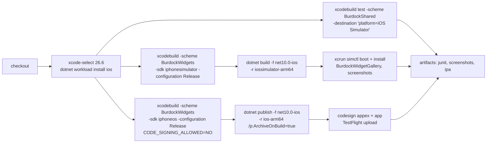
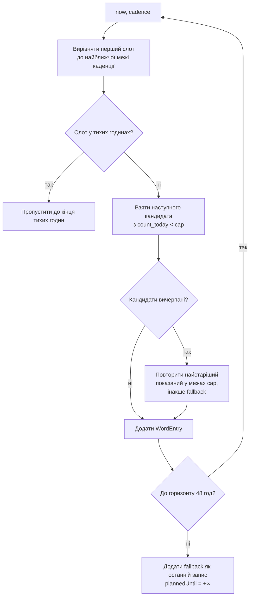
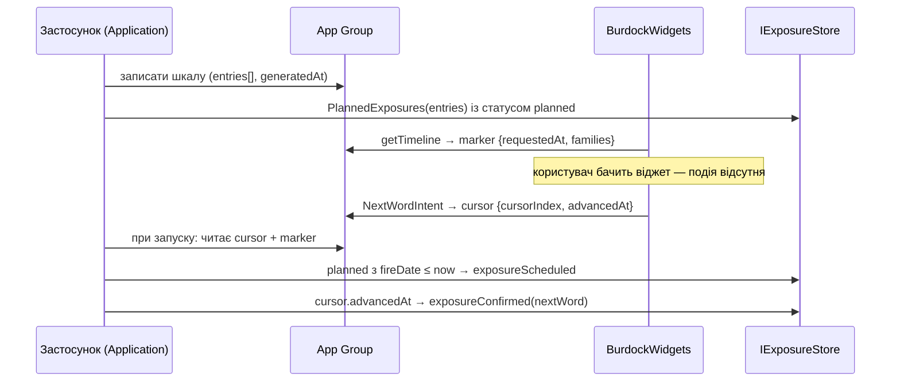
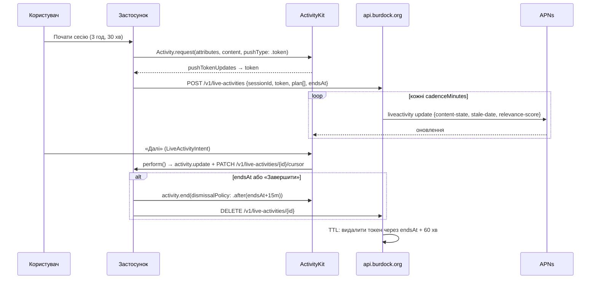

# 04. Поверхні iOS: віджети, сповіщення, Live Activity

| Поле | Значення |
|---|---|
| Статус | Draft |
| Версія | 0.1 |
| Дата | 2026-09-27 |
| Власник | Архітектор (затверджує власник продукту) |
| Джерела рішень | [Журнал рішень 2026-09-25](../decisions/2026-09-25-interview.md): Q1, Q12, Q25, Q35, Q36, Q30, Q14/Q32, Q4/Q13, Q6/Q16, Q27; T4, T5, T6, T8, T12, T15, T17, T20 |
| Пов'язані специфікації | 01-architecture (порти `IWidgetBridge`, `INotificationScheduler`, `IExposureStore`, `WordTimelinePlanner`), 02-design-system (візуал віджетів, токени `color.widget.*`, tinted/clear), 05-android-surfaces (дзеркальна специфікація), 06-learning-engine (вибір слів), 09-backend (APNs для Live Activity), 10-security-privacy |

## 0. Контекст для ШІ-агента

Ти працюєш над «зовнішніми поверхнями» iOS-застосунку «Реп'ях»: віджети WidgetKit (головний екран, екран блокування, StandBy), локальні сповіщення та Live Activity «Сесія». Це єдиний напрямок проєкту, де пишеться Swift; усе інше — C# / .NET MAUI.

Перед роботою прочитай: цю специфікацію повністю, журнал рішень (Q1, Q25, Q35, Q36, Q30, T4, T5, T17), розділи 1, 2, 5 і 8 дослідницького звіту, 01-architecture (порти) та 02-design-system (макети віджетів і токени).

Правила, які не можна порушувати:
1. Мінімальна версія iOS — **16.0** (Q25). Усе, що потребує iOS 17+ (інтерактивні кнопки, StandBy, `containerBackground`, AppIntents-конфігурація) або iOS 18+ (accented rendering), загортається в `#available` з робочим fallback.
2. Live Activity існує **лише** як сесія, яку користувач запускає сам, з прогресом і кнопкою завершення (Q35). Пасивна «стрічка слів» заборонена.
3. Тригери зміни слова: час (15/30/60/120/240 хв), кнопка «Далі», відкриття застосунку (Q36). Жодних «при розблокуванні» на iOS.
4. Розширення читає лише попередньо обчислені дані з App Group. Токени, ідентифікатори акаунта, будь-які персональні дані в контейнер App Group не потрапляють.
5. Пасивні покази ніколи не оцінюють картку FSRS (T4). Лічильники ведуться у двох величинах `exposureScheduled` / `exposureConfirmed` (T5).
6. Сповіщення ≤ 3/день за замовчуванням, тон дружній, ніколи з формулюванням втрати (T17). Нагороди не залежать від дозволу на сповіщення.

Код напрямку: Swift — `src/mobile/ios-extensions/BurdockWidgets/` (Xcode-проєкт), C# — `src/mobile/Burdock.Presentation/Platforms/iOS/Surfaces/`, доменний планувальник — `src/shared/Burdock.Domain/Timeline/`. Перевірка: юніт-тести планувальника (xunit.v3), `xcodebuild test` пакета `BurdockShared`, скриншоти галереї віджетів у артефактах CI, ручний чекліст із розділу 5.4 на TestFlight.

## 1. Мета й межі

**Мета.** Показувати користувачу англійські слова там, де він дивиться на телефон і без застосунку: на головному екрані, екрані блокування, у StandBy, у сповіщеннях, а під час свідомо запущеної «сесії» — у Live Activity й Dynamic Island. Поверхні є тонкими презентерами: усе, що потребує рішень (яке слово, коли, скільки разів), обчислює доменний планувальник у застосунку.

**Входить у v1:**
- Віджети сімейств `systemSmall`, `systemMedium`, `systemLarge`, `accessoryRectangular`, `accessoryCircular`, `accessoryInline`; StandBy на iOS 17+ через ті самі віджети.
- Інтерактивна кнопка «Далі» (iOS 17+), відкриття застосунку по натисканню (iOS 16).
- Конфігурація віджета (набір/категорія, показ перекладу) через AppIntents на iOS 17+, через налаштування застосунку на iOS 16.
- Локальні сповіщення зі словом, діями «Переклад», «Знаю», «Пізніше».
- Live Activity «Сесія» на 1-8 годин з автопросуванням через APNs і ручним «Далі» (iOS 16.1+).
- Підтримка iPhone та iPad (Q12): віджети на iPad мають ті самі сімейства; макети перевіряються на обох.

**Не входить у v1:** клавіатурне розширення, Apple Watch, Controls (iOS 18), Siri/Shortcuts як окремий сценарій, push-оновлення віджетів (iOS 26), Notification Content Extension (див. відкрите питання 7.4), віджет `systemExtraLarge` (лише iPad; відкладено, див. 7.5), зображення на віджетах (розділ 3 звіту).

**Відкладено з посиланням на roadmap:** контентний push через APNs (T8, v1.1); push-to-start Live Activity; рекламні поверхні (журнал, відкрите питання 1).

## 2. Вимоги

### 2.1 Функціональні

| ID | Вимога | MoSCoW |
|---|---|---|
| FR-04-1 | Розширення `BurdockWidgets` надає віджет «Слово» у сімействах systemSmall/Medium/Large та accessoryRectangular/Circular/Inline з одного `WidgetBundle`. | Must |
| FR-04-2 | Вміст віджета береться виключно з файлу часової шкали в App Group `group.org.burdock.app`; розширення не звертається до мережі, БД застосунку чи Keychain. | Must |
| FR-04-3 | Застосунок через `IWidgetBridge` записує часову шкалу на 48 годин уперед при кожному виході на передній план, зміні налаштувань, завершенні сесії та після спрацювання `NextWordIntent`, після чого викликає `WidgetCenter.reloadTimelines`. | Must |
| FR-04-4 | Слова змінюються за обраною каденцією 15/30/60/120/240 хв з урахуванням тихих годин, денного ліміту показів слова і безкоштовного набору з 5 слів. | Must |
| FR-04-5 | На iOS 17+ віджет має кнопку «Далі» (`Button(intent: NextWordIntent())`), яка змінює слово без відкриття застосунку; на iOS 16 натискання відкриває застосунок за deep link. | Must |
| FR-04-6 | Натискання на будь-яку частину віджета (крім кнопки) відкриває `burdock://word/{lexemeId}?src=widget.{family}`. | Must |
| FR-04-7 | Користувач може налаштувати для кожного екземпляра віджета: набір/категорію (лише Pro) та режим перекладу (видно / приховано). На iOS 16 — глобально в застосунку. | Should |
| FR-04-8 | Якщо часова шкала вичерпана (застосунок не відкривали > 48 год), останній запис показує стан «Відкрийте застосунок» з маскотом Реп'яшком у стані «сон» і без застарілого слова. | Must |
| FR-04-9 | Застосунок планує локальні сповіщення на 48 годин уперед (≤ `Notifications.PerDay`/день, тихі години) з категорією `WORD` та діями `SHOW_TRANSLATION`, `KNOW_IT`, `LEARN_LATER`. | Must |
| FR-04-10 | Дії `KNOW_IT` і `LEARN_LATER` виконуються у фоні без відкриття застосунку й записують `exposureConfirmed` та відповідний намір у `IExposureStore`. | Must |
| FR-04-11 | Перед системним запитом дозволу на сповіщення показується екран-пояснення; відмова не блокує жодну функцію й не впливає на нагороди. | Must |
| FR-04-12 | Користувач може запустити «Сесію» тривалістю 1-8 год; вона відображається як Live Activity (екран блокування + Dynamic Island) зі словом, прогресом `index/total`, часом завершення і кнопкою «Завершити» у застосунку. | Must |
| FR-04-13 | У сесії слово просувається (а) кнопкою «Далі» у Live Activity (iOS 17+), (б) автоматично за каденцією через APNs-оновлення, (в) у застосунку. За недоступності push сесія деградує до ручного просування без помилок для користувача. | Must |
| FR-04-14 | Сесія завершується явно користувачем або автоматично в `endsAt`; Live Activity прибирається з екрана блокування не пізніше `endsAt + LiveActivity.DismissAfterEndMinutes`. | Must |
| FR-04-15 | Застосунок обчислює `exposureScheduled` з планової шкали при наступному запуску та `exposureConfirmed` з подій (інтент, deep link, дія сповіщення, перегляд у застосунку); в інтерфейсі підтверджені показуються як «переглянуто», заплановані — як «≈ оцінка». | Must |
| FR-04-16 | Кілька екземплярів віджета (різні сімейства/конфігурації) працюють незалежно з однієї шкали; курсор «Далі» спільний для всіх екземплярів. | Should |
| FR-04-17 | Віджет на екрані блокування показує слово й переклад, але приховує серію/прогрес через `.privacySensitive()` (звіт, рішення 21). | Must |

### 2.2 Нефункціональні

| ID | Вимога | MoSCoW |
|---|---|---|
| NFR-04-1 | Пікове споживання пам'яті розширення ≤ 20 MB (системний ліміт ≈ 30 MB); жодних декодувань растрових зображень > 200 KB у розширенні. | Must |
| NFR-04-2 | Кількість викликів `reloadTimelines`, ініційованих застосунком, ≤ 15/день у типовому сценарії (бюджет системи 40-70/день для часто переглядуваного віджета). | Must |
| NFR-04-3 | Записи шкали розділені ≥ 5 хв; загальна кількість записів у файлі ≤ 200. | Must |
| NFR-04-4 | Файли в App Group мають клас захисту `NSFileProtectionCompleteUntilFirstUserAuthentication` і виключені з резервного копіювання iCloud (T12). | Must |
| NFR-04-5 | Кількість запланованих (pending) сповіщень ≤ 48 (системний ліміт 64), щоб залишити запас для сесійних і системних. | Must |
| NFR-04-6 | `ContentState` Live Activity ≤ 1 KB у серіалізованому вигляді (системний ліміт 4 KB). | Must |
| NFR-04-7 | Розширення й застосунок збираються на GitHub Actions `macos-26` без ручних кроків; артефакти включають скриншоти галереї віджетів для кожного сімейства у світлій, темній та (iOS 18+) tinted-темі. | Must |
| NFR-04-8 | Усі рядки віджетів і сповіщень локалізовані в `uk` (нейтральна) та `en`, з правильними формами множини. | Must |
| NFR-04-9 | Віджети відповідають WCAG 2.2 AA за контрастом у full-color режимі і читаються у vibrant/accented режимах (перевірка в 02-design-system). | Must |
| NFR-04-10 | `PrivacyInfo.xcprivacy` присутній у застосунку та розширенні з кодами причин (розділ 3.1.5). | Must |

## 3. Проєктування

### 3.1 Архітектура збірки

#### 3.1.1 Структура

```
src/mobile/ios-extensions/BurdockWidgets/
  BurdockWidgets.xcodeproj
  BurdockWidgets/                 # таргет розширення: віджети + Live Activity
    BurdockWidgetsBundle.swift    # @main WidgetBundle
    WordWidget/                   # TimelineProvider, views per family
    SessionActivity/              # ActivityConfiguration, Dynamic Island
    Intents/                      # NextWordIntent, WordWidgetConfigurationIntent, AdvanceSessionIntent
    Resources/                    # Assets.xcassets (маскот як PDF/SVG-вектор), Localizable.xcstrings
    Info.plist, BurdockWidgets.entitlements, PrivacyInfo.xcprivacy
  BurdockShared/                  # Swift Package: Codable-моделі, шляхи App Group, форматери
    Sources/BurdockShared/
    Tests/BurdockSharedTests/
  BurdockWidgetGallery/           # debug-таргет iOS-застосунку для скриншотів у CI (не публікується)
  scripts/build-appex.sh
```

Розширення `BurdockWidgets` містить і віджети, і Live Activity (Q35: «окремий Swift-таргет ActivityKit у тому ж розширенні»). `BurdockShared` — Swift-пакет без залежностей від WidgetKit, щоб його тести запускалися на симуляторі швидко і щоб `BurdockWidgetGallery` рендерив ті самі view.

#### 3.1.2 Ідентифікатори та підписання

| Елемент | Значення |
|---|---|
| Bundle ID застосунку | `org.burdock.app` |
| Bundle ID розширення | `org.burdock.app.widgets` |
| App Group | `group.org.burdock.app` |
| Deployment target | iOS 16.0 для обох таргетів (Q25) |
| Entitlements застосунку | `com.apple.security.application-groups` = [`group.org.burdock.app`], `aps-environment` (для токенів Live Activity), keychain-access-groups (лише застосунок) |
| Entitlements розширення | `com.apple.security.application-groups` = [`group.org.burdock.app`]; **без** keychain-групи застосунку |
| Info.plist застосунку | `NSSupportsLiveActivities = YES`; `CFBundleURLTypes` зі схемою `burdock` |
| Provisioning | Два профілі App Store / Ad Hoc (по одному на bundle ID) зберігаються як base64-секрети CI разом із сертифікатом розповсюдження; профіль розширення має ті самі capability App Groups |

Увага: `SupportedOSPlatformVersion` у `Burdock.Presentation.csproj` дорівнює `16.0`, що відрізняється від рекомендації звіту (17.0). Це наслідок Q25; звіт має нижчий пріоритет.

#### 3.1.3 Підключення до MAUI

```xml
<!-- Burdock.Presentation.csproj, фрагмент -->
<PropertyGroup Condition="$([MSBuild]::GetTargetPlatformIdentifier('$(TargetFramework)')) == 'ios'">
  <SupportedOSPlatformVersion>16.0</SupportedOSPlatformVersion>
  <CodesignEntitlements>Platforms/iOS/Entitlements.plist</CodesignEntitlements>
</PropertyGroup>
<ItemGroup Condition="$([MSBuild]::GetTargetPlatformIdentifier('$(TargetFramework)')) == 'ios'">
  <AdditionalAppExtensions Include="$(MSBuildThisFileDirectory)../ios-extensions/BurdockWidgets">
    <Name>BurdockWidgets</Name>
    <BuildOutput>build/Release-$(_SdkPlatformSuffix)</BuildOutput>
  </AdditionalAppExtensions>
  <PackageReference Include="WidgetKit.WidgetCenterProxy" Version="10.0.0" />
</ItemGroup>
```

`AdditionalAppExtensions` очікує вже зібраний `.appex` у `BuildOutput`, тому CI спочатку виконує `xcodebuild` для потрібної платформи, а потім `dotnet publish`. Механізм описаний у гайді Microsoft і в документації macios (див. розділ 8). Робочий процес iOS має бути закріплений на `dotnet-10.0.1xx-xcode26.5-10318` або новішому ≥ 10301, бо саме туди бекпортовано виправлення збірки `.appex` (macios PR #25846).

#### 3.1.4 CI-конвеєр (GitHub Actions, `runs-on: macos-26`)



Розширення для `iphoneos` збирається без підпису, підпис виконує MSBuild разом із застосунком (`CodesignProvision`, `CodesignKey`). Симуляторна збірка потрібна для скриншотів і для швидкої перевірки, що `.appex` вбудовується коректно (перевірити `Payload/Burdock.app/PlugIns/BurdockWidgets.appex`).

#### 3.1.5 PrivacyInfo.xcprivacy розширення

| Категорія API | Код причини | Чому потрібен у розширенні |
|---|---|---|
| `NSPrivacyAccessedAPICategoryFileTimestamp` | `C617.1` | читання дати модифікації файлу шкали для виявлення застарілих даних |
| `NSPrivacyAccessedAPICategoryUserDefaults` | `CA92.1`, `1C8F.1` | `UserDefaults(suiteName: "group.org.burdock.app")` для прапорців `schemaVersion`, `lastReloadRequestedAt` (1C8F.1 — саме доступ через App Group) |
| `NSPrivacyAccessedAPICategorySystemBootTime` | `35F9.1` | лише якщо використовується `ProcessInfo.systemUptime` у логуванні; інакше не декларувати |
| `NSPrivacyAccessedAPICategoryDiskSpace` | `E174.1` | не використовується розширенням; декларується лише в застосунку |

`NSPrivacyTracking = false`, `NSPrivacyCollectedDataTypes` порожній (розширення нічого не збирає). Той самий файл із повним набором кодів лежить у застосунку (10-security-privacy).

#### 3.1.6 Обмеження середовища виконання

- Пам'ять розширення ≈ 30 MB, перевищення = миттєве завершення без крашу в Sentry. Тому: маскот — вектор (PDF в asset catalog, «Preserve Vector Data»), жодних SVG-парсерів, шрифт Fixel як `.ttf` ≤ 300 KB на накреслення (лише 2 накреслення в розширенні), JSON шкали ≤ 64 KB.
- Ліміт 10 віджетів на бандл: у v1 один віджет «Слово» + одна Live Activity; резерв для «Серія» та «Слово дня» у майбутньому.
- Код віджета не виконується, поки віджет на екрані: увесь вміст має бути в записах шкали.
- SF Symbols дозволені лише всередині розширення (T6).

### 3.2 Спільний контракт даних (App Group)

#### 3.2.1 Файли

| Файл | Хто пише | Хто читає | Призначення |
|---|---|---|---|
| `Timeline/word-timeline.v1.json` | застосунок (`IWidgetBridge`) | розширення | планова шкала на 48 год |
| `Timeline/word-cursor.v1.json` | застосунок і розширення (`NextWordIntent`) | обидва | зміщення курсора «Далі» |
| `Timeline/extension-marker.v1.json` | розширення (`getTimeline`) | застосунок | діагностика: коли шкалу запитували, які сімейства активні |
| `Session/live-activity.v1.json` | застосунок | застосунок (після перезапуску), інтенти | стан поточної сесії для відновлення |

Запис — завжди атомарний (`Data.write(options: .atomic)` / `File.Replace`). Кожен файл отримує атрибути `NSFileProtectionCompleteUntilFirstUserAuthentication` (щоб розширення читало після перезавантаження до першого розблокування) та `NSURLIsExcludedFromBackupKey = true` (T12). Директорія: `FileManager.containerURL(forSecurityApplicationGroupIdentifier:)`. У контейнері немає токенів, ідентифікаторів інсталяції, нікнейма, статистики за межами того, що показує віджет.

#### 3.2.2 Схема `word-timeline.v1.json`

```json
{
  "schemaVersion": 1,
  "generatedAt": "2026-09-27T08:00:00+03:00",
  "plannedUntil": "2026-09-29T08:00:00+03:00",
  "cadenceMinutes": 60,
  "translationMode": "visible",
  "pair": { "native": "uk", "target": "en" },
  "fallback": { "kind": "openApp", "mascotState": "sleep", "title": "Слова закінчились", "body": "Відкрийте Реп'ях, щоб отримати нові" },
  "entries": [
    {
      "entryIndex": 0,
      "fireDate": "2026-09-27T08:00:00+03:00",
      "plannedUntil": "2026-09-27T09:00:00+03:00",
      "lexemeId": "0199a1c2-7f3e-7d21-9a44-2c0f5e4b8a10",
      "word": "burdock",
      "ipa": "/ˈbɜːdɒk/",
      "pos": "noun",
      "translation": "реп'ях",
      "example": "A burdock burr stuck to my sleeve.",
      "themeId": "burdock.default",
      "isFreeTier": false,
      "categoryId": "nature"
    }
  ]
}
```

Інваріанти: `entries` відсортовані за `fireDate` зростаюче; `fireDate[i+1] - fireDate[i] ≥ 5 хв`; `plannedUntil` запису = `fireDate` наступного або `plannedUntil` шкали; `translationMode ∈ {visible, hidden}`; `example` завжди без Tatoeba (T9); `word`, `translation` нормалізовані за апострофом (U+2019) до запису; `themeId` посилається на тему з 02-design-system, розширення має вбудований запасний варіант для невідомих тем.

Режим «переклад приховано» виражається полем `translationMode` на рівні шкали (глобальне налаштування) і може перевизначатися конфігурацією екземпляра віджета (iOS 17+). Переклад присутній у файлі завжди, ховає його view — це дозволяє перемикати режим без перезапису шкали.

#### 3.2.3 Схема `word-cursor.v1.json`

```json
{ "schemaVersion": 1, "cursorIndex": 12, "advancedAt": "2026-09-27T10:12:31+03:00", "source": "nextWordIntent" }
```

`cursorIndex` вказує на запис шкали, який зараз слід вважати поточним, якщо його `fireDate` ще не настав природно. `NextWordIntent` збільшує `cursorIndex` до першого запису з `entryIndex > current` і викликає `WidgetCenter.shared.reloadTimelines(ofKind: "WordWidget")`. Провайдер шкали при побудові бере `max(природний індекс за часом, cursorIndex)` як стартовий запис і далі віддає записи з вирівнюванням дат: наступні записи зсуваються так, щоб зберегти каденцію від моменту натискання (`advancedAt + cadence`). Застосунок при наступному запуску читає курсор, фіксує подію та перепланує шкалу від поточної позиції.

#### 3.2.4 Swift-модель (BurdockShared)

```swift
public struct WordTimeline: Codable, Sendable {
    public let schemaVersion: Int
    public let generatedAt: Date
    public let plannedUntil: Date
    public let cadenceMinutes: Int
    public let translationMode: TranslationMode
    public let pair: LanguagePair
    public let fallback: FallbackEntry
    public let entries: [WordEntry]
}
public struct WordEntry: Codable, Sendable, Identifiable {
    public var id: Int { entryIndex }
    public let entryIndex: Int
    public let fireDate: Date
    public let plannedUntil: Date
    public let lexemeId: UUID
    public let word: String
    public let ipa: String?
    public let pos: String?
    public let translation: String
    public let example: String?
    public let themeId: String
    public let isFreeTier: Bool
    public let categoryId: String?
}
```

Декодер: `JSONDecoder` з `.iso8601` датами; невідомий `schemaVersion` → fallback-стан «Оновіть застосунок» (без крашу). Невідомі поля ігноруються (сумісність уперед).

### 3.3 Планування шкали

#### 3.3.1 `WordTimelinePlanner` (Domain)

Детермінований чистий клас з ін'єкцією `IClock`; вхід — `PlanningRequest { now, horizon, cadence, quietHours, perWordDailyCap, candidates[], freeTierSet?, cursor }`, вихід — `WordTimeline`. Кандидатів постачає 06-learning-engine (найнижча ретрівабельність першою, фаза «знайомство» тощо); планувальник відповідає лише за розкладку в часі.



Правила:
- Тихі години (за замовчуванням 22:00-08:00, Q30) не створюють записів; слово, що показувалося перед тихими годинами, залишається на екрані до першого ранкового слоту (без запису «порожньо»).
- Денний ліміт показів слова (`Learning.MaxExposuresPerWordPerDay`, за замовчуванням 5) враховує вже підтверджені й заплановані покази того ж дня.
- Безкоштовний режим (Q14/Q32): пул рівно 5 слів дня, каденція фіксована на значенні за замовчуванням (60 хв — «темп» закритий у безкоштовній версії); при 16 активних годинах і ліміті 5 показів × 5 слів = 25 слотів запас достатній.
- StandBy (iOS 17+): окремі записи не потрібні — те саме `systemSmall`; але оскільки в StandBy віджет може бути на екрані всю ніч, тихі години визначають, що вночі показується останнє слово вечора у приглушеній темі, а не fallback.
- Записи ≥ 5 хв; за каденції 15 хв на 48 год виходить ≤ 128 записів після вирахування тихих годин (~64 при 10 тихих годинах), що вкладається в NFR-04-3.
- Останній запис завжди fallback (FR-04-8), тому вичерпання шкали ніколи не залишає застаріле слово.

#### 3.3.2 Політика перезавантаження

`TimelineReloadPolicy` = `.atEnd`. Явні виклики `WidgetCenter.reloadTimelines` робить лише застосунок через `IWidgetBridge.RequestReload(reason)` з коалесценцією (`Widget.ReloadCoalesceSeconds` = 300): кілька причин протягом 5 хв дають один виклик. Виняток — `NextWordIntent`, який викликає перезавантаження безпосередньо з розширення (інтерактивні дії користувача не бюджетуються).

| Тригер | Джерело | Очікувано на день | Примітка |
|---|---|---|---|
| Кінець шкали (`.atEnd`) | система | 0-1 | горизонт 48 год, зазвичай застосунок перепланує раніше |
| Вихід застосунку на передній план | `IWidgetBridge` | 2-6 | коалесценція 5 хв; перепланування лише якщо шкала змінилась (хеш) |
| Зміна налаштувань (каденція, тихі години, переклад, категорії) | `IWidgetBridge` | 0-2 | |
| Завершення мікросесії/тесту (змінює кандидатів) | `IWidgetBridge` | 1-3 | лише якщо перші 6 записів шкали змінилися |
| Завершення Live Activity «Сесія» | `IWidgetBridge` | 0-1 | |
| `NextWordIntent` | розширення | 0-20 | не бюджетується системою |
| Фонове оновлення контенту (`BGAppRefreshTask`) | `IWidgetBridge` | 0-1 | лише якщо змінився пакет контенту |
| **Разом (застосунок)** | | **≈ 4-14** | бюджет системи 40-70 |

Коли застосунок не відкривали кілька днів: шкала доходить до fallback-запису через 48 год; `.atEnd` викличе `getTimeline`, провайдер побачить, що `plannedUntil` минув, і поверне одноелементну шкалу з fallback і `policy: .never`. Сповіщення на цей час уже не заплановані (горизонт 48 год), тобто користувач бачить тихий стан «Реп'яшок спить», а не наздоганяючий потік.

> Реалізовано 27.10.2026, шматок 1 «застосунок» (без розширення): `Burdock.Domain.Widgets.WordTimelinePlanner` (слоти по каденції від локальної межі перед «зараз» на 48 год; тихі години без слотів, вечірнє слово лишається до першого ранкового слоту; запит у тихі години все одно дає поточний запис; денний ліміт показів на лексему з урахуванням уже зроблених сьогодні; ≤ 12 різних слів на навчальний день; одне слово не двічі поспіль і з розведенням `MinGap`; частка нових ≈ 0,4; free tier = 5 слів і каденція за замовчуванням; ≤ 200 записів; детермінований, з `ContentHash`/`LeadingHash`), типи `WordTimeline`/`TimelineEntry`/`TimelineFallback`; порт `IWidgetBridge` і `PlanWidgetTimelineUseCase` (облік показів за §3.5: `Scheduled` для записів, чий час настав, лише коли `extension-marker` новіший за `generatedAt`; «Далі» = `Confirmed` для витісненого слова і `Scheduled` для дострокового; водяний знак `widget.settledUntil`; перезапис і reload лише при зміні перших 6 записів або коли горизонту лишилося < 24 год); адаптер `AppGroupWidgetBridge` (файли §3.2.1, атомарний запис, `CompleteUntilFirstUserAuthentication`, виключення з бекапу, коалесценція reload 300 с через `WidgetKit.WidgetCenterProxy`), `WidgetCoordinator` у Presentation (поява Shell, resume, після сесії, після збереження налаштувань). Відхилення від зразка §3.2.2: fallback у файлі несе лише `kind` і `mascotState`, текст локалізує розширення (NFR-04-8); останній запис шкали не є fallback-записом, розширення показує fallback після `plannedUntil`. Без App Group entitlement контейнер відсутній і міст неактивний, тож збірка TestFlight 0.1.0 не змінює поведінку. Розширення, `AdditionalAppExtensions`, entitlements і другий профіль — шматки 2–3.

### 3.4 Сімейства віджетів і поведінка

| Сімейство | Вміст | Особливості |
|---|---|---|
| `systemSmall` | слово, IPA, переклад (або «···» у hidden), маскот-акцент, кнопка «Далі» (iOS 17+) | базовий для StandBy |
| `systemMedium` | + частина мови, приклад (1 рядок), категорія | |
| `systemLarge` | + приклад повністю, індикатор «сьогодні: N слів», кнопка «Далі» | серія `.privacySensitive()` |
| `accessoryRectangular` | слово + переклад (2 рядки), без маскота | vibrant rendering: лише текст і SF Symbol |
| `accessoryCircular` | перша літера або SF Symbol `text.book.closed` + скорочене слово (≤ 6 символів) | не показує переклад |
| `accessoryInline` | «burdock · реп'ях» (усічення за довжиною) | один рядок |

Режими рендерингу:
- `fullColor` — токени `color.widget.*` з 02-design-system.
- `accented` (iOS 18+, `widgetRenderingMode == .accented`): усе перефарбовується системою; ієрархія передається `widgetAccentable()` на слові, решта — вторинний колір. Дизайн «текст і форма спочатку» (звіт, розділ 1).
- `vibrant` (екран блокування): контраст забезпечує система; уникати напівпрозорих фонів.
- `containerBackground(for: .widget)` на iOS 17+; на iOS 16 — власний `ZStack` з фоном через `#available(iOS 17.0, *)`. Без `containerBackground` віджет не потрапляє у StandBy та iPad-екран блокування — це прийнятно для iOS 16.

Конфігурація: `WordWidgetConfigurationIntent: WidgetConfigurationIntent` (iOS 17+) з параметрами `wordSet` (динамічний список наборів; безкоштовний користувач бачить лише «Слова дня») та `translationMode`. На iOS 16 використовується `StaticConfiguration`, налаштування беруться з файлу шкали. Через `#available` бандл реєструє `AppIntentConfiguration` або `StaticConfiguration` під тим самим `kind: "WordWidget"`, щоб екземпляри переживали оновлення ОС.

Інтерактивність: `NextWordIntent: AppIntent` виконується в процесі розширення, змінює `word-cursor.v1.json`, повертає `.result()` і викликає reload. На iOS 16 кнопка не рендериться, натискання будь-де відкриває `burdock://word/{lexemeId}?src=widget.small&action=next`, і застосунок сам просуває курсор.

Deep links: `burdock://word/{lexemeId}?src=widget.{small|medium|large|accessoryRectangular|accessoryCircular|accessoryInline|standby}`; `src` потрапляє в аналітику лише як агрегована категорія (opt-in, Q9). Обробник — `IDeepLinkRouter` у Presentation, який також фіксує `exposureConfirmed(source: .widgetTap)`.

Галерея: `configurationDisplayName("Слово")`, `description("Нове англійське слово кожні 15-120 хвилин. Натисніть «Далі», щоб змінити.")`; `placeholder` і `getSnapshot` використовують вбудовані прев'ю-дані (`burdock / реп'ях`), не файл шкали. Кілька екземплярів (наприклад, small на головному + rectangular на екрані блокування) читають одну шкалу і один курсор.

### 3.5 Облік показів



`exposureScheduled` нараховується запису, чий `fireDate` минув до моменту звірки і який не був витіснений курсором раніше за свій `fireDate`. Якщо `extension-marker` показує, що шкалу жодного разу не запитували після `generatedAt` (віджет не встановлений або система не оновила), заплановані покази не нараховуються. Це все одно оцінка: iOS не повідомляє, чи віджет бачили (звіт, розділ 1). В інтерфейсі: «Переглянуто: 12» (confirmed) та «≈ Показано на віджетах: 40» з підписом «оцінка». `exposureConfirmed` дають: `NextWordIntent`, deep link з віджета, дії сповіщення, натискання на сповіщення, перегляд картки слова в застосунку, «Далі» у Live Activity.

### 3.6 Локальні сповіщення

**Реалізація.** Прямі виклики `UserNotifications` через біндінги Microsoft.iOS у `Platforms/iOS/Surfaces/IosNotificationScheduler : INotificationScheduler`, а не Plugin.LocalNotification. Обґрунтування: потрібні категорії з фоновими діями, `threadIdentifier`, `interruptionLevel`, детермінований набір ідентифікаторів для перепланування, а на Android — власна стратегія без точних будильників (05-android-surfaces); універсальний плагін додає шар абстракції, який довелося б обходити з обох боків (припущення щодо можливостей плагіна; перевірити перед остаточним ADR, див. 7.3).

**Дозвіл.** Екран-пояснення («Реп'яшок надсилатиме до 3 слів на день, ніколи вночі») → `requestAuthorization(options: [.alert, .sound])`. Provisional authorization не використовується: тихі сповіщення без банера на екрані блокування не виконують функцію показу слова і спотворюють метрики; замість цього — чесний запит після першої взаємодії зі словом. При відмові: у налаштуваннях — картка з deep link `UIApplication.openNotificationSettingsURLString`; віджети, нагороди, серія працюють без змін (FR-04-11).

**Планування.** На кожен вихід на передній план `INotificationScheduler.Replan(plan)`: видалити pending з префіксом `word.`, додати сповіщення на 48 год за планом з 06-learning-engine (не більше `Notifications.PerDay`/день, поза тихими годинами, слова, що не збігаються з поточним записом віджета в той самий час). Ідентифікатори `word.{yyyyMMdd}.{slot}` детерміновані, тому повторне планування ідемпотентне. При 8/день максимум 16 pending на 48 год — далеко від ліміту 64 (лише 64 найближчих зберігаються).

**Категорія `WORD`.**

| Дія | Ідентифікатор | Опції | Поведінка |
|---|---|---|---|
| Переклад | `SHOW_TRANSLATION` | `.foreground` | відкриває `burdock://word/{id}?src=notification&reveal=1`; показується лише в режимі hidden |
| Знаю | `KNOW_IT` | фонова | `didReceive` у фоні → `exposureConfirmed(.notificationAction)` + `IntroductionSignal.known`; не оцінює FSRS (T4) |
| Пізніше | `LEARN_LATER` | фонова | `exposureConfirmed` + позначка пріоритету для наступного планування |

Фонові дії обробляються делегатом `UNUserNotificationCenterDelegate` у MAUI `AppDelegate`: система запускає застосунок у фоні, ми пишемо подію в `IExposureStore` і завершуємо за < 1 с. Категорія додатково має `.customDismissAction`, щоб фіксувати dismiss як слабкий сигнал (не як confirmed).

**Шаблон вмісту.**

| Поле | Значення |
|---|---|
| `title` | `burdock  /ˈbɜːdɒk/` |
| `subtitle` | назва категорії (`Природа`) |
| `body` | visible: `реп'ях — A burdock burr stuck to my sleeve.`; hidden: `Здогадайтесь, а потім натисніть «Переклад»` |
| `threadIdentifier` | `words.{yyyyMMdd}` (групування за днем) |
| `categoryIdentifier` | `WORD` |
| `sound` | `nil` за замовчуванням (тихий банер); опція «Звук» у налаштуваннях вмикає `.default` |
| `badge` | ніколи не встановлюється |
| `interruptionLevel` | `.active` |
| `userInfo` | `{ lexemeId, slot, src: "notification" }` |

Time-sensitive не використовується: слово не є терміновим, рівень прориває Focus і за зловживання його відкликають на рев'ю; сесійні сповіщення також `.active`. Тон копірайту (T17): без «ти втратиш серію», без лічильників втрат; маскот з'являється лише в емодзі-вільному текстовому тоні («Реп'яшок приніс слово»).

### 3.7 Live Activity «Сесія»

#### 3.7.1 Модель

```swift
struct SessionAttributes: ActivityAttributes {
    struct ContentState: Codable, Hashable {
        var lexemeId: UUID
        var word: String
        var ipa: String?
        var translation: String
        var translationVisible: Bool
        var index: Int          // 1-based
        var total: Int
        var nextChangeAt: Date  // для ProgressView(timerInterval:) та staleDate
        var endsAt: Date
    }
    let sessionId: UUID
    let startedAt: Date
    let cadenceMinutes: Int
    let themeId: String
}
```

Серіалізований стан ≈ 300-400 байт (NFR-04-6). `total = floor(duration / cadence)`, тривалість 1-8 год, каденція така сама, як у віджета, або окрема для сесії (налаштування).

#### 3.7.2 Макети

Екран блокування: слово, IPA, переклад (за `translationVisible`), прогрес `index/total` як `ProgressView(timerInterval: startedAt...endsAt)`, час завершення `Text(endsAt, style: .relative)`, кнопка «Далі» (`Button(intent: AdvanceSessionIntent())`, iOS 17+). Dynamic Island: compact leading — маскот-гліф, trailing — `index/total`; minimal — гліф; expanded — слово + переклад + «Далі». Точні відступи, токени, стани маскота — 02-design-system. Кнопка «Завершити» лише в застосунку (HIG: завершення явне, але Live Activity не є панеллю керування).

#### 3.7.3 Механізми оновлення

| Варіант | Працює у фоні? | Надійність | Вердикт |
|---|---|---|---|
| Таймер у застосунку + `activity.update` | ні (лише передній план) | висока на передньому плані | доповнення |
| `LiveActivityIntent` «Далі» (iOS 17+) — виконується в процесі застосунку | так, за дією користувача | висока | обов'язково |
| `BGAppRefreshTask` за розкладом | «коли система дозволить» | низька: інтервал не гарантований, у Low Power відкладається | не використовуємо для каденції |
| APNs `liveactivity` push з токеном `pushTokenUpdates`, сервер шле за розкладом | так | висока за наявності мережі; потребує сервера (09-backend) | **основний для автопросування** |
| Push-to-start (iOS 17.2+) | так | не потрібен: сесію запускає користувач у застосунку | не використовуємо |

Рішення: автопросування у v1 — серверне через APNs; деградація — якщо токен не отримано протягом 10 с після старту, немає мережі або сервер повернув помилку, сесія працює у «ручному» режимі: слово змінюється по «Далі», а `nextChangeAt` не показується як таймер, лише прогрес до `endsAt`. Повернення застосунку на передній план завжди наздоганяє стан локально (обчислює `index` за часом і викликає `update`). Це не суперечить T8: T8 стосується push для оновлення контенту, а тут — окремий тип push (`apns-push-type: liveactivity`) з окремим токеном активності; APNs-ключ (.p8) все одно потрібен серверу вже у v1 (див. 7.1).

#### 3.7.4 Життєвий цикл токена



Сервер зберігає: `sessionId`, `token`, `endsAt`, план (масив `ContentState` з часами) — усе без персональних даних; токен видаляється за `DELETE`, за TTL і при відповіді APNs `410`. `activityStateUpdates` спостерігається застосунком для `.ended/.dismissed` → `DELETE`. Payload: `alert` відсутній (тихі оновлення), `stale-date = nextChangeAt + LiveActivity.StaleGraceMinutes`, `relevance-score` = 100 - index (свіжіші сесії вище при кількох активностях), `priority` = 5 за замовчуванням; 10 — лише для фінального `end` (припущення щодо бюджету високопріоритетних оновлень; перевірити в документації APNs під час імплементації).

#### 3.7.5 Політика завершення та обмеження

- Тривалість 1-8 год (`LiveActivity.MinDurationHours`/`MaxDurationHours`), 8 год — системна межа активної Live Activity; на екрані блокування залишається до 12 год, тому `dismissalPolicy: .after(endsAt + 15 хв)`.
- `staleDate` за пропущеного оновлення показує напис «Відкрийте, щоб оновити» без червоних станів.
- Одна активна сесія на застосунок; повторний старт завершує попередню.
- `#available(iOS 16.1, *)`: на iOS 16.0 кнопка «Почати сесію» не показується (сесія доступна лише в застосунку як звичайний режим без Live Activity). `LiveActivityIntent` — під `#available(iOS 17.0, *)`.
- `NSSupportsLiveActivitiesFrequentUpdates` не вмикається (оновлення ≥ 15 хв).

#### 3.7.6 Аргументація відповідності HIG та текст для App Review

Сесія: ініційована користувачем явно (вибір тривалості), відображає живий прогрес (`index/total`, час до завершення), має визначений кінець, не містить промо і не є «швидким доступом до функцій». Це відповідає HIG Live Activities і правилу 4.5.3 (див. звіт, розділ 1).

Текст для App Review Notes (англійською, як його подаємо):

> «Burdock uses a Live Activity only for a user-started "Learning session". The user explicitly chooses a duration (1–8 h) on the Session screen; the activity shows live progress (word N of M, time remaining), advances words at the user's chosen interval, and ends automatically at the chosen time or when the user taps "End" in the app. It is never started without user action, contains no promotional content, and is not used as a general notification channel. To test: Профіль → Сесія → «Почати» (3 години).»

### 3.8 Тестування на CI без Mac

| Рівень | Що перевіряємо | Як |
|---|---|---|
| Domain (xunit.v3, Linux) | `WordTimelinePlanner`: каденція, тихі години, ліміти, free tier, курсор, детермінізм | golden-тести з фіксованим `IClock` |
| Swift unit (`xcodebuild test`, симулятор) | `BurdockShared`: декодування схеми v1, невідомий `schemaVersion`, вибір поточного запису за `now` + cursor, усічення для `accessoryInline` | XCTest у пакеті |
| Рендер (симулятор) | `BurdockWidgetGallery` рендерить view кожного сімейства у світлій/темній темі, з довгими словами, hidden-режимом і fallback | `xcrun simctl io booted screenshot` → артефакт; порівняння з еталоном опційне (snapshot-бібліотека — припущення, обрати в 7.6) |
| Live Activity payload (симулятор) | `xcrun simctl push booted org.burdock.app payload.apns` з `liveactivity` payload перевіряє декодування `ContentState` | скрипт у CI, скриншот екрана блокування симулятора |
| Реальний пристрій | tinted/accented, StandBy, vibrant на екрані блокування, після перезавантаження до розблокування, Low Power Mode, iOS 16 | TestFlight, чекліст 5.4 |

Чесні обмеження: справжній рендер WidgetKit (tinted, StandBy, бюджет оновлень) у CI не відтворюється; додати віджет на головний екран симулятора скриптом не можна; галерея відтворює view, а не хостинг WidgetKit. Тому цикл «TestFlight → чекліст» є частиною Definition of Done для змін у розширенні.

### 3.9 Константи

| Параметр конфігурації | Значення за замовчуванням | Діапазон / примітка | Джерело |
|---|---|---|---|
| `Rotation.CadenceOptionsMinutes` | `[15, 30, 60, 120]` | пресети в налаштуваннях | Q36 |
| `Rotation.DefaultCadenceMinutes` | `60` | безкоштовний режим — фіксовано | Q30 |
| `Widget.PlanningHorizonHours` | `48` | | ця специфікація |
| `Widget.MinEntrySpacingMinutes` | `5` | системне обмеження WidgetKit | звіт §1 |
| `Widget.MaxEntries` | `200` | | NFR-04-3 |
| `Widget.ReloadCoalesceSeconds` | `300` | | NFR-04-2 |
| `Widget.ExtensionMemoryBudgetMB` | `20` | ліміт системи ≈ 30 | звіт §8 |
| `Learning.MaxExposuresPerWordPerDay` | `5` | 1-10 | Q30 |
| `Learning.QuietHours` | `22:00-08:00` | | Q30 |
| `FreeTier.WordsPerDay` | `5` | пул A1-B1 | Q14/Q32 |
| `Notifications.PerDay` | `3` | 0-8 | Q30, T17 |
| `Notifications.PendingSoftCap` | `48` | системний ліміт 64 | звіт §1 |
| `Notifications.PlanningHorizonHours` | `48` | | ця специфікація |
| `LiveActivity.MinDurationHours` / `MaxDurationHours` | `1` / `8` | 8 год — системна межа | Q35, звіт §1 |
| `LiveActivity.StaleGraceMinutes` | `5` | | ця специфікація |
| `LiveActivity.DismissAfterEndMinutes` | `15` | ≤ 12 год на екрані блокування | звіт §1 |
| `LiveActivity.TokenTtlAfterEndMinutes` | `60` | сервер | 09-backend |
| `LiveActivity.TokenWaitSeconds` | `10` | після цього — ручний режим | ця специфікація |
| `DeepLink.Scheme` | `burdock` | | Q27 |

## 4. Рішення та компроміси

| Питання | Варіанти | Обрано і чому |
|---|---|---|
| Як писати віджети | (a) Swift WidgetKit через `AdditionalAppExtensions`; (b) Plugin.Maui.Spine.Widgets (pre-1.0, один мейнтейнер) | (a): офіційний шлях Microsoft, повний доступ до WidgetKit/ActivityKit/AppIntents; (b) заблокував би Live Activity й інтерактивність. |
| Мінімальна iOS | 16 / 17 / 18 | 16 за Q25; ціна — подвійні гілки `#available` і відсутність інтерактивності на iOS 16 (≤ 7% пристроїв за звітом). |
| Джерело даних розширення | (a) JSON-файли в App Group; (b) спільна SQLite у App Group; (c) App Group UserDefaults | (a): мінімальна пам'ять, простий Codable, легко версіонувати; SQLite у розширенні додає SQLitePCLRaw-нативи й ризик блокувань; UserDefaults не для 60 KB. |
| Клас захисту файлів | Complete / CompleteUntilFirstUserAuthentication / None | CompleteUntilFirstUserAuthentication: віджет читає після перезавантаження до розблокування; вміст — лише словниковий. |
| Автопросування сесії | таймер у застосунку / BGAppRefresh / APNs / лише ручне | APNs з деградацією до ручного: єдиний передбачуваний фоновий механізм; вимагає серверного компонента вже у v1. |
| Бібліотека сповіщень | Plugin.LocalNotification / прямі біндінги | Прямі біндінги: контроль над категоріями, ідентифікаторами, рівнями переривання; менше «магії» під час перепланування. |
| Provisional authorization | так / ні | Ні: тихі сповіщення не показують слово на екрані блокування. |
| Time-sensitive | так / ні | Ні: не терміново, ризик рев'ю. |
| Облік показів | лише scheduled / лише confirmed / обидва | Обидва з різними підписами (T5). |

Рішення, що потребують ADR: `ADR-000x Notifications via direct bindings`, `ADR-000x Live Activity APNs in v1`.

## 5. Критерії приймання

### 5.1 Віджети
1. Given чиста інсталяція та онбординг завершено, when користувач додає віджет `systemSmall`, then протягом 5 с відображається перше слово з файлу шкали, а не плейсхолдер.
2. Given каденція 30 хв і тихі години 22:00-08:00, when планувальник будує шкалу о 21:50, then наступні записи мають `fireDate` 22:00 → відсутній, перший ранковий 08:00; жодних записів між 22:00 і 08:00.
3. Given iOS 17+, when користувач натискає «Далі», then слово змінюється без запуску застосунку, `word-cursor.v1.json` оновлено, при наступному запуску застосунок фіксує `exposureConfirmed(nextWord)`.
4. Given iOS 16, when користувач натискає віджет, then відкривається застосунок на картці слова і слово на віджеті змінюється після повернення в застосунок.
5. Given застосунок не відкривали 49 год, when віджет оновлюється, then показано стан «Відкрийте застосунок» з маскотом, без слова.
6. Given iOS 18 у tinted-режимі, when віджет рендериться, then слово, переклад і кнопка розрізняються без кольору (перевірка скриншотом на TestFlight).
7. Given безкоштовний режим, when будується шкала, then усі `lexemeId` належать до 5 слів дня, `isFreeTier = true`, конфігурація набору недоступна.
8. Пікова пам'ять розширення в Xcode Instruments (на орендованому Mac або за звітом `xcrun simctl spawn booted log`) ≤ 20 MB при `systemLarge` з довгим прикладом.

### 5.2 Сповіщення
1. Given дозвіл надано і `Notifications.PerDay = 3`, when застосунок виходить на передній план, then pending містить рівно 6 сповіщень `word.*` на 48 год, жодного в тихих годинах.
2. Given сповіщення доставлено, when користувач натискає «Знаю», then застосунок не відкривається, в `IExposureStore` з'являється `exposureConfirmed(.notificationAction)` протягом 2 с.
3. Given дозвіл відхилено, then серія, нагороди й віджети працюють, у налаштуваннях є посилання на системні налаштування сповіщень.
4. Жодне сповіщення не містить слів «втратиш», «згорить», «пропустиш» (лінт-тест по `.resx`).

### 5.3 Live Activity
1. Given iOS 16.1+ і мережа, when користувач починає сесію на 2 год з каденцією 30 хв, then Live Activity з'являється, сервер отримує токен ≤ 10 с, через 30 ± 2 хв слово змінюється при заблокованому телефоні.
2. Given мережі немає, when користувач починає сесію, then Live Activity з'являється у ручному режимі без повідомлень про помилку; «Далі» працює.
3. Given `endsAt` минув, then активність завершена, зникає з екрана блокування ≤ 15 хв, сервер видалив токен.
4. Given iOS 16.0, then кнопки «Почати сесію» немає, застосунок не викликає ActivityKit.
5. `ContentState` у JSON ≤ 1 KB (юніт-тест).

### 5.4 Ручний чекліст QA (TestFlight, кожен реліз розширення)
- [ ] Головний екран: small/medium/large у світлій і темній темі; довге слово (`responsibility`), довгий приклад.
- [ ] Екран блокування: rectangular/circular/inline, vibrant; серія прихована при заблокованому пристрої.
- [ ] StandBy (iOS 17+): нічний режим, читабельність з 1 м.
- [ ] Tinted/accented (iOS 18+) та clear (iOS 26): ієрархія без кольору.
- [ ] Пристрій iOS 16.x: без кнопки, натискання відкриває застосунок, `StaticConfiguration`.
- [ ] Low Power Mode: віджет змінює слово протягом ± 10 хв від плану.
- [ ] Перезавантаження без розблокування: віджет показує слово (не «--»).
- [ ] iPad: усі сімейства на головному екрані та екрані блокування.
- [ ] Live Activity: старт, автопросування із заблокованим екраном, «Далі» у Dynamic Island, завершення.
- [ ] Сповіщення: дії, групування за днем, відсутність звуку за замовчуванням.

## 6. Ризики

| Ризик | Ймовірність | Вплив | Пом'якшення |
|---|---|---|---|
| Збірка `.appex` на CI ламається при оновленні Xcode/workload | середня | високий (блокує реліз iOS) | пінити workload `10.0.1xx-xcode26.5-10318` і Xcode 26.6, `xcode-select` у workflow; окремий nightly-джоб «build extension only»; тижневий бюджет macOS-хвилин |
| Перевищення ~30 MB у розширенні (шрифти, маскот) | середня | високий (віджет мовчки зникає) | вектор для маскота, 2 накреслення шрифту, тест пам'яті на TestFlight, Sentry-«heartbeat» через marker |
| App Review відхиляє Live Activity за 4.5.3 | низька-середня | середній | явна тривалість, прогрес, кінець; текст у Review Notes; можливість вимкнути сесію серверним прапорцем без релізу |
| Неточність `exposureScheduled` спотворює вибір слів | середня | середній | вага scheduled у 06-learning-engine ≤ 0.3 від confirmed; підписи «оцінка» |
| APNs-оновлення затримуються/тротляться | середня | низький | `staleDate`, локальне наздоганяння, ручний режим |
| Повільний цикл iOS-налагодження без Mac | висока | середній | галерея з скриншотами в CI, TestFlight-чекліст, переоцінка покупки Mac (журнал, відкрите питання 3) |
| iOS 16 без `containerBackground` → інший вигляд на iPad lock screen | висока | низький | задокументована деградація; ≤ 7% пристроїв |
| Схема файлу змінюється несумісно між застосунком і розширенням різних версій | низька | середній | `schemaVersion`, fallback «Оновіть застосунок», e2e-тест сумісності N-1 |

## 7. Відкриті питання

| # | Питання | Хто вирішує | До |
|---|---|---|---|
| 7.1 | Вирішено ADR 0005: APNs-ключ і серверний планувальник Live Activity входять у v1; T8 стосується лише push оновлень контенту. Залишок: узгодити контракт `POST /v1/live-activities` з 09-backend | архітектор | до старту 09-backend |
| 7.2 | Каденція 240 хв: Q30 називає діапазон «до 4 год», Q36 — пресети до 120 хв. Додати 240 як п'ятий пресет? | власник | до фризу налаштувань |
| 7.3 | Остаточне рішення щодо Plugin.LocalNotification після спайку на 1 день | архітектор | спринт 2 |
| 7.4 | Notification Content Extension для показу перекладу без відкриття застосунку в hidden-режимі (третій Swift-таргет, +пам'ять, +рев'ю) | архітектор | після v1 |
| 7.5 | `systemExtraLarge` на iPad у v1 чи v1.1 | власник (дизайн-акцент) | до затвердження 02-design-system |
| 7.6 | Snapshot-бібліотека для Swift-тестів (pointfree swift-snapshot-testing чи власний порівнювач) | архітектор | спринт 3 |
| 7.7 | Чи потрібен окремий налаштовуваний інтервал для сесії, відмінний від віджетного | власник | до дизайну екрана «Сесія» |
| 7.8 | Вага `exposureScheduled` у фазі «знайомство» (T4: ≥ 3 покази у ≥ 2 дні — лише confirmed чи з оцінкою?) | 06-learning-engine | спринт 2 |

## 8. Джерела

Твердження без посилання нижче є загальновідомою поведінкою iOS SDK (`TimelineReloadPolicy`, `containerBackground`, `LiveActivityIntent`, `pushTokenUpdates`, `staleDate`, `UNNotificationInterruptionLevel`, `NSFileProtectionCompleteUntilFirstUserAuthentication`) і мають бути підтверджені за офіційною документацією Apple під час імплементації.

- Оновлення віджетів, бюджет ~40-70/день, записи ≥ 5 хв: https://developer.apple.com/documentation/widgetkit/keeping-a-widget-up-to-date
- Віджети iOS у .NET MAUI (AdditionalAppExtensions, App Group, WidgetCenterProxy): https://devblogs.microsoft.com/dotnet/how-to-build-ios-widgets-with-dotnet-maui/
- Build items macios (`AdditionalAppExtensions`): https://github.com/dotnet/macios/blob/main/docs/building-apps/build-items.md
- Виправлення збірки .appex (PR #25846) та релізи workload: https://github.com/dotnet/macios/pull/25846 , https://github.com/dotnet/macios/releases
- Вимоги Xcode для workload: https://learn.microsoft.com/en-us/dotnet/ios/troubleshooting/xcode-requirement
- Образ раннера macos-26: https://github.com/actions/runner-images/blob/main/images/macos/macos-26-Readme.md
- Accessory-сімейства та StandBy: https://developer.apple.com/documentation/widgetkit/widgetfamily/accessoryrectangular , https://developer.apple.com/documentation/widgetkit/widgetlocation/standby
- Інтерактивність віджетів і Live Activities: https://developer.apple.com/documentation/widgetkit/adding-interactivity-to-widgets-and-live-activities
- Accented rendering (iOS 18+): https://developer.apple.com/documentation/widgetkit/widgetaccentedrenderingmode
- Live Activities (ActivityKit, 8/12 год, 4 KB): https://developer.apple.com/documentation/activitykit/displaying-live-data-with-live-activities
- HIG Live Activities: https://developer.apple.com/design/human-interface-guidelines/live-activities
- App Store Review Guidelines (4.5.3, 5.1.2(i)): https://developer.apple.com/app-store/review/guidelines/
- Фонові стратегії (немає події розблокування): https://developer.apple.com/documentation/backgroundtasks/choosing-background-strategies-for-your-app
- Локальні сповіщення, ліміт 64, обробка дій: https://developer.apple.com/documentation/uikit/uilocalnotification , https://developer.apple.com/documentation/usernotifications/handling-notifications-and-notification-related-actions
- Агрегована статистика використання віджетів: https://developer.apple.com/documentation/analytics-reports/home-screen-widget-usage
- Privacy manifest і коди причин: https://learn.microsoft.com/en-us/dotnet/maui/ios/privacy-manifest
- Безпека WidgetKit (дані в App Group): https://support.apple.com/guide/security/widgetkit-security-secbb0a1f9b4/web
- SF Symbols лише в iOS-розширенні: https://developer.apple.com/design/human-interface-guidelines/sf-symbols
- Вимоги до завантажень в App Store: https://developer.apple.com/news/upcoming-requirements/
- Розподіл версій iOS: https://developer.apple.com/support/app-store/
- Пакет WidgetKit.WidgetCenterProxy та стек: розділ 2 дослідницького звіту.
