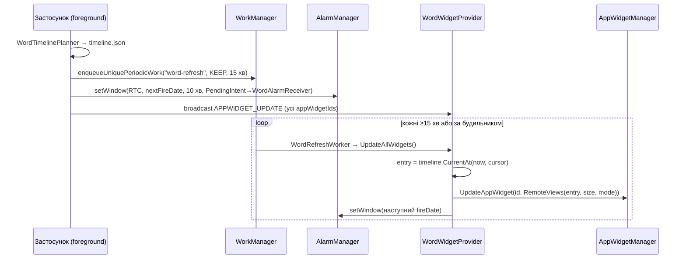
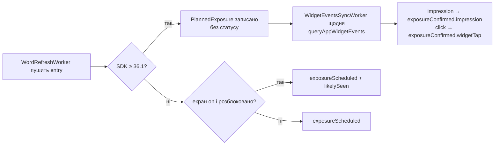

# 05. Поверхні Android: віджети, сповіщення, Live Updates

| Поле | Значення |
|---|---|
| Статус | Draft |
| Версія | 0.1 |
| Дата | 2026-09-27 |
| Власник | Архітектор (затверджує власник продукту) |
| Джерела рішень | [Журнал рішень 2026-09-25](../decisions/2026-09-25-interview.md): Q1, Q22, Q25, Q35, Q36, Q30, Q14/Q32, Q4/Q13, Q6/Q16, Q27; T2, T4, T5, T6, T12, T17, T19, T20; відкрите питання 2 |
| Пов'язані специфікації | 01-architecture (порти `IWidgetBridge`, `INotificationScheduler`, `IExposureStore`, `WordTimelinePlanner`), 02-design-system (макети RemoteViews, токени `color.widget.*`, типографічний fallback), 04-ios-surfaces (дзеркальна специфікація, спільний контракт шкали), 06-learning-engine, 10-security-privacy |

## 0. Контекст для ШІ-агента

Ти працюєш над «зовнішніми поверхнями» Android-застосунку «Реп'ях»: віджет головного екрана (і сторінки віджетів екрана блокування на Android 16 QPR2), локальні сповіщення та сесійну поверхню (постійне сповіщення, з опційним просуванням до Live Updates). На відміну від iOS, тут усе пишеться на C# у проєкті MAUI: `AppWidgetProvider`, `RemoteViews`, `WorkManager`-воркери, `BroadcastReceiver`-и.

Перед роботою прочитай: цю специфікацію, журнал рішень (Q22, Q36, Q30, T2, T5, T17, T19), розділи 1, 2 і 8 дослідницького звіту (Android-колонка та «cross-cutting gaps»), 04-ios-surfaces (контракт `word-timeline.v1.json` спільний), 02-design-system.

Правила, які не можна порушувати:
1. Мінімальний API 26, цільовий API 36 (T2). Поведінки API 31+ (immutable `PendingIntent`, Material You, `previewLayout`) і API 33+ (`POST_NOTIFICATIONS`) обов'язково мають гілки для API 26-30.
2. Жодних точних будильників (`setExact*`), жодних foreground-сервісів у v1. Оновлення — `WorkManager` + `AlarmManager.setWindow`.
3. Режим «при розблокуванні» — лише фіче-флаг для майбутнього (Q36, додаток A); у v1 код флагу існує, реалізації немає.
4. Віджет читає ту саму шкалу, що й iOS-розширення, обчислену `WordTimelinePlanner`. Віджет не приймає рішень про вибір слів.
5. `PendingIntent` завжди з `FLAG_IMMUTABLE` (крім випадків, де потрібен `FLAG_MUTABLE` для `RemoteInput` — у v1 таких немає).
6. Пасивні покази не оцінюють FSRS (T4); два лічильники `exposureScheduled`/`exposureConfirmed` (T5). Сповіщення ≤ 3/день, ніколи не «із втратою» (T17).
7. Material You перефарбовує віджет (T19); у застосунку — брендова палітра.

Код напрямку: `src/mobile/Burdock.Presentation/Platforms/Android/Widgets/`, `.../Platforms/Android/Notifications/`, `.../Platforms/Android/Resources/{layout,xml,values,values-v31,drawable}/`. Перевірка: юніт-тести планувальника (спільні з iOS), інструментальні тести на емуляторах API 26/31/34/36 (DeviceRunners), скриншоти `WidgetPreviewActivity`, чекліст Play-політик з розділу 5.5.

## 1. Мета й межі

**Мета.** Дати Android-користувачам ті самі поверхні, що й на iOS, з поправкою на платформу: віджет, який виглядає «рідним» завдяки Material You і оновлюється за каденцією настільки чесно, наскільки дозволяють Doze та App Standby; сповіщення як головна поверхня екрана блокування; сесія як постійне сповіщення з прогресом.

**Входить у v1 (Android-реліз через 1-2 місяці після iOS, Q22):**
- Віджет «Слово»: розміри 2×2, 4×2, 4×4, змінюваний розмір, попередній перегляд у пікері, категорія `home_screen|keyguard`.
- Кнопка «Далі» на всіх API без запуску застосунку; deep link у застосунок по натисканню на текст.
- Оновлення за каденцією 15/30/60/120/240 хв через `WordRefreshWorker` + `setWindow`.
- Сповіщення зі словом: канали, `BigTextStyle`, дії «Переклад», «Знаю», «Пізніше»; тихі години.
- Сесія 1-8 год як постійне сповіщення з прогресом; на API 36+ — за прапорцем запит на промоцію до Live Update.
- Облік показів через `queryAppWidgetEvents` (SDK 36.1+) з добовим воркером; оцінка для старших API.
- Підтримка планшетів (Q12 аналогічно): віджет 4×4 і адаптивні макети сповіщень.

**Не входить у v1:** режим «при розблокуванні» (додаток A), Quick Settings tile, живі шпалери, оверлеї `SYSTEM_ALERT_WINDOW`, Glance/Compose-віджети (немає NuGet-біндингу), зображення слів на віджеті, FCM-push для контенту (T8, v1.1).

## 2. Вимоги

### 2.1 Функціональні

| ID | Вимога | MoSCoW |
|---|---|---|
| FR-05-1 | `WordWidgetProvider : AppWidgetProvider` на C# рендерить віджет «Слово» через `RemoteViews` у трьох макетах (2×2, 4×2, 4×4), обираючи макет за `OnAppWidgetOptionsChanged` (`OPTION_APPWIDGET_MIN_WIDTH/HEIGHT`). | Must |
| FR-05-2 | Вміст віджета береться з `word-timeline.v1.json` (спільна схема з 04-ios-surfaces), збереженої в приватному сховищі застосунку; віджет показує запис, чий `fireDate ≤ now < plannedUntil`, з урахуванням курсора. | Must |
| FR-05-3 | `WordRefreshWorker` (`PeriodicWorkRequest`, 15 хв) і `WordAlarmReceiver` (`AlarmManager.setWindow`, вікно 10 хв, вирівняне на межу каденції) оновлюють усі екземпляри віджета; при кожному виході застосунку на передній план шкала й будильники переплановуються. | Must |
| FR-05-4 | Кнопка «Далі» надсилає broadcast `org.burdock.app.widget.NEXT_WORD` через `PendingIntent.GetBroadcast(..., FLAG_IMMUTABLE)`; провайдер зсуває курсор, оновлює `RemoteViews` і записує `exposureConfirmed(nextWord)` без запуску `MainActivity`. | Must |
| FR-05-5 | Натискання на текст віджета відкриває `MainActivity` з `burdock://word/{lexemeId}?src=widget.{2x2|4x2|4x4|keyguard}` через `PendingIntent.GetActivity(..., FLAG_IMMUTABLE)`. | Must |
| FR-05-6 | На API 31+ віджет використовує динамічні кольори системи (Material You) і системний радіус кутів; на API 26-30 — брендову палітру «Реп'ях-цвіт» з 02-design-system. | Must |
| FR-05-7 | Якщо шкала вичерпана (застосунок не відкривали > 48 год), віджет показує стан «Відкрийте застосунок» з маскотом (vector drawable) без застарілого слова. | Must |
| FR-05-8 | Метадані віджета: `updatePeriodMillis = 0`, `previewLayout` (API 31+) з `previewImage` fallback, `widgetCategory = home_screen|keyguard`, `targetCellWidth/Height`, `minResizeWidth/Height`, `maxResizeWidth/Height`, `description`, `resizeMode = horizontal|vertical`. | Must |
| FR-05-9 | Конфігурація екземпляра (набір для Pro, режим перекладу) через `configure`-Activity (`widgetFeatures = reconfigurable|configuration_optional`); налаштування зберігаються per `appWidgetId`. | Should |
| FR-05-10 | На API 33+ дозвіл `POST_NOTIFICATIONS` запитується лише після екрана-пояснення; при відмові функції та нагороди не обмежуються; у налаштуваннях є посилання на системні налаштування сповіщень. | Must |
| FR-05-11 | Канали сповіщень: `words` (DEFAULT, без звуку за замовчуванням), `session` (LOW, ongoing), `system` (HIGH, рідкісні системні повідомлення). Створюються при старті, ніколи не перестворюються з іншою важливістю. | Must |
| FR-05-12 | Сповіщення зі словом використовують `BigTextStyle`, дії `SHOW_TRANSLATION` (оновлює те саме сповіщення на місці), `KNOW_IT`, `LEARN_LATER`; дії обробляє `NotificationActionReceiver` без запуску застосунку. | Must |
| FR-05-13 | Сповіщення плануються на 48 год через `setWindow` з `RTC_WAKEUP` і вікном 10 хв, переплановуються при виході на передній план, `BOOT_COMPLETED`, `TIME_SET`, `TIMEZONE_CHANGED`. | Must |
| FR-05-14 | Сесія 1-8 год: постійне сповіщення на каналі `session` зі словом, прогресом `index/total`, часом завершення, діями «Далі» і «Завершити»; слово змінюється за каденцією через `setWindow`. На API 36+ за прапорцем `session.android.liveUpdates` додається `setRequestPromotedOngoing(true)` + `ProgressStyle`. | Must (базова) / Could (промоція) |
| FR-05-15 | На SDK 36.1+ `WidgetEventsSyncWorker` щодня (і при виході на передній план) читає `AppWidgetManager.queryAppWidgetEvents` та перетворює impressions на `exposureConfirmed(.impression)`, clicks — на `exposureConfirmed(.widgetTap)`. | Must |
| FR-05-16 | На API < 36.1 `exposureScheduled` нараховується лише записам, які воркер реально відправив у `RemoteViews`, з позначкою `likelySeen`, якщо в момент відправлення екран був увімкнений і пристрій розблокований. | Must |
| FR-05-17 | Користувач може ввімкнути «Ховати переклад на екрані блокування»: сповіщення отримують `VISIBILITY_PRIVATE` з `publicVersion` без перекладу; екземпляри віджета на сторінці екрана блокування рендеряться в режимі hidden. | Should |
| FR-05-18 | Екран «Чому віджет не оновлюється» пояснює обмеження енергозбереження та веде до системних налаштувань батареї для застосунку. | Should |

### 2.2 Нефункціональні

| ID | Вимога | MoSCoW |
|---|---|---|
| NFR-05-1 | Сумарна пам'ять растрів в одному `RemoteViews` ≤ 1.5 × ширина × висота × 4 байти (правило API 37, фатальне при перевищенні); у v1 растрів у віджеті немає — лише vector drawable та текст. | Must |
| NFR-05-2 | Усі `PendingIntent` створюються з `FLAG_IMMUTABLE`; збірка з `TreatWarningsAsErrors` не містить mutable-інтентів (перевірка лінтом у CI). | Must |
| NFR-05-3 | Усі нативні бібліотеки в APK/AAB вирівняні під 16 KB сторінки (Android 15+); перевіряється скриптом у CI на артефакті `.aab`. | Must |
| NFR-05-4 | Файли шкали та курсора виключені з Auto Backup (`dataExtractionRules` / `fullBackupContent`), T12. | Must |
| NFR-05-5 | `OnReceive` провайдера й ресиверів завершується < 5 с (ліміт broadcast 10 с); важка робота делегується `WorkManager`. | Must |
| NFR-05-6 | Віджет відповідає Android Widget Quality Tier 1 (адаптивні розміри, попередній перегляд, темна тема, доступність контенту `contentDescription`). | Should |
| NFR-05-7 | Текст віджета використовує лише системні сімейства (`sans-serif`, `sans-serif-medium`); типографічний fallback описано в 02-design-system. | Must |
| NFR-05-8 | Застосунок не запитує `SCHEDULE_EXACT_ALARM`, `USE_EXACT_ALARM`, `SYSTEM_ALERT_WINDOW`, `FOREGROUND_SERVICE_*` у v1 (маніфест перевіряється тестом). | Must |
| NFR-05-9 | Рядки віджетів і сповіщень локалізовані (`uk` нейтральна, `en`) з коректними формами множини (`1 слово / 2 слова / 5 слів`) через `plurals`. | Must |

## 3. Проєктування

### 3.1 Структура коду та маніфест

```
src/mobile/Burdock.Presentation/Platforms/Android/
  Widgets/
    WordWidgetProvider.cs          # AppWidgetProvider (BroadcastReceiver)
    WordRemoteViewsFactory.cs      # будує RemoteViews для розміру + режиму
    WordRefreshWorker.cs           # PeriodicWorkRequest, 15 хв
    WordAlarmReceiver.cs           # setWindow-будильники, вирівняні на каденцію
    WidgetEventsSyncWorker.cs      # queryAppWidgetEvents → IExposureStore (SDK 36.1+)
    WordWidgetConfigureActivity.cs # configure-Activity
    WidgetPreviewActivity.cs       # DEBUG: рендер RemoteViews.Apply для скриншотів
  Notifications/
    AndroidNotificationScheduler.cs  # INotificationScheduler
    NotificationChannels.cs
    NotificationAlarmReceiver.cs
    NotificationActionReceiver.cs
    SessionNotificationController.cs
    BootAndTimeReceiver.cs
  Resources/
    layout/widget_word_2x2.xml, widget_word_4x2.xml, widget_word_4x4.xml, widget_word_fallback.xml
    xml/word_widget_info.xml, data_extraction_rules.xml
    values/colors_widget.xml, styles_widget.xml
    values-v31/colors_widget.xml, styles_widget.xml
    drawable/mascot_sleep.xml, ic_next.xml, widget_bg.xml
```

`WordWidgetProvider` оголошується атрибутами: `[BroadcastReceiver(Exported = true, Label = "@string/widget_word_label")]`, `[IntentFilter(new[] { "android.appwidget.action.APPWIDGET_UPDATE", "org.burdock.app.widget.NEXT_WORD" })]`, `[MetaData("android.appwidget.provider", Resource = "@xml/word_widget_info")]` — за офіційним гайдом Microsoft (розділ 8). Провайдер і ресивери працюють у процесі застосунку, тому мають доступ до DI-контейнера MAUI через `IPlatformApplication.Current.Services`.

`word_widget_info.xml` (ключові атрибути):

| Атрибут | Значення | Примітка |
|---|---|---|
| `updatePeriodMillis` | `0` | оновлює лише наш код |
| `initialLayout` | `@layout/widget_word_2x2` | |
| `previewLayout` | `@layout/widget_word_4x2` | API 31+; `previewImage` для API 26-30 |
| `targetCellWidth` / `targetCellHeight` | `2` / `2` | API 31+ |
| `minWidth` / `minHeight` | `110dp` / `110dp` | fallback для API < 31 |
| `minResizeWidth` / `minResizeHeight` | `110dp` / `110dp` | 2×2 |
| `maxResizeWidth` / `maxResizeHeight` | `320dp` / `320dp` | 4×4 (API 31+) |
| `resizeMode` | `horizontal\|vertical` | |
| `widgetCategory` | `home_screen\|keyguard` | на API 36 будь-який віджет придатний для екрана блокування, якщо не `not_keyguard`; явний `keyguard` зберігається для сумісності намірів |
| `widgetFeatures` | `reconfigurable\|configuration_optional` | |
| `configure` | `org.burdock.app.WordWidgetConfigureActivity` | |
| `description` | `@string/widget_word_description` | API 31+ |

Макети та вибір: 2×2 (слово, переклад/«···», кнопка «Далі»), 4×2 (+ IPA, частина мови, категорія), 4×4 (+ приклад, лічильник «сьогодні: N слів»). Вибір за `OPTION_APPWIDGET_MIN_WIDTH`: < 200 dp → 2×2; < 200 dp висоти → 4×2; інакше 4×4. На API 31+ додатково використовується `RemoteViews(Map<SizeF, RemoteViews>)` для миттєвого перемикання без перерисовки провайдером.

### 3.2 Візуал: Material You, типографіка, растри

- **Кольори.** `values-v31/colors_widget.xml` посилається на `@android:color/system_accent1_600`, `system_neutral1_50/900` тощо; кореневий макет має `android:theme="@style/Theme.Burdock.Widget"` з батьком `Theme.DeviceDefault.DayNight`, фон `?android:attr/colorBackground`, радіус `@android:dimen/system_app_widget_background_radius` (внутрішні елементи — `system_app_widget_inner_radius`). У `values/` ті самі імена ресурсів вказують на палітру «Реп'ях-цвіт» (фіолет `#7C5CFF`, лайм `#B4F461`, фон `#F7F6FC`/`#15131F`) — токени генеруються з JSON (T20) у обидва набори. Контраст обох наборів перевіряється у 02-design-system.
- **Типографіка.** `RemoteViews` не завантажує шрифти з ресурсів застосунку, тому Fixel у віджеті недоступний: `sans-serif` для перекладу й прикладу, `sans-serif-medium` для слова, `textFontWeight` на API 28+. Слово ніколи не рендериться в растр заради шрифту (розмін «фірмовість ↔ пам'ять» вирішено на користь тексту).
- **Растри.** Правило API 37: сумарна пам'ять растрів у `RemoteViews` ≤ 1.5 × w × h × 4 байти, перевищення фатальне (звіт, розділ 1). Політика v1: жодного `setImageViewBitmap`; маскот і іконки — `setImageViewResource` з vector drawable (Material Symbols для іконок, власні вектори для Реп'яшка). Тест на 4×4 при масштабі шрифту 200 % входить у чекліст.
- **16 KB.** Android 15+ підтримує 16-KB сторінки пам'яті; усі нативні `.so` (SkiaSharp, `e_sqlite3`, Sentry Native, .NET runtime) мають бути вирівняні. CI перевіряє `.aab` скриптом на базі `llvm-objdump`/`check_elf_alignment` (припущення щодо інструмента; вимоги Play до строків перевірити в Play Console).

### 3.3 Дані та сховище

Спільний контракт з iOS: `WordTimelinePlanner` (Domain) створює `WordTimeline`, `AndroidWidgetBridge : IWidgetBridge` серіалізує його в `FilesDir/widget/word-timeline.v1.json` і `word-cursor.v1.json` (атомарний запис через тимчасовий файл + `File.Move` з перезаписом). Схема, інваріанти та fallback-запис ідентичні 04-ios-surfaces §3.2, тому юніт-тести серіалізації спільні.

Direct Boot: файли лежать у credential-encrypted сховищі; застосунок не `directBootAware`. Наслідок: після перезавантаження до першого розблокування лаунчер не отримає оновлення від нас (провайдер не запускається); після розблокування `BootAndTimeReceiver` (`BOOT_COMPLETED`, потребує `RECEIVE_BOOT_COMPLETED`) перепланує шкалу, будильники й сповіщення. Це прийнятно: сторінка віджетів екрана блокування до розблокування показує кешований останній кадр хоста (припущення; перевірити на Android 16 QPR2).

Резервні копії: `data_extraction_rules.xml` виключає `widget/`, БД прогресу й кеш контенту (T12). Жодних токенів чи PII у файлах віджета.

### 3.4 Механіка оновлення



- **Базовий шар — WorkManager.** `PeriodicWorkRequest<WordRefreshWorker>` з інтервалом 15 хв (мінімум платформи) через `Xamarin.AndroidX.Work.Runtime 2.11.2.1`; `ExistingPeriodicWorkPolicy.KEEP`; без обмежень (constraints) — робота локальна.
- **Вирівнювання — `setWindow`.** Періодичний воркер дрейфує; для попадання в межу каденції (наприклад, рівно о 10:00 при 60 хв) `WordAlarmReceiver` ставить один неточний будильник `setWindow(RTC, fireDate, 10 хв)` на наступний запис і при спрацюванні перевиставляє наступний. Точні будильники не використовуються: `SCHEDULE_EXACT_ALARM` за замовчуванням заборонений, `USE_EXACT_ALARM` обмежений політикою Play (звіт, розділ 1).
- **Catch-up замість черги.** Провайдер показує запис за поточним часом (`CurrentAt(now, cursor)`), а не «наступний у списку». Пропущені через сон записи не показуються заднім числом і не нараховуються як scheduled. Це вирівнює семантику з iOS, де WidgetKit також показує запис за часом.
- **Перепланування.** На передньому плані (`OnResume` через `ILifecycleEvents`), при `BOOT_COMPLETED`, `TIME_SET`, `TIMEZONE_CHANGED`, `APPWIDGET_ENABLED`, після завершення сесії й після `NEXT_WORD`.

Чесні очікування залежно від стану пристрою:

| Стан пристрою / бакет | Каденція 15 хв | 30 хв | 60 хв | 120 хв |
|---|---|---|---|---|
| Екран увімкнений, застосунок нещодавно використовувався (active/working_set) | 15-25 хв | 30-40 хв | ±10 хв | ±10 хв |
| Екран вимкнений, легкий Doze (maintenance windows) | оновлення групуються у вікна; побачить лише після пробудження — фактично «актуально при увімкненні» | те саме | те саме | те саме |
| Бакет `frequent` | ~30 хв мінімум для WorkManager | ~30-45 хв | ±15 хв | ±15 хв |
| Бакет `rare` | години | години | години | години |
| Бакет `restricted` / «обмежене» енергоспоживання в налаштуваннях | ~раз на добу | | | |
| Після перезавантаження до розблокування | без оновлень | | | |

Висновок для UX: оскільки віджет дивляться при увімкненому екрані, а увімкнення екрана виводить пристрій з Doze, воркер у більшості випадків встигає оновити слово в перші хвилини активності. У налаштуваннях каденція 15 хв позначена як «приблизно» з підказкою. OEM-обмежувачі (Samsung «Сплячі застосунки», Xiaomi «Автозапуск», Huawei «Керування запуском» — назви пунктів є припущенням і уточнюються під час QA на реальних пристроях) описуються на екрані FR-05-18 з кнопкою `Settings.ACTION_APPLICATION_DETAILS_SETTINGS` / `ACTION_IGNORE_BATTERY_OPTIMIZATION_SETTINGS` (без запиту `REQUEST_IGNORE_BATTERY_OPTIMIZATIONS`, щоб не потрапити під обмеження Play).

### 3.5 «Далі» та deep links

- `NEXT_WORD`: `PendingIntent.GetBroadcast(context, appWidgetId, new Intent(context, typeof(WordWidgetProvider)).SetAction("org.burdock.app.widget.NEXT_WORD").PutExtra(EXTRA_APPWIDGET_ID, id), PendingIntentFlags.Immutable | PendingIntentFlags.UpdateCurrent)`. Провайдер у `OnReceive`: читає курсор, обирає наступний запис (`entryIndex > current`), пише курсор з `source = "widget"`, оновлює всі екземпляри, додає `exposureConfirmed(nextWord)` в `IExposureStore` (локальна SQLite; запис < 50 мс), перевиставляє будильник. Якщо робота може перевищити 5 с — `GoAsync()` + `WorkManager` одноразова робота.
- Deep link: `PendingIntent.GetActivity(context, requestCode, new Intent(Intent.ActionView, Uri.Parse("burdock://word/{lexemeId}?src=widget.4x2")).SetPackage(packageName), Immutable | UpdateCurrent)`; `MainActivity` має `intent-filter` зі схемою `burdock` (`Exported = true`, `LaunchMode = SingleTop`); MAUI передає в `IDeepLinkRouter` через `OnNewIntent`. Роутер фіксує `exposureConfirmed(widgetTap)`.
- `requestCode` = `appWidgetId * 10 + slot`, щоб інтенти різних екземплярів не перезаписували одне одного.

### 3.6 Облік показів



- SDK 36.1+: `AppWidgetManager.queryAppWidgetEvents` повертає impressions/clicks/scrolls; події зберігаються лише кілька днів, тому `WidgetEventsSyncWorker` запускається щодня (`PeriodicWorkRequest`, 24 год, з `RequiresBatteryNotLow`) і додатково при виході на передній план. Події зіставляються з `PlannedExposure` за `appWidgetId` і часовим інтервалом запису; дублікати відсікаються за `(appWidgetId, eventTimestamp)`.
- API 26 - 36.0: оцінка `likelySeen` (`PowerManager.IsInteractive && !KeyguardManager.IsKeyguardLocked` у момент відправлення) підвищує вагу scheduled у 06-learning-engine, але в інтерфейсі все одно підписана як «≈ оцінка».
- Confirmed на всіх API: «Далі», deep link, дії й натискання сповіщень, перегляд картки в застосунку, «Далі» у сесії.

### 3.7 Сповіщення

**Дозвіл (API 33+).** Екран-пояснення → `Permissions.RequestAsync<Permissions.PostNotifications>()`. Після двох відмов система більше не показує діалог — застосунок показує картку з `Settings.ACTION_APP_NOTIFICATION_SETTINGS`. На API 26-32 дозвіл не потрібен, але користувач може вимкнути канал — стан перевіряється `NotificationManagerCompat.AreNotificationsEnabled()` і `GetNotificationChannel(id).Importance == None`. Відмова не впливає на нагороди, серію та віджети.

**Канали.**

| Канал | Важливість | Звук/вібрація | Видимість за замовчуванням | Призначення |
|---|---|---|---|---|
| `words` | `IMPORTANCE_DEFAULT` | `SetSound(null, null)`, без вібрації | `VISIBILITY_PUBLIC` (`PRIVATE` при FR-05-17) | слова за розкладом |
| `session` | `IMPORTANCE_LOW` | немає | `PUBLIC`/`PRIVATE` | постійне сповіщення сесії |
| `system` | `IMPORTANCE_HIGH` | системний | `PRIVATE` | рідкісні: завершення синхронізації акаунта, проблеми з підпискою |

Група каналів «Реп'ях». Важливість задається один раз; зміна потребує нового `channelId` (старий видаляється).

**Шаблон слова (`BigTextStyle`).**

| Поле | Значення |
|---|---|
| `contentTitle` | `burdock  /ˈbɜːdɒk/` |
| `contentText` | visible: `реп'ях · іменник`; hidden: `Здогадайтесь, а потім натисніть «Переклад»` |
| `bigText` | visible: `реп'ях · іменник\nA burdock burr stuck to my sleeve.`; hidden: те саме, що `contentText` |
| `subText` | назва категорії |
| `smallIcon` | монохромна іконка Реп'яшка (vector) |
| `group` / `groupSummary` | `words.{yyyyMMdd}` |
| `autoCancel` | true; `onlyAlertOnce` true |
| `visibility` / `publicVersion` | за FR-05-17 |
| `contentIntent` | `burdock://word/{id}?src=notification` |

Дії:

| Дія | Обробник | Поведінка |
|---|---|---|
| `SHOW_TRANSLATION` | `NotificationActionReceiver` | `Notify(sameId, builder з перекладом)` — оновлення на місці без запуску застосунку; `exposureConfirmed(.notificationAction)`; показується лише в hidden-режимі |
| `KNOW_IT` | те саме | `exposureConfirmed` + `IntroductionSignal.known`; `Cancel(id)`; не оцінює FSRS (T4) |
| `LEARN_LATER` | те саме | `exposureConfirmed` + пріоритет для наступного планування; `Cancel(id)` |

**Планування.** `AndroidNotificationScheduler.Replan(plan)` при кожному виході на передній план: скасувати власні будильники `notif.*`, виставити `setWindow(RTC_WAKEUP, fireAt, 10 хв, PendingIntent→NotificationAlarmReceiver)` для кожного слоту на 48 год (≤ `Notifications.PerDay`/день, поза тихими годинами). `setWindow` обрано замість `OneTimeWorkRequest`, бо затримки WorkManager у Doze можуть посунути сповіщення в тихі години; `NotificationAlarmReceiver` додатково перевіряє тихі години в момент спрацювання і скасовує доставку, якщо будильник прийшов запізно. Якщо QA покаже систематичні затримки > 30 хв у Doze, розглядається `setAndAllowWhileIdle` (неточний, без дозволу; припущення щодо його поведінки — перевірити). Будильники не переживають перезавантаження — `BootAndTimeReceiver` перепланує.

**Кількість.** 3/день за замовчуванням, 0-8 (Q30, T17); при 8/день — 16 будильників на 48 год. Тон копірайту: без втрат, лінт по `.resx` (спільний з iOS).

### 3.8 Сесійна поверхня

| Варіант | Плюси | Мінуси | Вердикт |
|---|---|---|---|
| (A) Android 16 Live Update (`setRequestPromotedOngoing` + `ProgressStyle`) | помітний чип у статус-барі, пріоритет на екрані блокування, нативна семантика «триває» | лише API 36+; політика прямо виключає «швидкий доступ до функцій / промо»; рішення про промоцію приймає система; критерії трактування для навчальної сесії не підтверджені | Could, за прапорцем |
| (B) Звичайне постійне сповіщення на каналі `session` з `setProgress` (API 26-35) / `ProgressStyle` (36+) | працює на всіх API, без FGS і декларацій Play, повністю під контролем | менш помітне; може бути згорнуте користувачем | **Must, базовий** |
| (C) Foreground service `specialUse` для «живої» сесії | гарантоване життя процесу, таймери без будильників | декларація Play + відео, постійне сповіщення FGS, обмеження запуску з фону, OEM-кілери | ні у v1 |

Рішення: (B) у v1 на всіх API. Поверх нього на API 36+ прапорець `session.android.liveUpdates` (за замовчуванням вимкнено, керується сервером) додає запит на промоцію; аргументація для політики Live Updates така сама, як для HIG на iOS (04-ios-surfaces §3.7.6): сесія ініційована користувачем, має живий прогрес і визначений кінець, не є промо чи ярликом до функцій. Прапорець вмикається лише після перевірки на Pixel з Android 16, що система промотує сповіщення і що Play не заперечує (перевірка через попередню подачу в internal testing).

Механіка: `SessionNotificationController` публікує `Notification` з `setOngoing(true)`, `setProgress(total, index, false)`, `setWhen(endsAt) + setUsesChronometer(true) + setChronometerCountDown(true)` (API 26+), діями «Далі» (broadcast → просування + повторний `Notify`) і «Завершити» (broadcast → `Cancel` + запис події). Просування за каденцією — той самий `setWindow` з 10-хвилинним вікном (`session.*` будильники), тому фактична зміна слова ± 10 хв — це задокументовано в UI («слово змінюється приблизно кожні 30 хв»). На API 34+ користувач може змахнути постійне сповіщення; це трактується як «Завершити» через `deleteIntent`. Стан сесії зберігається у `Session/live-session.v1.json` для відновлення після смерті процесу; будь-який будильник, що спрацював після `endsAt`, завершує сесію. Ліміт 8 год і мінімум 1 год спільні з iOS.

Fallback за API: 26-35 — (B) з `setProgress`; 36+ — (B) з `ProgressStyle` + опційна промоція; за відсутності дозволу на сповіщення (33+) — сесія працює лише всередині застосунку з поясненням, чому немає поверхні на екрані блокування.

### 3.9 Екран блокування

- **Android 16 QPR2+ сторінка віджетів.** Віджет придатний завдяки `widgetCategory` (і відсутності `not_keyguard`). `MainActivity` **не** отримує `android:showWhenLocked`: інакше весь застосунок відкривався б поверх екрана блокування; тому deep link з віджета на екрані блокування вимагає розблокування (стандартна поведінка), а «Далі» як broadcast працює без розблокування. Провайдер розрізняє екземпляри екрана блокування за `OPTION_APPWIDGET_HOST_CATEGORY == WIDGET_CATEGORY_KEYGUARD` в `GetAppWidgetOptions` і, якщо ввімкнено FR-05-17, рендерить їх у hidden-режимі (припущення: хост QPR2 передає категорію в options; перевірити на Pixel, Samsung не підтверджено звітом). `src=widget.keyguard` у deep link.
- **Решта пристроїв.** Головна поверхня екрана блокування — сповіщення; `VISIBILITY_PUBLIC` показує слово й переклад, `VISIBILITY_PRIVATE` + `publicVersion` ховає переклад (і приклад) до розблокування. Серія/прогрес у сповіщеннях не показуються взагалі (аналог `.privacySensitive()` на iOS).

### 3.10 Тестування на Windows

| Емулятор | Що перевіряємо |
|---|---|
| API 26 (мінімум) | канали, відсутність `previewLayout`, брендова палітра, `setWindow`, `PendingIntent` без `Immutable`-вимоги, макети 2×2/4×2/4×4 |
| API 31 | Material You, `previewLayout`, `targetCellWidth`, обов'язковий `FLAG_IMMUTABLE`, `RemoteViews(Map<SizeF,…>)` |
| API 34 | обмеження broadcast для кешованих застосунків, змахування постійних сповіщень, `POST_NOTIFICATIONS` |
| API 36 (Android 16, образ з QPR2 за наявності) | `queryAppWidgetEvents` (36.1), `ProgressStyle`, промоція Live Update, сторінка віджетів екрана блокування, 16 KB (образ `_16k`) |

Команди для симуляції енергозбереження:

```
adb shell dumpsys battery unplug
adb shell dumpsys deviceidle force-idle          # глибокий Doze
adb shell dumpsys deviceidle step                # перехід між станами
adb shell dumpsys deviceidle unforce
adb shell dumpsys battery reset
adb shell am set-standby-bucket org.burdock.app rare     # active|working_set|frequent|rare|restricted
adb shell am get-standby-bucket org.burdock.app
adb shell cmd jobscheduler run -f org.burdock.app <jobId> # примусовий запуск WorkManager-джобу
adb shell dumpsys alarm | grep org.burdock.app            # перевірка setWindow-будильників
adb shell am broadcast -a android.appwidget.action.APPWIDGET_UPDATE -n org.burdock.app/.WordWidgetProvider
adb exec-out screencap -p > widget.png
```

Скриншоти віджета: `WidgetPreviewActivity` (лише в Debug) викликає `WordRemoteViewsFactory` для кожного розміру/режиму і рендерить через `RemoteViews.Apply(context, container)` — це дозволено для власного пакета й не потребує хоста віджетів; скриншоти зберігаються як артефакти CI (Linux-раннер з емулятором або локально). Реальний хост (лаунчер) перевіряється вручну: додавання віджета в пікері, зміна розміру, темна тема, масштаб шрифту 200 %, сторінка екрана блокування на Android 16 QPR2. Інструментальні тести (DeviceRunners) покривають `CurrentAt`, вибір макета за розміром, побудову `PendingIntent`-ів і серіалізацію.

Чекліст політик Play перед подачею: target API 36; відсутність `SCHEDULE_EXACT_ALARM`/`USE_EXACT_ALARM`/FGS/`SYSTEM_ALERT_WINDOW`; усі `PendingIntent` immutable; форма Data safety узгоджена з інвентарем даних (10-security-privacy); пояснення дозволу на сповіщення в застосунку; 16 KB; Widget Quality Tier 1; при ввімкненні Live Updates — відповідність опублікованим критеріям.

### 3.11 Константи

| Параметр конфігурації | Значення за замовчуванням | Діапазон / примітка | Джерело |
|---|---|---|---|
| `Rotation.CadenceOptionsMinutes` | `[15, 30, 60, 120]` | спільно з iOS | Q36 |
| `Rotation.DefaultCadenceMinutes` | `60` | безкоштовний режим — фіксовано | Q30 |
| `Widget.PlanningHorizonHours` | `48` | спільно з iOS | 04-ios-surfaces |
| `Widget.Android.WorkerIntervalMinutes` | `15` | мінімум WorkManager | звіт §1 |
| `Widget.Android.AlarmWindowMinutes` | `10` | мінімум для `setWindow` | звіт §1 |
| `Widget.Android.ImpressionSyncIntervalHours` | `24` | події живуть «кілька днів» | звіт §8 п.24 |
| `Widget.Android.MaxBitmapBytesFactor` | `1.5` | × w × h × 4 | звіт §1 |
| `Widget.Android.LayoutBreakpointDp` | `200` | межа 2×2 → 4×2 → 4×4 | ця специфікація |
| `Learning.MaxExposuresPerWordPerDay` | `5` | 1-10 | Q30 |
| `Learning.QuietHours` | `22:00-08:00` | | Q30 |
| `FreeTier.WordsPerDay` | `5` | | Q14/Q32 |
| `Notifications.PerDay` | `3` | 0-8 | Q30, T17 |
| `Notifications.PlanningHorizonHours` | `48` | | ця специфікація |
| `Notifications.Android.LateDeliveryGraceMinutes` | `30` | пізніше — скасувати доставку | ця специфікація |
| `Session.MinDurationHours` / `MaxDurationHours` | `1` / `8` | спільно з iOS | Q35 |
| `Session.Android.LiveUpdatesFlag` | `session.android.liveUpdates = false` | серверний прапорець, API 36+ | ця специфікація |
| `Rotation.Android.UnlockModeFlag` | `rotation.android.unlockMode = false` | лише для майбутнього (додаток A) | Q36 |
| `DeepLink.Scheme` | `burdock` | | Q27 |

## 4. Рішення та компроміси

| Питання | Варіанти | Обрано і чому |
|---|---|---|
| Технологія віджета | RemoteViews на C# / Glance (Kotlin, без біндингу) / окремий Kotlin-модуль | RemoteViews на C#: офіційний гайд Microsoft, одна мова, один процес з DI; Glance потребував би Kotlin-бібліотеки й біндингу без NuGet. |
| Оновлення | WorkManager / setWindow / setExact / FGS | WorkManager як база + setWindow для вирівнювання; setExact заблокований політикою Play, FGS — надмірний і потребує декларацій. |
| Дані для віджета | окрема SQLite-таблиця / спільний JSON з iOS | JSON: одна схема, спільні тести, простий catch-up; SQLite прогресу залишається джерелом для confirmed-подій. |
| Кольори | Material You / бренд усюди | Material You на віджеті (T19), бренд у застосунку; палітра fallback для API 26-30. |
| Шрифт у віджеті | системний / растр із Fixel | системний: правило растрів API 37 і Widget Quality; фірмовість — через макет і маскот. |
| Сесія | Live Update / постійне сповіщення / FGS | постійне сповіщення з опційною промоцією за прапорцем: працює на всіх API, нульовий ризик політики у v1. |
| Планування сповіщень | WorkManager / setWindow | setWindow: краща передбачуваність щодо тихих годин; додаткова перевірка при спрацюванні. |
| Показ перекладу на екрані блокування | завжди / приховати за опцією / завжди приховати | за опцією (рішення 21 звіту: показувати слово + переклад за замовчуванням, ховати прогрес). |

Рішення, що потребують ADR: `ADR-000x Android widget refresh strategy (WorkManager + setWindow)`, `ADR-000x Session surface on Android (ongoing notification, Live Updates behind flag)`.

## 5. Критерії приймання

### 5.1 Віджет
1. Given API 31 з увімкненими динамічними кольорами, when віджет додано, then фон і акцент відповідають системним `system_accent1/neutral1`; на API 26 — палітра «Реп'ях-цвіт».
2. Given каденція 60 хв і пристрій активний, when минає година, then слово змінюється протягом 60-70 хв від попереднього (5 із 5 циклів на емуляторі API 34 без Doze).
3. Given `force-idle`, when минає каденція, then віджет оновлюється при виході з Doze протягом 2 хв, показуючи запис за поточним часом (не проміжні).
4. Given натискання «Далі», then слово змінюється ≤ 1 с, `MainActivity` не запускається (`adb shell dumpsys activity activities` не містить нового запуску), у SQLite з'являється `exposureConfirmed(nextWord)`.
5. Given зміна розміру віджета з 2×2 на 4×4, then макет змінюється на 4×4 з прикладом без повторного відкриття застосунку.
6. Given застосунок не відкривали 49 год, then показано fallback з маскотом; «Далі» відкриває застосунок.
7. Given масштаб шрифту 200 % і 4×4, then текст не обрізається до втрати слова; віджет не падає (`RemoteViews` без растрів).
8. Given SDK 36.1, when минула доба з двома impression-подіями, then `WidgetEventsSyncWorker` створив рівно два `exposureConfirmed(.impression)` без дублікатів при повторному запуску.

### 5.2 Сповіщення
1. Given API 33 і дозвіл не надано, then застосунок не викликає `Notify`, а екран «Сповіщення» пропонує пояснення і запит; нагороди й серія доступні.
2. Given `Notifications.PerDay = 3` і тихі години 22:00-08:00, then `dumpsys alarm` містить 6 будильників `notif.*` на 48 год, жоден між 22:00 і 08:00.
3. Given сповіщення в hidden-режимі, when натиснуто «Переклад», then те саме сповіщення (той самий id) оновлюється з перекладом без запуску застосунку ≤ 1 с.
4. Given будильник спрацював із запізненням > 30 хв усередині тихих годин, then сповіщення не показується, слот позначено `skipped`.
5. Given перезавантаження, then після розблокування протягом 2 хв будильники відновлені (`dumpsys alarm`).

### 5.3 Сесія та екран блокування
1. Given сесія 2 год з каденцією 30 хв, then постійне сповіщення показує `1/4`, слово змінюється кожні 30 ± 10 хв, о `endsAt` сповіщення зникає, подія завершення записана.
2. Given API 36 і `session.android.liveUpdates = true`, then сповіщення будується з `ProgressStyle` і `setRequestPromotedOngoing(true)`; при `false` — без них (юніт-тест на builder).
3. Given «Ховати переклад на екрані блокування» увімкнено, then на заблокованому пристрої сповіщення показує лише слово (`publicVersion`), після розблокування — повну версію.
4. Given Pixel з Android 16 QPR2, when віджет додано на сторінку екрана блокування, then слово видно без розблокування, «Далі» працює, натискання на текст просить розблокувати й потім відкриває картку слова.

### 5.4 Збірка й політики
1. `.aab` проходить перевірку 16-KB вирівнювання; маніфест не містить заборонених дозволів (NFR-05-8) — автоматичний тест у CI.
2. Лінт CI не знаходить `PendingIntent` без `Immutable`.
3. Widget Quality Tier 1 чекліст заповнено в PR-шаблоні релізу.

## 6. Ризики

| Ризик | Ймовірність | Вплив | Пом'якшення |
|---|---|---|---|
| OEM-обмежувачі зупиняють WorkManager/будильники (Samsung, Xiaomi) | висока | середній | екран пояснення з переходом у налаштування, catch-up за часом, чесні підписи «приблизно» |
| Каденція 15 хв сприймається як «не працює» у Doze | середня | середній | у налаштуваннях «≈ 15 хв», повідомлення про енергозбереження, метрика фактичних інтервалів (opt-in) |
| Правило растрів API 37 ламає віджет на майбутньому target | низька (немає растрів) | високий | політика «без bitmap», тест масштабу 200 %, CI-перевірка викликів `SetImageViewBitmap` |
| Live Updates відхилено політикою або не промотується системою | середня | низький | прапорець за замовчуванням вимкнено, базове сповіщення завжди працює |
| `queryAppWidgetEvents` повертає події з іншою семантикою/затримкою | середня | низький | впровадження за фіче-детектом, порівняння з likelySeen-оцінкою у бета-групі |
| Поведінка сторінки екрана блокування на не-Pixel пристроях невідома | висока | низький | не обіцяти в маркетингу; тестувати на Samsung у бета-групі |
| 16-KB вирівнювання зламано транзитивною нативною бібліотекою | середня | високий (блокує публікацію) | CI-перевірка `.aab`, пінінг версій SkiaSharp/SQLitePCLRaw/Sentry |
| Broadcast «Далі» перевищує 10 с при холодному старті процесу | низька | середній | мінімальна ініціалізація в ресивері, `GoAsync`, ліниве DI |

## 7. Відкриті питання

| # | Питання | Хто вирішує | До |
|---|---|---|---|
| 7.1 | Чи потрібен `setAndAllowWhileIdle` для сповіщень після QA у Doze (поведінка й ліміти — перевірити) | архітектор | після першої бета Android |
| 7.2 | Чи передає хост сторінки екрана блокування QPR2 категорію keyguard в options (визначає, чи можливий hidden-режим на віджеті) | архітектор (тест на Pixel) | спринт Android-1 |
| 7.3 | Вмикати `session.android.liveUpdates` у v1 Android чи лише після оцінки політики на internal testing | власник | перед подачею в Play |
| 7.4 | Список OEM для екрана FR-05-18 і точні назви пунктів меню | QA на реальних пристроях | бета |
| 7.5 | Каденція 240 хв (див. 04-ios-surfaces 7.2) | власник | до фризу налаштувань |
| 7.6 | Критерії ввімкнення режиму «при розблокуванні» (додаток A) | власник | після першого Android-релізу (журнал, відкрите питання 2) |
| 7.7 | Чи виносити `WidgetPreviewActivity` у окремий debug-flavor або лишити під `#if DEBUG` | архітектор | спринт Android-1 |

## Додаток A. Режим «при розблокуванні» (не v1)

Призначення: зафіксувати дизайн майбутнього фіче-флагу, щоб рішення (Q36, відкрите питання 2 журналу) можна було прийняти з відомою ціною.

**Фіче-флаг.** `rotation.android.unlockMode` — серверний прапорець + локальний перемикач у налаштуваннях, видимий лише коли серверний прапорець увімкнено і API ≥ 26. Доменний тригер реалізується як `UnlockRotationTrigger : IWordRotationTrigger`; у v1 клас відсутній, є лише запис у реєстрі тригерів із значенням «недоступно».

**Технічна реалізація (за брифом, звіт §1).** `ACTION_USER_PRESENT` можна отримувати лише контекстно зареєстрованим ресивером у живому процесі, тобто всередині foreground-сервісу типу `specialUse`: дозвіл `FOREGROUND_SERVICE_SPECIAL_USE`, `android:foregroundServiceType="specialUse"`, властивість `PROPERTY_SPECIAL_USE_FGS_SUBTYPE` з поясненням, постійне сповіщення сервісу, декларація в Play Console з демонстраційним відео. `SCREEN_ON` для кешованих застосунків на Android 14 відкладається, тому опора саме на `USER_PRESENT`. Запуск сервісу — лише з переднього плану (обмеження запуску FGS з фону); після перезавантаження — після відкриття застосунку користувачем. OEM-обмежувачі вбиватимуть сервіс; потрібен екран пояснення й перевірка «сервіс живий» при кожному відкритті.

**Вплив на батарею (припущення, виміряти).** Постійний процес + ресивер: оцінка 1-3 %/день на Pixel-референсі; на пристроях з агресивним енергозбереженням — непередбачувано.

**Критерії, за яких режим варто вмикати:** (1) ≥ 15 % активних Android-користувачів просять його у зворотному зв'язку або ≥ 25 % вмикають у бета-групі; (2) виміряний вплив на батарею ≤ 2 %/день на референсних пристроях; (3) декларація FGS `specialUse` схвалена Play; (4) частка користувачів, що вимкнули режим протягом тижня, < 30 %; (5) підтверджена відсутність приросту скарг «застосунок їсть батарею» у відгуках Play. Рішення приймає власник після першого Android-релізу.

## 8. Джерела

Твердження без посилання (`setWindow`, `PeriodicWorkRequest`, `OPTION_APPWIDGET_HOST_CATEGORY`, `ProgressStyle`, `setRequestPromotedOngoing`, `RemoteViews.Apply`, команди `dumpsys deviceidle`) є загальновідомою поведінкою Android SDK і мають бути підтверджені за офіційною документацією під час імплементації.

- Віджети Android у .NET MAUI (AppWidgetProvider на C#): https://devblogs.microsoft.com/dotnet/how-to-build-android-widgets-with-dotnet-maui/
- Розширені можливості віджетів (updatePeriodMillis, розміри, попередній перегляд): https://developer.android.com/develop/ui/views/appwidgets/advanced
- Зміни поведінки Android 17 (правило пам'яті растрів RemoteViews): https://developer.android.com/about/versions/17/behavior-changes-17
- AppWidgetProviderInfo (`widgetCategory`, `not_keyguard`): https://developer.android.com/reference/android/appwidget/AppWidgetProviderInfo
- AppWidgetManager (`queryAppWidgetEvents`, `setWidgetPreview`): https://developer.android.com/reference/android/appwidget/AppWidgetManager
- FAQ щодо віджетів на екрані блокування: https://android-developers.googleblog.com/2025/03/widgets-on-lock-screen-faq.html
- AlarmManager (`setWindow` ≥ 10 хв, обмеження точних будильників): https://developer.android.com/reference/android/app/AlarmManager
- Політика Play щодо точних будильників: https://support.google.com/googleplay/android-developer/answer/13161072
- Live Updates (критерії та виключення): https://developer.android.com/develop/ui/views/notifications/live-update
- Обмеження запуску FGS з фону: https://developer.android.com/develop/background-work/services/fgs/restrictions-bg-start
- Політика Play щодо FGS та декларацій: https://support.google.com/googleplay/android-developer/answer/13392821
- Політика Play щодо оверлеїв / AccessibilityService: https://support.google.com/googleplay/android-developer/answer/10964491
- Intent (`ACTION_USER_PRESENT`, `SCREEN_ON`): https://developer.android.com/reference/android/content/Intent
- Broadcasts (контекстна реєстрація, обмеження для кешованих застосунків): https://developer.android.com/develop/background-work/background-tasks/broadcasts
- Вимоги Play до target API: https://support.google.com/googleplay/android-developer/answer/11926878
- Xamarin.AndroidX.Work.Runtime 2.11.2.1: https://www.nuget.org/packages/Xamarin.AndroidX.Work.Runtime/
- Widget Quality Guidelines: https://developer.android.com/docs/quality-guidelines/widget-quality
- Material 3 у MAUI (`UseMaterial3`): https://learn.microsoft.com/en-us/dotnet/maui/user-interface/material-design
- androidx.security (deprecation, для контексту сховища): https://developer.android.com/jetpack/androidx/releases/security
- Розділ 8 дослідницького звіту, п. 24 (події віджетів зберігаються кілька днів) і п. 25 (Samsung — не підтверджено).
