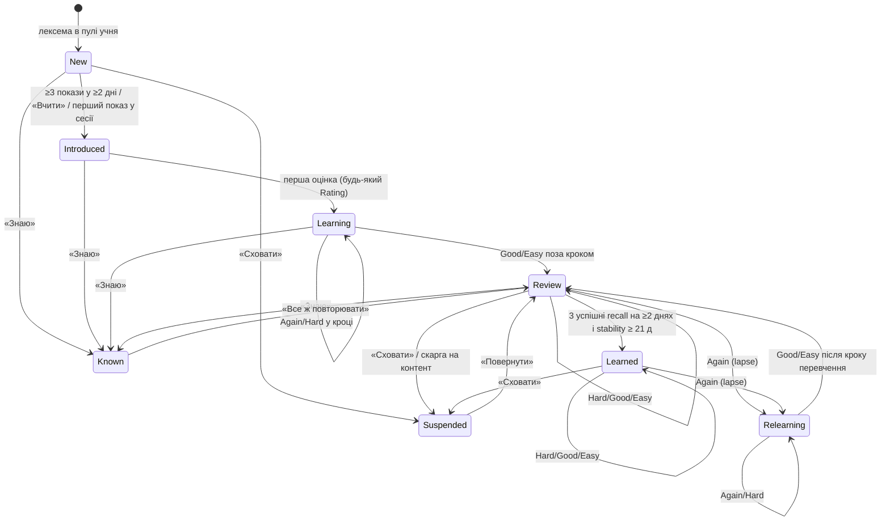
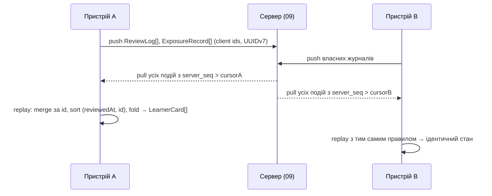

# 06. Рушій навчання: вибір слів, покази, повторення, тести

| Поле | Значення |
|---|---|
| Статус | Draft |
| Версія | 0.1 |
| Дата | 2026-09-27 |
| Власник | Архітектор (затверджує власник продукту) |
| Джерела рішень | [Журнал рішень](../decisions/2026-09-25-interview.md): Q11, Q14/Q32, Q18, Q21, Q30, Q34, T3, T4, T5, T11, T14, T21; [Дослідницький звіт](../research/2026-09-25-research-brief.md) §6, §7 (пункти 36-47) |
| Пов'язані специфікації | 01-architecture (шар Domain, порти `IClock`, `ILearnerCardRepository`, `IExposureStore`), 02-design-system (`QuizOption`, `TypedAnswerField`, `MatchPair`), 03-ux-flows-screens (екрани сесії, статистики), 04/05 (поверхні показу: події експозиції), 07-gamification (доменні події), 09-backend (синхронізація `ReviewLog`), 11-monetization (безкоштовний рівень), 13-analytics |

## 0. Контекст для ШІ-агента

Ти працюєш над рушієм навчання застосунку «Реп'ях» — чистою доменною логікою (проєкт `Burdock.Domain`, простір імен `Burdock.Domain.Learning`), яка вирішує **які слова** показувати на віджетах і в сповіщеннях, **коли** повторювати картку (FSRS-6) і **як** оцінювати відповідь у тесті.

Перед роботою прочитай: журнал рішень (Q14/Q32, Q18, Q21, Q30, T3-T5, T11, T14), §6 дослідницького звіту, цю специфікацію і 01-architecture (порти та правила шарів).

Правила, які не можна порушувати:
1. Пасивний показ (віджет, сповіщення, StandBy, Live Activity) **ніколи** не оцінює картку FSRS і не створює `ReviewLog` (T4).
2. У Domain немає `DateTime.Now`, `Random.Shared`, `TimeZoneInfo.Local` і платформових API — лише `IClock` та `IDeterministicRandom`, передані через конструктор. Той самий вхід дає той самий вихід байт у байт.
3. Усі числа політики читаються з `LearningPolicy` (ключі з таблиці констант §3.13); «магічних» чисел у коді немає.
4. У Domain немає рядків «English»/«Ukrainian» — лише `LanguagePair` (Q11).
5. `ReviewLog` та `ExposureRecord` — append-only; стан будь-якої картки можна відтворити повторним програванням журналу (§3.10).
6. Числа з дослідницького звіту, позначені `unverified`/`low`, у коментарях і документації не цитуються.

Код: `src/Burdock.Domain/Learning/*` (рушій), `src/Burdock.Infrastructure/Persistence/Learning/*` (SQLite-реалізації портів), `tests/Burdock.Domain.Tests/Learning/*` (xunit.v3). Перевірка результату: `dotnet test tests/Burdock.Domain.Tests` — golden-тести FSRS проти векторів py-fsrs 6.3.2, property-тести §3.12 і критерії приймання §5 проходять; прогін `DailyPlanner` з фіксованим seed дає ідентичний `DailyPlan` на Windows, Android та iOS.

## 1. Мета й межі

### 1.1 Мета

Рушій перетворює контент (лексеми з рівнем CEFR і категоріями), налаштування учня та історію його дій на три артефакти: (а) **денний план** — які слова і в якому порядку піти на кожну поверхню; (б) **чергу повторень** — коли яку картку перевірити активним пригадуванням; (в) **оцінку** відповіді в тесті, що живить планувальник FSRS-6. Педагогічна модель — двоколійна: пасивні покази формують знайомство й пріоритет, а пам'ять формує лише активне пригадування зі зворотним зв'язком, розподілене в часі (звіт §6: [doi:10.1126/science.1152408](https://doi.org/10.1126/science.1152408), [doi:10.1111/j.1467-9280.2008.02209.x](https://doi.org/10.1111/j.1467-9280.2008.02209.x)).

### 1.2 Входить у v1

- Доменна модель §3.1, життєвий цикл слова §3.2, інтеграція FSRS-6 через порт `IScheduler` §3.3.
- Двоколійна модель показів і повторень §3.4; денний план з розподілом по поверхнях §3.5.
- Три режими перевірки (Q21): вибір відповіді в обидва боки, пари «слово-переклад» (розминка без оцінки), набір слова з клавіатури §3.6.
- Композиція змішаної сесії 5-10 хв §3.7, статистика §3.8, навчальний день із межею 04:00 §3.9.
- Злиття історії з кількох пристроїв §3.10, схема SQLite і бюджети продуктивності §3.11, тестованість §3.12.
- Безкоштовний рівень: детермінований набір 5 слів/день з пулу A1-B1 (Q14/Q32); рушій обчислює його сам, 11-monetization лише вмикає режим.

### 1.3 Не входить у v1 / відкладено

| Що | Статус | Де вирішується |
|---|---|---|
| Аудіювання (TTS) і cloze як режими тесту | Зарезервовані значення `ExerciseMode.Listening`, `ExerciseMode.Cloze`; не генеруються | Q21; roadmap v1.1 |
| Оптимізація параметрів FSRS на пристрої | Не в v1; `ReviewLog` експортується для офлайн-оптимізації | §3.3.6, roadmap v1.2 |
| Дві картки на слово (окремо EN→UK і UK→EN) | Відхилено: одна картка зі змішаними режимами, легші режими обмежені Good | Звіт §7 п. 41 |
| Нечітке зіставлення української відповіді в наборі | Відхилено: набір лише цільовою мовою | Звіт §7 п. 42 |
| Власні списки слів користувача | Не в v1 як функція учня; у моделі є `Lexeme.sourceId` для списків власника (Q5) | 08-content, roadmap |
| Соціальні порівняння, ліги | Не в v1 (Q24) | 07-gamification |
| Друга мовна пара | Модель готова (`LanguagePair`), контенту немає (Q11) | Відкрите питання 5 журналу |

## 2. Вимоги

### 2.1 Функціональні

| ID | MoSCoW | Вимога | Перевірка |
|---|---|---|---|
| FR-06-1 | Must | Доменна модель §3.1 реалізована як незмінні записи (`record`) без залежностей від платформи, UI та сховища. | AC-06-1 |
| FR-06-2 | Must | Життєвий цикл слова §3.2 реалізовано як явну машину станів; будь-який перехід має причину (`TransitionReason`) і фіксується в журналі. | AC-06-2 |
| FR-06-3 | Must | Планування повторень виконує реалізація `IScheduler` за алгоритмом FSRS-6 (21 параметр) з паритетом проти py-fsrs 6.3.2 на golden-векторах. | AC-06-3 |
| FR-06-4 | Must | Бажане утримання задається пресетом `RetentionPreset` (Легко 0.85 / Стандарт 0.90 / Максимум 0.94); зміна пресету не переписує історію, а лише перераховує `due`. | AC-06-4 |
| FR-06-5 | Must | Жодна подія `ExposureRecord` не створює `ReviewLog` і не змінює `MemoryState` картки (T4). | AC-06-5 |
| FR-06-6 | Must | Слово переходить у стан `Introduced`, якщо має ≥ `intro.minExposures` показів у ≥ `intro.minDistinctDays` різних навчальних днів, АБО учень натиснув «Вчити», АБО картку вперше показано в сесії. | AC-06-6 |
| FR-06-7 | Must | `DailyPlan` обчислюється на початку навчального дня, при зміні `LearnerSettings`, при зміні entitlement і при виході на передній план, якщо план застарів; для однакового входу результат ідентичний. | AC-06-7 |
| FR-06-8 | Must | Пул кандидатів = лексеми поточного рівня в обраних категоріях; коли залишок пулу < `pool.spilloverThresholdDays × newWordsPerDay`, додається наступний рівень (§3.5.1). | AC-06-8 |
| FR-06-9 | Must | На кожній поверхні жодне слово не з'являється частіше за `exposuresPerWordPerDay`, двічі поспіль або поруч зі своєю плутаною парою (`confusableWith`). | AC-06-9 |
| FR-06-10 | Must | Таймлайн віджета будується зі слотів тривалістю `cadenceMinutes`; у тихі години слот не змінюється (припущення, §3.5.3). | AC-06-10 |
| FR-06-11 | Must | Для сповіщень план видає впорядкований список top-N (N = `notificationsPerDay`) із пріоритетом «прострочені повторення → нові слова дня». | AC-06-11 |
| FR-06-12 | Must | У безкоштовному режимі денний набір = 5 лексем із пулу `freePool` (A1-B1, усі категорії), детерміновано обраних за seed (`learnerId`, `learningDay`), однаковий для всіх поверхонь і пристроїв. | AC-06-12 |
| FR-06-13 | Must | Проєктор навантаження оцінює очікувані повторення; при заборгованості понад `throttle.backlogDays` днів нові слова не додаються, а UI отримує `PlanNotice.BackpackFull` («Рюкзак повний — спочатку повторимо»). | AC-06-13 |
| FR-06-14 | Should | Після ≥ `inactivity.gentleRestartDays` днів без сесії перша сесія обмежена `inactivity.firstSessionMaxReviews` повтореннями, впорядкованими від найлегших (§3.5.6). | AC-06-14 |
| FR-06-15 | Must | Підтримуються режими `ChoiceTargetToNative`, `ChoiceNativeToTarget`, `MatchingPairs`, `TypedRecall` з правилами §3.6; `MatchingPairs` не оцінює картку. | AC-06-15 |
| FR-06-16 | Must | Дистрактори обираються за правилами §3.6.2 з детермінованого ГПВЧ, засіяного (`sessionId`, `cardId`). | AC-06-16 |
| FR-06-17 | Must | Набрана відповідь нормалізується за §3.6.3; відстань Дамерау-Левенштейна ≤ 1 для слів ≥ 5 літер приймається як `Hard`. | AC-06-17 |
| FR-06-18 | Must | Результат вправи відображається на `Rating` за таблицею §3.6.4; `Easy` можливий лише явною кнопкою «Легко» після правильного набору. | AC-06-18 |
| FR-06-19 | Must | Після кожної відповіді показується правильна відповідь; тексти зворотного зв'язку не містять оцінних формулювань про учня (§3.6.5). | AC-06-19 |
| FR-06-20 | Must | Сесія складається за §3.7; навчальний день зараховується при ≥ `session.minGradedForDay` оцінених картках (T11). | AC-06-20 |
| FR-06-21 | Must | Статистики §3.8 обчислюються рушієм завжди; у безкоштовному режимі вони не показуються, але записуються. | AC-06-21 |
| FR-06-22 | Must | Навчальний день = локальна дата моменту `local − 04:00`; часовий пояс фіксується в кожній події; правила подорожей і DST за §3.9. | AC-06-22 |
| FR-06-23 | Must | Стан картки на будь-якому пристрої = чиста згортка `ReviewLog` у порядку (`reviewedAt`, `id`); дублікати за `id` ігноруються; налаштування зливаються як LWW. | AC-06-23 |
| FR-06-24 | Should | Рушій приймає `ClockSkewReport` від сервера і позначає події, створені при зсуві понад `clock.maxSkewHours`, як `suspect` (07 і 09 вирішують наслідки). | AC-06-24 |
| FR-06-25 | Must | Імпорт SM-2 (Anki-подібний експорт) відображає ease/interval на початковий `MemoryState` за §3.3.7; SM-2 не використовується для планування. | AC-06-25 |
| FR-06-26 | Should | `ReviewLog` експортується у форматі, сумісному з оптимізатором FSRS (CSV: card_id, review_time, review_rating, review_state, review_duration). | AC-06-26 |
| FR-06-27 | Must | Учень може позначити слово «Знаю» (стан `Known`, поза чергою) або сховати (`Suspended`); обидва оборотні. | AC-06-27 |
| FR-06-28 | Must | Кожна картка оцінюється не більше ніж `review.maxGradedPerCardPerDay` разів на навчальний день; решта показів у сесії — закріплення без оцінки. | AC-06-28 |
| FR-06-29 | Must | Для картки обчислюється поточна ймовірність пригадування `Retrievability` («шанс пригадати»), яку UI показує як відсоток. | AC-06-29 |
| FR-06-30 | Must | Кожен `ReviewLog` і `ExposureRecord` публікує доменну подію (`CardGraded`, `ExposureConfirmed`, `WordIntroduced`, `WordLearned`, `SessionCompleted`) для 07-gamification і 13-analytics. | AC-06-30 |

### 2.2 Нефункціональні

| ID | MoSCoW | Вимога |
|---|---|---|
| NFR-06-1 | Must | Обчислення `DailyPlan` для 5 000 карток і 30 000 записів `ReviewLog` — ≤ 50 мс (p95) на пристрої середнього класу (Pixel 7a / iPhone 12), без виділення понад 8 МБ. |
| NFR-06-2 | Must | Оцінювання однієї відповіді, включно з нормалізацією і розрахунком нового `MemoryState`, — ≤ 5 мс. |
| NFR-06-3 | Must | Детермінізм: за однакових `IClock`, seed, контенту та журналів усі функції рушія повертають структурно рівні результати на всіх платформах. |
| NFR-06-4 | Must | Рушій сумісний з trimming і AOT (`IsAotCompatible=true`): без рефлексії, без динамічної серіалізації в Domain. |
| NFR-06-5 | Must | Тестове покриття Domain.Learning ≥ 90 % рядків; golden-, property- і snapshot-тести з §3.12 у CI. |
| NFR-06-6 | Must | У тестах немає обмежень часу на відповідь (WCAG 2.2.1); час відповіді впливає лише на верхню межу оцінки і може бути вимкнений (`grading.useResponseTime=false`). |
| NFR-06-7 | Should | Зростання локальної БД ≤ 120 байт на `ReviewLog` і ≤ 80 байт на `ExposureRecord` (включно з індексами); 1 рік активного використання ≤ 15 МБ. |
| NFR-06-8 | Must | Дані рушія не містять персональних даних; ідентифікатор учня — випадковий UUID (звіт §5, рівень 0/1). |
| NFR-06-9 | Should | Публічний API рушія документований XML-коментарями англійською; кожен параметр `LearningPolicy` має опис і діапазон. |

## 3. Проєктування

### 3.1 Доменна модель

Усі типи — незмінні `record` у `Burdock.Domain.Learning`. Ідентифікатори — `Guid` версії 7 (`Guid.CreateVersion7()` з часом від `IClock`), щоб журнали природно сортувалися за часом.

| Тип | Поля | Інваріанти та примітки |
|---|---|---|
| `LanguagePair` | `native: LanguageCode`, `target: LanguageCode` | Значення (`uk`,`en`) у v1; у Domain пара — параметр, не константа (Q11). |
| `Lexeme` | `id: LexemeId`, `pair`, `lemma`, `pos: PartOfSpeech`, `cefrLevel: CefrLevel (A1..C2)`, `topics: TopicId[]`, `frequencyBand: 1..6`, `confusableWith: LexemeId[]`, `freePool: bool`, `sourceId`, `contentVersion` | З контент-пакета; `freePool=true` лише для 100 % перевірених слів A1-B1 (T21). `confusableWith` заповнює контент-пайплайн (близькі за формою чи значенням). |
| `Sense` | `id`, `lexemeId`, `gloss`, `order` | З контенту; рушій використовує лише для `Translation`. |
| `Translation` | `id`, `senseId`, `text`, `isPrimary`, `acceptedForms: string[]` | `acceptedForms` — форми, які приймаються при наборі (британський/американський правопис, дефісні варіанти); джерело — контент, не рушій. |
| `Example` | `id`, `senseId`, `targetText`, `nativeText`, `widgetSafe: bool` | `widgetSafe=false` для речень, що потребують атрибуції (T9). |
| `LearnerCard` | `lexemeId`, `state: CardState`, `memory: MemoryState? {stability: double, difficulty: double}`, `due: DateTimeOffset?`, `reps: int`, `lapses: int`, `introducedAt?`, `learnedAt?`, `lastReviewAt?`, `recallEvidence: RecallEvidence[]`, `version: long` | Одна картка на лексему на учня. `memory=null`, поки немає жодної оцінки. `recallEvidence` — до 3 останніх успішних пригадувань у recall-режимах (критерій «Вивчено»). `version` — монотонний лічильник для оптимістичного запису. |
| `ReviewLog` | `id: Guid v7`, `cardId: LexemeId`, `rating: Rating {Again=1, Hard=2, Good=3, Easy=4}`, `mode: ExerciseMode`, `stateBefore: CardState`, `elapsedDays: double`, `scheduledDays: double`, `responseMs: int?`, `reviewedAt: DateTimeOffset (UTC)`, `tzOffsetMinutes: short`, `learningDay: LocalDate`, `clientId: Guid`, `sessionId: Guid`, `isStep: bool`, `suspect: bool` | Append-only; ніколи не оновлюється. `isStep=true` для проміжного кроку навчання того ж дня. |
| `ExposureRecord` | `id: Guid v7`, `lexemeId`, `surface: Surface {WidgetHome, WidgetLock, StandBy, Notification, LiveActivity, InApp}`, `kind: ExposureKind {Scheduled, Confirmed}`, `at: DateTimeOffset`, `learningDay`, `clientId`, `meta: ExposureMeta {slotIndex?, actionId?, family?}` | `Scheduled` пише планувальник у момент побудови таймлайну; `Confirmed` — адаптер поверхні на дію користувача або Android-impression (T5). |
| `LearningDay` | `date: LocalDate`, `tzId: string`, `startedAtUtc` | Обчислюється як `LocalDate(localNow − 04:00)` (§3.9). |
| `LearnerSettings` | `level: CefrLevel`, `categories: TopicId[] (1..8)`, `newWordsPerDay`, `exposuresPerWordPerDay`, `cadenceMinutes`, `quietHours: {from, to}`, `notificationsPerDay`, `translationHidden: bool`, `retention: RetentionPreset`, `streakMode` (07), `gamificationEnabled` (07), `updatedAt`, `clientId` | Діапазони — Q30 і §3.13. `translationHidden` — режим «спочатку вгадай» на віджеті. |
| `DailyPlan` | `learningDay`, `settingsHash`, `contentVersion`, `newIntake: LexemeId[]`, `dueReviews: LexemeId[]`, `widgetTimeline: WidgetSlot[]`, `notificationQueue: NotificationSlot[]`, `sessionSeed: ulong`, `notices: PlanNotice[]`, `projectedReviews: int`, `computedAt` | Матеріалізований результат §3.5; поверхні лише читають його з App Group / локальної БД. |
| `ExerciseMode` | `{ChoiceTargetToNative, ChoiceNativeToTarget, MatchingPairs, TypedRecall, Listening (reserved), Cloze (reserved)}` | Зарезервовані значення не генеруються в v1 (Q21). |

### 3.2 Життєвий цикл слова



Правила переходів:

| Правило | Опис |
|---|---|
| Introduction gate (FR-06-6) | Рахуються `ExposureRecord` обох видів (`Scheduled` і `Confirmed`), бо iOS не підтверджує перегляд віджета. Лічильник — по різних `learningDay`. Якщо в учня немає жодної встановленої поверхні показу, gate не блокує: сесія бере слова прямо з `New` (перехід «перший показ у сесії»). |
| Пріоритет знайомих | При наборі нових слів у сесію першими йдуть `Introduced` за спаданням кількості показів; потім `New` у порядку пулу (§3.5.1). |
| «Вивчено» (FR-06-2) | `RecallEvidence` додається, коли `rating ≥ Good` у режимі з множини `learned.recallModes` (у v1 — лише `TypedRecall`; `ChoiceNativeToTarget` не входить, бо є впізнаванням, звіт §6 «testing ladder»). Перехід у `Learned` виконується, коли останні 3 докази без `Again` між ними припадають на ≥ 2 різні `learningDay` і `memory.stability ≥ learned.minStabilityDays`. |
| Регрес | `Again` у будь-якому оціненому режимі з `Review`/`Learned` → `Relearning`, `lapses++`, `recallEvidence` очищується, `learnedAt` зберігається як історичний факт, але лічильник «Вивчено» це слово більше не рахує. `Hard` не є регресом (звіт §6: Hard — прохідна оцінка). |
| `Known` | Слово виходить з усіх черг і не рахується ані як вивчене, ані як нове; у статистиці — окремий лічильник «Знаю». Повернення створює `MemoryState` зі `stability = known.assumedStabilityDays`, `difficulty = fsrs.defaultDifficulty`. |
| `Suspended` | Поза чергами і поза статистикою; після скарги на контент повернення можливе лише при новій `contentVersion` лексеми. |
| Кроки навчання | `Learning` і `Relearning` мають один короткий крок (`fsrs.learningSteps=[10m]`, `fsrs.relearningSteps=[10m]`), який виконується в тій самій сесії не раніше ніж через 10 хв або `session.stepMinCardsBetween` карток; якщо сесія завершилась раніше, крок стає першою карткою наступної сесії. |

### 3.3 Інтеграція FSRS-6

#### 3.3.1 Порт `IScheduler`

```csharp
public interface IScheduler
{
    SchedulerOutcome Review(LearnerCard card, Rating rating, DateTimeOffset nowUtc); // новий MemoryState, due, scheduledDays, стан
    double Retrievability(MemoryState memory, DateTimeOffset lastReviewUtc, DateTimeOffset nowUtc); // 0..1
    DateTimeOffset NextDue(MemoryState memory, DateTimeOffset lastReviewUtc, double desiredRetention);
    IReadOnlyList<double> Parameters { get; } // 21 параметр FSRS-6
}
```

Реалізації: `FsrsSharpScheduler` (адаптер до Fsrs.Sharp 2.0.0, MIT) або власний `Fsrs6Scheduler` — вибір за результатом аудиту (T3; звіт §8 п. 1: пакет не в списку awesome-fsrs, аудит обов'язковий). Обидві проходять один і той самий набір golden-тестів проти py-fsrs 6.3.2 ([py-fsrs](https://github.com/open-spaced-repetition/py-fsrs)), тож заміна прозора. Фаз (fuzz) реалізується в нашому коді через `IDeterministicRandom`, засіяний (`cardId`, `reps`), а не внутрішнім ГПВЧ бібліотеки, щоб результат був відтворюваним на всіх пристроях.

#### 3.3.2 Параметри та пресети

| Параметр | Значення | Джерело |
|---|---|---|
| `fsrs.parameters` | 21 значення за замовчуванням із `DEFAULT_PARAMETERS` py-fsrs 6.3.2, закріплені в конфігурації та golden-тестах | Звіт §6: параметри за замовчуванням уже кращі за SM-2 ([srs-benchmark](https://github.com/open-spaced-repetition/srs-benchmark)) |
| `fsrs.desiredRetention` | пресети `Легко=0.85`, `Стандарт=0.90` (за замовчуванням), `Максимум=0.94` | Звіт §6 |
| `fsrs.maximumIntervalDays` | 365 | Звіт §6 |
| `fsrs.enableFuzz` | true; fuzz не застосовується до інтервалів < `fsrs.fuzzMinIntervalDays` (2.5 д) | Звіт §6; поріг — практика Anki (припущення) |
| `fsrs.learningSteps` / `fsrs.relearningSteps` | `[10m]` / `[10m]` | §3.2; один крок, бо FSRS-6 слабший на внутрішньоденних повтореннях (звіт §6) |
| `review.maxGradedPerCardPerDay` | 2 (початкова оцінка + один крок) | Обмеження внутрішньоденних даних |

Зміна пресету утримання перераховує `due` для всіх карток у станах `Review`/`Learned` через `NextDue` без запису в `ReviewLog`; журнал зберігає лише фактичні оцінки, тому пресет можна змінювати без спотворення даних для майбутньої оптимізації.

#### 3.3.3 Шкала оцінок

`Rating` має чотири значення FSRS: `Again` («Ще ні» — забув), `Hard` («Важко» — згадав із зусиллям, прохідна оцінка), `Good` («Знаю»), `Easy` («Легко»). У UI «Ще ні» завжди означає саме забування — вимога копірайтингу для 02/03 (звіт §6, [Anki manual](https://docs.ankiweb.net/deck-options.html)). Учень ніколи не обирає оцінку вручну, окрім кнопки «Легко» після правильного набору; решту оцінок виводить рушій із результату вправи (§3.6.4).

#### 3.3.4 Ретривабельність для показу

`Retrievability` делегується планувальнику; інваріанти, які перевіряють тести: `R(t = stability) = 0.9` і `R` монотонно спадає з часом. UI показує «шанс пригадати: 87 %» лише для карток із `memory != null`; для `New`/`Introduced` — «ще не перевіряли». Округлення до цілого відсотка виконує UI, не рушій.

#### 3.3.5 Політика внутрішньоденних повторень

- Мікропокази (`ExposureRecord`) не оцінюються ніколи (T4), навіть підтверджені натисканням.
- Внутрішньоденні оцінені кроки обмежені `review.maxGradedPerCardPerDay`; додаткові появи картки в сесії (наприклад, друга помилка) фіксуються подією `ReinforcementShown` без `ReviewLog`.
- `ReviewLog.isStep=true` дозволяє при експорті для оптимізатора відфільтрувати кроки, якщо майбутня версія FSRS цього вимагатиме.

#### 3.3.6 Реоптимізація та експорт

`ReviewLog` зберігається безстроково локально й на сервері (09-backend). Експорт (FR-06-26) сумісний із форматом оптимізатора FSRS; персональні параметри у v1.2 повертатимуться сервером як `fsrs.parameters` з версією, а рушій застосує їх лише до нових оцінок (історію не переписує).

#### 3.3.7 Імпорт SM-2

Для імпорту з Anki-подібних експортів: `stability = max(0.1, interval_days)`; `difficulty = fsrs.defaultDifficulty`, якщо `ease ≥ 2.5`, інакше `clamp(fsrs.defaultDifficulty + (2.5 − ease) × 2, 1, 10)`; `state = Review`, `due = importedDue`. Це наближення (припущення); перша реальна оцінка після імпорту швидко його виправляє. SM-2 як планувальник не реалізується.

### 3.4 Двоколійна модель

| Колія | Що фіксується | На що впливає | Чого не робить |
|---|---|---|---|
| Пасивні покази | `ExposureRecord` (Scheduled/Confirmed) на поверхнях `WidgetHome`, `WidgetLock`, `StandBy`, `Notification`, `LiveActivity`, `InApp` | (а) фаза `Introduced` (§3.2); (б) пріоритет вибору: серед повторень першими на поверхні йдуть картки з найнижчою `Retrievability`, серед нових — з найменшою кількістю показів; (в) денні ліміти на поверхню (`surface.maxWordsPerDay`, `exposuresPerWordPerDay`) | Не створює `ReviewLog`, не змінює `MemoryState`, не рахується в серію і нагороди (звіт §7 п. 37) |
| Активне пригадування | `ReviewLog` із сесій у застосунку | `MemoryState`, `due`, стан картки, статистика утримання, серія (07) | Не залежить від кількості показів |

Режим «спочатку вгадай» (`translationHidden=true`) показує на віджеті лише лему; натискання «показати переклад» — це `Confirmed` показ із `meta.actionId="reveal"`. Це попереднє тестування без оцінки (звіт §6), яке підвищує пріоритет слова в найближчій сесії (`plan.revealBoost`).

### 3.5 Денний план

#### 3.5.1 Алгоритм `DailyPlanner.Compute`

```text
Compute(settings, entitlement, cards, exposures(last 14 days), content, clock, rng(seed = H(learnerId, learningDay, "plan-v1"))):
  day        := LearningDay.From(clock.LocalNow)                       // §3.9
  pool       := content.Lexemes where pair = settings.pair
                and level ∈ Levels(settings)                           // поточний рівень; +наступний, якщо залишок < pool.spilloverThresholdDays × newWordsPerDay
                and topics ∩ settings.categories ≠ ∅
                and card.state ∉ {Known, Suspended}
  if entitlement = Free: pool := FreeDailySet(learnerId, day, content) // §3.5.4, 5 лексем
  due        := cards where state ∈ {Learning, Review, Relearning, Learned} and due ≤ day.EndUtc
                order by Retrievability asc, due asc, lexemeId          // найнижчий шанс пригадати — першим
  overdueDays := Σ(max(0, day − card.dueDay)) / capacity                // §3.5.5
  intakeQuota := max(0, settings.newWordsPerDay − IntroducedToday(cards, day))
  if overdueDays > throttle.backlogDays: intakeQuota := 0; notices += BackpackFull
  if DaysSinceLastSession ≥ inactivity.gentleRestartDays: apply §3.5.6
  newIntake  := take intakeQuota from
                  (pool ∩ Introduced order by exposureCount desc, firstExposureAt asc)
                ++ (pool ∩ New order by frequencyBand asc, topicRoundRobin, rng.Shuffle within band)
  projected  := due.Count + intakeQuota × workload.reviewsPerNewWord
  widget     := BuildWidgetTimeline(day, settings, newIntake, due, rng)   // §3.5.2
  notif      := BuildNotificationQueue(day, settings, newIntake, due)     // §3.5.3
  return DailyPlan(day, Hash(settings), content.version, newIntake, due, widget, notif, rng.Seed, notices, projected)
```

Пул рівнів: у v1 пул = поточний рівень; коли залишок невивчених слів рівня в обраних категоріях менший за `pool.spilloverThresholdDays × newWordsPerDay` (14 днів запасу), додається наступний рівень, і UI отримує `PlanNotice.LevelAlmostDone` з пропозицією підвищити рівень. Попередній рівень не додається автоматично (припущення; учень може знизити рівень у налаштуваннях, це Pro-функція за Q14).

`topicRoundRobin`: серед нових слів категорії чергуються по колу, щоб день не складався з однієї теми (звіт §6: змішаний набір не гірший за тематичний, а розподіл важливіший, [doi:10.1017/S0272263115000236](https://doi.org/10.1017/S0272263115000236)).

#### 3.5.2 Таймлайн віджета

| Правило | Значення |
|---|---|
| Слоти | Від `day.StartUtc` до наступного `04:00` кроком `cadenceMinutes`; довжина ≤ `widget.maxSlotsPerDay` (96 при 15 хв). Слоти в тихі години повторюють останнє слово без ротації (припущення: бюджет оновлень WidgetKit ≈ 40-70/день, звіт §1). |
| Кандидати | `due` (пріоритет за найнижчою `Retrievability`) і `newIntake`; частка нових у слотах = `widget.newShare` (0.4), решта — повторення; якщо однієї групи бракує — добирається з іншої. |
| Ліміти | Кожна лексема ≤ `exposuresPerWordPerDay` на всіх поверхнях разом; на поверхню ≤ `surface.maxWordsPerDay` різних слів (віджет 12, сповіщення = `notificationsPerDay`). |
| Розподіл у часі | Покази одного слова рознесені: мінімальна відстань `widget.minSlotGapSameWord` = ⌈slots / exposuresPerWordPerDay⌉; жодне слово не йде двічі поспіль; лексеми з `confusableWith` не стоять у сусідніх слотах. |
| Кнопка «наступне» | Перехід на наступний слот таймлайну достроково; фіксує `Confirmed` для поточного слова (`actionId="next"`) і `Scheduled` для наступного; слот-лічильник зсувається, ліміти не порушуються. |
| Запис | Для кожного слоту планувальник пише `ExposureRecord(kind=Scheduled)` заздалегідь; адаптер віджета лише читає таймлайн (01/04/05). |

#### 3.5.3 Черга сповіщень і сесія

Сповіщення: `notificationsPerDay` слотів рівномірно між кінцем і початком тихих годин, зі зсувом `notif.jitterMinutes` від rng; вміст — top-N за пріоритетом: прострочені повторення (найнижча `R`), потім нові слова дня, які ще не мали `Confirmed` показу; те саме слово не йде у сповіщення двічі за день. Тон і тексти — T17 і 05. Сесія в застосунку читає `newIntake` та `due`, але формує чергу власними правилами §3.7.

#### 3.5.4 Безкоштовний режим (Q14/Q32)

```text
FreeDailySet(learnerId, day, content):
  seed := SHA256(learnerId ‖ day.date ‖ "free-v1")[0..8] як ulong
  rng  := Xoshiro256**(seed)                                             // власна реалізація в Domain, не System.Random
  pool := content.Lexemes where freePool and level ∈ {A1, A2, B1} and card.state ∉ {Learned, Known, Suspended}
          order by lexemeId
  return rng.Sample(pool, free.wordsPerDay = 5)
```

Усі поверхні й усі пристрої учня обчислюють один і той самий набір без мережі. Тести дозволені на цих 5 словах; крім них, у сесію потрапляють прострочені повторення слів із попередніх безкоштовних наборів (до `free.reviewsPerDay`, припущення — узгодити з 11-monetization), бо FSRS продовжує вести їхні картки. Статистика не показується, але записується (FR-06-21). Після переходу на Pro картки і журнали зберігаються без міграції.

#### 3.5.5 Проєктор навантаження та «Рюкзак повний»

`capacity` — середня кількість оцінених карток за навчальний день за останні 7 днів із сесіями (мінімум `workload.minCapacity` = 20). `projectedReviews = due + intake × workload.reviewsPerNewWord` (евристика Anki: 20 нових ≈ 200 повторень/день ⇒ 10, звіт §6). Екран налаштувань показує проєкцію при зміні `newWordsPerDay`. Автогальмо: якщо `overdueCount / capacity > throttle.backlogDays` (3), нові слова не додаються, а сесія отримує `PlanNotice.BackpackFull` з ключем копірайту `Copy.Plan.BackpackFull` («Рюкзак повний — спочатку повторимо»). Гальмо знімається автоматично, коли умова зникає; жодних попереджень про втрату.

#### 3.5.6 Повернення після перерви

Якщо з останньої сесії минуло ≥ `inactivity.gentleRestartDays` (7): перша сесія бере не більше `inactivity.firstSessionMaxReviews` (15) повторень, упорядкованих за **спаданням** `Retrievability` (спершу найлегші — досвід успіху), нові слова не додаються, `PlanNotice.WelcomeBack` вмикає копірайт підбадьорення (Реп'яшок «підбадьорення», Q20). З другої сесії діють звичайні правила й автогальмо. Черга на віджеті під час перерви продовжує показувати повторення з найнижчою `R`, але не більше `surface.maxWordsPerDay`.

### 3.6 Режими перевірки та оцінювання

#### 3.6.1 Режими

| `ExerciseMode` | Що бачить учень | Оцінює картку | Компонент 02 |
|---|---|---|---|
| `ChoiceTargetToNative` | Слово цільовою мовою, 4 переклади | Так (верхня межа `Good`) | `QuizOption` ×4 |
| `ChoiceNativeToTarget` | Переклад, 4 слова цільовою | Так (верхня межа `Good`) | `QuizOption` ×4 |
| `MatchingPairs` | 5 слів + 5 перекладів, з'єднати | Ні: розминка, лише XP (07) | `MatchPair` |
| `TypedRecall` | Переклад (+ перша літера як підказка за запитом), поле вводу | Так (до `Easy` явною кнопкою) | `TypedAnswerField` |

Кнопка «Не знаю» доступна в кожному оціненому режимі і дає `Again` без вгадування. Обмежень часу немає (WCAG 2.2.1, [Understanding Timing Adjustable](https://www.w3.org/WAI/WCAG22/Understanding/timing-adjustable.html)).

#### 3.6.2 Дистрактори

Порядок фільтрів, поки не набереться 3 дистрактори (детермінований `rng(sessionId, cardId)`): (1) той самий `pos`; (2) `cefrLevel` у межах ±1 від цільового; (3) перевага спільній темі (`topics ∩ ≠ ∅`), потім без теми; (4) виключити `confusableWith` цільової лексеми та лексеми зі спільним перекладом (`Translation.text` збігається — «близькі синоніми»); (5) виключити лексеми, що були правильною відповіддю за останні `distractor.recentCorrectWindow` (10) карток сесії; (6) якщо кандидатів < 3, послабити (3), потім (2) до ±2, потім (1). Дистрактори не повторюються між чотирма варіантами; позиція правильної відповіді — `rng.Next(4)`.

#### 3.6.3 Нормалізація набраної відповіді

Функція `AnswerNormalizer.Normalize(s)` (чиста, тестована таблично): `Trim` → NFC → case-fold (інваріантна культура) → апострофи U+0027, U+2019, U+02BC, U+0060 → U+0027 → зняття діакритики (NFD, видалити Mn, NFC: `café`→`cafe`) → дефіс/подвійний пробіл/довгий дефіс → один пробіл (`ice-cream`, `ice cream`, `icecream` порівнюються як `ice cream`, `ice-cream` та `icecream` за списком `acceptedForms`) → видалення артиклів `a`/`an`/`the` і частки `to` на початку, якщо лема їх не містить. Порівняння: (а) точний збіг з лемою або з `acceptedForms` → `Exact`; (б) відстань Дамерау-Левенштейна ≤ `typed.typoDistance` (1) для слів довжиною ≥ `typed.typoMinLength` (5) → `Typo`; (в) інакше `Wrong`. Британські/американські варіанти беруться лише з `acceptedForms` контенту, рушій не генерує їх сам.

#### 3.6.4 Відображення результату на `Rating`

| Режим | Результат | `Rating` | Примітка |
|---|---|---|---|
| Choice (обидва) | правильно, `responseMs ≤ grading.choiceFastMs` (4000) | `Good` | Верхня межа для впізнавання (звіт §7 п. 41) |
| Choice | правильно, `responseMs > grading.choiceFastMs` | `Hard` | Повільне впізнавання |
| Choice | неправильно або «Не знаю» | `Again` | |
| TypedRecall | `Exact` без підказки | `Good`; `Easy` лише після натискання «Легко» | Кнопка «Легко» з'являється лише в цьому випадку |
| TypedRecall | `Exact` із підказкою першої літери або `Typo` | `Hard` | |
| TypedRecall | `Wrong` або «Не знаю» | `Again` | |
| MatchingPairs | будь-який | немає | Подія `WarmupCompleted` для 07 |

Якщо `grading.useResponseTime=false` (вмикається автоматично при активних VoiceOver/TalkBack/Switch Control або вручну в доступності, припущення), рядок «повільно» не застосовується і правильна відповідь у Choice дає `Good`. Час відповіді вимірюється від повного показу варіантів до натискання і записується в `ReviewLog.responseMs` (для оптимізатора).

#### 3.6.5 Зворотний зв'язок

Одразу після відповіді: підсвічування обраного й правильного варіантів (колір + іконка + текст, не лише колір), правильна відповідь показується завжди, приклад речення з `widgetSafe` або будь-який у застосунку; при `Again` картка повертається на крок §3.2. Копірайт (ключі `Copy.Feedback.*`) описує факт, а не учня: «Правильно: *reluctant* — неохочий», «Ще ні. Правильно: …». Заборонені формулювання: «помилка», «невдача», «ти втратиш», порівняння з іншими. Мікроанімації — за 02 (Reduce Motion).

### 3.7 Композиція сесії

| Крок | Правило |
|---|---|
| Ціль | 5-10 хв: `session.targetCards` (20) карток, максимум `session.maxCards` (30); учень може завершити раніше — усе оцінене зберігається. Навчальний день зараховується при ≥ `session.minGradedForDay` (5) оцінених картках (T11). |
| Черга | (1) крок навчання/перевчення, що лишився з минулої сесії; (2) розминка `MatchingPairs`, якщо є ≥ 5 карток у стані ≥ `Learning` (опційно, не для першої сесії дня в безкоштовному режимі); (3) нові слова — показ картки (лема, переклад, приклад, TTS за бажанням) і одразу `ChoiceTargetToNative`; (4) повторення впереміш із кроками нових. |
| Вибір режиму для повторення | `TypedRecall`, якщо `memory.stability ≥ typed.minStabilityDays` (4) і режим доступний за `session.typedShare` (≤ 50 % повторень); інакше `ChoiceNativeToTarget`, якщо `stability ≥ 1 д`; інакше `ChoiceTargetToNative`. Картка, яка щойно отримала `Again`, повторюється в легшому режимі. |
| Обмеження | Нові в сесії ≤ `session.maxNew` (10) і ≤ залишок `newIntake`; підряд не більше `session.maxSameTopicRun` (2) карток однієї категорії, якщо є інші; та сама лексема не частіше ніж через `session.stepMinCardsBetween` (4) карток. |
| Порядок повторень | Впереміш (interleaving) за rng сесії з пріоритетом найнижчої `R`; кроки нових слів вставляються після ≥ 4 інших карток. |
| Підсумок (`SessionSummary`) | `graded`, `correct`, `again`, `newIntroduced`, `wordsLearned[]`, `durationMs`, `perCard[]{lexemeId, mode, rating, responseMs}`, `learningDayCounted: bool`, `notices`; на цій основі 07 нараховує XP та колючки, 03 малює екран підсумку, 13 пише агрегати. |

### 3.8 Статистика

Усі показники обчислює `LearningStats` як чисту функцію від (`cards`, `reviewLogs`, `exposures`, `day`); 03 і 13 не рахують нічого самостійно. У безкоштовному режимі 11-monetization ховає екран, але значення обчислюються й синхронізуються, щоб після переходу на Pro історія була повною.

| Показник | Ідентифікатор | Визначення |
|---|---|---|
| Покази слова | `exposures.scheduled`, `exposures.confirmed` (на лексему і сумарно) | Кількість `ExposureRecord` за видом. UI показує `confirmed` як «переглянуто», `scheduled` підписує як «показано (оцінка)» (T5, звіт §7 п. 4). |
| Знайомі | `counts.introduced` | Картки в `Introduced`. |
| Вчу | `counts.learning` | Картки в `Learning`, `Review`, `Relearning`. |
| Вивчено | `counts.learned` | Картки в `Learned` (без регресу). |
| Знаю | `counts.known` | Картки в `Known`. |
| Оцінка утримання | `retention.estimate` | Частка `rating ≥ Hard` серед `ReviewLog` з `isStep=false` за останні 30 днів; поруч — `retention.target` (пресет). Показується лише при ≥ 50 оцінках. |
| Середній шанс пригадати | `retention.meanRetrievability` | Середнє `Retrievability` по картках `Review`/`Learned` на момент обчислення. |
| Серія, навчальні дні | `streak.*`, `days.learning` | Навчальний день = ≥ 5 оцінених карток; повна логіка серії — 07, рушій дає лише множину `learningDays`. |
| Прогрес за рівнем / категорією | `progress.byLevel[level]`, `progress.byTopic[topic]` | `{total, introduced, learning, learned, known}` для лексем відповідного рівня/категорії в пулі учня. |
| Сьогодні | `today.newIntroduced`, `today.reviewsDone`, `today.reviewsDue`, `today.graded`, `today.correct`, `today.exposuresConfirmed`, `today.sessionMinutes` | Усе в межах поточного `LearningDay`. |
| Заборгованість | `backlog.overdueCount`, `backlog.days` | Див. §3.5.5. |

### 3.9 Час і часові пояси

| Правило | Опис |
|---|---|
| Навчальний день | `LearningDay.From(localNow) = LocalDate(localNow − time.rolloverOffset)`, `time.rolloverOffset = 04:00`. Формула зсуву не залежить від існування моменту 04:00 у день переходу на літній час (в Україні перехід о 03:00), тому DST не створює ані пропущених, ані подвійних днів. |
| Джерело часу | `IClock.UtcNow`, `IClock.LocalNow`, `IClock.TimeZoneId`; Infrastructure віддає системний час; тести — `FakeClock`. `reviewedAt` завжди UTC, `tzOffsetMinutes` і `learningDay` фіксуються в момент події і ніколи не перераховуються. |
| Подорожі | День події визначається місцевим часом пристрою в момент події. Якщо обчислений `learningDay` менший за останній записаний (переліт на захід), подія відноситься до останнього записаного дня (монотонність днів); якщо більший більш ніж на 1 (переліт на схід), пропущений день не вважається пропуском для серії (07 отримує `DayGap(reason=TimezoneShift)`). |
| Зміна часового поясу | При зміні `TimeZoneId` між подіями план перераховується; таймлайн віджета будується в новому поясі від поточного моменту. |
| Підробка годинника | Рушій отримує `ClockSkewReport{serverUtc, clientUtc}` від 09 при кожній синхронізації. Якщо `|skew| > clock.maxSkewHours` (24), нові події позначаються `suspect=true`; вони повноцінно впливають на FSRS (це все одно реальні відповіді), але 07 не зараховує їх у серію й нагороди до підтвердження сервером. Стрибок локального часу назад більш ніж на `clock.maxBackwardJumpMinutes` (10) між подіями фіксується подією `ClockAnomalyDetected`. |
| Оцінка `elapsedDays` | Різниця `reviewedAt − lastReviewAt` в UTC (дробові дні), не за календарними днями, як у py-fsrs. |

### 3.10 Злиття даних з кількох пристроїв



| Правило | Опис |
|---|---|
| Ідемпотентність | `ReviewLog.id` та `ExposureRecord.id` — первинні ключі; повторне отримання ігнорується. Журнали ніколи не редагуються і не видаляються (крім повного видалення акаунта). |
| Порядок згортки | Усі `ReviewLog` картки сортуються за (`reviewedAt`, `id`); `MemoryState` перераховується послідовно через `IScheduler.Review` із `nowUtc = reviewedAt`. `elapsedDays` при повторі береться з фактичної послідовності, а не зі збереженого поля (поле лишається для експорту). |
| Інкрементальність | Якщо нові події старіші за `lastReviewAt` картки, згортка запускається з початку журналу цієї картки; інакше — доповнюється. Повна згортка 5 000 карток виконується у фоновому потоці й вкладається в NFR-06-1 × 10. |
| Налаштування | `LearnerSettings` — LWW за `updatedAt`, при рівності — за меншим `clientId`. Зміна налаштувань не переписує журнали. |
| Стан `Known`/`Suspended` | Зберігається як `CardFlagChanged{lexemeId, flag, at, clientId}` у тому ж журналі подій; конфлікт «Знаю» на A і оцінка на B в один день вирішується за часом: пізніша подія перемагає. |
| Приклад 1 | A офлайн оцінив картку `Good` о 10:00, B онлайн оцінив ту саму картку `Again` о 12:00. Після злиття порядок 10:00→12:00 дає `Relearning`; локальний `due` на A перезаписується. |
| Приклад 2 | A і B обидва створили `Scheduled` покази того самого слова в один день. Обидва враховуються у введенні (`Introduced` швидше), але ліміт `exposuresPerWordPerDay` перевіряється при побудові плану на кожному пристрої окремо; після синхронізації план перераховується. |
| Приклад 3 | Той самий учень пройшов сесію на A о 23:50 і на B о 00:10 (той самий `learningDay` через межу 04:00) — обидві належать одному дню; денна квота нових слів спільна після синхронізації, надлишок нових слів залишається у стані `Learning` (жодних відкатів). |

### 3.11 Продуктивність і сховище

Таблиці SQLite (sqlite-net-pcl, WAL; повна DDL — 01-architecture):

| Таблиця | Ключові стовпці | Індекси |
|---|---|---|
| `learner_card` | `lexeme_id PK`, `state`, `stability`, `difficulty`, `due_utc`, `reps`, `lapses`, `introduced_at`, `learned_at`, `last_review_at`, `version` | `ix_card_state_due (state, due_utc)`, `ix_card_learned (learned_at)` |
| `review_log` | `id BLOB(16) PK`, `card_id`, `rating`, `mode`, `state_before`, `elapsed_days`, `scheduled_days`, `response_ms`, `reviewed_at`, `tz_offset`, `learning_day`, `client_id`, `session_id`, `is_step`, `suspect`, `synced` | `ix_log_card_time (card_id, reviewed_at)`, `ix_log_day (learning_day)`, `ix_log_unsynced (synced) WHERE synced = 0` |
| `exposure_record` | `id BLOB(16) PK`, `lexeme_id`, `surface`, `kind`, `at`, `learning_day`, `client_id`, `meta_json`, `synced` | `ix_exp_lexeme_day (lexeme_id, learning_day)`, `ix_exp_day_surface (learning_day, surface)` |
| `daily_plan` | `learning_day PK`, `settings_hash`, `content_version`, `plan_blob` (компактний бінарний формат, не JSON-рефлексія) | — |
| `card_flag_event` | `id PK`, `lexeme_id`, `flag`, `at`, `client_id` | `ix_flag_lexeme (lexeme_id, at)` |

Бюджети: обчислення плану — один запит карток зі станом і `due` (масив структур, без ORM-об'єктів на картку), `Retrievability` рахується лише для карток із `due ≤ day.End + 2 д`; ≤ 50 мс p95 на 5 000 карток (NFR-06-1). Пам'ять: `LearnerCard` як `readonly record struct` ≈ 80 байт; 5 000 карток ≈ 400 КБ. Таймлайн для віджета серіалізується у файл App Group ≤ 32 КБ (обмеження розширення WidgetKit — 04). Запис `ReviewLog` — одна транзакція на відповідь; синхронізація — пакетами ≤ 500 подій (09).

### 3.12 Тестованість

| Вид тесту | Що перевіряє |
|---|---|
| Golden (FSRS) | 200+ векторів `(state, rating sequence, timestamps) → (stability, difficulty, due)` згенерованих py-fsrs 6.3.2 з `fuzz=false`; допуск 1e-6 на stability/difficulty, точна рівність на `due` у днях. Окремий набір для `desiredRetention` 0.85/0.94 і для `maximumInterval`. |
| Property | (1) `due` не зменшується при `rating ≥ Good`; (2) `Retrievability` монотонно спадає в часі; (3) жодна лексема у `widgetTimeline` не перевищує `exposuresPerWordPerDay`; (4) немає двох однакових сусідніх слотів і сусідніх `confusableWith`; (5) `FreeDailySet` рівно 5 різних лексем з `freePool`; (6) згортка журналу інваріантна до порядку надходження подій (перемішування → той самий стан); (7) `Normalize` ідемпотентна. |
| Детермінізм | `DailyPlanner.Compute` і `SessionBuilder.Build` із фіксованими seed та `FakeClock` дають snapshot, який порівнюється побайтово на Windows/Android/iOS у CI. |
| Табличні | Нормалізація відповідей (апострофи, діакритика, дефіси, артиклі), відображення результатів на `Rating`, `LearningDay` навколо 03:59/04:00 і DST 29.03.2026 / 25.10.2026. |
| Сценарні | Життєвий цикл слова від `New` до `Learned` і назад через `Relearning`; «Рюкзак повний»; повернення після 10 днів; імпорт SM-2. |

### 3.13 Константи політики

| Ключ | За замовчуванням | Діапазон / примітка | Джерело |
|---|---|---|---|
| `learning.newWordsPerDay` | 10 | 3-30 | Q30 |
| `learning.exposuresPerWordPerDay` | 5 | 1-10 | Q30 |
| `learning.cadenceMinutes` | 60 | 15-240 (пресети 15/30/60/120/240) | Q30, Q36 |
| `learning.notificationsPerDay` | 3 | 0-8 | Q30 |
| `learning.quietHours` | 22:00-08:00 | локальний час | Q30 |
| `learning.retentionPreset` | Standard (0.90) | Easy 0.85 / Standard 0.90 / Max 0.94 | Звіт §6 |
| `fsrs.maximumIntervalDays` | 365 | 30-3650 | Звіт §6 |
| `fsrs.enableFuzz` / `fsrs.fuzzMinIntervalDays` | true / 2.5 | — | припущення |
| `fsrs.learningSteps` / `fsrs.relearningSteps` | [10m] / [10m] | 0-2 кроки | §3.2 |
| `fsrs.defaultDifficulty` | 5.0 | 1-10 | Імпорт/Known |
| `review.maxGradedPerCardPerDay` | 2 | 1-3 | §3.3.5 |
| `intro.minExposures` / `intro.minDistinctDays` | 3 / 2 | 1-10 / 1-5 | T4 |
| `learned.recallModes` | [TypedRecall] | підмножина режимів | Звіт §6 |
| `learned.requiredRecalls` / `learned.minDistinctDays` / `learned.minStabilityDays` | 3 / 2 / 21 | — | Звіт §6 |
| `known.assumedStabilityDays` | 30 | 7-365 | припущення |
| `pool.spilloverThresholdDays` | 14 | 0-60 | припущення |
| `widget.newShare` | 0.4 | 0-1 | припущення |
| `widget.maxSlotsPerDay` | 96 | — | 15 хв × 24 год |
| `surface.maxWordsPerDay.widget` / `.notification` | 12 / = notificationsPerDay | 5-20 | Звіт §6 (3-5 слів/день/поверхня — вихідна рекомендація; 12 обрано, бо 5 показів × 10 нових + повторення інакше не вміщуються, припущення) |
| `notif.jitterMinutes` | 10 | 0-30 | припущення |
| `free.wordsPerDay` / `free.reviewsPerDay` | 5 / 10 | фіксовано / 0-20 | Q14; припущення |
| `workload.reviewsPerNewWord` / `workload.minCapacity` | 10 / 20 | — | Звіт §6 (евристика Anki) |
| `throttle.backlogDays` | 3 | 1-7 | Звіт §6 |
| `inactivity.gentleRestartDays` / `inactivity.firstSessionMaxReviews` | 7 / 15 | 3-30 / 5-30 | припущення |
| `grading.choiceFastMs` | 4000 | 2000-10000 | припущення |
| `grading.useResponseTime` | true | авто-false при асистивних технологіях | NFR-06-6 |
| `typed.typoDistance` / `typed.typoMinLength` | 1 / 5 | — | Звіт §6 |
| `typed.minStabilityDays` | 4 | 1-30 | припущення |
| `distractor.recentCorrectWindow` | 10 | 0-30 | припущення |
| `session.targetCards` / `session.maxCards` / `session.minGradedForDay` | 20 / 30 / 5 | — | T11, звіт §6 |
| `session.maxNew` / `session.maxSameTopicRun` / `session.stepMinCardsBetween` / `session.typedShare` | 10 / 2 / 4 / 0.5 | — | припущення |
| `time.rolloverOffset` | 04:00 | 00:00-06:00 | Звіт §6 |
| `clock.maxSkewHours` / `clock.maxBackwardJumpMinutes` | 24 / 10 | — | припущення |

## 4. Рішення та компроміси

| Питання | Варіанти | Плюси / мінуси | Обрано і чому |
|---|---|---|---|
| Планувальник | (а) FSRS-6; (б) SM-2; (в) FSRS-7 | (а) найкращий відкритий за бенчмарком, є C#-реалізація; (б) простий, але гірший; (в) немає офіційної бібліотеки | (а) за T3 і звітом §6; (в) відкладено до появи бібліотеки, `ReviewLog` дозволяє переграти історію |
| Бібліотека FSRS | Fsrs.Sharp 2.0.0 vs власний порт | Пакет економить час, але не в awesome-fsrs; порт дорожчий, зате повністю під контролем | Аудит Fsrs.Sharp першим; порт, якщо аудит виявить розбіжності з golden-векторами (T3). Порт `IScheduler` робить вибір оборотним |
| Картки на слово | одна зі змішаними режимами vs дві (за напрямком) | Дві — точніше, але ~2× повторень і подвійна статистика | Одна; легкі режими обмежені `Good` (звіт §7 п. 41) |
| Чи рахувати `Scheduled` покази у gate знайомства | лише `Confirmed` vs обидва | Лише підтверджені чесніше, але на iOS gate ніколи не спрацює | Обидва (§3.2), користувачу показуємо лише підтверджені (T5) |
| Внутрішньоденні кроки | без кроків vs 1 крок vs 2-3 кроки | Без кроків — слабкий перший день; багато кроків — FSRS-6 слабкий на same-day | 1 крок 10 хв, ліміт 2 оцінки/день (§3.3.2) |
| Критерій «Вивчено» | лише stability vs stability + recall-докази | Лише stability можна набрати впізнаванням | Обидва, recall = `TypedRecall` (звіт §6) |
| Дистрактори | статичні з контенту vs динамічні в рушії | Статичні простіші, але не враховують історію сесії | Динамічні детерміновані (§3.6.2) |
| Безкоштовний набір | серверний список vs детермінований seed | Серверний — контрольований, але потребує мережі й ламає паритет поверхонь | Seed (`learnerId`, `learningDay`) — усі поверхні й пристрої збігаються офлайн (§3.5.4) |
| Формат плану для віджета | JSON vs компактний бінарний | JSON читабельний, але потребує серіалізації з рефлексією або генераторів у Swift/C# | Бінарний з версією (04 описує розкладку); NFR-06-4 |
| Обмеження часу на відповідь | таймер vs без таймера | Таймер додає азарту, але порушує WCAG 2.2.1 і шкодить доступності | Без таймера; час лише знижує верхню межу оцінки і може бути вимкнений |

ADR, які треба створити: `ADR-0006 FSRS library choice after audit`, `ADR-0007 Learned criterion`, `ADR-0008 Free daily set seeding`.

## 5. Критерії приймання

| ID | Given / When / Then |
|---|---|
| AC-06-1 | Given проєкт `Burdock.Domain`, When аналізатор перевіряє посилання, Then немає залежностей від MAUI, SQLite, `System.Random` чи `DateTime.Now` (архітектурний тест NetArchTest). |
| AC-06-2 | Given картка в `Review` з 2 доказами recall у різні дні і `stability=25`, When третій `TypedRecall` дає `Good` наступного дня, Then стан `Learned`, подія `WordLearned`; When далі `Again`, Then `Relearning`, `lapses=1`, `counts.learned` зменшується на 1. |
| AC-06-3 | Given golden-вектори py-fsrs 6.3.2, When прогнати `IScheduler.Review`, Then stability/difficulty збігаються з допуском 1e-6, `due` — точно. |
| AC-06-4 | Given 100 карток у `Review`, When пресет змінено зі Стандарт на Легко, Then усі `due` перераховані, `ReviewLog` не змінився. |
| AC-06-5 | Given картка з `memory`, When надійшло 50 `ExposureRecord` будь-якого виду, Then `memory`, `due`, `reps` незмінні, `ReviewLog` порожній. |
| AC-06-6 | Given `New` слово з показами в дні D і D+1 (2 і 1), When додається показ у D+1, Then стан `Introduced`; Given 3 покази в одному дні, Then стан лишається `New`. |
| AC-06-7 | Given однакові налаштування, картки, контент і `FakeClock`, When `Compute` виконано двічі на різних платформах, Then плани побайтово рівні. |
| AC-06-8 | Given рівень A2 із залишком 100 невивчених слів і `newWordsPerDay=10`, Then пул = A2 (100 ≥ 140? ні → пул A2+B1 і `LevelAlmostDone`); Given залишок 200, Then лише A2. |
| AC-06-9 | Property: для 1 000 випадкових конфігурацій жоден `widgetTimeline` не містить слово > `exposuresPerWordPerDay` разів, двох однакових сусідніх слотів чи сусідніх `confusableWith`. |
| AC-06-10 | Given тихі години 22:00-08:00 і `cadence=60`, Then слоти 22:00-08:00 мають те саме слово, що й слот 21:00. |
| AC-06-11 | Given 3 прострочені картки та 10 нових, `notificationsPerDay=3`, Then черга сповіщень містить 3 прострочені картки за зростанням `R`. |
| AC-06-12 | Given `learnerId=X`, `day=2026-10-01`, When `FreeDailySet` обчислено на двох пристроях без мережі, Then однакові 5 лексем із `freePool` рівнів A1-B1. |
| AC-06-13 | Given `capacity=20`, 70 прострочених карток, Then `intakeQuota=0` і `notices` містить `BackpackFull`; Given 50 прострочених, Then квота звичайна. |
| AC-06-14 | Given остання сесія 9 днів тому і 80 прострочених карток, Then перша сесія містить ≤ 15 повторень, упорядкованих за спаданням `R`, без нових. |
| AC-06-15 | Given сесію з `MatchingPairs`, When розминку завершено, Then `ReviewLog` не додається, подія `WarmupCompleted` опублікована. |
| AC-06-16 | Given цільове слово `bank (noun, B1, topic: Робота)`, Then усі дистрактори — іменники рівнів A2-B2, жоден не з `confusableWith` і не має спільного перекладу; повторний виклик із тим самим seed дає той самий набір. |
| AC-06-17 | Таблиця: `"  Don’t "`→`don't`=Exact; `cafe`≡`café`; `colour` приймається для `color`, якщо у `acceptedForms`; `recieve`→`receive`=Typo (Hard); `recive`→`receive` (відстань 1, довжина ≥5)=Typo; `cat`→`cta`=Wrong (довжина < 5). |
| AC-06-18 | Given Choice правильно за 3 000 мс → `Good`; за 6 000 мс → `Hard`; неправильно → `Again`; TypedRecall Exact + «Легко» → `Easy`; Exact без кнопки → `Good`; `useResponseTime=false` і 9 000 мс → `Good`. |
| AC-06-19 | Given будь-яка відповідь, Then у `FeedbackModel` є `correctAnswer`, і текст не містить слів зі списку `Copy.Forbidden` (тест на ресурси). |
| AC-06-20 | Given сесія з 4 оціненими картками, Then `learningDayCounted=false`; з 5 — `true`; сесія ніколи не містить > 30 карток і > 10 нових. |
| AC-06-21 | Given entitlement Free, Then `LearningStats.Compute` повертає повні значення, а `StatsVisibility=false` віддає 11. |
| AC-06-22 | Given локальний час 03:59 15.10, Then `learningDay=14.10`; о 04:00 — `15.10`; 29.03.2026 о 04:30 (після переходу) — `29.03`; переліт Київ→Нью-Йорк із локальною датою назад — події відносяться до останнього записаного дня. |
| AC-06-23 | Given журнал картки з 30 подій у випадковому порядку надходження з двох `clientId`, When згорнути, Then стан ідентичний згортці в хронологічному порядку; дублікати `id` не змінюють результат. |
| AC-06-24 | Given `ClockSkewReport` зі зсувом 30 год, Then наступні `ReviewLog.suspect=true` і FSRS-стан оновлюється як звичайно. |
| AC-06-25 | Given імпорт SM-2 з `interval=12`, `ease=2.1`, Then `stability=12`, `difficulty=5.8`, стан `Review`. |
| AC-06-26 | Given 1 000 `ReviewLog`, When експорт, Then CSV має 1 000 рядків із заголовком `card_id,review_time,review_rating,review_state,review_duration`. |
| AC-06-27 | Given слово в `Review`, When «Знаю», Then воно відсутнє у `due`, `widgetTimeline`, `notificationQueue`; When «Все ж повторювати», Then `stability=30`, `due` перераховано. |
| AC-06-28 | Given картка вже оцінена двічі сьогодні, When вона знову з'являється в сесії, Then `ReviewLog` не пишеться, публікується `ReinforcementShown`. |
| AC-06-29 | Given `stability=10 д`, `lastReview` 10 днів тому, Then `Retrievability ≈ 0.90 ± 0.005`; 20 днів тому — менше. |
| AC-06-30 | Given оцінка `Good`, Then подія `CardGraded{lexemeId, rating, mode, learningDay, suspect}` опублікована рівно один раз. |
| NFR-06-1 | Бенчмарк BenchmarkDotNet на 5 000 карток / 30 000 логів: p95 `Compute` ≤ 50 мс на Pixel 7a і iPhone 12; виділення ≤ 8 МБ. |

## 6. Ризики

| Ризик | Ймовірність | Вплив | Пом'якшення |
|---|---|---|---|
| Fsrs.Sharp 2.0.0 має розбіжності з py-fsrs або нестабільний API | Середня | Високий (неправильні інтервали) | Аудит + golden-тести до інтеграції; порт `IScheduler` дозволяє замінити бібліотеку власним портом |
| На iOS `Scheduled` покази переоцінюють знайомство (віджет не бачили) | Висока | Середній | Gate потребує ≥ 2 днів; сесія починає з `ChoiceTargetToNative`, що м'яко виявляє незнайоме слово; `Confirmed` показуємо окремо |
| Внутрішньоденні кроки псують дані для майбутньої оптимізації | Середня | Середній | `isStep` у журналі, ліміт 2 оцінки/день, експорт із фільтром |
| Автогальмо сприймається як «застосунок не дає нових слів» | Середня | Середній | Явне повідомлення «Рюкзак повний» з поясненням і кнопкою «Все одно додати 3» (Pro) |
| Критерій «Вивчено» лише через `TypedRecall` робить статус рідкісним | Середня | Середній | `session.typedShare` 0.5 і `typed.minStabilityDays` 4; метрика часу до «Вивчено» у 13; конфігурований `learned.recallModes` |
| Часові аномалії (подорожі, ручна зміна часу) плутають день і серію | Низька | Середній | Монотонність днів, `ClockSkewReport`, `suspect`, `DayGap(TimezoneShift)` |
| Розмір `ReviewLog` у активних учнів за роки | Низька | Низький | ≤ 120 байт/подія, індекси часткові; roll-up вирішує 09 (відкрите питання) |
| Дистрактори занадто легкі при малому пулі (безкоштовний режим) | Висока | Низький | Послаблення фільтрів у визначеному порядку; для безкоштовного режиму дистрактори беруться з усього `freePool`, не лише з 5 слів дня |

## 7. Відкриті питання

| № | Питання | Хто вирішує | До |
|---|---|---|---|
| 1 | Чи включати прострочені повторення попередніх безкоштовних наборів у безкоштовну сесію (`free.reviewsPerDay`), чи лише 5 слів дня | Власник продукту разом із 11-monetization | До затвердження 11 |
| 2 | Чи зараховувати `ChoiceNativeToTarget` до `learned.recallModes` після перших метрик часу до «Вивчено» | Архітектор за даними 13 | Через 8 тижнів після релізу |
| 3 | Джерело `confusableWith`: лише пайплайн контенту чи ще й статистика помилок учнів (агрегована) | 08-content, 13-analytics | v1.1 |
| 4 | Політика тихих годин для віджета (повторювати останнє слово чи продовжувати ротацію) | Власник продукту, 04 | До дизайну віджета |
| 5 | Roll-up старих `ReviewLog` на сервері (ніколи / після 24 місяців) | 09-backend | Перед релізом |
| 6 | Чи потрібен пресет «дуже легко» (0.80) для дорослих новачків | Власник продукту | Після бета-тесту |
| 7 | Підтвердження від Tono Lab щодо CEFR-J впливає на джерело `cefrLevel` (відкрите питання 7 журналу) | Власник продукту | Перед релізом |

## 8. Джерела

- Журнал рішень: [docs/decisions/2026-09-25-interview.md](../decisions/2026-09-25-interview.md).
- Дослідницький звіт §6, §7, §8: [docs/research/2026-09-25-research-brief.md](../research/2026-09-25-research-brief.md).
- FSRS: [srs-benchmark](https://github.com/open-spaced-repetition/srs-benchmark), [awesome-fsrs — The Algorithm](https://github.com/open-spaced-repetition/awesome-fsrs/wiki/The-Algorithm), [py-fsrs](https://github.com/open-spaced-repetition/py-fsrs), [Fsrs.Sharp 2.0.0](https://www.nuget.org/packages/Fsrs.Sharp/2.0.0), [Anki deck options](https://docs.ankiweb.net/deck-options.html).
- Пам'ять і пригадування: [Karpicke & Roediger 2008](https://doi.org/10.1126/science.1152408), [Cepeda et al. 2008](https://doi.org/10.1111/j.1467-9280.2008.02209.x), [Uchihara et al. 2019, encounters and incidental learning](https://doi.org/10.1111/lang.12343), [Vocabulary Wallpaper](https://doi.org/10.1145/2207676.2208598).
- Ієрархія перевірки та критерій вивченості: [Laufer & Goldstein 2004](https://doi.org/10.1111/j.0023-8333.2004.00260.x), [doi:10.1080/09541440601056620](https://doi.org/10.1080/09541440601056620), [doi:10.1111/lang.12285](https://doi.org/10.1111/lang.12285), [doi:10.1037/a0023956](https://doi.org/10.1037/a0023956).
- Змішані vs тематичні набори: [doi:10.1017/S0272263115000236](https://doi.org/10.1017/S0272263115000236).
- Доступність: [WCAG 2.2 Timing Adjustable](https://www.w3.org/WAI/WCAG22/Understanding/timing-adjustable.html), [WCAG 2.2 Contrast](https://www.w3.org/WAI/WCAG22/Understanding/contrast-minimum.html).
- Платформа: [WidgetKit — Keeping a widget up to date](https://developer.apple.com/documentation/widgetkit/keeping-a-widget-up-to-date), [Guid.CreateVersion7](https://learn.microsoft.com/en-us/dotnet/api/system.guid.createversion7), [sqlite-net-pcl 1.11.285](https://www.nuget.org/packages/sqlite-net-pcl/1.11.285).
