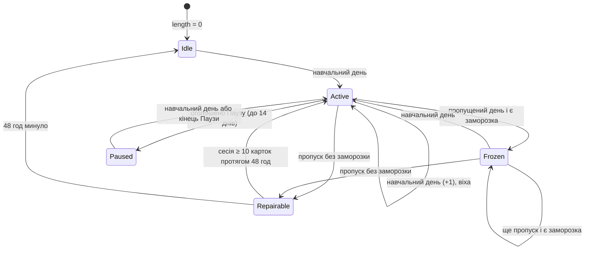
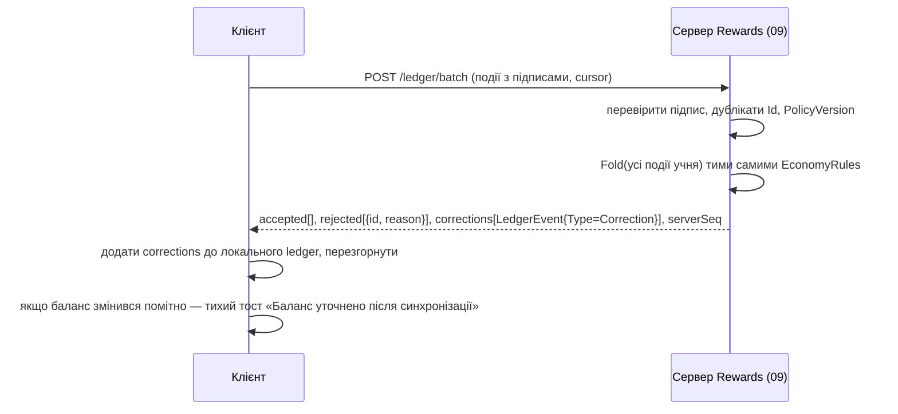

# 07. Гейміфікація: серія, щоденний вхід, мікрозавдання, колючки

| Поле | Значення |
|---|---|
| Статус | Draft |
| Версія | 0.1 |
| Дата | 2026-09-27 |
| Власник | Архітектор (затверджує власник продукту) |
| Джерела рішень | [Журнал рішень](../decisions/2026-09-25-interview.md): Q14/Q32, Q20, Q24, Q34, T11, T14, T17, T18; [Дослідницький звіт](../research/2026-09-25-research-brief.md) §6 «Streaks & rewards», §7 (пункти 36-40, 44-47) |
| Пов'язані специфікації | 06-learning-engine (доменні події, навчальний день), 02-design-system (`StreakBadge`, `CurrencyPill`, `DailyCalendarTile`, `TaskRow`, `RewardCard`, motion), 03-ux-flows-screens (екрани «Нагороди», «Серія», підсумок сесії), 05 (сповіщення), 09-backend (звірка ledger), 11-monetization (паритет free/Pro), 13-analytics (guardrail) |

## 0. Контекст для ШІ-агента

Ти працюєш над модулем гейміфікації «Реп'яха» — чистою доменною логікою в `Burdock.Domain.Rewards`, яка з подій рушія навчання (06) виводить серію, XP, валюту «колючки», щоденний календар, мікрозавдання та досягнення. Перед роботою прочитай: журнал рішень (Q34, Q24, T11, T17, T18), §6 дослідницького звіту («Streaks & rewards»), 06-learning-engine (§3.7 підсумок сесії, §3.9 навчальний день) і цю специфікацію.

Правила, які не можна порушувати:
1. Нагороди нараховуються **лише** за навчальні дії; пасивні покази на віджеті чи в сповіщенні ніколи не дають серію, XP чи колючки (звіт §7 п. 37).
2. Колючки не купуються за гроші, не випадають випадково, не згорають (Q34). Жодного ГПВЧ у виборі нагород; єдиний детермінований `IDeterministicRandom` — для вибору мікрозавдань дня.
3. Жодного формулювання втрати: ані в UI, ані в сповіщеннях, ані в назвах подій (T17). «Серія перервалась» описується як факт із пропозицією продовжити, а не як покарання.
4. Нагороди не залежать від дозволу на сповіщення, відстеження чи покупок (Apple 5.1.2(i)); Pro не має економічної переваги (Q34, §3.2.6).
5. Уся економіка — чиста згортка `EconomyRules.Fold(events) → EconomyState` без `DateTime.Now`, без I/O; той самий код виконує сервер при звірці (T18).
6. Перемикач «Без гейміфікації» першокласний: логіка працює, презентація вимикається (§3.9).

Код: `src/Burdock.Domain/Rewards/*` (правила, стан, події), `src/Burdock.Application/Rewards/*` (обробники доменних подій 06 → `LedgerEvent`), `src/Burdock.Infrastructure/Persistence/Rewards/*`, тести `tests/Burdock.Domain.Tests/Rewards/*`. Перевірка: `dotnet test` — property-тести згортки (порядок подій не впливає, каппи не перевищуються), snapshot-тести стану серії навколо межі 04:00, тест на список заборонених слів у копірайті `Copy.Rewards.*`.

## 1. Мета й межі

### 1.1 Мета

Підтримати звичку щоденного активного повторення без маніпуляцій: серія та щоденні нагороди дають зворотний зв'язок про сталість, XP — про обсяг зусиль, колючки — приємний, але необов'язковий спосіб «одягнути» Реп'яшка і віджет. Дизайн виходить із висновку Deci, Koestner і Ryan (1999): очікувані матеріальні нагороди підривають внутрішню мотивацію, тоді як інформаційний зворотний зв'язок — ні ([doi:10.1037/0033-2909.125.6.627](https://doi.org/10.1037/0033-2909.125.6.627)). Тому все, що ми даруємо, або інформує про прогрес, або є косметикою без ігрової переваги.

### 1.2 Входить у v1

- Серія: режими Щоденний і Гнучкий N/7, заморозка, відновлення 48 год, Пауза, віхи (§3.3).
- Щоденний календар входу: 7-денний цикл і 30-денний трек (§3.4).
- Економіка: XP з 30 рівнями та титулами, колючки з таблицями нарахування і витрат, каталог косметики (§3.2).
- Бібліотека мікрозавдань (24) з детермінованим добором 3 щоденних + 1 тижневого (§3.5); 20 досягнень (§3.6).
- Append-only ledger із чистою згорткою, клієнтське нарахування зі звіркою сервером (§3.7, T18).
- Святкування з драбиною інтенсивності та еквівалентами для Reduce Motion; стани Реп'яшка (§3.8).
- Режим «Без гейміфікації» (§3.9), синхронізація та офлайн (§3.10), guardrail-метрики (§3.11).

### 1.3 Не входить у v1 / відкладено

| Що | Статус | Де вирішується |
|---|---|---|
| Ліги, друзі, порівняння, спільні цілі | Не в v1 (Q24); модуль `Social` зарезервований в архітектурі | Roadmap після 6 місяців |
| Серверно-авторитетне нарахування | v1.1; у v1 клієнт нараховує, сервер звіряє (T18) | 09-backend |
| App Attest / Play Integrity | Відкладено до появи цінних нагород (T16) | 10-security |
| Купівля колючок, «преміальна» валюта, випадкові скрині | Ніколи (Q34, звіт §7 пп. 38-39) | — |
| Реальні призи, конкурси | Ні (звіт §7 п. 45) | — |
| Шпалери екрана блокування як предмет каталогу | Не в v1 (потребує окремого дослідження виводу зображень на заблокований екран) | Відкрите питання 3 |
| A/B-експерименти над нагородами | Не в v1 (§3.11) | 13-analytics |
| Сезонні або обмежені в часі предмети | Ні: штучна терміновість суперечить принципам (§3.1) | — |

## 2. Вимоги

### 2.1 Функціональні

| ID | MoSCoW | Вимога | Перевірка |
|---|---|---|---|
| FR-07-1 | Must | Навчальний день для серії = подія `SessionCompleted` з `learningDayCounted=true` (≥ `session.minGradedForDay` оцінених карток, 06). Події `ExposureConfirmed` не впливають на серію, календар і валюту. | AC-07-1 |
| FR-07-2 | Must | Режим серії обирається в налаштуваннях: `Daily` (за замовчуванням, T11) або `Flexible(N)` з N за замовчуванням 5 і діапазоном 3-6 днів на тиждень. | AC-07-2 |
| FR-07-3 | Must | Заморозка: одна безкоштовна на тиждень нараховується автоматично, у запасі не більше `streak.freeze.maxBanked` (2); застосовується автоматично за пропущений день; купується за колючки з лімітом частоти. | AC-07-3 |
| FR-07-4 | Must | Відновлення: після переривання без заморозки протягом `streak.repair.windowHours` (48) учень може повернути серію, завершивши сесію з ≥ `streak.repair.gradedCards` оцінених карток; без оплати. | AC-07-4 |
| FR-07-5 | Must | Пауза: учень заздалегідь або в поточний день оголошує паузу до `streak.pause.maxDays` (14); дні паузи не рахуються ні пропусками, ні навчальними днями. | AC-07-5 |
| FR-07-6 | Must | Віхи серії 3, 7, 14, 30, 60, 100, 365 і кожні 100 далі дають колючки й святкування рівня за §3.8; віха нараховується один раз на серію. | AC-07-6 |
| FR-07-7 | Must | Межа дня, часовий пояс і `DayGap(TimezoneShift)` беруться з 06 §3.9; серія ніколи не переривається через зміну часового поясу. | AC-07-7 |
| FR-07-8 | Must | Календар входу: 7-денний цикл 5/5/10/10/15/15/30 колючок; пропущений день не скидає позицію в циклі; 30 зарахованих днів відкривають тему віджета «Луг». | AC-07-8 |
| FR-07-9 | Must | Нагорода календаря нараховується автоматично при першому відкритті застосунку в навчальний день (без окремого натискання і без модального вікна). | AC-07-9 |
| FR-07-10 | Must | XP нараховуються за таблицею §3.2.1, не витрачаються; рівень = найбільший L з `xp ≥ 25·(L−1)·(L+2)`, L ∈ 1..30. | AC-07-10 |
| FR-07-11 | Must | Колючки нараховуються лише за джерелами таблиці §3.2.2 з денними лімітами на джерело та загальним лімітом повторюваних джерел `economy.dailyEarnCap`. | AC-07-11 |
| FR-07-12 | Must | Каталог витрат §3.2.3: теми віджета, вбрання і пакети емоцій Реп'яшка, рамки аватара, заморозка серії; ціни та умови розблокування — з конфігурації. | AC-07-12 |
| FR-07-13 | Must | Купівля неможлива при недостатньому балансі; колючки не купуються за гроші, не згорають, баланс не має верхньої межі. | AC-07-13 |
| FR-07-14 | Must | Мікрозавдання: щодня о межі дня добираються 3 щоденних, щопонеділка — 1 тижневе, детерміновано за (`learnerId`, `learningDay`) з фільтром релевантності §3.5.2. | AC-07-14 |
| FR-07-15 | Must | Прогрес завдання обчислюється як предикат над доменними подіями; жодне завдання не винагороджує дозвіл на сповіщення, підписку чи оцінку в магазині. | AC-07-15 |
| FR-07-16 | Must | Досягнення §3.6 нараховуються один раз, приховані досягнення не показують умову до отримання. | AC-07-16 |
| FR-07-17 | Must | Кожне нарахування або витрата — `LedgerEvent` (append-only, UUIDv7, підписаний); стан = `EconomyRules.Fold(events)`; дублікати за `id` ігноруються. | AC-07-17 |
| FR-07-18 | Must | Сервер повторює згортку тими самими правилами, відхиляє неможливі події (`LedgerRejection`) і повертає корекції; клієнт застосовує корекції без втрати вже куплених предметів, крім випадків підтвердженого дублювання. | AC-07-18 |
| FR-07-19 | Must | Події з `suspect=true` (зсув годинника, 06 §3.9) не зараховуються в серію, календар і валюту до підтвердження сервером. | AC-07-19 |
| FR-07-20 | Must | Святкування дотримуються драбини §3.8: без миготіння > 3/с, з еквівалентом для Reduce Motion, звук вимкнений за замовчуванням, інформація ніколи не передається лише кольором чи звуком. | AC-07-20 |
| FR-07-21 | Must | Перемикач «Без гейміфікації» ховає XP, колючки, календар, завдання, досягнення, святкування і лічильник серії; облік триває (§3.9). | AC-07-21 |
| FR-07-22 | Must | Усі копірайти нагород і серії проходять тест на заборонений словник (втрата, сором, терміновість) і мають українські форми множини (1 день / 2 дні / 5 днів). | AC-07-22 |
| FR-07-23 | Must | Безкоштовний рівень має повний доступ до серії, календаря, завдань, досягнень і каталогу; Pro не дає множників чи ексклюзивів (§3.2.6). | AC-07-23 |
| FR-07-24 | Should | Стани Реп'яшка (радість, сум, сон, свято, здивування, підбадьорення) відображаються на події за таблицею §3.8.3; «сум» ніколи не є реакцією на результат учня. | AC-07-24 |
| FR-07-25 | Should | Ledger-події ставляться в чергу офлайн і синхронізуються пакетами; до звірки баланс показується як звичайний, корекція з'являється тихо (§3.10). | AC-07-25 |
| FR-07-26 | Should | Модуль публікує події `StreakChanged`, `LevelUp`, `CurrencyChanged`, `TaskCompleted`, `AchievementUnlocked`, `ItemPurchased` для 03, 05 і 13. | AC-07-26 |
| FR-07-27 | Could | Сповіщення про віху або заморозку надсилаються лише в межах ліміту 05 (≤ 1 нагородне сповіщення на день) і ніколи про переривання серії. | AC-07-27 |
| FR-07-28 | Must | Guardrail: жодна зміна параметрів гейміфікації не вважається успішною, якщо метрика 30-денного утримання (06 `retention.estimate`) падає понад `guardrail.retentionDropPp` (2 в. п.) при зростанні DAU (§3.11). | AC-07-28 |

### 2.2 Нефункціональні

| ID | MoSCoW | Вимога |
|---|---|---|
| NFR-07-1 | Must | Згортка 20 000 `LedgerEvent` ≤ 30 мс на пристрої середнього класу; інкрементальна згортка з контрольної точки (snapshot кожні `ledger.snapshotEvery` = 500 подій). |
| NFR-07-2 | Must | Детермінізм: `EconomyRules.Fold` — чиста функція; порядок надходження подій не впливає на результат (сортування за `occurredAt`, `id`). |
| NFR-07-3 | Must | Підпис `LedgerEvent` — HMAC-SHA256 ключем інсталяції з SecureStorage (T18); серверна перевірка підпису у v1 виявляє лише підробку поза застосунком, не є антифродом. |
| NFR-07-4 | Must | Trim/AOT-сумісність, жодної рефлексії в Domain; формат ledger версіонований (`schemaVersion`). |
| NFR-07-5 | Must | Доступність святкувань: Reduce Motion, Reduce Transparency, VoiceOver/TalkBack оголошення результату текстом; таргети 44 pt / 48 dp (02). |
| NFR-07-6 | Should | Розмір ledger ≤ 100 байт/подія; 1 рік ≤ 3 МБ. |
| NFR-07-7 | Must | Жодних PII в ledger; `learnerId` — випадковий UUID (звіт §5). |
| NFR-07-8 | Should | Усі числа §3.12 читаються з `RewardsPolicy`, завантаженої з конфігурації сервера з локальним кешем і версією; зміна політики не ламає згортку старих подій (правила застосовуються за `policyVersion` події). |

## 3. Проєктування

### 3.1 Принципи

| № | Принцип | Що це означає в продукті | Джерело |
|---|---|---|---|
| P1 | Нагороди інформаційні, не контролюючі | Кожна нагорода супроводжується фактом про навчання («5 слів перейшли у «Вивчено»»), а не лише числом; косметика не дає переваг | [Deci, Koestner, Ryan 1999](https://doi.org/10.1037/0033-2909.125.6.627) |
| P2 | Без формулювань втрати | Немає «сердець», штрафів, «ти втратиш серію»; переривання описується нейтрально, відновлення — легке | T17; [Duolingo: Improving the streak](https://blog.duolingo.com/improving-the-streak/) |
| P3 | Валюта не купується і не випадає випадково | Немає магазину колючок, скринь, множників за гроші; уникаємо правил про розкриття шансів | Q34; [App Store Review Guidelines](https://developer.apple.com/app-store/review/guidelines/); [Play: Monetization](https://support.google.com/googleplay/android-developer/answer/9858738) |
| P4 | Без соціального тиску | Немає ліг, рейтингів, порівнянь, спільних серій | Q24 |
| P5 | Нагорода лише за навчання | Джерела — події 06; покази, дозволи, покупки, оцінки в магазині не винагороджуються | Звіт §7 п. 37; Apple 5.1.2(i) |
| P6 | Без темних патернів | Немає фальшивої терміновості, confirmshaming, прихованих умов, таймерів на пропозиції | [deceptive.design](https://www.deceptive.design/types) |
| P7 | «Без гейміфікації» — першокласний режим | Один перемикач у налаштуваннях і в онбордингу, без втрати даних | Звіт §7 п. 47 |
| P8 | Доступні святкування | Без обмежень часу, без миготіння > 3/с, Reduce Motion, не лише колір/звук | [WCAG 2.2 Timing](https://www.w3.org/WAI/WCAG22/Understanding/timing-adjustable.html); [Game Accessibility Guidelines](https://gameaccessibilityguidelines.com/full-list/) |
| P9 | Звичка, а не тиск | Копірайт сповіщень у рамці звички («Твої 5 слів чекають»), 1 нагородне сповіщення/день, тихі години | [Duolingo: How the streak builds habit](https://blog.duolingo.com/how-duolingo-streak-builds-habit/), [Putting in work](https://blog.duolingo.com/putting-in-work-the-habit-of-language-learning/) |
| P10 | Пам'ять важливіша за DAU | Guardrail §3.11: зростання активності не приймається ціною 30-денного утримання | Звіт §8 «cross-cutting gaps» |

### 3.2 Економіка

#### 3.2.1 XP і рівні

XP не витрачаються і не скидаються. Нарахування (ключі `xp.earn.*`): оцінена картка з `rating ≥ Hard` — 2, з `Again` — 1 (зусилля рахується); `SessionCompleted` з `learningDayCounted` — 10; `WarmupCompleted` — 5 (до 2/день); `WordLearned` — 20; виконане мікрозавдання — 10 (тижневе — 30); досягнення — 25. Поріг рівня L: `xp.levelThreshold(L) = 25 · (L − 1) · (L + 2)` (крок зростає на 50 XP щорівня). При ~20 картках на день учень досягає рівня 10 приблизно за 6 тижнів, рівня 30 — приблизно за рік (припущення для калібрування).

| Рівень | XP | Титул | Рівень | XP | Титул | Рівень | XP | Титул |
|---|---|---|---|---|---|---|---|---|
| 1 | 0 | Насінинка | 11 | 3 250 | Лугова душа | 21 | 11 500 | Мудрий реп'ях |
| 2 | 100 | Паросток | 12 | 3 850 | Стежковий мандрівник | 22 | 12 600 | Старійшина лугу |
| 3 | 250 | Пагінець | 13 | 4 500 | Словолов | 23 | 13 750 | Реп'ях-дослідник |
| 4 | 450 | Листочок | 14 | 5 200 | Чіпкий словолов | 24 | 14 950 | Словограй |
| 5 | 700 | Кущик | 15 | 5 950 | Знавець стежок | 25 | 16 200 | Реп'ях-поліглот |
| 6 | 1 000 | Бутончик | 16 | 6 750 | Луговий майстер | 26 | 17 500 | Луговий легендар |
| 7 | 1 350 | Реп'яшок | 17 | 7 600 | Реп'ях-провідник | 27 | 18 850 | Реп'ях-зірка |
| 8 | 1 750 | Чіпкий реп'яшок | 18 | 8 500 | Хранитель лугу | 28 | 20 250 | Сонячний реп'ях |
| 9 | 2 200 | Колючка | 19 | 9 450 | Словоплет | 29 | 21 700 | Реп'ях-легенда |
| 10 | 2 700 | Цвіт реп'яха | 20 | 10 450 | Майстер колючок | 30 | 23 200 | Великий Реп'ях |

Титули показуються в профілі й на екрані підсумку сесії; вони не впливають на функції. Після рівня 30 XP продовжують рахуватися («Великий Реп'ях · 25 000 XP»).

#### 3.2.2 Колючки: нарахування

| Дія (подія 06/07) | Сума | Денний ліміт | Ключ |
|---|---|---|---|
| `SessionCompleted` з `learningDayCounted=true` | 10 | 3 сесії (30) | `economy.earn.session` |
| Перша сесія навчального дня (`LearningDayCounted`) | 5 | 1 | `economy.earn.learningDay` |
| `WordLearned` | 5 | 10 слів (50) | `economy.earn.wordLearned` |
| Мікрозавдання щоденне | 10 | 3 (30) | `economy.earn.taskDaily` |
| Мікрозавдання тижневе | 40 | 1/тиждень | `economy.earn.taskWeekly` |
| Мікрозавдання онбордингове/одноразове | 10-30 (за таблицею §3.5) | одноразово | `economy.earn.taskOneOff` |
| Календар входу | 5/5/10/10/15/15/30 за позицією циклу | 1 | `economy.calendar.cycle` |
| Віха серії 3 / 7 / 14 / 30 / 60 / 100 / 365 / кожні +100 | 15 / 30 / 50 / 100 / 150 / 250 / 500 / 250 | 1 на віху на серію | `economy.earn.streakMilestone` |
| Досягнення | 20-100 (§3.6) | одноразово | `economy.earn.achievement` |
| Загальний ліміт повторюваних джерел (сесії, дні, слова, щоденні завдання) | — | 150/день | `economy.dailyEarnCap` |

Віхи, тижневі завдання, календар і досягнення не входять у `dailyEarnCap`. Типовий активний день дає 60-120 колючок; перший предмет каталогу (рамка за 100) доступний на 2-й день, перша тема — приблизно за тиждень (припущення для калібрування; перевіряється метриками §3.11).

#### 3.2.3 Колючки: каталог витрат

| Категорія | Предмет | Ціна | Умова розблокування | Ключ |
|---|---|---|---|---|
| Тема віджета | Цвіт (палітра «Реп'ях-цвіт») | 0 | За замовчуванням | `catalog.theme.bloom` |
| Тема віджета | Луг | 0 | 30 зарахованих днів календаря (§3.4) | `catalog.theme.meadow` |
| Тема віджета | Ніч | 400 | — | `catalog.theme.night` |
| Тема віджета | Сонце | 600 | Рівень 8 | `catalog.theme.sun` |
| Вбрання Реп'яшка | Шарфик | 150 | — | `catalog.outfit.scarf` |
| Вбрання Реп'яшка | Окуляри | 150 | — | `catalog.outfit.glasses` |
| Вбрання Реп'яшка | Бриль | 200 | — | `catalog.outfit.strawhat` |
| Вбрання Реп'яшка | Рюкзачок | 200 | Виконано `TASK_ONB_FIRST_SESSION` | `catalog.outfit.backpack` |
| Вбрання Реп'яшка | Дощовик | 250 | — | `catalog.outfit.raincoat` |
| Вбрання Реп'яшка | Віночок | 300 | Серія 7 | `catalog.outfit.wreath` |
| Вбрання Реп'яшка | Светр із оленями | 300 | — | `catalog.outfit.sweater` |
| Вбрання Реп'яшка | Бандана | 350 | 50 слів «Вивчено» | `catalog.outfit.bandana` |
| Вбрання Реп'яшка | Вишиванка | 500 | Рівень 10 | `catalog.outfit.vyshyvanka` |
| Вбрання Реп'яшка | Космічний шолом | 600 | 100 слів «Вивчено» | `catalog.outfit.spacehelmet` |
| Вбрання Реп'яшка | Корона | 800 | Рівень 20 | `catalog.outfit.crown` |
| Емоції Реп'яшка | Базовий набір (6 станів) | 0 | За замовчуванням | `catalog.emotion.base` |
| Емоції Реп'яшка | Театральний (виразніші анімації) | 250 | — | `catalog.emotion.theatrical` |
| Емоції Реп'яшка | Дрімливий (спокійні, повільні) | 250 | — | `catalog.emotion.sleepy` |
| Рамка аватара | Листочок | 100 | — | `catalog.frame.leaf` |
| Рамка аватара | Лаймова | 150 | — | `catalog.frame.lime` |
| Рамка аватара | Фіолетова | 150 | — | `catalog.frame.violet` |
| Рамка аватара | Коралова | 200 | 30 слів «Вивчено» | `catalog.frame.coral` |
| Рамка аватара | Сонячна | 250 | Серія 14 | `catalog.frame.sunny` |
| Рамка аватара | Небесна | 300 | — | `catalog.frame.sky` |
| Рамка аватара | Золота | 500 | Рівень 15 | `catalog.frame.gold` |
| Серія | Заморозка на день | 200 | ≤ 1 покупка на 7 днів, запас ≤ 2 | `catalog.freeze` |

Умови розблокування показуються відкрито («Відкриється на рівні 8») і ніколи не мають дедлайну. Куплені предмети не втрачаються, повернень немає (ціни низькі, а колючки не мають грошової вартості).

#### 3.2.4 Контроль інфляції

Сумарна вартість каталогу v1 ≈ 7 700 колючок; при 60-120/день учень збирає її за 3-4 місяці — цього достатньо, щоб косметика лишалась приємною, але не ставала метою. Інструменти: денні ліміти на джерело, `dailyEarnCap`, єдиний повторюваний «стік» (заморозка) з лімітом частоти, версія політики в кожній події (ціни можна змінювати без переписування історії). Валюта не згорає і не має верхньої межі балансу — інакше з'явилась би рамка втрати. Розширення каталогу планується щоквартально без обмежених у часі предметів (відкрите питання 2).

#### 3.2.5 Валюта і назва

Назва в UI — «колючки» (Q34; дослідницький звіт вживав робочу назву «реп'яшки», журнал рішень має пріоритет). Одна колючка неподільна; символ у `CurrencyPill` — іконка колючки з 02.

#### 3.2.6 Паритет безкоштовного рівня і Pro

Серія, календар, завдання, досягнення, XP і весь каталог доступні в безкоштовному режимі (Q14/Q32). Pro не отримує множників XP чи колючок, ексклюзивних предметів або додаткових заморозок у v1 (рішення: жодних ексклюзивів, щоб нагороди не сприймалися як частина продажу і не порушували P1/P3). Єдина відмінність — у Pro більше навчальних подій (більше нових слів), отже, органічно більше нагород; це наслідок навчання, а не привілей.

### 3.3 Серія

#### 3.3.1 Визначення

Навчальний день — `SessionCompleted{learningDayCounted=true}` (≥ 5 оцінених карток, 06 §3.7). Одного такого дня достатньо; додаткові сесії не подовжують серію, лише дають колючки в межах лімітів. `StreakState { mode, length, longest, lastCountedDay, freezesBanked, lastFreezeGrantWeek, lastFreezePurchaseDay, pause?, repair?, week {start, daysCounted} }` обчислюється лінивою згорткою: при кожному запиті стан «дотягується» від `lastCountedDay` до вчорашнього дня, застосовуючи правила до кожного пропущеного дня. Серія ніколи не обчислюється фоновим таймером — лише детерміновано з подій і `IClock`.



#### 3.3.2 Правила

| Правило | Щоденний (`Daily`) | Гнучкий (`Flexible(N)`, N за замовчуванням 5) |
|---|---|---|
| Приріст | +1 за кожен навчальний день | +1 за кожен навчальний день; поруч показується «тиждень 3/5» |
| Перевірка пропуску | Кожен день без навчання (поза Паузою) | Наприкінці тижня (понеділок 04:00 місцевого часу): якщо `daysCounted < N`, дефіцит = `N − daysCounted` |
| Заморозка | Пропущений день покривається однією заморозкою; серія не змінюється; подія `FreezeApplied` | Кожен день дефіциту покривається однією заморозкою |
| Без заморозки | Стан `Repairable` з дедлайном `кінець пропущеного дня + streak.repair.windowHours` | Те саме від кінця тижня |
| Відновлення | Сесія з ≥ `streak.repair.gradedCards` (10) оцінених карток до дедлайну повертає `length`; пропущений день позначається «відновлено»; не більше `streak.repair.maxPer30Days` (2) | Те саме |
| Кінець серії | Після дедлайну `length → 0`, `longest` зберігається; наступний навчальний день починає нову серію без будь-яких втрат у валюті або предметах | Те саме |

Спільні правила:
- **Нарахування заморозок**: щопонеділка о 04:00 місцевого часу, якщо `freezesBanked < streak.freeze.maxBanked` (2), додається одна (`FreezeGranted{reason=Weekly}`). Купівля: `catalog.freeze` за 200 колючок, не частіше ніж раз на `streak.freeze.purchaseCooldownDays` (7), лише якщо запас < 2. Заморозка застосовується автоматично й лише за реальний пропуск; підтвердження не потрібне (P2: жодних «встигни купити»).
- **Пауза**: учень задає діапазон дат (початок — сьогодні або пізніше, довжина ≤ `streak.pause.maxDays` = 14); дні паузи не є ні пропусками, ні навчальними; навчання під час паузи дозволене і рахує день (пауза скорочується автоматично). Між паузами `streak.pause.cooldownDays` (7). Мета — відпустка, хвороба, іспити без «гри в заморозки».
- **Віхи**: множина `{3, 7, 14, 30, 60, 100, 365} ∪ {k·100 : k ≥ 2}`; кожна віха дає колючки за §3.2.2 і святкування §3.8 (3-14 — рівень L2, 30-60 — L3, 100+ — L4). Віха фіксується подією `StreakMilestoneReached{length}` один раз на серію.
- **Часовий пояс**: межа дня та `DayGap(reason=TimezoneShift)` — з 06 §3.9; день із таким розривом не є пропуском. Події з `suspect=true` не рухають серію до підтвердження сервером; UI показує «сесію збережено, серію оновимо після синхронізації».
- **Зміна режиму**: перехід `Daily → Flexible` зберігає `length`; `Flexible → Daily` також, але перевірка пропусків починається з наступного дня. Зміна не частіше ніж раз на 7 днів (припущення), щоб режим не став інструментом обходу.

#### 3.3.3 Копірайт серії

| Момент | Дозволено | Заборонено |
|---|---|---|
| Активна серія | «Серія: 12 днів» (форми: 1 день / 2-4 дні / 5+ днів через `PluralRules`) | «Не втрать серію!» |
| Застосована заморозка | «Учора Реп'яшок прикрив тебе заморозкою. Серія: 12 днів» | «Ти пропустив день» |
| Стан Repairable | «Серія на 12 днях зробила паузу. Одна сесія до завтра її поверне» + кнопка «Повернути серію» | Таймер зворотного відліку, червоні кольори, «останній шанс» |
| Кінець серії | «Твоя серія була 12 днів — це вже звичка. Нова починається з сьогоднішньої сесії» | «Серію втрачено», «0 днів» великим шрифтом |
| Сповіщення (05) | Лише про слова дня або віху; ніколи про переривання (T17) | Будь-яке нагадування у формі втрати |

### 3.4 Календар входу

| Правило | Опис |
|---|---|
| Цикл | 7 позицій з нагородами `economy.calendar.cycle = [5, 5, 10, 10, 15, 15, 30]` колючок. Позиція просувається лише в зарахований день; після 7-ї — знову 1-ша. |
| Зарахування | Автоматично при першому переході застосунку на передній план у навчальний день (подія `AppOpened` → `CalendarDayClaimed{position, learningDay}`), без окремого натискання і без модального вікна: тост «+10 колючок · день 3 з 7» і анімація `DailyCalendarTile` (02). Рішення на користь автозарахування: окрема кнопка «забрати» створює ритуал і відчуття втрати за незабране (P2, P6). |
| Пропущений день | Нічого не втрачається і не скидається: наступного разу нараховується наступна позиція. Сповіщень про «незабрану нагороду» немає. |
| Межа дня | Ключ — `learningDay` з 06 §3.9; відкриття о 03:30 належить попередньому дню і не дає повторного зарахування. |
| 30-денний трек | Лічильник зарахованих днів (не поспіль): день 30 — тема віджета «Луг» (`ThemeUnlocked{meadow}`), день 60 — рамка «Небесна», день 90 — 100 колючок; далі кожні 30 днів — 50 колючок (припущення). Прогрес показується як «18 / 30 днів до теми «Луг»» без дедлайну. |
| Без гейміфікації | Зарахування відбувається тихо (§3.9), UI не показує нічого. |
| Офлайн | `CalendarDayClaimed` створюється локально й синхронізується як звичайна ledger-подія; сервер відхиляє другу подію на той самий `learningDay` (§3.7). |

### 3.5 Мікрозавдання

#### 3.5.1 Бібліотека

Тип: D — щоденне, W — тижневе, O — онбордингове/одноразове. Умова — предикат над подіями поточного вікна (день/тиждень) або над станом. Умова релевантності визначає, чи завдання може потрапити в добір сьогодні.

| ID | Тип | Назва | Опис для учня | Умова виконання | Релевантне, якщо | Нагорода |
|---|---|---|---|---|---|---|
| TASK_D_REVIEW_10 | D | Десятка повторень | Повтори 10 слів | `count(CardGraded where stateBefore ∈ {Review, Learned, Relearning}) ≥ 10` | `dueReviews ≥ 10` | 10 |
| TASK_D_NEW_5 | D | П'ять новеньких | Познайомся з 5 новими словами в сесії | `count(WordIntroduced where surface = InApp) ≥ 5` | `intakeQuota ≥ 5` і немає `BackpackFull` | 10 |
| TASK_D_TYPED_5 | D | Набери сам | Набери з клавіатури 5 слів | `count(CardGraded where mode = TypedRecall) ≥ 5` | ≥ 5 карток зі `stability ≥ typed.minStabilityDays` | 10 |
| TASK_D_TWO_SESSIONS | D | Двічі за день | Заверши дві сесії | `count(SessionCompleted where learningDayCounted) ≥ 2` | завжди | 10 |
| TASK_D_WARMUP | D | Розминка | Пройди розминку «пари» | `count(WarmupCompleted) ≥ 1` | ≥ 5 карток у стані ≥ Learning | 10 |
| TASK_D_ACCURACY | D | Впевнений крок | Заверши сесію з ≥ 80 % правильних (≥ 10 карток) | `∃ SessionCompleted: graded ≥ 10 ∧ correct/graded ≥ 0.8` | завжди | 10 |
| TASK_D_TOPIC_MIX | D | Три стежки | Повтори слова з трьох різних категорій | `distinct(topic of CardGraded) ≥ 3` | обрано ≥ 3 категорії | 10 |
| TASK_D_RELEARN | D | Друга спроба | Поверни 3 слова після «Ще ні» | `count(CardGraded where stateBefore = Relearning ∧ rating ≥ Hard) ≥ 3` | ≥ 3 картки у Relearning | 10 |
| TASK_D_LEARNED_1 | D | Плюс одне в скарбничку | Доведи одне слово до «Вивчено» | `count(WordLearned) ≥ 1` | ≥ 1 картка з 2 доказами і `stability ≥ 21` | 10 |
| TASK_D_SESSION_15 | D | Довша прогулянка | Пройди сесію на 15+ карток | `∃ SessionCompleted: graded ≥ 15` | `dueReviews + intakeQuota ≥ 15` | 10 |
| TASK_D_EXAMPLES | D | Читач | Відкрий приклади до 5 слів | `count(ExampleViewed) ≥ 5` | завжди | 10 |
| TASK_D_LISTEN | D | Послухай | Прослухай вимову 5 слів | `count(PronunciationPlayed) ≥ 5` | TTS доступний | 10 |
| TASK_D_DUE_CLEAR | D | Чиста черга | Повтори все, що на сьогодні | `count(CardGraded where card ∈ dueReviews) ≥ dueReviews` | `5 ≤ dueReviews ≤ 30` | 10 |
| TASK_W_DAYS | W | П'ять днів | Навчайся 5 днів цього тижня (у гнучкому режимі — N) | `learningDays(week) ≥ N або 5` | завжди | 40 |
| TASK_W_LEARNED_10 | W | Десять у скарбничку | Доведи 10 слів до «Вивчено» за тиждень | `count(WordLearned, week) ≥ 10` | ≥ 10 карток близькі до порогу | 40 |
| TASK_W_TYPED_30 | W | Тридцять наборів | Набери 30 слів з клавіатури | `count(CardGraded mode = TypedRecall, week) ≥ 30` | ≥ 15 карток придатні | 40 |
| TASK_W_REVIEW_100 | W | Сотня повторень | Повтори 100 слів за тиждень | `count(CardGraded, week) ≥ 100` | середня `capacity ≥ 15` | 40 |
| TASK_W_ALL_TOPICS | W | Усі стежки | Повтори слова з кожної обраної категорії | `distinct(topic) = settings.categories.Count` | ≥ 2 категорії | 40 |
| TASK_W_NEW_30 | W | Тридцять нових | Познайомся з 30 новими словами | `count(WordIntroduced InApp, week) ≥ 30` | `newWordsPerDay ≥ 5` і немає `BackpackFull` | 40 |
| TASK_ONB_FIRST_SESSION | O | Перша сесія | Заверши першу сесію | `SessionCompleted` | завжди | 20 |
| TASK_ONB_WIDGET | O | Реп'яшок на робочому столі | Додай віджет | `WidgetInstalled` | платформа підтримує віджети | 20 |
| TASK_ONB_SETTINGS | O | Свій темп | Налаштуй ритм показів під себе | `SettingsChanged{key ∈ {cadenceMinutes, quietHours, exposuresPerWordPerDay, retention}}` | завжди (ключі доступні й у безкоштовному режимі) | 10 |
| TASK_ONB_TYPED | O | Перший набір | Набери перше слово з клавіатури | `CardGraded{mode = TypedRecall}` | завжди | 10 |
| TASK_ONB_LEARNED | O | Перше вивчене | Доведи перше слово до «Вивчено» | `WordLearned` | завжди | 30 |
| TASK_ONB_LIVE_SESSION | O | Сесія на екрані | Запусти сесію слів на екрані блокування (Live Activity) | `LiveActivityStarted` | iOS 16.1+ | 10 |

Жодне завдання не згадує дозволи на сповіщення, підписку, оцінку в магазині чи запрошення друзів (Apple 5.1.2(i), P4, P5). Завдання, що залежать від Pro-функцій (зміна рівня/категорій), відсутні свідомо.

#### 3.5.2 Добір і відображення

```text
SelectDaily(state, plan, day, rng = Xoshiro(H(learnerId, day, "tasks-v1"))):
  candidates := DailyTasks where Relevant(task, state, plan) and task ∉ yesterday.selected (якщо після виключення лишається ≥ 3)
  groups     := {Reviews: [REVIEW_10, DUE_CLEAR, RELEARN, ACCURACY], Growth: [NEW_5, LEARNED_1, TOPIC_MIX], Modes: [TYPED_5, WARMUP, LISTEN, EXAMPLES, SESSION_15, TWO_SESSIONS]}
  pick один із кожної групи через rng; якщо група порожня — добрати з іншої
SelectWeekly(...): щопонеділка о 04:00 місцевого часу один із WeeklyTasks за тим самим принципом; TASK_W_DAYS має пріоритет кожен другий тиждень
```

Онбордингові завдання показуються окремим блоком до виконання і не займають місць щоденних. Оновлення — на межі дня (04:00); завдання, не виконані до межі, просто зникають без повідомлення. Прогрес (`TaskRow`, 02) показує «7 / 10» і обчислюється згорткою подій дня; таймерів «залишилось 3 години» немає (P6). Завдання, що стало нерелевантним протягом дня (наприклад, спрацював «Рюкзак повний»), лишається видимим, але позначається «сьогодні не обов'язкове».

### 3.6 Досягнення

Досягнення одноразові, дають XP (25) і колючки за таблицею; «приховані» показують лише силует і напис «Секрет» до отримання. Іконки — Lucide 1.48.0 (ISC), позначені `custom` малює дизайнер у стилі Реп'яшка (02).

| ID | Назва | Умова | Видиме | Іконка | Колючки |
|---|---|---|---|---|---|
| ACH_FIRST_STEP | Перший крок | Перша `SessionCompleted` | так | `footprints` | 20 |
| ACH_STREAK_7 | Тиждень поспіль | Серія 7 | так | `flame` | 30 |
| ACH_STREAK_30 | Місяць поспіль | Серія 30 | так | `calendar-check` | 50 |
| ACH_STREAK_100 | Сотня днів | Серія 100 | так | `medal` | 100 |
| ACH_STREAK_365 | Рік із Реп'яшком | Серія 365 | так | custom «вінок 365» | 100 |
| ACH_LEARNED_10 | Перша десятка | 10 слів у «Вивчено» | так | `sprout` | 20 |
| ACH_LEARNED_100 | Сотня в скарбничці | 100 слів | так | `trees` | 50 |
| ACH_LEARNED_500 | П'ятсот | 500 слів | так | `mountain` | 100 |
| ACH_LEARNED_1000 | Тисяча | 1 000 слів | так | custom «реп'ях-гора» | 100 |
| ACH_TYPED_100 | Клавіатурний майстер | 100 правильних `TypedRecall` | так | `keyboard` | 30 |
| ACH_REVIEWS_1000 | Тисяча повторень | 1 000 оцінених карток | так | `repeat` | 50 |
| ACH_LEVEL_10 | Цвіт реп'яха | Рівень 10 | так | `flower` | 30 |
| ACH_LEVEL_20 | Майстер колючок | Рівень 20 | так | `award` | 50 |
| ACH_LEVEL_30 | Великий Реп'ях | Рівень 30 | так | custom «корона» | 100 |
| ACH_TOPIC_COMPLETE | Стежку пройдено | Усі слова однієї категорії поточного рівня у «Вивчено» або «Знаю» | так | `map` | 50 |
| ACH_ALL_TOPICS_WEEK | Компас | За тиждень оцінені картки з усіх обраних категорій | так | `compass` | 20 |
| ACH_COMEBACK | Повернення | Сесія після ≥ 14 днів без навчання | приховане (щоб не заохочувати перерву) | `sunrise` | 20 |
| ACH_PERFECT_20 | Жодного «Ще ні» | Сесія ≥ 20 карток без `Again` | приховане | `sparkles` | 30 |
| ACH_RELEARN_50 | Друге дихання | 50 карток повернулися з `Relearning` у `Review` | так | `refresh-cw` | 30 |
| ACH_WARDROBE_5 | Модник | 5 вбрань у гардеробі | приховане | `shirt` | 20 |

### 3.7 Модель ledger

#### 3.7.1 Події та стан

```csharp
public sealed record LedgerEvent(
    Guid Id,                 // UUIDv7, генерується клієнтом
    LedgerEventType Type,    // Earn, Spend, FreezeGrant, FreezeConsume, CalendarClaim, TaskComplete,
                             // AchievementUnlock, StreakMilestone, StreakRepair, PauseDeclared, Correction
    int Amount,              // > 0 для нарахувань, < 0 для витрат, 0 для службових
    Currency Currency,       // Thorns (колючки) | Xp | None
    string Reason,           // ключ джерела: "session", "task:TASK_D_TYPED_5", "catalog.outfit.scarf", ...
    Guid? SourceEventId,     // id доменної події 06 (SessionCompleted, CardGraded, ...) для ідемпотентності
    DateTimeOffset OccurredAt, LocalDate LearningDay, Guid ClientId,
    int PolicyVersion, bool Suspect, byte[] Signature);        // HMAC-SHA256 ключем інсталяції
```

`EconomyState { thorns, xp, level, inventory: Set<ItemId>, equipped, freezes, streak: StreakState, calendar: CalendarState, tasks: TaskProgress, achievements: Set<AchievementId>, lastAppliedEventId }`. `EconomyRules.Fold(policy, events, clock)`:

```text
Fold(events):
  state := Empty
  for e in Distinct(events by Id) order by (OccurredAt, Id):
      if e.Suspect and not e.Confirmed: skip (лишається в черзі на підтвердження)
      if Duplicate(e.SourceEventId, e.Reason) within state: skip          // одна нагорода на одну доменну подію
      if ExceedsDailyCap(state, e): clamp amount до залишку ліміту (0 → skip)
      if e.Type = Spend and state.thorns + e.Amount < 0: mark Rejected     // клієнт не створює таких подій; сервер відхиляє
      state := Apply(state, e)
  return state
```

Ідемпотентність на двох рівнях: `Id` події та пара (`SourceEventId`, `Reason`) — та сама сесія не може двічі дати «10 за сесію», навіть якщо подія створена на двох пристроях. Клієнт створює ledger-події в обробнику доменних подій 06 (`Application.Rewards.RewardsProjector`) синхронно з записом `ReviewLog` в одній транзакції SQLite.

#### 3.7.2 Звірка сервером (v1) і шлях до v1.1



| Аспект | v1 (T18) | v1.1 |
|---|---|---|
| Хто нараховує | Клієнт; сервер повторює згортку і відхиляє неможливе (перевищення лімітів, невідомий `Reason`, майбутній `OccurredAt`, зсув годинника > `clock.maxSkewHours`, дублікат `SourceEventId`) | Сервер нараховує з подій 06; клієнт показує оптимістичний прогноз тими самими `EconomyRules` |
| Наслідки відхилення | `Correction` зі зворотною сумою; предмети, куплені за відхилені колючки, **лишаються** (косметика не варта конфлікту), баланс обрізається до 0 (припущення) | Те саме, але прогноз замінюється фактом |
| Код | Один пакет `Burdock.Domain.Rewards` посилається і з клієнта, і з сервера | Без змін у правилах |

Антизловживання (усі — конфігуровані): денні ліміти §3.2.2; відхилення подій із `OccurredAt` у майбутньому понад `ledger.maxFutureSkewMinutes` (10); не більше `ledger.maxEventsPerDay` (500) на учня; дублікати `Id`; підпис; `PolicyVersion` не старіший за `ledger.minPolicyVersion`. App Attest / Play Integrity відкладено (T16).

### 3.8 Святкування, рух, Реп'яшок

#### 3.8.1 Драбина інтенсивності

| Рівень | Момент | Повна анімація (02) | Reduce Motion | Хаптика | Звук |
|---|---|---|---|---|---|
| L0 | Правильна відповідь | Галочка + м'яке підсвічування 200 мс | Те саме без руху | `Light` | немає |
| L1 | Завдання виконано, календар зараховано | Тост із `CurrencyPill`, що збільшується, 600 мс | Тост без масштабування | `Light` | немає |
| L2 | Сесію завершено; віха 3-14; слово «Вивчено» | Реп'яшок «радість», 5-8 листочків-конфеті 800 мс | Статична ілюстрація + fade 200 мс | `Success` | опційний, вимкнено за замовчуванням |
| L3 | Віха 30-60; новий рівень; предмет розблоковано | Повноекранна картка `RewardCard` з Реп'яшком «свято», 1 500 мс, кнопка «Далі» | Картка з'являється fade, без частинок | `Success` | опційний |
| L4 | Віха 100+, 365; рівень 30; 1 000 слів | Як L3 + унікальна ілюстрація, 2 500 мс | Як L3 | `Success` ×2 | опційний |

Інваріанти: жодного миготіння частіше 3/с (WCAG 2.3.1), жодних часових обмежень на закриття (WCAG 2.2.1), результат завжди продубльований текстом (VoiceOver/TalkBack оголошує «Сесію завершено. 12 із 15 правильно»), колір ніколи не єдиний носій інформації. Звук за замовчуванням вимкнений (`celebration.soundEnabled=false`), хаптика підпорядкована системним налаштуванням. Одночасно показується не більше одного святкування L3/L4; решта ставляться в чергу на екран підсумку.

#### 3.8.2 Стани Реп'яшка

| Стан (Q20) | Коли | Ніколи |
|---|---|---|
| Радість | Правильна відповідь серії, завершення сесії, виконане завдання | — |
| Свято | Віхи, рівні, розблокування | — |
| Здивування | Відкриття прихованого досягнення, перший «Легко» | — |
| Підбадьорення | Після `Again`, у стані Repairable, «Рюкзак повний», повернення після перерви | Не поєднується з текстом про втрату |
| Сон | Тихі години на віджеті, порожній план («на сьогодні все») | Як реакція на пропущений день |
| Сум | Лише технічні порожні стани (немає мережі при першому запуску, контент недоступний) | Ніколи як реакція на результат учня (FR-07-24) |

### 3.9 Режим «Без гейміфікації»

`LearnerSettings.gamificationEnabled=false` (перемикач в онбордингу і в налаштуваннях, з поясненням «Лише слова та повторення. Без балів, серій і нагород»). Поведінка: приховуються XP, рівень, колючки, каталог, календар входу, завдання, досягнення, `StreakBadge`, святкування L1-L4 (L0 залишається як зворотний зв'язок відповіді), нагородні сповіщення; Реп'яшок лишається як ілюстрація станів без «свята». Залишаються: підсумок сесії з фактами навчання (оцінені, правильні, «Вивчено»), нейтральний «Календар навчання» (теплова карта навчальних днів без лічильника серії), статистика 06. Облік не зупиняється: ledger-події створюються і згортаються тихо, тож повернення перемикача показує все накопичене (рішення: не карати за експеримент із режимом). Заморозки й паузи в цьому режимі не пропонуються, бо серія невидима; сервер звіряє події однаково.

### 3.10 Синхронізація та офлайн

| Аспект | Правило |
|---|---|
| Черга | Таблиця `ledger_event(id PK, ..., synced)` з індексом `WHERE synced = 0`; надсилання пакетами ≤ 200 подій при кожній синхронізації 09; порядок — за `OccurredAt`. |
| До звірки | Баланс, серія, рівень показуються як звичайні (без позначки «попередньо»); лише події `suspect` виносяться в окремий стан «очікує підтвердження». |
| Два пристрої купують офлайн | Обидві покупки приймаються, баланс після злиття може стати від'ємним → `Correction(clamp)` до 0; предмети зберігаються (припущення, §3.7.2). |
| Два пристрої зараховують один день | Дублікат за (`SourceEventId`/`LearningDay`, `Reason`) → друга подія пропускається під час згортки на обох пристроях, ще до відповіді сервера. |
| Зміна політики | Нова `RewardsPolicy` застосовується лише до подій з новим `PolicyVersion`; старі події згортаються за своєю версією (NFR-07-8). |
| Видалення акаунта | Ledger видаляється разом з іншими даними (10-security); локальна копія — при «видалити дані інсталяції». |

### 3.11 Метрики та guardrail

Модуль публікує агрегати в 13-analytics (opt-in, без ідентифікаторів): розподіл довжини серії, частка днів із заморозкою/відновленням/паузою, сесій на навчальний день, нараховано/витрачено колючок на день, продажі каталогу, виконання завдань за ID, частка учнів з вимкненою гейміфікацією, час до першої покупки. Guardrail (P10): будь-яка зміна `RewardsPolicy` оцінюється парою «навчальні дні на тиждень» × «30-денна оцінка утримання» (06 `retention.estimate`) і «слова у «Вивчено» на тиждень»; якщо активність зросла, а утримання впало понад `guardrail.retentionDropPp` (2 в. п.) або вивчені слова/тиждень впали, зміна відкочується. A/B-експериментів над нагородами у v1 немає: зміни політик версіонуються, порівнюються до/після на когортах за тижнем реєстрації, і кожна зміна документується ADR.

### 3.12 Константи політики

| Ключ | За замовчуванням | Діапазон / примітка | Джерело |
|---|---|---|---|
| `streak.mode.default` / `streak.flexible.daysPerWeek` | Daily / 5 | Daily, Flexible(3-6) | T11; звіт §6 |
| `streak.freeze.weeklyGrant` / `streak.freeze.maxBanked` | 1 / 2 | 0-2 / 1-3 | T11; звіт §6 |
| `streak.freeze.price` / `streak.freeze.purchaseCooldownDays` | 200 / 7 | 100-500 / 3-14 | припущення |
| `streak.repair.windowHours` / `streak.repair.gradedCards` / `streak.repair.maxPer30Days` | 48 / 10 / 2 | — | Звіт §6; припущення |
| `streak.pause.maxDays` / `streak.pause.cooldownDays` | 14 / 7 | 1-14 / 0-30 | Звіт §6; припущення |
| `streak.milestones` | [3, 7, 14, 30, 60, 100, 365] + кожні 100 | — | Завдання |
| `streak.modeChangeCooldownDays` | 7 | 0-30 | припущення |
| `economy.calendar.cycle` / `economy.calendar.trackRewards` | [5,5,10,10,15,15,30] / {30: theme.meadow, 60: frame.sky, 90: 100} | — | Звіт §6; припущення |
| `economy.earn.*` | таблиця §3.2.2 | — | припущення (калібрування) |
| `economy.dailyEarnCap` | 150 | 50-500 | припущення |
| `xp.earn.*` / `xp.levelThreshold(L)` | §3.2.1 / `25·(L−1)·(L+2)` | 30 рівнів | припущення |
| `catalog.*` | §3.2.3 | ціни 100-800 | припущення |
| `tasks.dailyCount` / `tasks.weeklyCount` / `tasks.refreshAt` | 3 / 1 / 04:00 місцевого (= 06 `time.rolloverOffset`) | — | Звіт §6 |
| `ledger.snapshotEvery` / `ledger.maxEventsPerDay` / `ledger.maxFutureSkewMinutes` | 500 / 500 / 10 | — | припущення |
| `celebration.soundEnabled` / `celebration.maxFlashHz` / `celebration.maxDurationMs.L4` | false / 3 / 2 500 | — | WCAG 2.3.1; припущення |
| `guardrail.retentionDropPp` | 2 | 1-5 | припущення |
| `notifications.rewardsPerDay` | 1 | 0-1 | Звіт §6; T17 |

## 4. Рішення та компроміси

| Питання | Варіанти | Плюси / мінуси | Обрано і чому |
|---|---|---|---|
| Режим серії за замовчуванням | Щоденний vs Гнучкий 5/7 | Звіт рекомендує гнучкий за замовчуванням (§7 п. 36); журнал рішень T11 фіксує щоденний із безкоштовною заморозкою | Щоденний (T11 має пріоритет); гнучкий доступний у налаштуваннях і пропонується в онбордингу тим, хто обирає «кілька разів на тиждень» |
| Зарахування календаря | Автоматично при відкритті vs кнопка «Забрати» | Кнопка створює ритуал і відчуття втрати за незабране; авто менш «ігрове», але чесніше | Автоматично, з тостом (P2, P6) |
| Дозволяти від'ємний баланс після злиття | Відхиляти пізнішу покупку vs залишати предмети і обрізати до 0 | Відхилення = втрата предмета через технічну причину; обрізання = теоретичне зловживання косметикою | Обрізання до 0 (T18: косметика не варта складного антифроду) |
| Хто нараховує | Клієнт + звірка vs сервер від дня 1 | Клієнт працює офлайн одразу; сервер чесніший, але блокує офлайн-нагороди | Клієнт + звірка у v1, серверно-авторитетно у v1.1 (T18); один пакет правил на обох сторонах |
| Ексклюзиви для Pro | Немає vs 1-2 предмети | Ексклюзиви — маркетинговий аргумент, але розмивають P1/P3 і паритет Q14 | Немає у v1 |
| Що робить «Без гейміфікації» з обліком | Зупинити vs вести тихо | Зупинка простіша, але карає за спробу режиму | Вести тихо (§3.9) |
| Серія в режимі «Без гейміфікації» | Показувати лічильник vs ховати | Серія — головний драйвер тиску; хтось хоче її й без балів | Ховати, лишити нейтральну теплову карту навчальних днів; окремий перемикач «лише серія» — відкрите питання 1 |
| Час у мікрозавданнях («ранкова сесія») | Включити vs ні | Такі завдання диктують розклад і створюють тиск | Не включати; завдання про зміст навчання |
| Нагорода за встановлення віджета | Включити vs ні | Це не дозвіл і не покупка; віджет — навчальна поверхня | Включити як одноразове онбордингове (не суперечить 5.1.2(i)) |
| Випадкові скрині «з опублікованими шансами» | Так vs ні | Додають азарту; вимагають правового аналізу в кількох юрисдикціях | Ні (Q34, звіт §7 п. 39) |

ADR, які треба створити: `ADR-0009 Streak default mode (Daily per T11)`, `ADR-0010 Ledger reconciliation policy`, `ADR-0011 Calendar auto-claim`.

## 5. Критерії приймання

| ID | Given / When / Then |
|---|---|
| AC-07-1 | Given 20 `ExposureConfirmed` і `SessionCompleted{graded=4}`, Then серія, календар і баланс незмінні; Given `SessionCompleted{graded=5, learningDayCounted=true}`, Then серія +1, +5 і +10 колючок. |
| AC-07-2 | Given `Flexible(5)` і 5 навчальних днів пн-пт, When минає тиждень, Then серія не переривається і `week.daysCounted=5`; Given 4 дні без заморозок, Then стан `Repairable` у понеділок 04:00. |
| AC-07-3 | Given `freezesBanked=0` у понеділок 03:59, Then о 04:00 `freezesBanked=1`; Given 2 у запасі, Then нарахування не відбувається; Given пропущений день і 1 заморозка, Then `FreezeApplied`, `length` без змін; купівля другої заморозки в межах 7 днів відхиляється. |
| AC-07-4 | Given `Repairable` з дедлайном через 48 год, When сесія з 10 оціненими картками за 30 год, Then `length` відновлено; When сесія з 6 картками, Then день навчальний, але серія не відновлена; третє відновлення за 30 днів недоступне. |
| AC-07-5 | Given Пауза 10 днів, When учень не навчається 10 днів, Then серія без змін; When учень навчається на 3-й день паузи, Then день зараховано, пауза завершена. |
| AC-07-6 | Given серія стає 7, Then `StreakMilestoneReached{7}` один раз, +30 колючок, святкування L2; повторне досягнення 7 у тій самій серії неможливе; після переривання нова серія знову дає віху 7. |
| AC-07-7 | Given `DayGap(TimezoneShift)` між двома навчальними днями, Then серія неперервна. |
| AC-07-8 | Given позиції 1-3 зараховані, пропущено 2 дні, When відкриття, Then нараховано позицію 4 (10 колючок); Given 30 зарахованих днів, Then `ThemeUnlocked{meadow}`. |
| AC-07-9 | Given перший запуск у навчальний день, Then `CalendarDayClaimed` без дії користувача і без модального вікна; повторне відкриття того ж дня і відкриття о 03:30 наступної доби не дають другої події. |
| AC-07-10 | Given 700 XP, Then рівень 5 «Кущик»; 699 — рівень 4; 23 200 — рівень 30; XP ніколи не зменшуються. |
| AC-07-11 | Given 4 сесії за день, Then за сесії нараховано 30, не 40; Given 12 `WordLearned`, Then 50; сума повторюваних джерел ніколи не перевищує 150/день (property-тест). |
| AC-07-12 | Given рівень 7 і 600 колючок, When купівля теми «Сонце», Then відхилено з причиною `LevelRequired(8)`; на рівні 8 — `ItemPurchased`, баланс 0. |
| AC-07-13 | Given баланс 150, When купівля за 200, Then подія не створюється, UI показує «ще 50»; у застосунку відсутній будь-який шлях покупки колючок за гроші (перевірка каталогу IAP в 11). |
| AC-07-14 | Given однакові `learnerId`, `learningDay`, стан, Then добір завдань ідентичний на двох пристроях; Given `dueReviews=3`, Then `TASK_D_REVIEW_10` не обирається. |
| AC-07-15 | Статичний тест: жоден предикат завдань не посилається на події `NotificationPermissionGranted`, `SubscriptionPurchased`, `StoreReviewShown`. |
| AC-07-16 | Given `ACH_COMEBACK` не отримане, Then у списку — силует і «Секрет»; після сесії через 15 днів — розкрите, +20 колючок, XP +25, повторно не нараховується. |
| AC-07-17 | Given 1 000 подій у випадковому порядку з 50 дублікатами `Id` і 20 парами з однаковим (`SourceEventId`, `Reason`), Then `Fold` дає той самий стан, що й для 930 унікальних подій у хронологічному порядку. |
| AC-07-18 | Given сервер відхилив подію нарахування на 10, Then клієнт додає `Correction(−10)`, перезгортає, куплені предмети лишаються; баланс не менше 0. |
| AC-07-19 | Given подія з `suspect=true`, Then серія й баланс без змін до `Confirmed`; після підтвердження — застосовано з оригінальним `OccurredAt`. |
| AC-07-20 | Given Reduce Motion увімкнено, When віха 30, Then показується статична `RewardCard` без частинок; аудит анімацій: жодна не містить зміни яскравості > 3 разів на секунду; звук вимкнений за замовчуванням. |
| AC-07-21 | Given `gamificationEnabled=false`, Then на екранах відсутні `StreakBadge`, `CurrencyPill`, `DailyCalendarTile`, `TaskRow`, `RewardCard`; ledger продовжує зростати; після ввімкнення баланс і серія відображають накопичене. |
| AC-07-22 | Тест ресурсів `Copy.Rewards.*` і `Copy.Streak.*`: жодного слова зі списку `Copy.Forbidden` («втрат», «згорить», «останній шанс», «поспішай»); для лічильників є форми one/few/many. |
| AC-07-23 | Given entitlement Free, Then усі предмети каталогу купуються, завдання й досягнення нараховуються, множників немає (порівняння згорток однакових подій для Free і Pro дає рівні стани). |
| AC-07-24 | Given `Again` тричі поспіль, Then стан Реп'яшка «підбадьорення», ніколи «сум». |
| AC-07-25 | Given 300 подій офлайн, When з'єднання, Then надіслано 2 пакети (200 + 100), усі `synced=1` після відповіді; при відмові мережі черга зберігається. |
| AC-07-26 | Given рівень зростає з 4 до 5, Then опубліковано `LevelUp{from=4, to=5, title="Кущик"}` рівно один раз. |
| AC-07-27 | Given віха 14 і вже надіслане нагородне сповіщення сьогодні, Then друге не планується; жодне сповіщення не має тексту про переривання серії. |
| AC-07-28 | Given звіт 13 за 4 тижні після зміни політики з DAU +5 % і `retention.estimate` −3 в. п., Then процес випуску вимагає відкату (документована перевірка в 14-devops чеклісті релізу). |
| NFR-07-1 | BenchmarkDotNet: `Fold` 20 000 подій ≤ 30 мс; інкрементальна згортка від snapshot ≤ 5 мс. |

## 6. Ризики

| Ризик | Ймовірність | Вплив | Пом'якшення |
|---|---|---|---|
| Серія все одно сприймається як тиск (навіть без формулювань втрати) | Середня | Середній | Гнучкий режим, паузи, відновлення без оплати, нейтральний копірайт, перемикач «Без гейміфікації»; метрика частки учнів із паузами |
| Каталог вичерпується за 3-4 місяці, валюта накопичується без сенсу | Висока | Низький | Квартальні поповнення без дедлайнів; XP і титули як довгострокова прогресія; відкрите питання 2 |
| Клієнтське нарахування підробляють | Низька (косметика) | Низький | Звірка сервером, ліміти, підписи; серверно-авторитетно у v1.1; App Attest пізніше (T16) |
| Автозарахування календаря не помічають → «нагороди не працюють» | Середня | Низький | Тост + анімація тайла + запис у «Історії нагород» |
| Завдання про типи вправ спотворюють поведінку (учень чекає на набір) | Низька | Середній | Режими обирає рушій 06; завдання лише лічать те, що сталося; guardrail §3.11 |
| Святкування дратують досвідчених користувачів | Середня | Низький | Налаштування інтенсивності (повна / мінімальна / вимкнено), Reduce Motion, «Без гейміфікації» |
| Гнучкий режим використовується для «економії» днів і зменшує розподілене повторення | Середня | Середній | Кулдаун зміни режиму; віджети й сповіщення продовжують показувати слова; метрика слів у «Вивчено»/тиждень у guardrail |
| Різні часові пояси двох пристроїв дають розбіжні `learningDay` для однієї події | Низька | Середній | День фіксується в події пристроєм-джерелом і не перераховується (06 §3.9); згортка використовує збережений день |

## 7. Відкриті питання

| № | Питання | Хто вирішує | До |
|---|---|---|---|
| 1 | Чи потрібен окремий перемикач «лише серія» для тих, хто хоче серію без балів і колючок | Власник продукту після бета-тесту | Перед релізом |
| 2 | Ритм поповнення каталогу та джерело ілюстрацій вбрання (дизайнер / ШІ-генерація з рецензією) | Власник продукту, 02 | v1.1 |
| 3 | Шпалери екрана блокування як предмет каталогу (технічна можливість і політика магазинів) | Архітектор, 04/05 | v1.1 |
| 4 | Чи показувати «попередній» стан балансу до звірки сервером (зараз — ні) | Архітектор разом із 09 | Перед релізом |
| 5 | Політика для учнів, які набирають > 500 ledger-подій на день (ліміт чи лише журнал) | 09-backend | Перед релізом |
| 6 | Чи вважати «Знаю» (Known) внеском у `ACH_TOPIC_COMPLETE` (зараз — так) | Власник продукту | Перед релізом |

## 8. Джерела

- Журнал рішень: [docs/decisions/2026-09-25-interview.md](../decisions/2026-09-25-interview.md) (Q14/Q32, Q20, Q24, Q34, T11, T16, T17, T18).
- Дослідницький звіт §6 «Streaks & rewards», §7 пп. 36-47, §8: [docs/research/2026-09-25-research-brief.md](../research/2026-09-25-research-brief.md).
- Мотивація: [Deci, Koestner & Ryan 1999, meta-analysis of extrinsic rewards](https://doi.org/10.1037/0033-2909.125.6.627).
- Практика серій: [Duolingo — Improving the streak](https://blog.duolingo.com/improving-the-streak/), [How the Duolingo streak builds habit](https://blog.duolingo.com/how-duolingo-streak-builds-habit/), [Putting in work: the habit of language learning](https://blog.duolingo.com/putting-in-work-the-habit-of-language-learning/).
- Магазини: [App Store Review Guidelines](https://developer.apple.com/app-store/review/guidelines/) (3.1.1, 5.1.2(i)), [Google Play — Monetization and Ads policy](https://support.google.com/googleplay/android-developer/answer/9858738).
- Темні патерни: [deceptive.design — types](https://www.deceptive.design/types).
- Доступність: [WCAG 2.2 Understanding Timing Adjustable](https://www.w3.org/WAI/WCAG22/Understanding/timing-adjustable.html), [Game Accessibility Guidelines — full list](https://gameaccessibilityguidelines.com/full-list/).
- Іконки: [Lucide](https://github.com/lucide-icons/lucide) (ISC).
- Ідентифікатори подій: [Guid.CreateVersion7](https://learn.microsoft.com/en-us/dotnet/api/system.guid.createversion7).
