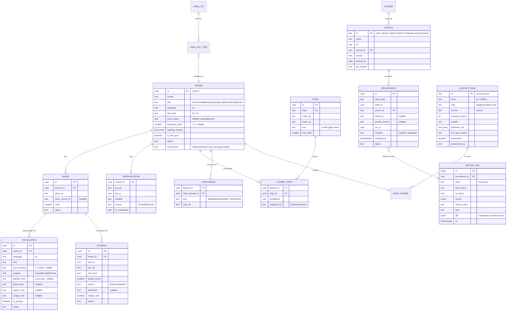
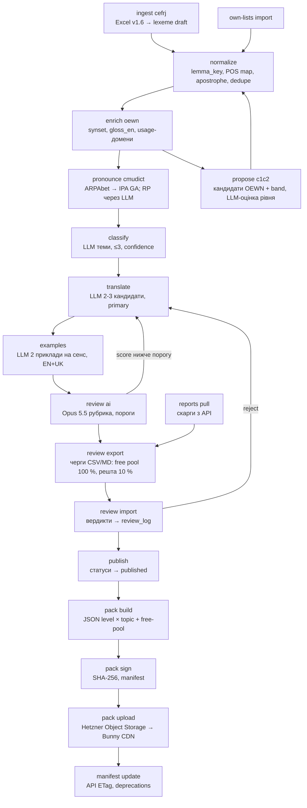
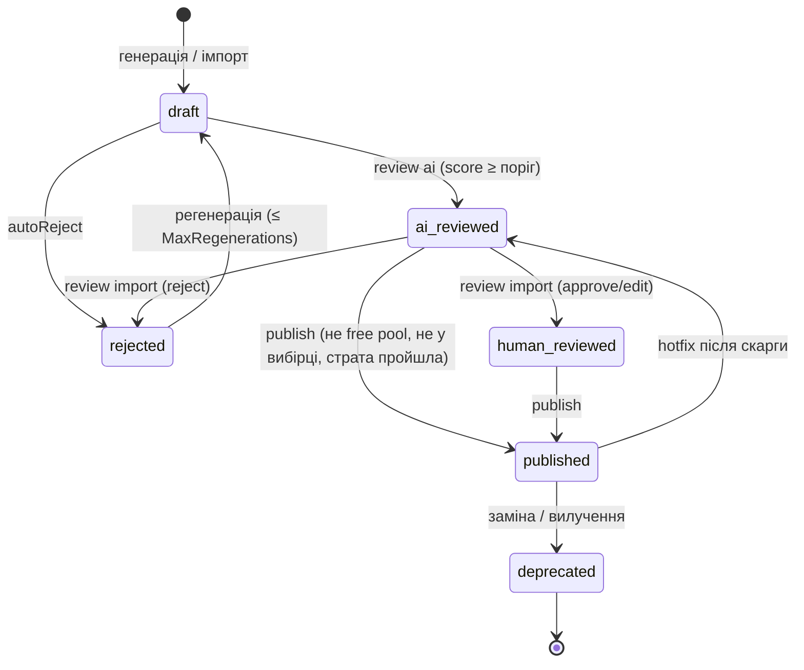

# 08. Контент-пайплайн: база слів, генерація, рецензування, пакети

| Поле | Значення |
|---|---|
| Статус | Draft |
| Версія | 0.1 |
| Дата | 2026-09-27 |
| Власник | Власник продукту / Архітектор (контент-пайплайн) |
| Джерела рішень | [Журнал рішень](../decisions/2026-09-25-interview.md): Q5, Q7, Q11, Q14, Q18, Q28, Q32, Q37, T7, T8, T9, T21, T22, відкриті питання 7, 10, 11, 12, 13 |
| Пов'язані специфікації | 01-architecture (`Burdock.ContentPipeline`, порт `IContentPackStore`), 06-learning-engine (модель `Lexeme`), 09-backend (маніфест контенту, object storage + CDN), 10-security-privacy, 02-design-system (екран атрибуції), 03-ux-flows-screens (аркуш «Повідомити про помилку», екран «Джерела та ліцензії»), 12-localization |

## 0. Контекст для ШІ-агента

Ти працюєш над контент-пайплайном проєкту «Реп'ях»: як будується, перевіряється, ліцензується, пакується і доставляється база англійських слів з українськими перекладами. Перед роботою прочитай: журнал рішень (обов'язково Q37, Q28, Q18, Q14/Q32, T21, T22), розділ 3 дослідницького звіту `docs/research/2026-09-25-research-brief.md`, цю специфікацію та `content/sources/README.md`.

Правила, які не можна порушувати:

1. **Жодних ShareAlike- і NonCommercial-джерел у даних** (Q37). Дозволені лише джерела з таблиці 3.1. Wiktionary/Kaikki можна відкрити як довідник під час ручного рецензування, але не копіювати з нього текст.
2. **Переклади й приклади генерує ШІ і перевіряє людина** (Q28, T22). Кожен запис має `provenance` з моделлю, версією промту та рецензентом. Журнал рецензування ніколи не видаляється (доказ авторського редагування за Законом 2811-IX).
3. **Безкоштовний пул (A1-B1) перевіряється людиною на 100 %** перед публікацією (T21). Решта — 10 % стратифіковано.
4. **На віджетах і в сповіщеннях показуються лише записи з `widget_safe = true`** (T9): без атрибуції на кожне речення.
5. Промти до моделей пишуться українською, вихідні схеми та ідентифікатори — англійською (Q7).
6. Частотні дані з CC BY-SA/CC BY-NC-SA джерел (wordfreq, SUBTLEX) використовуються лише як внутрішній інструмент упорядкування і **ніколи не потрапляють у пакети**.

Код напрямку: `content/pipeline/Burdock.ContentPipeline` (консольний застосунок .NET 10), схема майстер-бази у `content/pipeline/db/migrations`, промти у `content/pipeline/prompts`, черги рецензування у `content/review`. Перевірка результату: `dotnet run --project content/pipeline -- lint` проходить без помилок, `pack build` створює пакети, які проходять `pack verify`, а критерії приймання розділу 5 виконуються.

## 1. Мета й межі

**Мета.** Побудувати відтворюваний, ліцензійно чистий і документований процес, який із відкритих лем та ШІ-генерації створює базу лексем UK→EN з рівнями CEFR, темами, перекладами за сенсами, прикладами, транскрипцією та атрибуцією, і доставляє її в застосунок як версіоновані пакети.

**У v1 входить:**

- Мовна пара `uk→en` (Q11): англійські лексеми, українські переклади. Модель даних не містить захардкоджених мов.
- Леми та рівні A1-B2 з CEFR-J Wordlist v1.6, C1/C2 — власна оцінка (див. 3.2).
- 8 категорій (Q18) + псевдотема «Загальна лексика», 6 рівнів CEFR.
- Безкоштовний пул ≈600 лексем A1-B1 (Q14/Q32).
- Генерація перекладів, прикладів, класифікації тем через Claude Sonnet 5, рецензування через Claude Opus 5.5, Message Batches API (T22).
- Ручне рецензування через CSV/Markdown-черги + CLI (v1), пакети `level × topic` у JSON із маніфестом, SHA-256, CDN `cdn.burdock.org`.
- Імпорт власних списків власника зі статусом `human_reviewed` (Q5).
- Цикл скарг користувачів → черга → hotfix-пакет.

**Не входить у v1:**

- Аудіофайли (озвучення лише системним TTS, T7), зображення, Tatoeba-речення (T9; схема готова, увімкнення потребує ADR).
- Веб-адмінка рецензування (v1.1+), ECDSA-підпис пакетів (v1.1+), дельта-пакети (v1.1+), друга цільова мова (відкрите питання 5).
- Публікація бази під відкритою ліцензією: база є власною, рішення про відкриття — окреме.

## 2. Вимоги

### 2.1 Функціональні

| ID | Пріоритет | Вимога |
|---|---|---|
| FR-08-1 | Must | Пайплайн імпортує дані лише з джерел таблиці 3.1; `lint licenses` блокує збірку, якщо в `content/sources` є файл без запису в реєстрі джерел або з забороненою ліцензією. |
| FR-08-2 | Must | Кожен запис `translation`, `example`, `lexeme_topic`, `pronunciation` має рядок `provenance` (модель, версія промту, рецензент, час, статус). |
| FR-08-3 | Must | Переклади прив'язані до сенсу (`sense`), а не до лексеми; кожен сенс має рівно один `is_primary` переклад. |
| FR-08-4 | Must | Статуси контенту: `draft → ai_reviewed → human_reviewed → published → deprecated` (+ `rejected`); переходи лише через CLI-команди, що пишуть у `review_log`. |
| FR-08-5 | Must | Лексема з `is_free_pool = true` публікується лише зі статусом `human_reviewed` для всіх її сенсів, перекладів і прикладів. |
| FR-08-6 | Must | Для решти контенту формується стратифікована вибірка (рівень × тема × тип запису) з часткою `Content:Review:SampleRate` для ручної перевірки; провал вибірки страти вище порогу блокує публікацію страти. |
| FR-08-7 | Must | ШІ-рецензент (друга модель) оцінює кожен згенерований запис за рубрикою 3.7; записи нижче порогу повертаються у `draft` з причиною і регенеруються не більше `Content:Llm:MaxRegenerations` разів. |
| FR-08-8 | Must | Пакети будуються за гранулярністю `level × topic` плюс окремий пакет `free-pool`; маніфест містить SHA-256, розмір, версію, `schema_version`, `min_app_version`, атрибуції і віддається з ETag (09-backend). |
| FR-08-9 | Must | Атрибуції всіх джерел рендеряться у `content/ATTRIBUTIONS.md`, вбудовуються в застосунок (екран «Джерела та ліцензії») і дублюються в маніфесті пакетів. |
| FR-08-10 | Must | Власні списки імпортуються з CSV або Markdown-таблиці, валідуються, зливаються з канонічними лексемами й отримують статус `human_reviewed`; у застосунку видимі лише для Pro (Q14). |
| FR-08-11 | Must | Фільтр небажаного контенту: лексеми з usage-доменами OEWN на кшталт «slang», «vulgarism», «obscenity», «ethnic slur», «disparagement» (точний перелік тегів уточнюється при імпорті — припущення) і слова зі стоп-списків `filters/offensive-en.txt`, `filters/offensive-uk.txt` не потрапляють у пакети. |
| FR-08-12 | Must | Нормалізація українського тексту на вході: U+0027, U+02BC, U+2018, U+00B4 → U+2019; заборона літер ы, э, ъ, ё та латинських омогліфів у кириличних словах; `lint` завершується помилкою при порушенні. |
| FR-08-13 | Should | Пари сплутуваних слів (`confusable`) видів `spelling`, `meaning`, `false_friend`, `sound` заповнюються ШІ з ручною перевіркою і передаються у 06-learning-engine як дистрактори. |
| FR-08-14 | Should | Скарги користувачів (`POST /v1/content/reports`, 09-backend) потрапляють у чергу `content/review/reports`, тріаж ≤ `Content:Reports:TriageSlaDays`, виправлення виходить hotfix-пакетом (patch-версія). |
| FR-08-15 | Should | Транскрипція GA виводиться з CMUdict через таблицю ARPAbet→IPA (3.5.4); RP генерує модель з `confidence ≤ 0.6` і позначкою «орієнтовно» в UI. |
| FR-08-16 | Could | Дельта-пакети (`since_version`) замість повного перезавантаження (v1.1). |
| FR-08-17 | Could | Мала веб-адмінка рецензування замість CSV/Markdown-черг (v1.1). |
| FR-08-18 | Must | Приклади з `source = 'tatoeba'` (якщо будуть увімкнені ADR) мають обов'язкове поле `attribution` і `widget_safe = false`; v1 їх не імпортує. |
| FR-08-19 | Must | `frequency_band` у пакеті обчислюється лише з джерела з дозволеною ліцензією; дані wordfreq/SUBTLEX використовуються тільки як внутрішній критерій черговості рецензування і не зберігаються у майстер-базі поза таблицею `internal_ordering`. |
| FR-08-20 | Must | Пакет із `schema_version` вищим за підтримуваний застосунком ігнорується клієнтом; застарілі пакети позначаються `deprecated` із `superseded_by`. |
| FR-08-21 | Must | Лексеми C1/C2 мають `level_source = 'llm_estimate'` до ручного підтвердження і показуються в UI з позначкою «орієнтовний рівень». |

### 2.2 Нефункціональні

| ID | Пріоритет | Вимога |
|---|---|---|
| NFR-08-1 | Must | Відтворюваність: кожен запуск має `run_id`, фіксує версії джерел (хеші файлів), ідентифікатори моделей, версії промтів; повторний запуск на тих самих входах без LLM-стадій дає біт-ідентичні пакети. |
| NFR-08-2 | Must | Розмір пакета `level × topic` ≤ `Content:Pack:MaxSizeKb` (300 КБ gzip), пакет `free-pool` ≤ 500 КБ; сумарний кеш типового Pro-користувача (1 рівень × 8 тем + general + free) ≤ 5 МБ. |
| NFR-08-3 | Must | У майстер-базі, пакетах і логах пайплайну немає персональних даних; скарги користувачів зберігають лише `installation_id` у псевдонімізованому вигляді (10-security-privacy). |
| NFR-08-4 | Must | Вартість повного прогону LLM-стадій обмежена `Content:Llm:MaxRunCostUsd`; пайплайн зупиняється при перевищенні оцінки до відправлення батчу. |
| NFR-08-5 | Must | Пайплайн запускається на Windows (робоча машина) і Linux (GitHub Actions) без змін коду; секрети лише через змінні середовища. |
| NFR-08-6 | Must | Журнал рецензування (`review_log`) зберігається безстроково і входить у резервні копії майстер-бази. |
| NFR-08-7 | Must | Схема майстер-бази і пакетів версіонується; зміна формату пакета підвищує `schema_version` і документується в цій специфікації. |
| NFR-08-8 | Should | Повний прогін пайплайну (без ручного рецензування) на 10 000 лексем завершується за ≤ 48 годин з урахуванням вікна Batches API. |

## 3. Проєктування

### 3.1 Політика джерел

| Джерело | Що беремо | Ліцензія | Зобов'язання | Рядок атрибуції / цитування |
|---|---|---|---|---|
| CEFR-J Wordlist v1.6 (Tono Lab, TUFS) | Леми, частини мови, рівні A1-B2 (7 801 запис) | Авторське право Tono Laboratory; дозволено дослідницьке й комерційне використання з цитуванням; на сторінці є суперечлива примітка про «витрати після окремої консультації» для комерційного використання — потрібне письмове підтвердження (відкрите питання 7) | Точне цитування у застосунку, ATTRIBUTIONS.md, маніфесті; при модифікації списку — обов'язкове посилання | `The CEFR-J Wordlist Version 1.6. Compiled by Yukio Tono, Tokyo University of Foreign Studies. Retrieved from https://www.cefr-j.org/download_eng.html on DD/MM/YYYY.` (дата підставляється з `content/sources/README.md`) |
| Open English WordNet 2025 | Синсети, глоси, usage-домени для сенсів і фільтра | CC BY 4.0 + збереження ліцензійного повідомлення Princeton WordNet | Подвійна атрибуція: команда Open English WordNet і Princeton WordNet; текст WNDB-ліцензії у ATTRIBUTIONS.md | `This product includes data from Open English WordNet 2025 (https://github.com/globalwordnet/english-wordnet), licensed under CC BY 4.0, derived from Princeton WordNet. WordNet 3.1 Copyright 2011 by Princeton University. All rights reserved.` |
| CMUdict (cmusphinx/cmudict) | ARPAbet-транскрипція → IPA GA | BSD-2-Clause | Зберегти повідомлення про авторське право та disclaimer у документації дистрибутива (ATTRIBUTIONS.md, екран атрибуції) | `Copyright (C) 1993-2015 Carnegie Mellon University. All rights reserved.` + повний текст умов і disclaimer |
| Claude Sonnet 5 / Opus 5.5 (Anthropic API) | Переклади, приклади, класифікація, оцінка RP, рецензування | Anthropic Commercial Terms: права на Outputs передаються замовнику; вимога повідомляти користувачів, що фактичні твердження можуть бути хибними | Повідомлення «може містити помилки» на екрані атрибуції та в умовах; журнал ручного редагування | Текст повідомлення — див. 3.14 |
| Власні списки власника | Лексеми, переклади, приклади, теми | Власний контент | Немає | Немає |
| Tatoeba (лише за ADR, не в v1) | Пари речень EN-UK | CC BY 2.0 FR, атрибуція на кожне речення (автор + посилання) | `attribution` обов'язкове, `widget_safe = false`, показ лише в застосунку з ім'ям автора та посиланням | `Речення №{id} автора {username}, Tatoeba, CC BY 2.0 FR` |

**Заборонені як джерела даних** (Q37; звіт, розд. 3): Wiktionary та витяг Kaikki (CC BY-SA 4.0 + GFDL, каскад ShareAlike на всю базу), Octanove Vocabulary Profile (CC BY-SA 4.0), Kelly list (CC BY-NC-SA), VESUM/dict_uk (CC BY-NC-SA 4.0), Oxford 3000/5000 (всі права застережено, торгова марка), Cambridge English Vocabulary Profile (умови забороняють програмні продукти на основі даних), COCA/wordfrequency.info (платна, обмежена), SUBTLEX-US напряму (CC BY-NC-SA 4.0), словникові скани без ліцензії, FreeDict (немає пари eng-ukr), wordfreq як джерело даних пакета (CC BY-SA 4.0 на дані).

**Wiktionary як довідник рецензента.** Рецензент може відкрити статтю Wiktionary, щоб перевірити, чи не пропущено поширений сенс або чи правильний наголос. Заборонено: копіювати переклади, приклади, глоси, транскрипції; вставляти текст у чергу рецензування. Дозволено: змінити власне формулювання після перевірки, зафіксувати у `review_log.note` «звірено з довідником» без цитати. Ця межа документується в інструкції рецензента `content/review/REVIEWER_GUIDE.md`.

**Tatoeba.** У v1 не імпортується. Схема підтримує `example.source = 'tatoeba'` з обов'язковою атрибуцією; будь-яке увімкнення потребує ADR і UI-місця для атрибуції на екрані слова (03-ux-flows-screens). На віджетах і в сповіщеннях такі приклади не з'являються ніколи (T9).

### 3.2 Цільовий інвентар

| Рівень | Джерело лем | Орієнтовна кількість | Примітка |
|---|---|---|---|
| A1 | CEFR-J v1.6 | ≈1 200 | Точні числа за рівнями фіксуються після імпорту (припущення; сума A1-B2 = 7 801 за звітом) |
| A2 | CEFR-J v1.6 | ≈1 450 | |
| B1 | CEFR-J v1.6 | ≈2 550 | |
| B2 | CEFR-J v1.6 | ≈2 600 | |
| C1 | Кандидати з OEWN + частотність, оцінка рівня моделлю, ручна вибірка | ≈1 200 (припущення) | Без Octanove (CC BY-SA). Кандидат = лема OEWN, якої немає в CEFR-J, у частотній смузі 4-5, не власна назва, не вульгаризм; модель пропонує рівень C1/C2 із впевненістю; `level_source = 'llm_estimate'` |
| C2 | Те саме | ≈800 (припущення) | Ручна перевірка 20 % кандидатів C1/C2 замість 10 % через нижчу надійність |
| Разом | | ≈9 800 ≈ 10 000 | |

**Цілі за категоріями** (Q18: 300-600 слів на категорію; мінімум на клітинку рівень × тема, припущення):

| Категорія (`topic.slug`) | A1 | A2 | B1 | B2 | C1 | C2 | Разом |
|---|---|---|---|---|---|---|---|
| Спілкування (`communication`) | 60 | 80 | 100 | 100 | 60 | 40 | 440 |
| Подорожі (`travel`) | 60 | 80 | 90 | 80 | 40 | 20 | 370 |
| Робота і бізнес (`work-business`) | 40 | 70 | 100 | 110 | 80 | 50 | 450 |
| IT та програмування (`it-programming`) | 30 | 50 | 90 | 110 | 80 | 40 | 400 |
| Їжа (`food`) | 60 | 70 | 70 | 60 | 30 | 20 | 310 |
| Здоров'я (`health`) | 40 | 60 | 80 | 90 | 60 | 30 | 360 |
| Місто й транспорт (`city-transport`) | 50 | 70 | 80 | 70 | 30 | 20 | 320 |
| Покупки (`shopping`) | 50 | 60 | 70 | 60 | 30 | 20 | 290 |
| Загальна лексика (`general`, псевдотема) | решта | решта | решта | решта | решта | решта | ≈6 000 |

Лексема може мати до 3 тем; лексеми без жодної теми з впевненістю ≥ `Content:Topic:MinConfidence` потрапляють у `general` (псевдотема `general` і її завантаження Pro-користувачам — відкрите питання 13 журналу). Якщо клітинка не досягає мінімуму з CEFR-J, пайплайн пропонує кандидатів з OEWN за тим самим механізмом, що й для C1/C2, з позначкою `level_source = 'llm_estimate'`.

**Безкоштовний пул** (Q14/Q32): ≈600 лексем (`Content:FreePool:TargetSize`), по ≈200 з A1, A2, B1, обираються з `general` та будь-яких тем за критеріями: частотна смуга 1-3, конкретне значення, культурно нейтральне, лема ≤ 12 символів і основний переклад ≤ 16 символів (вміщується у малий віджет), без омографів з різними частинами мови в тому ж рівні. 100 % ручне рецензування, другий рецензент на 20 % вибірки для міжекспертної згоди. Пул є окремим пакетом `free-pool`, який завантажують усі користувачі.

**Власні списки** імпортуються окремим джерелом (3.11) і не входять у підрахунки вище.

### 3.3 Канонічна схема контенту

Майстер-база — PostgreSQL 18 (схема `content` у модульному моноліті, 09-backend, або окрема БД пайплайну; припущення: окрема БД `burdock_content` на тій самій інстанції, щоб LLM-стадії не торкалися користувацьких даних). Пакети — JSON (3.10), локальний кеш у застосунку — SQLite з таблицями того самого складу (01-architecture).



Сутності без блоку атрибутів на діаграмі: `LICENSE (id, name, url, attribution_template)`, `PACK_LEXEME (pack_id, lexeme_id)`, `OWN_LIST (id, name, file_path, imported_run_id)`, `OWN_LIST_ITEM (id, own_list_id, lexeme_id, raw_row)`.

Додаткова службова таблиця `internal_ordering (lexeme_id, source, score)` містить внутрішні частотні оцінки (наприклад, з wordfreq) виключно для сортування черг рецензування; вона не входить у `pack build` і не реплікується поза пайплайном (FR-08-19).

Ідентифікатори: UUIDv7 (`Guid.CreateVersion7()`, PostgreSQL `uuidv7()`), стабільні між версіями пакетів; прогрес користувача (06-learning-engine) посилається на `lexeme.id`, тому лексема ніколи не видаляється фізично, лише `deprecated` із `superseded_by`.

**Приклад однієї лексеми у форматі пакета** (скорочено; ідентифікатори ілюстративні):

```json
{
  "id": "0192f3a4-7c1e-7d2b-9a3f-2b5e8c1d4f60",
  "lemma": "receipt",
  "pos": "noun",
  "language": "en",
  "cefrLevel": "B1",
  "levelSource": "cefrj",
  "frequencyBand": 3,
  "spellingVariants": [],
  "isFreePool": true,
  "pronunciation": { "ipaGa": "ɹɪˈsit", "ipaRp": "rɪˈsiːt", "arpabet": "R IH0 S IY1 T", "source": "cmudict", "rpConfidence": 0.6 },
  "topics": [ { "slug": "shopping", "confidence": 0.96, "assignedBy": "human" } ],
  "confusables": [ { "otherLexemeId": "0192f3a4-7c1e-7d2b-9a3f-2b5e8c1d4f61", "otherLemma": "recipe", "kind": "false_friend", "noteUk": "«рецепт» англійською — recipe, а receipt — це чек або квитанція" } ],
  "senses": [
    {
      "id": "0192f3a4-7c1e-7d2b-9a3f-2b5e8c1d4f70",
      "order": 1,
      "glossEn": "a written acknowledgement that a specified article or sum of money has been received",
      "oewnSynsetId": "oewn-<offset>-n",
      "translations": [
        { "language": "uk", "text": "чек", "textStressed": "чек", "register": "neutral", "genderNote": "ч.", "pluralNote": "чеки", "aspectNote": null, "usageNote": "у магазині чи кафе", "isPrimary": true },
        { "language": "uk", "text": "квитанція", "textStressed": "квита́нція", "register": "neutral", "genderNote": "ж.", "pluralNote": "квитанції", "aspectNote": null, "usageNote": "за оплату послуг, поштове відправлення", "isPrimary": false }
      ],
      "examples": [
        { "textEn": "Can I have a receipt, please?", "textUk": "Можна мені чек, будь ласка?", "cefrLevel": "A2", "lengthWords": 6, "source": "llm", "attribution": null, "widgetSafe": true },
        { "textEn": "Keep the receipt in case you want to return the shoes.", "textUk": "Збережіть чек на випадок, якщо захочете повернути взуття.", "cefrLevel": "B1", "lengthWords": 11, "source": "llm", "attribution": null, "widgetSafe": true }
      ]
    }
  ],
  "provenance": {
    "translation": { "modelId": "claude-sonnet-5", "promptVersion": "translate-v3", "reviewedBy": "human:ol", "reviewedAt": "2026-10-14T10:22:00Z", "status": "human_reviewed" },
    "examples": { "modelId": "claude-sonnet-5", "promptVersion": "examples-v2", "reviewedBy": "ai:claude-opus-5-5;human:ol", "reviewedAt": "2026-10-14T10:25:00Z", "status": "human_reviewed" }
  }
}
```

Поля `Lexeme`, які споживає 06-learning-engine: `id`, `lemma`, `pos`, `cefrLevel`, `topics[]`, `frequencyBand`, `spellingVariants[]`, `confusables[]`, `isFreePool`, основний переклад і `widgetSafe`-приклади.

### 3.4 Правила українського контенту

1. **Переклад за сенсом.** Лексема з кількома сенсами отримує окремі переклади для кожного; сенс із `order = 1` — найчастотніший для рівня лексеми. У віджеті показується лише основний переклад основного сенсу.
2. **Іменники.** `gender_note` (ч./ж./с./мн.), `plural_note` для нерегулярної або нетривіальної множини («дитина — діти», «око — очі»). Для збірних і незлічуваних — примітка «незлічуване».
3. **Дієслова.** Якщо англійське дієслово природно передається видовою парою, основний переклад містить недоконаний вид, а `aspect_note` — доконаний: «купувати / купити», «читати / прочитати». Якщо пара несиметрична або відсутня, `aspect_note` пояснює («дізнаватися / дізнатися — про повторювану дію лише недок.»).
4. **Регістр.** `register`: `neutral` (за замовчуванням), `formal`, `informal`. Сленг і вульгаризми не генеруються (фільтр FR-08-11).
5. **Апостроф.** Канонічна форма для відображення — U+2019 (’). На вході нормалізуються U+0027, U+02BC, U+2018, U+00B4 (FR-08-12). Англійський текст зберігається з U+0027, бо так його вводять з клавіатури; порівняння відповідей у вправах нормалізує обидві форми (06-learning-engine).
6. **Абетка.** Обов'язкове коректне вживання ґ, є, ї, і; заборонені ы, э, ъ, ё; латинські омогліфи в кириличних словах (a, c, e, i, o, p, x, y) виявляються lint-перевіркою за змішаними скриптами в одному токені.
7. **Наголос.** Необов'язкове поле `text_stressed` з комбінованим знаком U+0301 після наголошеної голосної; генерується моделлю, підтверджується рецензентом для безкоштовного пулу; у UI показується за налаштуванням.
8. **Без росіянізмів.** Список заборонених конструкцій і замін підтримується у `filters/russisms-uk.csv`, наприклад: «приймати участь → брати участь», «слідуючий → наступний», «відноситься до → стосується», «на протязі → протягом», «являється → є», «любий (у значенні будь-який) → будь-який», «підписка (на послугу) → передплата (лише для видань; для застосунку лишаємо «підписка» як усталений термін, див. glossary)». Lint помічає збіги як попередження, рецензент вирішує.
9. **Приклади речень.** Довжина ≤ 12 слів для A1-A2 та ≤ 16 для B1+ (`Content:Example:MaxWords.*`), природні, повсякденні, культурно нейтральні; без насильства, політики, релігії, алкоголю, дорослого контенту, стереотипів; імена людей нейтральні й короткі (Anna, Tom, Олена, Тарас); українські топоніми дозволені (Львів, Дніпро); валюта — гривня або без валюти. Український приклад — переклад англійського за змістом, не дослівний, узгоджений за рівнем.
10. **Звертання в прикладах.** Форми на «ви» або нейтральні конструкції, щоб уникати гендерованого минулого часу, коли речення звернене до читача; розповідні речення від третьої особи можуть мати будь-який рід.
11. **Термінологія.** Терміни UI (Серія, Колючки, Реп'яшок) не з'являються у прикладах; терміни IT-категорії відповідають `docs/glossary.md`.

### 3.5 Стадії пайплайну



| Стадія | Команда `burdock-content` | Вхід → вихід | Інструмент |
|---|---|---|---|
| Інгест лем | `ingest cefrj --file content/sources/cefrj/CEFR-J_Wordlist_v1.6.xlsx --run <id>` | Excel → `lexeme` (status `draft`, `level_source = cefrj`) | ClosedXML або CSV-експорт; хеш файлу в `source.file_sha256` |
| Нормалізація | `normalize` | Уніфікація POS (CEFR-J → внутрішній перелік), `lemma_key` = нижній регістр + NFC, злиття дублікатів «lemma+pos», варіанти написання (`colour/color` → `spelling_variants`) | Внутрішній код |
| Збагачення сенсами | `enrich oewn --file content/sources/oewn/english-wordnet-2025.xml` | Для кожної лексеми — до `Content:Sense:MaxPerLexeme` (3) синсетів, відсортованих за порядком OEWN; `gloss_en`; позначки usage-доменів для фільтра | Парсер WN-LMF XML |
| Транскрипція | `pronounce cmudict --file content/sources/cmudict/cmudict.dict` та `pronounce rp` | ARPAbet → `ipa_ga` за таблицею 3.5.4; RP — LLM (Sonnet 5) із `rp_confidence = 0.6` | Внутрішній код + Batches |
| Кандидати C1/C2 | `propose c1c2 --target 2000` | Леми OEWN поза CEFR-J, band 4-5, без власних назв і небажаних доменів → LLM оцінює рівень і придатність → `lexeme` зі `level_source = llm_estimate` | Batches |
| Класифікація тем | `classify --level A1 --batch 20` | LLM повертає до 3 тем із confidence; < 0.6 відкидається; `general` якщо нічого | Batches, промт 3.6.3 |
| Переклад | `translate --level A1` | 2-3 кандидати перекладу на сенс, вибір primary, граматичні примітки | Batches, промт 3.6.1 |
| Приклади | `examples --level A1` | 2 приклади на сенс (EN + UK), довжина за рівнем | Batches, промт 3.6.2 |
| ШІ-рецензія | `review ai --level A1` | Opus 5.5 оцінює за рубрикою; авто-відхилення; статус `ai_reviewed` | Batches, промт 3.6.4 |
| Черги для людини та імпорт вердиктів | `review export --stratum A1/food --format md`, `review import --file <queue>.md` | Markdown-таблиця або CSV у `content/review/queues/` → вердикти у `review_log`, статуси `human_reviewed` або `rejected` | Внутрішній код |
| Публікація | `publish --level A1 --topic food` | Перевірка воріт (3.9) → `published` | Внутрішній код |
| Збірка пакетів | `pack build --pair uk-en --out content/packs` | JSON.gz на кожну клітинку `level × topic`, `general`, `free-pool` | System.Text.Json (source-gen) |
| Підпис, завантаження, маніфест | `pack sign`, `pack upload --bucket burdock-content`, `manifest update --publish` | SHA-256 кожного файлу і `manifest.json` → Object Storage (S3 API) → CDN → API 09-backend перечитує маніфест і оновлює ETag | Внутрішній код, S3-сумісний клієнт, HTTP до внутрішнього ендпоінту |
| Власні списки | `own-lists import --file content/own-lists/travel-owner.csv` | Валідація, злиття (3.11) | Внутрішній код |
| Скарги | `reports pull --since 2026-10-01` | Скарги з API → `content/review/reports/` | HTTP |
| Перевірки | `lint [--licenses|--text|--schema]`, `stats`, `cost estimate --level A1`, `pack verify` | Звіти | Внутрішній код |

#### 3.5.4 Таблиця ARPAbet → IPA (General American)

| ARPAbet | IPA | ARPAbet | IPA | ARPAbet | IPA |
|---|---|---|---|---|---|
| AA | ɑ | EY | eɪ | P | p |
| AE | æ | F | f | R | ɹ |
| AH1/AH2 | ʌ | G | ɡ | S | s |
| AH0 | ə | HH | h | SH | ʃ |
| AO | ɔ | IH | ɪ | T | t |
| AW | aʊ | IY | i | TH | θ |
| AY | aɪ | JH | dʒ | UH | ʊ |
| B | b | K | k | UW | u |
| CH | tʃ | L | l | V | v |
| D | d | M | m | W | w |
| DH | ð | N | n | Y | j |
| EH | ɛ | NG | ŋ | Z | z |
| ER1/ER2 | ɝ | OW | oʊ | ZH | ʒ |
| ER0 | ɚ | OY | ɔɪ | | |

Наголос: цифра `1` → `ˈ` перед складом, `2` → `ˌ`, `0` → без знака. Межа складу визначається евристикою максимального початку (onset) — це наближення; для безкоштовного пулу транскрипція входить у ручну перевірку. Слова, відсутні в CMUdict (≈ окремі фрази, нові терміни IT), отримують `source = llm` та `confidence = 0.5` для обох варіантів.

### 3.6 Промти

Усі промти зберігаються у `content/pipeline/prompts/<name>-v<N>.md` із системною частиною, схемою виходу та few-shot; `prompt_version` записується в `provenance`. Вихід вимагається як JSON за схемою (structured outputs, `output_config.format`), без вільного тексту. Модель генерації: `claude-sonnet-5`; рецензент: `claude-opus-5-5` (T22). Запити пакуються у Message Batches API по 20 лексем на запит (`Content:Llm:LexemesPerRequest`), системний промт незмінний у межах прогону для кешування.

#### 3.6.1 Переклад (`translate-v3`)

```text
[system]
Ти — укладач навчального англо-українського словника для дорослих, які вивчають англійську
з рівня {cefr_level}. Тобі дають англійську лексему, частину мови, сенс (глоса з Open English
WordNet) і рівень CEFR. Для КОЖНОГО сенсу запропонуй 2-3 українські переклади, впорядковані
від найуживанішого, і познач один як основний (isPrimary).

Правила:
1. Перекладай сенс, а не слово: інші сенси цієї лексеми тобі не показано — не додавай їх.
2. Сучасна літературна українська. Заборонені росіянізми та кальки (наприклад «приймати
   участь», «слідуючий», «відноситься до», «на протязі»). Літери ґ, є, ї — за правописом.
3. Апостроф — лише символ U+2019 (’).
4. Іменники: вкажи рід (ч./ж./с./мн.) у genderNote і множину в pluralNote, якщо вона
   нерегулярна або корисна учню. Незлічувані — usageNote «незлічуване».
5. Дієслова: основний переклад — недоконаний вид; доконаний — в aspectNote у форматі
   «недок. / док.». Якщо пари немає, поясни коротко.
6. register: neutral, formal або informal. Жодного сленгу, вульгаризмів, образ.
7. textStressed — переклад зі знаком наголосу U+0301 після наголошеної голосної; для
   односкладових — без знака.
8. usageNote — до 60 символів, лише якщо потрібно розрізнити переклади.
9. Якщо сенс не має природного однослівного відповідника, дай коротке словосполучення
   (до 3 слів) і познач usageNote «описовий переклад».
10. Не пояснюй свої рішення. Поверни лише JSON за схемою.

[schema]
{ "type":"object","properties":{"items":{"type":"array","items":{"type":"object","properties":{
  "senseId":{"type":"string"},
  "translations":{"type":"array","minItems":2,"maxItems":3,"items":{"type":"object","properties":{
    "text":{"type":"string"},"textStressed":{"type":"string"},
    "register":{"enum":["neutral","formal","informal"]},
    "genderNote":{"type":["string","null"]},"pluralNote":{"type":["string","null"]},
    "aspectNote":{"type":["string","null"]},"usageNote":{"type":["string","null"]},
    "isPrimary":{"type":"boolean"}},
    "required":["text","textStressed","register","genderNote","pluralNote","aspectNote","usageNote","isPrimary"],"additionalProperties":false}}},
  "required":["senseId","translations"],"additionalProperties":false}}},
  "required":["items"],"additionalProperties":false }

[few-shot: user]
{"cefrLevel":"A1","items":[{"senseId":"s1","lemma":"buy","pos":"verb","glossEn":"obtain by purchase; acquire by means of a financial transaction"}]}

[few-shot: assistant]
{"items":[{"senseId":"s1","translations":[
 {"text":"купувати","textStressed":"купува́ти","register":"neutral","genderNote":null,"pluralNote":null,"aspectNote":"купувати / купити","usageNote":null,"isPrimary":true},
 {"text":"придбати","textStressed":"придба́ти","register":"formal","genderNote":null,"pluralNote":null,"aspectNote":"придбавати / придбати","usageNote":"офіційний стиль","isPrimary":false}]}]}

[user]
{"cefrLevel":"{cefr_level}","items":[{"senseId":"...","lemma":"...","pos":"...","glossEn":"..."}, ...]}
```

#### 3.6.2 Приклади (`examples-v2`)

```text
[system]
Ти пишеш навчальні приклади речень для застосунку, який показує англійські слова
українцям на віджетах телефона. Для кожного сенсу створи 2 пари речень: англійське
речення з цільовим словом і його природний український переклад.

Правила:
1. Рівень {cefr_level}: лексика та граматика речення не складніші за цей рівень; цільове
   слово вжите в заданому сенсі, у природній формі (може бути у множині чи іншому часі).
2. Довжина англійського речення: не більше {max_words} слів. Українське — приблизно
   такої ж довжини, це переклад за змістом, а не дослівний.
3. Побутові, конкретні, нейтральні ситуації. Заборонено: насильство, політика, релігія,
   алкоголь, наркотики, хвороби зі смертельним наслідком, дорослий контент, стереотипи
   про національності чи стать, бренди, реальні відомі особи.
4. Імена людей — короткі й нейтральні (Anna, Tom, Sam, Олена, Тарас). Українські топоніми
   дозволені. Валюта — гривня або без валюти.
5. Українське речення: сучасна літературна мова, апостроф U+2019, без росіянізмів. Якщо
   речення звернене до читача — використовуй форму на «ви» або нейтральну конструкцію.
6. Обидва речення в парі мають один зміст; не додавай пояснень і дужок.
7. Одне речення з пари — ствердження, друге — питання або спонукання, якщо це природно.
8. Поверни лише JSON за схемою.

[schema]
{ "type":"object","properties":{"items":{"type":"array","items":{"type":"object","properties":{
  "senseId":{"type":"string"},
  "examples":{"type":"array","minItems":2,"maxItems":2,"items":{"type":"object","properties":{
    "textEn":{"type":"string"},"textUk":{"type":"string"}},
    "required":["textEn","textUk"],"additionalProperties":false}}},
  "required":["senseId","examples"],"additionalProperties":false}}},
  "required":["items"],"additionalProperties":false }

[few-shot: user]
{"cefrLevel":"A1","maxWords":12,"items":[{"senseId":"s1","lemma":"ticket","pos":"noun","glossEn":"a commercial document showing that the holder is entitled to something","primaryTranslationUk":"квиток"}]}

[few-shot: assistant]
{"items":[{"senseId":"s1","examples":[
 {"textEn":"We bought two tickets to Lviv.","textUk":"Ми купили два квитки до Львова."},
 {"textEn":"Do you have your ticket?","textUk":"У вас є квиток?"}]}]}
```

#### 3.6.3 Класифікація тем (`classify-v2`)

```text
[system]
Ти класифікуєш англійські слова за темами навчального застосунку. Теми (slug — назва —
опис): communication — Спілкування — розмова, емоції, стосунки, ввічливість; travel —
Подорожі — далекий транспорт, готелі, кордон, відпочинок; work-business — Робота і бізнес —
офіс, кар'єра, гроші компанії, переговори; it-programming — IT та програмування — комп'ютери,
код, інтернет, пристрої; food — Їжа — продукти, страви, приготування, ресторани; health —
Здоров'я — тіло, самопочуття, лікар, спорт як здоров'я; city-transport — Місто й транспорт —
вулиці, будівлі, міський транспорт, орієнтування; shopping — Покупки — магазини, ціни, оплата.

Для кожної лексеми (з сенсом) поверни від 0 до 3 тем із впевненістю 0..1. Тему давай
лише тоді, коли слово справді типове для розмов на цю тему на рівні {cefr_level}; загальні
слова (the, make, good) лишай без тем. Не вигадуй нових тем. Поверни лише JSON.

[schema]
{ "type":"object","properties":{"items":{"type":"array","items":{"type":"object","properties":{
  "lexemeId":{"type":"string"},
  "topics":{"type":"array","maxItems":3,"items":{"type":"object","properties":{
    "slug":{"enum":["communication","travel","work-business","it-programming","food","health","city-transport","shopping"]},
    "confidence":{"type":"number","minimum":0,"maximum":1}},
    "required":["slug","confidence"],"additionalProperties":false}}},
  "required":["lexemeId","topics"],"additionalProperties":false}}},
  "required":["items"],"additionalProperties":false }

[few-shot: user]
{"cefrLevel":"A2","items":[{"lexemeId":"l1","lemma":"receipt","pos":"noun","glossEn":"a written acknowledgement that a sum of money has been received"},{"lexemeId":"l2","lemma":"because","pos":"conj","glossEn":"for the reason that"}]}

[few-shot: assistant]
{"items":[{"lexemeId":"l1","topics":[{"slug":"shopping","confidence":0.95},{"slug":"travel","confidence":0.35}]},{"lexemeId":"l2","topics":[]}]}
```

Після класифікації: теми з `confidence < Content:Topic:MinConfidence` (0.6) відкидаються; 5 % лексем кожної теми (не менше 20) потрапляють у ручну вибіркову перевірку; теми лексем безкоштовного пулу перевіряються повністю (обсяг перевірки призначених моделлю тем — відкрите питання 12 журналу).

#### 3.6.4 ШІ-рецензія (`review-v2`, модель `claude-opus-5-5`)

```text
[system]
Ти — незалежний рецензент навчального англо-українського контенту. Тобі дають лексему,
сенс, згенеровані переклади й приклади. Оціни їх суворо, як редактор словника для
українських учнів рівня {cefr_level}.

Критерії (кожен 1-5, 5 — бездоганно):
- accuracy: переклад точно передає сенс; приклад вживає слово саме в цьому сенсі;
  український приклад відповідає англійському за змістом.
- naturalness: сучасна літературна українська без росіянізмів і кальок; природна
  англійська; правильний апостроф U+2019 в українському тексті.
- levelFit: лексика й граматика прикладів не перевищують рівень; довжина в межах ліміту
  ({max_words} слів).
- safety: немає насильства, політики, релігії, алкоголю, дорослого контенту, стереотипів,
  брендів, реальних осіб; текст доречний для віджета на екрані блокування.
- grammarNotes: рід, множина, вид дієслова, наголос вказані правильно (якщо є).

Додатково: autoReject = true, якщо accuracy ≤ 2, або safety ≤ 3, або в українському
тексті є літери ы, э, ъ, ё, або основний переклад є росіянізмом. Для кожного зауваження
дай reasonCode з переліку: wrong_sense, unnatural_uk, russism, wrong_gender, wrong_aspect,
wrong_stress, too_hard, too_long, unsafe, mismatch_en_uk, apostrophe, other — і коротку
пропозицію виправлення українською (до 120 символів). Не переписуй контент повністю.
Поверни лише JSON.

[schema]
{ "type":"object","properties":{"items":{"type":"array","items":{"type":"object","properties":{
  "entityType":{"enum":["translation","example"]},
  "entityId":{"type":"string"},
  "scores":{"type":"object","properties":{
    "accuracy":{"type":"integer","minimum":1,"maximum":5},
    "naturalness":{"type":"integer","minimum":1,"maximum":5},
    "levelFit":{"type":"integer","minimum":1,"maximum":5},
    "safety":{"type":"integer","minimum":1,"maximum":5},
    "grammarNotes":{"type":"integer","minimum":1,"maximum":5}},
    "required":["accuracy","naturalness","levelFit","safety","grammarNotes"],"additionalProperties":false},
  "autoReject":{"type":"boolean"},
  "issues":{"type":"array","items":{"type":"object","properties":{
    "reasonCode":{"enum":["wrong_sense","unnatural_uk","russism","wrong_gender","wrong_aspect","wrong_stress","too_hard","too_long","unsafe","mismatch_en_uk","apostrophe","other"]},
    "suggestion":{"type":"string"}},"required":["reasonCode","suggestion"],"additionalProperties":false}}},
  "required":["entityType","entityId","scores","autoReject","issues"],"additionalProperties":false}}},
  "required":["items"],"additionalProperties":false }

[few-shot: user]
{"cefrLevel":"A1","maxWords":12,"lemma":"buy","pos":"verb","glossEn":"obtain by purchase","translations":[{"entityId":"t1","text":"купляти","isPrimary":true,"aspectNote":"купляти / купити"}],"examples":[{"entityId":"e1","textEn":"I buy bread every morning.","textUk":"Я купую хліб щоранку."}]}

[few-shot: assistant]
{"items":[
 {"entityType":"translation","entityId":"t1","scores":{"accuracy":4,"naturalness":2,"levelFit":5,"safety":5,"grammarNotes":4},"autoReject":false,"issues":[{"reasonCode":"unnatural_uk","suggestion":"Літературна форма — «купувати»; «купляти» розмовне."}]},
 {"entityType":"example","entityId":"e1","scores":{"accuracy":5,"naturalness":5,"levelFit":5,"safety":5,"grammarNotes":5},"autoReject":false,"issues":[]}]}
```

### 3.7 Пороги ШІ-рецензії

| Правило | Значення (ключ конфігурації) | Дія |
|---|---|---|
| Прохідний бал за кожним критерієм | ≥ 4 (`Content:AiReview:MinScore`) | Нижче — `draft` + регенерація з `issues` у промті |
| Безпека | ≥ 5 для `widget_safe` (`Content:AiReview:MinSafetyWidget`) | 4 → `widget_safe = false`, ≤ 3 → відхилення |
| `autoReject` | — | `rejected`, регенерація; після `Content:Llm:MaxRegenerations` (2) → у ручну чергу з позначкою «потребує людини» |
| Розбіжність між генератором і рецензентом щодо основного перекладу | рецензент пропонує інший primary | Обидва варіанти в ручну чергу незалежно від вибірки |
| Середній бал страти | < 4,3 (`Content:AiReview:StratumMinAvg`) | Страта не публікується, промт переглядається |

### 3.8 Ручне рецензування

**Обсяг.** 100 % записів безкоштовного пулу; 10 % стратифіковано (рівень × тема × тип запису; `Content:Review:SampleRate`) для решти; 20 % для C1/C2 і для будь-якої страти, де ШІ-рецензент або скарги показали проблеми; 100 % тем безкоштовного пулу і 5 % тем решти.

**Інструмент v1.** `review export` створює файл `content/review/queues/YYYY-MM-DD-<level>-<topic>.md` — Markdown-таблицю (або CSV за `--format csv`) зі стовпцями: `entity_id`, `lemma`, `pos`, `gloss_en`, `field`, `value`, `ai_scores`, `ai_issues`, `verdict` (`approve` | `edit` | `reject`), `edited_value`, `reason_code`, `note`. Рецензент редагує у будь-якому редакторі, комітить файл; `review import` валідує, застосовує правки, пише `review_log` з `diff` і переводить статуси. Файл черги залишається в git як частина доказової бази.

**Правила рецензента** (`content/review/REVIEWER_GUIDE.md`): перевіряти сенс, природність, рівень, безпеку, граматичні примітки, наголос; звірятися з довідниками без копіювання; помічати `reason_code` з того самого переліку, що і ШІ-рецензент (для порівняння); час на запис — орієнтир 30-60 с; сумнівне — `reject` з нотаткою, а не «approve з натяжкою».

**Міжекспертна згода.** 5 % записів (20 % для безкоштовного пулу) отримують другого рецензента (або власника); ціль Cohen's κ ≥ 0,7 за вердиктом approve/не-approve; нижче — уточнення інструкції.

**Веб-адмінка (v1.1).** Та сама модель черги, але з UI: список, картка, гарячі клавіші, автозбереження в `review_log`. Формат черги залишається сумісним для офлайн-роботи.

### 3.9 Статуси та ворота публікації



Ворота `publish` для страти `level × topic`: усі записи мають статус ≥ `ai_reviewed`; для `is_free_pool` — усі `human_reviewed`; вибірка страти пройдена (частка `reject` ≤ `Content:Review:MaxSampleRejectRate` 5 %; інакше страта повертається на 100 % перевірку); `lint --text` без помилок; фільтр небажаного контенту пройдено; кожна лексема має основний переклад і ≥ 1 `widget_safe`-приклад для основного сенсу; атрибуції джерел зібрані.

### 3.10 Пакети контенту

**Гранулярність.** Один пакет на клітинку `pair × level × topic` (8 тем + `general`) плюс `free-pool`: 6 × 9 + 1 = 55 пакетів для `uk-en`. Лексема з кількома темами повторюється в кожному пакеті теми (дублювання ≤ 3 разів; клієнт зливає за `id`).

**Формат: JSON (gzip), а не SQLite.** Обґрунтування: пакети малі (50-150 лексем, 30-200 КБ gzip), JSON десеріалізується AOT-безпечно через source-generated `System.Text.Json`, легко порівнюється в git і читається рецензентом; дельти й hotfix — це заміна невеликого файлу; імпорт у локальний SQLite (`sqlite-net-pcl`) під час завантаження. Віджети не читають пакети напряму: iOS-розширення отримує попередньо обчислений «розклад слів» через App Group, Android-віджет (C#) — через спільний SQLite/файл (01-architecture), тож формат пакета на віджети не впливає. SQLite-пакети мали б сенс при ≥ 2 МБ на пакет або запитах усередині розширення — це переоцінюється, якщо пакети переростуть `Content:Pack:MaxSizeKb`.

**Структура файлу пакета:**

```json
{ "schemaVersion": 1, "packId": "uk-en.b1.shopping", "pair": "uk-en", "level": "B1", "topic": "shopping",
  "version": "1.2.0", "builtAt": "2026-10-20T12:00:00Z", "minAppVersion": "1.0.0",
  "attributionIds": ["cefrj-1.6", "oewn-2025", "cmudict", "anthropic-outputs"],
  "removedLexemeIds": [], "lexemes": [ { "...": "див. приклад у 3.3" } ] }
```

**Версіонування.** `schemaVersion` — ціле, підвищується при несумісній зміні структури; клієнт ігнорує пакети з невідомим `schemaVersion` (FR-08-20). `version` — semver: MAJOR = зміна `schemaVersion`; MINOR = додані або змістовно змінені лексеми; PATCH = hotfix (виправлення тексту без зміни складу). Маніфест має власний `manifestVersion` і `generatedAt`.

**Дельта-стратегія.** v1: повна заміна пакета (файли малі); `removedLexemeIds` дозволяє клієнту позначити лексеми `deprecated`, не втрачаючи прогрес. v1.1: `delta/<packId>/<from>..<to>.json.gz` з операціями upsert/remove, якщо трафік цього вимагатиме.

**Маніфест** (`GET https://api.burdock.org/v1/content/manifest?pair=uk-en`, заголовки `ETag`, `Cache-Control: max-age=300`; показано один пакет, решта — за тим самим шаблоном з `"required": false`):

```json
{
  "manifestVersion": 42,
  "schemaVersion": 1,
  "generatedAt": "2026-10-20T12:05:00Z",
  "pair": "uk-en",
  "minAppVersion": "1.0.0",
  "packs": [
    {
      "packId": "uk-en.free-pool",
      "level": "free",
      "topic": "free-pool",
      "version": "1.0.3",
      "schemaVersion": 1,
      "url": "https://cdn.burdock.org/packs/v1/uk-en/free/free-pool-1.0.3.json.gz",
      "sha256": "9f2c…",
      "sizeBytes": 412300,
      "lexemeCount": 602,
      "minAppVersion": "1.0.0",
      "required": true,
      "deprecated": false,
      "supersededBy": null
    }
  ],
  "attributions": {
    "cefrj-1.6": { "name": "CEFR-J Wordlist v1.6", "license": "CEFR-J terms", "url": "https://www.cefr-j.org/download_eng.html", "notice": "The CEFR-J Wordlist Version 1.6. Compiled by Yukio Tono, Tokyo University of Foreign Studies. Retrieved from https://www.cefr-j.org/download_eng.html on DD/MM/YYYY." },
    "oewn-2025": { "name": "Open English WordNet 2025", "license": "CC BY 4.0", "url": "https://github.com/globalwordnet/english-wordnet", "notice": "…" },
    "cmudict": { "name": "CMU Pronouncing Dictionary", "license": "BSD-2-Clause", "url": "https://github.com/cmusphinx/cmudict", "notice": "…" },
    "anthropic-outputs": { "name": "Переклади та приклади", "license": "Власний контент", "url": null, "notice": "Створено з допомогою моделей Claude і відредаговано редакторами «Реп'яха». Можливі помилки — повідомте нам." }
  },
  "signature": null
}
```

Файли на CDN незмінні (immutable): новий вміст = новий шлях із версією; `Cache-Control: public, max-age=31536000, immutable`. Шаблон шляху: `https://cdn.burdock.org/packs/v{schemaVersion}/{pair}/{level}/{topic}/{topic}-{version}.json.gz`.

**Підпис.** v1: SHA-256 у маніфесті, маніфест — лише через TLS з API (`api.burdock.org`, автентифіковано, з фільтрацією за entitlement, 09 §3.5); CDN-дзеркала маніфесту немає: при недоступності API клієнт працює з кешованим маніфестом і ніколи не приймає пізніше маніфест із `manifestVersion` меншим за кешований (T25). v1.1: поле `signature` — JWS (ECDSA P-256) над канонічним JSON маніфесту, публічний ключ вбудований у застосунок, ротація через два ключі. Клієнт відхиляє пакет із невідповідним SHA-256 і повідомляє в Sentry без вмісту.

**Політика кешу клієнта** (пов'язано з Q4/Q13, T8, 06-learning-engine):

| Стан користувача | Що завантажується | Коли перевіряється маніфест |
|---|---|---|
| Будь-який після першого запуску | `free-pool` (required) | Старт, повернення на передній план, фонове оновлення (T8), не частіше `Content:Client:ManifestMinIntervalMin` (30 хв) |
| Pro або тріал | `free-pool` + `general` обраного рівня + обрані категорії обраного рівня; за бажанням ±1 рівень (налаштування) | Те саме + одразу після зміни рівня/категорій (потрібен інтернет, Q13) |
| Зміна вибору | Нові пакети завантажуються; невибрані лишаються `Content:Pack:CachePurgeGraceDays` (30) і видаляються, прогрес по їхніх лексемах зберігається | — |
| Втрата Pro | Нові пакети не завантажуються; кешовані категорії стають недоступними в UI, але не видаляються протягом grace-періоду | — |

Сумісність: клієнт зі старішою версією, ніж `minAppVersion` пакета, показує м'яке повідомлення «Оновіть застосунок, щоб отримати нові слова» і продовжує працювати з кешем. Пакет `deprecated: true` із `supersededBy` замінюється автоматично; без `supersededBy` — видаляється після grace-періоду, його лексеми лишаються в історії користувача як «архівні».

### 3.11 Власні списки

Формат імпорту — CSV (UTF-8, роздільник `,`, лапки за RFC 4180) або Markdown-таблиця з тими самими стовпцями. Обов'язкові: `lemma`, `pos` (внутрішній перелік), `cefr_level` (A1-C2), `translation_uk`. Необов'язкові: `alt_translations_uk` (через `;`), `gender_note`, `plural_note`, `aspect_note`, `register`, `example_en_1`/`example_uk_1`, `example_en_2`/`example_uk_2` (для публікації потрібна хоча б одна пара), `topics` (slug-и через `;`, ≤ 3), `ipa_ga`/`ipa_rp` (порожні — з CMUdict/LLM), `note` (службова нотатка).

Валідація: обов'язкові стовпці, допустимі значення, довжина прикладів, lint тексту (апостроф, абетка, росіянізми), фільтр небажаного контенту. Злиття: за `lemma_key + pos` шукається канонічна лексема; якщо знайдена — власні переклади й приклади додаються як окремі записи з `source = owner`, `assigned_by = owner`, і власний основний переклад стає `is_primary`, якщо власник не вказав інше; якщо не знайдена — створюється нова лексема з `level_source = owner`. Усі записи власника одразу отримують статус `human_reviewed` (Q5) із записом у `review_log` (`actor = human:owner`), далі проходять ті самі ворота публікації. У пакетах вони позначаються `"source": "owner"`; клієнт показує списки лише Pro-користувачам (Q14) — це реалізує 06-learning-engine через entitlement, а пайплайн кладе їх у пакет `level × topic` як звичайні лексеми плюс окремий пакет `own-lists` для перегляду «списком».

### 3.12 Метрики якості та цикл скарг

| Метрика | Ціль | Як вимірюється |
|---|---|---|
| Критичні помилки (неправильний сенс, небезпечний текст) у безкоштовному пулі після публікації | ≤ 0,5 % записів | Скарги + плановий повторний аудит 10 % через 3 місяці |
| Критичні помилки в решті опублікованого | ≤ 2 % | Ручна вибірка при публікації + скарги |
| Частка `reject` у ручній вибірці страти | ≤ 5 % | `review import` |
| Cohen's κ між рецензентами | ≥ 0,7 | Подвійна вибірка |
| Частка ШІ-авто-відхилень на страту | моніторинг; > 15 % → перегляд промту | `review ai` |
| Регресії між версіями | 0 змінених `published` перекладів без запису в `review_log` | `pack verify --against <prev>` порівнює вміст пакетів і вимагає `review_log` для кожної різниці |
| Час від скарги до hotfix | free pool ≤ 7 днів, решта ≤ 14 днів (`Content:Reports:HotfixSlaDays.*`) | Журнал скарг |

**Скарги користувачів.** Аркуш «Повідомити про помилку» (03-ux-flows-screens) надсилає `POST /v1/content/reports` із `lexemeId`, `packId`, `packVersion`, `entityType`, `entityId`, `reason`, необов'язковим коментарем (≤ 300 символів, попередження «не вказуйте особисті дані»). Перелік причин `ContentReportReason`: `wrong_translation`, `unnatural_example`, `wrong_level`, `wrong_topic`, `offensive`, `typo`, `pronunciation`, `other`. `reports pull` створює чергу; тріаж ≤ 3 робочих днів; підтверджені правки проходять `human_reviewed` → hotfix-пакет із PATCH-версією → маніфест; користувачам, які скаржилися, нічого персонально не надсилається (немає ідентифікації), але в застосунку після оновлення пакета показується загальний тост «Оновлено N слів за вашими підказками».

### 3.13 Оцінка вартості

Ціни зі звіту (розд. 3): Sonnet 5 — $2 вхід / $10 вихід за MTok; Opus 5.5 — $4 / $20; Message Batches −50 %. Припущення: середньо 1,6 сенсу на лексему, регенерація додає 20 %; кешування системного промту не враховане (зменшить вхідні витрати).

| Стадія | Модель | Вхід, ток./лексему | Вихід, ток./лексему | Вартість/лексему без Batches |
|---|---|---|---|---|
| Класифікація | Sonnet 5 | 300 | 60 | $0,0012 |
| Переклад (×1,6 сенсу) | Sonnet 5 | 1 440 | 560 | $0,0085 |
| Приклади (×1,6) | Sonnet 5 | 1 280 | 560 | $0,0082 |
| RP-транскрипція, кандидати C1/C2 (амортизовано) | Sonnet 5 | 200 | 40 | $0,0008 |
| ШІ-рецензія (×1,6) | Opus 5.5 | 2 400 | 640 | $0,0224 |
| Разом на лексему | | | | ≈ $0,041 |
| З Batches (−50 %) | | | | ≈ $0,021 |
| З регенерацією ×1,2 | | | | ≈ $0,025 |
| **10 000 лексем** | | | | **≈ $250 (Batches) / ≈ $500 (без)** |

Ліміт `Content:Llm:MaxRunCostUsd = 600` на повний прогін; `cost estimate` рахує за фактичною довжиною промтів перед відправленням батчу. Порядок величин низький, тому економити на рецензенті (Opus 5.5) не потрібно.

**Час ручного рецензування** (30-60 с на запис; запис = переклад, приклад або набір тем; ≈ 4 записи на лексему):

| Обсяг | Лексем | Записів | Час при 45 с |
|---|---|---|---|
| Безкоштовний пул, 100 % | 600 | 2 400 | ≈ 30 год |
| Другий рецензент, 20 % пулу | 120 | 480 | ≈ 6 год |
| Вибірка 10 % A1-B2 поза пулом | ≈ 720 | 2 880 | ≈ 36 год |
| Вибірка 20 % C1/C2 | ≈ 400 | 1 600 | ≈ 20 год |
| Разом | | ≈ 7 400 | **≈ 92 год ≈ 2,5 робочих тижні** |

### 3.14 Правові аспекти

- **Закон України 2811-IX, ст. 33** (звіт, розд. 3): необроблений ШІ-вихід має лише 25-річне право sui generis і лише за умови дотримання прав на вихідні дані; відредагований людиною результат — звичайний твір. Тому `review_log` із `diff` для кожного людського редагування зберігається безстроково (NFR-08-6), а `ATTRIBUTIONS.md` документує права на вихідні дані.
- **Anthropic Commercial Terms** (звіт, розд. 3): права на Outputs передаються замовнику за умови дотримання умов; замовник «acknowledges, and must notify its Users, that factual assertions in Outputs should not be relied upon without independently checking their accuracy, as they may be false, incomplete, misleading or not reflective of recent events or information». Повідомлення для UI (екран «Джерела та ліцензії» і умови використання): «Переклади та приклади створено з допомогою моделей Claude (Anthropic) і відредаговано редакторами «Реп'яха». Попри перевірку, окремі формулювання можуть містити помилки. Помітили неточність — натисніть «Повідомити про помилку» на картці слова.»
- **Екран «Джерела та ліцензії»** (03-ux-flows-screens, 02-design-system): секції «Словникові дані» (CEFR-J з цитуванням і датою; Open English WordNet + Princeton WordNet із повним повідомленням; CMUdict із повним BSD-повідомленням), «Переклади та приклади» (повідомлення вище), «Шрифти та іконки» (з 02-design-system), «Бібліотеки з відкритим кодом» (генерується зі списку NuGet). Вміст рендериться з `ATTRIBUTIONS.md`, вбудованого як ресурс, і з `attributions` маніфесту (щоб нові джерела з'являлися без релізу застосунку).
- **`content/ATTRIBUTIONS.md`** генерується командою `attributions render` з таблиць `source`/`license` і містить повні тексти ліцензій там, де це вимагається (BSD, WordNet). Файл також публікується на `https://burdock.org/licenses` (припущення) для магазинів застосунків.
- **CEFR-J.** До отримання письмового підтвердження від Tono Lab (відкрите питання 7) пайплайн працює, але реліз у магазини блокується чеклістом релізу; альтернатива — власна розмітка рівнів моделлю з ручною перевіркою (дорожче і менш надійно), задокументована як ризик R-1.

### 3.15 Структура каталогу `content/`

```text
content/
├── README.md                 # як запустити пайплайн, куди йдуть пакети, git-правила
├── ATTRIBUTIONS.md           # генерується: attributions render
├── sources/
│   ├── README.md             # реєстр джерел: ліцензія, URL, цитування, дата, SHA-256
│   ├── cefrj/                # CEFR-J_Wordlist_v1.6.xlsx (≈1 МБ, комітиться) + LICENSE-NOTE.md
│   ├── oewn/                 # english-wordnet-2025.xml.gz НЕ комітиться (> 50 МБ); download.ps1/.sh + SHA-256
│   ├── cmudict/              # cmudict.dict (≈3,5 МБ, комітиться) + LICENSE
│   └── derived/              # малі похідні файли (наприклад, частотні смуги для 10k лем) з атрибуцією
├── pipeline/
│   ├── Burdock.ContentPipeline/          # консольний застосунок .NET 10 (System.CommandLine)
│   │   ├── Commands/                     # ingest, normalize, enrich, pronounce, propose, classify,
│   │   │                                 # translate, examples, review, publish, pack, manifest,
│   │   │                                 # own-lists, reports, lint, stats, cost, attributions
│   │   ├── Llm/                          # клієнт Anthropic API, Batches, схеми виходу
│   │   ├── Db/                           # EF Core 10 + Npgsql, міграції майстер-бази
│   │   └── Packs/                        # збірка, перевірка, підпис JSON-пакетів
│   ├── Burdock.ContentPipeline.Tests/    # xunit v3: нормалізація, ARPAbet→IPA, lint, збірка пакетів
│   ├── prompts/                          # translate-v3.md, examples-v2.md, classify-v2.md, review-v2.md
│   ├── filters/                          # offensive-en.txt, offensive-uk.txt, russisms-uk.csv
│   └── appsettings.json                  # константи з таблиці 3.16 (без секретів)
├── own-lists/                # CSV/MD списки власника (комітяться)
├── review/
│   ├── REVIEWER_GUIDE.md
│   ├── queues/               # експортовані черги та заповнені вердикти (комітяться)
│   └── reports/              # витягнуті скарги користувачів (без PII; комітяться)
└── packs/                    # зібрані артефакти (.gitignore), відтворювані командою pack build
```

Git-правила: файли > 10 МБ не комітяться (OEWN, повні частотні дампи), натомість скрипт завантаження і SHA-256 у `sources/README.md`; `packs/` у `.gitignore`; черги рецензування і скарги комітяться як доказова база; секрети (`ANTHROPIC_API_KEY`, ключі S3) лише у змінних середовища або GitHub Secrets.

### 3.16 Константи

| Параметр | Значення v1 | Ключ конфігурації |
|---|---|---|
| Розмір безкоштовного пулу | 600 | `Content:FreePool:TargetSize` |
| Рівні безкоштовного пулу | A1, A2, B1 | `Content:FreePool:Levels` |
| Частка ручної перевірки поза пулом / для C1-C2 | 0,10 / 0,20 | `Content:Review:SampleRate`, `Content:Review:SampleRateEstimatedLevels` |
| Частка подвійного рецензування | 0,05 (пул 0,20) | `Content:Review:DoubleReviewRate`, `Content:Review:DoubleReviewRateFreePool` |
| Максимальна частка reject у вибірці страти | 0,05 | `Content:Review:MaxSampleRejectRate` |
| Мінімальний бал ШІ-рецензії / безпеки для віджетів / середній бал страти | 4 / 5 / 4,3 | `Content:AiReview:MinScore`, `Content:AiReview:MinSafetyWidget`, `Content:AiReview:StratumMinAvg` |
| Максимум регенерацій | 2 | `Content:Llm:MaxRegenerations` |
| Модель генерації / рецензування | `claude-sonnet-5` / `claude-opus-5-5` | `Content:Llm:GenerationModel`, `Content:Llm:ReviewModel` |
| Використовувати Batches API | true | `Content:Llm:UseBatches` |
| Лексем на запит | 20 | `Content:Llm:LexemesPerRequest` |
| Ліміт вартості прогону | 600 USD | `Content:Llm:MaxRunCostUsd` |
| Кандидатів перекладу на сенс / прикладів на сенс | 2-3 / 2 | `Content:Translation:MinCandidates`, `Content:Translation:MaxCandidates`, `Content:Example:PerSense` |
| Максимум слів у прикладі A1-A2 / B1+ | 12 / 16 | `Content:Example:MaxWords.A1A2`, `Content:Example:MaxWords.B1Plus` |
| Максимум сенсів / тем на лексему, мінімальна впевненість теми | 3 / 3 / 0,6 | `Content:Sense:MaxPerLexeme`, `Content:Topic:MaxPerLexeme`, `Content:Topic:MinConfidence` |
| Частотних смуг | 6 | `Content:Frequency:Bands` |
| Максимальний розмір пакета (gzip) | 300 КБ (free-pool 500 КБ) | `Content:Pack:MaxSizeKb`, `Content:Pack:FreePoolMaxSizeKb` |
| Версія схеми пакета | 1 | `Content:Pack:SchemaVersion` |
| Grace-період невибраних пакетів | 30 днів | `Content:Pack:CachePurgeGraceDays` |
| Мінімальний інтервал перевірки маніфесту | 30 хв | `Content:Client:ManifestMinIntervalMin` |
| SLA тріажу скарг / hotfix (пул / решта) | 3 робочих дні / 7 / 14 днів | `Content:Reports:TriageSlaDays`, `Content:Reports:HotfixSlaDays.FreePool`, `Content:Reports:HotfixSlaDays.Other` |
| Максимальна довжина коментаря скарги | 300 символів | `Content:Reports:MaxCommentLength` |
| Цільова кількість C1 / C2 | 1 200 / 800 | `Content:Inventory:TargetC1`, `Content:Inventory:TargetC2` |

## 4. Рішення та компроміси

| Питання | Варіанти | Обрано і чому |
|---|---|---|
| Ліцензійна модель бази | (a) відкритий стек з CC BY-SA і публікація бази під CC BY-SA; (b) власна база без ShareAlike; (c) платні ліцензії OUP/Cambridge | **(b)** за Q37: контроль над базою, відсутність каскаду ShareAlike; ціна — власна генерація перекладів і прикладів із рецензуванням (≈$250-500 LLM + ≈90 год людини) |
| Джерело C1/C2 | Octanove (CC BY-SA); власна оцінка моделлю; відмова від C1/C2 у v1 | **Власна оцінка** з позначкою «орієнтовний рівень» і 20 % ручною перевіркою: зберігає 6 рівнів (Q18) без ShareAlike; ризик точності рівня прийнятий |
| Формат пакета | SQLite-файл; JSON.gz; Protobuf | **JSON.gz**: малі пакети, AOT-безпечна десеріалізація, читабельність, простий hotfix; SQLite — якщо пакети переростуть 2 МБ |
| Гранулярність | один великий пакет на рівень; `level × topic`; на лексему | **`level × topic` + free-pool + general**: відповідає налаштуванням користувача (Q14), дублювання мультитемних лексем ≤ 3× прийнятне |
| Підпис | лише TLS + SHA-256; ECDSA з v1 | **SHA-256 + TLS у v1**, ECDSA у v1.1: немає сторонніх пакетів, маніфест віддає лише наш API |
| Інструмент рецензування | таблиці + CLI; веб-адмінка; сторонній сервіс | **Таблиці + CLI** у v1: соло-розробник, файли черг у git = доказова база; адмінка пізніше на тій самій моделі |
| Частотність | wordfreq (CC BY-SA); Google Books Ngram; hermitdave/FrequencyWords; без частотності | **Внутрішнє впорядкування без відвантаження**; джерело для `frequency_band` у пакеті — відкрите питання 7.2; до вирішення `frequency_band` у пакетах = null |
| Tatoeba | увімкнути з атрибуцією в застосунку; не використовувати | **Не використовувати у v1** (T9): єдине джерело прикладів спрощує UI і ліцензування; схема готова |
| Модель перекладу | одна модель генерує й оцінює; дві різні моделі | **Дві** (T22): незалежність оцінки, Opus 5.5 як сильніший рецензент дешевий у Batches |
| Де живе майстер-база | схема `content` в основній БД; окрема БД | **Окрема БД пайплайну** (припущення): LLM-стадії та масові оновлення ізольовані від користувацьких даних; модуль Content 09-backend читає лише маніфест і пакети |

## 5. Критерії приймання

1. **Given** `content/sources` містить файл із джерела поза таблицею 3.1, **when** запускається `lint --licenses`, **then** команда завершується кодом ≠ 0 із назвою файлу.
2. **Given** імпортовано CEFR-J v1.6, **when** виконано `stats`, **then** кількість лексем зі `level_source = cefrj` дорівнює 7 801 ± дублікати «lemma+pos», і кожна має `source_id = cefrj-1.6` з хешем файлу.
3. **Given** лексема з `is_free_pool = true` має хоча б один запис зі статусом `ai_reviewed`, **when** запускається `publish`, **then** страта не публікується з повідомленням про незавершене ручне рецензування.
4. **Given** переклад містить «слідуючий» або літеру «ы», **when** запускається `lint --text`, **then** повертається помилка з `entity_id` і кодом `russism` / `forbidden_char`.
5. **Given** український текст з апострофом U+0027 на вході, **when** виконано `normalize`, **then** у базі збережено U+2019.
6. **Given** відповідь ШІ-рецензента з `accuracy = 2`, **when** виконано `review ai`, **then** запис переходить у `draft`, `review_log` містить `scores` і `reason_code`, і регенерація підставляє `issues` у промт.
7. **Given** заповнена черга з вердиктом `edit` і новим значенням, **when** виконано `review import`, **then** `review_log.diff` містить старе й нове значення, `actor = human:<alias>`, статус `human_reviewed`.
8. **Given** опубліковану страту, **when** виконано `pack build` двічі на тих самих даних, **then** SHA-256 файлів збігаються (NFR-08-1).
9. **Given** пакет `uk-en.b1.shopping`, **when** перевіряється розмір, **then** ≤ 300 КБ gzip, і кожна лексема має основний переклад та ≥ 1 приклад із `widgetSafe = true`.
10. **Given** маніфест з пакетом `schemaVersion = 2`, **when** клієнт v1 його читає, **then** пакет ігнорується без помилки, решта пакетів завантажується.
11. **Given** маніфест із `sha256`, що не збігається з файлом, **when** клієнт завантажує пакет, **then** пакет відхиляється, кеш не змінюється, подія зафіксована без вмісту.
12. **Given** власний список CSV із рядком без `translation_uk`, **when** виконано `own-lists import`, **then** імпорт зупиняється з номером рядка; **given** валідний рядок для наявної лексеми, **then** переклад додається як `source = owner`, `human_reviewed`, `is_primary = true`.
13. **Given** приклад із `source = tatoeba` без `attribution`, **when** `lint --schema`, **then** помилка; **given** з атрибуцією, **then** `widget_safe = false` примусово.
14. **Given** нова версія пакета, у якій змінився `published` переклад без запису `review_log`, **when** `pack verify --against <prev>`, **then** збірка блокується.
15. **Given** екран «Джерела та ліцензії», **when** відкрито в застосунку без мережі, **then** показано CEFR-J-цитування з датою, повідомлення OEWN + Princeton, BSD-повідомлення CMUdict і текст «може містити помилки».
16. **Given** оцінка `cost estimate` перевищує `Content:Llm:MaxRunCostUsd`, **when** запускається LLM-стадія, **then** батч не відправляється.
17. **Given** запис `internal_ordering`, **when** `pack build`, **then** жодне поле пакета не походить із цієї таблиці (перевірка тестом).

## 6. Ризики

| Ризик | Ймовірність | Вплив | Пом'якшення |
|---|---|---|---|
| R-1. Tono Lab не підтвердить безоплатне комерційне використання CEFR-J або вимагатиме оплату | Середня | Високий: леми/рівні A1-B2 — основа інвентарю | Запит надіслати до початку генерації; план Б — власна розмітка рівнів моделлю з ручною перевіркою 20 % і повідомленням «орієнтовний рівень»; оцінити бюджет оплати |
| R-2. Дрейф моделей: нова версія Sonnet/Opus змінює стиль перекладів між прогонами | Висока | Середній: неоднорідність контенту | `model_id` і `prompt_version` у provenance; golden-набір 100 лексем із еталонними відповідями, який проганяється перед кожним прогоном; регенерація лише страт, а не всієї бази |
| R-3. Якість української: росіянізми, неприродні речення, неправильні наголоси | Середня | Високий: довіра аудиторії | Другий рецензент на пул, стоп-списки, κ ≥ 0,7, цикл скарг із SLA, нотатки з glossary |
| R-4. Помилкові рівні C1/C2 (без Octanove) | Висока | Середній | Позначка «орієнтовний рівень», 20 % перевірка, коригування за поведінкою користувачів (частка «Ще ні» за рівнем) у v1.1 |
| R-5. Неправильна тема (класифікація) псує вибір слів у категорії | Середня | Середній | Поріг 0,6, вибіркова перевірка, скарга `wrong_topic`, «general» як безпечний дефолт |
| R-6. Каскад ShareAlike через випадкове потрапляння даних wordfreq/Wiktionary у пакети | Низька | Високий | Таблиця `internal_ordering` поза `pack build`, тест приймання 17, інструкція рецензента, `lint --licenses` |
| R-7. Небажаний текст на екрані блокування | Низька | Високий: репутація, вік 12+ | `safety = 5` для `widget_safe`, стоп-списки, ручна перевірка пулу, hotfix ≤ 7 днів |
| R-8. Соло-розробник не встигає ручне рецензування (~90 год) до релізу | Середня | Середній | Пріоритет: пул → A1/A2 категорії → решта; публікувати рівнями; залучити зовнішнього рецензента-філолога погодинно |
| R-9. Затримки Batches API (до 24 год) ламають графік | Низька | Низький | Стадії ідемпотентні, запуск батчів уночі, синхронний режим для hotfix |

## 7. Відкриті питання

| № | Питання | Хто вирішує | Термін |
|---|---|---|---|
| 7.1 | Письмове підтвердження умов CEFR-J від Tono Lab (комерційне використання з цитуванням; примітка про «витрати після консультації» на сторінці завантаження) — відкрите питання 7 журналу | Власник | До публікації паків (17: чекпоінт C6) |
| 7.2 | **Джерело `frequency_band` для пакетів** (відкрите питання 10 журналу). Дані wordfreq — CC BY-SA 4.0, SUBTLEX-US — CC BY-NC-SA 4.0 (звіт, розд. 3 і 8): використовуються лише як внутрішній критерій черговості і не відвантажуються. Кандидати з дозвільними умовами, які потрібно підтвердити перед ухваленням: Google Books Ngram (сторінка наборів даних `https://storage.googleapis.com/books/ngrams/books/datasetsv3.html` заявляє Creative Commons Attribution 3.0 Unported — попередня перевірка 27.09.2026, потребує підтвердження власником і фіксації рядка атрибуції); hermitdave/FrequencyWords (`https://github.com/hermitdave/FrequencyWords`: README заявляє MIT для коду і CC BY-SA 4.0 для даних — попередня перевірка 27.09.2026, тобто не підходить для відвантаження, лише як внутрішній інструмент); Leipzig Corpora Collection — умови не перевірені. До рішення `frequency_band` у пакетах = null, а 06-learning-engine не покладається на нього. | Власник + архітектор | До збірки першого пакета |
| 7.3 | Точний перелік usage-доменів OEWN для фільтра (FR-08-11) після імпорту WN-LMF | Архітектор | Стадія `enrich oewn` |
| 7.4 | Чи потрібен окремий пакет `own-lists` або достатньо позначки `source = owner` у пакетах тем | Власник | Перед `pack build` |
| 7.5 | Зовнішній рецензент-філолог: бюджет і ставка | Власник | До ручного рецензування |
| 7.6 | Форма звертання в прикладах і UI («ти» / «ви») — узгодити з 02-design-system і 12-localization; відкрите питання 11 журналу | Власник | Перед `examples` |
| 7.7 | Публічна сторінка `burdock.org/licenses` з ATTRIBUTIONS.md для магазинів | Власник | Перед подачею в App Store |
| 7.8 | Показувати `ipa_rp` з низькою впевненістю чи приховати до ручної перевірки | Власник + дизайн | Перед релізом |

## 8. Джерела

- Журнал рішень: [docs/decisions/2026-09-25-interview.md](../decisions/2026-09-25-interview.md)
- Дослідницький звіт, розділи 3 і 8: [docs/research/2026-09-25-research-brief.md](../research/2026-09-25-research-brief.md)
- CEFR-J Wordlist, умови та цитування: https://www.cefr-j.org/download_eng.html
- Open Language Profiles, CSV CEFR-J v1.5 (лише довідково, використовується Excel v1.6): https://github.com/openlanguageprofiles/olp-en-cefrj
- Open English WordNet 2025: https://github.com/globalwordnet/english-wordnet/releases/tag/2025-edition ; ліцензія: https://github.com/globalwordnet/english-wordnet/blob/main/LICENSE.md
- CMUdict, ліцензія BSD: https://github.com/cmusphinx/cmudict/blob/master/LICENSE
- Tatoeba, завантаження та ліцензії: https://tatoeba.org/en/downloads
- Kaikki (чому не використовується): https://kaikki.org/dictionary/rawdata.html ; CC BY-SA 4.0: https://creativecommons.org/licenses/by-sa/4.0/legalcode.en
- wordfreq (ліцензія даних CC BY-SA 4.0): https://github.com/rspeer/wordfreq
- SUBTLEX-US, ліцензія CC BY-NC-SA 4.0: https://osf.io/download/eb2cq/
- Google Books Ngram, набори даних (перевірити умови): https://storage.googleapis.com/books/ngrams/books/datasetsv3.html
- hermitdave/FrequencyWords (перевірити умови): https://github.com/hermitdave/FrequencyWords
- Anthropic, ціни: https://www.anthropic.com/pricing ; комерційні умови: https://www.anthropic.com/legal/commercial-terms
- Закон України 2811-IX (ст. 33): https://zakon.rada.gov.ua/laws/show/2811-20/print
- Заборонені джерела (Oxford, Cambridge EVP, Kelly, dict_uk, COCA, FreeDict) з посиланнями на їхні умови: [content/sources/README.md](../../content/sources/README.md)
- PostgreSQL 18, `uuidv7()`: https://www.postgresql.org/docs/18/release-18.html
- .NET `Guid.CreateVersion7`: https://learn.microsoft.com/en-us/dotnet/api/system.guid.createversion7
- Bunny CDN, ціни: https://bunny.net/pricing/
