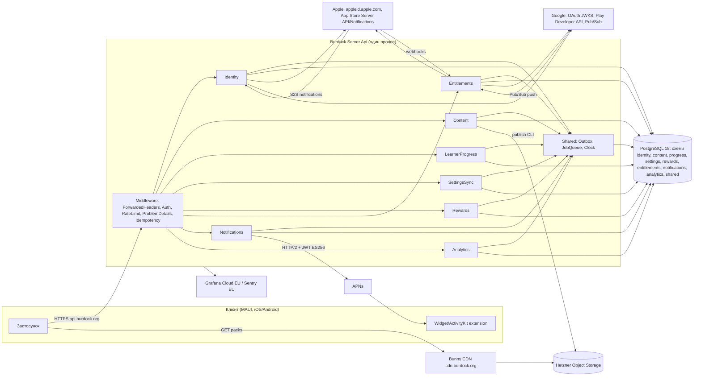
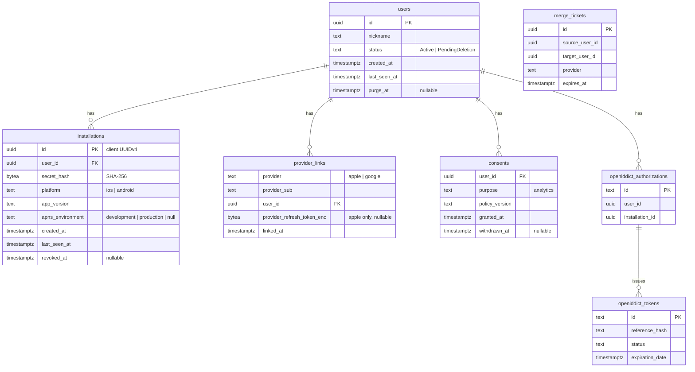
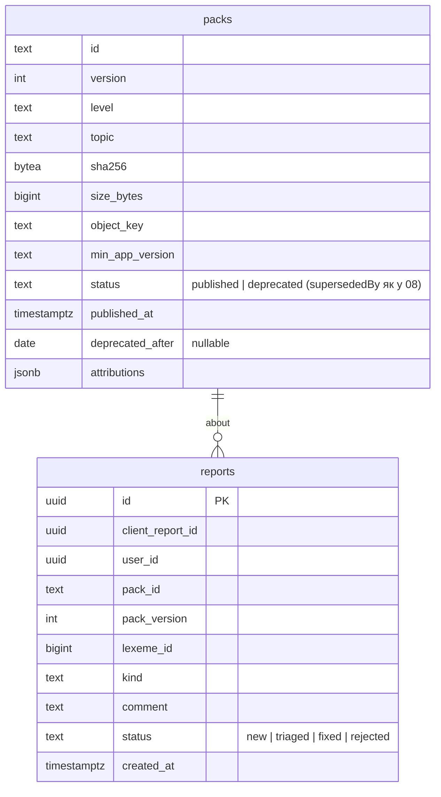
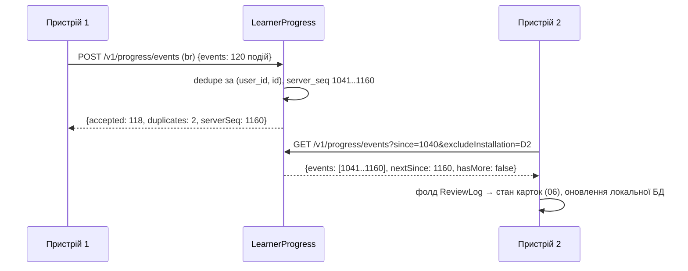
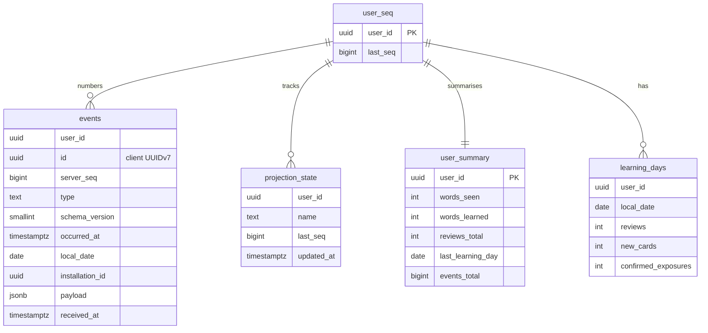
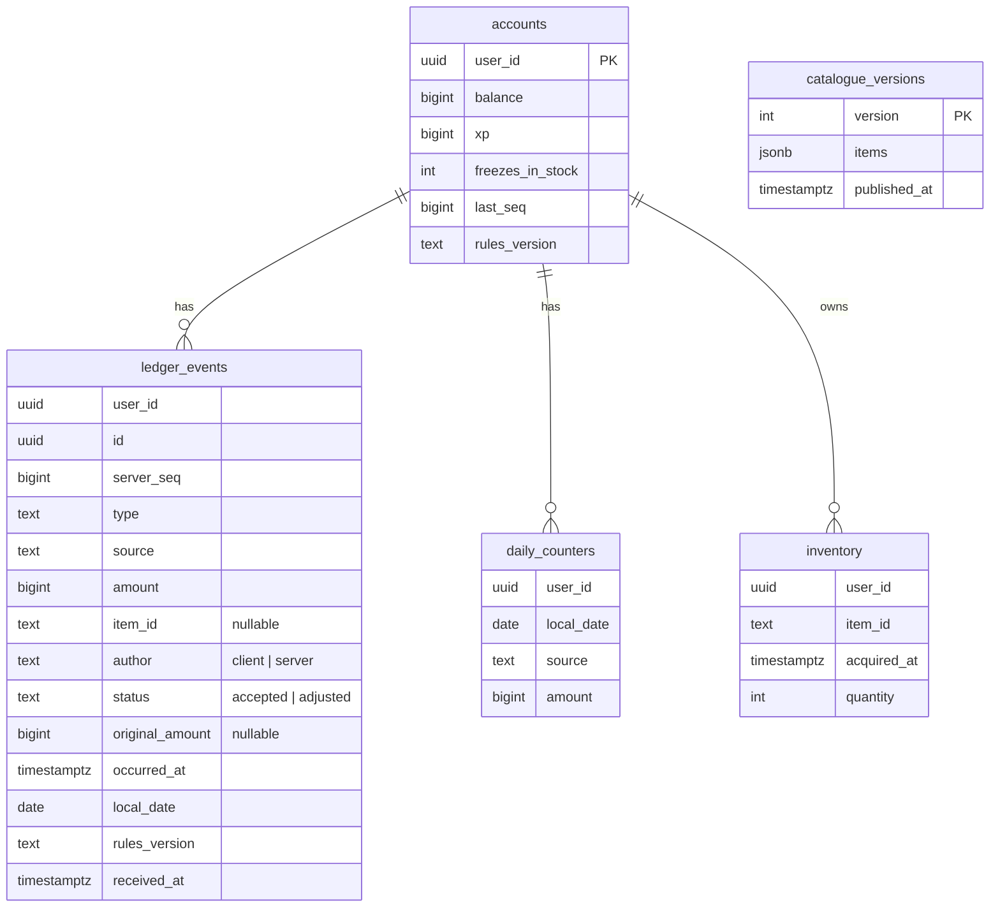
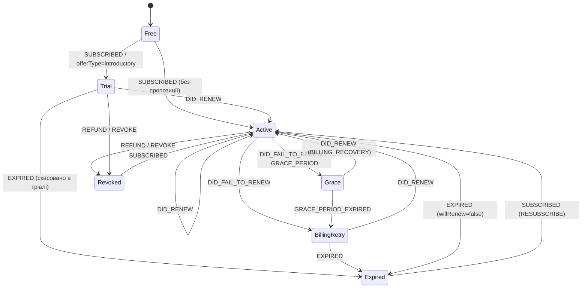
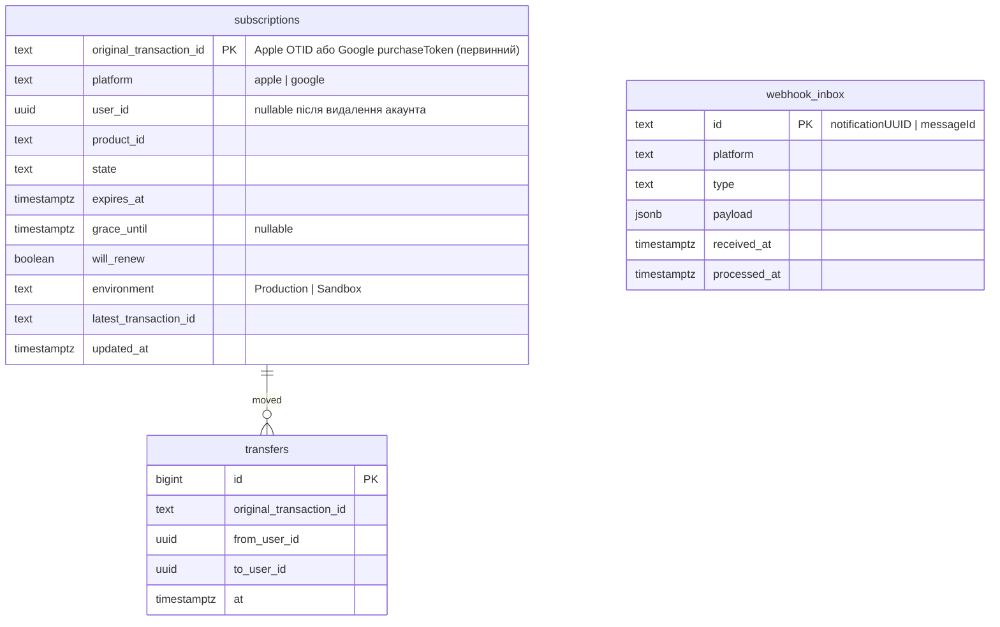
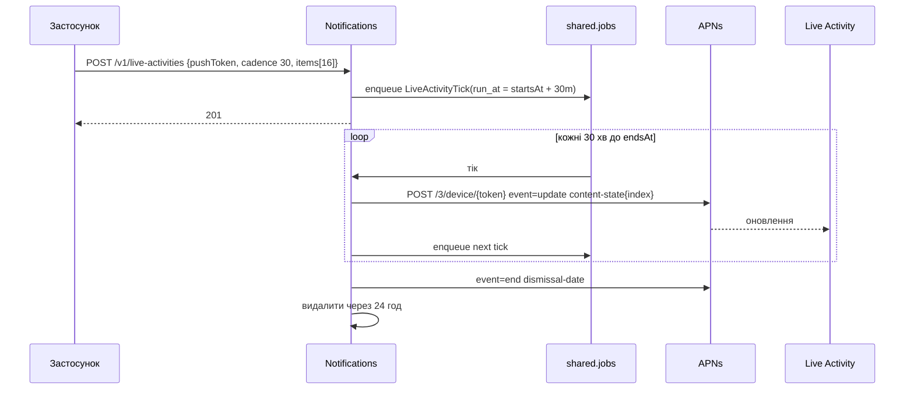
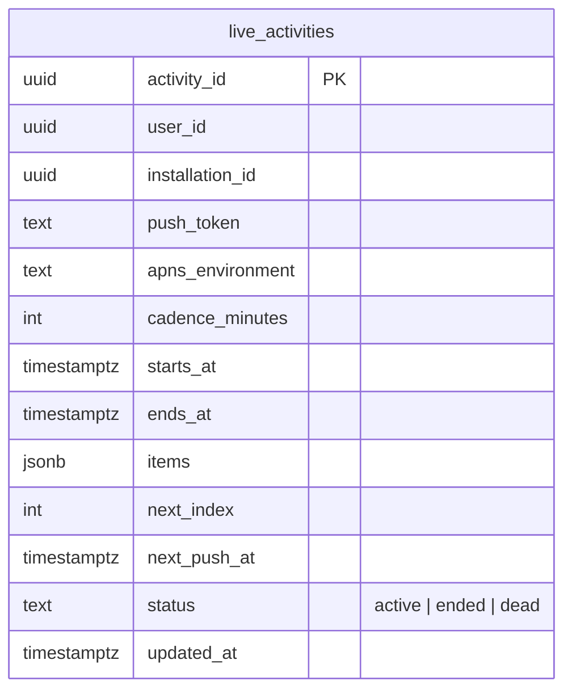

# 09. Серверна частина

| Поле | Значення |
|---|---|
| Статус | Draft |
| Версія | 0.1 |
| Дата | 2026-09-27 |
| Власник | Архітектор (бекенд) |
| Джерела рішень | [Журнал рішень](../decisions/2026-09-25-interview.md): Q3, Q4/Q13, Q9, Q10/Q15, Q17, Q23, Q27, Q33, Q35, Q38, T8, T10, T12, T13, T14, T15, T16, T18 |
| Пов'язані специфікації | 01-architecture (шари, `Burdock.Contracts`), 04-ios-surfaces (push-токени Live Activity), 06-learning-engine (`ReviewLog`, `ExposureRecord`), 07-gamification (`LedgerEvent`, `EconomyRules`), 08-content-pipeline (маніфест і пакети), 10-security-privacy, 11-monetization (стани entitlement), 13-analytics-observability, 14-devops-ci |

## 0. Контекст для ШІ-агента

Ти працюєш над серверною частиною «Реп'яха»: ASP.NET Core 10 Minimal APIs, модульний моноліт, PostgreSQL 18, EF Core 10 + Npgsql, OpenIddict. Сервер обов'язковий (Q4/Q13), але клієнт після першого запуску працює з кешу; сервер є джерелом істини для облікових записів, entitlement-ів, звірки нагород і журналу подій прогресу.

Перед роботою прочитай: `docs/decisions/2026-09-25-interview.md` (обов'язково), цю специфікацію, `docs/specs/10-security-privacy.md`, `docs/specs/01-architecture.md`, а для конкретного модуля відповідну доменну специфікацію (06, 07, 08, 11).

Правила, які не можна порушувати:
1. Модулі не читають таблиці одне одного. Кожен модуль має власну схему PostgreSQL; взаємодія лише через публічні контракти модуля (`*.Contracts`) та події через outbox.
2. Чиста архітектура в кожному модулі: `Domain` без залежностей, `Application` залежить лише від `Domain`, `Infrastructure` реалізує порти. Хост (`Burdock.Server.Api`) лише компонує.
3. Жодних персональних даних понад інвентар з `10-security-privacy.md`. Ніколи не логувати тіла запитів, токени, IP-адреси; ідентифікатори користувачів у логах лише через HMAC-редактор.
4. Усі часові поля в UTC (`timestamptz`); локальна дата навчання приходить від клієнта як `localDate`.
5. Публічні контракти змінюються лише адитивно в межах `/v1`. Ламальна зміна = `/v2` і ADR.
6. Політика чисел (ліміти, TTL) береться з таблиці констант (§3.15) через `IOptions<T>`, не з літералів у коді.

Код живе в `src/server/`, спільні пакети в `src/shared/`, тести в `tests/server/`. Перевірка результату: `dotnet build -warnaserror`, `dotnet test` (модульні + інтеграційні на Testcontainers), `docs/api/openapi.v1.json` без незапланованого diff, Kiota-клієнт у `Burdock.Contracts/Client` перегенеровано без diff.

## 1. Мета й межі

### 1.1. Відповідальність сервера за модулями

| Модуль | Відповідальність у v1 | Схема PostgreSQL |
|---|---|---|
| Identity | Анонімні акаунти (автостворення, інсталяційна кредиталь), видача та ротація токенів (OpenIddict), прив'язка Sign in with Apple / Google для синхронізації (Q3), об'єднання акаунтів, список пристроїв, видалення акаунта (в застосунку та через веб), нікнейми та фільтр нецензурної лексики (T10), записи згод | `identity` |
| Content | Маніфест пакетів контенту з ETag (T8), реєстр опублікованих пакетів, публікація з пайплайну (08), депрекація, скарги на контент, пакет безкоштовного пулу | `content` |
| LearnerProgress | Приймання append-only журналу подій навчання (T14) з ідемпотентністю, курсор `server_seq` на користувача, віддача подій на інші пристрої, ліниві проєкції статистики, бекфіл нового пристрою | `progress` |
| SettingsSync | Синхронізація налаштувань як LWW з версіонуванням схеми (T14) | `settings` |
| Rewards | Приймання леджера нагород, повторне застосування `EconomyRules` серверним часом, відхилення неможливих подій, проєкції балансу та інвентарю, каталог косметики (T18) | `rewards` |
| Entitlements | Валідація підписок App Store Server API / Play Developer API (Q23), вебхуки (App Store Server Notifications V2, RTDN), автомат станів entitlement, видача entitlement клієнту з TTL (11) | `entitlements` |
| Notifications | APNs (token-based) для оновлень Live Activity сесії (Q35); реєстр push-токенів активностей; планувальник оновлень | `notifications` |
| Analytics | Приймання opt-in анонімних подій (Q9), список дозволених подій, агрегація, ретенція (13) | `analytics` |
| Shared (ядро) | `Result`, каталог помилок, `IClock`, outbox, черга фонових завдань, ключі ідемпотентності | `shared` |

Analytics і Notifications доповнюють перелік модулів із T13 (він містив п'ять модулів). Це адитивне уточнення, а не зміна рішення: Notifications потрібен через Q35, Analytics через Q9.

### 1.2. Чого сервер НЕ робить

- Не планує повторення і не обирає наступне слово: FSRS (06) працює лише на клієнті. Сервер зберігає `ReviewLog` як факти, але ніколи не обчислює стан картки.
- Не дублює навчальну логіку: єдина «доменна» логіка на сервері, спільна з клієнтом, це згортка `EconomyRules` (для звірки нагород) і валідація схеми пакетів контенту (§1.3).
- Не є системою авторингу контенту: пайплайн (08) живе в `content/` і лише публікує готові пакети через внутрішній CLI.
- Не надсилає щоденні нагадування: сповіщення «слово дня» локальні (T17). Єдиний push у v1 це оновлення Live Activity.
- Не має адмін-UI та веб-клієнта у v1 (єдина веб-сторінка: видалення акаунта).
- Не є сховищем сирих аналітичних профілів: зберігає лише агреговані ряди.
- Не обробляє платежі: магазини є мерчантом; сервер лише підтверджує стан підписки.

### 1.3. Спільний пакет `Burdock.Domain` між клієнтом і сервером

Рішення: чисті доменні правила живуть в одному C#-пакеті `src/shared/Burdock.Domain` (netstandard-сумісний `net10.0`, нуль залежностей, без MAUI) і підключаються як до клієнта, так і до сервера. Сервер використовує з нього лише:

- `EconomyRules` (07): версіонована згортка `LedgerEvent` → `EconomyState` з денними лімітами. Сервер повторює ту саму згортку серверним часом. Одна реалізація гарантує, що баланс, який бачить користувач, і баланс, який приймає сервер, збігаються біт у біт; розбіжність можлива лише через дані (час, дублікати), а не через код.
- `ContentPackSchema` (08): валідація структури пакета і маніфесту при публікації (ті самі правила, якими клієнт перевіряє завантажений пакет).
- Значення-об'єкти: `LexemeId`, `CefrLevel`, `TopicId`, `LanguagePair`, `LearningDay` (обчислення навчального дня з ролловером 04:00 за локальним часом клієнта).

FSRS-логіка також лежить у `Burdock.Domain`, але сервер її не викликає (жодного посилання з серверних модулів на простір імен `Burdock.Domain.Scheduling`; це перевіряється архітектурним тестом).

Обґрунтування: (а) T18 вимагає, щоб «той самий код став серверно-авторитетним пізніше»; спільний пакет робить перехід до v1.1 конфігураційним, а не переписуванням; (б) соло-розробник (Q29) не може підтримувати дві реалізації правил; (в) коштом є зв'язність версій, яку знімаємо явним `rulesVersion` у кожній події леджера і правилом «сервер деплоїться першим» (§3.7, §3.13).

### 1.4. Поза межами v1 (відкладено)

| Що | Куди | Причина |
|---|---|---|
| Push-тригер оновлення контенту (APNs silent push / FCM) | v1.1 | T8: у v1 опитування маніфесту |
| Серверно-авторитетне нарахування нагород | v1.1 | T18 |
| App Attest / Play Integrity | після появи цінних нагород | T16 |
| Підписані ECDSA пакети | v1.1 (коли з'являться сторонні пакети) | Дослідження, §7 п. 50: у v1 достатньо TLS + SHA-256 у маніфесті, що віддається автентифікованим API |
| Ліги, друзі, соціальний модуль | не планується | Q24 |
| Адмін-UI, панель модерації скарг | v1.1 | у v1 скарги читаються через SQL по SSH-тунелю |
| FCM для Android-сесії; passkeys, email/пароль | не планується | Android-сесія працює на локальних сповіщеннях; Q3 обмежує вхід Apple/Google |

## 2. Вимоги

### 2.1. Функціональні

| ID | Вимога | MoSCoW |
|---|---|---|
| FR-09-1 | Клієнт може створити анонімний акаунт одним викликом без будь-яких персональних даних і отримати нікнейм; повторний виклик з тим самим `installationId` і секретом повертає той самий акаунт | Must |
| FR-09-2 | Сервер видає короткоживучі access-токени та ротовані refresh-токени з виявленням повторного використання (RFC 9700); повторне використання поза вікном терпимості відкликає весь ланцюжок | Must |
| FR-09-3 | Користувач може прив'язати Apple ID (обов'язково) або Google (з релізом Android) до анонімного акаунта виключно для синхронізації; сервер перевіряє identity/ID token криптографічно | Must |
| FR-09-4 | Якщо провайдер уже прив'язаний до іншого акаунта, сервер повертає `merge_required` зі зведенням обох акаунтів, а клієнт пропонує «об'єднати» (реплей обох журналів) або «перейти на існуючий» | Must |
| FR-09-5 | Користувач може відв'язати провайдера, переглянути й відкликати пристрої, видалити акаунт у застосунку та через веб-URL; видалення м'яке на 30 днів із негайним відкликанням токенів і Apple-токенів (TN3194) | Must |
| FR-09-6 | Сервер обробляє server-to-server сповіщення Sign in with Apple (`consent-revoked`, `account-delete`) і відв'язує провайдера | Must |
| FR-09-7 | `GET /v1/content/manifest` віддає перелік пакетів з версіями, SHA-256, розмірами, URL, мінімальною версією застосунку та атрибуціями, підтримує `ETag`/`If-None-Match` і фільтрує пакети за entitlement-ом | Must |
| FR-09-8 | Пакети зберігаються як незмінні версіоновані об'єкти на Hetzner Object Storage за CDN (Bunny); публікація виконується з пайплайну CLI-командою, депрекація не видаляє файли протягом періоду підтримки | Must |
| FR-09-9 | Користувач може анонімно поскаржитися на слово/приклад (`POST /v1/content/reports`) з лімітом на добу | Should |
| FR-09-10 | `POST /v1/progress/events` приймає пакет append-only подій з клієнтськими UUIDv7, ідемпотентно, і повертає стан кожної події та поточний `serverSeq` | Must |
| FR-09-11 | `GET /v1/progress/events?since=` віддає події користувача з монотонним курсором `server_seq`, з пагінацією та стисненням, для бекфілу і крос-пристроєвої синхронізації | Must |
| FR-09-12 | Заплановані покази (`exposureScheduled`) синхронізуються агреговано за день, підтверджені покази (`exposureConfirmed`) як сирі події | Must |
| FR-09-13 | Налаштування синхронізуються як LWW за парою (`updatedAt`, `clientId`) на рівні окремого ключа з версією схеми | Must |
| FR-09-14 | `POST /v1/rewards/ledger` повторює `EconomyRules` серверним часом, відхиляє неможливі події (перевищені ліміти, майбутній час, дублікати, невідомі товари) і повертає корекції та актуальний баланс/інвентар | Must |
| FR-09-15 | `GET /v1/rewards/catalogue` віддає каталог косметики з цінами і версією, з ETag | Must |
| FR-09-16 | `POST /v1/entitlements/apple` приймає JWS `signedTransactionInfo`, перевіряє ланцюжок до кореневого сертифіката Apple, підтверджує стан через App Store Server API і повертає entitlement | Must |
| FR-09-17 | Вебхук App Store Server Notifications V2 перевіряє JWS, ідемпотентний за `notificationUUID`, оновлює автомат станів | Must |
| FR-09-18 | `POST /v1/entitlements/google` перевіряє purchase token через `purchases.subscriptionsv2`, а RTDN приймається через Pub/Sub push з перевіркою OIDC-токена | Should (з релізом Android) |
| FR-09-19 | `GET /v1/entitlements/me` повертає стан автомата (Free, Trial, Active, Grace, BillingRetry, Expired, Revoked) з `cacheUntil`; entitlement слідує за акаунтом на всіх пристроях; відновлення покупок переносить `originalTransactionId` на поточний акаунт з аудитом | Must |
| FR-09-20 | Клієнт реєструє push-токен Live Activity з розкладом; сервер надсилає `update` за каденцією до `endsAt` або явного завершення, потім `end`; мертві токени прибираються | Must |
| FR-09-21 | `POST /v1/analytics/events` приймає лише дозволені імена та властивості подій з погодинними мітками часу, лише за наявності активної згоди; зберігає без ідентифікатора користувача | Must |
| FR-09-22 | `GET /v1/config` віддає прапорці функцій, мінімальні версії застосунку, публічні константи політики з ETag | Must |
| FR-09-23 | Усі помилки повертаються у форматі RFC 9457 `application/problem+json` з машинним `code` і `traceId` | Must |
| FR-09-24 | Неідемпотентні POST (прив'язка, об'єднання, entitlement, Live Activity) підтримують заголовок `Idempotency-Key` із зберіганням відповіді 24 години | Should |
| FR-09-25 | OpenAPI-документ `/v1` генерується на етапі збірки і зберігається в репозиторії; клієнтський SDK генерується Kiota в `Burdock.Contracts/Client` | Must |
| FR-09-26 | Фонові завдання: оновлення entitlement-ів, очищення неактивних анонімних акаунтів через 12 місяців, фіналізація видалення, планувальник Live Activity, агрегація аналітики, перебудова проєкцій, обслуговування партицій | Must |

### 2.2. Нефункціональні

| ID | Вимога | MoSCoW |
|---|---|---|
| NFR-09-1 | Дані користувачів зберігаються та обробляються лише в ЄС/ЄЕЗ (Hetzner Falkenstein/Helsinki, Bunny, Grafana Cloud EU, Sentry EU). Винятки лише APNs та сервери магазинів як необхідні процесори | Must |
| NFR-09-2 | p95 латентності на стартовій VM при 50 RPS: токен ≤ 150 мс, маніфест ≤ 50 мс (304), пакет 100 подій прогресу ≤ 300 мс, леджер 50 подій ≤ 300 мс, `entitlements/me` ≤ 100 мс | Should |
| NFR-09-3 | Доступність 99.5% на місяць у v1 (одна VM, планові вікна деплою ≤ 2 хв через експанд/контракт міграції) | Should |
| NFR-09-4 | RPO ≤ 5 хв (безперервний WAL-архів pgBackRest), RTO ≤ 2 год (відновлення з об'єктного сховища на нову VM за ранбуком) | Must |
| NFR-09-5 | Жодних тіл запитів, токенів, IP-адрес у логах; ідентифікатори користувачів лише як HMAC | Must |
| NFR-09-6 | Кожен ендпоїнт має явну політику авторизації та явну політику rate limiting; відсутність політики валить збірку архітектурним тестом | Must |
| NFR-09-7 | Міграції БД лише expand/contract; будь-яка міграція має бути сумісною з попередньою версією застосунку протягом одного релізу | Must |
| NFR-09-8 | Образи контейнерів закріплені за digest, підписані (cosign), запускаються не від root з read-only файловою системою | Must |
| NFR-09-9 | Спостережуваність: трасування, метрики та логи через OpenTelemetry; винятки в Sentry; алерти на помилки 5xx, латентність, глибину черги завдань, вік останнього бекапу | Must |
| NFR-09-10 | Горизонтальне масштабування без зміни коду: API без стану, завдання через PostgreSQL-чергу з `SKIP LOCKED`, лідерські завдання через advisory lock | Should |
| NFR-09-11 | Стиснення відповідей (br/gzip) та приймання стиснених тіл запитів для пакетів подій | Should |
| NFR-09-12 | Тести: покриття Domain модулів ≥ 90%, інтеграційні тести кожного ендпоїнта на Testcontainers PostgreSQL 18, контрактний тест OpenAPI без diff | Must |

## 3. Проєктування

### 3.1. Структура рішення та межі модулів

```text
src/
  shared/
    Burdock.Domain/                    # чисті правила, спільні з клієнтом (EconomyRules, ContentPackSchema, value objects)
    Burdock.Contracts/                 # згенерований Kiota-клієнт + моделі (не редагувати вручну)
      Client/
      Models/
  server/
    Burdock.Server.Api/                # хост: Program.cs, композиція модулів, endpoint groups /v1, OpenAPI, middleware
    Burdock.Server.Shared/             # ядро: Result<T>, ErrorCatalog, IClock, Outbox, JobQueue, IdempotencyStore, Redaction
    Burdock.Server.Modules.Identity/
      Domain/  Application/  Infrastructure/  Contracts/  Endpoints/
    Burdock.Server.Modules.Content/
    Burdock.Server.Modules.LearnerProgress/
    Burdock.Server.Modules.SettingsSync/
    Burdock.Server.Modules.Rewards/
    Burdock.Server.Modules.Entitlements/
    Burdock.Server.Modules.Notifications/
    Burdock.Server.Modules.Analytics/
tests/
  server/
    Burdock.Server.ArchitectureTests/  # правила залежностей між шарами і модулями
    Burdock.Server.Modules.*.Tests/    # Domain + Application (без БД)
    Burdock.Server.IntegrationTests/   # WebApplicationFactory + Testcontainers PostgreSQL 18
    Burdock.Server.ContractTests/      # OpenAPI snapshot, Kiota regeneration, webhook fixtures
    Burdock.Server.LoadTests/          # k6 сценарії
docs/api/openapi.v1.json               # артефакт збірки, коміт у репозиторій
```

Кожен модуль є одним проєктом із чотирма папками-шарами й одним `Endpoints` (адаптер входу). Правила залежностей (перевіряються `Burdock.Server.ArchitectureTests`):

| Шар | Може залежати від | Не може |
|---|---|---|
| `Domain` | `Burdock.Domain` (спільний), BCL | будь-чого іншого |
| `Application` | `Domain`, `Burdock.Server.Shared` (порти: `IClock`, `Result`), `*.Contracts` інших модулів | EF Core, HTTP, ASP.NET |
| `Infrastructure` | `Application`, EF Core/Npgsql, HttpClient, OpenIddict | `Endpoints` |
| `Endpoints` | `Application`, ASP.NET Core Minimal APIs | `Infrastructure` (лише через DI) |
| `Contracts` | BCL | будь-чого (це публічна поверхня модуля для інших модулів) |

Межі модулів:
- Окрема схема PostgreSQL на модуль; `DbContext` кожного модуля має `HasDefaultSchema` і власну історію міграцій (`__EFMigrationsHistory` у своїй схемі). Роль БД одна (просто), але архітектурний тест забороняє згадування чужої схеми в міграціях і `DbContext`.
- Синхронні запити між модулями лише через інтерфейси з `*.Contracts` (наприклад, `IEntitlementReader.GetStateAsync(userId)` з Entitlements для Content; `IUserDirectory` з Identity для Entitlements). Реалізація живе в `Infrastructure` модуля-власника.
- Асинхронна взаємодія через доменні події → `shared.outbox` в тій самій транзакції → диспетчер у процесі → обробники в інших модулях (at-least-once, ідемпотентні обробники). Приклади: `UserDeletionRequested` (Identity → усі), `AccountsMerged` (Identity → Progress, Rewards, Entitlements, Settings), `EntitlementChanged` (Entitlements → Content-кеш маніфесту), `ContentPackPublished` (Content → Notifications у v1.1).



### 3.2. Наскрізні механізми

**Автентифікація.** OpenIddict як сервер токенів (T13). Access-токени: самодостатні JWT (ES256, ключ у sops), час життя `Auth:AccessTokenLifetime` = 10 хв, аудиторія `burdock-api`. Refresh-токени: непрозорі (reference tokens), зберігаються як хеш у `identity.openiddict_tokens`, rolling (кожне оновлення видає новий), `Auth:RefreshTokenLifetime` = 30 днів ковзно, вікно терпимості повторного використання `Auth:RefreshTokenReuseLeeway` = 30 с (типове значення OpenIddict 7.7.1 за дослідженням, розділ 8 п. 5). Повторне використання поза вікном відкликає всю авторизацію (усі токени ланцюжка), а клієнт мовчки переавтентифікується інсталяційним грантом (§3.3). Middleware `UseAuthentication` + `UseAuthorization`; політики: `Authenticated` (типова для всіх груп, крім явно анонімних), `Anonymous` (config, реєстрація, вебхуки з власною перевіркою), `Webhook:Apple`, `Webhook:Google` (перевірка підпису у фільтрі ендпоїнта, без bearer).

**Авторизація.** Кожна `MapGroup` має `RequireAuthorization(policy)` або `AllowAnonymous()` явно. Ресурси завжди адресуються як `/me` або через `userId` з claims (`sub`); шляхи з чужим `userId` не існують. Архітектурний тест обходить `EndpointDataSource` і валить збірку, якщо в ендпоїнта немає метаданих авторизації або rate limiting (NFR-09-6).

**Валідація.** Рішення: вбудована валідація Minimal APIs .NET 10 (`builder.Services.AddValidation()`, атрибути DataAnnotations та `IValidatableObject` на DTO запитів; підтримується генератором коду і не потребує рефлексії). FluentValidation не використовуємо: додаткова залежність без переваг для плоских DTO; складні інваріанти (наприклад, порядок подій у пакеті) належать `Domain`/`Application` і повертаються як `Result` з кодом помилки. Помилки валідації віддаються як `HttpValidationProblemDetails`.

**Формат помилок.** RFC 9457 через `AddProblemDetails()`; `type` = `https://burdock.org/problems/{code}`, розширення `code` (машинний ідентифікатор з `ErrorCatalog`), `traceId`. У продакшені без деталей винятків. Коди, на які спирається клієнт: `installation_unknown`, `provider_not_linked`, `merge_required`, `consent_required`, `rules_version_unsupported`, `entitlement_transferred`, `idempotency_key_reuse`, `upgrade_required`, `rate_limited`.

**Ідемпотентність.** Події (прогрес, леджер, аналітика) ідемпотентні природно за клієнтським UUIDv7 (`id` унікальний у межах користувача). Для інших POST фільтр `IdempotencyFilter` читає `Idempotency-Key` (UUID), зберігає `(user_id, key, request_sha256, status, body)` у `shared.idempotency_keys` на `Retention:IdempotencyHours` = 24 год; повтор з тим самим ключем і тим самим хешем повертає збережену відповідь, з іншим хешем — 422 `idempotency_key_reuse`.

**Rate limiting.** Вбудований `Microsoft.AspNetCore.RateLimiting` з `RejectionStatusCode = 429` і заголовком `Retry-After`. Партиції обмежені за розміром: для анонімних запитів ключ = хеш IP-префікса (/24 IPv4, /64 IPv6) у пам'яті (IP не персистується і не логується), для автентифікованих ключ = `sub`. Політики й числа в §3.15. IP береться з `X-Forwarded-For` лише від довіреного проксі (контейнер Caddy) через `ForwardedHeadersOptions.KnownProxies`.

**Пагінація.** Курсорна: `since`/`nextSince` для журналів, `cursor` (непрозорий base64) для списків. Без offset-пагінації.

**Час.** Сервер лише UTC. Клієнт надсилає заголовки `X-Client-Timezone` (IANA id) та `X-Client-Time` (ISO-8601 UTC); сервер обчислює зсув `clockSkew = serverNow - clientTime` і повертає `X-Server-Time`. Події несуть `occurredAt` (UTC) і `localDate` (обчислена клієнтом за `LearningDay`). Сервер не переобчислює `localDate`, лише перевіряє правдоподібність (`|localDate - occurredAt.Date| ≤ 1 день`).

**Версіонування API.** Префікс `/v1`; адитивні зміни (нові поля, нові ендпоїнти, нові enum-значення там, де клієнт оголосив толерантність) без зміни версії. Ламальна зміна відкриває `/v2` і зберігає `/v1` щонайменше 12 місяців із заголовками `Deprecation` (RFC 9745) і `Sunset` (RFC 8594). Примусове оновлення застосунку через `minAppVersion` у `/v1/config` і код 426 `upgrade_required` для застарілих клієнтів (за заголовком `X-App-Version`).

**Remote config.** `GET /v1/config` (анонімно, `Cache-Control: public, max-age=300`, ETag): `minAppVersion` per platform, `features` (наприклад `liveActivities`, `googleSignIn`, `contentPush`), `policy` (публічні константи з 06/07: денні ліміти, каденції), `urls` (політика приватності, умови, підтримка), `rulesVersion` (поточна версія `EconomyRules`).

**Здоров'я і стиснення.** `/healthz/live` (процес живий) і `/healthz/ready` (з'єднання з БД, застосованість міграцій, вік outbox); Caddy пропускає назовні лише `/healthz/live` для зовнішнього монітора. `ResponseCompression` (brotli, gzip) для JSON; `RequestDecompression` для `Content-Encoding: br|gzip` на `/v1/progress/events`, `/v1/rewards/ledger`, `/v1/analytics/events`; ліміт тіла після розпакування `Api:MaxRequestBodyBytes` = 2 МіБ.

**OpenAPI та SDK.** `Microsoft.AspNetCore.OpenApi` (`AddOpenApi`/`MapOpenApi`) видає документ `/openapi/v1.json` у Development; на збірці `Microsoft.Extensions.ApiDescription.Server` записує `docs/api/openapi.v1.json`. Рішення щодо генератора клієнта: **Kiota**. Обґрунтування: генерує клієнт з мінімальними залежностями і серіалізацією через System.Text.Json (без Newtonsoft), що узгоджується з обрізанням і AOT-профілем MAUI; підтримує генерацію підмножини документа; це інструмент Microsoft з активною підтримкою. NSwag відхилено через типово більший монолітний клієнт і додаткову конфігурацію для STJ. Kiota генерує `Burdock.Contracts/Client` та `Burdock.Contracts/Models`; CI перевіряє, що перегенерація не дає diff (FR-09-25). Ручні DTO у `Burdock.Contracts` заборонені; доменні типи (`LedgerEvent`) відображаються у wire-моделі мапером на клієнті.

#### 3.2.1. Реєстр ендпоїнтів `/v1`

| Метод і шлях | Модуль | Авторизація | Rate-limit політика | Ідемпотентність |
|---|---|---|---|---|
| `GET /v1/config` | Host | Anonymous | `anon-ip` | GET |
| `POST /v1/identity/anonymous` | Identity | Anonymous | `identity-create` | за `installationId` |
| `POST /v1/connect/token` | Identity (OpenIddict) | Anonymous (гранти) | `token` | немає |
| `POST /v1/connect/revocation` | Identity | Anonymous | `token` | немає |
| `GET /v1/identity/me` | Identity | Authenticated | `user` | GET |
| `PATCH /v1/identity/me` | Identity | Authenticated | `user-write` | немає |
| `PUT /v1/identity/me/consents/{purpose}` | Identity | Authenticated | `user-write` | природна |
| `POST /v1/identity/link/{provider}` | Identity | Authenticated | `link` | `Idempotency-Key` |
| `POST /v1/identity/merge` | Identity | Authenticated | `link` | `Idempotency-Key` |
| `DELETE /v1/identity/link/{provider}` | Identity | Authenticated | `user-write` | природна |
| `GET /v1/identity/me/installations` | Identity | Authenticated | `user` | GET |
| `DELETE /v1/identity/me/installations/{id}` | Identity | Authenticated | `user-write` | природна |
| `DELETE /v1/identity/me` | Identity | Authenticated | `user-write` | природна |
| `POST /v1/identity/me/restore` | Identity | Anonymous (доказ: provider token або інсталяційний секрет) | `link` | природна |
| `GET /v1/identity/oauth/{provider}/start`, `POST .../callback` | Identity | Anonymous | `anon-ip` | немає |
| `POST /v1/identity/apple/notifications` | Identity | Webhook:Apple (JWT) | `webhook` | за `jti`/`events` |
| `GET /web/account/delete` та `POST /web/account/delete` | Identity | веб-сесія SIWA/Google | `anon-ip` | CSRF-токен |
| `GET /v1/content/manifest` | Content | Authenticated | `user` | ETag |
| `POST /v1/content/reports` | Content | Authenticated | `reports` | природна (`clientReportId`) |
| `POST /v1/progress/events` | LearnerProgress | Authenticated | `progress-batch` | за `id` подій |
| `GET /v1/progress/events` | LearnerProgress | Authenticated | `user` | GET |
| `GET /v1/progress/stats` | LearnerProgress | Authenticated | `user` | GET |
| `GET /v1/settings`, `PUT /v1/settings` | SettingsSync | Authenticated | `user`, `user-write` | LWW |
| `POST /v1/rewards/ledger` | Rewards | Authenticated | `rewards-batch` | за `id` подій |
| `GET /v1/rewards/state` | Rewards | Authenticated | `user` | GET |
| `GET /v1/rewards/catalogue` | Rewards | Authenticated | `user` | ETag |
| `POST /v1/entitlements/apple`, `POST /v1/entitlements/google` | Entitlements | Authenticated | `entitlement` | `Idempotency-Key` |
| `GET /v1/entitlements/me` | Entitlements | Authenticated | `user` | GET |
| `POST /v1/entitlements/apple/notifications` | Entitlements | Webhook:Apple (JWS) | `webhook` | `notificationUUID` |
| `POST /v1/entitlements/google/rtdn` | Entitlements | Webhook:Google (OIDC) | `webhook` | `messageId` |
| `POST /v1/live-activities`, `PATCH /v1/live-activities/{id}`, `DELETE /v1/live-activities/{id}` | Notifications | Authenticated | `user-write` | `activityId` |
| `POST /v1/analytics/events` | Analytics | Authenticated + активна згода | `analytics` | за `id` подій |
| `GET /healthz/live`, `GET /healthz/ready` | Host | Anonymous (мережево обмежено) | немає | GET |

### 3.3. Модуль Identity

#### 3.3.1. Анонімний акаунт та інсталяційна кредиталь

Проблема: анонімний акаунт не має пароля, тож втрата refresh-токена означала б втрату акаунта. Рішення: клієнт при першому запуску генерує `installationId` (UUIDv4, випадковий, без часової мітки, щоб не розкривати момент установлення) та `installationSecret` (32 випадкових байти), зберігає обидва в SecureStorage (`ThisDeviceOnly`; 10-security-privacy) і реєструє акаунт. Сервер зберігає лише SHA-256 від секрету (секрет має 256 біт ентропії, тому повільне хешування не потрібне). Інсталяційна кредиталь є довгоживучим «паролем пристрою», refresh-токени короткі. При перевстановленні SecureStorage очищається за політикою клієнта, тому акаунт без прив'язки Apple/Google втрачається; застосунок м'яко нагадує про прив'язку після першого тижня (UX у 11/04).

Рішення щодо OpenIddict: **стандартний потік `refresh_token` + два кастомні гранти** (OpenIddict дозволяє реєструвати власні типи грантів через дозволи `Permissions.Prefixes.GrantType` і `AllowCustomFlow`):

| Грант | Параметри | Результат |
|---|---|---|
| `urn:burdock:grant:installation` | `installation_id`, `installation_secret`, `platform`, `app_version`, `apns_environment?` | access + refresh для акаунта, до якого прив'язана інсталяція |
| `refresh_token` | `refresh_token` | новий access + новий refresh (rolling) |
| `urn:burdock:grant:switch_code` | `switch_code` (одноразовий, 10 хв, виданий `/identity/merge`) | access + refresh для цільового акаунта; інсталяція переприв'язується |

Альтернативи відхилено: (а) самописна видача JWT без OpenIddict позбавляє ротації, зберігання й відкликання токенів «з коробки»; (б) authorization code flow через браузер для анонімного акаунта безглуздий (немає, кого автентифікувати); (в) OpenIddict `client_credentials` не моделює користувача.

Реєстрація й перший вхід виконуються двома викликами, щоб єдиним емітентом токенів залишався OpenIddict:

```mermaid
sequenceDiagram
  participant A as Застосунок
  participant S as api.burdock.org
  participant DB as identity
  A->>A: installationId = UUIDv4, secret = 32 байти → SecureStorage
  A->>S: POST /v1/identity/anonymous {installationId, secretHash?, platform, appVersion, locale}
  Note over A,S: secret передається як є по TLS; сервер зберігає SHA-256
  S->>DB: INSERT users(nickname), installations(id, user_id, secret_hash)
  S-->>A: 201 {userId, nickname, createdAt}
  A->>S: POST /v1/connect/token grant_type=urn:burdock:grant:installation
  S->>DB: перевірка хешу секрету, статус акаунта
  S-->>A: {access_token (10 хв), refresh_token (30 днів, rolling), expires_in}
  A->>S: ... запити з Bearer; при 401 → refresh_token; при invalid_grant → installation grant
```

Повторний `POST /v1/identity/anonymous` з відомим `installationId` і правильним секретом повертає 200 з тим самим акаунтом (ідемпотентність FR-09-1); з неправильним секретом — 409 `installation_conflict` (клієнт генерує новий `installationId`).

Нікнейм генерується сервером з курованих списків: `{Прикметник} Реп'ях #{NNNN}` (наприклад «Хоробрий Реп'ях #4821»; близько 200 прикметників у формі чоловічого роду, чотиризначний тег). Користувач може змінити нікнейм (`PATCH /v1/identity/me`): довжина 3–24, літери будь-якого алфавіту, цифри, пробіл, апостроф, дефіс; серверний фільтр нецензурної лексики: нормалізація (нижній регістр, зняття діакритики, заміна leet-символів, злиття повторів), словники uk/en/ru, перевірка підрядків і транслітерованих форм; відмова 422 `nickname_rejected` без пояснення, який саме фрагмент спрацював. Нікнейми не унікальні (соціальних функцій немає, Q24). Нікнейм трактуємо як контент користувача: інтерфейс просить не вводити справжнє ім'я.

> Реалізовано 02.10.2026 (`Burdock.Server.Modules.Identity`): `POST /v1/identity/anonymous` (201 для нової інсталяції, 200 для повтору з тим самим секретом, 409 `installation_conflict`), грант `urn:burdock:grant:installation` і `refresh_token` через OpenIddict 7.7 (reference refresh-токени, ротація, `Auth:RefreshTokenReuseLeeway`), `GET`/`PATCH /v1/identity/me`. Нікнейм генерується сервером зі списку, що починається з десяти прикметників онбордингу; правила довжини спільні з клієнтом (`LearnerProfile`: 2–24 символи, тому константа `Identity:NicknameMinLength` = 2, а не 3). Ключі підпису/шифрування з `Auth:SigningKeyPem`/`Auth:EncryptionKeyBase64`, без них ефемерні (лише Development і тести). Прив'язка провайдерів, об'єднання, видалення й S2S-сповіщення ще не реалізовані.
>
> Доповнено 11.10.2026: `RegisterInstallationDto.LearnerId` (необов'язковий) дає застосунку запропонувати локальний id учня як id акаунта (ADR 0006): вільний id стає id акаунта, зайнятий — 409 `learner_id_taken`, і клієнт лишається локальним до появи прив'язки акаунта. Клієнт (`Burdock.Infrastructure.Sync.HttpSyncGateway`): id і секрет інсталяції та refresh-токен у SecureStorage (`sync.installationId`, `sync.installationSecret`, `sync.refreshToken`), access-токен лише в пам'яті; порядок — кешований access-токен → грант `refresh_token` → installation grant → реєстрація, якщо сервер не знає інсталяцію; 401 на робочому запиті → одне оновлення токена і повтор; `installation_conflict` → одна ротація інсталяції; транспортні збої й тайм-аути → `sync.offline`, коди problem-відповідей → `sync.<code>`.

#### 3.3.2. Прив'язка Sign in with Apple та Google

Нативні шляхи: на iOS `ASAuthorizationController` (identity token JWT + authorization code + nonce), на Android Credential Manager «Sign in with Google» (ID token + nonce). Перехресні випадки (Apple на Android, Google на iOS) через `WebAuthenticator` з веб-потоком, що завершується на сервері (`GET /v1/identity/oauth/{provider}/start` → провайдер → `POST /v1/identity/oauth/{provider}/callback` → редирект на `org.burdock.app://auth?link_code=…`); `link_code` одноразовий, прив'язаний до S256-виклику, який згенерував застосунок (PKCE-подібний захист від перехоплення редиректу). Веб-потік Apple вимагає Services ID і підтвердженого домену `burdock.org`; ті самі налаштування використовує веб-сторінка видалення.

Перевірка identity token Apple: підпис за JWKS `https://appleid.apple.com/auth/keys` (кеш 24 год з примусовим оновленням при невідомому `kid`), `iss = https://appleid.apple.com`, `aud ∈ {org.burdock.app, <ServicesId>}`, `exp`, `nonce = SHA-256(clientNonce)`; ідентифікатор користувача `sub`. Email і ім'я, які Apple передає при першій авторизації, **не зберігаються** (мінімізація: для синхронізації достатньо `sub`). Для Google: підпис за JWKS Google, `iss ∈ {accounts.google.com, https://accounts.google.com}`, `aud` = серверний client id, `exp`, `nonce`; зберігаємо лише `sub`.

Для виконання TN3194 (відкликання токенів Apple при видаленні акаунта) сервер при прив'язці обмінює `authorization_code` на пару токенів Apple через `/auth/token` (client secret = JWT ES256, підписаний ключем Sign in with Apple `.p8`) і зберігає refresh-токен Apple зашифрованим (Data Protection API з ключами в томі, ключ шифрування з sops) у `identity.provider_links.provider_refresh_token_enc`. Використання: лише виклик `/auth/revoke` при видаленні акаунта або відв'язці.

```mermaid
sequenceDiagram
  participant U as Користувач
  participant A as Застосунок (акаунт A2, анонімний)
  participant S as Identity
  participant AP as Apple
  U->>A: «Синхронізувати через Apple»
  A->>AP: ASAuthorizationController (nonce)
  AP-->>A: identityToken, authorizationCode
  A->>S: POST /v1/identity/link/apple {identityToken, authorizationCode, nonce} Idempotency-Key
  S->>AP: перевірка JWKS; обмін code → refresh (для TN3194)
  alt sub вільний
    S-->>A: 200 {status: "linked"}
  else sub прив'язаний до A1
    S-->>A: 409 merge_required {mergeTicket, current: {events, learnedWords, streakDays, balance, lastActiveAt}, existing: {...}}
    A->>U: Вибір: «Об'єднати прогрес» / «Перейти на існуючий» / «Скасувати»
    U->>A: Об'єднати
    A->>S: POST /v1/identity/merge {mergeTicket, strategy: "merge"}
    S->>S: реплей журналів A2 → A1, переприв'язка інсталяції, entitlement, soft-delete A2
    S-->>A: 200 {switchCode}
    A->>S: POST /v1/connect/token grant_type=urn:burdock:grant:switch_code
    S-->>A: токени A1
    A->>S: GET /v1/progress/events?since=0 (повний бекфіл)
  end
```

Правила об'єднання (`strategy`):

| Стратегія | Коли пропонується | Що відбувається |
|---|---|---|
| `adopt` (перейти на існуючий) | автоматично без діалогу, якщо поточний акаунт має < `Identity:TrivialAccountEvents` = 20 подій прогресу (свіжа установка) | інсталяція переприв'язується до A1; A2 м'яко видаляється (30 днів) |
| `merge` (об'єднати) | обидва акаунти мають прогрес | вижилий акаунт = A1 (той, що вже прив'язаний). Події A2 (прогрес і леджер) додаються до журналу A1 з новими `server_seq`, зберігаючи власні `id`; дублікати `id` пропускаються. Леджер A1 перезгортається `EconomyRules` після злиття: баланс = результат згортки, інвентар = об'єднання. Налаштування: LWW за ключами. Entitlement: `originalTransactionId` переприв'язується до A1. Згоди: найсуворіша (opt-out перемагає). Стан карток FSRS клієнт відтворює з об'єднаного `ReviewLog` (06 гарантує детермінований фолд; при конфлікті одного слова перемагає останній огляд за `occurredAt`). A2 → soft delete |
| `cancel` | завжди доступно | нічого не змінюється; `mergeTicket` анулюється |

`mergeTicket` живе 10 хв, прив'язаний до `sub` поточного access-токена і до `provider:sub`. Об'єднання виконується в одній транзакції на модуль з подією `AccountsMerged(sourceUserId, targetUserId)` через outbox; клієнт бачить результат лише після повного бекфілу.

#### 3.3.3. Відв'язка, пристрої, видалення, S2S-сповіщення

- `DELETE /v1/identity/link/{provider}`: дозволено завжди; для Apple викликається `/auth/revoke`; акаунт лишається доступним через інсталяційну кредиталь. Якщо це був єдиний спосіб відновлення, клієнт попереджає.
- `GET /v1/identity/me/installations`: `{id, platform, appVersion, createdAt, lastSeenAt, isCurrent}`; `DELETE .../{id}` відкликає всі токени цієї інсталяції (OpenIddict authorization per installation) і її секрет.
- `DELETE /v1/identity/me`: стан акаунта `PendingDeletion`, `purge_at = now + Retention:SoftDeleteDays` (30). Негайно: відкликання всіх токенів і секретів інсталяцій, `/auth/revoke` для Apple, подія `UserDeletionRequested` (Entitlements зберігає лише `originalTransactionId`→«орфан» без user_id; Notifications завершує активності; Analytics нічого не робить, бо не має user_id). Протягом 30 днів `POST /v1/identity/me/restore` з дійсним identity token того самого провайдера (або інсталяційним секретом для анонімного акаунта на тому самому пристрої) скасовує видалення. Фіналізатор (§3.12) фізично видаляє рядки у всіх схемах за `userId` (кожен модуль обробляє `UserPurged`).
- Веб-URL для Google Play та Apple: `https://burdock.org/account/delete` (статична сторінка з поясненням) веде на `https://api.burdock.org/web/account/delete`, де серверно-рендерена сторінка пропонує вхід через Apple або Google (веб-потоки) і кнопку підтвердження з CSRF-токеном. Анонімні акаунти видаляються лише в застосунку (веб не може їх автентифікувати), про що сторінка каже прямо.
- `POST /v1/identity/apple/notifications`: JWT від Apple перевіряється тим самим JWKS; події `consent-revoked` і `account-delete` → відв'язка провайдера (акаунт не видаляється, бо міг бути прив'язаний лише для синхронізації); `email-disabled`/`email-enabled` ігноруються (email не зберігаємо). Обробка ідемпотентна за `jti`.
- Неактивні анонімні акаунти (без прив'язки, `last_seen_at` старше `Retention:InactiveAnonymousMonths` = 12) видаляються фоновим завданням без попередження (немає каналу зв'язку); прив'язані акаунти не чіпаємо.

#### 3.3.4. Модель даних Identity



Ключові індекси: `provider_links (provider, provider_sub)` UNIQUE; `installations (user_id)`; `users (status, purge_at)` частковий для фіналізатора; `users (last_seen_at)` для очищення; `openiddict_tokens (reference_hash)` UNIQUE.

### 3.4. Модуль Content

**Маніфест.** `GET /v1/content/manifest` (Authenticated; ETag = хеш вмісту після фільтрації за entitlement, тому ETag різний для Free та Pro):

```json
{
  "schemaVersion": 1,
  "generatedAt": "2026-09-27T10:00:00Z",
  "languagePair": "uk-en",
  "packs": [
    {
      "id": "en.a1.travel",
      "level": "A1",
      "topic": "travel",
      "version": 7,
      "sha256": "…64 hex…",
      "size": 245760,
      "url": "https://cdn.burdock.org/packs/v1/uk-en/a1/travel/travel-7.json.gz",
      "minAppVersion": "1.0.0",
      "deprecatedAfter": null,
      "attributions": [
        { "source": "CEFR-J Wordlist v1.6", "license": "custom-citation", "text": "…точний рядок цитування…" },
        { "source": "Open English WordNet 2025", "license": "CC BY 4.0", "url": "https://github.com/globalwordnet/english-wordnet" },
        { "source": "CMUdict", "license": "BSD-2-Clause" }
      ]
    },
    { "id": "uk-en.free-pool", "level": "A1-B1", "topic": "mixed", "version": 3, "...": "..." }
  ]
}
```

Схема маніфесту і пакета валідується `ContentPackSchema` зі спільного `Burdock.Domain` (та сама перевірка, що на клієнті). Поля пакета (структура SQLite всередині) належать 08.

**Фільтрація за entitlement.** `uk-en.free-pool` видається всім; решта пакетів лише станам `Trial | Active | Grace | BillingRetry` (через `IEntitlementReader`). Клієнт кешує маніфест і пакети згідно з налаштуваннями (Q4/Q13); після втрати Pro він продовжує використовувати вже завантажені пакети лише в межах безкоштовного режиму (клієнтська політика, 11).

**Публічні чи підписані URL.** Рішення для v1: незмінні пакети за **публічними, але не перелічуваними URL** (шлях містить префікс SHA-256; лістинг бакета вимкнений; URL відомі лише з автентифікованого маніфесту) з перевіркою SHA-256 на клієнті. Bunny Token Authentication (підписані URL з TTL) закладена як прапорець `Content:SignedUrls` для v1.1: клієнт трактує `url` як непрозорий, тому увімкнення не потребує зміни клієнта. Обґрунтування: контент є власною базою (Q37), але скрейпінг словника має низьку цінність порівняно з застосунком; підписані URL ускладнюють фонове довантаження й кешування, а витік URL із пробного періоду все одно можливий. Ланцюжок цілісності: маніфест приходить із API по TLS, пакет перевіряється SHA-256 → підпис ECDSA не потрібен, поки немає сторонніх пакетів.

**Зберігання і публікація.** Hetzner Object Storage (S3-сумісний, ЄС) як origin, Bunny CDN як `cdn.burdock.org` (pull zone, кеш 30 днів, `Cache-Control: public, max-age=31536000, immutable` на пакети). Публікація з пайплайну: `burdock-content publish --pack en.a1.travel --version 7 --file …` → CLI (у складі `Burdock.Server.Api` як команда `content publish`, виконується по SSH на VM або в CI з обмеженим ключем) завантажує об'єкт, обчислює SHA-256/розмір, валідує схему, вставляє рядок у `content.packs` зі статусом `published`, інвалідує кеш маніфесту. Депрекація: `deprecatedAfter` = дата; клієнти з `minAppVersion` нижче нової версії й далі бачать старий пакет до дати; файли не видаляються щонайменше `Content:DeprecatedRetentionDays` = 180 днів.

**Скарги.** `POST /v1/content/reports {clientReportId, packId, packVersion, lexemeId, kind: translation|example|transcription|offensive|other, comment ≤ 500}` → `content.reports`; ліміт `reports` = 10/добу/користувач; `comment` є контентом користувача (без PII за попередженням в UI); у v1 читається SQL-запитом, у v1.1 модераційна вкладка. Зберігається `user_id` для дедуплікації і видаляється при видаленні акаунта; зі скаргою не зберігається жоден інший контекст.



Індекси: `packs (id, version)` PK; `packs (status)`; `reports (user_id, client_report_id)` UNIQUE; `reports (status, created_at)`.

> Реалізовано 02.10.2026 (`Burdock.Server.Modules.Content`): таблиця `content.packs` (id + version, sha256 об'єкта, розмір, object_key, min_app_version, status, published_at, deprecated_after, attributions jsonb); команда `api content publish --index <index.json> --attributions content/pipeline/packs/attributions.json` gzip-ує кожен пакет з `build_packs.py` детерміновано, кладе його за шляхом `packs/v1/{pair}/{level}/{topic}/{packId}-{version}.json.gz` у сховище (`Content:ObjectStore` = FileSystem для розробки або S3 для Hetzner Object Storage) і деприкує старіші версії на `Content:DeprecatedRetentionDays`; повторна публікація тієї самої версії з тим самим вмістом є no-op, з іншим — 409 `content.pack_version_conflict`. `GET /v1/content/manifest` (лише з токеном) віддає найновішу опубліковану версію кожного пакета, видиму для entitlement учня (`IEntitlementReader` у `Burdock.Server.Shared.Contracts`; до появи модуля Entitlements усі мають `Entitlements:DefaultState`, типово Trial), з URL `Content:PublicBaseUrl` + ключ, `Required` = true для free-pool, атрибуціями та слабким ETag від складу маніфесту. У Development `Content:ServeStoreLocally` вмикає `GET /v1/content/store/{key}`. Скарги (FR-09-9) ще не реалізовані.
>
> Клієнт 11.10.2026 (`RefreshContentUseCase`): маніфест читається з `If-None-Match` (ETag у `sync_state.manifest.etag`), пакети новіші за імпортовану версію завантажуються з CDN-адреси без токена, перевіряються за SHA-256 gz-об'єкта, розпаковуються і проходять через той самий `ContentPackMapper`, що й вбудовані пакети; ETag зберігається лише коли всі пакети імпортувалися. У Debug базова адреса API `http://10.0.2.2:5210/` (емулятор Android → localhost розробника, дозвіл на cleartext лише для цього хоста в `network_security_config.xml`), у Release `https://api.burdock.org/`.

### 3.4a. Модуль Pronunciation (ADR 0020)

Вимова для слів, яких не було у пре-рендері пайплайну (ADR 0019): адміністратор (пізніше пайплайн і слова користувача) просить кліп для лексеми, фоновий воркер рендерить відсутні голоси один раз через сайдкар Kokoro і кладе їх як незмінні активи. Клієнт ніколи не чекає на синтез: поки кліпа немає, він озвучує системним TTS.

| Ендпоінт | Доступ | Поведінка |
|---|---|---|
| `GET /v1/pronunciation/voices` | публічний | каталог голосів v1 (af_heart, am_michael, bf_emma, bm_george), `Cache-Control: public, max-age=86400` |
| `GET /v1/pronunciation/clips/{lexemeId}/{voice}` | публічний | `302` на CDN-адресу (коли налаштовано `Pronunciation:PublicBaseUrl`) або сам файл `audio/mp4` з `ETag` і `Cache-Control: immutable`; `202` + `Retry-After: 5`, поки кліп у черзі; `404`, якщо його не просили; `503`, якщо рендер остаточно не вдався |
| `POST /v1/pronunciation/clips {lexemeId, text, voices?}` | заголовок `X-Burdock-Admin-Key` (sops-секрет `Pronunciation__AdminKey`; без ключа ендпоінт відповідає `503`) | ставить у чергу відсутні голоси, повертає `202` зі станом кожного; ідемпотентний: відрендерений кліп поточної версії рушія не рендериться вдруге, невдалий ставиться знову |

Домен: `PronunciationText` (1–64 символи латиницею з апострофом, дефісом, крапкою, пробілами; нормалізує пробіли й апострофи), `Clip` (queued → rendered | failed після 3 спроб), `VoiceCatalog.V1`, шлях `pronunciation/{engineVersion}/{voice}/{lexemeId}.m4a`. Порти: `IPronunciationRenderer` (сайдкар, `content/pipeline/audio/server.py`, образ `infra/kokoro/Dockerfile`), `IClipStore` (v1: тека `Pronunciation:StorePath`; продакшн: Object Storage за CDN), `IClipRepository` (v1: у пам'яті процесу; далі таблиця `pronunciation.clip`), `IRenderJobs` (v1: `Channel`; далі `shared.jobs`). Налаштування: `Pronunciation:KokoroBaseUrl` (`http://kokoro:8081/` у compose), `EngineVersion` (`kokoro-82m-v1.0`, змінюється разом із моделлю чи параметрами), `WordSpeed` 0.9, `RenderTimeoutSeconds` 60.

### 3.5. Модуль LearnerProgress

**Модель подій.** Конверт події єдиний для всіх типів (payload належить 06):

```json
{
  "id": "0192c6a1-3b1e-7d2a-9f0e-5b7f5a1c9d10",
  "type": "ReviewLog | ExposureConfirmed | ExposureDaily | CardIntroduced | WordListChanged",
  "schemaVersion": 1,
  "occurredAt": "2026-09-27T10:12:33Z",
  "localDate": "2026-09-27",
  "installationId": "…",
  "payload": { }
}
```

Агрегація (FR-09-12): `exposureScheduled` не передається поодинці; клієнт емітує `ExposureDaily {lexemeId, surface, scheduledCount, confirmedCount}` один раз на завершений навчальний день і, за потреби, повторно з більшими лічильниками (проєкція бере останнє значення за ключем `(localDate, lexemeId, surface)`). `ExposureConfirmed` (натискання, дія в сповіщенні, перегляд у застосунку, Android-impression) передається сирим, бо це рідкіша й цінніша подія (T5). `ReviewLog` завжди сирий (потрібен для повторної оптимізації FSRS, 06).

**Приймання.** `POST /v1/progress/events {events: [...]}`: до `Progress:MaxBatchEvents` = 500 подій і `Progress:MaxBatchBytes` = 1 МіБ (після розпакування). Транзакція на пакет: `INSERT … ON CONFLICT (user_id, id) DO NOTHING`, `server_seq` = `nextval` з послідовності на користувача (реалізація: таблиця `progress.user_seq (user_id, last_seq)` з `UPDATE … RETURNING` у тій самій транзакції, що дає монотонність без глобальної послідовності). Відповідь `{accepted: [...], duplicates: [...], rejected: [{id, code}], serverSeq}`. Причини відхилення: `schema_invalid`, `future_timestamp` (понад `Progress:FutureSkewTolerance` = 5 хв), `local_date_implausible`, `unknown_type`. Відхилені події не блокують решту пакета.

**Читання.** `GET /v1/progress/events?since={serverSeq}&limit={≤1000}&excludeInstallation={id}`: події з `server_seq > since` у порядку `server_seq`, `{events, nextSince, hasMore}`; `excludeInstallation` дозволяє пристрою не читати власні події. Новий пристрій робить бекфіл із `since=0` пакетами по 1000 у фоні (04/01 визначають UX прогрес-бару). Стиснення відповіді brotli.

**Проєкції.** `progress.user_summary` (лічильники слів за станами, оглядів усього, останній навчальний день, кількість подій) і `progress.learning_days (user_id, local_date, reviews, new_cards)` оновлюються ліниво: `projection_state (user_id, name, last_seq)`; на читанні `GET /v1/progress/stats` або при об'єднанні акаунтів догортаються події після `last_seq`. Сервер не веде стан карток FSRS. Використання проєкцій у v1: зведення для діалогу об'єднання, статистика для майбутнього веб-кабінету, метрики продукту (агреговано в Analytics).

**Ретенція.** `ReviewLog`, `ExposureDaily`, `CardIntroduced`, `WordListChanged` зберігаються доти, доки живе акаунт. `ExposureConfirmed` старші за `Retention:ExposureConfirmedRawMonths` = 12 згортаються у `ExposureDaily` (фонове завдання, місячна партиція) і видаляються. Партиції `progress.events` за місяцем `occurred_at`; партиції створюються на 3 місяці наперед (§3.12).





Індекси: `events` PK `(user_id, id)` (унікальність для ідемпотентності), `events (user_id, server_seq)` UNIQUE (курсор), партиціювання `PARTITION BY RANGE (occurred_at)`; PK у партиційованій таблиці включає ключ партиції, тому фактичний PK `(user_id, id, occurred_at)`, а унікальність `id` на користувача додатково гарантується перевіркою в транзакції приймання (припущення; альтернатива — глобальна таблиця `event_ids` без партицій, якщо перевірка виявиться дорогою).

> Реалізовано 11.10.2026 (`Burdock.Server.Modules.LearnerProgress`): схема `progress` з таблицями `events` (PK `(user_id, id)`, унікальний `(user_id, server_seq)`, payload jsonb) і `user_seq`; `POST /v1/progress/events` приймає до `Progress:MaxBatchEvents` = 500 подій (тіло ≤ 1 МіБ), валідує конверт (`schema_invalid`, `unknown_type`, `future_timestamp` понад `Progress:FutureSkewTolerance` = 5 хв, `local_date_implausible`, `payload_too_large` > 16 КіБ), у транзакції блокує рядок `user_seq` (`FOR UPDATE`), відсіює дублікати за `(user_id, id)` і присвоює послідовні `server_seq`; відповідь `{accepted, duplicates, rejected[{id, code}], serverSeq}`. `GET /v1/progress/events?since&limit&excludeInstallation` віддає сторінку в порядку `server_seq` з `nextSince` і `hasMore` (ліміт ≤ `Progress:PageSize` = 1000). Партиціювання за місяцем, проєкції та `GET /v1/progress/stats` ще не реалізовані.
>
> Клієнт 11.10.2026 (`Burdock.Application.UseCases.Sync`, `Burdock.Infrastructure.Sync`): use case-и навчання кладуть події в outbox SQLite (`sync_outbox`): `ReviewLog` з id запису журналу оцінок, `ExposureConfirmed` для підтверджених показів, `CardIntroduced` при явному «Вчити»; `SyncProgressUseCase` штовхає пакетами по 200 зі штампом інсталяції, прибирає з outbox прийняті, дублікати й відхилені (останні лише в лог), тягне після курсора (`sync_state.progress.cursor`) сторінками по 500 без власних подій (із порожнім курсором — усе, для відновлення після перевстановлення) і відтворює події в локальні картки через планувальник; id події дорівнює id локального запису, тому повтор ідемпотентний. Типи подій і коди відхилень — у спільному `Burdock.Domain.Sync.ProgressEventTypes`. `ExposureDaily` і `WordListChanged` клієнт ще не надсилає (чекають на віджети та списки). Запуск синхронізації: `SyncCoordinator` у Presentation при появі Shell, при поверненні з фону й після підсумку сесії, без накладання проходів; порядок проходу — акаунт → прогрес → налаштування → контент, збій одного кроку не зупиняє наступні.

### 3.6. Модуль SettingsSync

Налаштування є документом з плоскими ключами (`newWordsPerDay`, `rotationIntervalMinutes`, `quietHours`, `analyticsOptIn`, `nicknameOverride`, `theme`, `pronunciationVariety`, …; повний перелік у 05/06). LWW на рівні ключа: кожне значення несе `(updatedAt, clientId)`; перемагає більший `updatedAt`, при рівності лексикографічно більший `clientId` (детерміновано на обох сторонах). `GET /v1/settings` → `{schemaVersion, entries: {key: {value, updatedAt, clientId}}, etag}`; `PUT /v1/settings` приймає повний або частковий набір записів, застосовує LWW на сервері й повертає результуючий документ (клієнт застосовує той самий алгоритм, тому результат сходиться). `schemaVersion`: сервер зберігає невідомі ключі як є (forward-compat), клієнт ігнорує невідомі; при підвищенні версії схеми клієнтські мігратори працюють локально, сервер не трансформує. `updatedAt` береться з клієнтського годинника, але обмежується `min(updatedAt, serverNow + 5 хв)`, щоб зіпсований годинник не «заморозив» ключ назавжди. Ключі з категорії безпеки (`analyticsOptIn`) додатково дублюються в `identity.consents` як юридичний запис.

Таблиця: `settings.entries (user_id, key, value jsonb, updated_at, client_id, PRIMARY KEY (user_id, key))`, `settings.documents (user_id PK, schema_version, etag, updated_at)`.

> Реалізовано 11.10.2026 (`Burdock.Server.Modules.SettingsSync`): схема `settings` з таблицями `entries (user_id, key, value jsonb, updated_at, client_id)` і `documents (user_id, schema_version, etag, updated_at)`; `GET /v1/settings` віддає документ із сильним ETag і відповідає 304 на `If-None-Match`; `PUT /v1/settings {schemaVersion, entries}` перевіряє ключі (`[A-Za-z0-9._-]{1,64}`), розмір значення (≤ 4 КіБ), clientId, ліміт 200 ключів і версію схеми, зливає за правилом LWW (`SettingsEntry.Supersedes`: пізніший `updatedAt`, при рівності більший `clientId` за ordinal) і повертає результуючий документ; незмінені ключі не перезаписуються. Правила LWW (`SettingsEntry`, `SettingsDocumentRules`) живуть у спільному `Burdock.Domain.Sync`, тож клієнт і сервер зливають однаково. Клієнт 11.10.2026: `PreferencesLearnerContext` штампує кожен змінений ключ (`sync.stamp.<key>` = UTC-тіки `IClock`) і зберігає походження застосованих значень (`sync.client.<key>`); `PreferencesSettingsSync` віддає 12 ключів (рівень, теми, темп, покази, частота, сповіщення, тихі години, приховування перекладу, утримуваність, гейміфікація, нікнейм) як JSON-скаляри; `SyncSettingsUseCase` застосовує з сервера те, що виграє за LWW, і надсилає лише локальні записи, що перемагають, тому в стані спокою на прохід один `GET` і жодного `PUT`.

### 3.7. Модуль Rewards

**Приймання леджера.** `POST /v1/rewards/ledger {events: [LedgerEvent]}` (до `Rewards:MaxBatchEvents` = 200). `LedgerEvent` (07): `{id UUIDv7, type: Earned|Spent|StreakFreezeUsed|Adjusted, source, amount, itemId?, occurredAt, localDate, rulesVersion, installationId}`. Обробка в одній транзакції на користувача (`SELECT … FOR UPDATE` на `rewards.accounts`):

1. Дублікат `id` → `duplicate` (без ефекту).
2. `rulesVersion` невідомий серверу → увесь пакет 409 `rules_version_unsupported` (можливо лише у dev: правило «сервер деплоїться першим»).
3. `occurredAt > serverNow + Rewards:FutureSkewTolerance` (5 хв) → `rejected: future_timestamp`.
4. Згортка `EconomyRules.Apply(state, event, serverNow)` зі спільного пакета: денні ліміти джерела перевищено → `adjusted` з `correction.amount` (частина, що вміщується) або `rejected: cap_exceeded`; витрата з недостатнім балансом → `rejected: insufficient_balance`; невідомий або недоступний товар каталогу чи ціна не збігається з версією каталогу → `rejected: catalogue_mismatch`; вже наявний неспоживний предмет → `rejected: already_owned`; заморозка понад запас → `rejected: freeze_limit`.
5. Прийняті й скориговані події записуються в `rewards.ledger_events` із `server_seq`; проєкція `accounts` (баланс, XP) і `inventory` оновлюються.

Відповідь: `{results: [{id, status: accepted|adjusted|rejected|duplicate, code?, correction?}], balance, xp, inventory: [...], serverSeq}`. Клієнт застосовує корекції локально (UX корекції описано в 07: без звинувачень, лише тихе вирівнювання). `GET /v1/rewards/state` повертає баланс/інвентар і використовується при бекфілі нового пристрою разом із `GET /v1/progress/events` (леджер також читається з курсором `GET /v1/rewards/ledger?since=`).

**Каталог.** `GET /v1/rewards/catalogue` → `{version, items: [{id, kind: widgetTheme|mascotOutfit|mascotEmotion|avatarFrame|streakFreeze, price, availableFrom, availableUntil, requiresPro}]}` з ETag; джерело у репозиторії (`content/catalogue/*.json`), завантажується при старті; версія каталогу входить у `LedgerEvent.Spent.catalogueVersion`.

**Шлях до v1.1.** Ті самі `EconomyRules` викликаються не для перевірки клієнтських `Earned`, а для генерації: клієнт надсилає факти (`SessionCompleted`, `StreakDayClosed`), сервер емітує `Earned`, клієнт лише відображає. Схема таблиць не змінюється; змінюється лише хто автор події (`author: client|server`), поле вже є у v1.



Індекси: `ledger_events` PK `(user_id, id, occurred_at)` з місячними партиціями, `(user_id, server_seq)` UNIQUE; `daily_counters` PK `(user_id, local_date, source)`.

### 3.8. Модуль Entitlements

**Apple.** Клієнт після покупки або при відновленні (`Transaction.currentEntitlements`) надсилає `POST /v1/entitlements/apple {signedTransactionInfo}` (JWS, формат `JWSTransaction`). Сервер: (1) перевіряє ланцюжок `x5c` до вбудованого Apple Root CA G3 (з `apple.com/certificateauthority`, закріпленого в збірці) і підпис ES256; (2) читає `originalTransactionId`, `productId`, `expiresDate`, `environment`, `appAccountToken`, `revocationDate`, `offerType`; (3) підтверджує стан через App Store Server API `Get All Subscription Statuses` (JWT ES256 з ключем App Store Server API `.p8`; базовий URL prod або sandbox за `environment`); (4) прив'язує `originalTransactionId` до `userId`; (5) оновлює автомат станів і повертає entitlement. Клієнт при покупці задає `appAccountToken = userId` (UUID), тож у вебхуках сервер має прямий зв'язок із користувачем навіть без попереднього `POST`.

Офіційної бібліотеки App Store Server Library для .NET Apple не публікує (є Java, Python, Node, Swift), тому перевірка JWS реалізується в `Entitlements.Infrastructure` на `Microsoft.IdentityModel.JsonWebTokens` + `X509Chain` (припущення: спільнотні NuGet-порти розглядаються після аудиту, але не є залежністю за замовчуванням).

**Вебхук Apple.** `POST /v1/entitlements/apple/notifications` (App Store Server Notifications V2): тіло `{signedPayload}` → перевірка JWS так само → `notificationType` + `subtype` + `data.signedTransactionInfo`/`signedRenewalInfo`. Ідемпотентність за `notificationUUID` (`entitlements.webhook_inbox`). Відповідь 200 негайно, обробка синхронна, але коротка; при помилці 500, щоб Apple повторив. Обробляються: `SUBSCRIBED`, `DID_RENEW`, `DID_FAIL_TO_RENEW` (підтип `GRACE_PERIOD` → Grace, інакше BillingRetry), `GRACE_PERIOD_EXPIRED`, `EXPIRED`, `DID_CHANGE_RENEWAL_STATUS` (`willRenew`), `REFUND`, `REVOKE`, `OFFER_REDEEMED`, `RENEWAL_EXTENDED`, `TEST`. Sandbox і production вебхуки налаштовуються на різні URL (staging/prod); prod також приймає sandbox-транзакції (App Review тестує покупки в sandbox), позначаючи `environment = Sandbox` і виключаючи їх з фінансових агрегатів.

**Google.** `POST /v1/entitlements/google {purchaseToken, productId}` → Play Developer API `purchases.subscriptionsv2.get` (сервісний акаунт з роллю перегляду фінансових даних, OAuth2 JWT) → `subscriptionState`, `lineItems[].expiryTime`, `linkedPurchaseToken` (ланцюжок оновлень), `acknowledgementState`; сервер підтверджує (`acknowledge`) після запису, щоб не втратити грант при збої клієнта. `obfuscatedExternalAccountId` = SHA-256(userId) задається клієнтом при покупці для зв'язку у RTDN. RTDN: Pub/Sub push на `POST /v1/entitlements/google/rtdn` з OIDC-токеном (перевірка `aud` = URL ендпоїнта, `email` = сервісний акаунт push-підписки, підпис за JWKS Google); тіло містить лише `purchaseToken` і тип (`SUBSCRIPTION_PURCHASED`, `SUBSCRIPTION_RENEWED`, `SUBSCRIPTION_CANCELED`, `SUBSCRIPTION_ON_HOLD`, `SUBSCRIPTION_IN_GRACE_PERIOD`, `SUBSCRIPTION_RECOVERED`, `SUBSCRIPTION_RESTARTED`, `SUBSCRIPTION_REVOKED`, `SUBSCRIPTION_EXPIRED`, `SUBSCRIPTION_PAUSED`, інші логуються), тому після кожного RTDN сервер повторно запитує `subscriptionsv2` (RTDN лише тригер). Ідемпотентність за `messageId`.

**Автомат станів.**



| Стан | `isPro` | Доступ до Pro-контенту | Примітка |
|---|---|---|---|
| Free | ні | лише `uk-en.free-pool` | типовий |
| Trial | так | повний | вступна пропозиція магазину (Q33) |
| Active | так | повний | |
| Grace | так | повний до `graceUntil` | Apple/Google grace period |
| BillingRetry | ні | безкоштовний режим | Apple `DID_FAIL_TO_RENEW` без grace; Google `ON_HOLD`; показуємо підказку оновити платіж |
| Expired | ні | безкоштовний режим | |
| Revoked | ні | безкоштовний режим | повернення коштів; косметика, куплена за колючки, не відбирається |

`GET /v1/entitlements/me` → `{state, isPro, platform, productId, expiresAt, graceUntil, willRenew, environment, cacheUntil, serverTime}`; `cacheUntil = min(expiresAt або graceUntil, now + Entitlements:ClientCacheTtl = 24 год)`; клієнтська офлайн-терпимість після `cacheUntil` визначена в 11 (`Entitlements:OfflineGraceHours` = 72). Entitlement належить акаунту, тому працює на всіх пристроях після прив'язки Apple/Google або на одному анонімному акаунті.

**Той самий Apple ID на двох анонімних акаунтах.** `originalTransactionId` унікальний у `entitlements.subscriptions`. Якщо акаунт B надсилає транзакцію, вже прив'язану до A (типово: другий пристрій без прив'язки Apple натиснув «Відновити покупки»), сервер переносить підписку на B (семантика «відновлення» магазинів), пише `entitlements.transfers (original_transaction_id, from_user, to_user, at)`, повертає B стан з прапорцем `transferred: true`, а A при наступному `GET /v1/entitlements/me` отримує `Free` з кодом `entitlement_transferred` і підказкою увійти через Apple, щоб мати Pro на всіх пристроях. Ліміт переносів `Entitlements:MaxTransfersPerDay` = 3 на транзакцію захищає від пінг-понгу.

**Оновлення без вебхуків.** Завдання `EntitlementRefresh` щодня перевіряє через API магазинів підписки, у яких `expiresAt` у межах `Entitlements:RefreshLookaheadHours` = 48 і не було вебхука за останні 24 год.



Індекси: `subscriptions (user_id)`; `subscriptions (state, expires_at)` для завдання оновлення; `webhook_inbox (received_at)` для ретенції 90 днів.

```mermaid
sequenceDiagram
  participant AS as App Store
  participant S as Entitlements
  participant DB as entitlements
  AS->>S: POST /v1/entitlements/apple/notifications {signedPayload}
  S->>S: JWS: x5c → Apple Root CA G3, ES256
  S->>DB: INSERT webhook_inbox (notificationUUID) ON CONFLICT → 200 (дублікат)
  S->>S: decode signedTransactionInfo / signedRenewalInfo
  S->>DB: UPSERT subscriptions за originalTransactionId; user_id з appAccountToken або наявного зв'язку
  S->>S: автомат станів → EntitlementChanged (outbox)
  S-->>AS: 200
```

### 3.9. Модуль Notifications (APNs для Live Activity)

Контекст: Live Activity сесія (Q35, 04) триває 1–8 год і змінює слово за каденцією. Клієнт у фоні не може надійно оновлювати активність, тому оновлення надсилає сервер через APNs (ActivityKit push). Клієнт (Swift-розширення через App Group → MAUI) отримує push-токен активності після `Activity.request(pushType: .token)` і реєструє його.

**Реєстрація.** `POST /v1/live-activities`:

```json
{
  "activityId": "…UUID від клієнта…",
  "pushToken": "hex",
  "apnsEnvironment": "production | development",
  "cadenceMinutes": 30,
  "startsAt": "2026-09-27T09:00:00Z",
  "endsAt": "2026-09-27T13:00:00Z",
  "items": [
    { "index": 0, "lexemeId": 10453, "headword": "journey", "translation": "подорож", "transcription": "ˈdʒɜːni" }
  ]
}
```

Обмеження: `LiveActivity:MaxDurationHours` = 8, `LiveActivity:MinCadenceMinutes` = 15, `LiveActivity:MaxItems` = 32, одна активна сесія на користувача (нова замінює стару з `end`). Рішення: клієнт надсилає самодостатній список слів (не лише `lexemeId`), щоб Notifications не залежав від Content і не тримав словник у БД; список є тимчасовим (видаляється через `Retention:LiveActivityAfterEndHours` = 24 після завершення) і не містить PII (слова публічного словника; дізнатися рівень користувача з нього теоретично можливо, що враховано в інвентарі 10 як tier 1).

`PATCH /v1/live-activities/{id} {pushToken}` оновлює токен (ActivityKit може ротувати `pushTokenUpdates`); `DELETE` завершує (сервер надсилає `end`).

**Планувальник.** Завдання `LiveActivityTick` кожні 30 с вибирає активності з `next_push_at <= now` (`FOR UPDATE SKIP LOCKED`), формує payload:

```json
{ "aps": { "timestamp": 1790000000, "event": "update",
  "content-state": { "index": 3, "total": 16, "headword": "journey", "translation": "подорож", "transcription": "ˈdʒɜːni", "endsAt": "2026-09-27T13:00:00Z" } } }
```

Заголовки: `apns-push-type: liveactivity`, `apns-topic: org.burdock.app.push-type.liveactivity`, `apns-priority: 5` (енергоощадно; 10 лише для `end`), `apns-expiration` = час наступного оновлення. Останній крок: `event: end` з `dismissal-date = endsAt + 15 хв`. Розмір payload контролюється (< 4 КБ). Форма `content-state` є контрактом зі Swift `ContentState` у 04; зміна полів вимагає узгодженої зміни обох.

**З'єднання з APNs.** HTTP/2 через `SocketsHttpHandler` до `api.push.apple.com:443` або `api.sandbox.push.apple.com:443` за `apnsEnvironment` інсталяції; token-based auth: JWT ES256 з ключем `.p8` (`kid`, `iss` = Team ID), оновлюється кожні `Apns:TokenRefresh` = 50 хв (Apple вимагає не частіше ніж раз на 20 хв і не рідше ніж раз на годину). Обробка відповідей: `410 Unregistered`, `400 BadDeviceToken` → активність позначається `dead`, токен видаляється; `403 ExpiredProviderToken` → перегенерація JWT і повтор; `429`/`5xx` → експоненційний повтор до 3 разів; будь-яка помилка логуються без токена (лише `activityId`).

FCM не потрібен у v1 (Android-сесія працює на локальних сповіщеннях). Push-тригер оновлення контенту (v1.1) додасть `push_registrations (installation_id, platform, token, environment)` і тихий push `content-available` / FCM data-message; таблиця не створюється у v1.





Індекси: `live_activities (status, next_push_at)` частковий `WHERE status = 'active'`; `live_activities (user_id)` UNIQUE частковий `WHERE status = 'active'`.

### 3.10. Модуль Analytics (opt-in)

`POST /v1/analytics/events {events: [{id, name, props, hourBucket}]}` (до `Analytics:MaxBatch` = 100). Умови: бearer-токен потрібен лише для rate limiting і перевірки згоди (`identity.consents` через `IConsentReader`); у сховищі `user_id` не зберігається. Для підрахунку унікальних за день використовується `day_token = HMAC-SHA256(dayKey, userId)`, де `dayKey` генерується щодня фоновим завданням і знищується через 48 год, тому токени різних днів незв'язувані. `hourBucket` = мітка часу, округлена клієнтом до години (UTC); сервер додатково відкидає хвилини. `props` перевіряються за списком дозволених (`content/analytics/allowlist.json`: ім'я події → дозволені ключі, типи, enum-значення; рядки довільного вмісту заборонені). Незнайомі події → `rejected: not_allowlisted`, без збереження.

Таблиці: `analytics.events_raw (id, name, props jsonb, hour_bucket, day_token, app_version, platform, locale)` з місячними партиціями і ретенцією `Retention:AnalyticsRawDays` = 90; `analytics.daily_aggregates (date, name, dimension jsonb, count, uniques)` з ретенцією `Retention:AnalyticsAggregateMonths` = 24. Агрегація щоночі (§3.12). Дашборди в Grafana Cloud поверх агрегатів (13).

### 3.11. Модель даних: партиціювання та оцінка обсягів

Партиціювання (`PARTITION BY RANGE`) за місяцем для `progress.events`, `rewards.ledger_events`, `analytics.events_raw`, `entitlements.webhook_inbox`. Завдання `PartitionMaintenance` створює партиції на 3 місяці наперед і від'єднує/видаляє ті, що вийшли за ретенцію (лише для таблиць з ретенцією). Партиція за замовчуванням (`DEFAULT`) існує як запобіжник і моніториться (має бути порожньою).

Оцінка обсягів (припущення: 35% зареєстрованих активні протягом місяця; активний користувач: 50 `ReviewLog`/день × 220 Б, 10 `ExposureConfirmed`/день × 150 Б, 15 `ExposureDaily`/день × 160 Б, 8 `LedgerEvent`/день × 200 Б; індекси і TOAST ×1.7):

| Користувачів | Подій/місяць | Приріст БД/місяць | БД через 12 міс. | Примітка |
|---|---|---|---|---|
| 1 000 | ≈ 0.9 млн | ≈ 0.3 ГБ | ≈ 3.6 ГБ | одна VM, локальний диск |
| 10 000 | ≈ 9 млн | ≈ 3 ГБ | ≈ 36 ГБ | Volume Hetzner, стиснення `ExposureConfirmed` через 12 міс. |
| 100 000 | ≈ 90 млн | ≈ 30 ГБ | ≈ 360 ГБ | окрема VM для БД, розгляд `pg_partman`/Marten, холодні партиції на об'єктне сховище |

Стан-таблиці (users, accounts, subscriptions, settings) на 100k користувачів займають < 1 ГБ і не є вузьким місцем.

### 3.12. Фонові завдання

Рішення: **власні `BackgroundService` + PostgreSQL-черга** (`shared.jobs`) замість Hangfire/Quartz. Обґрунтування: (а) єдиний процес і < 15 типів завдань з простою каденцією; (б) черга в тій самій БД дає транзакційність з доменними записами (outbox і завдання пишуться в одній транзакції) і не потребує додаткової схеми чужої бібліотеки; (в) Hangfire тягне панель (яку довелося б захищати; адмін-UI у v1 немає) і власний сторедж; Quartz дає кластеризацію, але потребує JobStore-таблиць і конфігурації, надлишкової для однієї ноди; (г) `FOR UPDATE SKIP LOCKED` дає безпечне багатоспоживацьке читання при появі другої ноди без зміни коду, а лідерські розклади захищаються `pg_try_advisory_lock`. Крон-вирази парсяться бібліотекою Cronos (MIT; припущення, підлягає перевірці ліцензії при додаванні).

Схема: `shared.jobs (id uuid, type text, payload jsonb, run_at timestamptz, attempts int, max_attempts int, locked_until timestamptz, last_error text, status queued|running|done|dead, created_at)`; індекс `(status, run_at)`. `shared.outbox (id, module, event_type, payload, occurred_at, dispatched_at)`. Дедлайн виконання і повтор з експоненційною затримкою; `dead` завдання видно в метриці й алерті.

| Завдання | Каденція | Що робить |
|---|---|---|
| `OutboxDispatcher` | безперервно, `Jobs:PollInterval` = 5 с | доставляє доменні події обробникам інших модулів |
| `LiveActivityTick` | кожні 30 с | §3.9 |
| `EntitlementRefresh` | щодня 04:00 UTC | §3.8, підписки без свіжого вебхука |
| `InactiveAnonymousPurge` | щодня 03:00 UTC | акаунти без прив'язки і з `last_seen_at` > 12 міс. → `UserPurged` |
| `SoftDeleteFinaliser` | щодня 03:30 UTC | `PendingDeletion` з `purge_at <= now` → `UserPurged` у всі модулі |
| `AnalyticsAggregation` | щодня 02:00 UTC | `events_raw` → `daily_aggregates`; ротація `day_token` |
| `ExposureCompaction` | щомісяця | `ExposureConfirmed` > 12 міс. → `ExposureDaily` |
| `PartitionMaintenance` | щомісяця 1-го числа та при старті | створення/відкріплення партицій |
| `ProjectionRebuild` | на вимогу (CLI `projections rebuild --user|--all`) і ліниво на читанні | §3.5 |
| `TokenPruning` | щодня | OpenIddict `PruneAsync` для прострочених токенів і авторизацій; `merge_tickets`, `idempotency_keys` |
| `JwksRefresh` | кожні 24 год і при невідомому `kid` | ключі Apple/Google |
| `BackupVerification` | щотижня | перевіряє вік останнього успішного `pgbackrest info`, алерт при > 26 год |

### 3.13. Інфраструктура

**Топологія запуску.** Одна VM Hetzner Cloud (Falkenstein або Helsinki; вибір при створенні, бакет бекапів у іншій локації), Docker Compose (Q17): `caddy` (80/443, автоматичні сертифікати Let's Encrypt, `reverse_proxy api:8080`, заголовки безпеки з 10), `api` (образ `ghcr.io/<org>/burdock-api@sha256:…`, non-root, read-only rootfs, `tmpfs /tmp`, `healthcheck`), `postgres` (власний образ `FROM postgres:18.<minor>` за digest + пакет pgbackrest; `shm_size`, том даних), `pgbackrest` (той самий образ, cron: повний бекап щонеділі, диференційний щодня, `archive_command` безперервно; репозиторій на Hetzner Object Storage з `repo1-cipher-type=aes-256-cbc`, ретенція `repo1-retention-full=5` тижневих повних бекапів (≈ 35 днів, число публікується в політиці приватності) і `repo1-retention-diff=14`). Hetzner Backups VM увімкнені як другий рівень. Деталі файлів у `infra/README.md` та 14-devops-ci.

**Конфігурація і секрети.** Усе через змінні середовища (`Burdock__Auth__AccessTokenLifetime` тощо); секрети в репозиторії зашифровані sops + age (`infra/secrets/<env>.env.enc`); ключ age лише на VM (`/etc/burdock/age.key`, root, 0400) і в GitHub Environment `prod` для аварійного відновлення. Деплой-скрипт розшифровує у `tmpfs`, передає в compose через `env_file` і видаляє.

**Міграції.** Одноразова команда `api migrate` перед підняттям нової версії (`docker compose run --rm api migrate`). Правила expand/contract: додавання колонок/таблиць у релізі N, перемикання коду в N, видалення старого в N+1; ніяких `RENAME` і `NOT NULL` без значення за замовчуванням в одному кроці; довгі індекси `CREATE INDEX CONCURRENTLY` поза транзакцією міграції (окрема команда). Кожна міграція має тест «застосувати на копію попередньої схеми з даними».

**Пул з'єднань.** Npgsql пул у процесі: `Maximum Pool Size` = `Db:MaxPoolSize` = 40, `Minimum Pool Size` = 2, `Connection Idle Lifetime` = 300 с; PostgreSQL `max_connections` = 100. Рішення: **PgBouncer не використовується у v1** (одна нода API, пул Npgsql достатній, транзакційний режим PgBouncer ламає prepared statements без додаткової конфігурації). PgBouncer додається на кроці «дві ноди API» (нижче).

**Спостережуваність.** Aspire ServiceDefaults (OpenTelemetry трасування/метрики/логи, health, resilience) → OTLP напряму до Grafana Cloud EU (регіон Німеччина, безкоштовний рівень на старті); Sentry (регіон ЄС) для винятків з `SendDefaultPii = false`. Логи через `[LoggerMessage]` з класифікацією даних і `Redaction` (HMAC для ідентифікаторів, стирання для решти) до експорту (10). Метрики, що мають алерти: 5xx rate, p95 на групу ендпоїнтів, глибина `shared.jobs`, вік outbox, `dead` завдання, помилки APNs, вік бекапу, вільне місце на диску, кількість відкликань refresh-токенів через повторне використання (сигнал крадіжки).

**Шлях масштабування** (без зміни коду, лише конфігурація):
1. Вертикально: більша VM (до ~10k користувачів за оцінкою §3.11).
2. БД на окрему VM у приватній мережі Hetzner; API лишається на першій.
3. Дві ноди API за Hetzner Load Balancer + PgBouncer перед PostgreSQL; фонові завдання вже безпечні для кількох нод (`SKIP LOCKED`, advisory lock).
4. Керований PostgreSQL (наприклад Azure Database for PostgreSQL Flexible Server у West Europe) або репліка читання для проєкцій, якщо операційне навантаження стає проблемою; код не змінюється (Q17: міграція на Azure без переписування).

**Орієнтовна вартість** (за дослідженням, розділ 2, станом на 2026-09-25): Hetzner €12–20/міс. (1k користувачів), €40–90 (10k), €200–450 (100k); Bunny CDN $0.01/ГБ; Grafana Cloud безкоштовний рівень (10k рядів метрик / 50 ГБ логів / 14 днів); ціни Hetzner Object Storage у дослідженні не підтверджено, перевіряти в консолі. Порівняння з Azure Container Apps + Flexible Server: $20–60 / $250–350 / $700–1500 відповідно.

### 3.14. Тестування

| Рівень | Інструменти | Що покриває |
|---|---|---|
| Модульні (Domain, Application) | xunit.v3, без БД | правила модулів, автомат станів entitlement, LWW, злиття; golden-тести `EconomyRules` спільні з клієнтом (`tests/shared`) |
| Архітектурні | власні тести на рефлексії | залежності шарів і модулів, наявність політик auth/rate-limit на кожному ендпоїнті, заборона `Burdock.Domain.Scheduling` на сервері |
| Інтеграційні | `WebApplicationFactory` + Testcontainers PostgreSQL (образ того самого digest, що у prod) | кожен ендпоїнт: щасливий шлях, ідемпотентність, авторизація, rate limit 429, ProblemDetails, міграції на порожню і на попередню схему |
| Контрактні | snapshot `docs/api/openapi.v1.json`, регенерація Kiota, компіляція `Burdock.Contracts` для `net10.0-ios`/`-android` | відсутність ламальних змін; фікстури JWS App Store (тестове сповіщення `TEST`), RTDN, Apple S2S |
| Навантажувальні | k6 (`tests/server/Burdock.Server.LoadTests`) проти staging | сценарій «ранок»: 50 RPS стало, сплеск 200 RPS 2 хв; цілі NFR-09-2, помилки < 0.1% |
| Хаос (мінімум) | скрипти в `infra/scripts/chaos/` на staging | рестарт `postgres` (readiness падає й відновлюється ≤ 30 с, нуль втрачених прийнятих подій); APNs-заглушка з 5xx/410; зсув годинника клієнта ±1 год; перехід межі місяця партицій; заповнення диска до 90% (алерт) |
| Відновлення | щомісячний ранбук | `pgbackrest restore` у staging-контейнер + smoke-тести; фіксується час (RTO) |

### 3.15. Константи та ключі конфігурації

| Параметр | Значення v1 | Ключ конфігурації |
|---|---|---|
| Час життя access-токена | 10 хв | `Auth:AccessTokenLifetime` |
| Час життя refresh-токена (ковзний) | 30 днів | `Auth:RefreshTokenLifetime` |
| Вікно терпимості повторного використання refresh-токена | 30 с | `Auth:RefreshTokenReuseLeeway` |
| Довжина інсталяційного секрету | 32 байти | `Auth:InstallationSecretBytes` |
| Час життя `mergeTicket` / `switch_code` / `link_code` | 10 хв | `Identity:ShortCodeLifetime` |
| Поріг «тривіального» акаунта для авто-`adopt` | 20 подій | `Identity:TrivialAccountEvents` |
| Довжина нікнейма | 3–24 | `Identity:NicknameMinLength`, `Identity:NicknameMaxLength` |
| М'яке видалення | 30 днів | `Retention:SoftDeleteDays` |
| Неактивні анонімні акаунти | 12 міс. | `Retention:InactiveAnonymousMonths` |
| Ключі ідемпотентності | 24 год | `Retention:IdempotencyHours` |
| Сирі `ExposureConfirmed` | 12 міс. | `Retention:ExposureConfirmedRawMonths` |
| Сирі аналітичні події | 30 днів (13 FR-13-5, T24) | `Retention:AnalyticsRawDays` |
| Агрегати аналітики | 24 міс. | `Retention:AnalyticsAggregateMonths` |
| Вебхуки у `webhook_inbox` | 90 днів | `Retention:WebhookInboxDays` |
| Дані Live Activity після завершення | 24 год | `Retention:LiveActivityAfterEndHours` |
| Депрековані пакети зберігаються | 180 днів | `Content:DeprecatedRetentionDays` |
| Кеш маніфесту/конфігу на клієнті | 300 с | `Content:ManifestCacheMaxAge`, `Config:CacheMaxAge` |
| Підписані URL пакетів | вимкнено | `Content:SignedUrls` |
| Пакет подій прогресу | 500 подій / 1 МіБ | `Progress:MaxBatchEvents`, `Progress:MaxBatchBytes` |
| Сторінка читання подій | 1000 | `Progress:PageSize` |
| Терпимість майбутнього часу | 5 хв | `Progress:FutureSkewTolerance`, `Rewards:FutureSkewTolerance` |
| Пакет леджера | 200 подій | `Rewards:MaxBatchEvents` |
| Пакет аналітики | 100 подій | `Analytics:MaxBatch` |
| TTL entitlement на клієнті | 24 год | `Entitlements:ClientCacheTtl` |
| Офлайн-терпимість entitlement | 72 год | `Entitlements:OfflineGraceHours` |
| Перевірка підписок наперед | 48 год | `Entitlements:RefreshLookaheadHours` |
| Переносів підписки на добу | 3 | `Entitlements:MaxTransfersPerDay` |
| Live Activity: тривалість / каденція / елементи | 8 год / ≥ 15 хв / ≤ 32 | `LiveActivity:MaxDurationHours`, `LiveActivity:MinCadenceMinutes`, `LiveActivity:MaxItems` |
| Оновлення JWT APNs | 50 хв | `Apns:TokenRefresh` |
| Тіло запиту (після розпакування) | 2 МіБ | `Api:MaxRequestBodyBytes` |
| Пул з'єднань БД | 40 | `Db:MaxPoolSize` |
| Інтервал опитування черги завдань | 5 с | `Jobs:PollInterval` |
| Rate limit: створення акаунта / токен | 5/год і 20/добу на IP-префікс / 20/хв на інсталяцію або IP-префікс | `RateLimits:IdentityCreate`, `RateLimits:Token` |
| Rate limit: прив'язка-об'єднання / анонімні GET | 10/год на користувача / 60/хв на IP-префікс | `RateLimits:Link`, `RateLimits:AnonIp` |
| Rate limit: користувач читання / запис | 120/хв / 60/хв | `RateLimits:User`, `RateLimits:UserWrite` |
| Rate limit: пакети прогресу / леджера | 30/хв / 30/хв | `RateLimits:ProgressBatch`, `RateLimits:RewardsBatch` |
| Rate limit: entitlement / скарги / аналітика | 20/год / 10/добу / 10/хв | `RateLimits:Entitlement`, `RateLimits:Reports`, `RateLimits:Analytics` |
| Підтримка `/v1` після появи `/v2` | 12 міс. | `Api:DeprecationWindowMonths` |

## 4. Рішення та компроміси

| Питання | Варіанти | Обрано і чому |
|---|---|---|
| Спільний доменний пакет клієнт/сервер | (а) окремі реалізації; (б) спільний `Burdock.Domain` | (б): одна згортка `EconomyRules`, один набір golden-тестів, готовий шлях до серверно-авторитетних нагород (T18); ризик зв'язності знято `rulesVersion` і правилом «сервер деплоїться першим» |
| Емітент токенів | (а) самописні JWT; (б) OpenIddict із кастомними грантами; (в) ASP.NET Core Identity + passkeys | (б): ротація, зберігання, відкликання й виявлення повторного використання з коробки; кастомні гранти покривають анонімний вхід і перемикання акаунта; (в) суперечить Q3 (лише Apple/Google) |
| Довгоживуча кредиталь анонімного акаунта | (а) лише refresh-токен; (б) інсталяційний секрет + короткі refresh-токени | (б): втрата/відкликання refresh-токена не втрачає акаунт; секрет ніколи не залишає пристрій, крім TLS-каналу до нашого API |
| Зберігання email/імені від Apple/Google | (а) зберігати; (б) лише `sub` | (б): для синхронізації достатньо `sub`; менше даних у tier 2, немає ярлика «Email» у App Privacy |
| Об'єднання акаунтів | (а) завжди перемагає прив'язаний; (б) реплей обох журналів з підтвердженням | (б) за замовчуванням із авто-`adopt` для свіжих установок; append-only журнал робить злиття природним |
| URL пакетів | (а) підписані з TTL; (б) публічні неперелічувані незмінні | (б) у v1 з прапорцем для (а) в v1.1 |
| Підпис пакетів | (а) ECDSA у v1; (б) TLS + SHA-256 | (б) до появи сторонніх пакетів (дослідження, §7 п. 50) |
| Агрегація показів | (а) усе сирим; (б) заплановані щоденно, підтверджені сирими | (б): скорочує обсяг у 5–10 разів без втрати цінних сигналів (T5) |
| Валідація | (а) FluentValidation; (б) вбудована DataAnnotations .NET 10 | (б): без залежностей, генерована, достатня для плоских DTO |
| Генератор SDK | (а) NSwag; (б) Kiota | (б): STJ, мінімальні залежності, trimming-friendly, Microsoft |
| Фонові завдання | (а) Hangfire; (б) Quartz; (в) BackgroundService + PG-черга | (в): транзакційність з outbox, без панелі та сторонніх схем, масштабується через `SKIP LOCKED` |
| Пул з'єднань | (а) PgBouncer з дня 1; (б) Npgsql пул | (б) для однієї ноди; PgBouncer з кроку 3 масштабування |
| Логи/метрики | (а) self-hosted Seq на тій самій VM; (б) Grafana Cloud EU | (б): без додаткового навантаження на єдину VM, регіон ЄС, безкоштовний рівень |
| Ключ RTDN/вебхуків | (а) секрет у URL; (б) криптографічна перевірка (JWS Apple, OIDC Pub/Sub) | (б) обов'язково; URL додатково неочевидний |
| Дублювання підписки між анонімними акаунтами | (а) відмова; (б) перенос з аудитом | (б): відповідає семантиці «відновити покупки», не блокує чесного користувача; ліміт переносів |

ADR, які потрібно оформити з цієї специфікації: `ADR-0009 Shared Burdock.Domain between client and server`, `ADR-0010 OpenIddict custom grants for anonymous identity`, `ADR-0011 PostgreSQL-backed job queue instead of Hangfire/Quartz`, `ADR-0012 Kiota for client SDK`.

## 5. Критерії приймання

1. **Анонімний акаунт.** Given чиста установка, When клієнт викликає `POST /v1/identity/anonymous` і потім інсталяційний грант, Then отримує 201 з нікнеймом формату «{Прикметник} Реп'ях #NNNN» і пару токенів; повторний виклик з тим самим `installationId`/секретом повертає 200 з тим самим `userId`; з іншим секретом — 409.
2. **Ротація токенів.** Given refresh-токен R1 обміняно на R2, When R1 використовується повторно через > 30 с, Then обидва відкликані, відповідь `invalid_grant`, а інсталяційний грант далі працює; повтор у межах 30 с повертає той самий R2 (терпимість).
3. **Прив'язка Apple.** Given підроблений identity token (інший `aud`, прострочений, невірний nonce), When `POST /v1/identity/link/apple`, Then 401 з кодом `provider_token_invalid`; з коректним токеном — `linked`, у БД лише `sub`, жодних email/імен у жодній таблиці (перевірка інтеграційним тестом, що сканує всі схеми на шаблон email).
4. **Об'єднання.** Given A1 з 300 подіями прив'язаний до Apple `sub`, A2 з 50 подіями, When A2 прив'язує той самий `sub` і обирає `merge`, Then A1 містить 350 подій з новими `server_seq`, баланс A1 дорівнює згортці об'єднаного леджера, інсталяція A2 вказує на A1, A2 у стані `PendingDeletion`; при 5 подіях в A2 діалог не показується (`adopt`).
5. **Видалення.** Given акаунт з прив'язкою Apple, When `DELETE /v1/identity/me`, Then усі токени недійсні негайно, викликано `/auth/revoke` (перевірка через заглушку), через 30 днів фіналізатор не залишає жодного рядка з `userId` у жодній схемі (тест обходить усі таблиці з колонкою `user_id`).
6. **Маніфест.** Given користувач Free, When `GET /v1/content/manifest`, Then лише `uk-en.free-pool`; Given Pro — усі опубліковані; повторний запит з `If-None-Match` дає 304; зміна entitlement змінює ETag.
7. **Ідемпотентність подій.** Given пакет з 500 подій, When він надсилається двічі (друга спроба після таймауту), Then у БД 500 рядків, друга відповідь має 500 `duplicates`, `serverSeq` не змінився.
8. **Курсор.** Given 2500 подій, When читання з `since=0&limit=1000` тричі, Then події без пропусків і повторів у порядку `server_seq`, третій `hasMore=false`.
9. **Леджер.** Given денний ліміт джерела 50 і вже нараховано 45, When приходить `Earned 10`, Then `adjusted` з `correction.amount=5`; `Earned` з `occurredAt` на +10 хв у майбутньому → `rejected: future_timestamp`; `Spent` за ціною, що не збігається з каталогом → `catalogue_mismatch`; баланс у відповіді дорівнює згортці `EconomyRules` на клієнті над тими самими прийнятими подіями (спільний golden-тест).
10. **Apple вебхук.** Given фікстура `DID_FAIL_TO_RENEW` з підтипом `GRACE_PERIOD`, When надіслана двічі, Then стан `Grace` з `graceUntil`, другий виклик 200 без змін; підроблений підпис → 401; `REFUND` → `Revoked`, `isPro=false`.
11. **Перенос підписки.** Given OTID прив'язаний до A, When B надсилає ту саму транзакцію, Then B `Active`, A `Free` з `entitlement_transferred`, рядок у `transfers`; четвертий перенос за добу → 429.
12. **Live Activity.** Given реєстрація з каденцією 15 хв і 4 елементами, When минає 60 хв (тестовий годинник), Then APNs-заглушка отримала 3 `update` з індексами 1..3 і 1 `end` з `dismissal-date`; після 410 від APNs активність `dead` і токен видалений; `DELETE` до кінця сесії надсилає `end` негайно.
13. **Аналітика.** Given користувач без згоди, When `POST /v1/analytics/events`, Then 403 `consent_required`; зі згодою подія з недозволеною властивістю відхиляється; у `events_raw` немає колонки `user_id`, `hour_bucket` має нульові хвилини; `day_token` для одного користувача різний у різні дні.
14. **Rate limiting.** Given 6 викликів `POST /v1/identity/anonymous` з одного IP-префікса за годину, Then шостий 429 з `Retry-After`; ліміти не спрацьовують між різними користувачами.
15. **Помилки.** Будь-яка помилка має `Content-Type: application/problem+json`, `type` з префіксом `https://burdock.org/problems/`, `traceId`, без стек-трейсів (перевірка на всіх інтеграційних тестах через спільний assert).
16. **Контракт.** `dotnet build` оновлює `docs/api/openapi.v1.json`; CI падає, якщо файл змінився без коміту або Kiota-клієнт після регенерації має diff; `Burdock.Contracts` компілюється для `net10.0-ios` і `net10.0-android`.
17. **Архітектура.** Тест падає при появі посилання з `Application` на EF Core, з модуля на чужу схему в міграції, при ендпоїнті без політики авторизації або rate limiting, при використанні `Burdock.Domain.Scheduling` на сервері.
18. **Логи.** Інтеграційний тест з увімкненим тестовим експортером логів перевіряє, що в жодному записі немає сирого `userId` (UUID), bearer-токенів, email-шаблонів або IP-адрес під час повного сценарію (реєстрація → синхронізація → покупка).
19. **Міграції.** Кожна міграція застосовується на знімок схеми попереднього релізу з тестовими даними; версія N-1 застосунку проходить smoke-тести на схемі N.
20. **Відновлення.** Щомісячний ранбук: відновлення з pgBackRest у чистий контейнер завершується ≤ 2 год, `SELECT count(*)` за ключовими таблицями збігається з джерелом на момент бекапу.

## 6. Ризики

| Ризик | Ймовірність | Вплив | Пом'якшення |
|---|---|---|---|
| Втрата анонімного акаунта при перевстановленні або зміні пристрою без прив'язки | висока | середній (втрата прогресу) | нагадування про прив'язку після тижня і перед великими віхами; чесне попередження в «Мої дані» |
| Розходження версій `EconomyRules` між клієнтом і сервером | середня | середній | `rulesVersion` у подіях, сервер зберігає реєстр попередніх версій, деплой сервера перед релізом застосунку, спільні golden-тести |
| Відсутність офіційної .NET-бібліотеки для JWS App Store | висока | середній | власна перевірка на `Microsoft.IdentityModel` + фікстури з тестових сповіщень; аудит спільнотних портів |
| Пропущені вебхуки магазинів (мережа, простій) | середня | середній | `EntitlementRefresh` за розкладом, клієнт надсилає поточні транзакції при запуску, TTL entitlement 24 год |
| Зростання `progress.events` понад оцінки | середня | середній | місячні партиції, стиснення `ExposureConfirmed`, моніторинг розміру, план кроку 2 масштабування |
| Одна VM = єдина точка відмови | висока | середній | Hetzner Backups + pgBackRest у іншій локації, RTO 2 год за ранбуком, статус-сторінка; клієнт працює з кешу під час простою |
| Обмеження бюджету оновлень Live Activity Apple або зміна поведінки iOS | низька | низький | каденція ≥ 15 хв, пріоритет 5, деградація до локального завершення сесії клієнтом |
| Зловживання створенням акаунтів (спам інсталяцій) | середня | низький | rate limits на IP-префікс, очищення через 12 міс., відсутність цінності в порожніх акаунтах |
| Помилка в злитті акаунтів псує прогрес | низька | високий | злиття лише додає події (нічого не видаляє), A2 зберігається 30 днів для відкату, тест на детермінованість фолду з 06 |
| Витік URL пакетів і скрейпінг словника | середня | низький | неперелічувані URL, моніторинг трафіку Bunny, прапорець підписаних URL |
| Простій під час міграцій | низька | середній | expand/contract, `CONCURRENTLY`, тест міграцій на копії |

## 7. Відкриті питання

| Питання | Хто вирішує | До коли |
|---|---|---|
| Точний список полів `payload` для кожного типу події прогресу і гарантія детермінованого фолду `ReviewLog` → стан картки при злитті | автор 06 | до початку реалізації LearnerProgress |
| Форма `ContentState` Live Activity (поля, локалізація, чи потрібна `transcription`) | автор 04 | до реалізації Notifications |
| Чи потрібен сервер для збереження `nickname` як частини SettingsSync або окремим полем Identity (зараз: поле Identity) | архітектор | ADR-0010 |
| Ціни і `productId` підписок, конфігурація вступної пропозиції | власник | перед подачею в App Store |
| Локація VM (Falkenstein чи Helsinki) і, відповідно, локація бакета бекапів | власник | перед створенням інфраструктури |
| Юридична адреса та реквізити для DPA Hetzner, Bunny, Grafana, Sentry | власник | перед прод-розгортанням |
| Чи публікувати статус-сторінку (`status.burdock.org`) у v1 | власник | перед релізом |
| Аудит ліцензії й підтримки Cronos або заміна на власний парсер | архітектор | при додаванні залежності |
| Політика зберігання `ReviewLog` для користувачів, що видалили лише локальні дані, але не акаунт | автори 06/10 | до релізу |

## 8. Джерела

Факти про версії, ціни та платформи взяті з [дослідницького звіту 2026-09-25](../research/2026-09-25-research-brief.md), розділи 2, 5, 7 (п. 15–22, 48–50) і 8.

- **ASP.NET Core 10**: Minimal APIs https://learn.microsoft.com/en-us/aspnet/core/fundamentals/apis ; що нового (валідація `AddValidation`) https://learn.microsoft.com/en-us/aspnet/core/release-notes/aspnetcore-10.0 ; OpenAPI (`AddOpenApi`, `ApiDescription.Server`) https://learn.microsoft.com/en-us/aspnet/core/fundamentals/openapi/aspnetcore-openapi?view=aspnetcore-10.0 ; обробка помилок https://learn.microsoft.com/en-us/aspnet/core/fundamentals/error-handling?view=aspnetcore-10.0 ; rate limiting https://learn.microsoft.com/en-us/aspnet/core/performance/rate-limit?view=aspnetcore-10.0 ; Kiota https://learn.microsoft.com/en-us/openapi/kiota/overview
- **RFC**: 9457 Problem Details https://www.rfc-editor.org/rfc/rfc9457.html ; 9745 Deprecation https://www.rfc-editor.org/rfc/rfc9745.html ; 8594 Sunset https://www.rfc-editor.org/rfc/rfc8594.html ; 9700 OAuth 2.0 Security BCP https://www.rfc-editor.org/rfc/rfc9700.txt ; 9562 UUID https://www.rfc-editor.org/rfc/rfc9562.html ; 7636 PKCE https://www.rfc-editor.org/rfc/rfc7636.html ; 8252 OAuth for Native Apps https://www.rfc-editor.org/rfc/rfc8252.html
- **OpenIddict**: репозиторій (7.7.1 за звітом) https://github.com/openiddict/openiddict-core ; дозволи і кастомні гранти https://documentation.openiddict.com/configuration/application-permissions ; типові значення (leeway 30 с) https://raw.githubusercontent.com/openiddict/openiddict-core/dev/src/OpenIddict.Server/OpenIddictServerOptions.cs
- **Sign in with Apple / Google**: перевірка користувача https://developer.apple.com/documentation/signinwithapple/verifying-a-user ; S2S сповіщення https://developer.apple.com/documentation/signinwithapple/processing-changes-for-sign-in-with-apple-accounts ; TN3194 https://developer.apple.com/documentation/technotes/tn3194-handling-account-deletions-and-revoking-tokens-for-sign-in-with-apple ; видалення акаунта https://developer.apple.com/support/offering-account-deletion-in-your-app/ ; перевірка Google ID token https://developers.google.com/identity/gsi/web/guides/verify-google-id-token ; Credential Manager https://developer.android.com/identity/sign-in/credential-manager-siwg ; MAUI WebAuthenticator https://learn.microsoft.com/en-us/dotnet/maui/platform-integration/communication/authentication?view=net-maui-10.0
- **App Store**: Server API https://developer.apple.com/documentation/appstoreserverapi ; JWSTransaction https://developer.apple.com/documentation/appstoreserverapi/jwstransaction ; Get Transaction Info https://developer.apple.com/documentation/appstoreserverapi/get-transaction-info ; Server Notifications V2 https://developer.apple.com/documentation/appstoreservernotifications ; типи https://developer.apple.com/documentation/appstoreservernotifications/notificationtype ; увімкнення https://developer.apple.com/documentation/appstoreservernotifications/enabling-app-store-server-notifications ; payload https://developer.apple.com/documentation/appstoreservernotifications/responsebodyv2decodedpayload ; `appAccountToken` https://developer.apple.com/documentation/storekit/transaction/appaccounttoken ; Apple Root CA https://www.apple.com/certificateauthority/ ; App Store Server Library (Java; .NET відсутній) https://github.com/apple/app-store-server-library-java
- **Google Play**: RTDN https://developer.android.com/google/play/billing/rtdn-reference ; `purchases.subscriptionsv2` https://developers.google.com/android-publisher/api-ref/rest/v3/purchases.subscriptionsv2 ; безпека Play Billing https://developer.android.com/google/play/billing/security ; Pub/Sub push https://cloud.google.com/pubsub/docs/push
- **APNs / ActivityKit**: push-оновлення Live Activity https://developer.apple.com/documentation/activitykit/starting-and-updating-live-activities-with-activitykit-push-notifications ; ліміти https://developer.apple.com/documentation/activitykit/displaying-live-data-with-live-activities ; token-based з'єднання https://developer.apple.com/documentation/usernotifications/establishing-a-token-based-connection-to-apns
- **PostgreSQL / EF Core**: PG 18 https://www.postgresql.org/docs/18/release-18.html ; партиціювання https://www.postgresql.org/docs/18/ddl-partitioning.html ; `SKIP LOCKED` https://www.postgresql.org/docs/18/sql-select.html ; advisory locks https://www.postgresql.org/docs/18/explicit-locking.html ; Npgsql пул https://www.npgsql.org/doc/connection-string-parameters.html ; PgBouncer https://www.pgbouncer.org/ ; міграції EF Core https://learn.microsoft.com/en-us/ef/core/managing-schemas/migrations/applying ; `Guid.CreateVersion7` https://learn.microsoft.com/en-us/dotnet/api/system.guid.createversion7
- **Хостинг і фонові процеси**: Generic Host https://learn.microsoft.com/en-us/dotnet/core/extensions/generic-host ; outbox/доменні події https://learn.microsoft.com/en-us/dotnet/architecture/microservices/multi-container-microservice-net-applications/subscribe-events ; Aspire ServiceDefaults https://learn.microsoft.com/en-us/dotnet/aspire/fundamentals/service-defaults ; OpenTelemetry в .NET https://learn.microsoft.com/en-us/dotnet/core/diagnostics/observability-with-otel ; Grafana Cloud OTLP https://grafana.com/docs/grafana-cloud/send-data/otlp/send-data-otlp/ ; ціни Grafana https://grafana.com/pricing/ ; Sentry ASP.NET Core https://docs.sentry.io/platforms/dotnet/guides/aspnetcore/ ; редакція даних https://learn.microsoft.com/en-us/dotnet/core/extensions/data-redaction
- **Інфраструктура**: публікація контейнера https://learn.microsoft.com/en-us/dotnet/core/docker/publish-as-container ; образ PostgreSQL https://hub.docker.com/_/postgres ; pgBackRest https://pgbackrest.org/user-guide.html ; Caddy https://caddyserver.com/docs/automatic-https ; sops https://github.com/getsops/sops ; cosign https://docs.sigstore.dev/cosign/signing/overview/ ; Hetzner Firewalls https://docs.hetzner.com/cloud/firewalls/ ; Hetzner Object Storage https://docs.hetzner.com/storage/object-storage/ ; Hetzner billing FAQ https://docs.hetzner.com/cloud/billing/faq ; Bunny ціни https://bunny.net/pricing/ ; Bunny Token Authentication https://docs.bunny.net/docs/cdn-token-authentication
- **Тестування**: Testcontainers PostgreSQL https://dotnet.testcontainers.org/modules/postgres/ ; k6 https://grafana.com/docs/k6/latest/
- NIST SP 800-63B-4 (довідково; паролів у продукті немає): https://pages.nist.gov/800-63-4/sp800-63b.html
