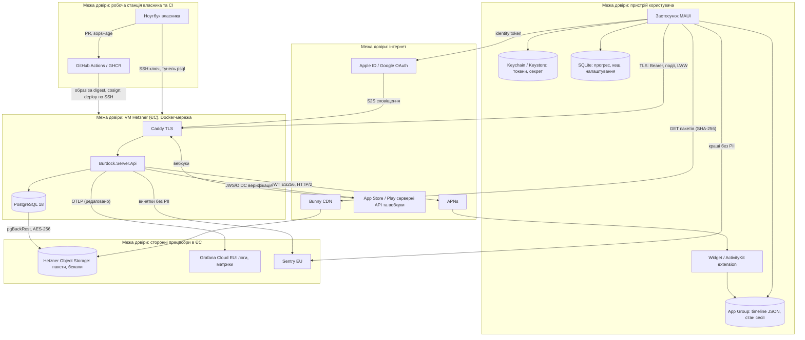

# 10. Безпека та приватність

| Поле | Значення |
|---|---|
| Статус | Draft |
| Версія | 0.1 |
| Дата | 2026-09-27 |
| Власник | Архітектор (безпека застосунків) / Власник продукту (юридична частина) |
| Джерела рішень | [Журнал рішень](../decisions/2026-09-25-interview.md): Q3, Q4/Q13, Q9, Q10/Q15, Q17, Q23, Q27, Q38, T7, T12, T15, T16, T18 |
| Пов'язані специфікації | 01-architecture, 04-ios-surfaces (App Group, віджети, Live Activity), 09-backend, 11-monetization, 13-analytics-observability, 14-devops-ci |

## 0. Контекст для ШІ-агента

Ця специфікація визначає, які дані «Реп'ях» обробляє, чому саме такі, де вони лежать, як захищені і що бачить користувач. Вона є джерелом істини для інвентарю даних, privacy manifest, ярликів App Privacy та Data safety, тексту політики приватності, а також для контролів безпеки клієнта й сервера.

Перед роботою прочитай: `docs/decisions/2026-09-25-interview.md`, цей документ, `docs/specs/09-backend.md` (механізми, на які тут посилаємось), а для клієнтських змін 01 і 04.

Правила, які не можна порушувати:
1. Будь-який новий тип даних спочатку додається в інвентар (§3.1) і проходить «privacy diff» (§3.6), лише потім у код. Немає рядка в інвентарі — немає збору.
2. На пристрої немає персональних даних, у App Group немає токенів, у логах немає тіл запитів, токенів, IP-адрес і сирих ідентифікаторів користувача.
3. Жодних сторонніх рекламних чи аналітичних SDK, жодного ATT, жодних ідентифікаторів пристрою (IDFV, Android ID, рекламні ідентифікатори).
4. Дані користувачів лише в ЄС/ЄЕЗ; винятки лише неминучі процесори (APNs, сервери магазинів).
5. Українська мова є мовою за замовчуванням для всіх текстів приватності; англійська як переклад.

Код цього напрямку розподілений: клієнтські контролі в `src/mobile/`, серверні в `src/server/`, маніфести в `src/mobile/Platforms/iOS/PrivacyInfo.xcprivacy` і `src/mobile/ios-extensions/BurdockWidgets/PrivacyInfo.xcprivacy`, тексти в `docs/legal/` (створюється разом з реалізацією), інфраструктурні контролі в `infra/`. Перевірка результату: чекліст «privacy diff» (§3.6.1) зелений, критерії §5 пройдені, MASTG-самооцінка (§3.6.3) без відкритих пунктів рівня L1.

## 1. Мета й межі

### 1.1. Принципи

| Принцип | Що означає на практиці |
|---|---|
| Мінімізація за задумом | Кожне поле має ціль з інвентарю; email, ім'я, телефон, локація, контакти не збираються навіть якщо провайдер їх дає |
| Анонімність спочатку | Повна функціональність без входу (Q3, Apple 5.1.1(v)); вхід через Apple/Google лише для синхронізації і зберігає тільки `sub` |
| Без сторонніх трекерів | Власна opt-in аналітика і Sentry в регіоні ЄС з вимкненим PII (Q9); ніяких Firebase/рекламних SDK |
| Резидентність у ЄС | Hetzner (Falkenstein/Helsinki), Bunny, Grafana Cloud EU, Sentry EU (Q17, Q9) |
| Прозорість українською | Політика, екран згоди, «Мої дані», «Джерела та ліцензії» українською за замовчуванням, англійською як переклад |
| Безпека пропорційна цінності | Косметичні нагороди і відсутність PII на пристрої дозволяють відмовитися від pinning, jailbreak-детекції, шифрування БД у v1 (T15, T16) з задокументованим обґрунтуванням |
| Перевірюваність | Кожен контроль має тест або чекліст-пункт; інвентар = маніфест = ярлики = політика |

### 1.2. Правова рамка

**Закон України 2297-VI «Про захист персональних даних»** (чинний, редакція 14.06.2025 за дослідженням). Обов'язки, що стосуються нас, і як їх виконуємо (формулювання є технічним переказом; юридичне підтвердження — відкрите питання §7):

| Обов'язок | Реалізація |
|---|---|
| Визначена мета обробки та відповідність даних меті (ст. 6) | Цілі зафіксовані в інвентарі §3.1 і в політиці приватності; дані поза інвентарем не збираються |
| Підстави обробки (ст. 11): згода; виконання правочину; законний інтерес володільця | Анонімний акаунт, синхронізація, підписка: виконання договору (умови використання). Аналітика: згода (opt-in, відклична). Логи безпеки, захист від зловживань: законний інтерес |
| Права суб'єкта (ст. 8): знати про обробку, доступ, виправлення, видалення, відкликання згоди, заперечення | Екран «Мої дані» (§3.5.3), веб-URL видалення, процедура запитів із SLA (§3.5.5) |
| Повідомлення суб'єкта про володільця, мету, права (ст. 12) | Політика приватності показується при першому запуску (посилання) і доступна з налаштувань; згода на аналітику окремим екраном |
| Внутрішній документ про порядок обробки (ст. 24; Типовий порядок обробки персональних даних, наказ Уповноваженого 1/02-14) | Документ «Порядок обробки персональних даних у застосунку „Реп'ях“» у `docs/legal/`, оновлюється разом з інвентарем |
| Повідомлення Уповноваженого про обробку, що становить особливий ризик (ст. 9) | Не застосовується: не обробляємо особливі категорії, локацію, біометрію (припущення, підтверджує юрист) |
| Транскордонна передача (ст. 29): держави ЄЕЗ вважаються такими, що забезпечують належний захист | Усі процесори в ЄЕЗ; APNs (Apple) і сервери магазинів як необхідні для надання послуги; політика перелічує їх |
| Знищення даних (ст. 15) | Ретенція §3.5.4, видалення акаунта з фізичним знищенням через 30 днів, очищення неактивних через 12 місяців |

Явного строку повідомлення про витік у чинній редакції 2297-VI немає (припущення; юрист підтвердить); внутрішнім стандартом приймаємо 72 години (§3.4.11).

**Законопроєкт 8153** (GDPR-подібний): ухвалений у першому читанні 20.11.2024, у порядку денному сесії 2026-09 (постанова 4958-IX), не ухвалений. Наслідок: будуємо контролі «у формі GDPR» уже зараз, щоб ухвалення не вимагало перебудови.

**GDPR.** Продукт доступний у всіх країнах, але маркетинг лише на Україну (Q38). За ст. 3(2) GDPR і настановами EDPB 3/2018 регламент застосовується при *навмисному* таргетуванні ЄС; сама по собі доступність у магазині таргетуванням не є. Тому: (а) не призначаємо представника за ст. 27 і не ведемо реєстр за ст. 30 у формальному вигляді; (б) впроваджуємо контролі GDPR-зразка (мінімізація, згода, права суб'єкта, ЄС-хостинг, 72 год); (в) **тригер перегляду**: частка платних користувачів з ЄС ≥ 10% (відкрите питання 4 журналу) або будь-яка маркетингова активність на ЄС, або локалізація ціни у EUR з таргетуванням — тоді призначаємо представника, оформлюємо реєстр обробки і переглядаємо вік цифрової згоди (ст. 8, 13–16 років залежно від країни).

**Apple App Store Review Guidelines.** 5.1.1(i) політика приватності в App Store Connect і в застосунку; 5.1.1(ii) згода на збір даних (наша аналітика opt-in, окремий екран, не змішаний з умовами); 5.1.1(iii) мінімізація; 5.1.1(v) застосунок без обов'язкового входу і обов'язкове видалення акаунта в застосунку; 5.1.2(i) без передачі персональних даних третім сторонам без згоди, зокрема стороннім ШІ (TTS лише на пристрої, T7; LLM лише в пайплайні контенту без даних користувачів); 4.8 Sign in with Apple обов'язковий, якщо є Google (Q3); 3.1.2 підписки через IAP (Q23). PrivacyInfo.xcprivacy обов'язковий (§3.3.9).

**Google Play.** Розділ Data safety заповнюється з інвентарю (§3.3.11); політика видалення акаунта вимагає видалення в застосунку і публічний веб-URL (`https://burdock.org/account/delete`, 09 §3.3.3); User Data policy: без доступу до контактів, локації, SMS.

**Вік 12+ (Q10, Q15).** Рейтинг 12+ в обох магазинах, без дитячого фокусу, не в категорії Kids. Ми не запитуємо вік і не створюємо «дитячого режиму». Рішення для випадку, коли користувач сам повідомляє, що йому менше 13: технічно нічого не змінюється, бо анонімний акаунт не містить персональних даних, а аналітика потребує згоди й анонімна; звернення обробляється як запит на видалення за бажанням заявника (батьків). Якщо колись з'явиться збір, що вимагає згоди (email, ім'я), одночасно з'явиться віковий ґейт і механізм батьківської згоди; це фіксується як умова в «privacy diff».

### 1.3. Поза межами v1

- Сертифікатний pinning (T16; OWASP і Apple не рекомендують для звичайних застосунків), App Attest/Play Integrity (T16; до появи цінних нагород), шифрування локальної БД (T15; PII локально немає).
- Bug bounty (§3.6.4: не у v1), зовнішній пентест (після появи платних користувачів).
- Представник у ЄС (§1.2), DPO (не вимагається за нашим профілем обробки).
- Адмін-панель з керуванням доступом (v1.1; у v1 доступ лише через SSH-тунель).

## 2. Вимоги

### 2.1. Функціональні

| ID | Вимога | MoSCoW |
|---|---|---|
| FR-10-1 | Інвентар даних (§3.1) є вичерпним: будь-який запис у БД сервера, файл на пристрої, подія аналітики або поле Sentry відповідає рядку інвентарю | Must |
| FR-10-2 | Застосунок повністю функціональний без входу; вхід через Apple/Google лише для синхронізації; сервер зберігає лише `sub` провайдера | Must |
| FR-10-3 | Аналітика вимкнена за замовчуванням; згода запитується окремим екраном з рівнозначними кнопками, може бути відкликана в налаштуваннях; без згоди події не надсилаються і сервер їх відхиляє | Must |
| FR-10-4 | Екран «Мої дані»: перелік даних на пристрої і на сервері, експорт у JSON, видалення локальних даних, видалення акаунта, список пристроїв, керування прив'язками | Must |
| FR-10-5 | Видалення акаунта в застосунку і через веб-URL; м'яке видалення 30 днів із негайним відкликанням доступу; фізичне знищення після строку | Must |
| FR-10-6 | Екран «Джерела та ліцензії» з атрибуціями контенту (з маніфесту) і ліцензіями відкритих бібліотек | Must |
| FR-10-7 | Токени та інсталяційний секрет зберігаються лише в захищеному сховищі ОС (Keychain `ThisDeviceOnly` / Android Keystore), не потрапляють у бекапи, очищуються при першому запуску після перевстановлення | Must |
| FR-10-8 | Контейнер App Group містить лише попередньо відрендерені дані для віджетів; стрік і прогрес на екрані блокування позначені `privacySensitive` | Must |
| FR-10-9 | PrivacyInfo.xcprivacy у застосунку та розширенні з точними кодами причин; ярлики App Privacy і Data safety генеруються з інвентарю | Must |
| FR-10-10 | Sentry: `SendDefaultPii=false`, без IP, без ідентифікаторів пристрою, очищення хлібних крихт, регіон ЄС; ідентифікатор для підрахунку уражених установок лише як усічений хеш `installationId` | Must |
| FR-10-11 | Логи сервера не містять тіл запитів, токенів, IP-адрес; ідентифікатори користувачів псевдонімізуються HMAC до експорту | Must |
| FR-10-12 | Секрети зберігаються в репозиторії лише зашифрованими (sops + age) і в GitHub Environments; жодних секретів у образах контейнерів і логах | Must |
| FR-10-13 | Процедура запитів суб'єктів даних (доступ, виправлення, видалення, перенесення) з каналом `privacy@burdock.org` і SLA 30 днів | Must |
| FR-10-14 | Ранбук інцидентів з ролями, рівнями, строками повідомлення (внутрішній стандарт 72 год) і шаблонами повідомлень | Must |
| FR-10-15 | `security.txt` (RFC 9116) на `burdock.org` з контактом для повідомлень про вразливості | Should |

### 2.2. Нефункціональні

| ID | Вимога | MoSCoW |
|---|---|---|
| NFR-10-1 | Профіль приймання: OWASP MASVS v2.1 рівень L1 + MASVS-PRIVACY; кожен контроль має відображення на реалізацію і тест (§3.3.13) | Must |
| NFR-10-2 | TLS 1.2+ з сучасними наборами шифрів (TLS 1.3 переважно) на `api.burdock.org` і `cdn.burdock.org`; HSTS з нарощуванням `max-age` від 1 дня до 1 року без preload на старті | Must |
| NFR-10-3 | Кожен реліз проходить «privacy diff» (інвентар = маніфест = ярлики = політика) і чекліст безпеки; невиконання блокує реліз | Must |
| NFR-10-4 | Автоматичні перевірки в CI: NuGetAudit без вразливостей high/critical, CodeQL без нових high, secret scanning без знахідок, Dependabot увімкнено | Must |
| NFR-10-5 | Бекапи зашифровані (pgBackRest AES-256), зберігаються в іншій локації ЄС, відновлення тестується щомісяця | Must |
| NFR-10-6 | Адміністративний доступ до продакшену лише через SSH з ключами і тунель до PostgreSQL; кожна сесія фіксується у журналі операцій | Must |
| NFR-10-7 | Ротація ключів за розкладом (§3.4.12) без простою | Should |
| NFR-10-8 | Час до відкликання всіх сесій при компрометації (ротація ключа підпису + очищення токенів) ≤ 15 хв за ранбуком | Should |

## 3. Проєктування

### 3.1. Інвентар даних

| Рівень | Дані | Мета | Підстава (2297-VI ст. 11) | Де | Ретенція | Хто має доступ |
|---|---|---|---|---|---|---|
| 0 (лише пристрій) | Прогрес слів, стан FSRS, лічильники показів, `ReviewLog`, леджер нагород, налаштування, кеш пакетів контенту, розклад віджетів | Функція навчання | Виконання договору | SQLite у пісочниці застосунку (iOS: захист файлів `CompleteUntilFirstUserAuthentication`, щоб віджет читав після перезавантаження; Android: FBE), App Group для віджетів; виключено з iCloud/Auto Backup (T12) | Керує користувач: «Видалити дані на пристрої» | Лише застосунок і його розширення |
| 0 | `installationId` (UUIDv4), `installationSecret`, access/refresh токени | Автентифікація анонімного акаунта | Виконання договору | Keychain `ThisDeviceOnly` / Android Keystore-backed сховище; не в бекапах | До перевстановлення або відкликання пристрою | Лише застосунок (не розширення) |
| 1 (анонімна синхронізація) | `userId` (UUID), нікнейм (згенерований або змінений користувачем), `installationId`, платформа, версія застосунку, локаль інтерфейсу, часовий пояс (лише в заголовках запиту, не зберігається), `last_seen_at` | Акаунт, синхронізація між пристроями, підтримка сумісності | Виконання договору | PostgreSQL `identity`, Hetzner ЄС | Неактивний анонімний акаунт: 12 місяців; інакше до видалення акаунта (+30 днів) | Власник продукту через SSH-тунель; сервіс |
| 1 | Журнал подій прогресу (`ReviewLog`, `ExposureConfirmed`, `ExposureDaily`, …) з `lexemeId`, оцінками, часовими мітками UTC і локальною датою | Синхронізація, бекфіл, звірка | Виконання договору | `progress`, Hetzner ЄС | Поки живе акаунт; сирі `ExposureConfirmed` 12 місяців, далі агрегат | Те саме |
| 1 | Налаштування (LWW документ) | Синхронізація | Виконання договору | `settings` | Поки живе акаунт | Те саме |
| 1 | Леджер нагород, баланс, інвентар | Звірка нагород, синхронізація | Виконання договору | `rewards` | Поки живе акаунт | Те саме |
| 1 | Тимчасовий список слів Live Activity сесії, push-токен активності | Оновлення Live Activity | Виконання договору | `notifications` | До 24 год після завершення сесії | Сервіс; push-токен передається APNs (Apple, США) |
| 1 | Скарги на контент: `packId`, `lexemeId`, вид, коментар ≤ 500 символів | Якість контенту | Законний інтерес / згода (добровільна дія) | `content.reports` | 12 місяців після закриття або до видалення акаунта | Власник продукту |
| 1 | Записи згод (`purpose`, версія політики, час надання/відкликання) | Доказ згоди | Юридичний обов'язок володільця | `identity.consents` | Поки живе акаунт + 30 днів | Те саме |
| 2 (прив'язаний акаунт) | `provider` + `sub` (Apple/Google), зашифрований refresh-токен Apple (лише для відкликання за TN3194) | Відновлення акаунта на іншому пристрої | Виконання договору | `identity.provider_links` | До відв'язки або видалення акаунта | Сервіс; власник не має ключа розшифрування токена поза сервером |
| 2 | Підписка: `originalTransactionId` / purchase token, `productId`, стан, дати, середовище, `appAccountToken` (= `userId`) | Entitlement Pro, підтримка, звірка з магазином | Виконання договору | `entitlements`, обмін з Apple/Google | Поки живе акаунт; після видалення акаунта запис підписки зберігається без `userId` для фінансової звірки до 3 років (припущення, підтвердить бухгалтер) | Те саме |
| Аналітика (opt-in) | Ім'я події з дозволеного списку, дозволені властивості, година (UTC), версія застосунку, платформа, локаль, `day_token` (HMAC з добовим ключем) | Продуктові рішення | Згода | `analytics`, Hetzner ЄС; дашборди Grafana Cloud EU лише над агрегатами | Сирі 90 днів, агрегати 24 місяці | Власник продукту |
| Ops | Краш-звіти Sentry: стек, версія ОС/застосунку, модель пристрою (клас), усічений хеш `installationId`, хлібні крихти без URL-параметрів | Стабільність | Законний інтерес | Sentry, регіон ЄС | 90 днів | Власник продукту |
| Ops | Логи сервера: рівень, повідомлення без даних, HMAC(`userId`), `traceId`, шлях без query | Безпека, діагностика | Законний інтерес | Grafana Cloud EU | 30 днів | Власник продукту |
| Ops | Метрики та трейси (агреговані, без ідентифікаторів) | Надійність | Законний інтерес | Grafana Cloud EU | 14 днів (безкоштовний рівень) | Власник продукту |
| Ops | Лічильники rate limiting за хешем IP-префікса | Захист від зловживань | Законний інтерес | Лише пам'ять процесу | Хвилини | Ніхто (не персистується) |
| Ops | Бекапи БД (усі рівні 1–2) | Відновлення | Законний інтерес | pgBackRest, Hetzner Object Storage в іншій локації ЄС, шифровано | 35 днів | Власник продукту (ключ шифрування в sops) |
| Ops | Журнал операцій адміністратора (дата, хто, ціль, причина) | Підзвітність | Законний інтерес | `docs/ops/journal.md` у приватному репозиторії | 24 місяці | Власник продукту |

**Явно виключені дані:** email (навіть приватний relay Apple), ім'я, телефон, дата народження, стать, локація, контакти, фото, мікрофон, IDFV/IDFA/Android ID/рекламні ідентифікатори, IP-адреси в будь-якому сховищі, точні часові мітки в аналітиці, вміст буфера обміну, список встановлених застосунків, будь-які сторонні рекламні або аналітичні SDK. Цей перелік теж публікується в політиці приватності.

### 3.2. Модель загроз

#### 3.2.1. Діаграма потоків даних

#### 3.2.2. STRIDE за елементами (топ-25 загроз)

| # | Елемент | Категорія | Загроза | Ймов. | Вплив | Пом'якшення | Вимоги |
|---|---|---|---|---|---|---|---|
| 1 | Токени в Keychain | S | Крадіжка refresh-токена (бекап, синхронізація Keychain, зловмисний застосунок на jailbreak) і повторне використання | Н | С | `ThisDeviceOnly`, короткі access-токени, ротація refresh-токенів з виявленням повторного використання (відкликання ланцюжка), список пристроїв з відкликанням | FR-10-7, 09 FR-09-2 |
| 2 | Інсталяційний секрет | S | Копіювання секрету → постійний доступ до анонімного акаунта | Н | С | Лише Keychain/Keystore, не в бекапах, хеш на сервері, відкликання через список пристроїв, ре-прив'язка при перемиканні акаунта | FR-10-7 |
| 3 | IdP → API | S | Підроблений identity token Apple/Google | Н | В | Перевірка підпису за JWKS, `iss`, `aud`, `exp`, `nonce`; TTL кешу JWKS | 09 FR-09-3 |
| 4 | Stores → API | S | Підроблене сповіщення App Store / RTDN дає Pro | С | С | JWS ланцюжок до Apple Root CA G3; OIDC-токен Pub/Sub; повторний запит стану через API магазину після RTDN | 09 FR-09-17/18 |
| 5 | App ↔ API | S | Підміна сервера (MITM, шкідливий проксі, корпоративний CA) | Н | В | TLS з довіреним сховищем ОС; без pinning за T16 (обґрунтування §4); ATS без винятків; жодних HTTP-ендпоїнтів | NFR-10-2 |
| 6 | Леджер нагород | T | Підроблені події `Earned` (модифікований клієнт, повтор запитів) | С | Н | Серверна згортка `EconomyRules`, денні ліміти, відхилення майбутнього часу й дублікатів, косметичні нагороди без грошової цінності | 09 FR-09-14 |
| 7 | CDN → App | T | Підмінений пакет контенту на CDN або в кеші | Н | С | SHA-256 з автентифікованого маніфесту, незмінні URL з хешем, відмова при розбіжності | 09 FR-09-7 |
| 8 | Пакет контенту → SQLite | T | Шкідливий пакет (переповнення, величезні BLOB, ін'єкція через дані) | Н | С | Валідація схеми `ContentPackSchema` перед відкриттям, ліміт розміру, відкриття read-only, параметризовані запити, без `ATTACH`/динамічного SQL | FR-10-1 |
| 9 | Deep link → App | T | Ін'єкція параметрів через `org.burdock.app://` або Universal Link | С | Н | Список дозволених маршрутів, суворий парсинг, жодних дій з автентифікацією через посилання, крім обміну `link_code` з верифікатором | §3.3.4 |
| 10 | App Group | T/I | Розширення чи інший процес читає/пише контейнер | Н | Н | Лише попередньо відрендерені дані, без токенів і `userId`; віджет не має мережевого коду | FR-10-8 |
| 11 | Sync API | T | Повтор синхронізаційних подій для роздування статистики | Н | Н | Ідемпотентність за UUIDv7 у межах користувача; повтор чужих подій неможливий без токена (див. 1) | 09 FR-09-10 |
| 12 | Identity (злиття) | T/E | Зловживання злиттям: захоплення чужого акаунта через `mergeTicket` | Н | В | Тікет прив'язаний до `sub` поточного токена і до `provider:sub`, 10 хв, одноразовий; злиття лише додає події; акаунт-джерело зберігається 30 днів | 09 FR-09-4 |
| 13 | Видалення акаунта | R | Користувач заперечує, що просив видалення | Н | Н | Запис запиту (HMAC `userId`, час, канал) 12 місяців; підтвердження в UI; вікно відновлення 30 днів | FR-10-5 |
| 14 | Підписки | R | Спір щодо стану підписки | Н | Н | `webhook_inbox` 90 днів, ідентифікатори транзакцій, журнал переносів | 09 §3.8 |
| 15 | Логи сервера | I | PII у логах (email у винятку, токен у URL, IP у access-log) | С | В | `[LoggerMessage]` з класифікацією, `Redaction` (HMAC/стирання), access-log Caddy без IP та query, тест логів на шаблони | FR-10-11 |
| 16 | Sentry | I | Токени/дані у хлібних крихтах або URL | С | С | `SendDefaultPii=false`, `BeforeBreadcrumb` вирізає query і заголовки, `BeforeSend` очищує повідомлення, без скриншотів | FR-10-10 |
| 17 | Віджет на екрані блокування | I | Сторонній бачить прогрес/стрік | С | Н | `privacySensitive()` на стріку і прогресі; слово та переклад видимі за рішенням (дослідження §7 п. 21) | FR-10-8 |
| 18 | Бекапи | I | Витік бакета бекапів | Н | В | Приватний бакет, окремі ключі, шифрування репозиторію AES-256 (ключ у sops), ротація ключів | NFR-10-5 |
| 19 | Адмін-доступ | I/E | Компрометація ноутбука власника → доступ до БД | Н | В | SSH ключі з парольною фразою, Hetzner Firewall на 22, окрема read-only роль за замовчуванням, журнал операцій, шифрування диска ноутбука, 2FA GitHub | NFR-10-6 |
| 20 | Аналітика | I (linkability) | Реідентифікація через комбінацію властивостей і часу | Н | С | Список дозволених властивостей без вільного тексту, година замість часу, добовий HMAC-токен, лише агрегати поза БД | FR-10-3 |
| 21 | Скарги на контент | I | Користувач вписує PII у коментар | С | Н | Попередження в UI, ліміт 500 символів, видалення разом з акаунтом, доступ лише власнику | §3.1 |
| 22 | `POST /identity/anonymous` | D | Масове створення акаунтів | С | Н | Rate limit на IP-префікс, дешеві рядки, очищення через 12 місяців, без email-розсилок, які можна зловживати | 09 §3.15 |
| 23 | Пакети подій | D | Бомба розпакування, великі тіла | С | С | Ліміт після розпакування 2 МіБ, ліміт кількості подій, таймаути Kestrel, rate limit | 09 NFR-09-11 |
| 24 | Ендпоїнти без `userId` у шляху | E | IDOR: доступ до чужих даних | Н | В | Ресурси лише `/me`, `sub` з токена, архітектурний тест на політики авторизації, інтеграційні тести з двома користувачами | 09 NFR-09-6 |
| 25 | CI / залежності | E (ланцюг постачання) | Шкідливий GitHub Action або NuGet-пакет вкрадає секрети чи підміняє образ | С | В | Дії закріплені за SHA, мінімальні `permissions` токенів, Environments з обов'язковим рев'ю для prod, NuGetAudit + lock-файли, Dependabot, cosign-підпис образів і перевірка при деплої, secret scanning | NFR-10-4 |

Додатково: контейнерна ескалація (non-root, read-only rootfs, без `privileged`, Hetzner Firewall лише 80/443/22) і зловживання пробним періодом (див. 3.2.3).

#### 3.2.3. Сценарії зловживань

| Сценарій | Що робить зловмисник | Чому це має обмежену цінність | Контролі |
|---|---|---|---|
| Підробка нагород | Модифікований клієнт надсилає `Earned` понад ліміти або витрати за нульову ціну | Нагороди косметичні, не купуються і не продаються (Q34) | Серверна згортка й ліміти (09 §3.7); v1.1 серверно-авторитетні гранти; App Attest/Play Integrity лише коли з'явиться цінність |
| Зловживання тріалом | Створення нових анонімних акаунтів для повторного тижня | Вступну пропозицію надають магазини на рівні Apple ID / Google-акаунта, не нашого акаунта (Q33), тому новий анонімний акаунт нового тріалу не дає | Немає серверного тріалу; перенос підписки обмежений 3/добу |
| Скрейпінг контенту | Збір URL пакетів з маніфесту під Pro і масове завантаження | База словника без ШІ-перекладів-у-контексті застосунку має обмежену цінність; Q37 виключає ShareAlike, тож витік не змінює ліцензійний статус | Автентифікований маніфест, неперелічувані URL, моніторинг трафіку Bunny, прапорець підписаних URL (09 §3.4) |
| Захоплення акаунта через крадіжку токена | Витяг refresh-токена з пристрою | Потрібен фізичний/root-доступ; дані акаунта не містять PII | Ротація і виявлення повторного використання, список пристроїв, `ThisDeviceOnly` |
| Повтор синхронізаційних подій | Повторне надсилання пакетів | Ідемпотентність робить повтор нейтральним | UUIDv7 ідентифікатори, `server_seq` |
| Шкідливий пакет контенту | Підміна пакета на шляху або в кеші пристрою | Потрібно зламати TLS до API або файлову систему пристрою | SHA-256 з маніфесту, валідація схеми, read-only відкриття |
| Ланцюг постачання | Компрометований пакет NuGet / GitHub Action | Один розробник = мала поверхня рев'ю, тому автоматика критична | Пінінг за SHA/версією з lock-файлами, аудит, підписані образи, Environments |

### 3.3. Клієнтські контролі

#### 3.3.1. Зберігання токенів і секретів
- `installationId`, `installationSecret`, refresh/access токени: MAUI `SecureStorage`; на iOS клас доступності `kSecAttrAccessibleAfterFirstUnlockThisDeviceOnly` (не синхронізується в iCloud Keychain, не мігрує у бекапах); на Android сховище на базі Android Keystore, каталог виключений з Auto Backup (`android:allowBackup="false"` або `dataExtractionRules` без секретів), виклики обгорнуті в try/catch з відновленням через новий анонімний акаунт при пошкодженні (за дослідженням: androidx.security 1.1.0 позначено застарілим, покладаємось на платформенний Keystore).
- Перевстановлення: Keychain на iOS переживає видалення застосунку, тому при старті перевіряється маркер у `Preferences` (видаляється разом із застосунком); якщо маркера немає, а секрети є, вони стираються і створюється новий акаунт (користувачу пояснюється, що прогрес відновлюється лише через вхід Apple/Google).
- Access-токен тримається лише в пам'яті; refresh виконується єдиним «польотом» (mutex) з перевіркою `invalid_grant` → інсталяційний грант.
- Жодних токенів у `Preferences`, у SQLite, у App Group, у логах, у буфері обміну, в URL.

#### 3.3.2. Локальна база і бекапи
- SQLite без шифрування (T15): вміст — `lexemeId`, оцінки, часові мітки, налаштування; жодних PII. Файли БД і кеш виключені з iCloud/Auto Backup (T12): iOS `NSURLIsExcludedFromBackupKey`, Android `dataExtractionRules`/`fullBackupContent` з виключенням каталогу даних.
- iOS захист файлів для БД, яку читає віджет: `NSFileProtectionCompleteUntilFirstUserAuthentication` (компроміс на користь роботи віджета після перезавантаження; дані не є PII).
- «Видалити дані на пристрої» стирає БД, кеш пакетів, App Group і Preferences, але не секрети акаунта (окрема дія «Вийти з акаунта на цьому пристрої» відкликає інсталяцію на сервері й чистить Keychain).

#### 3.3.3. Політика вмісту App Group
Дозволено: попередньо відрендерений timeline (слово, переклад, транскрипція, рівень, тема, час зміни), тема віджета, стан сесії Live Activity (індекс, кінець), лічильник стріку (позначений `privacySensitive` у Swift), прапорець «без гейміфікації». Заборонено: токени, `userId`, `installationId`, статистика понад стрік, будь-які мережеві налаштування. Розширення не містить мережевого коду й не має доступу до Keychain-групи застосунку (окремі access group). Перевірка: тест на схему JSON у App Group і аудит `Entitlements.plist` розширення.

#### 3.3.4. Глибокі посилання
Схема `org.burdock.app://` і Universal Links `https://burdock.org/l/*`. Список дозволених маршрутів (`/word/{id}`, `/session`, `/settings/...`, `/auth?link_code=`), параметри валідуються за типом, невідомі маршрути ігноруються. Посилання ніколи не змінюють стан автентифікації, крім `link_code`, який обмінюється лише разом із верифікатором, згенерованим у цій же сесії застосунку (09 §3.3.2). Android: `autoVerify` для App Links; iOS: асоційований домен з `applinks:burdock.org`.

#### 3.3.5. OAuth у застосунку
Нативні SDK насамперед (ASAuthorizationController, Credential Manager). Веб-потік лише через `WebAuthenticator` (ASWebAuthenticationSession / Custom Tabs, RFC 8252), з `state`, `nonce` і S256-викликом; жодних вбудованих WebView для входу; `prefersEphemeralWebBrowserSession` не вмикається (щоб працювала сесія Apple/Google у системному браузері).

#### 3.3.6. Виявлення jailbreak/root
Не реалізуємо. Обґрунтування: MASVS-RESILIENCE не входить у L1; локально немає PII; нагороди косметичні; евристики обходяться і дають хибні спрацювання на кастомних прошивках, що шкодить чесним користувачам. Переглянути разом з App Attest/Play Integrity (T16).

#### 3.3.7. Скриншоти та буфер обміну
Скриншоти не блокуються (навчальний контент). Копіювання слова/перекладу дозволене; нічого чутливого в буфер не потрапляє; Android: для скопійованого тексту не позначаємо як чутливий (не потрібно). Екран «Мої дані» при експорті пише файл через системний share sheet, не в буфер.

#### 3.3.8. Логування на пристрої та Sentry
- Release: рівень Warning+, повідомлення без контенту користувача та ідентифікаторів; Debug-логи лише у Debug-збірках.
- Sentry.Maui: `Dsn` для проєкту в регіоні ЄС, `SendDefaultPii = false` (без IP), `AttachScreenshot = false`, `AttachViewHierarchy = false`, `MaxBreadcrumbs = 50`, `BeforeBreadcrumb` відкидає query-рядки й заголовки HTTP, `BeforeSend` вирізає рядки, схожі на UUID/email/токени, з повідомлень; `TracesSampleRate = 0` у v1 (лише краші); `User` містить лише `Id = SHA-256(installationId + appSalt)[..16]` для підрахунку уражених установок; `Release`/`Environment`/`Dist` для символікації; iOS `EnableAssemblyILStripping=false` (за дослідженням).
- Клієнтські логи ніколи не надсилаються на наш сервер.

#### 3.3.9. Privacy manifest (застосунок і розширення)

`PrivacyInfo.xcprivacy` в обох таргетах:

| Ключ | Значення застосунку | Значення розширення |
|---|---|---|
| `NSPrivacyTracking` | `false` | `false` |
| `NSPrivacyTrackingDomains` | `[]` | `[]` |
| `NSPrivacyAccessedAPITypes` | FileTimestamp → `C617.1`; SystemBootTime → `35F9.1`; DiskSpace → `E174.1`; UserDefaults → `CA92.1`, `1C8F.1` | UserDefaults → `CA92.1`, `1C8F.1`; FileTimestamp → `C617.1` (якщо читає файли App Group) |
| `NSPrivacyCollectedDataTypes` | див. таблицю ярликів (§3.3.10); у розширенні порожньо | `[]` |

`NSUserTrackingUsageDescription` відсутній (ATT не потрібен, трекінгу немає). Сторонні SDK з власними маніфестами (Sentry) додаються як є; CI перевіряє, що злиття маніфестів не додає доменів трекінгу.

#### 3.3.10. Ярлики App Privacy (чернетка)

| Категорія → тип | Збирається | Пов'язано з користувачем | Для трекінгу | Мета |
|---|---|---|---|---|
| Identifiers → User ID (`userId`, `installationId`) | так | так | ні | App Functionality |
| Purchases → Purchase History (стан підписки) | так | так | ні | App Functionality |
| User Content → Other User Content (нікнейм, коментар скарги) | так | так | ні | App Functionality |
| Usage Data → Product Interaction (opt-in аналітика) | так, лише за згодою | ні | ні | Analytics |
| Diagnostics → Crash Data | так | ні | ні | App Functionality |
| Diagnostics → Performance Data | ні (TracesSampleRate 0) | — | — | — |
| Contact Info, Location, Contacts, Browsing/Search History, Financial Info (крім Purchases), Health, Sensitive Info | не збирається | — | — | — |

Рішення щодо «пов'язано з користувачем»: дані акаунта декларуємо як пов'язані, бо вони прив'язані до `userId`, навіть якщо `userId` анонімний; це консервативне прочитання правил Apple.

#### 3.3.11. Розділ Data safety Google Play (чернетка)

| Тип даних | Збирається / передається | Обробка ефемерна | Обов'язково | Мета | Шифрування в дорозі | Можна запросити видалення |
|---|---|---|---|---|---|---|
| Personal info → User IDs | збирається / не передається | ні | так | App functionality, Account management | так | так |
| Financial info → Purchase history | збирається / не передається | ні | ні | App functionality | так | так |
| App activity → Other user-generated content (нікнейм, скарги) | збирається / не передається | ні | ні | App functionality | так | так |
| App activity → App interactions (аналітика) | збирається за згодою / не передається | ні | ні | Analytics | так | так |
| App info and performance → Crash logs, Diagnostics | збирається / передається процесору (Sentry) | ні | так | App functionality | так | так |
| Device or other IDs | не збирається | — | — | — | — | — |
| Location, Contacts, Messages, Photos, Audio, Files, Calendar, Health | не збирається | — | — | — | — | — |

Практики безпеки: дані шифруються в дорозі; користувач може запросити видалення (в застосунку і за URL); незалежної перевірки безпеки (MASA) у v1 немає.

#### 3.3.12. Дозволи

| Платформа | Дозвіл | Обґрунтування |
|---|---|---|
| iOS | Сповіщення (`UNUserNotificationCenter`), запит після онбордингу з поясненням | Локальні нагадування «слово дня» (Q1) |
| iOS | Live Activities (`NSSupportsLiveActivities`), без `FrequentUpdates` | Сесія (Q35) |
| iOS | App Groups, Associated Domains, Sign in with Apple, Push (для ActivityKit) | Віджети, Universal Links, вхід, оновлення сесії |
| Android | `POST_NOTIFICATIONS` (runtime), `INTERNET`, `RECEIVE_BOOT_COMPLETED` (перепланування віджета), `com.android.vending.BILLING` | Сповіщення, мережа, віджет після перезавантаження, підписка |
| Обидві | Немає: локація, камера, мікрофон, контакти, точні будильники, foreground service, ATT | Не потрібні продукту |

#### 3.3.13. Відображення MASVS v2.1 (L1 + PRIVACY)

| Контроль | Реалізація | Перевірка |
|---|---|---|
| MASVS-STORAGE-1 | Токени і секрет лише в Keychain/Keystore `ThisDeviceOnly`; БД без PII; бекапи виключені | MASTG-тести сховища: інспекція файлів пісочниці і бекапу симулятора/емулятора; юніт-тест `SecureStorageAccessibility` |
| MASVS-STORAGE-2 | Немає логів з даними, немає токенів у буфері/скриншотах; App Group без секретів | Перегляд логів `Console.app`/`logcat` під час сценаріїв; тест JSON-схеми App Group |
| MASVS-CRYPTO-1 | Лише криптографія ОС/.NET: TLS, ES256 JWT (сервер), SHA-256 перевірка пакетів; без власних алгоритмів | Код-рев'ю, аналізатори (Sonar/Meziantou правила на слабку криптографію) |
| MASVS-CRYPTO-2 | Ключі не зберігаються в коді; секрет інсталяції генерується `RandomNumberGenerator` | Secret scanning, аналіз бінарника на рядки |
| MASVS-AUTH-1 | OAuth 2.0/OIDC з PKCE через системний браузер або нативні SDK; refresh-ротація на сервері | Інтеграційні тести 09 (крит. 2, 3); MASTG перевірка відсутності WebView-логіну |
| MASVS-AUTH-2 | Локальна автентифікація (біометрія) не використовується | Не застосовується, задокументовано |
| MASVS-AUTH-3 | Чутливі операції (видалення акаунта, відв'язка, відкликання пристрою) вимагають свіжого access-токена (< 5 хв, примусовий refresh) і явного підтвердження | Інтеграційний тест: старий токен → 403 `fresh_token_required` |
| MASVS-NETWORK-1 | Лише HTTPS, ATS без винятків, `cleartextTrafficPermitted=false`, стандартний `HttpClient` без кастомних валідаторів сертифікатів | Статичний аналіз Info.plist/network_security_config; проксі-тест з недовіреним CA має провалити з'єднання |
| MASVS-NETWORK-2 | Pinning не реалізовано (L2; T16) | Задокументовано |
| MASVS-PLATFORM-1 | Deep links з allowlist; App Group і Keychain access groups мінімальні; без експортованих Android-компонентів, крім віджета та receiver-ів з дозволом | Огляд `AndroidManifest`/entitlements у CI (скрипт); тести deep link |
| MASVS-PLATFORM-2 | WebView не використовується | Grep у CI на `WebView`/`BlazorWebView` |
| MASVS-PLATFORM-3 | Стрік на екрані блокування `privacySensitive`; без чутливого вмісту у перемикачі застосунків (немає PII) | Ручна перевірка на пристрої, знімок у CI |
| MASVS-CODE-1 | Мінімальні версії iOS 16 / Android 26; актуальні SDK (T1, T2) | CI |
| MASVS-CODE-2 | Примусове оновлення через `minAppVersion` з `/v1/config` | Інтеграційний тест 426 |
| MASVS-CODE-3 | NuGetAudit (усі рівні), Dependabot, lock-файли | CI |
| MASVS-CODE-4 | `TreatWarningsAsErrors`, `AnalysisLevel=latest-Recommended`, nullable, trimming warnings як помилки | CI |
| MASVS-RESILIENCE-1..4 | Не входять у L1; не реалізовано (§3.3.6) | Задокументовано |
| MASVS-PRIVACY-1 | Інвентар §3.1, виключений список, лише `sub` від IdP | Privacy diff, тест сканування схем БД |
| MASVS-PRIVACY-2 | «Мої дані»: експорт, видалення, керування згодою і прив'язками | UI-тести сценаріїв |
| MASVS-PRIVACY-3 | Політика українською, екран згоди, ярлики з інвентарю, «Джерела та ліцензії» | Privacy diff |
| MASVS-PRIVACY-4 | Без IDFV/Android ID/рекламних ID; `installationId` випадковий; аналітика з добовим HMAC | Grep у CI на `IdentifierForVendor`, `Settings.Secure.AndroidId`, `AdvertisingId`; тест незв'язуваності `day_token` |

### 3.4. Серверні контролі

#### 3.4.1. TLS і заголовки
- Caddy термінує TLS (Let's Encrypt, автоматичне оновлення), стандартна політика Caddy: TLS 1.2+ з сучасними наборами, TLS 1.3 переважно; Kestrel слухає лише в docker-мережі по HTTP.
- HSTS: `max-age=86400` перші два тижні після запуску → `max-age=31536000; includeSubDomains`; без `preload` на старті (за дослідженням).
- Заголовки API: `X-Content-Type-Options: nosniff`, `Referrer-Policy: no-referrer`, `Cache-Control: no-store` для всіх автентифікованих відповідей (крім явних ETag-ресурсів: маніфест, конфіг, каталог), `Content-Security-Policy: default-src 'none'; frame-ancestors 'none'`, `Permissions-Policy` з порожніми списками; заголовок `Server` прибрано. Сторінка `/web/account/delete`: окремий CSP з `form-action` на Apple/Google, `frame-ancestors 'none'`, CSRF-токен у формі, `SameSite=Strict` кука сесії.
- CORS: не вмикається (немає браузерних клієнтів API; веб-сторінка видалення same-origin).

#### 3.4.2. Автентифікація і авторизація
Описано в 09 §3.2–3.3: OpenIddict, access 10 хв, refresh 30 днів rolling з виявленням повторного використання (leeway 30 с), інсталяційна кредиталь, кастомні гранти, політики на кожному ендпоїнті, ресурси лише `/me`. Додатково: чутливі операції вимагають токена, виданого < 5 хв тому (claim `auth_time`/`iat`), інакше 403 `fresh_token_required`.

#### 3.4.3. Валідація вхідних даних і ліміти
DataAnnotations на DTO; ліміти: тіло ≤ 2 МіБ після розпакування, рядки з обмеженою довжиною (нікнейм 24, коментар 500), масиви з максимальною кількістю (події 500/200/100), UUID лише у канонічній формі, дати лише ISO-8601 UTC; JSON без невідомих полів у критичних DTO (`UnmappedMemberHandling.Disallow` для леджера та entitlement); Kestrel `MaxRequestHeadersTotalSize`, таймаути заголовків та тіла за замовчуванням; відхилення `Transfer-Encoding` трюків Caddy.

#### 3.4.4. Rate limiting
Політики й числа в 09 §3.15 (створення акаунта 5/год і 20/добу на IP-префікс; токен 20/хв; прив'язка 10/год; анонімні GET 60/хв; користувач 120/хв читання, 60/хв запис; пакети 30/хв; entitlement 20/год; скарги 10/добу; аналітика 10/хв). Відповідь 429 з `Retry-After`; ключі партицій обмежені й лише в пам'яті; метрика кількості 429 за політикою з алертом при аномалії.

#### 3.4.5. Ідемпотентність
Природна для подій (UUIDv7), `Idempotency-Key` для неідемпотентних POST з ретенцією 24 год (09 §3.2). Захищає від дублювання при повторах клієнта і від деяких replay-сценаріїв.

#### 3.4.6. Секрети
| Секрет | Де живе | Хто читає |
|---|---|---|
| Пароль PostgreSQL (роль `burdock_app`), read-only роль `burdock_ro` | sops (`infra/secrets/prod.env.enc`) | контейнер `api`; власник через тунель |
| Ключ підпису JWT (ES256), ключ шифрування OpenIddict, кільце Data Protection | sops + том `dp-keys` | `api` |
| APNs `.p8` (Key ID, Team ID) | sops | `api` (Notifications) |
| Sign in with Apple `.p8` (client secret), Services ID | sops | `api` (Identity) |
| App Store Server API `.p8`, Issuer ID, Key ID | sops | `api` (Entitlements) |
| Сервісний акаунт Google Play (JSON) | sops | `api` (Entitlements) |
| Ключі Hetzner Object Storage (окремі для бекапів і для публікації контенту) | sops | `pgbackrest`, CLI публікації |
| Ключ шифрування репозиторію pgBackRest | sops | `pgbackrest` |
| Bunny API key (purge) | sops | CLI публікації |
| HMAC-ключ редакції логів | sops | `api` |
| Токен OTLP Grafana, DSN Sentry | sops | `api` |
| Age-ключ | лише VM `/etc/burdock/age.key` (root, 0400) + GitHub Environment `prod` для аварійного відновлення | деплой-скрипт |
| SSH deploy key | GitHub Environment `prod` (required reviewers = власник) | GitHub Actions |

Правила: секрети ніколи не в образах, не в `docker inspect`-видимих аргументах збірки, не в логах (`Redaction` стирає значення, що збігаються з відомими секретами, як бекстоп); локально розробники використовують `dotnet user-secrets` і Testcontainers з одноразовими паролями.

#### 3.4.7. Хостові контролі
- SSH: лише ключі (ed25519 з парольною фразою), `PermitRootLogin no`, окремий користувач `deploy` з обмеженим sudo для compose, `fail2ban` або еквівалент, `unattended-upgrades` для ОС.
- Hetzner Cloud Firewall: вхідні лише 80/443 звідусіль і 22 з поточних IP власника (оновлюється скриптом; альтернатива на розгляд: WireGuard/Tailscale-мережа, припущення); вихідні без обмежень (APNs, магазини, JWKS, OTLP).
- Docker: `api` non-root UID, `read_only: true`, `tmpfs: /tmp`, `cap_drop: ALL`, `no-new-privileges`, ліміти пам'яті; `postgres` без публікації порту назовні; образи закріплені за digest; підписи cosign перевіряються деплой-скриптом перед `compose up`.
- Час: `chrony`/systemd-timesyncd (коректність JWT `exp` і зсуву годинника клієнтів).

#### 3.4.8. Безпека ланцюга постачання
NuGetAudit (режим `all`, поріг `moderate`, фейл на high/critical) і `packages.lock.json` з `RestoreLockedMode` у CI; Dependabot для NuGet, GitHub Actions і Docker; CodeQL для C# на кожен PR та щотижня; GitHub secret scanning із push protection; дії GitHub закріплені за SHA; образ публікується `dotnet publish /t:PublishContainer` у GHCR, підписується cosign (keyless OIDC), і деплой перевіряє підпис; SBOM (CycloneDX) як артефакт релізу (припущення щодо інструмента).

#### 3.4.9. Бекапи і відновлення
pgBackRest: безперервний WAL-архів, повний бекап щотижня, диференційний щодня, репозиторій у Hetzner Object Storage в іншій локації ЄС, `repo1-cipher-type=aes-256-cbc`, ретенція 5 повних (≈ 35 днів); окрема пара ключів для бекапів; бакет приватний. Hetzner Backups VM як другий рівень (без томів). Щомісячний тест відновлення в staging з фіксацією часу і контрольних сум; результат у журналі операцій. Бекапи містять дані рівнів 1–2, тому підпадають під ті самі правила доступу; видалення акаунта не «вичищає» бекапи ретроактивно, що зазначено в політиці (максимум 35 днів залишкового зберігання).

#### 3.4.10. Модель адміністративного доступу
Адмін-UI відсутній. Доступ до даних: `psql` через SSH-тунель, за замовчуванням роллю `burdock_ro` (read-only); роль запису вмикається окремою командою «break-glass» з обов'язковим записом у `docs/ops/journal.md` (дата, мета, які таблиці, посилання на задачу). Сесії `psql` з `\set HISTFILE` у захищеному каталозі на VM, `log_statement = 'ddl'` плюс аудит `mod` для сесій адміністратора (через `ALTER ROLE burdock_admin SET log_statement = 'mod'`). Експорт даних з продакшену на робочу станцію заборонений, крім агрегатів; для аналізу проблем використовується staging з синтетичними даними.

#### 3.4.11. Логування, редакція, Sentry на сервері
- Усі логи через `[LoggerMessage]` із параметрами, позначеними класифікацією даних (`[PersonalData]` для `userId`, `installationId`, нікнейма; `[SensitiveData]` для токенів, секретів). `Microsoft.Extensions.Compliance.Redaction`: HMAC-редактор (експериментальний API `EXTEXP0002`, вмикається свідомо) для `PersonalData`, стирання для `SensitiveData`; логер налаштований так, що некласифікований параметр складного типу не серіалізується.
- Ніколи не логуються: тіла запитів/відповідей, заголовки `Authorization`/`Cookie`, query-рядки, IP-адреси (Caddy access-log вимкнений або з форматом без IP та query), push-токени, ідентифікатори транзакцій магазинів у відкритому вигляді (лише хеш).
- Sentry (ASP.NET Core SDK): `SendDefaultPii=false`, `MaxRequestBodySize=None`, вимкнені хлібні крихти з запитами, `BeforeSend` очищує повідомлення винятків регулярними виразами (UUID, email, JWT), теги лише `module`, `endpoint`, `release`; регіон ЄС.
- OpenTelemetry: атрибути спанів обмежені allowlist-ом (`http.route`, статус, `module`), без `http.url` з query, без `enduser.id`; колектор з redaction-процесором як бекстоп у v1.1.
- Тест «логи без PII» (09 крит. 18) обов'язковий у CI.

#### 3.4.12. Реагування на інциденти (контур ранбука)
1. **Виявлення**: алерти Grafana (5xx, сплеск відкликань refresh-токенів через повторне використання, 429, аномалії трафіку Bunny), Sentry, повідомлення Apple/Google, звернення на `security@burdock.org`, secret scanning.
2. **Тріаж і рівні**: S1 підтверджений витік даних користувачів або компрометація сервера; S2 активна експлуатація вразливості без підтвердженого витоку; S3 вразливість без експлуатації; S4 інше. Одна особа (власник) є інцидент-менеджером; шаблон запису інциденту в `docs/ops/incidents/`.
3. **Стримування** (≤ 15 хв, NFR-10-8): відкликання всіх сесій (ротація ключа підпису JWT + `TRUNCATE` токенів OpenIddict; клієнти переавтентифікуються інсталяційним грантом), ротація секретів через sops, блокування IP на Hetzner Firewall, вимкнення ендпоїнта прапорцем у `/v1/config` або переведення API в режим лише читання; при компрометації VM — ізоляція, знімок диска для доказів, розгортання нової VM з бекапу.
4. **Усунення і відновлення**: патч, повторний деплой, відновлення з pgBackRest за потреби, перевірка цілісності.
5. **Повідомлення**: внутрішній стандарт: Уповноваженому ВРУ з прав людини (за 2297-VI; строк у чинній редакції не визначений, припущення) і, за наявності підстав GDPR, наглядовому органу протягом 72 годин; користувачам без невиправданої затримки при високому ризику через банер у застосунку (поле `notice` у `/v1/config`) і сторінку `burdock.org/security`; Apple/Google за їхніми вимогами при витоку даних, пов'язаних з магазином.
6. **Пост-мортем** протягом 7 днів: хронологія, корінна причина, дії; докази (логи, знімки) зберігаються 12 місяців.

#### 3.4.13. Ротація ключів

| Ключ | Період | Спосіб без простою |
|---|---|---|
| Ключ підпису JWT (ES256) | 90 днів | Додати новий ключ в OpenIddict (два активних), через 15 хв (TTL access) прибрати старий |
| Ключ шифрування OpenIddict / Data Protection | 180 днів | Стандартна ротація кільця ключів з періодом перекриття |
| APNs `.p8` | 12 місяців або при підозрі | Створити новий ключ у Developer Portal, оновити sops, перезапустити `api`; старий відкликати через добу |
| Sign in with Apple `.p8` | 12 місяців | Новий ключ, оновити sops; refresh-токени Apple лишаються дійсними |
| App Store Server API `.p8` | 12 місяців | Аналогічно; перевірити тестовим сповіщенням |
| Сервісний акаунт Google | 12 місяців | Новий ключ, перекриття 24 год, видалити старий |
| Пароль PostgreSQL | 180 днів | Дві ролі (`app_a`/`app_b`) з перемиканням у sops і перезапуском `api` |
| Ключі Object Storage (бекапи, публікація) | 180 днів | Нова пара, перевірка `pgbackrest check`, відкликання старої |
| Ключ шифрування репозиторію pgBackRest | при компрометації або 24 місяці | Новий stanza + повний бекап; старий репозиторій зберігається до кінця ретенції |
| HMAC-ключ редакції логів | 12 місяців | Псевдоніми змінюються; прийнятно |
| Age-ключ | 12 місяців | `sops updatekeys` для всіх файлів |
| SSH-ключі, deploy key | 12 місяців або при зміні пристрою | Додати новий, видалити старий |
| Токени Grafana/Sentry | 12 місяців | Перевипуск, sops |

### 3.5. Приватність в інтерфейсі

#### 3.5.1. Екран згоди на аналітику
Показується наприкінці онбордингу окремо від умов використання: заголовок «Допомогти покращити Реп'ях?», короткий список, що саме збирається (назви подій, «година, а не точний час», «без імені, email, локації чи ідентифікаторів пристрою»), посилання «Повний перелік», дві рівнозначні кнопки «Дозволити» / «Не зараз» (без темних патернів: однаковий розмір і контраст, без попереднього вибору), примітка «Змінити можна будь-коли в Налаштування → Приватність». Результат пишеться в `identity.consents` з версією тексту; зміна тексту, що розширює збір, вимагає повторної згоди.

#### 3.5.2. Політика приватності (структура, UA + EN)
1. Хто ми і як зв'язатися (`privacy@burdock.org`, поштова адреса володільця).
2. Що ми збираємо і навіщо (таблиця з інвентарю §3.1 простими словами; окремо «Що ми не збираємо»).
3. Анонімний акаунт та вхід через Apple/Google (лише ідентифікатор, без email).
4. Підписка і магазини (що бачить Apple/Google, що бачимо ми).
5. Аналітика за згодою і звіти про збої (Sentry, ЄС).
6. Де зберігаються дані (Hetzner ЄС, Bunny, Grafana Cloud EU, Sentry EU; APNs і магазини як необхідні процесори).
7. Скільки зберігаємо (таблиця ретенції §3.5.4, включно з бекапами 35 днів).
8. Ваші права і як ними скористатися (в застосунку, веб-URL, пошта; строки).
9. Діти (12+, без дитячого фокусу, що робити батькам).
10. Безпека (стисло: шифрування в дорозі, обмежений доступ, без сторонніх трекерів).
11. Зміни політики (версія, дата, повідомлення в застосунку).
12. Правова основа (2297-VI; GDPR-подібні практики; що зміниться при таргетуванні ЄС).
Українська версія є основною і має пріоритет при розбіжностях; англійська для магазинів і користувачів поза Україною.

#### 3.5.3. Екрани «Джерела та ліцензії» і «Мої дані»
- «Джерела та ліцензії»: атрибуції з `attributions` маніфесту для завантажених пакетів (CEFR-J з точним рядком цитування, Open English WordNet CC BY 4.0, CMUdict BSD) + ліцензії відкритих бібліотек (генерується з `packages.lock.json` у CI) + примітка про ШІ-генерацію перекладів і прикладів з рецензуванням (вимога прозорості й «може містити помилки»).
- «Мої дані»: (а) «На цьому пристрої»: розмір БД і кешу, кнопка «Видалити дані на пристрої»; (б) «На сервері»: нікнейм, ідентифікатор акаунта (для звернень), прив'язки Apple/Google з кнопками відв'язати, список пристроїв з відкликанням, стан підписки; (в) «Аналітика»: перемикач згоди; (г) «Експортувати мої дані» → JSON (збирається на пристрої з локальної репліки та `GET`-ендпоїнтів 09: `/identity/me`, `/identity/me/installations`, `/settings`, `/entitlements/me`, `/rewards/state`; містить події прогресу, леджер, налаштування, згоди) через системний share sheet; (д) «Видалити акаунт» з поясненням 30-денного вікна і наслідків для підписки (підписка керується в магазині і не скасовується автоматично, про що сказано явно); (е) посилання на таблицю ретенції та політику.

#### 3.5.4. Таблиця ретенції, яку публікуємо

| Дані | Строк |
|---|---|
| Дані на пристрої | доки ви їх не видалите або не видалите застосунок |
| Анонімний акаунт без входу через Apple/Google | видаляється через 12 місяців без активності |
| Акаунт після запиту на видалення | доступ припиняється одразу; дані знищуються протягом 30 днів |
| Підтверджені покази слів (сирі) | 12 місяців, далі лише денні підсумки |
| Скарги на контент | 12 місяців після опрацювання |
| Події аналітики (за згодою) | 30 днів сирих, 24 місяці агрегатів без ідентифікаторів |
| Звіти про збої | 90 днів |
| Технічні логи сервера | 30 днів |
| Резервні копії | до 35 днів |

#### 3.5.5. Процедура запитів суб'єктів даних

| Право | Канал | Підтвердження особи | Строк |
|---|---|---|---|
| Доступ / перенесення | Самообслуговування «Експортувати мої дані»; або лист на `privacy@burdock.org` | У застосунку — сесія; поштою — лише для прив'язаних акаунтів через підтвердження входом на веб-сторінці (анонімні акаунти можуть скористатися лише самообслуговуванням, бо ми не можемо пов'язати лист з акаунтом) | негайно / до 30 днів |
| Виправлення | Нікнейм і налаштування в застосунку | сесія | негайно |
| Видалення | «Видалити акаунт», веб-URL, лист | сесія / вхід Apple-Google на веб-сторінці | доступ негайно, знищення ≤ 30 днів |
| Відкликання згоди | Перемикач аналітики | сесія | негайно (сервер відхиляє нові події одразу) |
| Заперечення / скарга | лист; згадка про право звернутися до Уповноваженого ВРУ з прав людини | — | відповідь ≤ 30 днів |

Реєстр запитів ведеться у приватному репозиторії (`docs/ops/dsr.md`) без персональних даних (дата, тип, канал, результат).

### 3.6. Релізні ворота

#### 3.6.1. Чекліст «privacy diff» (перед кожним релізом)
- [ ] Diff схем БД (міграції), DTO, подій аналітики, полів Sentry з попереднього релізу переглянуто; кожне нове поле є в інвентарі §3.1.
- [ ] `PrivacyInfo.xcprivacy` (обидва таргети) відповідають інвентарю; нові API з обов'язковими причинами додані з кодами.
- [ ] Ярлики App Privacy і Data safety відповідають інвентарю (таблиці §3.3.10–11 оновлені; чернетка = подане).
- [ ] Політика приватності оновлена, версія збільшена, якщо змінився збір; екран згоди вимагає повторної згоди, якщо розширився обсяг аналітики.
- [ ] Allowlist подій аналітики переглянуто: жодних властивостей вільного тексту.
- [ ] Тест «логи без PII» і тест сканування схем БД на email/IP пройдені.
- [ ] Список процесорів (Hetzner, Bunny, Grafana, Sentry, Apple, Google) без змін або оновлений з DPA.

#### 3.6.2. Чекліст безпеки релізу
- [ ] NuGetAudit чистий (high/critical), CodeQL без нових high, Dependabot PR переглянуто.
- [ ] Образ підписаний, digest зафіксований у compose, підпис перевірено при деплої.
- [ ] Міграції expand/contract, прогнані на копії попередньої схеми.
- [ ] Архітектурні тести (політики auth/rate-limit на кожному ендпоїнті) зелені.
- [ ] Ротації ключів за розкладом не прострочені (скрипт `infra/scripts/check-rotations.sh`).
- [ ] Бекап відновлювався за останні 30 днів; `pgbackrest info` без помилок.
- [ ] Ранбук інцидентів актуальний; контакти й доступи перевірені.
- [ ] Для змін у клієнті: MASVS-таблиця §3.3.13 переглянута для зачеплених контролів.

#### 3.6.3. План тестування безпеки
- До запуску: самооцінка за MASTG для контролів L1 + PRIVACY (сховище, мережа, платформа, код, приватність) на iOS-симуляторі/пристрої та Android-емуляторі; сервер: перевірка OWASP API Security Top 10 (BOLA/IDOR, зламана автентифікація, надмірне розкриття, ліміти ресурсів, масове присвоєння, неправильна конфігурація) інтеграційними тестами та ручним проходом з проксі на staging.
- Після появи платних користувачів або перед v1.1 (що раніше): зовнішній тест «сірої скриньки» (мобільний клієнт + API) за MASVS L1 і OWASP API Top 10; звіт і виправлення критичних до наступного релізу.

#### 3.6.4. Політика відповідального розкриття
Bug bounty у v1 відсутній (немає бюджету на виплати й тріаж). Натомість: `security.txt` (RFC 9116) з `Contact: mailto:security@burdock.org`, `Preferred-Languages: uk, en`, `Policy` з посиланням на сторінку відповідального розкриття (без юридичних переслідувань добросовісних дослідників, підтвердження отримання за 3 робочі дні, виправлення критичних за 30 днів, подяка на сторінці). Переглянути платну програму у v1.1 за наявності доходу.

### 3.7. Константи

| Параметр | Значення | Ключ / місце |
|---|---|---|
| Access-токен | 10 хв | `Auth:AccessTokenLifetime` (09) |
| Refresh-токен (ковзний) | 30 днів | `Auth:RefreshTokenLifetime` (09) |
| Вікно повторного використання refresh | 30 с | `Auth:RefreshTokenReuseLeeway` (09) |
| Свіжість токена для чутливих операцій | 5 хв | `Auth:FreshTokenMaxAge` |
| М'яке видалення акаунта | 30 днів | `Retention:SoftDeleteDays` |
| Неактивні анонімні акаунти | 12 міс. | `Retention:InactiveAnonymousMonths` |
| Сирі аналітичні події / агрегати | 30 днів / 24 міс. | `Retention:AnalyticsRawDays`, `Retention:AnalyticsAggregateMonths` |
| Ротація добового HMAC-ключа аналітики | 24 год, знищення через 48 год | `Analytics:DayKeyLifetimeHours` |
| Sentry (клієнт і сервер): збереження подій | 90 днів | налаштування проєкту Sentry |
| Логи сервера | 30 днів | ретенція Grafana Cloud |
| Бекапи | 35 днів (5 повних) | `repo1-retention-full=5` |
| Скарги на контент | 12 міс. після закриття | `Retention:ReportsMonths` |
| Запис запиту на видалення (аудит) | 12 міс. | `Retention:DeletionAuditMonths` |
| HSTS | 86400 с → 31536000 с через 14 днів | Caddyfile |
| Sentry клієнт: `TracesSampleRate` / `MaxBreadcrumbs` | 0 / 50 | `SentryOptions` |
| Ротація JWT-ключа підпису | 90 днів | розклад §3.4.13 |
| Ротація паролів БД, ключів сховища | 180 днів | розклад §3.4.13 |
| Ротація `.p8` ключів Apple, Google SA, age, SSH | 12 міс. | розклад §3.4.13 |
| Час стримування інциденту | ≤ 15 хв | NFR-10-8 |
| Внутрішній строк повідомлення про витік | 72 год | ранбук |
| SLA відповіді на запити суб'єктів | 30 днів | §3.5.5 |
| Підтвердження отримання звіту про вразливість | 3 робочі дні | `security.txt` policy |
| Rate limits | див. 09 §3.15 | `RateLimits:*` |

## 4. Рішення та компроміси

| Питання | Варіанти | Обрано і чому |
|---|---|---|
| Зберігати email від Apple/Google | так / лише `sub` | Лише `sub`: мінімізація, менше ярликів, не потрібне для синхронізації; ціна — неможливість підтвердити особу листом для анонімних і прив'язаних акаунтів (компенсується входом на веб-сторінці) |
| Certificate pinning | так / ні | Ні (T16): ризик самоблокування при ротації сертифікатів, OWASP і Apple не рекомендують для звичайних застосунків; без PII в трафіку понад токени, які й так короткоживучі |
| Шифрування SQLite | SQLCipher/SQLite3MC / ні | Ні (T15): локально немає PII; безкоштовних бандлів для SQLitePCLRaw 3 немає; повернутись, якщо на пристрої з'являться дані рівня 2 |
| Jailbreak/root детекція | так / ні | Ні: L1 не вимагає, косметичні нагороди, хибні спрацювання |
| Ідентифікатор у Sentry | немає / повний `installationId` / усічений хеш | Усічений хеш: дає кількість уражених установок без можливості зв'язати з акаунтом на сервері (сервер не знає солі клієнта) |
| Аналітика: зв'язок з користувачем | `userId` / без ідентифікатора / добовий HMAC | Добовий HMAC: DAU і воронки в межах дня без крос-денної зв'язуваності |
| Юрисдикційна позиція | лише 2297-VI / повна GDPR-відповідність / GDPR-подібні контролі без формальних ролей | Третє (Q38) з чітким тригером переходу до другого |
| Віковий ґейт | так / ні | Ні: немає збору, що потребує згоди дитини; ґейт з'явиться разом із таким збором |
| Веб-видалення для анонімних | пошук за `installationId` / лише в застосунку | Лише в застосунку: `installationId` не є доказом володіння; сторінка це пояснює |
| Адмін-доступ | адмін-панель / psql через тунель | Тунель у v1: менше поверхні, аудит через журнал і `log_statement` |
| Access-log з IP на Caddy | так / ні | Ні: IP не потрібні для роботи; ліміти працюють у пам'яті; за потреби форензики вмикається тимчасово з окремим записом у журналі |

## 5. Критерії приймання

1. Given чиста установка iOS, When застосунок пройшов онбординг, Then у Keychain є лише елементи з `ThisDeviceOnly`, у пісочниці немає файлів з рядками токенів (перевірка скриптом MASTG на симуляторі), у резервній копії симулятора відсутні БД і кеш.
2. Given застосунок видалено і встановлено знову на iOS, When перший запуск, Then старі елементи Keychain стерті, створено новий акаунт, показано пояснення про відновлення через Apple/Google.
3. Given Android-пристрій, When виконати `adb backup`/перевірку `dataExtractionRules`, Then каталог БД і секрети виключені.
4. Given будь-який файл у контейнері App Group, Then він відповідає JSON-схемі timeline/session і не містить полів `token`, `userId`, `installationId` (юніт-тест на схему + grep у CI).
5. Given віджет на екрані блокування, When пристрій заблоковано, Then слово і переклад видимі, стрік і прогрес розмиті (`privacySensitive`); знімок у CI-артефактах.
6. Given проксі з недовіреним CA, When застосунок робить будь-який запит, Then з'єднання провалюється; жодних HTTP-запитів (ATS без винятків, `cleartextTrafficPermitted=false`).
7. Given користувач не дав згоду, When відбувається будь-яка подія аналітики, Then клієнт не робить запиту (перевірка мережевим перехопленням у тесті), а прямий виклик до API повертає 403 `consent_required`.
8. Given згода надана, When подія містить властивість поза allowlist, Then вона відхиляється; у таблиці `analytics.events_raw` немає колонок `user_id`/`ip`, `hour_bucket` має нульові хвилини й секунди; `day_token` одного користувача різний у сусідні дні.
9. Given повний сценарій (реєстрація → синхронізація → покупка → скарга → видалення), When зібрати всі логи сервера і події Sentry тестовим експортером, Then немає UUID акаунта у відкритому вигляді, email-шаблонів, JWT, IPv4/IPv6 адрес, query-рядків.
10. Given `PrivacyInfo.xcprivacy` застосунку і розширення, Then містять `NSPrivacyTracking=false`, порожні `NSPrivacyTrackingDomains`, коди `C617.1`, `35F9.1`, `E174.1`, `CA92.1`, `1C8F.1` відповідно до §3.3.9; `NSUserTrackingUsageDescription` відсутній (перевірка скриптом у CI).
11. Given інвентар §3.1, When порівняти з ярликами App Privacy, Data safety і текстом політики (чекліст §3.6.1), Then розбіжностей немає; чекліст доданий до PR релізу.
12. Given користувач натискає «Експортувати мої дані», Then формується JSON з розділами `account`, `installations`, `settings`, `entitlement`, `progressEvents`, `ledger`, `consents`, і він передається через share sheet, не в буфер обміну.
13. Given запит `DELETE /v1/identity/me` зі свіжим токеном, Then 200; зі старим токеном (> 5 хв) → 403 `fresh_token_required`; після видалення всі токени недійсні негайно, через 30 днів жодного рядка з `userId` (09 крит. 5).
14. Given `https://burdock.org/account/delete`, Then сторінка українською з англійським перекладом пояснює обидва шляхи; для прив'язаного акаунта вхід через Apple/Google на `api.burdock.org/web/account/delete` завершує видалення; форма має CSRF-захист (тест з підробленим токеном → 403).
15. Given заголовки відповідей API (`curl -I`), Then присутні `Strict-Transport-Security`, `X-Content-Type-Options: nosniff`, `Referrer-Policy: no-referrer`, `Content-Security-Policy: default-src 'none'`, відсутній `Server`; `Cache-Control: no-store` на автентифікованих відповідях без ETag.
16. Given CI, When у PR додано пакет з відомою вразливістю high або секрет у коді, Then збірка падає (NuGetAudit, secret scanning push protection).
17. Given деплой, When образ не підписаний або digest не збігається, Then скрипт зупиняється до `compose up`.
18. Given ранбук інцидентів, When навчальна тривога «витік ключа підпису», Then усі сесії відкликано і новий ключ у роботі ≤ 15 хв; запис у `docs/ops/incidents/`.
19. Given щомісячний тест відновлення, Then відновлена БД у staging проходить smoke-тести, час ≤ 2 год, запис у журналі операцій.
20. Given `https://burdock.org/.well-known/security.txt`, Then файл валідний за RFC 9116 з контактом і терміном дії.
21. Given таблиця MASVS §3.3.13, Then кожен контроль L1 і PRIVACY має статус «пройдено» або «не застосовується з обґрунтуванням» у звіті самооцінки перед подачею в магазини.

## 6. Ризики

| Ризик | Ймовірність | Вплив | Пом'якшення |
|---|---|---|---|
| Ухвалення законопроєкту 8153 з вимогами (реєстр, DPO, повідомлення 72 год), які ми не формалізували | середня | середній | Контролі вже GDPR-подібні; лишається оформити документи; відстежувати статус щокварталу |
| Неправильна декларація ярликів App Privacy/Data safety → відхилення або скарга | середня | середній | Генерація з інвентарю, privacy diff, консервативні відповіді |
| Apple змінює вимоги до privacy manifest або кодів причин | середня | низький | Перевірка перед кожним релізом за документацією Apple; CI-скрипт валідації |
| Користувач вписує PII у нікнейм або скаргу | висока | низький | Попередження, ліміти довжини, видалення за запитом, відсутність публічності |
| Компрометація єдиного адміністратора (фішинг, втрата ноутбука) | низька | високий | 2FA всюди, апаратний ключ для GitHub/Apple/Hetzner, шифрування диска, ротація за ранбуком, відсутність довгоживучих сесій |
| Секрет в історії git | низька | високий | Push protection, sops для всіх секретів, ротація при знахідці |
| Неможливість підтвердити особу для запитів анонімних користувачів поштою | висока | низький | Самообслуговування в застосунку; пояснення в політиці |
| Sentry/Grafana змінюють регіон або умови обробки | низька | середній | DPA, перевірка регіону при онбордингу, можливість перейти на self-hosted Seq |
| Live Activity список слів на сервері розкриває рівень користувача | низька | низький | 24 год ретенції, дані не PII, доступ як до рівня 1 |
| Хибні спрацювання фільтра нікнеймів на українських словах | середня | низький | Ручне доопрацювання словників, повідомлення без звинувачень, можливість повторити |

## 7. Відкриті питання

| Питання | Хто вирішує | До коли |
|---|---|---|
| Юридичне підтвердження: відсутність обов'язку повідомляти Уповноваженого (ст. 9) і відсутність строку повідомлення про витік у чинній редакції 2297-VI | юрист | до релізу |
| Строк зберігання записів підписок після видалення акаунта для фінансової звітності (припущення 3 роки) | бухгалтер/юрист | до релізу |
| Юридична адреса володільця для політики та DPA з Hetzner, Bunny, Grafana Labs, Sentry | власник | до прод-розгортання |
| Чи потрібне апаратне 2FA (ключ FIDO2) як обов'язкове для облікових записів Apple Developer, Google Play Console, Hetzner, GitHub | власник | до прод-розгортання |
| Формат і місце сторінки відповідального розкриття та `security.txt` (статичний сайт `burdock.org`) | власник | до релізу |
| Словники фільтра нецензурної лексики (джерела, ліцензії) | архітектор | до реалізації Identity |
| Чи вмикати `preload` HSTS через 6 місяців | архітектор | огляд через 6 місяців після запуску |
| Рішення про WireGuard/Tailscale для SSH замість allowlist IP | архітектор | до прод-розгортання |
| Чи включати «Performance Data» в ярлики, якщо `TracesSampleRate` стане > 0 у v1.1 | архітектор | v1.1 |

## 8. Джерела

Факти з [дослідницького звіту 2026-09-25](../research/2026-09-25-research-brief.md), розділи 2, 5, 7 (п. 15–22) і 8 (п. 4, 5, 20, 29, 30, 31).

- Закон України 2297-VI «Про захист персональних даних»: https://zakon.rada.gov.ua/laws/show/2297-17
- Законопроєкт 8153 (картка): https://itd.rada.gov.ua/billinfo/Bills/Card/40707
- Наказ Уповноваженого 1/02-14 (Типовий порядок обробки персональних даних, порядок повідомлення): https://zakon.rada.gov.ua/laws/show/v1_02715-14
- EDPB Guidelines 3/2018 on territorial scope (Art. 3): https://www.edpb.europa.eu/our-work-tools/our-documents/guidelines/guidelines-32018-territorial-scope-gdpr-article-3-version_en
- GDPR (Regulation 2016/679): https://eur-lex.europa.eu/eli/reg/2016/679/oj
- Apple App Store Review Guidelines: https://developer.apple.com/app-store/review/guidelines/
- Apple App Privacy Details: https://developer.apple.com/app-store/app-privacy-details/
- Apple, видалення акаунта в застосунку: https://developer.apple.com/support/offering-account-deletion-in-your-app/
- Apple Privacy manifest files: https://developer.apple.com/documentation/bundleresources/privacy-manifest-files ; MAUI privacy manifest: https://learn.microsoft.com/en-us/dotnet/maui/ios/privacy-manifest
- Apple HIG Privacy: https://developer.apple.com/design/human-interface-guidelines/privacy
- Apple Platform Security, WidgetKit: https://support.apple.com/guide/security/widgetkit-security-secbb0a1f9b4/web
- SwiftUI `privacySensitive`: https://developer.apple.com/documentation/swiftui/view/privacysensitive(_:)
- Apple Platform Security, класи захисту даних (Data Protection classes): https://support.apple.com/guide/security/data-protection-classes-secb010e978a/web
- TN3194: https://developer.apple.com/documentation/technotes/tn3194-handling-account-deletions-and-revoking-tokens-for-sign-in-with-apple
- Google Play Data safety: https://support.google.com/googleplay/android-developer/answer/10787469 ; видалення акаунта: https://support.google.com/googleplay/android-developer/answer/13327111
- Android Auto Backup і правила витягу даних: https://developer.android.com/identity/data/autobackup
- androidx.security (стан 1.1.0): https://developer.android.com/jetpack/androidx/releases/security
- MAUI SecureStorage: https://learn.microsoft.com/en-us/dotnet/maui/platform-integration/storage/secure-storage?view=net-maui-10.0 ; Preferences: https://learn.microsoft.com/en-us/dotnet/maui/platform-integration/storage/preferences?view=net-maui-10.0 ; WebAuthenticator: https://learn.microsoft.com/en-us/dotnet/maui/platform-integration/communication/authentication?view=net-maui-10.0
- RFC 8252 OAuth 2.0 for Native Apps: https://www.rfc-editor.org/rfc/rfc8252.html ; RFC 7636 PKCE: https://www.rfc-editor.org/rfc/rfc7636.html ; RFC 9700 OAuth 2.0 Security BCP: https://www.rfc-editor.org/rfc/rfc9700.txt
- RFC 9116 security.txt: https://www.rfc-editor.org/rfc/rfc9116.html
- NIST SP 800-63B-4: https://pages.nist.gov/800-63-4/sp800-63b.html
- OWASP MASVS: https://mas.owasp.org/MASVS/ ; MASTG: https://mas.owasp.org/MASTG/ ; релізи: https://github.com/OWASP/masvs/releases
- OWASP Pinning Cheat Sheet: https://cheatsheetseries.owasp.org/cheatsheets/Pinning_Cheat_Sheet.html
- Microsoft STRIDE (Threat Modeling Tool): https://learn.microsoft.com/en-us/azure/security/develop/threat-modeling-tool-threats
- ASP.NET Core, HTTPS/HSTS: https://learn.microsoft.com/en-us/aspnet/core/security/enforcing-ssl?view=aspnetcore-10.0 ; rate limiting: https://learn.microsoft.com/en-us/aspnet/core/performance/rate-limit?view=aspnetcore-10.0
- Редакція даних .NET: https://learn.microsoft.com/en-us/dotnet/core/extensions/data-redaction ; бібліотека: https://github.com/dotnet/extensions/tree/main/src/Libraries/Microsoft.Extensions.Compliance.Redaction ; `[LoggerMessage]`: https://learn.microsoft.com/en-us/dotnet/core/extensions/logger-message-generator
- OpenTelemetry redaction processor: https://github.com/open-telemetry/opentelemetry-collector-contrib/blob/main/processor/redactionprocessor/README.md
- Sentry ASP.NET Core: https://docs.sentry.io/platforms/dotnet/guides/aspnetcore/ ; Sentry MAUI options: https://docs.sentry.io/platforms/dotnet/guides/maui/configuration/options/ ; MAUI troubleshooting: https://docs.sentry.io/platforms/dotnet/guides/maui/troubleshooting/
- NuGetAudit: https://learn.microsoft.com/en-us/nuget/concepts/auditing-packages
- GitHub CodeQL: https://docs.github.com/en/code-security/code-scanning/introduction-to-code-scanning/about-code-scanning-with-codeql ; Dependabot: https://docs.github.com/en/code-security/dependabot/dependabot-version-updates/about-dependabot-version-updates ; secret scanning: https://docs.github.com/en/code-security/secret-scanning/introduction/about-secret-scanning ; Environments: https://docs.github.com/en/actions/how-tos/deploy/configure-and-manage-deployments/manage-environments ; безпечне використання Actions: https://docs.github.com/en/actions/reference/security/secure-use
- cosign: https://docs.sigstore.dev/cosign/signing/overview/ ; sops: https://github.com/getsops/sops
- pgBackRest: https://pgbackrest.org/user-guide.html ; Hetzner Cloud Firewalls: https://docs.hetzner.com/cloud/firewalls/ ; Hetzner privacy: https://www.hetzner.com/legal/privacy-policy/
- Caddy automatic HTTPS: https://caddyserver.com/docs/automatic-https
- Play Integrity (відкладено): https://developer.android.com/google/play/integrity/standard ; SQLCipher комерційна ліцензія (відкладено): https://www.zetetic.net/sqlcipher/commercial/
