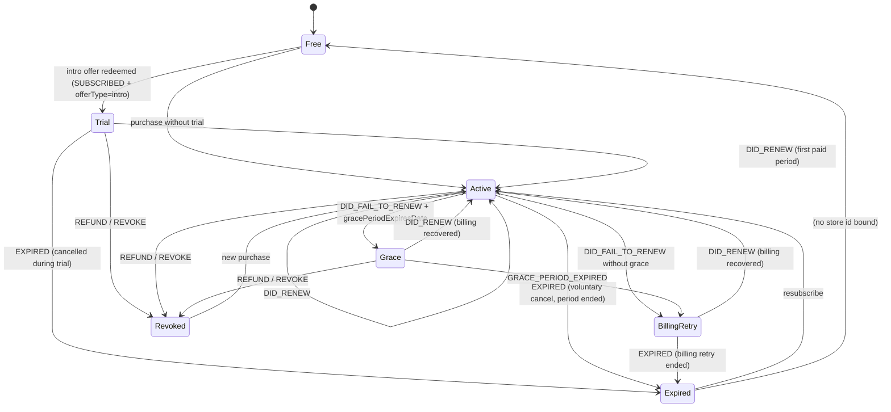
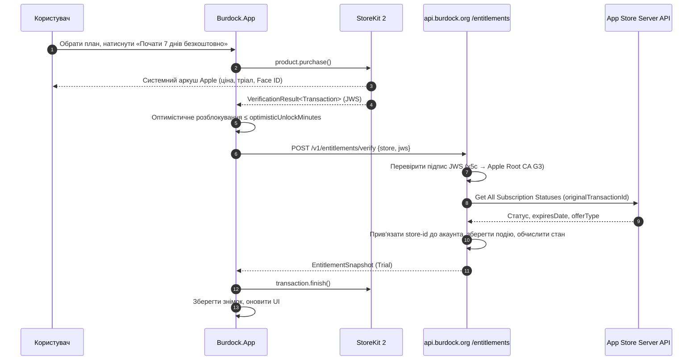
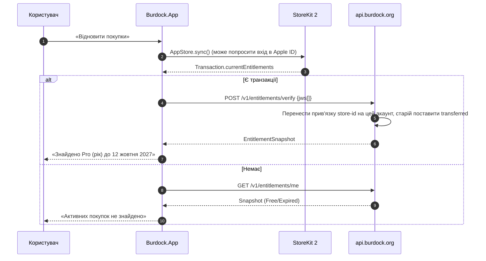
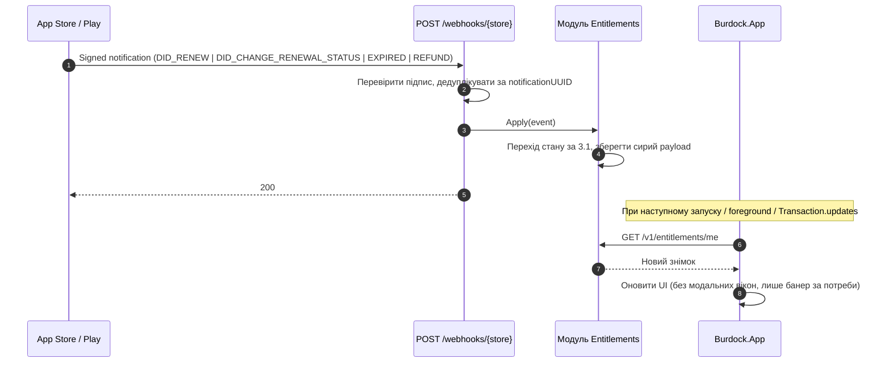
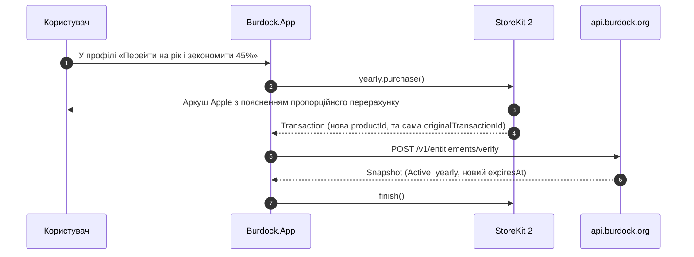

# 11. Монетизація: Free, тріал, Pro

| Поле | Значення |
|---|---|
| Статус | Draft |
| Версія | 0.1 |
| Дата | 2026-09-27 |
| Власник | Власник продукту / Архітектор |
| Джерела рішень | [Журнал рішень](../decisions/2026-09-25-interview.md): Q2, Q14, Q32, Q33, Q31, Q23, Q3, Q9, Q22, Q38, T13, T17, T18; відкриті питання 1, 6 |
| Пов'язані специфікації | 01-architecture, 03-ux-flows-screens (екран Paywall `S-xx`, екран згоди), 04-ios-surfaces, 05-android-surfaces, 06-learning-engine, 07-gamification, 08-content-pipeline, 09-backend (модуль Entitlements), 10-security-privacy, 12-localization, 13-analytics-observability, 14-devops-ci, 15-testing-quality, 17-roadmap |

## 0. Контекст для ШІ-агента

Ти працюєш над монетизацією застосунку «Реп'ях»: freemium із підпискою Pro, 7-денним тріалом через вступну пропозицію магазину та безкоштовним режимом «5 слів на день». Перед роботою прочитай: журнал рішень (розділ 3 «Бізнес-модель» цілком, Q3, Q9), цю специфікацію, 09-backend (модуль `Entitlements`), 03-ux-flows-screens (екран Paywall), 10-security-privacy.

Правила, які не можна порушувати:
1. Покупки лише через нативні StoreKit 2 / Google Play Billing; серверна валідація через App Store Server API / Play Developer API. RevenueCat та інші посередники заборонені (Q23).
2. Джерело істини про рівень доступу — entitlement, виданий сервером. Клієнт лише кешує його з терміном дії. Жодної логіки «розблокувати за локальним прапорцем».
3. Безкоштовний режим доступний одразу без тріалу і без картки (Q33). Серверного «тижня без картки» немає.
4. Paywall без темних патернів: ціна, період, автопродовження та посилання на умови видно завжди; кнопка «Відновити покупки» є на кожному paywall; нічого не позначено заздалегідь.
5. Нагороди, серія та сповіщення ніколи не залежать від підписки й ніколи не використовуються як тиск («ти втратиш серію», T17).
6. Ціни та тексти не хардкодяться: ціни завжди беруться зі StoreKit/Play Billing у валюті користувача; тексти в `.resx`.

Де лежить код: клієнт `src/Burdock.App/Features/Monetization/` (ViewModel-и paywall, `IEntitlementService`, `IStoreService`), домен `src/Burdock.Domain/Entitlements/`, сервер `src/Burdock.Server/Modules/Entitlements/`. Як перевірити: юніт-тести станової машини entitlement-ів (`Burdock.Domain.Tests`), контрактні тести серверних вебхуків з фікстурами Apple/Google, ручний прогін через StoreKit Configuration file на симуляторі в CI та через Sandbox-тестера на TestFlight (розділ 3.11).

## 1. Мета й межі

### 1.1 Ціннісна пропозиція за рівнями

| Рівень | Що отримує користувач | Для кого | Обмеження |
|---|---|---|---|
| **Free** | 5 випадкових слів на день із загального пулу A1-B1; віджети (усі сімейства), сповіщення, тести на цих словах, серія, щоденні нагороди, «колючки» та косметика | Той, хто хоче «слово дня» на екрані блокування без зобов'язань | Немає вибору рівня, категорій, темпу; закриті статистика, історія слів, власні списки |
| **Trial** (7 днів) | Повний Pro | Той, хто хоче спробувати повноцінне навчання перед оплатою | Одна вступна пропозиція на Apple ID / обліковий запис Google; після 7 днів автоматично переходить у платну підписку, якщо не скасувати |
| **Pro** (місяць або рік) | Усі рівні A1-C2 і 9 категорій, темп 3-30 нових слів на день, статистика, історія слів, власні списки, усі режими сесії, Live Activity «сесія», необмежені FSRS-повторення | Той, хто системно вчить слова | Річний план дає економію 40-50% проти місячного |

Принцип: **Free не є «зламаним» Pro.** Free повністю робочий у своїй ніші (звичка + слово на екрані), Pro додає керування та глибину. Free-користувач ніколи не бачить помилок, порожніх екранів чи «зачинених дверей» без пояснення.

### 1.2 Що входить у v1

- Дві підписки в одній групі (`org.burdock.app.pro.monthly`, `org.burdock.app.pro.yearly`) з 7-денною вступною пропозицією на обох.
- Модель entitlement-ів `Free / Trial / Active / Grace / BillingRetry / Expired / Revoked`, спільна з 09-backend.
- Клієнтські потоки: покупка, відновлення, апгрейд місяць→рік, керування підпискою через системний екран магазину.
- Серверна валідація: App Store Server Notifications V2 + App Store Server API; Google Play Real-time Developer Notifications + Play Developer API (Android з релізом за Q22).
- Paywall у чотирьох точках входу з лімітами частоти.
- Досвід завершення тріалу з м'якою деградацією.

### 1.3 Що явно не входить

- Довічна та сімейна підписки, Family Sharing (Q31).
- Реклама у Free (Q14: окреме дослідження; план у Додатку A, «не в v1»).
- Промокоди, реферальні бонуси, знижки «повернись» із таймером.
- Покупка «колючок» за гроші, платні предмети (Q34).
- Веб-оплата, зовнішні платіжні посилання, альтернативні магазини.
- Юридичне оформлення отримувача виплат (ФОП/юрособа, банк, звітність) — поза межами специфікації, але позначено як передумова релізу (розділ 3.10).

### 1.4 Відкладено (див. 17-roadmap)

- Win-back-пропозиції магазину, промо-пропозиції для колишніх підписників — оцінка у v1.1.
- Рішення щодо реклами — після дослідження, v1.1.
- Play Integrity / App Attest для покупок — лише якщо з'явиться зловживання (T16).

## 2. Вимоги

### 2.1 Безкоштовний рівень

| ID | Вимога | Пріоритет |
|---|---|---|
| FR-11-1 | Без активного entitlement-у користувач отримує рівно `free.wordsPerDay` (5) слів на добу, обраних із пулу `FreePool` (опубліковані слова рівнів A1-B1, позначені `free_pool=true` у контент-паку, див. 08). Набір фіксований на навчальний день (T: перехід доби 04:00 локального часу, як у 06) і не змінюється при перезапуску. | Must |
| FR-11-2 | Free-набір дня обирається детерміновано з насіння `(installationId, learningDay)`, з перевагою словам, які користувач іще не бачив; уже «Вивчені» слова виключаються, поки пул не вичерпано. | Must |
| FR-11-3 | Віджети всіх сімейств, сповіщення, ротація за часом і кнопка «наступне» працюють для Free без обмежень, але лише над словами дня та словами пулу, введеними раніше у Free. | Must |
| FR-11-4 | Сесії (усі три режими v1 за Q21) доступні для Free над словами дня та належними FSRS-повтореннями зі слів `FreePool`, які користувач уже вивчав. Слова поза пулом у сесію Free не потрапляють. | Must |
| FR-11-5 | Серія, заморозки, щоденні нагороди, «колючки», косметика працюють для Free повністю; жодна нагорода не залежить від підписки (T17, Apple 5.1.2(i)). | Must |
| FR-11-6 | Закрито для Free: вибір рівня, вибір категорій, темп (нові слова/день, інтервал ротації, кількість показів), екран статистики, історія слів, власні списки, Live Activity «сесія». | Must |
| FR-11-7 | Закриті налаштування показуються у вигляді **прев'ю із замком**: контрол видно, значення за замовчуванням застосовано (Q30: 10 нових/день не застосовується для Free; для Free застосовано 5/день, інтервал 60 хв, 5 показів, 3 сповіщення), контрол недоступний для зміни; дотик відкриває Paywall із контекстом `placement=locked_setting`. | Must |
| FR-11-8 | Закриті екрани (статистика, історія, списки) показують розмитий/скелетний макет з реальними, але приховано-агрегованими даними («Ви зберегли 143 слова — прогрес у безпеці») і однією кнопкою «Спробувати Pro». Жодних лічильників відліку. | Must |
| FR-11-9 | Free ніколи не показує рекламу, банери сторонніх мереж чи трекери (Q14, Q9). | Must |

### 2.2 Тріал

| ID | Вимога | Пріоритет |
|---|---|---|
| FR-11-10 | Тріал реалізовано лише як вступна пропозиція магазину: 7 днів безкоштовно, далі автопродовження на обраний план (Q33). | Must |
| FR-11-11 | Клієнт перед показом Paywall визначає право на вступну пропозицію засобами магазину (StoreKit 2: `Product.SubscriptionInfo.isEligibleForIntroOffer`; Play Billing: наявність offer-у з тегом `trial7` у `ProductDetails`). Право визначає магазин, не сервер (припущення: у сервера немає джерела кращого за магазин). | Must |
| FR-11-12 | Користувачу без права на тріал Paywall показує ті самі плани без згадки «7 днів безкоштовно» і з заголовком «Оформити Pro»; жодних повідомлень «ви вже використали тріал» (це може бути невірним для нового Apple ID). | Must |
| FR-11-13 | Одна вступна пропозиція на одну підписну групу на Apple ID; на Play — одна пропозиція «new customer acquisition» на підписку на обліковий запис Google. Застосунок не намагається обходити це через анонімні акаунти й не пропонує «ще один тріал». | Must |
| FR-11-14 | За 24-48 годин до кінця тріалу застосунок **не** надсилає сповіщень зі страхом; єдине нагадування надсилає магазин (Apple/Google роблять це самі). У застосунку в профілі видно «Тріал до 12 жовтня, далі 149 ₴/міс» (припущення щодо суми). | Must |

### 2.3 Продукти й ціни

| ID | Вимога | Пріоритет |
|---|---|---|
| FR-11-15 | Продукти App Store: `org.burdock.app.pro.monthly`, `org.burdock.app.pro.yearly` в одній підписній групі `pro` (група потрібна для апгрейду/даунгрейду без подвійного списання). | Must |
| FR-11-16 | Продукт Google Play: одна підписка `org.burdock.app.pro` з базовими планами `monthly` і `yearly` та пропозицією `trial7` (7 днів безкоштовно) на кожному базовому плані. Відповідність id між магазинами описано в таблиці 3.3. | Must (Android) |
| FR-11-17 | Річний план коштує 50-60% від 12 місячних (економія 40-50%); показуємо економію як «−45%» (обчислена зі справжніх цін магазину, не з констант). | Must |
| FR-11-18 | Ціни та валюта ніколи не хардкодяться; локалізований рядок ціни береться з `Product.displayPrice` / `ProductDetails` і форматується магазином. | Must |
| FR-11-19 | Аркуш цін (розділ 3.9) заповнюється до подачі в App Store (відкрите питання 6 журналу рішень); до заповнення в App Store Connect стоять плейсхолдери, а CI-перевірка `pricing-worksheet-complete` блокує релізний тег. | Must |

### 2.4 Entitlement-и

| ID | Вимога | Пріоритет |
|---|---|---|
| FR-11-20 | Сервер (09, модуль `Entitlements`) видає `EntitlementSnapshot` зі станом із множини `{Free, Trial, Active, Grace, BillingRetry, Expired, Revoked}`, підписаний ключем сервера, з `issuedAt`, `expiresAt`, `ttlSeconds`. | Must |
| FR-11-21 | Клієнт кешує знімок у локальному сховищі (не в SecureStorage, бо це не секрет; підпис захищає цілісність) і повторно запитує при: запуску, поверненні на передній план після `entitlement.refreshMinIntervalMinutes`, події `Transaction.updates`, після покупки/відновлення, та за 24 години до `expiresAt`. | Must |
| FR-11-22 | Доступ до Pro-функцій визначається функцією `HasPro(snapshot, now)`: `true` для `Trial`, `Active`, `Grace`, а також для `BillingRetry` протягом `entitlement.billingRetryCourtesyDays`; `false` для `Free`, `Expired`, `Revoked`. | Must |
| FR-11-23 | Офлайн: якщо сервер недоступний, клієнт довіряє кешованому знімку до `expiresAt + entitlement.offlineLeewayHours`; після цього переходить у Free з банером «Підключіться до інтернету, щоб оновити Pro» і без втрати даних. | Must |
| FR-11-24 | Локальний сигнал магазину (`Transaction.currentEntitlements` / `queryPurchasesAsync`) використовується лише як підказка для негайного оптимістичного розблокування після покупки на ≤ `entitlement.optimisticUnlockMinutes`, поки сервер не підтвердить. | Should |
| FR-11-25 | Entitlement прив'язаний до облікового запису Burdock (анонімного або з провайдером, Q3) і до ідентифікатора магазину (`originalTransactionId` / `purchaseToken`). Один ідентифікатор магазину активний лише в одному акаунті; при «Відновити покупки» на іншому акаунті entitlement переноситься (останній переможець), стара прив'язка позначається `transferred`. | Must |
| FR-11-26 | Об'єднання анонімного акаунта з акаунтом провайдера (Q3) переносить entitlement разом із прогресом; конфлікт двох активних підписок вирішується на користь довшої `expiresAt`, друга не втрачається (обидва store-ids залишаються прив'язані). | Must |

### 2.5 Потоки покупки

| ID | Вимога | Пріоритет |
|---|---|---|
| FR-11-27 | Покупка: клієнт викликає магазин, отримує підписану транзакцію (JWS для Apple, `purchaseToken` для Google), надсилає на `POST /v1/entitlements/verify`, сервер перевіряє й повертає знімок; клієнт завершує транзакцію (`finish()` / `acknowledge`) **лише після** відповіді сервера 2xx або після тайм-ауту з локальною чергою повтору. | Must |
| FR-11-28 | Відновлення: кнопка «Відновити покупки» викликає `AppStore.sync()` / `queryPurchasesAsync`, передає всі поточні транзакції на сервер; результат показується явно («Знайдено підписку Pro до 12 листопада» або «Активних покупок не знайдено»). | Must |
| FR-11-29 | Продовження, скасування, відшкодування, зміна плану обробляються **сервером** через вебхуки магазинів; клієнт дізнається при наступному оновленні знімка. Клієнт також слухає `Transaction.updates` для швидшої реакції. | Must |
| FR-11-30 | Скасування та керування підпискою виконуються лише через системний екран (`showManageSubscriptions` / посилання на Play «Підписки»); застосунок не має власного «скасувати», але має кнопку «Керувати підпискою», яка веде на системний екран. | Must |
| FR-11-31 | Апгрейд місяць→рік у межах підписної групи (Apple обчислює пропорційно і перемикає негайно, бо річний план вищого рангу; Play — режим заміни з пропорційним розрахунком). Даунгрейд рік→місяць застосовується з наступного періоду. UI пояснює момент перемикання одним реченням. | Should |
| FR-11-32 | Family Sharing вимкнено для обох продуктів у v1 (Q31). | Must |

### 2.6 Paywall

| ID | Вимога | Пріоритет |
|---|---|---|
| FR-11-33 | Кожен Paywall показує: назву плану, ціну за період, період, речення про автопродовження та спосіб скасування, тривалість тріалу і ціну після тріалу (якщо тріал доступний), посилання на Умови користування та Політику приватності, кнопку «Відновити покупки». Це вимога Apple 3.1.2 і політики оплат Google Play. | Must |
| FR-11-34 | Заборонено: попередньо вибрані апсели, таймери зворотного відліку, фальшиві знижки, «лише сьогодні», confirmshaming («Ні, я не хочу вчити слова»), приховане закриття, кнопка закриття, що з'являється із затримкою > 0 с. | Must |
| FR-11-35 | Річний план може бути виділений як «Найвигідніший» з обчисленою економією, але не є попередньо вибраним: користувач сам торкається плану, і лише тоді активується кнопка оплати. | Must |
| FR-11-36 | Точки входу: (a) кінець онбордингу з кнопкою «Пропустити, почати безкоштовно» такого самого розміру, що й основна; (b) дотик до закритого налаштування/екрана; (c) один раз після завершення тріалу (при першому запуску після переходу в `Expired`); (d) з профілю «Реп'ях Pro» — завжди. | Must |
| FR-11-37 | Автоматичні покази (a) і (c) підпадають під ліміт `paywall.autoShowCooldownDays`; покази (b) і (d) ініціює користувач і ліміти не застосовуються. Paywall ніколи не показується всередині сесії, у віджеті, у сповіщенні чи в Live Activity. | Must |
| FR-11-38 | Paywall адаптивний до iPad і темної теми, підтримує Dynamic Type до AX5 без обрізання ціни та юридичного тексту (02-design-system). | Must |
| FR-11-39 | Тексти paywall локалізовано uk (основна) та en (12-localization); юридичний рядок автопродовження є окремим ресурсом, який змінюється лише через PR із позначкою `legal`. | Must |

### 2.7 Завершення тріалу, деградація, повернення

| ID | Вимога | Пріоритет |
|---|---|---|
| FR-11-40 | Після переходу в `Expired` весь прогрес зберігається на пристрої й сервері назавжди (у межах політики зберігання 10): FSRS-стан, історія повторень, серія, нагороди, косметика, власні списки. Нічого не видаляється. | Must |
| FR-11-41 | Слова поза `FreePool`, вивчені у тріалі/Pro, залишаються в базі користувача, але не потрапляють у Free-набір дня, віджети чи сесію. Екран історії слів для Free закритий (FR-11-6), тому ці слова видимі лише в агрегованому вигляді на прев'ю («143 слова чекають на вас у Pro»). При поверненні в Pro повторення відновлюються з поточними інтервалами FSRS. | Must |
| FR-11-42 | Налаштування рівня/категорій/темпу, встановлені у тріалі, зберігаються як «бажані», але для Free застосовуються значення за замовчуванням Free; на прев'ю налаштування видно і поточне Free-значення, і збережене бажане («У Pro: B2, Подорожі + IT, 15 слів/день»). | Should |
| FR-11-43 | Перший запуск після завершення тріалу показує одноразовий екран «Тріал завершено» з поясненням, що залишається у Free, і двома рівнозначними кнопками: «Продовжити безкоштовно» і «Оформити Pro». Реп'яшок у стані «підбадьорення», не «сум». | Must |
| FR-11-44 | Win-back: єдина дозволена дія — м'яка картка в профілі «Повернутися до Pro» без знижок і таймерів; жодних сповіщень про повернення. Магазинні win-back-пропозиції розглядаються у v1.1 через ADR. | Must |

### 2.8 Антизловживання, повернення коштів, юридичне

| ID | Вимога | Пріоритет |
|---|---|---|
| FR-11-45 | Повторне використання тріалу через нові анонімні акаунти неможливе за дизайном: право на тріал визначає магазин на рівні Apple ID / акаунта Google, а не Burdock-акаунт. Сервер додатково не дозволяє одній `originalTransactionId` живити два акаунти одночасно (FR-11-25). | Must |
| FR-11-46 | Повернення коштів обробляють лише магазини; застосунок дає посилання «Проблема з оплатою?» на сторінку магазину. При `REFUND` / `SUBSCRIPTION_REVOKED` сервер переводить entitlement у `Revoked`; клієнт деградує до Free при наступному оновленні, без звинувачувальних текстів. | Must |
| FR-11-47 | Сервер зберігає журнал усіх подій магазину (сирі підписані payload-и) `entitlement.rawEventRetentionDays` для розслідувань і звірки з фінансовими звітами. Payload-и не містять персональних даних понад ідентифікатори транзакцій. | Must |
| FR-11-48 | ПДВ та податки з продажу утримують і сплачують магазини як продавець запису у більшості юрисдикцій; застосунок не показує ПДВ окремо. Юридичний статус отримувача виплат (ФОП/юрособа, валютний рахунок, банківські угоди з Apple/Google) — поза межами специфікації; позначено як блокер релізу у 17-roadmap. | Must |
| FR-11-49 | Реєстрація у програмах зниженої комісії (App Store Small Business Program, Play 15% на перший $1M) виконується до релізу; це впливає на аркуш цін. | Should |

### 2.9 Метрики

| ID | Вимога | Пріоритет |
|---|---|---|
| FR-11-50 | Клієнт (за згодою на аналітику, 13) надсилає події `paywall_view`, `paywall_dismiss`, `trial_started`, `purchase_completed`, `subscription_expired`, `restore_completed` з властивостями лише з allowlist (`placement`, `product`, `eligible_for_trial`, `tier_before`). | Should |
| FR-11-51 | Сервер обчислює фінансові KPI з журналу подій магазину (не з клієнтської аналітики, бо вона opt-in і неповна): старти тріалу, конверсія тріал→оплата, відтік, ARPU, частка річних планів. | Must |

### 2.10 Нефункціональні вимоги

| ID | Вимога | Пріоритет |
|---|---|---|
| NFR-11-1 | Перевірка знімка з кешу — синхронна і ≤ 5 мс; жоден екран не чекає мережі, щоб вирішити, показувати замок чи ні. | Must |
| NFR-11-2 | `POST /v1/entitlements/verify` відповідає ≤ 2 с p95 (включно з викликом App Store Server API); при недоступності Apple/Google сервер повертає 202 із тимчасовим знімком `pendingVerification=true` на `entitlement.pendingTtlMinutes` і довіряє локальній перевірці підпису JWS. | Must |
| NFR-11-3 | Вебхуки магазинів ідемпотентні за `notificationUUID` / `messageId`; повторна доставка не змінює стан двічі. | Must |
| NFR-11-4 | Жодних секретів магазину (ключі App Store Server API `.p8`, сервісний акаунт Google) у клієнті чи в репозиторії; лише в секретах CI/сервера (14). | Must |
| NFR-11-5 | Станова машина entitlement-ів — чиста доменна логіка з інжектованим годинником, покрита тестами на кожен перехід (15). | Must |

## 3. Проєктування

### 3.1 Станова машина entitlement-у



Назви подій наведено в термінах App Store Server Notifications V2; таблиця відповідності до Google Play RTDN (`SUBSCRIPTION_PURCHASED`, `SUBSCRIPTION_RENEWED`, `SUBSCRIPTION_IN_GRACE_PERIOD`, `SUBSCRIPTION_ON_HOLD`, `SUBSCRIPTION_CANCELED`, `SUBSCRIPTION_EXPIRED`, `SUBSCRIPTION_REVOKED`) ведеться в 09. `Free` та `Expired` для клієнта рівнозначні щодо доступу; різниця лише в тому, що `Expired` має прив'язаний store-id і може отримати win-back-картку в профілі.

### 3.2 Поведінка клієнта в кожному стані

| Стан | `HasPro` | Що бачить користувач | Оновлення знімка | Офлайн-поведінка |
|---|---|---|---|---|
| Free | ні | Free-набір дня, замки на прев'ю, «Спробувати Pro» у профілі | TTL 24 год | Free працює повністю з кешу |
| Trial | так | Повний Pro, у профілі «Тріал до {дата}, далі {ціна}» | TTL 24 год, примусово за 24 год до `expiresAt` | Довіра кешу до `expiresAt + offlineLeewayHours` |
| Active | так | Повний Pro, у профілі план і дата продовження | TTL 24 год | Довіра кешу до `expiresAt + offlineLeewayHours` |
| Grace | так | Повний Pro + ненав'язливий банер «Не вдалося списати оплату. Оновіть спосіб оплати» з кнопкою на системний екран | TTL 6 год | Довіра кешу до `gracePeriodEndsAt` |
| BillingRetry | так протягом `billingRetryCourtesyDays`, далі ні | Той самий банер; після пільгового періоду — Free із банером | TTL 6 год | Довіра кешу до кінця пільгового періоду |
| Expired | ні | Одноразовий екран «Тріал/підписку завершено», далі як Free + картка «Повернутися до Pro» у профілі | TTL 24 год | Як Free |
| Revoked | ні | Як Free, без картки повернення протягом `winback.suppressAfterRevokeDays` | TTL 24 год | Як Free |

Банер про проблему з оплатою показується не частіше одного разу на запуск і має кнопку «Приховати на 3 дні».

### 3.3 Контракти

`EntitlementSnapshot` (JSON, відповідь `GET /v1/entitlements/me` і `POST /v1/entitlements/verify`; повна схема в OpenAPI 09):

```json
{
  "status": "Active",
  "tier": "pro",
  "productId": "org.burdock.app.pro.yearly",
  "store": "app_store",
  "isTrial": false,
  "autoRenewEnabled": true,
  "expiresAt": "2027-10-12T09:15:00Z",
  "gracePeriodEndsAt": null,
  "issuedAt": "2026-10-12T09:15:04Z",
  "ttlSeconds": 86400,
  "pendingVerification": false,
  "signature": "base64url(Ed25519 over canonical JSON without 'signature')"
}
```

Відповідність продуктів між магазинами:

| Логічний план | App Store product id | Play subscription / base plan / offer | Тривалість | Тріал |
|---|---|---|---|---|
| Pro місяць | `org.burdock.app.pro.monthly` (група `pro`, рівень 2) | `org.burdock.app.pro` / `monthly` / `trial7` | P1M | 7 днів |
| Pro рік | `org.burdock.app.pro.yearly` (група `pro`, рівень 1) | `org.burdock.app.pro` / `yearly` / `trial7` | P1Y | 7 днів |

Рівень 1 у групі App Store — вищий, тому перехід місяць→рік є апгрейдом і застосовується негайно.

### 3.4 Послідовності

**Покупка (StoreKit 2, аналогічно для Play Billing):**



**Відновлення покупок:**



**Продовження, скасування, відшкодування (без участі клієнта):**



Скасування (`DID_CHANGE_RENEWAL_STATUS`, `autoRenewStatus=false`) **не** змінює `HasPro`: доступ триває до `expiresAt`. Клієнт лише змінює текст у профілі на «Pro до 12 листопада, автопродовження вимкнено».

**Апгрейд місяць→рік:**



### 3.5 Серверна валідація (стисло; деталі в 09)

| Аспект | App Store | Google Play |
|---|---|---|
| Вхідні дані від клієнта | `jwsRepresentation` транзакції | `purchaseToken` + `productId` |
| Перевірка на сервері | Підпис JWS через ланцюжок `x5c` до Apple Root CA G3; потім App Store Server API `Get All Subscription Statuses` за `originalTransactionId` | Play Developer API `purchases.subscriptionsv2.get` через сервісний акаунт (`Google.Apis.AndroidPublisher.v3`) |
| Вебхуки | App Store Server Notifications V2 (JWS, `signedPayload`) на `POST /webhooks/app-store`; окремий URL для Sandbox | RTDN через Cloud Pub/Sub push на `POST /webhooks/play`; перевірка JWT Pub/Sub |
| Підтвердження покупки | `finish()` після відповіді сервера | `acknowledge` після відповіді сервера; Play скасовує непідтверджені покупки через 3 дні, тому черга повторів обов'язкова |
| Середовища | Sandbox / Production; сервер розрізняє за полем `environment` і не змішує акаунти | License testers; тестові покупки позначено `purchaseType=0` |
| Бібліотека | Офіційної .NET-бібліотеки Apple немає (є Java/Python/Node/Swift); власна перевірка JWS або community-пакет після аудиту (припущення; рішення через ADR у Phase 5) | Офіційний NuGet `Google.Apis.AndroidPublisher.v3` |
| Секрети | Ключ `.p8` App Store Server API (Issuer ID, Key ID) | JSON сервісного акаунта з правами Play Console «Фінансові дані» |

Сервер зберігає для кожного акаунта: список прив'язаних store-id, поточний стан, `expiresAt`, історію подій. Знімок видається на основі поточного стану і має `ttlSeconds` = `entitlement.snapshotTtlSeconds` (менше для Grace/BillingRetry).

### 3.6 Paywall: макет, розміщення, ліміти

Текстовий wireframe (HTML-прев'ю в `design/preview/paywall.html`, номер екрана в 03):

```
┌───────────────────────────────────────────────┐
│  ✕                                             │
│  [Реп'яшок, стан «радість», Lottie ≤ 2 с]      │
│  Реп'ях Pro                                    │
│  Обирай рівень і теми, тримай темп,            │
│  бач статистику і власні списки.               │
│                                                │
│  ○ Щомісяця        149 ₴/міс                   │
│  ○ Щороку  Найвигідніше  899 ₴/рік  (−45%)     │
│      = 75 ₴/міс                                │
│                                                │
│  [ Почати 7 днів безкоштовно ]  (неактивна,    │
│   поки план не обрано)                         │
│  Далі 899 ₴/рік. Підписка продовжується        │
│  автоматично; скасувати можна будь-коли в       │
│  налаштуваннях Apple ID.                       │
│                                                │
│  Відновити покупки · Умови · Приватність        │
└───────────────────────────────────────────────┘
```

Правила: кнопка ✕ видима з першого кадру, у зоні 44 pt; список переваг — 3-4 пункти без порівняльної таблиці «Free vs Pro» з червоними хрестиками (це confirmshaming в іншому вигляді); тексти для стану «без права на тріал» — «Оформити Pro» і рядок «899 ₴/рік. Підписка продовжується автоматично…». Усі суми у прикладі — плейсхолдери (припущення).

Розміщення та ліміти:

| Placement | Тригер | Ініціатор | Ліміт |
|---|---|---|---|
| `onboarding_end` | Останній крок онбордингу | автоматичний | 1 раз за життя інсталяції; кнопка «Пропустити» рівнозначна |
| `locked_setting` | Дотик до контролу/екрана із замком | користувач | без ліміту |
| `trial_ended` | Перший запуск у стані `Expired` після `Trial` | автоматичний | 1 раз на перехід у Expired |
| `profile` | Картка «Реп'ях Pro» у профілі | користувач | без ліміту |
| будь-який автоматичний | — | — | не частіше `paywall.autoShowCooldownDays`; не в сесії; не при першому запуску дня, якщо користувач ще не бачив слово дня |

### 3.7 Free-набір дня

```
DailyFreeSet(learningDay):
  seed = HMAC-SHA256(installationSecret, learningDay)       // installationSecret локальний, не надсилається
  pool = FreePool ∖ Learned                                  // вивчені виключаються
  unseen = pool ∖ Seen; seen = pool ∩ Seen
  take = min(free.wordsPerDay, |pool|)
  set = take-first(shuffle(unseen, seed)) ++ take-rest(shuffle(seen, seed))
  if |pool| == 0: set = take(shuffle(Learned ∩ FreePool, seed))   // пул вичерпано: повторення
  return set
```

Детермінізм гарантує однаковий набір у застосунку, віджеті та сповіщеннях без спільного стану, крім `installationSecret` в App Group / спільному сховищі (04, 05). Сесія Free = слова дня + належні повторення FSRS зі слів `FreePool`, які були введені у Free раніше (06 визначає ліміт повторень на сесію). Слова, введені у тріалі поза пулом, у Free не плануються.

### 3.8 Прев'ю закритих налаштувань

| Налаштування | Значення для Free (застосоване) | Вигляд | Дія при дотику |
|---|---|---|---|
| Рівень | Пул A1-B1 (без вибору) | Сегментований контрол з A1…C2, стан disabled, замок праворуч, підпис «У Pro: {бажане}» | Paywall `locked_setting` |
| Категорії | Усі 8 (пул) | Список чипів у disabled, замок | Paywall |
| Нових слів/день | 5 | Слайдер disabled на позиції 5 | Paywall |
| Інтервал ротації | 60 хв | Сегмент 15/30/60/120/240 disabled на 60 | Paywall |
| Показів на день | 5 | disabled | Paywall |
| Сповіщень/день, тихі години | доступні (Free) | активні | — |
| Статистика | — | Розмитий макет графіка з реальними агрегатами (кількість слів, серія), кнопка «Спробувати Pro» | Paywall |
| Історія слів | — | Скелет списку + «143 слова збережено» | Paywall |
| Власні списки | — | Порожній стан із Реп'яшком «Списки чекають у Pro» | Paywall |

Замок — іконка Lucide `lock`, семантичний колір `content.tertiary`, з `SemanticProperties.Description` «Доступно в Pro» для VoiceOver/TalkBack.

### 3.9 Аркуш цін (заповнити до подачі)

Усі значення нижче — **плейсхолдери** для відкритого питання 6 журналу рішень. Правило: спочатку обирається ціна в UAH для маркетингового ринку, далі підбираються найближчі цінові точки App Store / Play для USD та EUR; річна = 50-60% від 12 місячних.

| Параметр | UAH | USD | EUR | Коментар |
|---|---|---|---|---|
| Pro місяць | ___ (орієнтир 129-199) | ___ (орієнтир 2.99-4.99) | ___ | Орієнтири — припущення, не дослідження ринку |
| Pro рік | ___ (орієнтир 799-1 199) | ___ (орієнтир 19.99-29.99) | ___ | Економія 40-50% |
| Ефективна ціна/міс у році | авто | авто | авто | Показується на paywall |
| Комісія магазину | 15% (Small Business / Play 15%) або 30% | | | Впливає на цільову маржу |
| ПДВ | утримує магазин | | | Не показується окремо |
| Базова країна ціноутворення | Україна | | | Автоконвертація магазину для інших країн з ручною перевіркою для US/EU |
| Дата фіксації | ___ | | | Рішення власника, ADR-посилання |

Чекліст перед фіксацією: (1) перевірити реальні цінові точки в App Store Connect і Play Console; (2) розрахувати виплату після комісії та податків для трьох валют; (3) перевірити, що річна економія на paywall відображається як «−4x%» для всіх трьох валют; (4) зафіксувати в ADR.

### 3.10 Константи

| Ключ конфігурації | Значення v1 | Де діє | Примітка |
|---|---|---|---|
| `free.wordsPerDay` | 5 | клієнт, сервер | Q14 |
| `free.rotationIntervalMinutes` | 60 | клієнт | застосоване значення Free |
| `free.maxExposuresPerWordPerDay` | 5 | клієнт | Q30 |
| `free.notificationsPerDay` | 3 | клієнт | Q30 |
| `trial.durationDays` | 7 | магазин (довідково) | Q31 |
| `entitlement.snapshotTtlSeconds` | 86400 (Active/Trial/Free), 21600 (Grace/BillingRetry) | сервер | |
| `entitlement.refreshMinIntervalMinutes` | 30 | клієнт | не частіше при foreground |
| `entitlement.offlineLeewayHours` | 72 | клієнт | покриває продовження, яке не встигли побачити |
| `entitlement.billingRetryCourtesyDays` | 3 | клієнт, сервер | доступ у BillingRetry без grace (припущення) |
| `entitlement.optimisticUnlockMinutes` | 30 | клієнт | до підтвердження сервером |
| `entitlement.pendingTtlMinutes` | 60 | сервер | при недоступності API магазину |
| `entitlement.rawEventRetentionDays` | 730 | сервер | фінансова звірка (припущення) |
| `paywall.autoShowCooldownDays` | 7 | клієнт | |
| `paywall.maxAutoShowsPerLaunch` | 1 | клієнт | |
| `winback.suppressAfterRevokeDays` | 90 | клієнт | |
| `store.appStoreGracePeriod` | увімкнено, 16 днів | App Store Connect | значення обирається в консолі; перевірити доступні варіанти |
| `store.playGracePeriodDays` | 7 | Play Console | базовий план |
| `store.familySharing` | вимкнено | обидві консолі | Q31; для App Store вмикання незворотне (перевірити в довідці ASC) |

### 3.11 Тестування

| Рівень | Що | Як | Обмеження CI |
|---|---|---|---|
| Юніт | Станова машина, `HasPro`, `DailyFreeSet`, ліміти paywall | xunit.v3, інжектований годинник, таблиці переходів (15) | немає |
| Контракт сервера | Вебхуки Apple/Google | Фікстури підписаних payload-ів (записані із Sandbox), тест підпису й ідемпотентності | Секрети Sandbox у GitHub Secrets; без реальних викликів у PR |
| Симулятор iOS | Покупка, тріал, продовження, відшкодування | **StoreKit Configuration file** (`Burdock.storekit`) із прискореним часом підписки; запуск UI-тесту на `macos-26` раннері; знімки екрана paywall в артефактах (14) | Симулятор не викликає сервер Apple; сервер валідує через `pendingVerification` шлях |
| TestFlight | Реальні Sandbox-покупки | Sandbox-тестери в App Store Connect (окремі Apple ID, прискорене продовження); перевірка вебхуків Sandbox на staging | Ручний прогін власником; чекліст у 15 |
| Android | Play Billing | License testers у Play Console, тестові картки, внутрішнє тестування; RTDN на staging | Емулятор із Google Play образом; локально на Windows |
| Регресія релізу | Повний прогін чекліста 5.x | Перед кожним релізним тегом | — |

Обов'язковий чекліст ручного прогону перед подачею: покупка місяця з тріалом → скасувати до кінця → перевірити Expired; покупка року без тріалу (другий Sandbox-акаунт) → апгрейд неможливий (уже рік) → даунгрейд на місяць з наступного періоду; відновлення на новій інсталяції; відшкодування із Sandbox → Revoked; офлайн 4 доби → перехід у Free із банером.

## 4. Рішення та компроміси

| Питання | Варіанти | Плюси | Мінуси | Обрано і чому |
|---|---|---|---|---|
| Доступ до StoreKit 2 з MAUI | (a) `Plugin.InAppBilling`; (b) власна Swift-обгортка у наявному Xcode-проєкті розширень з ObjC-фасадом і binding-проєктом; (c) прямі біндінги Microsoft.iOS, якщо доступні | (a) швидко, одна API для двох платформ; (b) повний контроль, доступ до `Transaction.updates`, `isEligibleForIntroOffer`, `showManageSubscriptions`; (c) без сторонніх залежностей | (a) залежність від одного мейнтейнера, покриття StoreKit 2 API треба перевірити; (b) Swift без локального Xcode, лише через CI; (c) наявність і повнота біндінгів не підтверджені | **Спайк на 1 тиждень у Phase 5** (17-roadmap): критерії — доступ до JWS, eligibility, `updates`, керування підпискою, робота зі StoreKit Configuration; рішення через ADR. Попередня перевага (b), бо Swift-таргет уже існує для віджетів (Q35) і контроль важливіший за швидкість. Версії та можливості (a)/(c) — припущення, потребують перевірки. |
| Хто визначає право на тріал | магазин / сервер | магазин: єдине джерело істини про Apple ID | сервер не бачить історії Apple ID | Магазин (FR-11-11) |
| Free-набір: випадковий чи FSRS-керований | випадковий детермінований / черга FSRS | випадковий: відповідає Q14, простий, працює без стану у віджеті | менше педагогічної цінності | Детермінований випадковий з перевагою невідомим словам + повторення пулу в сесії (3.7); повне FSRS-планування лише в Pro |
| Прогрес поза пулом після тріалу | видалити / заморозити / показувати read-only | заморозити: жодних втрат, мотив повернутися | нема прямого read-only перегляду, бо історія закрита | Заморозити і показувати агреговано (FR-11-41); прямий read-only перегляд конфліктував би з «історія слів закрита» |
| Джерело фінансових KPI | клієнтська аналітика / серверний журнал подій магазину / звіти консолей | сервер: повний, не залежить від opt-in | потребує звірки з консолями | Сервер + щомісячна звірка з App Store Connect / Play Console (FR-11-51) |
| Дії при несплаті | негайно Free / grace + courtesy | courtesy: не карати за проблему банку | ризик короткого безкоштовного доступу | Grace магазину + `billingRetryCourtesyDays` |
| Реклама у Free | зараз / дослідження / ніколи | — | — | Дослідження після v1 (Q14), Додаток A |

## 5. Критерії приймання

- [ ] AC-11-1. Given нова інсталяція без покупок, When минув онбординг із «Пропустити», Then у застосунку 5 слів дня, віджет і сповіщення працюють, а всі закриті налаштування показані як disabled із замком і застосованими значеннями Free.
- [ ] AC-11-2. Given той самий пристрій, When застосунок перезапущено тричі протягом одного навчального дня, Then набір слів дня незмінний, а після переходу 04:00 — новий, без повторів невивчених слів попереднього дня.
- [ ] AC-11-3. Given Apple ID із правом на тріал, When відкрито Paywall, Then видно «Почати 7 днів безкоштовно», ціну після тріалу, рядок автопродовження, посилання Умови/Приватність, кнопку «Відновити покупки»; кнопка оплати неактивна, поки план не обрано.
- [ ] AC-11-4. Given Apple ID без права на тріал, When відкрито Paywall, Then немає жодної згадки тріалу і немає повідомлення про «використаний тріал».
- [ ] AC-11-5. Given успішна покупка, When сервер відповів знімком `Trial`, Then усі Pro-функції доступні, `transaction.finish()` викликано після відповіді, знімок збережено з підписом.
- [ ] AC-11-6. Given знімок `Active` з `expiresAt` через 10 днів, When пристрій офлайн 4 доби, Then Pro доступний; When офлайн триває понад `expiresAt + 72 год`, Then застосунок у Free з банером про оновлення, дані користувача недоторкані.
- [ ] AC-11-7. Given вебхук `REFUND` для прив'язаного `originalTransactionId`, When клієнт оновив знімок, Then стан `Revoked`, доступ Free, жодного тексту зі звинуваченням, картка win-back відсутня 90 днів.
- [ ] AC-11-8. Given повторна доставка того самого вебхука, When обробка завершена, Then стан і журнал подій не змінені вдруге (ідемпотентність).
- [ ] AC-11-9. Given стан `Expired` після `Trial`, When перший запуск, Then один екран «Тріал завершено» з двома рівнозначними кнопками; при другому запуску екран не з'являється; прогрес і серія збережені.
- [ ] AC-11-10. Given автоматичний Paywall показано сьогодні, When користувач не ініціює Paywall сам, Then наступний автоматичний показ не раніше ніж через 7 днів; під час сесії Paywall не з'являється ніколи.
- [ ] AC-11-11. Given «Відновити покупки» на новій інсталяції з тим самим Apple ID, When транзакції знайдені, Then entitlement перенесено на новий акаунт, старий позначено `transferred`, користувач бачить явне підтвердження з датою.
- [ ] AC-11-12. Given Paywall на iPad у темній темі з Dynamic Type AX5, Then усі елементи (ціна, юридичний текст, кнопки) видимі без обрізання, контраст ≥ 4.5:1.
- [ ] AC-11-13. Given релізний тег, When аркуш цін 3.9 містить плейсхолдери, Then CI-перевірка `pricing-worksheet-complete` блокує реліз.
- [ ] AC-11-14. Given збірка застосунку, Then у бінарнику немає жодного секрету магазину (перевірка секрет-сканером у 14).

## 6. Ризики

| Ризик | Ймовірність | Вплив | Пом'якшення |
|---|---|---|---|
| Обраний спосіб доступу до StoreKit 2 не покриває потрібні API (eligibility, updates) | середня | високий | Спайк з критеріями до початку Phase 5; резервний варіант — Swift-обгортка |
| Відхилення App Review за 3.1.2 через неповний юридичний текст на paywall | середня | високий | Чекліст FR-11-33 у PR-шаблоні; знімки paywall у CI-артефактах для самоперевірки перед подачею |
| Незавершені транзакції (сервер недоступний під час покупки) | середня | середній | Оптимістичне розблокування + локальна черга повтору `verify`; `Transaction.updates` при наступному запуску |
| Помилка серверної станової машини дає Pro безкоштовно або забирає в платника | низька | високий | Таблично покриті переходи, контрактні фікстури, щомісячна звірка з консолями |
| Юридичне оформлення виплат затягується | середня | високий (блокер релізу) | Позначено чекпойнтом у 17-roadmap задовго до подачі |
| Ціни, не адаптовані до ринку України, дають низьку конверсію | середня | середній | Аркуш цін з орієнтирами, перегляд через 8 тижнів після релізу без зміни для наявних підписників |
| Бар'єр «підписка з карткою» знижує старти тріалу | висока | середній | Free повністю робочий; Paywall не агресивний; вимірюємо частку стартів тріалу та конверсію (13) |
| Play Billing: непідтверджені покупки скасовуються через 3 дні | низька | середній | Черга `acknowledge` з повторами; серверний `verify` виконує acknowledge, якщо клієнт не зміг |

## 7. Відкриті питання

| # | Питання | Хто вирішує | До коли |
|---|---|---|---|
| 1 | Ціни UAH/USD/EUR (аркуш 3.9) | Власник | До подачі в App Store (журнал рішень, п. 6) |
| 2 | `FreePool` = усі A1-B1 чи курований піднабір (впливає на обсяг 100% ручної перевірки за T21) | Власник + 08 | Перед публікацією контенту (Phase 6) |
| 3 | Спосіб доступу до StoreKit 2 (спайк) | Архітектор, ADR | Початок Phase 5 |
| 4 | Тривалість Grace Period у App Store Connect / Play (16 днів / 7 днів — припущення) | Власник | Phase 5 |
| 5 | Чи показувати рік як «−45%» або як «75 ₴/міс» головним акцентом | Дизайн (02/03) | Phase 5, перевірити на 5 користувачах бета |
| 6 | Юридичний статус отримувача виплат (ФОП група, валютний рахунок) | Власник | До Phase 6 |
| 7 | Win-back-пропозиції магазину у v1.1 | Власник, ADR | Після 3 місяців метрик |
| 8 | Реклама у Free (Додаток A) | Власник після дослідження | Перед v1.1 |

## 8. Джерела

З дослідницького звіту (перевірені 2026-09-25):

- App Store Review Guidelines (3.1.x покупки та підписки, 5.1.1(ii) згода, 5.1.2(i) нагороди без умов): https://developer.apple.com/app-store/review/guidelines/
- Політика оплат Google Play: https://support.google.com/googleplay/android-developer/answer/9858738
- Типи темних патернів (для чекліста paywall): https://www.deceptive.design/types
- WCAG 2.2 Timing Adjustable (без таймерів на paywall): https://www.w3.org/WAI/WCAG22/Understanding/timing-adjustable.html
- Play Integrity (відкладено, T16): https://developer.android.com/google/play/integrity/standard
- Hetzner/ціни хостингу для оцінки маржі: https://docs.hetzner.com/cloud/billing/faq

Офіційна документація, додана автором специфікації (перевірити актуальність перед посиланням у коді):

- StoreKit 2: https://developer.apple.com/documentation/storekit
- App Store Server API: https://developer.apple.com/documentation/appstoreserverapi
- App Store Server Notifications V2: https://developer.apple.com/documentation/appstoreservernotifications
- Автопоновлювані підписки (вимоги до подання, підписні групи, вступні пропозиції): https://developer.apple.com/app-store/subscriptions/
- Google Play Billing Library: https://developer.android.com/google/play/billing
- Real-time Developer Notifications: https://developer.android.com/google/play/billing/rtdn-reference
- Play Developer API `purchases.subscriptionsv2`: https://developers.google.com/android-publisher/api-ref/rest/v3/purchases.subscriptionsv2

## Додаток A. План дослідження реклами у Free (не в v1)

Статус: дослідження виконується перед v1.1 за відкритим питанням 1 журналу рішень. До завершення дослідження й окремого ADR у застосунку немає жодного рекламного SDK.

**Питання, на які має відповісти дослідження**

1. Скільки доходу на Free-користувача реально дає реклама в освітньому застосунку для української аудиторії (eCPM UA для банерів/натівів/rewarded) проти впливу на конверсію в Pro?
2. Чи можливий формат без трекінгу: контекстна реклама без ідентифікаторів, без ATT, без персоналізації? Які мережі підтримують «non-personalized only» режим і що це означає для eCPM?
3. Який вплив на App Privacy label («Дані, що використовуються для відстеження», «Ідентифікатори») та Data safety Play; чи зникає поточна перевага «дані не збираються / не пов'язані»?
4. Чи зберігається сумісність із `PrivacyInfo.xcprivacy` (SDK з переліку Apple потребують власних маніфестів і підписів).
5. Який вплив на розмір застосунку, час запуску, споживання батареї, стабільність (краші SDK), рейтинг у магазині?
6. Чи конфліктує реклама з дизайн-акцентом проєкту (Q8/Q19) та етичною гейміфікацією (rewarded-реклама за нагороди — заборонена як принцип).
7. Яка альтернатива: підняти цінність Free без реклами (наприклад, «слово дня» від партнерів-видавців із явною позначкою) або зовсім не монетизувати Free.

**Кандидати для оцінки** (лише перелік для дослідження, не рекомендація): Google AdMob, AppLovin MAX, Unity Ads, а також контекстні/приватні мережі без трекінгу. Кожен оцінюється за таблицею нижче.

| Критерій | Вага | Поріг відсікання |
|---|---|---|
| Робота без ATT/ідентифікаторів реклами | 30% | обов'язково |
| Наявність privacy manifest і підписаного SDK | 15% | обов'язково |
| Вплив на App Privacy label | 15% | не додає «Tracking» |
| eCPM UA у non-personalized режимі | 15% | ≥ порогу, який окупає втрату конверсії (розрахунок у дослідженні) |
| Стабільність, розмір, краші | 10% | crash-free не падає нижче цілі 13 |
| Керованість частоти й форматів (без full-screen у навчальному потоці) | 10% | обов'язково |
| Сумісність із MAUI (біндінги, підтримка) | 5% | є актуальний NuGet |

**Критерії рішення**: реклама вводиться лише якщо (1) працює без трекінгу, (2) не змінює privacy label на «Tracking», (3) очікуваний дохід ≥ 2× втрат від зниження конверсії тріалу (оцінка з метрик 13 за 3 місяці), (4) формат не з'являється у віджетах, сповіщеннях, сесії та на paywall, (5) є кнопка «Прибрати рекламу» = Pro без інших умов. Інакше рішення «без реклами» фіксується ADR і питання закривається.
