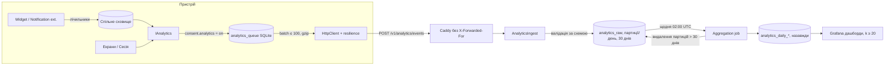

# 13. Аналітика та спостережуваність

| Поле | Значення |
|---|---|
| Статус | Draft |
| Версія | 0.1 |
| Дата | 2026-09-27 |
| Власник | Архітектор |
| Джерела рішень | [Журнал рішень](../decisions/2026-09-25-interview.md): Q9, Q3, Q17, Q29, Q38, T5, T13, T14; дослідницький звіт розділи 2, 5, 6 (guardrail) |
| Пов'язані специфікації | 01-architecture, 03-ux-flows-screens (екран згоди), 06-learning-engine (`ReviewLog`), 07-gamification, 09-backend (модуль ingest аналітики), 10-security-privacy, 11-monetization, 14-devops-ci, 15-testing-quality, 16-documentation-plan |

## 0. Контекст для ШІ-агента

Ти працюєш над аналітикою продукту та спостережуваністю сервера «Реп'ях». Перед роботою прочитай: Q9 журналу рішень, цю специфікацію, 10-security-privacy (інвентар даних), 09-backend (модуль `Analytics`), 03 (екран згоди).

Правила, які не можна порушувати:
1. Продуктова аналітика лише **opt-in**, вимкнена за замовчуванням, без будь-якої нагороди за ввімкнення. Звіти про збої — окремий перемикач.
2. Жодних сторонніх аналітичних SDK (Firebase, Amplitude, Mixpanel тощо). Дозволені лише власний ingest на `api.burdock.org` та Sentry у регіоні ЄС із `SendDefaultPii=false`.
3. Події не містять вільного тексту, точних часових міток, IP, IDFV/Android ID, рекламних ідентифікаторів, ідентифікатора акаунта Burdock чи будь-чого, що зв'язує дні між собою. Єдиний ключ — `day_token`, що змінюється щодня.
4. Кожна нова подія або властивість проходить чекліст приватності (розділ 3.10) і потрапляє в таблицю 3.2 **до** написання коду.
5. Сирі події живуть на сервері 30 днів, агрегати — безстроково. Дашборди не показують групи менші за `analytics.kAnonymityMin`.
6. Сервер ніколи не логує тіла запитів, токени, IP та email; редагування на рівні `ILogger` і в OTel Collector.

Де лежить код: клієнт `src/mobile/Burdock.Infrastructure/Analytics/` (`IAnalytics`, `AnalyticsQueue`, `ConsentStore`), спільні контракти подій `src/shared/Burdock.Contracts/Analytics/`, сервер `src/server/Burdock.Server.Modules.Analytics/` (ingest і агрегація в одному модулі, 09 §3.1), інфраструктура спостережуваності `infra/observability/` (OTel Collector, правила алертів). Як перевірити: юніт-тести allowlist-у подій (жодна властивість поза схемою не серіалізується), контрактні тести ingest-ендпоінта, тест «вимкнена згода = нуль запитів», тест редагування логів, ручний перегляд дашбордів Grafana після деплою на staging.

## 1. Мета й межі

Мета: (1) розуміти, чи допомагає застосунок вчити слова, і чи не купуємо ми залученість ціною пам'яті; (2) бачити здоров'я сервера та стабільність клієнта; (3) робити це так, щоб інвентар даних для App Privacy та Data safety залишався «дані не пов'язані з користувачем / не використовуються для відстеження».

**У v1:** згода та її UX-зв'язок; таксономія подій; клієнтська черга з батчингом; ingest і агрегація на сервері; KPI та guardrail; Sentry для клієнта й сервера; OpenTelemetry на сервері; health checks; алерти; чергування для соло-розробника; використання вбудованої аналітики App Store Connect / Play Console.

**Не в v1:** A/B-експерименти; воронки на рівні окремого користувача; сесійні записи/heatmap; будь-які сторонні SDK; профілювання продуктивності клієнта в проді (Sentry profiling вимкнено); синтетичний моніторинг з кількох регіонів (достатньо одного зовнішнього пінгу).

**Відкладено (17-roadmap):** серверне обчислення 30-денного пригадування з журналу синхронізації (потребує окремого ADR щодо законної підстави, бо це не opt-in); публічна сторінка статусу; трасування клієнта.

## 2. Вимоги

### 2.1 Принципи та згода

| ID | Вимога | Пріоритет |
|---|---|---|
| FR-13-1 | Два незалежні перемикачі: «Анонімна статистика використання» (`consent.analytics`) і «Звіти про збої» (`consent.crashReports`). Обидва за замовчуванням **вимкнено**; показуються на екрані згоди в онбордингу (03) і доступні в Налаштуваннях → Приватність будь-коли. | Must |
| FR-13-2 | Увімкнення не дає нагород, «колючок», досягнень чи іншої вигоди; текст пояснює, що саме збирається, і містить посилання на політику приватності. Кнопки «Увімкнути» і «Не зараз» рівнозначні за розміром і стилем. | Must |
| FR-13-3 | При вимкненій згоді клієнт не створює, не зберігає й не надсилає жодної події; черга очищається негайно при вимкненні. Sentry не ініціалізується без `consent.crashReports` (ініціалізація відкладена до читання згоди). | Must |
| FR-13-4 | Аналітика анонімна: жодних ідентифікаторів інсталяції, акаунта, пристрою; єдиний ключ дедуплікації — `day_token` (розділ 3.1), який неможливо зв'язати між днями. | Must |
| FR-13-5 | Аналітика агрегатна: сервер зберігає сирі події `analytics.rawRetentionDays` (30) для перерахунку агрегатів і видаляє їх; агрегати без ключів зберігаються безстроково. | Must |
| FR-13-6 | Усі дані (ingest, Sentry, Grafana) обробляються лише в ЄС (Q17, Q38). | Must |
| FR-13-7 | Зміна списку подій або властивостей потребує оновлення таблиці 3.2, чекліста 3.10 і, якщо додається нова категорія даних, ADR (16). | Must |

### 2.2 Події та KPI

| ID | Вимога | Пріоритет |
|---|---|---|
| FR-13-8 | Події описано у схемі `analytics-events.schema.json` (Contracts); клієнтський серіалізатор відкидає будь-яку властивість поза allowlist і будь-який рядок довший за `analytics.maxStringLength` (32); відкинуті властивості рахуються в лічильнику `analytics_dropped_props_total` на клієнті (не надсилаються). | Must |
| FR-13-9 | Часові мітки в подіях округлені до години (`ts_hour`, UTC) плюс `local_hour` (0-23) для аналізу добових патернів; точних мілісекунд немає. | Must |
| FR-13-10 | Усі кількісні властивості — лічильники або бакети (наприклад `streak_bucket ∈ {0,1-2,3-6,7-13,14-29,30-59,60+}`), а не сирі значення, якщо кардинальність може перевищити 20. | Must |
| FR-13-11 | KPI з розділу 3.3 обчислюються серверними задачами агрегації; визначення зафіксовані як SQL/код у репозиторії з тестами на синтетичних даних. | Must |
| FR-13-12 | Guardrail-метрика «30-денне пригадування» обчислюється на пристрої з `ReviewLog` (06) і надсилається як бакетована частка; будь-яке рішення, що збільшує DAU, перевіряється на відсутність падіння recall30 (розділ 3.4). | Must |

### 2.3 Клієнтська черга

| ID | Вимога | Пріоритет |
|---|---|---|
| FR-13-13 | Події пишуться у локальну SQLite-таблицю `analytics_queue` і надсилаються батчами ≤ `analytics.batchMaxEvents` при: досягненні розміру, переході у фон, або кожні `analytics.flushIntervalMinutes` на передньому плані. | Must |
| FR-13-14 | Черга обмежена `analytics.queueMaxEvents` і `analytics.queueMaxAgeDays`; при переповненні відкидаються найстаріші події; офлайн-режим лише накопичує. | Must |
| FR-13-15 | Повтор із експоненційною затримкою (стандартний resilience handler 01) для 5xx/мережевих помилок; на 4xx батч відкидається (схема несумісна) і рахується локально. | Must |
| FR-13-16 | Віджети та розширення не надсилають подій напряму; вони пишуть лічильники у спільне сховище (App Group / спільний файл), а застосунок перетворює їх на події при наступному запуску. | Must |

### 2.4 Сервер: ingest, агрегація, спостережуваність

| ID | Вимога | Пріоритет |
|---|---|---|
| FR-13-17 | `POST /v1/analytics/events` приймає до `analytics.batchMaxEvents` подій, валідує за схемою, відкидає невідомі події, **не читає й не зберігає IP** (обробник не має доступу до `RemoteIpAddress`; reverse proxy Caddy не додає `X-Forwarded-For` до цього маршруту), приймає звичайний access-токен анонімного акаунта (Q3) **лише** для rate-limit і захисту від сміття: обробник відкидає ідентичність до збереження, і жодне поле акаунта не потрапляє в `analytics_raw` (архітектурний тест на схему та ролі PostgreSQL). | Must |
| FR-13-18 | Сирі події зберігаються у схемі `analytics_raw` (партиції за днем); щоденна задача агрегації будує таблиці `analytics_daily_*`; задача видалення знищує партиції старші за `analytics.rawRetentionDays`. | Must |
| FR-13-19 | Сервер інструментовано OpenTelemetry (traces, metrics, logs) через Aspire ServiceDefaults; експорт OTLP через OTel Collector із процесором редагування у Grafana Cloud EU або self-hosted стек (розділ 3.7). | Must |
| FR-13-20 | Health checks: `/health/live`, `/health/ready` (БД, застосовані міграції, вільний диск, доступність об'єктного сховища контенту), `/health/startup`; ready не викликає зовнішніх API магазинів. | Must |
| FR-13-21 | Алерти з порогами розділу 3.8 і політикою чергування 3.9; кожен алерт має посилання на runbook (16). | Must |
| FR-13-22 | Sentry для сервера: ASP.NET Core інтеграція, регіон ЄС, `SendDefaultPii=false`, фільтр `BeforeSend` вирізає заголовки, cookies, тіла; трасування продуктивності з вибіркою `sentry.server.tracesSampleRate`. | Must |

### 2.5 Sentry клієнта

| ID | Вимога | Пріоритет |
|---|---|---|
| FR-13-23 | `Sentry.Maui` з DSN у регіоні ЄС, `SendDefaultPii=false`, без `User`, без `AttachScreenshot`, без `AttachViewHierarchy`; `Release` = `org.burdock.app@{version}+{build}`, `Distribution` = `{build}`, `Environment` ∈ {debug, testflight, production}. | Must |
| FR-13-24 | Breadcrumbs проходять `BeforeBreadcrumb`-фільтр з allowlist категорій (`navigation`, `ui.lifecycle`, `http` лише з методом і статус-кодом без URL-запиту, `app.lifecycle`); тексти елементів UI, слова, переклади, запити — вирізаються. | Must |
| FR-13-25 | iOS-збірки для символізації публікуються з `EnableAssemblyILStripping=false` і завантаженням dSYM у Sentry з CI (14); без цього стек-трейси нечитабельні. | Must |
| FR-13-26 | Crash-free sessions вимірюються через auto session tracking Sentry; ціль NFR-13-3. | Should |

### 2.6 Нефункціональні вимоги

| ID | Вимога | Пріоритет |
|---|---|---|
| NFR-13-1 | Накладні витрати аналітики на клієнті: ≤ 1 мс на подію у фоновому потоці; ≤ 200 КБ черги; нуль мережевих запитів при вимкненій згоді. | Must |
| NFR-13-2 | Ingest p95 ≤ 150 мс; батч 100 подій ≤ 64 КБ. | Must |
| NFR-13-3 | Crash-free sessions ≥ 99.5% (ціль, припущення) серед користувачів із увімкненими звітами. | Should |
| NFR-13-4 | Витрати на спостережуваність при ≤ 10k користувачів вкладаються у безкоштовний рівень Grafana Cloud (10k серій / 50 ГБ логів / 14 днів) і Sentry Developer/Team; при перевищенні — ADR. | Should |
| NFR-13-5 | Жоден дашборд не показує групу з `n < analytics.kAnonymityMin` (20). | Must |

## 3. Проєктування

### 3.1 Ідентифікація: чому саме `day_token`

Розглянуто три варіанти: (a) стабільний псевдонімний хеш інсталяції; (b) добовий ротований ключ; (c) чисті лічильники без ключів.

- (a) дає воронки й ретеншн напряму, але це «ідентифікатор, пов'язаний із пристроєм»: App Privacy довелося б заповнювати як «дані, пов'язані з користувачем», а видалення за запитом стало б необхідним і для аналітики.
- (c) не дозволяє рахувати навіть DAU (дублікати при повторних надсиланнях).
- (b) дає точні добові унікальні лічильники без зв'язку між днями. Ретеншн і когорти отримуємо через **обчислені на пристрої властивості**: клієнт знає власну дату встановлення й надсилає `install_week` (ISO-тиждень) та `days_since_install_bucket`. Тоді D7 когорти тижня W = унікальних `day_token` з `days_since_install=7` та `install_week=W` / кількість `first_open` у тижні W.

**Обрано (b)**: `day_token = base64url(HMAC-SHA256(installationSecret, learning_day))[:16]`, де `installationSecret` — випадкові 32 байти, згенеровані на пристрої, ніколи не надсилаються й не резервуються (T12). Сервер не може відновити зв'язок між `day_token` різних днів. Ротація о 04:00 локального часу разом із навчальним днем (06).

### 3.2 Таксономія подій

Спільні властивості кожної події (усі з allowlist, інших немає):

| Властивість | Тип / значення | Примітка |
|---|---|---|
| `event` | ім'я з таблиці нижче | snake_case, англійською |
| `schema_version` | int | зміна ламає сумісність лише вгору |
| `day_token` | 16 символів | 3.1 |
| `ts_hour` | ISO-година UTC | без хвилин |
| `local_hour` | 0-23 | для добових патернів |
| `platform` | `ios` / `android` / `ipados` | |
| `os_major` | int | наприклад 17, 26 |
| `app_version` | `major.minor` | без build |
| `locale` | `uk` / `en` | лише UI-мова |
| `tier` | `free` / `trial` / `pro` | зі знімка entitlement (11) |
| `install_week` | `2026-W41` | ISO-тиждень першого запуску |
| `days_since_install_bucket` | `0`,`1`,`2-6`,`7`,`8-29`,`30`,`31+` | точні 1, 7, 30 для ретеншну |
| `gamification_enabled` | bool | режим «без гейміфікації» (07) |

Події:

| Подія | Коли | Специфічні властивості (allowlist) |
|---|---|---|
| `first_open` | Перший запуск після встановлення (один раз) | — |
| `app_open` | Перший `app_open` за навчальний день; далі лічильник у `day_summary` | `source` ∈ {icon, widget, notification, live_activity, spotlight} |
| `onboarding_step` | Завершення кроку онбордингу | `step` ∈ {welcome, level, categories, pace, notifications, widget_hint, consent, paywall, done}, `outcome` ∈ {next, skip, back} |
| `widget_state` | При foreground, якщо конфігурація віджетів змінилася | `families_bucket` ∈ {0,1,2,3+}, `has_lockscreen` bool, `has_standby_capable` bool |
| `widget_tap` | Дотик до віджета, який відкрив застосунок, або кнопка «наступне» (лічильник у `day_summary`) | `action` ∈ {open, next_word} |
| `notification_permission` | Результат запиту дозволу | `result` ∈ {granted, denied, provisional} |
| `notification_open` | Відкриття з сповіщення (лічильник у `day_summary`) | `action` ∈ {open, know_it, next} |
| `session_start` | Початок сесії | `entry` ∈ {home, widget, notification, live_activity}, `planned_cards_bucket` ∈ {≤5,6-10,11-20,21+} |
| `session_complete` | Завершення сесії | `cards_bucket`, `correct_pct_bucket` ∈ {<50,50-69,70-84,85-94,95-100}, `modes` (бітова маска 3 режимів), `duration_bucket` ∈ {<1m,1-3m,3-6m,6-10m,10m+}, `completed` bool |
| `live_activity_session` | Завершення сесії Live Activity (04) | `duration_hours_bucket` ∈ {1,2-3,4-8}, `words_shown_bucket`, `ended_by` ∈ {user, timeout, system} |
| `day_summary` | Один раз наприкінці навчального дня або при першому запуску наступного дня | `sessions_count_bucket` ∈ {0,1,2,3-4,5+}, `learning_day` bool (≥5 карток), `words_introduced_bucket`, `words_learned_bucket`, `exposures_confirmed_bucket` ∈ {0,1-2,3-5,6-10,11+}, `exposures_scheduled_bucket`, `widget_taps_bucket`, `notification_opens_bucket`, `streak_bucket`, `streak_mode` ∈ {daily, flexible}, `freeze_used` bool |
| `recall_report` | Раз на тиждень (перший запуск тижня), якщо є ≥ 20 придатних повторень | `recall30_bucket` ∈ {<60,60-69,70-79,80-84,85-89,90-94,95+}, `sample_bucket` ∈ {20-49,50-99,100+}, `recall7_bucket` |
| `reward_claimed` | Отримання щоденної нагороди/віхи (07) | `kind` ∈ {daily, milestone, quest}, `calendar_day_bucket` ∈ {1-3,4-6,7,30} |
| `cosmetic_applied` | Застосування косметики | `kind` ∈ {widget_theme, mascot_outfit, avatar_frame} |
| `paywall_view` | Показ paywall (11) | `placement` ∈ {onboarding_end, locked_setting, trial_ended, profile}, `eligible_for_trial` bool |
| `paywall_dismiss` | Закриття без покупки | `placement`, `dwell_bucket` ∈ {<3s,3-10s,10-30s,30s+} |
| `trial_started` | Підтверджений сервером `Trial` | `product` ∈ {monthly, yearly}, `placement` |
| `purchase_completed` | Підтверджений сервером `Active` без тріалу або апгрейд | `product`, `kind` ∈ {new, upgrade, resubscribe} |
| `subscription_expired` | Перехід у `Expired` помічено клієнтом | `from` ∈ {trial, active} |
| `restore_completed` | Результат «Відновити покупки» | `found` bool |
| `settings_changed` | Зміна налаштування (лічильник за ключем) | `key` ∈ {level, categories, new_words_per_day, rotation_interval, exposures_per_day, notifications_per_day, quiet_hours, streak_mode, theme, gamification, tts_voice} (значення не надсилаються, крім бакета `new_words_per_day_bucket`) |
| `content_pack_update` | Успішне оновлення паків | `packs_bucket` ∈ {1,2-3,4+}, `bytes_bucket` ∈ {<1MB,1-5MB,5MB+} |
| `content_report` | Скарга на слово (Q28) — **без тексту й без lexeme_id** у аналітиці; сама скарга йде окремим автентифікованим каналом у 08 | `reason` ∈ {translation, example, level, offensive, other} |
| `sync_result` | Результат синхронізації (лічильник) | `outcome` ∈ {ok, conflict_resolved, failed}, `latency_bucket` |
| `nonfatal_error` | Оброблена помилка, варта уваги | `area` ∈ {content, sync, store, widget, notification, tts}, `code` (з фіксованого переліку кодів) |
| `consent_changed` | Лише перехід у стан «увімкнено» (вимкнення нічого не надсилає) | `which` ∈ {analytics, crash_reports} |

Категорично відсутні: тексти слів, `lexeme_id` (крім агрегатів у 08 з окремою підставою), нікнейм, email, будь-які координати, точний час, ідентифікатори пристрою/акаунта, IP.

### 3.3 KPI та визначення

| KPI | Визначення | Джерело | Ціль (припущення) |
|---|---|---|---|
| Активація (віджет) | Частка `first_open` когорти, для якої `widget_state.families_bucket ≥ 1` зафіксовано протягом `activation.widgetWindowHours` (24) після встановлення | `widget_state` з `days_since_install_bucket ∈ {0,1}` / `first_open` | ≥ 40% |
| Активація (навчання) | Частка когорти з `session_complete.completed=true` у день 0 | `session_complete` | ≥ 55% |
| D1 / D7 / D30 retention | Унікальних `day_token` з `days_since_install_bucket` = 1 / 7 / 30 у когорті `install_week` / кількість `first_open` цієї когорти | будь-яка подія дня, дедуплікована за `day_token` | D1 ≥ 45%, D7 ≥ 25%, D30 ≥ 12% |
| Сесій на навчальний день | Середнє `sessions_count` (середина бакета) серед `day_summary` з `learning_day=true` | `day_summary` | 1.5-2.5 |
| Слів введено / вивчено за тиждень | Сума середин бакетів `words_introduced_bucket` і `words_learned_bucket` на унікальний `day_token`, зведена по тижню | `day_summary` | введено 30-70, вивчено 15-40 (Pro) |
| Підтверджених показів на день | Розподіл `exposures_confirmed_bucket`; окремо співвідношення до `exposures_scheduled_bucket` (T5) | `day_summary` | медіана ≥ 3 |
| Розподіл довжини серії | Гістограма `streak_bucket` серед активних за день | `day_summary` | частка 7+ ≥ 30% через 8 тижнів |
| Opt-in на сповіщення | `notification_permission.result=granted` / усі результати | `notification_permission` | ≥ 60% |
| Старт тріалу | Кількість акаунтів, що перейшли у `Trial` за тиждень / нових інсталяцій за тиждень (серверний журнал магазину + консолі) | 11, сервер | 8-12% |
| Конверсія тріал→оплата | `Trial → Active` / усі `Trial`, що завершилися (з лагом 8 днів) | сервер | 35-45% |
| Відтік | Активні підписки на початок місяця, що стали `Expired/Revoked` протягом місяця / активні на початок | сервер | ≤ 8% місячні, ≤ 3% річні (у перерахунку на місяць) |
| ARPU / ARPPU | Дохід за звітом консолей / MAU з App Store Connect та Play; ARPPU по платних | консолі | визначити після 3 місяців |
| Crash-free sessions | Sentry sessions без збою / усі | Sentry | ≥ 99.5% |
| recall30 (guardrail) | Розділ 3.4 | `recall_report` | не падає > 2 п.п. |

Усі відсоткові цілі — припущення для першого перегляду через 8 тижнів після релізу; зафіксувати переглянуті значення в цій таблиці.

### 3.4 Guardrail: «жодного приросту DAU ціною 30-денного пригадування»

Визначення на пристрої (06 надає `ReviewLog` з полями `reviewedAt`, `previousReviewAt`, `grade`, `mode`, `scheduledDays`):

```
eligible = reviews where mode ∈ {typed_recall, choice_uk_en, choice_en_uk}
           and elapsedDays = days(previousReviewAt → reviewedAt) ∈ [25, 35]
           and it is the first review of that card in the current learning day
recall30 = count(grade ≥ Good) / count(eligible) over the trailing 8 weeks
recall7  = same with elapsedDays ∈ [6, 8]
```

Умови надсилання: ≥ 20 придатних повторень (інакше подія не створюється), раз на тиждень, значення бакетоване. Матчинг/warm-up не враховується (без оцінки); пасивні покази не враховуються (T4).

Правило прийняття рішень: будь-яка зміна, яка за 4 тижні після викочування збільшує DAU або сесії/день, але зменшує медіанний бакет `recall30` (порівняно з попередніми 8 тижнями, з урахуванням сезонності) більш ніж на один бакет або ≥ 2 п.п. в оцінці середини бакета, відкочується або переглядається. Це записується у ADR-рішенні щодо зміни. Аналогічний контроль — на частку `learning_day=true` серед днів з `app_open` (не хочемо «відкривань без навчання»).

### 3.5 Потік даних



Батч стискається gzip і надсилається з access-токеном анонімного акаунта лише для rate-limit (10); токен та ідентифікатор акаунта відкидаються в обробнику і не пишуться у `analytics_raw`. Ingest працює в окремій схемі БД без зовнішніх ключів на схеми Identity/LearnerProgress, і задачі агрегації не мають прав читати ці схеми (перевіряється архітектурним тестом на рівні ролей PostgreSQL).

### 3.6 Дашборди та звіти

| Дашборд | Панелі | Аудиторія | Каденція перегляду |
|---|---|---|---|
| Product overview | DAU/WAU (унікальні `day_token`), активація, D1/D7/D30 когорти, сесії/день, learning-day rate | власник | щотижня, понеділок |
| Learning quality | recall30/recall7 розподіл, слів введено/вивчено, підтверджені vs заплановані покази, розподіл серії | власник | щотижня |
| Surfaces | widget families, widget taps, notification opt-in, notification opens, Live Activity сесії | власник | щотижня |
| Monetization | paywall views за placement, dismiss dwell, старти тріалу, конверсія, відтік, MRR (з сервера), звірка з консолями | власник | щотижня + місячна звірка |
| Server health | RPS, p50/p95/p99, 4xx/5xx, черга агрегації, PG-пул, диск, вік бекапу, TLS | архітектор | щодня (алерти) + щотижня |
| Client stability | crash-free sessions, топ-10 issues, за версією/ОС | архітектор | щодня після релізу 7 днів, далі щотижня |

Звіти: щотижневий короткий звіт (5 чисел + 3 спостереження) у `docs/reports/weekly/YYYY-Www.md` пишеться агентом за шаблоном (16) з даних дашбордів; щомісячний звіт додає звірку доходу з консолями та перегляд цілей KPI.

### 3.7 OpenTelemetry на сервері

- **Інструментація**: Aspire ServiceDefaults (OTel SDK, health, resilience) без оркестратора Aspire у проді. Автоінструментація ASP.NET Core, HttpClient, Npgsql; ресурсні атрибути `service.name=burdock-api`, `service.version`, `deployment.environment`.
- **Метрики (додатково до стандартних)**: `burdock_sync_events_total{outcome}`, `burdock_entitlement_verify_total{store,result}`, `burdock_webhook_total{store,type,result}`, `burdock_analytics_batches_total{result}`, `burdock_analytics_events_total`, `burdock_aggregation_lag_seconds`, `burdock_content_manifest_requests_total{cache}`, `burdock_backup_age_seconds`, `burdock_tls_cert_expiry_seconds`.
- **Логи**: `[LoggerMessage]` з класифікацією даних, `EnableRedaction()` + `AddRedaction()` (HMAC для ідентифікаторів акаунтів, стирання email/токенів); тіла запитів, заголовки авторизації, IP ніколи не логуються.
- **Collector**: `otel/opentelemetry-collector-contrib` як контейнер у тому ж Compose; конвеєр `receivers: otlp → processors: memory_limiter, redaction (allowlist атрибутів, блок-патерни для email/JWT/IP), attributes (видалити `net.peer.ip`, `client.address`, `http.request.header.*`), batch → exporters: otlphttp (Grafana Cloud EU)`.
- **Бекенд**: Grafana Cloud EU (Німеччина) безкоштовний рівень на старті (10k серій / 50 ГБ логів / 14 днів); при перевищенні — перехід на self-hosted Grafana + Prometheus + Loki + Tempo на окремому Hetzner-вузлі або платний рівень (ADR). Seq як альтернатива для логів у розробці.
- **Трейси**: `ParentBased(TraceIdRatioBased(otel.tracesSampleRatio))`; помилки семплюються завжди (tail sampling у Collector за `status=ERROR`).

### 3.8 Правила алертів

| Алерт | Умова | Вікно | Рівень | Runbook |
|---|---|---|---|---|
| API down | `/health/live` недоступний із зовнішнього пінгу | 3 перевірки по 1 хв | P1 | `docs/runbooks/incident.md` |
| Error rate | 5xx / усі > `alert.errorRatePct` (2%) при ≥ 50 запитів | 10 хв | P1 | incident |
| Latency | p95 `http.server.request.duration` > `alert.p95Ms` (800 мс) | 15 хв | P2 | incident |
| Webhook failures | `burdock_webhook_total{result=failed}` > 5 | 30 хв | P1 (втрата entitlement-ів) | `docs/runbooks/store-webhooks.md` |
| Aggregation lag | `burdock_aggregation_lag_seconds` > 36 год | одноразово | P2 | `docs/runbooks/analytics-jobs.md` |
| Ingest rejects | 4xx на `/v1/analytics/events` > 20% | 30 хв | P3 | analytics-jobs |
| Disk | вільно < `alert.diskFreePct` (15%) | 5 хв | P1 | `docs/runbooks/disk.md` |
| PG connections | використано > 80% пулу | 10 хв | P2 | incident |
| Backup age | `burdock_backup_age_seconds` > 36 год | одноразово | P1 | `docs/runbooks/restore-backup.md` |
| Backup restore drill | не виконувався > 35 днів | одноразово | P3 | restore-backup |
| Certificate expiry | `burdock_tls_cert_expiry_seconds` < 7 днів | одноразово | P1 | `docs/runbooks/rotate-keys.md` |
| Crash spike | нові краші за годину > 3× медіани попередніх 24 год і ≥ 10 подій | 1 год | P2 | `docs/runbooks/client-hotfix.md` |
| Content manifest errors | 5xx на `/v1/content/manifest` > 1% | 10 хв | P1 (віджети не оновляться) | `docs/runbooks/content-hotfix.md` |
| Rate-limit storm | 429 > 10% запитів | 10 хв | P3 | incident |

### 3.9 Чергування для соло-розробника

- **Канал**: Grafana Alerting → push у мобільний застосунок сповіщень (наприклад Grafana IRM/OnCall або самостійний ntfy-сервер у ЄС; вибір у 14) + email-дублікат. Жодних SMS-шлюзів зі США.
- **Тихі години**: 23:00-08:00 за Києвом. У тихі години проходять лише P1; P2/P3 групуються у ранковий дайджест о 08:30.
- **Ескалація «на себе»**: P1, не підтверджений за 30 хв, повторюється кожні 15 хв до підтвердження; після 2 год без підтвердження автоматично виконується безпечна дія з runbook (перезапуск контейнера API), і подія записується в журнал інцидентів.
- **Відпустка/недоступність**: режим `maintenance-window` вимикає P2/P3, лишає P1; перед цим виконується перевірка бекапів і оновлень; статус-сторінка (відкладено) або текст у застосунку «Синхронізація може бути повільною».
- **Після інциденту**: post-mortem за шаблоном (16) протягом 3 днів, без пошуку винних; дії потрапляють у беклог із міткою `reliability`.

### 3.10 Чекліст приватності для нової події/властивості

Виконується у PR, що додає або змінює подію; результат — таблиця в описі PR.

1. Яку KPI або рішення живить ця подія? Якщо відповідь «може знадобитися» — не додаємо.
2. Чи всі властивості з фіксованого переліку значень або бакетів (≤ 20 значень)? Вільного тексту, `lexeme_id`, чисел без бакетів немає?
3. Чи можна за поєднанням властивостей однієї події виділити особу в групі < 20? (наприклад `platform=ipados` + `os_major=16` + `locale=en` + рідкісний бакет) → об'єднати бакети або прибрати властивість.
4. Чи потрібна точність часу більша за годину? Якщо так — обґрунтування в ADR.
5. Чи не є подія сигналом про здоров'я, фінанси, місцезнаходження, контакти? (заборонено)
6. Чи змінюється інвентар даних (10), App Privacy label чи Data safety? Якщо так — ADR і оновлення політики приватності до релізу.
7. Чи оновлено таблицю 3.2, схему `analytics-events.schema.json`, тести allowlist-у й агрегаційну задачу?
8. Чи подія працює однаково при `gamification_enabled=false` і в режимі Free?

### 3.11 Sentry: конфігурація

Клієнт (`MauiProgram.cs`, ініціалізація лише після читання `consent.crashReports=true`):

| Параметр | Значення | Примітка |
|---|---|---|
| `Dsn` | EU-DSN (проєкт `burdock-app`) | з `appsettings.{env}.json`, не секрет |
| `SendDefaultPii` | `false` | Q9 |
| `TracesSampleRate` | `sentry.client.tracesSampleRate` = 0 у production (v1: ярлики App Privacy без Performance Data, 10 §3.5), 1.0 у debug; 0.05 розглянути у v1.1 через ADR | лише навігаційні транзакції |
| `ProfilesSampleRate` | 0 | вимкнено |
| `AttachScreenshot` / `AttachViewHierarchy` | `false` | можуть містити слова та нікнейм |
| `MaxBreadcrumbs` | 50 | |
| `BeforeBreadcrumb` | allowlist категорій, вирізання `data` окрім `status_code`, `method`, `route` | FR-13-24 |
| `BeforeSend` | видалити `User`, `ServerName`, `Request`, теги з локальними шляхами; додати `tier`, `platform`, `os_major` | |
| `Release` / `Distribution` / `Environment` | за FR-13-23 | CI встановлює з тегу |
| `AutoSessionTracking` | `true` | crash-free sessions |
| `CacheDirectoryPath` | кеш застосунку | офлайн-краші надсилаються пізніше |
| `IsGlobalModeEnabled` | `true` | мобільний клієнт |
| iOS `EnableAssemblyILStripping` | `false` | символізація (звіт) |
| Native crash handling | увімкнено для iOS/Android | dSYM/ProGuard mapping завантажує CI |

Сервер (`Program.cs`):

| Параметр | Значення |
|---|---|
| `UseSentry()` з ASP.NET Core інтеграцією | EU-DSN проєкту `burdock-api` |
| `SendDefaultPii` | `false` |
| `TracesSampleRate` | `sentry.server.tracesSampleRate` = 0.1 |
| `BeforeSend` | видалити заголовки, cookies, query, тіла; залишити маршрут, статус, `trace_id` |
| `MinimumEventLevel` | Error |
| `MinimumBreadcrumbLevel` | Information (після редагування) |
| Інтеграція з OTel | `UseOpenTelemetry()` у Sentry для спільних `trace_id` |

### 3.12 App Store Connect та Play Console

| Джерело | Що беремо | Обмеження |
|---|---|---|
| App Store Connect → App Analytics | Покази, завантаження, ретеншн за Apple, сесії, краші; звіт «Home Screen Widget Usage» | Лише користувачі, що погодилися ділитися з розробниками; звіт віджетів запізнюється до 8 днів (звіт розділ 1) |
| App Store Connect → Sales and Trends, Subscriptions | Активні підписки, тріали, конверсія, відтік, дохід за країнами | Звірка з серверним журналом раз на місяць |
| Play Console → Statistics, Android vitals | Установлення, видалення, crash rate, ANR rate; пороги «поганої поведінки» Play | Пороги перевірити в Play Console на момент Android-релізу |
| Play Console → Subscriptions | Активні, скасовані, відновлені, дохід | Звірка щомісяця |
| Обидві консолі | Рейтинги, відгуки → мітки у беклозі | Відповіді українською в межах 3 днів |

Ці дані не імпортуються автоматично у v1; числа переписуються у щомісячний звіт вручну або агентом.

### 3.13 Політика A/B-тестування

У v1 експериментів немає. Причини: немає стабільного ідентифікатора для розподілу когорт у аналітиці (3.1), обсяг користувачів на старті не дає статистичної потужності, а guardrail-метрика потребує тижнів. Дозволено: **віддалені прапорці** (`GET /v1/config` у 09) — глобальні або за версією застосунку, без розподілу на користувачів; поетапне викочування через TestFlight/Play staged rollout; порівняння «до/після» за 4 тижні з урахуванням guardrail. Повернення до питання експериментів — не раніше 6 місяців після релізу і лише через ADR.

### 3.14 Константи

| Ключ конфігурації | Значення v1 | Де діє |
|---|---|---|
| `consent.analytics.default` | `false` | клієнт |
| `consent.crashReports.default` | `false` | клієнт |
| `analytics.batchMaxEvents` | 100 | клієнт, сервер |
| `analytics.batchMaxBytes` | 65536 | сервер |
| `analytics.flushIntervalMinutes` | 15 | клієнт |
| `analytics.queueMaxEvents` | 2000 | клієнт |
| `analytics.queueMaxAgeDays` | 14 | клієнт |
| `analytics.maxStringLength` | 32 | клієнт, сервер |
| `analytics.rawRetentionDays` | 30 | сервер |
| `analytics.kAnonymityMin` | 20 | дашборди, агрегація |
| `analytics.recallMinSample` | 20 | клієнт |
| `analytics.recallWindowDays` | 25-35 | клієнт |
| `activation.widgetWindowHours` | 24 | агрегація |
| `sentry.client.tracesSampleRate` | 0 | клієнт |
| `sentry.server.tracesSampleRate` | 0.1 | сервер |
| `otel.tracesSampleRatio` | 0.1 | сервер |
| `alert.errorRatePct` | 2 | алерти |
| `alert.p95Ms` | 800 | алерти |
| `alert.diskFreePct` | 15 | алерти |
| `alert.backupMaxAgeHours` | 36 | алерти |
| `alert.certExpiryDays` | 7 | алерти |
| `oncall.quietHours` | 23:00-08:00 Europe/Kyiv | алерти |
| `logs.retentionDays` | 30 | Grafana/Loki |
| `traces.retentionDays` | 14 | Grafana/Tempo |

## 4. Рішення та компроміси

| Питання | Варіанти | Плюси | Мінуси | Обрано і чому |
|---|---|---|---|---|
| Ідентифікатор в аналітиці | стабільний хеш / добовий ключ / без ключа | див. 3.1 | | Добовий ключ + когортні властивості з пристрою: точний DAU і ретеншн без зв'язку між днями |
| Звіти про збої за замовчуванням | увімкнено / вимкнено | увімкнено: більше даних для соло-розробника | вимкнено: узгоджено з інвентарем «opt-in crash reports» у звіті та консервативним прочитанням Q9 | Вимкнено; окремий перемикач на екрані згоди з чесним поясненням. Перегляд через ADR, якщо частка згод < 30% |
| Де рахувати recall30 | пристрій / сервер із журналу синхронізації | пристрій: не залежить від акаунта, працює для opt-in | лише вибірка opt-in | Пристрій; серверний варіант відкладено (потрібна окрема законна підстава) |
| Бекенд спостережуваності | Grafana Cloud EU / self-hosted / Seq | Cloud: нуль обслуговування, безкоштовний рівень | обмеження ретеншну 14 днів; залежність | Grafana Cloud EU на старті, self-hosted при перевищенні лімітів |
| Аналітика у віджетах | напряму / через застосунок | напряму: свіжіше | розширення не мають згоди/черги, обмежена пам'ять | Через спільні лічильники й застосунок |
| Експерименти | A/B у v1 / лише прапорці | | | Лише прапорці (3.13) |
| Точність часу | хвилина / година | хвилина: точніші сесії | ризик кореляції | Година + локальна година |

## 5. Критерії приймання

- [ ] AC-13-1. Given свіжа інсталяція, When онбординг пройдено без змін на екрані згоди, Then обидва перемикачі вимкнені, `analytics_queue` порожня, мережевий монітор не бачить запитів до `/v1/analytics/*` і Sentry.
- [ ] AC-13-2. Given `consent.analytics=true`, When користувач вимикає перемикач, Then черга очищена протягом 1 с і нових подій не створюється; повторне ввімкнення надсилає лише `consent_changed`.
- [ ] AC-13-3. Given будь-яка подія, When її серіалізовано, Then у JSON присутні лише властивості зі схеми; тест з «зайвою» властивістю проходить лише якщо вона відкинута.
- [ ] AC-13-4. Given два дні поспіль на одному пристрої, Then `day_token` різні, і жодне поле не дозволяє їх зв'язати (перевірка схеми + рев'ю).
- [ ] AC-13-5. Given ingest отримав батч, Then у `analytics_raw` немає колонок IP/токена/акаунта; SQL-тест на схему.
- [ ] AC-13-6. Given партиція `analytics_raw` старша за 30 днів, When виконано задачу видалення, Then партиція відсутня, а агрегати за ті дні збережені.
- [ ] AC-13-7. Given дашборд з фільтром, що дає групу n < 20, Then панель показує «недостатньо даних».
- [ ] AC-13-8. Given `ReviewLog` із 25 придатними повтореннями, When перший запуск тижня, Then створено одну `recall_report` з бакетом, що відповідає обчисленню тестового оракула; при 19 повтореннях подія не створюється.
- [ ] AC-13-9. Given Sentry увімкнено, When відбувся краш, Then подія має `release`, `dist`, `environment`, не має `user`, IP, скріншотів, і breadcrumbs не містять тексту слів або URL із запитом.
- [ ] AC-13-10. Given iOS-збірка з CI, Then стек-трейси Sentry символізовані (dSYM завантажено, IL stripping вимкнено).
- [ ] AC-13-11. Given сервер логує запит з email у параметрі, Then у Grafana/Loki email відсутній (замінений або стертий) — тест на редагування.
- [ ] AC-13-12. Given API зупинено, Then P1-алерт надійшов протягом 5 хв із посиланням на runbook; у тихі години — теж (P1).
- [ ] AC-13-13. Given бекап не виконувався 37 годин, Then алерт «Backup age» спрацював.
- [ ] AC-13-14. Given PR додає нову подію, Then опис PR містить заповнений чекліст 3.10 і diff у таблиці 3.2 (перевірка PR-шаблону в 16).

## 6. Ризики

| Ризик | Ймовірність | Вплив | Пом'якшення |
|---|---|---|---|
| Низька частка згоди робить KPI нерепрезентативними | висока | середній | Чесний текст згоди; додаткові опори: App Store Connect/Play аналітика та серверні фінансові дані; вказувати `n` на кожному дашборді |
| Витік ідентифікатора через «невинну» властивість (рідкісні поєднання) | середня | високий | k-анонімність у дашбордах, чекліст 3.10, бакети |
| Безкоштовний рівень Grafana вичерпано (серії/логи) | середня | низький | Ліміт кардинальності міток, алерт на 80% квоти, план self-hosted |
| Соло-розробник пропускає алерти | середня | високий | Повтори P1, авто-дія з runbook, ранкові дайджести, щотижнева перевірка алерт-каналу |
| Sentry без згоди = сліпа зона крашів | висока | середній | Android vitals і App Store Connect краші як резерв; перегляд рішення за ADR |
| Ретеншн з `days_since_install_bucket` спотворюється при перевстановленні (нова дата) | низька | низький | Прийнятно; документувати в дашборді |
| Аналітичні події з віджетів втрачаються при вбитому процесі | середня | низький | Лічильники у спільному сховищі, ідемпотентне злиття |

## 7. Відкриті питання

| # | Питання | Хто вирішує | До коли |
|---|---|---|---|
| 1 | Звіти про збої: залишити «вимкнено за замовчуванням» чи «увімкнено з можливістю вимкнути» (аргумент: немає персональних даних) — відкрите питання 8 журналу рішень; рекомендація архітектора там: увімкнено за замовчуванням з окремим перемикачем | Власник, ADR | Phase 5 (пакет приватності) |
| 2 | Канал алертів для соло-розробника (Grafana IRM vs ntfy self-hosted) | Архітектор | Phase 2 |
| 3 | Grafana Cloud EU стек: Німеччина чи Швеція | Архітектор | Phase 2 |
| 4 | Чи потрібна одноразова пропозиція «надіслати звіт» після виявленого крашу при вимкненій згоді | Дизайн (03) + Власник | Phase 6 |
| 5 | Цілі KPI після перших 8 тижнів | Власник | Реліз + 8 тижнів |
| 6 | Серверний розрахунок recall30 з журналу синхронізації як «дані для роботи сервісу» — законна підстава | Власник + юрист | v1.1 |

## 8. Джерела

З дослідницького звіту (перевірені 2026-09-25):

- Sentry.Maui 6.11.1: https://www.nuget.org/packages/Sentry.Maui/6.11.1
- Символізація iOS у Sentry (IL stripping): https://docs.sentry.io/platforms/dotnet/guides/maui/troubleshooting/
- Спостережуваність .NET з OpenTelemetry: https://learn.microsoft.com/en-us/dotnet/core/diagnostics/observability-with-otel
- Grafana Cloud ціни й безкоштовний рівень: https://grafana.com/pricing/
- Seq ціни: https://datalust.co/pricing
- Редагування даних у .NET логах: https://learn.microsoft.com/en-us/dotnet/core/extensions/data-redaction
- OTel Collector redaction processor: https://github.com/open-telemetry/opentelemetry-collector-contrib/blob/main/processor/redactionprocessor/README.md
- Rate limiting в ASP.NET Core: https://learn.microsoft.com/en-us/aspnet/core/performance/rate-limit?view=aspnetcore-10.0
- App Store Connect «Home Screen Widget Usage»: https://developer.apple.com/documentation/analytics-reports/home-screen-widget-usage
- App Store Review Guidelines (5.1.1(ii) згода на збір даних, 5.1.2(i)): https://developer.apple.com/app-store/review/guidelines/
- App Privacy Details: https://developer.apple.com/app-store/app-privacy-details/
- Play Data safety / видалення акаунта: https://support.google.com/googleplay/android-developer/answer/13327111
- Privacy manifest MAUI iOS: https://learn.microsoft.com/en-us/dotnet/maui/ios/privacy-manifest

Офіційна документація, додана автором специфікації (перевірити перед використанням у коді):

- Sentry для .NET MAUI: https://docs.sentry.io/platforms/dotnet/guides/maui/
- Sentry для ASP.NET Core: https://docs.sentry.io/platforms/dotnet/guides/aspnetcore/
- OpenTelemetry .NET: https://opentelemetry.io/docs/languages/dotnet/
- Health checks в ASP.NET Core: https://learn.microsoft.com/en-us/aspnet/core/host-and-deploy/health-checks
- Grafana Alerting: https://grafana.com/docs/grafana/latest/alerting/
