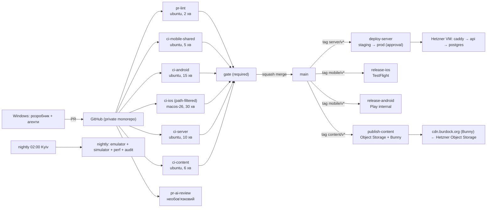
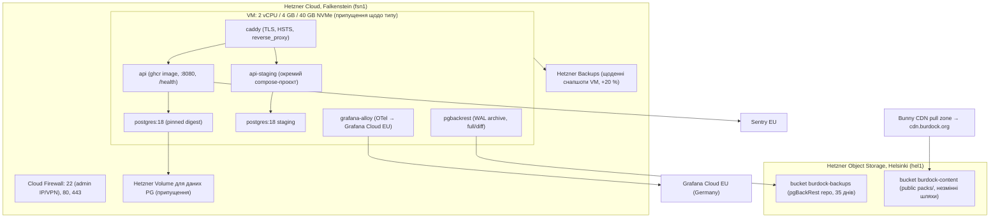
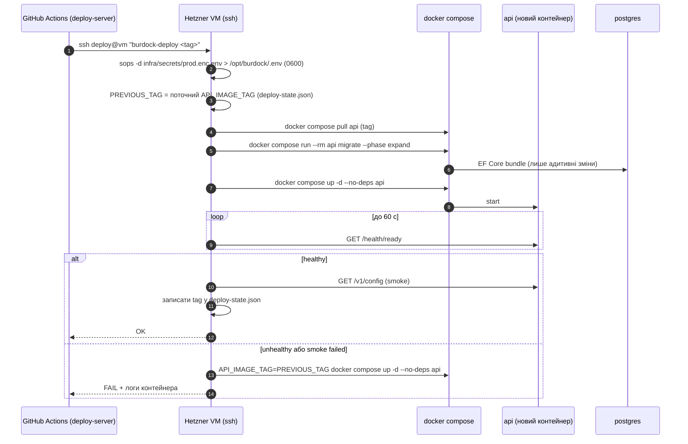

# 14. DevOps, CI/CD та інфраструктура розробки

| Поле | Значення |
|---|---|
| Статус | Draft |
| Версія | 0.1 |
| Дата | 2026-09-27 |
| Власник | Архітектор |
| Джерела рішень | [Журнал рішень](../decisions/2026-09-25-interview.md): Q6/Q16, Q9, Q17, Q22, Q23, Q25, Q26, Q27, Q29, Q38; T1, T2, T8, T13, T15, T16, T22; відкрите питання 3 |
| Пов'язані специфікації | [01-architecture.md](01-architecture.md), [15-testing-quality.md](15-testing-quality.md), [16-documentation-plan.md](16-documentation-plan.md) |

## 0. Контекст для ШІ-агента

Ти змінюєш робочі процеси GitHub Actions, інфраструктуру в `infra/` або процедури релізу проєкту «Реп'ях». Перед роботою прочитай: цей документ, `01-architecture.md` (розділи 3.1-3.3 про структуру й рішення), `15-testing-quality.md` (що саме є quality gate), `docs/decisions/2026-09-25-interview.md`.

Правила, які не можна порушувати:
1. Розробка лише на Windows; iOS збирається виключно в GitHub Actions на `macos-26` або на орендованому Mac за процедурою розділу 3.10 (Q6/Q16).
2. macOS-хвилини платні; кожен iOS-workflow має `concurrency` зі скасуванням попередніх запусків, `timeout-minutes` і фільтри шляхів.
3. Секрети підписання та ключі API магазинів зберігаються лише в GitHub Environments; у логах ніколи не друкуються; сторонні actions пінуються за SHA.
4. Дані користувачів лише в ЄС: Hetzner Falkenstein/Helsinki, Sentry EU, Grafana Cloud EU (Q17, Q9, Q38).
5. Деплой сервера завжди через workflow з міграціями expand/contract, health-check і автоматичним відкатом; ручні `docker compose up` на сервері лише за runbook-ом інциденту.
6. Будь-яка зміна вартості (новий workflow на macOS, більша VM) фіксується в розділі 3.9 або 3.11 цієї специфікації.

Де лежить код: `.github/workflows/*.yml`, `.github/dependabot.yml`, `infra/compose/`, `infra/caddy/`, `infra/secrets/*.enc.env`, `infra/scripts/`. Перевірка результату: `actionlint` без помилок (припущення щодо інструмента); dry-run деплою на `staging` зелений; кошторис хвилин не перевищено.

## 1. Мета й межі

**Мета.** Дати соло-розробнику з ШІ-агентами (Q29) передбачуваний конвеєр: кожен PR перевіряється автоматично, iOS-збірки й знімки екранів приходять із CI, сервер розгортається однією кнопкою з відкатом, а витрати на macOS та хостинг відомі наперед.

**Входить у v1:** робоче місце Windows; налаштування приватного монорепозиторію; trunk-based flow; workflows для мобайла (shared, Android, iOS), сервера, контенту, релізів; секрети й підписання; середовища dev/staging/prod; кошторис; процедура хмарного Mac; Hetzner-інфраструктура з Docker Compose, бекапами, моніторингом; DNS/TLS; Bunny CDN; sops/age; контрольна точка .NET 11; перелік runbook-ів.

**Не входить:** Kubernetes, кілька регіонів, blue/green з нульовим простоєм (v1.1 при > 10k користувачів), self-hosted раннери, власний Mac mini (відкрите питання 3 журналу рішень, переоцінка після першого місяця), APNs/FCM-інфраструктура (T8, v1.1).

## 2. Вимоги

### 2.1 Функціональні

| ID | Вимога | MoSCoW |
|---|---|---|
| FR-14-1 | Робоче місце на Windows налаштовується за чеклістом розділу 3.1 за ≤ 2 год без Mac | Must |
| FR-14-2 | Гілка `main` захищена: PR обов'язковий, required check `gate`, лінійна історія, заборона force-push | Must |
| FR-14-3 | Кожен PR проходить path-filtered workflows; результат агрегує один job `gate` | Must |
| FR-14-4 | `ci-ios` збирає Swift-розширення через `xcodebuild`, застосунок через `dotnet build`, робить знімки на симуляторі та завантажує їх артефактами | Must |
| FR-14-5 | Реліз iOS завантажує IPA у TestFlight через App Store Connect API key з середовища `prod-ios` з ручним підтвердженням | Must |
| FR-14-6 | Реліз Android завантажує підписаний AAB у внутрішній трек Google Play через сервісний акаунт | Must |
| FR-14-7 | `ci-server` збирає контейнер, проганяє Testcontainers-тести, публікує образ у ghcr.io з тегом `sha-<short>` і версією | Must |
| FR-14-8 | `deploy-server` розгортає образ на Hetzner через SSH: pull → міграції (expand) → up → health → відкат при невдачі | Must |
| FR-14-9 | `ci-content` валідує контент, збирає паки, на тег `content/v*` публікує їх в Object Storage та реєструє маніфест | Must |
| FR-14-10 | Dependabot оновлює NuGet, GitHub Actions, Docker-образи щотижня згрупованими PR | Should |
| FR-14-11 | Бекапи: Hetzner Backups для VM + pgBackRest у Object Storage в іншій локації; відновлення тренується щомісяця (алерт 13, якщо > 35 днів) | Must |
| FR-14-12 | Моніторинг і алерти розділу 3.14 працюють з першого дня staging | Should |
| FR-14-13 | Секрети сервера зашифровані sops/age у репозиторії; розшифрування лише на VM | Must |
| FR-14-14 | Процедура оренди хмарного Mac задокументована та виконувана за ≤ 1 год до першої збірки | Should |
| FR-14-15 | Автоматичне ШІ-рев'ю PR працює як необов'язковий коментар (Q29) | Could |

### 2.2 Нефункціональні

| ID | Вимога | MoSCoW |
|---|---|---|
| NFR-14-1 | `gate` для типового PR без iOS-змін завершується ≤ 15 хв | Should |
| NFR-14-2 | Витрати macOS-хвилин у базовому сценарії ≤ 1 500 хв/міс (розділ 3.9) | Should |
| NFR-14-3 | RPO бази даних ≤ 5 хв, RTO ≤ 2 год | Must |
| NFR-14-4 | Прод-деплой триває ≤ 5 хв, простій API ≤ 30 с | Should |
| NFR-14-5 | Усі сторонні actions пінуються за повним SHA; `GITHUB_TOKEN` за замовчуванням read-only | Must |
| NFR-14-6 | Інфраструктура відтворюється зі скриптів `infra/` на чистій VM за ≤ 1 год (runbook) | Should |

## 3. Проєктування

### 3.1 Робоче місце на Windows

| Компонент | Версія / налаштування | Примітка |
|---|---|---|
| ОС | Windows 11, Hyper-V/WHPX увімкнено | Прискорення емулятора |
| IDE | Visual Studio 2026 з workload «.NET MAUI» або JetBrains Rider | Hot Restart для iOS у VS 2026 відсутній, тож без Mac iOS-запуск неможливий [https://learn.microsoft.com/en-us/dotnet/maui/ios/hot-restart?view=net-maui-10.0] |
| .NET SDK | 10.0.12 LTS через `global.json` (`10.0.1xx`, `rollForward: latestPatch`) [https://dotnet.microsoft.com/en-us/platform/support/policy/dotnet-core] | Однакова версія локально та в CI |
| Workloads | `dotnet workload install maui-android maui-ios` | `maui-ios` лише для компіляції/IntelliSense; iOS-workload band `dotnet-10.0.1xx-xcode26.5-10318` або ≥ 10301 [https://github.com/dotnet/macios/releases] |
| Android SDK | Platform 36, Build-Tools, Emulator; AVD Pixel 8 API 36 (x86_64, Google APIs), AVD Pixel Tablet для iPad-аналогів | T2: min 26, target 36 |
| JDK | Microsoft OpenJDK 17 (припущення щодо версії, яку вимагає MAUI 10) | Встановлюється VS |
| Docker Desktop | WSL2 backend | PostgreSQL 18 локально, Testcontainers |
| Node.js LTS | лише для Appium 2 + драйвер UiAutomator2 | UI-smoke локально |
| Git, gh CLI | остання стабільна | `gh` для PR і перегляду артефактів CI |
| Pre-commit | Husky.Net (припущення): `dotnet format --verify-no-changes`, перевірка Conventional Commit, gitleaks | Швидкий локальний gate |
| Секрети локально | `dotnet user-secrets` для `Burdock.Server.Api`; мобайл без секретів | Ніколи в `appsettings.Development.json` |
| Swift-код | Редагується у VS Code/Rider як текст; перевіряється лише в `ci-ios` | Q6/Q16: знімки з CI як зворотний зв'язок |
| Локальна перевірка перед PR | `dotnet build Burdock.Mobile.slnx -f net10.0-android36.0`, `dotnet test`, Android smoke за бажанням | Розділ 3.6 |

### 3.2 Налаштування GitHub-репозиторію

| Параметр | Значення |
|---|---|
| Видимість | Private (Q26); 2 000 безкоштовних Linux-хвилин/міс, macOS платно [https://docs.github.com/en/billing/reference/actions-runner-pricing] |
| Гілка за замовчуванням | `main` |
| Ruleset для `main` | Require PR (0 approvals, бо соло; self-review через ШІ-коментар), required status check `gate`, require linear history, block force pushes and deletions, require conversation resolution, restrict who can bypass: ніхто |
| Signed commits | Рекомендовано (SSH signing), не обов'язково |
| Actions permissions | Allow GitHub actions + verified creators; сторонні за SHA; `permissions: contents: read` за замовчуванням, розширення per-job |
| Environments | `dev` (без захисту), `staging` (без ручного підтвердження, лише `main`), `prod-server`, `prod-ios`, `prod-android` (required reviewer = власник, wait timer 0, лише теги) |
| Dependabot | `nuget` (щотижня, групи `minor-and-patch`, `security` окремо), `github-actions` (щотижня), `docker` для `infra/compose` (щотижня); ігнорувати major MAUI/.NET до контрольної точки .NET 11 |
| Security | Secret scanning + push protection увімкнено; Dependency review action на PR; приватні vulnerability reports |
| CODEOWNERS | Опційно: `docs/specs/ docs/adr/` → власник; корисно як нагадування про рев'ю специфікацій |
| Issue templates | bug, feature, content-report (скарга на слово з застосунку веде сюди через API), release-checklist |
| Labels | `area:*` за scope-ами розділу 3.3, `flaky`, `contract-break-approved`, `run-emulator`, `run-ios` |

### 3.3 Потік розробки

- **Trunk-based.** Гілки `feat/<scope>-<коротко>`, `fix/…`, `chore/…`, `docs/…`, `content/…` живуть ≤ 2 днів; squash-merge у `main`; `main` завжди придатний до релізу.
- **Conventional Commits.** Заголовок squash-коміту = заголовок PR: `type(scope): summary` англійською (Q7). Scopes: `mobile`, `ios`, `android`, `widgets`, `server`, `contracts`, `content`, `design`, `infra`, `ci`, `docs`. `BREAKING CHANGE:` лише для `contracts` і `server`.
- **SemVer на артефакт.**

| Артефакт | Тег | Джерело версії | Build number |
|---|---|---|---|
| Мобільний застосунок | `mobile/v1.4.0` | `Directory.Build.props` → `ApplicationDisplayVersion` | `ApplicationVersion` = `github.run_number` + зсув 1000 |
| Сервер | `server/v1.3.2` | тег → `ContainerImageTags` | `sha-<short>` завжди |
| Контент | `content/v2026.10.1` | тег → `manifest.version` | — |
| Contracts | `Version` у csproj, major = версія API | — | — |

- **Changelog.** Генерується з комітів (git-cliff, припущення) у `CHANGELOG.md` на артефакт під час релізного workflow; нотатки для магазинів українською пише власник на основі changelog.
- **Feature flags замість довгих гілок** (01-architecture.md 3.14): незавершені функції зливаються вимкненими.

### 3.4 Огляд конвеєра

### 3.5 Workflows

| Workflow | Тригери | Раннер | Кроки | Артефакти | ~хв |
|---|---|---|---|---|---|
| `pr-lint` | PR (усі) | ubuntu-latest | Перевірка заголовка PR (Conventional Commits); `dotnet format --verify-no-changes`; markdownlint для `docs/`; перевірка синтаксису Mermaid; `actionlint` | — | 2 |
| `ci-mobile-shared` | PR/push `main`; paths `src/shared/Burdock.Domain/**`, `src/mobile/Burdock.Application/**`, `Burdock.Infrastructure/**`, `src/shared/**`, `tests/**`, `Directory.*.props` | ubuntu-latest | setup-dotnet за `global.json`; кеш NuGet; збірка `net10.0`-проєктів; `dotnet test` Domain/Application/Architecture/Contracts/Infrastructure(`net10.0`) з покриттям; ReportGenerator; перевірка порогів | звіт покриття, TRX | 4-6 |
| `ci-android` | PR/push `main`; paths `src/mobile/**`, `src/shared/**` | ubuntu-latest | workload `maui-android`; `dotnet build -f net10.0-android36.0 -c Release`; на `main`: `dotnet publish … -p:AndroidPackageFormats=aab;apk` з keystore зі секрету; розмір AAB; опційно job `android-smoke` (мітка `run-emulator` або nightly): емулятор API 36 з KVM (припущення щодо доступності KVM на ubuntu-latest), Appium S1-S9, знімки | `*.aab`, `*-Signed.apk`, знімки | 12-18 (+15 smoke) |
| `ci-ios` | PR/push `main`; paths `src/mobile/ios-extensions/**`, `**/Platforms/iOS/**`, `**/*.csproj`, `Directory.Packages.props`, `design/tokens/**`; мітка `run-ios`; nightly | macos-26 | `xcode-select` на Xcode 26.6 [https://github.com/actions/runner-images/blob/main/images/macos/macos-26-Readme.md]; workload `maui-ios` пінований; `xcodebuild build` розширення для `iphonesimulator`; `xcodebuild test` (`BurdockWidgetsTests`); `dotnet build -f net10.0-ios -r iossimulator-arm64`; `xcrun simctl boot` iPhone + iPad; install, Appium S1-S10; знімки світла/темна/AX5; перевірка `PrivacyInfo.xcprivacy` в app і appex; на `main` додатково `dotnet build -r ios-arm64` (перевірка AOT і вбудовування `.appex`) | знімки, лог xcodebuild, `.app` симулятора | 25-40 |
| `ci-server` | PR/push `main`; paths `src/server/**`, `src/shared/**`, `tests/Burdock.Server.Tests/**` | ubuntu-latest | збірка; модульні тести; Testcontainers інтеграційні; експорт `openapi.v1.json` + `oasdiff breaking` проти `main`; `dotnet publish /t:PublishContainer -p ContainerRegistry=ghcr.io` (push лише `main`/теги) [https://learn.microsoft.com/en-us/dotnet/architecture/modern-web-apps-azure/common-web-application-architectures]; скан образу (Trivy, припущення); підпис образу (cosign, припущення) | образ `ghcr.io/<org>/burdock-api:sha-…`, `openapi.v1.json` | 8-12 |
| `ci-content` | PR/push `main`; paths `content/**`, `src/shared/Burdock.Contracts/ContentPack/**` | ubuntu-latest | `dotnet run --project content/pipeline/Burdock.ContentPipeline -- validate`; `-- build-packs`; тести пайплайну; звіт ліцензій/атрибуцій | `artifacts/packs/*.pack`, `ATTRIBUTIONS.md` | 5-10 |
| `content-generate` | `workflow_dispatch` з полями `level`, `topic`, `maxBudgetUsd` | ubuntu-latest | Генерація/рецензування через Claude Batches API (T22) з жорстким лімітом бюджету; результат як PR у `content/` зі статусом `ai_reviewed` | PR з журналом рецензування | 10-60 (переважно очікування) |
| `publish-content` | тег `content/v*` | ubuntu-latest | `ci-content` кроки; завантаження паків у Hetzner Object Storage (S3 API, незмінні шляхи `packs/{packId}/{version}/`); `POST /v1/admin/content/manifests` на staging, потім prod (environment); прогрів Bunny | маніфест, лог публікації | 6-10 |
| `release-ios` | тег `mobile/v*`; `workflow_dispatch` | macos-26, environment `prod-ios` | імпорт сертифіката розповсюдження і профілів (app + appex) у тимчасовий keychain; `xcodebuild archive`-сумісна збірка розширення; `dotnet publish -f net10.0-ios -c Release -r ios-arm64 -p:ArchiveOnBuild=true -p:CodesignKey=… -p:CodesignProvision=…`; завантаження dSYM у Sentry (`EnableAssemblyILStripping=false`) [https://docs.sentry.io/platforms/dotnet/guides/maui/troubleshooting/]; `xcrun altool --upload-app --type ios --apiKey --apiIssuer`; очищення keychain | IPA, dSYM | 35-50 |
| `release-android` | тег `mobile/v*` | ubuntu-latest, environment `prod-android` | підписаний AAB (upload key); завантаження у внутрішній трек через Google Play Developer API (сервісний акаунт); mapping-файли у Sentry | AAB, mapping | 12-18 |
| `deploy-server` | тег `server/v*` → staging автоматично; `workflow_dispatch` (`environment=prod`) | ubuntu-latest, environments `staging`/`prod-server` | розділ 3.12 | лог деплою, `deploy-state.json` | 3-5 |
| `nightly` | `cron` 23:00 UTC (02:00 Київ) | ubuntu-latest + macos-26 | Android emulator smoke + планшет; iOS simulator повний UI + AX5 + iPad; псевдолокалізація; BenchmarkDotNet; `dotnet list package --vulnerable --include-transitive`; карантинні тести; звіт у issue `nightly-report` | знімки, звіти | 60 Linux + 45 macOS |
| `pr-ai-review` | PR opened/synchronize | ubuntu-latest | ШІ-рев'ю (припущення щодо action) з промтом `docs/prompts/review.md`, що посилається на специфікації; коментар без блокування | коментар | 3 |
| `gate` | після усіх PR-workflows | ubuntu-latest | Агрегує результати `if: always()`; пропущені за фільтром шляхів jobs рахуються успішними; це єдиний required check | — | 1 |

Правила для всіх workflows: `concurrency: { group: ${{ github.workflow }}-${{ github.ref }}, cancel-in-progress: true }` (крім релізів і деплою); `timeout-minutes` явно; кешування NuGet за хешем `Directory.Packages.props`; `setup-dotnet` читає `global.json`; артефакти зберігаються 14 днів (релізні 90).

### 3.6 Що де виконується

| Задача | Windows локально | Linux CI | macOS CI | Хмарний Mac | Hetzner VM |
|---|---|---|---|---|---|
| Збірка Domain/Application/Contracts + модульні тести | так | так | — | — | — |
| Збірка Android APK/AAB | так | так | — | — | — |
| Android emulator smoke | так (ручно) | nightly / за міткою | — | — | — |
| Компіляція iOS-проєкту C# (без запуску) | частково (IntelliSense) | — | так | так | — |
| Swift-розширення `xcodebuild` | ні | ні | так | так | — |
| iOS simulator UI + знімки | ні | ні | так | так | — |
| Налагодження iOS крок за кроком | ні | ні | ні | так (Pair to Mac або VNC) | — |
| Підпис і TestFlight | ні | ні | так | так (аварійно) | — |
| Сервер: збірка, Testcontainers | так (Docker Desktop) | так | — | — | — |
| Публікація контейнера | ні | так | — | — | — |
| Міграції БД | dev-БД локально | тести | — | — | staging/prod |
| Контент: валідація, збирання паків | так | так | — | — | — |
| Генерація контенту через LLM | ні (бюджет контролює CI) | так | — | — | — |
| Бекапи, моніторинг | — | — | — | — | так |

### 3.7 Секрети та підписання

| Секрет | Де зберігається | Формат | Ротація |
|---|---|---|---|
| Apple Distribution certificate + private key | GitHub Environment `prod-ios` | `.p12` base64 + пароль | щороку (термін сертифіката) |
| Provisioning profiles (app `org.burdock.app`, appex `org.burdock.app.widgets`) | `prod-ios` | `.mobileprovision` base64 | при зміні entitlements/пристроїв |
| App Store Connect API key | `prod-ios` | `.p8` base64, Key ID, Issuer ID | щороку або при підозрі |
| Android upload keystore | `prod-android` | `.jks` base64, alias, паролі | не ротується; резервна копія офлайн у власника; Play App Signing тримає app signing key |
| Google Play service account | `prod-android` | JSON base64 | щороку |
| Sentry auth token (dSYM/mapping) | repo secret | рядок | щороку |
| `GHCR` | `GITHUB_TOKEN` з `packages: write` | — | — |
| SSH deploy key до VM | `staging`, `prod-server` | ed25519 private key | щороку |
| age-ключ для sops (лише для CI-валідації, не для prod-розшифрування) | `staging` | рядок | щороку |
| S3-ключі Hetzner Object Storage, Bunny API key | `publish-content` environment | рядок | щороку |

Рішення про fastlane match: **не використовується у v1**; сертифікати як base64-секрети простіші для одного застосунку і не потребують окремого репозиторію; перегляд при появі другої платформи Apple (watchOS). Усі кроки з секретами використовують `::add-mask::`; тимчасовий keychain видаляється у `if: always()`.

### 3.8 Середовища

| Середовище | Призначення | URL | Дані | Захист |
|---|---|---|---|---|
| `dev` | Локально: compose на Windows, мобайл на емуляторі | `http://localhost:8080` | синтетичні | — |
| `staging` | Автодеплой з тегу `server/v*`; TestFlight/Internal-збірки вказують сюди через `appsettings.Staging.json` | `https://api.staging.burdock.org` | синтетичні + власні тестові акаунти | лише з `main`; секрети staging |
| `prod` | Користувачі | `https://api.burdock.org`, `https://cdn.burdock.org` | реальні, ЄС | required reviewer; лише теги; wait 0 |

Мобільні збірки з TestFlight/Internal track мають перемикач середовища у прихованому екрані розробника (Debug/Staging), релізні збірки прибиті до prod.

### 3.9 Кошторис macOS-хвилин

Ціна `macos-26` $0.062/хв (стандартний macOS-раннер) [https://docs.github.com/en/billing/reference/actions-runner-pricing]; безкоштовні хвилини приватного репозиторію покривають лише Linux (Q26). Оцінка при ~4.3 тижнях/міс:

| Сценарій | Склад | Хв/міс | $/міс |
|---|---|---|---|
| Мінімальний | `ci-ios` лише на `main` з iOS-змінами (4/тижд × 30) + nightly 2/тижд × 45 + 2 релізи × 45 | ≈ 990 | ≈ 61 |
| Базовий (ціль NFR-14-2) | + PR з iOS-шляхами 4/тижд × 30 | ≈ 1 500 | ≈ 93 |
| Інтенсивний (місяць роботи над віджетами) | 3 запуски/день × 30 × 22 + nightly 7/тижд × 45 + 2 релізи | ≈ 3 400 | ≈ 211 |

Важелі контролю: фільтри шляхів і мітка `run-ios`; `cancel-in-progress`; nightly iOS лише пн/ср/пт до релізу; кеш workload і DerivedData; spending limit у GitHub Billing на рівні $150/міс (припущення) з алертом на 75 %. Альтернатива для пікових місяців: Codemagic з 500 безкоштовними macOS-хвилинами/міс, далі $0.095/хв [https://codemagic.io/pricing/]. Linux-хвилини: очікуване споживання ≈ 3 000-4 000 хв/міс при 15 PR/тижд перевищує 2 000 безкоштовних; заходи: фільтри шляхів, nightly 3/тижд, emulator smoke лише за міткою; переоцінка публічності репозиторію після врегулювання ліцензій контенту.

### 3.10 Хмарний Mac для інтерактивного налагодження

**Коли орендувати:** (1) макет віджета не сходиться після 3 циклів CI-знімків; (2) краш або поведінка iOS, яку не пояснюють логи Sentry і знімки; (3) проблема підпису/завантаження в App Store Connect; (4) профілювання пам'яті розширення в Instruments; (5) реліз-QA: 2 год ручної перевірки з VoiceOver перед кожним релізом у магазин.

**Варіанти:** погодинна оренда (Scaleway ≈ €0.22/год) або місячна (MacStadium $149/міс) [https://www.macstadium.com/pricing]; за замовчуванням погодинна; перехід на місячну або купівля Mac mini, якщо сесії перевищують ~40 год/міс (відкрите питання 3 журналу рішень).

**Чеклист сесії (≤ 60 хв до першої збірки):**
1. macOS 26.2+ з Xcode 26.6 (не оновлювати до macOS 27 без стабільної підтримки Xcode 27) [https://learn.microsoft.com/en-us/dotnet/ios/troubleshooting/xcode-requirement]; `sudo xcodebuild -license accept`; завантажити runtime iOS 26 і, за наявності, iOS 16.x для перевірки мінімальної версії (Q25).
2. Встановити .NET SDK за `global.json`, `dotnet workload install maui-ios` того самого band, що в CI.
3. Клонувати репозиторій через тимчасовий deploy key (read-only), `dotnet build src/mobile/Burdock.Presentation -f net10.0-ios -t:Run -p:_DeviceName=:v2:udid=<simulator>`.
4. Варіант A, Pair to Mac: увімкнути Remote Login (SSH) на Mac; з'єднати Windows і Mac через VPN (Tailscale/WireGuard, припущення); у VS 2026 → Tools → iOS → Pair to Mac; налагоджувати з Windows на віддаленому симуляторі. Перевірити збірку `.appex` через Pair to Mac (issue dotnet/macios #23424 закрито 2026-06-29, поведінку слід підтвердити) [https://github.com/dotnet/macios/issues/23424].
5. Варіант B, VNC/Screen Sharing: працювати безпосередньо на Mac у VS Code + Xcode (для Swift і Instruments).
6. Наприкінці: відкликати deploy key, видалити keychain-елементи та локальні секрети, знищити VM; записати підсумок у `docs/runbooks/cloud-mac-log.md`.

### 3.11 Інфраструктура Hetzner

**Розмір при запуску.** Одна VM 2 vCPU / 4 GB RAM / 40 GB NVMe (тип уточнюється в консолі, припущення); порядок витрат €12-20/міс для ~1k користувачів, €40-90 при 10k [https://docs.hetzner.com/cloud/billing/faq]. Масштабування: спочатку вертикально (4 vCPU / 8 GB), далі винесення PostgreSQL на окрему VM; міграція на Azure Container Apps + PostgreSQL Flexible можлива без зміни коду (Q17).

**ОС і базова конфігурація:** Ubuntu LTS (припущення), Docker Engine + Compose plugin, `unattended-upgrades`, `fail2ban`, SSH лише за ключем без root-логіну, `ufw` дублює Cloud Firewall; cloud-init у `infra/cloud-init.yaml`.

**Docker Compose (`infra/compose/compose.yaml` + `compose.prod.yaml` / `compose.staging.yaml`):**

| Сервіс | Образ | Ключові налаштування |
|---|---|---|
| `caddy` | `caddy:2` пінований | `Caddyfile`: `api.burdock.org { reverse_proxy api:8080 }`, автоматичний ACME, HSTS `max-age=86400` на старті → 31536000 через 30 днів, без preload [https://learn.microsoft.com/en-us/aspnet/core/security/enforcing-ssl?view=aspnetcore-10.0]; access-логи без IP (або з HMAC) |
| `api` | `ghcr.io/<org>/burdock-api:${API_IMAGE_TAG}` | `env_file: .env` (з sops); `healthcheck: /health/live`; `restart: unless-stopped`; ліміти пам'яті; лише внутрішня мережа + Caddy |
| `postgres` | `postgres:18.<patch>@sha256:…` (PG 19 у beta, major пінується явно) [https://www.postgresql.org/docs/18/release-18.html] | том даних; `archive_mode=on`, `archive_command=pgbackrest … archive-push`; `shared_buffers` ≈ 25 % RAM; лише внутрішня мережа |
| `pgbackrest` | образ із pgBackRest (припущення) | спільний том з PG, cron: full нд 03:00, diff щодня 03:00, `repo1-type=s3` (hel1), `repo1-cipher-type=aes-256-cbc`, `repo1-retention-full=5` [https://pgbackrest.org/] |
| `alloy` | `grafana/alloy` | OTLP receiver ← `api`; експорт у Grafana Cloud EU; збирання docker-логів з редагуванням |
| `seq` (опційно) | `datalust/seq` | Self-hosted логи, ліцензія Individual $0 [https://datalust.co/pricing]; вмикається, якщо Grafana Cloud free tier не вистачає |
| `api-staging`, `postgres-staging` | ті самі образи | Окремий compose-проєкт `burdock-staging`, хост `api.staging.burdock.org`, менші ліміти |

Watchtower або авто-оновлення образів не використовуються: кожна зміна прод-версії проходить через `deploy-server`.

### 3.12 Деплой сервера

Правила: міграції за принципом expand/contract: реліз N додає колонки/таблиці та пише в обидва місця; реліз N+1 виконує `--phase contract` після підтвердження; тому відкат на `PREVIOUS_TAG` завжди сумісний зі схемою. Скрипт `infra/scripts/burdock-deploy.sh` є єдиною точкою входу і використовується як у CI, так і в runbook-у інциденту. Простій ≤ 30 с на старті одного контейнера прийнятний для v1 (NFR-14-4); Caddy повертає 502 з брендованою сторінкою «Реп'яшок спить» (кольори `color.surface.default`, `color.brand.primary` з 02-design-system.md).

### 3.13 Резервні копії

| Рівень | Що | Куди | Частота | Зберігання | Перевірка |
|---|---|---|---|---|---|
| VM | Hetzner Backups (снапшоти сервера, томи не включені) | Hetzner fsn1 | щодня | 7 копій | Відновлення на тестову VM раз на пів року |
| БД, безперервно | pgBackRest WAL archive (`archive_timeout=300s`) | Object Storage hel1 (інша локація) | постійно | 35 днів | Моніторинг лагу архіву |
| БД, базові | pgBackRest full (нд) + diff (щодня) | Object Storage hel1, шифрування AES-256 | щотижня/щодня | 5 full | **Restore drill щомісяця**: відновлення у staging-compose, прогін інтеграційних тестів, запис часу RTO у runbook |
| БД, логічний | `pg_dump --format=custom` | Object Storage hel1 | щомісяця | 12 місяців | Використовується для major-оновлення PG |
| Object Storage контенту | Паки відтворюються з git + пайплайну | — | — | — | Версіонування бакета увімкнено |
| Секрети | `*.enc.env` у git; age-ключ власника офлайн | git + офлайн-носій | — | — | Перевірка розшифрування при drill |

Цілі: RPO ≤ 5 хв, RTO ≤ 2 год (NFR-14-3). Sentry/Grafana дані не резервуються (оперативні).

### 3.14 Моніторинг та алерти

- Телеметрія через Aspire ServiceDefaults (OTel traces/metrics/logs, health-ендпоінти) → Grafana Cloud EU free tier (10k series / 50 GB логів / 14 днів) [https://learn.microsoft.com/en-us/dotnet/core/diagnostics/observability-with-otel] [https://grafana.com/pricing/]; краші й винятки в Sentry EU з `SendDefaultPii=false` (Q9).
- Дашборд «Burdock API»: RPS, частка 5xx, p50/p95, активні з'єднання PG, розмір БД, черга outbox-подій на користувача (розподіл), кількість завантажень паків, час останнього успішного бекапу, CPU/RAM/диск VM.

| Алерт | Умова | Канал |
|---|---|---|
| API недоступний | зовнішня перевірка `/health/live` падає 2 хв поспіль (зовнішній uptime-сервіс, припущення) | email + месенджер власника (припущення: Telegram) |
| Помилки | 5xx > 2 % за 5 хв | те саме |
| Латентність | p95 > 800 мс за 10 хв | email |
| Диск | > 80 % | email |
| Бекап | останній full > 8 днів або лаг WAL > 15 хв | email + месенджер |
| TLS | сертифікат < 14 днів до завершення (Caddy оновлює сам; алерт = збій ACME) | email |
| Ресурси | CPU > 85 % 15 хв, RAM > 90 % | email |
| Sentry | новий тип помилки у проді або сплеск ×5 | Sentry → email |

Логи: `[LoggerMessage]` + редагування (HMAC для ідентифікаторів, без тіл запитів, токенів, IP) [https://learn.microsoft.com/en-us/dotnet/core/extensions/data-redaction]; зберігання 30 днів (оперативні), 90 днів для безпекових подій.

### 3.15 DNS і TLS для burdock.org

| Запис | Тип | Значення | Примітка |
|---|---|---|---|
| `api.burdock.org` | A/AAAA | IP VM (Hetzner Primary IP; опційно Floating IP для міграції) | Q27 |
| `api.staging.burdock.org` | A/AAAA | той самий IP | Caddy розводить за хостом |
| `cdn.burdock.org` | CNAME | хост pull zone Bunny | Q27; TLS видає Bunny |
| `burdock.org`, `www` | A/ALIAS | статичний сайт (Bunny Storage + CDN, припущення) | сторінки політики, `/account/delete` (вимога Google Play) [https://support.google.com/googleplay/android-developer/answer/13327111] |
| `/.well-known/apple-app-site-association`, `/.well-known/assetlinks.json` | файли | статичний сайт | глибокі посилання (припущення про потребу в v1) |
| `CAA` | CAA | `0 issue "letsencrypt.org"` | обмежує видавців |
| `TXT` SPF | TXT | `v=spf1 -all` | пошти від домену у v1 немає |

DNS-хостинг: Hetzner DNS (ЄС, безкоштовно, припущення) або реєстратор; TTL 300 с під час запуску. TLS: Caddy отримує сертифікати Let's Encrypt (HTTP-01) для `api.*`; Kestrel за проксі використовує OS-дефолтні версії TLS; HSTS від одного дня до року після стабілізації, без preload [https://learn.microsoft.com/en-us/aspnet/core/security/enforcing-ssl?view=aspnetcore-10.0]. Certificate pinning у клієнті не робиться (T16).

### 3.16 Bunny CDN для контент-паків

- Pull zone `burdock-content` з origin = Hetzner Object Storage bucket `burdock-content` (публічне читання лише префікса `packs/`); шляхи незмінні `packs/{packId}/{contentHash}.pack`, тому `Cache-Control: public, max-age=31536000, immutable`; purge не потрібен.
- Маніфест ніколи не кешується CDN: його віддає `api.burdock.org` з ETag (T8).
- Ціна ≈ $0.01/ГБ [https://bunny.net/pricing/]; оцінка: 48 паків × 300 КБ × 10k користувачів × 2 оновлення/міс ≈ 290 ГБ ≈ $3/міс.
- Pro-паки: імена за хешем вмісту (невгадувані), маніфест повертає лише дозволені entitlement-ом паки; Bunny Token Authentication для Pro-префікса розглядається у v1.1, коли з'явиться попит на обхід.
- Регіон зберігання і CDN у ЄС; Cloudflare R2 не використовується (процесор у США).

### 3.17 Конфігурація та секрети на сервері

- sops + age: `infra/secrets/prod.enc.env`, `staging.enc.env` у git; одержувачі: age-ключ VM (`/etc/burdock/age.key`, 0600, root) і офлайн-ключ власника; `.sops.yaml` описує правила. Розшифрування лише під час деплою на VM; CI має ключ лише для staging (перевірка формату).
- Перелік: `ConnectionStrings__Burdock`, `POSTGRES_PASSWORD`, `OpenIddict__SigningCertificate` (PFX base64) і `EncryptionCertificate`, `Apple__AppStoreServerApi__{KeyId,IssuerId,PrivateKey}`, `Apple__SignInWithApple__{TeamId,KeyId,PrivateKey}`, `Google__PlayDeveloperApi__ServiceAccountJson`, `Google__OAuth__{ClientId,ClientSecret}` (з релізом Android), `Sentry__Dsn`, `Bunny__ApiKey`, `S3__{Endpoint,AccessKey,SecretKey}`, `PgBackRest__CipherPass`, `Content__PackSigningKey` (якщо ECDSA буде обрано), `Admin__ApiKey` для `publish-content`.
- Несекретна конфігурація в `appsettings.Production.json` усередині образу; перевизначення через env. Ротація: щороку або при підозрі; runbook «Ротація секретів».

### 3.18 Контрольна точка .NET 11

| Дата | Дія |
|---|---|
| 2026-11-10 | .NET 11 GA (STS, CoreCLR за замовчуванням, XAML source-gen за замовчуванням) [https://learn.microsoft.com/en-us/dotnet/maui/whats-new/dotnet-11?view=net-maui-10.0] |
| Грудень 2026 | Спайк на гілці `chore/net11-spike` лише в CI: збірка, тести, знімки; go/no-go звіт в ADR-015 |
| Лютий-березень 2027 | Міграція: `global.json`, workloads, CommunityToolkit.Maui ≥ 15 [https://github.com/CommunityToolkit/Maui/releases/tag/15.0.1], перевірка Sentry.Maui, sqlite-net-pcl, Syncfusion.Maui.Toolkit, WidgetCenterProxy; min Android лишається 26 (підлога .NET 11 = 24) [https://learn.microsoft.com/en-us/dotnet/core/compatibility/maui/11/android-minimum-api-level]; 2 тижні TestFlight/Internal |
| До 2027-04-15 | Реліз на .NET 11 у магазини; запас до завершення підтримки MAUI 10 (2027-05-11) [https://dotnet.microsoft.com/en-us/platform/support/policy/maui] |
| Сервер | Переходить одночасно або лишається на .NET 10 LTS до кінця підтримки (2028-11-14); незалежне рішення в ADR-015 |

### 3.19 Runbook-и (зміст у 16-documentation-plan.md)

1. Деплой і відкат сервера. 2. Відновлення БД з pgBackRest (повне і point-in-time). 3. Відтворення VM з нуля (cloud-init + compose + sops). 4. Ротація секретів і ключів (sops, SSH, API keys). 5. Поновлення Apple-сертифіката та профілів; ротація App Store Connect API key. 6. Резервна копія Android keystore та скидання upload key через Play Console. 7. Інцидент безпеки / витік даних (з чеклісту дослідження). 8. Гарячий відкат контент-пака (публікація нового маніфесту). 9. Збій macOS-раннера через зміну Xcode на образі. 10. Сесія хмарного Mac (розділ 3.10). 11. Обробка алертів Grafana. 12. Запит на видалення акаунта. 13. Міграція на .NET 11. 14. Перевищення бюджету GitHub Actions.

### 3.20 Таблиця констант

| Параметр | Значення | Примітка |
|---|---|---|
| `Ci:ArtifactRetentionDays` / `ReleaseArtifactRetentionDays` | 14 / 90 | припущення |
| `Ci:IosTimeoutMinutes` | 45 | обмеження витрат |
| `Ci:MacMinutesBudgetPerMonth` | 1 500 | NFR-14-2 |
| `Ci:SpendingLimitUsd` | 150 | припущення |
| `Deploy:HealthTimeoutSeconds` | 60 | розділ 3.12 |
| `Deploy:MaxDowntimeSeconds` | 30 | NFR-14-4 |
| `Backup:WalArchiveTimeoutSeconds` | 300 | RPO |
| `Backup:RetentionDays` | 35 | дослідження, розділ 7 п. 20 |
| `Backup:RestoreDrillMonths` | 3 | розділ 3.13 |
| `Hsts:MaxAgeLaunch` / `MaxAgeSteady` | 86400 / 31536000 | дослідження, розділ 5 |
| `Logs:RetentionDaysOps` / `Security` | 30 / 90 | дослідження, розділ 5 |
| `Cdn:PackCacheMaxAge` | 31536000, immutable | розділ 3.16 |
| `Alerts:ErrorRatePct` / `P95Ms` / `DiskPct` | 2 / 800 / 80 | припущення |

## 4. Рішення та компроміси

| Рішення | Варіанти | Обрано і чому | ADR |
|---|---|---|---|
| CI-провайдер | GitHub Actions; Codemagic; self-hosted Mac | GitHub Actions `macos-26` + Linux: один інструмент, репозиторій уже там (Q26); Codemagic як резерв для пікових місяців | ADR-018 |
| Підписання iOS | base64-секрети; fastlane match у приватному репозиторії | base64-секрети: один застосунок, менше рухомих частин; match при другій платформі Apple | ADR-018 |
| Хмарний Mac | погодинно; місячно; купити Mac mini | Погодинно до накопичення статистики; переоцінка через місяць (відкрите питання 3) | ADR-019 |
| Хостинг | Hetzner compose; Azure Container Apps; Fly.io | Hetzner Falkenstein + compose (Q17): €12-20/міс проти 3-10× на Azure; ЄС | ADR-020 |
| Staging | окрема VM; той самий VM, окремий compose-проєкт | Той самий VM у v1 (вартість); окрема VM при 10k користувачів | ADR-020 |
| Бекапи БД | лише снапшоти Hetzner; pgBackRest; логічні дампи | Усі три рівні: снапшоти не покривають томи й не дають PITR | ADR-021 |
| Секрети на сервері | sops/age в git; Vault; Azure Key Vault | sops/age: без додаткового сервісу, аудит через git; Key Vault при міграції на Azure | ADR-022 |
| Логи/метрики | Grafana Cloud EU; Seq; обидва | Grafana Cloud EU free tier як основа; Seq як опційний контейнер | ADR-023 |
| CDN | Bunny + Hetzner Object Storage; Cloudflare R2 | Bunny + Hetzner: процесори в ЄС, $0.01/ГБ | ADR-024 |
| DNS | Hetzner DNS; Cloudflare DNS-only; реєстратор | Hetzner DNS (припущення), бо не додає процесора поза ЄС | ADR-024 |
| Деплой | SSH + compose; Watchtower; GitOps-агент | SSH-скрипт з відкатом: прозоро, відтворювано з runbook-а | ADR-020 |

## 5. Критерії приймання

- [ ] Given чистий Windows 11, When пройти чеклист 3.1, Then `dotnet build Burdock.Mobile.slnx -f net10.0-android36.0` і `dotnet test` зелені за ≤ 2 год.
- [ ] Given push у `main` без PR, When спробувати, Then GitHub відхиляє (ruleset).
- [ ] Given PR лише з `docs/**`, When відкрити, Then виконуються `pr-lint` і `gate`, решта пропущені, `gate` зелений за ≤ 3 хв.
- [ ] Given PR зі зміною `src/mobile/ios-extensions/**`, When завершується `ci-ios`, Then в артефактах є знімки iPhone і iPad у світлій/темній темах і лог `xcodebuild` без помилок.
- [ ] Given тег `mobile/v1.0.0`, When власник підтверджує `prod-ios`, Then збірка з'являється в TestFlight, а dSYM у Sentry.
- [ ] Given тег `server/v1.0.0`, When `deploy-server` на staging, Then `/health/ready` 200, `deploy-state.json` містить новий тег.
- [ ] Given образ з навмисно зламаним `/health/ready`, When деплой на staging, Then за 60 с відбувається відкат на попередній тег і workflow червоний.
- [ ] Given restore drill, When відновити останній full + WAL у staging, Then інтеграційні тести проходять і RTO ≤ 2 год записано в runbook.
- [ ] Given `infra/secrets/prod.enc.env`, When `git log -p`, Then жодного відкритого секрету; `sops -d` працює лише на VM.
- [ ] Given місяць базового сценарію, When переглянути GitHub Billing, Then macOS-хвилин ≤ 1 500.
- [ ] Given зупинений контейнер `api` на 3 хв, When перевірити канал алертів, Then отримано сповіщення «API недоступний».
- [ ] Given `curl -I https://api.burdock.org/health/live`, Then TLS валідний, є `Strict-Transport-Security`, немає заголовка `Server`.

## 6. Ризики

| Ризик | Ймовірність | Вплив | Пом'якшення |
|---|---|---|---|
| Образ `macos-26` змінює Xcode за замовчуванням і ламає `ci-ios` | Висока | Високий | Явний `xcode-select` на 26.6; runbook 9; моніторинг release notes образів |
| Цикл iOS-налагодження лише через CI надто повільний | Висока | Високий | Знімки й `xcodebuild test` у CI; хмарний Mac за процедурою; переоцінка купівлі Mac mini через місяць |
| Перевищення бюджету macOS-хвилин | Середня | Середній | Фільтри, `cancel-in-progress`, spending limit, Codemagic-резерв |
| Перевищення 2 000 Linux-хвилин | Висока | Низький | Фільтри шляхів, nightly 3/тижд, кеш; невеликі доплати прийнятні |
| Втрата Android upload key або Apple-сертифіката | Низька | Високий | Play App Signing; офлайн-копії; runbook 5-6 |
| Єдина VM як точка відмови | Середня | Середній | Снапшоти + pgBackRest, відтворення за 1 год (runbook 3); окрема VM для БД при зростанні |
| Витік секретів через логи CI | Низька | Високий | `add-mask`, environments, мінімальні permissions, secret scanning |
| Hetzner Object Storage: ціни й ліміти не підтверджені | Середня | Низький | Перевірити в консолі перед створенням; альтернатива: Backblaze/Bunny Storage у ЄС |
| Міграції з блокуванням таблиць у проді | Середня | Середній | Expand/contract, `lock_timeout` у бандлі, деплой у низьке навантаження (04:00-05:00 Київ) |

## 7. Відкриті питання та припущення

| # | Питання / припущення | Хто вирішує | До коли |
|---|---|---|---|
| 1 | (припущення) Тип VM Hetzner для запуску (2 vCPU / 4 GB), окремий Volume для PG, Ubuntu LTS | Архітектор після перевірки цін у консолі | до staging |
| 2 | (припущення) Інструменти без версій у дослідженні: actionlint, git-cliff, Husky.Net, Trivy, cosign, oasdiff, gitleaks, ШІ-рев'ю action, зовнішній uptime-сервіс, Telegram-алерти | Архітектор | перший місяць |
| 3 | (припущення) KVM доступний на `ubuntu-latest` для Android-емулятора; інакше smoke лише локально | Перевірити в nightly | перший тиждень |
| 4 | (припущення) Spending limit $150/міс і базовий сценарій 1 500 macOS-хвилин | Власник | до першого iOS-релізу |
| 5 | (припущення) DNS на Hetzner DNS; статичний сайт на Bunny; потреба в universal links у v1 | Власник | до подання в магазини |
| 6 | (припущення) Staging на тій самій VM | Архітектор | до staging |
| 7 | (припущення) JDK 17 для MAUI 10 Android | Перевірити при встановленні | перший день |
| 8 | Купівля Mac mini vs оренда (відкрите питання 3 журналу) | Власник | після першого місяця CI |
| 9 | Чи робити репозиторій публічним заради безлімітних Linux-хвилин після врегулювання ліцензій (дослідження, п. 14) | Власник | після ліцензійного рішення |
| 10 | Підпис контент-паків ECDSA (впливає на секрети `publish-content`) | Власник, ADR-014 | до релізу пайплайну |
| 11 | Чи мігрувати сервер на .NET 11 разом із мобайлом або лишити на LTS | Архітектор, ADR-015 | грудень 2026 |
| 12 | Доступність iOS 16 simulator runtime у Xcode 26.6 на раннері (перевірка мінімальної версії Q25) | Перевірити в `ci-ios` | перша iOS-збірка |

## 8. Джерела

- Журнал рішень: [docs/decisions/2026-09-25-interview.md](../decisions/2026-09-25-interview.md)
- Дослідницький звіт: [docs/research/2026-09-25-research-brief.md](../research/2026-09-25-research-brief.md)
- Ціни GitHub Actions: https://docs.github.com/en/billing/reference/actions-runner-pricing
- Образ macos-26: https://github.com/actions/runner-images/blob/main/images/macos/macos-26-Readme.md
- Codemagic pricing: https://codemagic.io/pricing/
- MacStadium pricing: https://www.macstadium.com/pricing
- Hot Restart (MAUI 10): https://learn.microsoft.com/en-us/dotnet/maui/ios/hot-restart?view=net-maui-10.0
- Вимоги до Xcode для .NET iOS: https://learn.microsoft.com/en-us/dotnet/ios/troubleshooting/xcode-requirement
- Релізи dotnet/macios: https://github.com/dotnet/macios/releases
- dotnet/macios #23424 (Pair to Mac і appex): https://github.com/dotnet/macios/issues/23424
- Політика підтримки .NET: https://dotnet.microsoft.com/en-us/platform/support/policy/dotnet-core
- Політика підтримки MAUI: https://dotnet.microsoft.com/en-us/platform/support/policy/maui
- Що нового в .NET MAUI 11: https://learn.microsoft.com/en-us/dotnet/maui/whats-new/dotnet-11?view=net-maui-10.0
- Мінімальний Android API у .NET 11: https://learn.microsoft.com/en-us/dotnet/core/compatibility/maui/11/android-minimum-api-level
- CommunityToolkit.Maui 15.0.1: https://github.com/CommunityToolkit/Maui/releases/tag/15.0.1
- Sentry MAUI troubleshooting: https://docs.sentry.io/platforms/dotnet/guides/maui/troubleshooting/
- Публікація контейнерів .NET: https://learn.microsoft.com/en-us/dotnet/architecture/modern-web-apps-azure/common-web-application-architectures
- Hetzner billing FAQ: https://docs.hetzner.com/cloud/billing/faq
- pgBackRest: https://pgbackrest.org/
- PostgreSQL 18: https://www.postgresql.org/docs/18/release-18.html
- Bunny pricing: https://bunny.net/pricing/
- Grafana pricing: https://grafana.com/pricing/
- Seq pricing: https://datalust.co/pricing
- Спостережуваність з OTel: https://learn.microsoft.com/en-us/dotnet/core/diagnostics/observability-with-otel
- Редагування даних у логах: https://learn.microsoft.com/en-us/dotnet/core/extensions/data-redaction
- Enforcing SSL / HSTS: https://learn.microsoft.com/en-us/aspnet/core/security/enforcing-ssl?view=aspnetcore-10.0
- Google Play: видалення акаунта: https://support.google.com/googleplay/android-developer/answer/13327111
- EU Data Boundary (альтернатива Azure): https://learn.microsoft.com/en-us/privacy/eudb/eu-data-boundary-learn
