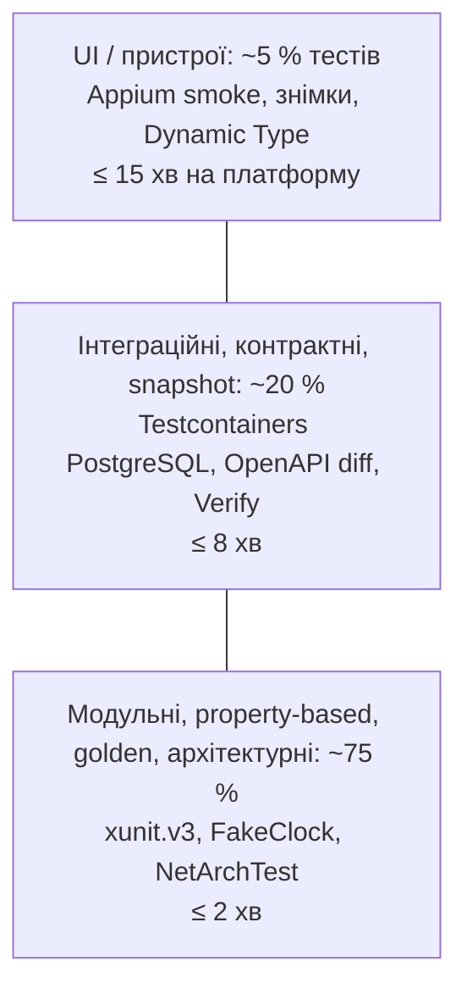
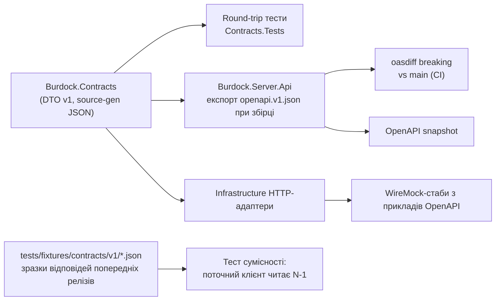

# 15. Тестування та якість

| Поле | Значення |
|---|---|
| Статус | Draft |
| Версія | 0.1 |
| Дата | 2026-09-27 |
| Власник | Архітектор |
| Джерела рішень | [Журнал рішень](../decisions/2026-09-25-interview.md): Q6/Q16, Q7, Q9, Q12, Q19, Q22, Q25, Q29, Q37; T1-T5, T11, T15, T20, T21 |
| Пов'язані специфікації | [01-architecture.md](01-architecture.md), [02-design-system.md](02-design-system.md), [14-devops-ci.md](14-devops-ci.md), [16-documentation-plan.md](16-documentation-plan.md) |

## 0. Контекст для ШІ-агента

Ти пишеш або змінюєш тести проєкту «Реп'ях». Перед роботою прочитай: цей документ, розділи 3.4-3.7, 3.10, 3.11, 3.19 у `01-architecture.md` (шари, порти, `Result<T>`, час, fitness functions), `docs/decisions/2026-09-25-interview.md`.

Правила, які не можна порушувати:
1. Тести Domain/Application детерміновані: лише `FakeClock`, `FakeIdGenerator`, `SeededRandom`; жодного `Task.Delay`, реального часу, мережі, файлової системи.
2. Кожен тест має один сценарій і назву `{Subject}_{Scenario}_{Expected}`; акцептанс-тести формулюються як Given/When/Then у коментарі над тестом.
3. Golden-вектори FSRS у `tests/fixtures/fsrs/` не редагуються вручну; лише регенеруються скриптом із зафіксованою версією py-fsrs.
4. Snapshot-файли (`*.verified.*`) змінюються лише свідомо; зміна снапшота без пояснення в описі PR не приймається.
5. Flaky-тест не «лікується» повторами; його карантинять за політикою розділу 3.18.
6. Не використовуй реальні слова користувача чи PII у фікстурах; лише синтетичні дані з `Burdock.TestKit`.

Де лежить код: `tests/*`, `tests/fixtures/*`, `tests/Burdock.TestKit/`. Перевірка результату: `dotnet test Burdock.Mobile.slnx` і `dotnet test Burdock.Server.slnx` зелені локально на Windows (серверні інтеграційні тести потребують Docker Desktop); пороги покриття розділу 3.17 не порушено; job `gate` у CI зелений.

## 1. Мета й межі

**Мета.** Забезпечити, щоб соло-розробник з ШІ-агентами (Q29) міг швидко змінювати код, не ламаючи навчальну логіку, економіку нагород, контракти з сервером і якість інтерфейсу, при тому що iOS доступна лише через CI (Q6/Q16).

**Входить у v1:** модульні, property-based, golden, архітектурні, snapshot, контрактні, інтеграційні (сервер), UI-smoke (Android локально, iOS у CI), тести доступності, контенту, локалізації, продуктивності та безпеки; пороги покриття та quality gates; Definition of Done.

**Не входить:** мутаційне тестування (Stryker.NET оцінити у v1.1), навантажувальне тестування сервера понад smoke-рівень (k6-профіль у v1.1), тестування на реальних iOS-пристроях у фермі (лише симулятор у v1), тести Android-режиму «при розблокуванні» (Q36, відкладено).

## 2. Вимоги

### 2.1 Функціональні

| ID | Вимога | MoSCoW |
|---|---|---|
| FR-15-1 | Кожна публічна доменна операція (планувальник, економіка, timeline, налаштування) покрита модульними тестами з детермінованими портами | Must |
| FR-15-2 | Реалізація FSRS-6 проходить golden-тести проти векторів py-fsrs 6.3.2 з допуском 1e-6 для стабільності й складності | Must |
| FR-15-3 | `EconomyRules` та `TimelinePlanner` мають property-based тести з інваріантами розділу 3.5 | Must |
| FR-15-4 | Архітектурні тести реалізують усі 8 правил із 01-architecture.md, розділ 3.19 | Must |
| FR-15-5 | Snapshot-тести фіксують `timeline.json`, розклад сповіщень на 7 днів, OpenAPI v1 і згенеровані файли токенів | Must |
| FR-15-6 | Контрактні тести: DTO `Burdock.Contracts` проходять round-trip серіалізацію; CI блокує breaking-зміни OpenAPI без підняття версії | Must |
| FR-15-7 | Інтеграційні тести сервера виконуються проти PostgreSQL 18 у Testcontainers на кожному PR серверних змін | Must |
| FR-15-8 | UI-smoke (≤ 10 сценаріїв) виконується на Android-емуляторі локально та в CI; на iOS-симуляторі лише в CI зі знімками екранів як артефактами | Must |
| FR-15-9 | Автоматичний тест контрасту токенів з `design/tokens/tokens.json` для світлої і темної тем | Must |
| FR-15-10 | Валідація контент-паків перевіряє схему, ліцензійні поля, заборонені джерела, образливі теги, множину, апостроф | Must |
| FR-15-11 | Тести локалізації: відсутні ключі, невикористані ключі, форми множини, псевдолокалізація без обрізання тексту | Should |
| FR-15-12 | Тести продуктивності вимірюють холодний старт та час генерації timeline проти бюджетів 01-architecture.md 3.17 | Should |
| FR-15-13 | Тести безпеки: аудит залежностей, сканування секретів, присутність `PrivacyInfo.xcprivacy`, редагування PII в логах, чекліст MASVS L1 перед релізом | Must |
| FR-15-14 | Ручний чекліст VoiceOver/TalkBack і Dynamic Type виконується перед кожним релізом у магазин | Must |

### 2.2 Нефункціональні

| ID | Вимога | MoSCoW |
|---|---|---|
| NFR-15-1 | Модульні тести мобайла (Domain + Application + Architecture + Contracts) виконуються ≤ 120 с на Linux-раннері | Must |
| NFR-15-2 | Інтеграційні тести сервера ≤ 8 хв, UI-smoke на одній платформі ≤ 15 хв | Should |
| NFR-15-3 | Частка flaky-падінь у gate-тестах < 1 % за 30 днів | Should |
| NFR-15-4 | Тести не потребують мережі, крім явно позначених `Category=Integration|Ui` | Must |
| NFR-15-5 | Усі тести запускаються однією командою `dotnet test` на Windows без додаткових скриптів (крім Appium і Docker) | Must |

## 3. Проєктування

### 3.1 Піраміда тестів

| Рівень | Частка за кількістю | Частка часу CI | Блокує злиття |
|---|---|---|---|
| Модульні + property + golden + архітектурні | ≈ 75 % | ≈ 15 % | Так |
| Інтеграційні + контрактні + snapshot + контент + локалізація | ≈ 20 % | ≈ 35 % | Так (для відповідних шляхів) |
| UI-smoke + доступність + продуктивність | ≈ 5 % | ≈ 50 % | Android-smoke: так на `main`; iOS: так лише для iOS-шляхів; решта nightly |

### 3.2 Тестові проєкти та інструменти

| Проєкт | Що перевіряє | Інструменти | Де виконується |
|---|---|---|---|
| `tests/Burdock.TestKit` | Спільна бібліотека: `FakeClock`, `FakeIdGenerator`, `SeededRandom`, in-memory порти, builders, object mothers | xunit.v3 4.0.1 на Microsoft.Testing.Platform 2.4.1 [https://xunit.net/releases/v3/4.0.0] | усюди |
| `Burdock.Domain.Tests` | Сутності, доменні сервіси, FSRS golden, property-тести | xunit.v3, CsCheck або FsCheck (припущення, обрати одну) | Windows, Linux CI |
| `Burdock.Application.Tests` | Use case-и з fake-портами, snapshot timeline/сповіщень | xunit.v3, Verify (припущення щодо пакета для xunit.v3) | Windows, Linux CI |
| `Burdock.Architecture.Tests` | Правило залежностей, іменування, заборонені API | NetArchTest.Rules (припущення щодо версії) + BannedApiAnalyzers | Windows, Linux CI |
| `Burdock.Infrastructure.Tests` | SQLite-репозиторії на тимчасовому файлі, міграції `user_version`, мапінг Contracts, HTTP-адаптери проти WireMock (припущення) | xunit.v3, sqlite-net-pcl | Windows, Linux CI (`net10.0`) |
| `Burdock.Contracts.Tests` | Round-trip DTO, сумісність із зразками попередніх версій | xunit.v3, System.Text.Json source-gen | Windows, Linux CI |
| `Burdock.Server.Tests` | Ендпоінти модулів, міграції, ідемпотентність, OpenAPI snapshot | xunit.v3, Testcontainers.PostgreSql (припущення щодо версії), `WebApplicationFactory`, Respawn (припущення) | Windows (Docker Desktop), Linux CI |
| `Burdock.ContentPipeline.Tests` | Валідатори паків, нормалізація, збирання | xunit.v3, JSON Schema | Windows, Linux CI |
| `Burdock.UiTests` | Appium smoke, знімки, доступність, розміри цілей | Appium.WebDriver 9.0.0, UiAutomator2 / XCUITest | Android: локально + CI; iOS: macOS CI |
| `BurdockWidgetsTests` (Xcode target) | SwiftUI snapshot віджетів з фікстурним JSON, парсинг `bridgeVersion` | XCTest | macOS CI |
| Device-тести Infrastructure (опційно) | SecureStorage, файлові права, App Group на пристрої | DeviceRunners 0.1.0-preview.12 [https://github.com/mattleibow/DeviceRunners/releases/tag/0.1.0-preview.12] | nightly, поки пакет у preview |

### 3.3 Модульні тести Domain та Application

- **Детермінізм.** `FakeClock(DateTimeOffset start, TimeZoneInfo tz)` з `Advance(TimeSpan)`, `SetLocalTime(...)`; `FakeIdGenerator` генерує UUIDv7 із лічильника; `SeededRandom(seed)` для fuzz FSRS. Усі три реєструються в `TestKit.CreateSut()`.
- **Fake-порти.** `InMemoryLexemeRepository`, `InMemoryLearnerCardRepository`, `InMemoryEventJournal` (зберігає порядок, дозволяє асерти «подія записана»), `RecordingWidgetBridge` (фіксує опубліковані timeline), `RecordingNotificationScheduler`, `StubEntitlementGateway`, `StubFeatureFlags`. Fake-и живуть у TestKit і мають власні тести.
- **Use case-тести** перевіряють три речі: результат (`Result`), побічні ефекти в портах (що записано в журнал/outbox), відсутність зайвих викликів. Приклад: `GradeCard_WhenOffline_AppendsEventAndEnqueuesOutbox`.
- **Доменні сервіси** тестуються як чисті функції з таблицями (`[Theory]` + `[MemberData]`): `LearningDay.From` для 03:59/04:00/04:01 у поясах Europe/Kyiv, UTC, America/Los_Angeles; переходи літнього часу.
- **Result-помилки** асертяться за `Error.Code`, ніколи за текстом.

### 3.4 Golden-тести FSRS

| Аспект | Рішення |
|---|---|
| Джерело істини | py-fsrs 6.3.2 (MIT) [https://github.com/open-spaced-repetition/py-fsrs]; скрипт `tests/fixtures/fsrs/generate_vectors.py` з `requirements.txt`, що пінить версію |
| Формат | `vectors.v1.json`: `{parameters[21], desiredRetention, maxIntervalDays, cases[{id, reviews[{deltaDays, grade}], expected[{stability, difficulty, dueDays, state}]}]}` |
| Набори | (a) нова картка × 4 оцінки; (b) 150 випадкових послідовностей по 30 повторень із зафіксованим seed; (c) retention 0.85/0.90/0.94; (d) кліп максимального інтервалу 365 д; (e) повторне навчання після Again; (f) same-day повторення (перевірка, що вони не змінюють `dueDays` понад одного дня) |
| Допуски | `stability`, `difficulty`: 1e-6 абсолютно; `dueDays`: точно; fuzz вимкнено для golden |
| Fuzz | Окремий тест: однаковий seed → однаковий інтервал; інтервал у межах fuzz-діапазону; fuzz не змінює `stability` |
| Адаптер бібліотеки | Якщо обрано Fsrs.Sharp 2.0.0 (T3) [https://www.nuget.org/packages/Fsrs.Sharp/2.0.0], ті самі вектори проганяються через адаптер; розбіжність з py-fsrs понад допуск блокує ADR-005 |
| Регресія | Вектори версіонуються; перехід на FSRS-7 у майбутньому додає `vectors.v2.json`, не замінює v1 |

### 3.5 Property-based тести

Бібліотека: CsCheck або FsCheck (припущення; критерій вибору: сумісність з xunit.v3 і shrinking для record-типів). Мінімум 200 прогонів на властивість у CI, 1000 у nightly.

**`EconomyRules` (Rewards):**
1. Для будь-якої послідовності `LedgerEvent` баланс «Колючок» ≥ 0 після згортання.
2. Згортання детерміноване: `Fold(events) == Fold(events)`; згортання ідемпотентне щодо дублікатів за `EventId`.
3. Сума нарахувань за навчальний день ≤ `Rewards:DailyEarnCap`; надлишок відкидається з подією `CapReached`, а не помилкою.
4. Витрата понад баланс повертає `Result.Failure(rewards.insufficient_balance)` і не змінює стан.
5. Пасивні покази (`ExposureRecord`) ніколи не породжують нарахувань (T4, дослідження розділ 6).
6. Заморозка серії: за тиждень не більше `Streak:FreeFreezesPerWeek`; після паузи серія не скидається (T11).

**`TimelinePlanner` (Exposure):**
1. Усі записи в `[start, start + Timeline:HorizonHours]`.
2. Відстань між сусідніми записами ≥ `Timeline:MinEntryGapMinutes`; крок дорівнює `Rotation:IntervalMinutes` з точністю до тихих годин.
3. Одне слово з'являється ≤ `Exposure:MaxPerWordPerDay` разів на навчальний день.
4. Записи для поверхні `Notification` не потрапляють у тихі години; кількість сповіщень на день ≤ `Notifications:PerDay`; на iOS не більше `Ios:MaxPendingNotifications` очікуваних.
5. Використовуються лише лексеми з переданого пулу (кешовані, дозволені entitlement-ом); у безкоштовному режимі рівно 5 слів дня з пулу A1-B1 (Q14/Q32).
6. Детермінованість для однакових входів і seed.
7. Сесія Live Activity тривалістю `D` з інтервалом `I` містить `floor(D/I)` записів і завершується не пізніше 8 годин (Q35).

### 3.6 Архітектурні тести

| Критерій | NetArchTest.Rules (обрано) | ArchUnitNET |
|---|---|---|
| Прив'язка до тест-фреймворку | Немає: повертає `TestResult`, працює з xunit.v3 без адаптера | Окремі адаптери під конкретні версії xunit (припущення щодо підтримки v3) |
| Виразність | Достатня для правил залежностей, іменування, `sealed`, просторів імен, `Slices` | Багатша (цикли, PlantUML), але важча |
| Розмір і підтримка | Маленька бібліотека, мало транзитивних залежностей | Більший API |
| Висновок | Достатньо для 8 правил 01-architecture.md 3.19; ArchUnitNET як запасний варіант, якщо знадобиться пошук циклів між серверними модулями | — |

Доповнення: `Microsoft.CodeAnalysis.BannedApiAnalyzers` з `BannedSymbols.txt` для `Burdock.Domain` і `Burdock.Application` забороняє `System.DateTime.Now/UtcNow/Today`, `System.Guid.NewGuid`, `System.Random.Shared`, `System.Threading.Thread.Sleep`, `System.IO.File`. Порушення є помилкою компіляції, тест лише документує правило.

Перелік тестів (один тест на правило, назва містить номер правила): `Rule01_Domain_HasNoExternalReferences`, `Rule02_Application_DoesNotReferenceOuterLayers`, `Rule03_Presentation_OnlyCompositionReferencesInfrastructure`, `Rule04_ViewModels_DoNotTouchRepositoriesOrHttp`, `Rule05_UseCases_AreSealedWithSingleExecute`, `Rule06_ServerModules_DoNotReferenceEachOther`, `Rule07_DomainTypes_HaveNoSerializationAttributes`, `Rule08_OnlySystemClock_UsesDateTimeNow`.

### 3.7 Snapshot-тести

| Снапшот | Вхід | Скрабінг | Навіщо |
|---|---|---|---|
| `timeline.json` (App Group bridge) | `FakeClock` 2026-10-05T06:00 Kyiv, налаштування за замовчуванням Q30, фікстурний пак A1 «Подорожі», seed 42 | Немає (усі значення детерміновані) | Контракт зі Swift; зміна формату видима у PR |
| Розклад сповіщень на 7 днів | Те саме + тихі години 22:00-08:00 | Немає | Захист від регресій тихих годин і лімітів |
| Розклад для Live Activity сесії 2 год × 15 хв | — | Немає | Q35 |
| OpenAPI v1 (`docs/api/openapi.v1.json`) | Збірка сервера | Версія збірки | Огляд змін контракту |
| Згенеровані `Colors.xaml`, `BurdockTokens.swift`, `colors.xml` | `design/tokens/tokens.json` | Немає | Токени T20 змінюються лише через JSON |
| Порожні та помилкові `ViewState` головних ViewModel-ів | Fake-порти повертають `Result.Failure` | GUID | Дизайн станів помилок як контракт |

Інструмент Verify (припущення щодо пакета `Verify.XunitV3`); файли `*.verified.*` лежать поруч із тестами; у CI розбіжність дає падіння з diff у логах. Оновлення снапшотів лише командою `dotnet test -- --verify-accept` локально й обов'язковим реченням «Snapshot updated because …» в описі PR.

### 3.8 Контрактні тести клієнт-сервер

Правила: усі DTO є `record` з `init`-властивостями та `[JsonPropertyName]`; невідомі поля ігноруються клієнтом (тест `Deserialize_WithUnknownFields_Succeeds`); нове обов'язкове поле у відповіді сервера є breaking і потребує `/v2` або значення за замовчуванням; `oasdiff` (припущення щодо інструмента) з прапорцем `--fail-on ERR` блокує PR; винятки лише через мітку `contract-break-approved` і запис у CHANGELOG контрактів.

### 3.9 Інтеграційні тести сервера

- Testcontainers для .NET (припущення щодо версії) піднімає образ `postgres:18.<patch>` із зафіксованим дайджестом; один контейнер на тест-колекцію модуля; `Respawn` очищує таблиці між тестами; міграції EF Core застосовуються на старті колекції.
- `WebApplicationFactory<Program>` з підміною лише зовнішніх шлюзів (App Store Server API, Play Developer API, Apple/Google IdP) на фейки; OpenIddict працює реально з тестовими ключами.
- Обов'язкові сценарії: PKCE-логін і ротація refresh-токена з виявленням повторного використання; `POST /v1/progress/events` ідемпотентний за `EventId`, повертає монотонний `serverSeq`; `GET /v1/content/manifest` повертає 304 за `If-None-Match`; LWW налаштувань обирає більший `version`; entitlement з простроченим чеком повертає `Free`; rate limiting повертає 429; видалення акаунта чистить усі схеми модулів у межах 30 днів (тест на job).
- Локально на Windows потрібен Docker Desktop; в CI Linux-раннер має Docker. Тести позначені `Category=Integration` і пропускаються, якщо Docker недоступний, з явним попередженням у виводі (не тихий success).

### 3.10 Тести на пристроях і UI за умов Windows-only

| Платформа | Де | Драйвер | Пристрої | Коли |
|---|---|---|---|---|
| Android | Локально (емулятор Pixel 8, API 36) і Linux CI | Appium 2 + UiAutomator2, Appium.WebDriver 9.0.0 | Телефон; планшет (Pixel Tablet) у nightly | Локально перед PR; CI на `main` і nightly |
| iOS | Лише macOS CI (`macos-26`) | Appium 2 + XCUITest | iPhone (iOS 26 runtime), iPad (Q12); iOS 16 runtime за наявності в Xcode 26.6 | PR, що торкаються iOS-шляхів; nightly; перед релізом |

**Smoke-набір (≤ 10 сценаріїв, ≤ 15 хв):** S1 перший запуск створює анонімний акаунт і нікнейм (Q3, T10); S2 онбординг вибору рівня й категорій завершується та завантажує паки; S3 головний екран показує слово дня; S4 мікросесія з 5 карток з оцінками; S5 зміна інтервалу ротації перепланує timeline; S6 екран налаштувань поважає діапазони Q30; S7 офлайн-режим показує слова з кешу; S8 темна тема застосовується; S9 екран «Джерела та ліцензії» відкривається; S10 (iOS) файл `timeline.json` існує в контейнері App Group після S3 (перевірка через `xcrun simctl get_app_container booted org.burdock.app group.org.burdock.app`, припущення щодо точного синтаксису).

**Знімки екранів як артефакти CI:** кожен крок smoke зберігає PNG у `artifacts/screenshots/{platform}/{device}/{theme}/{scale}/{step}.png`; матриця: світла/темна × стандартний розмір/AX5 (iOS) або 200 % (Android); зберігаються 14 днів; для iOS це єдиний спосіб побачити інтерфейс без Mac (Q6/Q16).

**Віджети iOS:** SwiftUI snapshot-тести в `BurdockWidgetsTests` рендерять `systemSmall/systemMedium/accessoryRectangular/accessoryInline` з фікстурного `timeline.json` у світлій, темній та tinted-темі; PNG додаються в артефакти; порівняння з еталоном з допуском 1 % пікселів (припущення).

**Page objects:** доступ до елементів лише через `AutomationId`; ідентифікатори називаються `{Screen}_{Element}` (`Session_GradeGoodButton`), оголошуються в XAML і є частиною Definition of Done для екрана.

### 3.11 Перевірки доступності

| Перевірка | Автоматизація | Поріг |
|---|---|---|
| Контраст семантичних пар токенів (`color.text.primary` на `color.surface.default`, `color.feedback.*` на поверхнях, текст на `color.brand.primary`, `color.reward.gold` з текстом) у світлій і темній темах | Окремий тест-проєкт `DesignTokens.Tests` поряд із генератором токенів (02-design-system.md); обчислює контраст WCAG за JSON | ≥ 4.5:1 текст, ≥ 3:1 великий текст і іконки (падіння); < 7:1 у темній темі для кастомних кольорів = попередження в логу [https://www.w3.org/WAI/WCAG22/Understanding/contrast-minimum.html] [https://developer.apple.com/design/human-interface-guidelines/dark-mode] |
| Семантика елементів | Тест сканує XAML: `Button`, `ImageButton`, `Image` з `TapGestureRecognizer` мають `SemanticProperties.Description` або текст | 0 порушень |
| Розмір цілей дотику | Appium читає bounds інтерактивних елементів | ≥ 44 pt iOS / 48 dp Android |
| Dynamic Type / масштаб шрифту | Знімки AX5 (iOS) і 200 % (Android) у nightly; тест на відсутність `LineBreakMode=NoWrap` для `label`/`body` | Візуальний огляд + автоматичний пошук обрізань за `Clip` |
| Reduce Motion | Unit-тест: `IMotionSettings.ReduceMotion == true` → тривалість анімацій 0, конфеті нагород замінюється статичним станом | 0 порушень |
| Ручний чекліст перед релізом | VoiceOver (порядок фокусу, ярлики, ротор), TalkBack, перемикач контролю, збільшення, Bold Text | Підписаний чекліст у PR релізу |

### 3.12 Валідація контенту

Тести у `Burdock.ContentPipeline.Tests` виконуються на кожному PR у `content/**` і перед публікацією пака:

1. Пак відповідає JSON Schema `Burdock.Contracts/ContentPack/pack.schema.json` і оголошує `contentSchemaVersion`.
2. Кожна лексема має ≥ 1 сенс, ≥ 1 переклад цільовою парою (`uk→en`), ≥ 1 приклад рівня ≤ рівня лексеми, транскрипцію IPA з допустимих символів.
3. Поля `source` і `license` заповнені та належать до дозволеного переліку: CEFR-J (з рядком цитування), Open English WordNet (CC BY 4.0), CMUdict (BSD-2), джерела `llm` (Claude після рецензування) та `owner` (власні списки) за словником 08 §3.4 (Q37) [https://github.com/globalwordnet/english-wordnet/releases/tag/2025-edition] [https://github.com/cmusphinx/cmudict/blob/master/LICENSE].
4. Заборонені джерела відсутні в `provenance`: Wiktionary/kaikki, Octanove, Kelly, VESUM, Oxford, Cambridge; Tatoeba відсутня в полях, видимих на віджетах і сповіщеннях (Q37, T9).
5. Немає тегів `vulgar`, `derogatory`, `slang` у опублікованому пулі; для 12+ (Q10/Q15) додатково стоп-список (`content/pipeline/rules/offensive.txt`).
6. Статус кожного елемента `published`; для ШІ-контенту присутні `model_id`, `prompt_version`, `reviewer`, `reviewed_at` (Q28, T22).
7. 100 % лексем безкоштовного пулу мають `human_reviewed` (T21); ≥ 10 % решти в межах кожного рівня.
8. Апостроф нормалізовано до U+02BC у словах і прикладах; у Presentation-рядках використовується U+2019.
9. Іменники з нерегулярною множиною мають поле `plural`; переклади з `{count}` мають українські форми `one/few/many`.
10. Кожен пак 100-500 КБ, `checksum` збігається, `attributions` містить усі джерела, задіяні в паку; персональних даних немає.
11. 8 тем × 6 рівнів CEFR присутні в маніфесті (Q18); тема має 300-600 слів або явний виняток у `manifest.notes`.

### 3.13 Тести локалізації

- `ResxKeysTest`: усі ключі, на які посилаються `Strings.*` у коді та `{x:Static}`/`{loc:Translate}` у XAML, існують у `AppResources.resx` (нейтральна мова `uk`, Q7) [https://learn.microsoft.com/en-us/dotnet/maui/fundamentals/localization?view=net-maui-10.0]; невикористані ключі дають попередження.
- `PluralRulesTest`: функція `UkrainianPlural(count)` повертає `one` для 1, 21, 101; `few` для 2-4, 22-24; `many` для 5-20, 25-30, 111-114; кожен ключ із `{count}` має три форми.
- `NoHardcodedStringsTest`: регулярний вираз шукає кириличні літерали в `.xaml` і `.cs` поза `Resources/` і тестами.
- Псевдолокалізація: тест генерує `AppResources.qps-ploc.resx` (розширення на 35 %, дужки, діакритика); nightly-знімки в цій локалі виявляють обрізання; будь-який `…` на кнопках вважається дефектом.
- Дата/число/валюта форматуються через `CultureInfo`, тест перевіряє `uk-UA` формат «1 234,5» і дні тижня з малої літери.

### 3.14 Тести продуктивності

| Метрика | Метод | Поріг у CI | Джерело правди |
|---|---|---|---|
| Холодний старт Android | `adb shell am start -W -n org.burdock.app/.MainActivity`, медіана 5 запусків на емуляторі CI | ≤ 2× бюджету 1500 мс (емулятор повільніший) | Sentry app-start на реальних пристроях |
| Холодний старт iOS | Sentry app-start; у CI лише відсутність регресії таймауту запуску 20 с | інформаційно | Sentry |
| Генерація timeline 48 год | Тест зі `Stopwatch` після прогріву, 20 ітерацій, медіана | ≤ 20 мс на CI | BenchmarkDotNet у nightly (припущення) |
| Перепланування 64 сповіщень | те саме | ≤ 30 мс логіки без платформового виклику | — |
| Розмір локальної БД | Тест заповнює 48 фікстурних паків + 12 місяців синтетичних подій (10 карток/день) | ≤ 60 МБ | — |
| Розмір застосунку | CI читає розмір `.aab` і `.ipa` | ≤ 40 МБ AAB, ≤ 60 МБ IPA (припущення) | Store Connect |
| Пам'ять розширення | Ручне вимірювання в Instruments на хмарному Mac | орієнтир 01-architecture.md 3.17 | — |

### 3.15 Тести безпеки

- `NuGetAudit` під час restore з `TreatWarningsAsErrors` для рівня `moderate` і вище; nightly `dotnet list package --vulnerable --include-transitive` [https://learn.microsoft.com/en-us/nuget/concepts/auditing-packages].
- GitHub secret scanning + push protection; gitleaks (припущення) у pre-commit і CI; тест, що `appsettings*.json` мобайла не містять ключів довших за 32 символи зі схожою на секрет ентропією.
- Сканування контейнера сервера на відомі вразливості перед публікацією в ghcr.io (Trivy, припущення).
- Тест `PrivacyManifest_PresentInAppAndExtension`: обидва `PrivacyInfo.xcprivacy` існують і містять коди C617.1, 35F9.1, E174.1, CA92.1, 1C8F.1 [https://learn.microsoft.com/en-us/dotnet/maui/ios/privacy-manifest].
- Тест `SecureStorage_UsesThisDeviceOnly` для iOS-адаптера; тест `Backup_ExcludesDatabaseAndCache` перевіряє правила виключення (T12, T15) [https://learn.microsoft.com/en-us/dotnet/maui/platform-integration/storage/secure-storage?view=net-maui-10.0].
- Тест `Logging_RedactsPii`: фейковий sink отримує лог із email/токеном/installation id, у виводі лише HMAC або `[REDACTED]` [https://learn.microsoft.com/en-us/dotnet/core/extensions/data-redaction].
- Серверні: прострочений access-токен → 401; повторне використання refresh-токена → відкликання сімейства; HSTS-заголовок присутній; заголовок `Server` відсутній; 429 з бюджетом на partition key [https://learn.microsoft.com/en-us/aspnet/core/performance/rate-limit?view=aspnetcore-10.0].
- Чекліст OWASP MASVS v2.1.0 L1 + MASVS-PRIVACY проходиться вручну перед кожним релізом у магазин, результат зберігається в `docs/security/masvs-{version}.md` [https://github.com/OWASP/masvs/releases].
- Тест `Widget_BridgeContainsNoSecrets`: у `timeline.json` немає полів `token`, `email`, `installationId`.

### 3.16 Тестові дані та builders

- Builders у `Burdock.TestKit/Builders`: `LexemeBuilder`, `LearnerCardBuilder`, `LearnerSettingsBuilder`, `TimelineRequestBuilder`, `LedgerEventBuilder`, `EventEnvelopeBuilder`, `EntitlementSnapshotBuilder`. Кожен має розумні значення за замовчуванням (налаштування Q30, рівень A1, тема «Подорожі») і fluent-методи `With*`; `Build()` повертає валідний об'єкт або кидає, якщо інваріант порушено навмисно.
- Object mothers у `TestKit/Scenarios`: `Learner.NewbieDay1()`, `Learner.Streak30Days()`, `Learner.FreeTierAfterTrial()`, `Learner.ProWithBacklog3Days()`, `Content.PackA1Travel()` (50 синтетичних слів, без реального контенту з ліцензійними обмеженнями).
- Ідентифікатори детерміновані: `TestIds.Lexeme(n)`, `TestIds.Event(n)` як UUIDv7 із фіксованого часу.
- Фікстури файлів у `tests/fixtures/`: `fsrs/`, `snapshots/`, `packs/`, `contracts/v1/`, `tokens/`.

### 3.17 Покриття та quality gates

| Збірка | Рядки | Гілки | Інструмент |
|---|---|---|---|
| `Burdock.Domain` | ≥ 90 % | ≥ 85 % | Microsoft.Testing.Platform `--coverage` + ReportGenerator (припущення) |
| `Burdock.Application` | ≥ 85 % | ≥ 80 % | те саме |
| Серверні модулі (`Domain` + `Application` простори імен) | ≥ 80 % | ≥ 75 % | те саме |
| `Burdock.Infrastructure`, серверні `Infrastructure`/`Endpoints` | ≥ 60 % | — | інтеграційні |
| ViewModel-и Presentation | ≥ 60 % | — | модульні з fake use case-ами |
| `Burdock.ContentPipeline` валідатори | ≥ 85 % | — | модульні |

**Що блокує злиття (job `gate`, див. 14-devops-ci.md):** збірка без попереджень; модульні, архітектурні, snapshot, контрактні тести зелені; пороги покриття не знижено; `oasdiff` без breaking-змін; валідація контенту для змін у `content/**`; відсутність вразливостей ≥ moderate; PR-заголовок за Conventional Commits; для iOS-шляхів зелений `ci-ios`; для змін UI у PR є знімки екранів (світла/темна). Не блокує: ШІ-рев'ю, nightly-набори, продуктивність (крім розміру БД).

### 3.18 Політика flaky-тестів

1. Два незрозумілі падіння одного тесту за 7 днів → тест отримує `[Trait("Category", "Quarantine")]`, створюється issue з міткою `flaky` і посиланням на логи.
2. Карантинні тести не входять у `gate`, але виконуються nightly і звітуються.
3. SLA: 7 днів на виправлення кореневої причини або видалення тесту з поясненням; продовження лише з коментарем архітектора.
4. Повтори (`retry`) заборонені для модульних та інтеграційних тестів; для UI-smoke дозволено 1 повтор на рівні сценарію з обов'язковим логуванням факту повтору.
5. Метрика: частка запусків `gate` з повтором або карантинним падінням < 1 % за 30 днів (NFR-15-3).

### 3.19 Конвенції іменування

| Елемент | Конвенція | Приклад |
|---|---|---|
| Тест-проєкт | `{Project}.Tests` | `Burdock.Application.Tests` |
| Тест-клас | `{Sut}Tests`, каталог повторює фічу | `Learning/GradeCard/GradeCardUseCaseTests` |
| Тест-метод | `{Subject}_{Scenario}_{Expected}` | `Execute_WhenDailyLimitReached_ReturnsDailyLimitError` |
| Property-тест | `Property_{Invariant}` | `Property_BalanceNeverNegative` |
| Golden | `Golden_{Set}_{CaseId}` через `[Theory]` | `Golden_PyFsrs632_Case017` |
| Архітектурний | `Rule{NN}_{Rule}` | `Rule03_Presentation_OnlyCompositionReferencesInfrastructure` |
| UI-smoke | `S{NN}_{Scenario}` | `S04_MicroSession_FiveCardsGraded` |
| Категорії | `Trait("Category", …)`: `Unit`, `Property`, `Golden`, `Architecture`, `Snapshot`, `Contract`, `Integration`, `Content`, `Localization`, `Ui`, `Performance`, `Security`, `Quarantine` | — |
| Мова | Назви тестів англійською (Q7); коментар Given/When/Then може бути українською, якщо цитує вимогу спеки | — |

### 3.20 Definition of Done

Задача вважається виконаною, коли:
1. Код відповідає шарам 01-architecture.md; архітектурні тести зелені.
2. Нова логіка має модульні тести; use case має тест на успіх і на кожен `Error.Code`.
3. Публічні зміни контрактів супроводжуються оновленням `Burdock.Contracts`, OpenAPI snapshot і CHANGELOG.
4. UI-зміни: використовуються лише токени 02-design-system.md; `AutomationId` додано; знімки світлої й темної теми додано у PR; контраст і Dynamic Type перевірено; рядки в `.resx` з формами множини.
5. Документація: оновлено відповідну специфікацію або ADR, якщо змінилося рішення; вимоги, які закриває PR, перелічені за ідентифікаторами (`FR-..`).
6. Немає `TODO` без номера issue; немає карантинних тестів, доданих у цьому PR.
7. CI `gate` зелений; для iOS-змін є зелений `ci-ios` зі знімками.

### 3.21 Таблиця констант

| Параметр | Значення | Примітка |
|---|---|---|
| `Tests:Property:RunsCi` / `RunsNightly` | 200 / 1000 | припущення |
| `Tests:Fsrs:ToleranceStability` | 1e-6 | розділ 3.4 |
| `Tests:Fsrs:GoldenCases` | ≥ 200 | припущення |
| `Tests:Coverage:*` | таблиця 3.17 | — |
| `Tests:Flaky:WindowDays` / `SlaDays` | 7 / 7 | розділ 3.18 |
| `Tests:UiSmoke:MaxMinutes` | 15 | NFR-15-2 |
| `Tests:Screenshots:RetentionDays` | 14 | припущення |
| `Tests:Perf:TimelineMsCi` | 20 | 01-architecture.md 3.17 |
| `Tests:Perf:ColdStartFactorEmulator` | 2× | припущення |
| `Tests:Contrast:MinNormal` / `MinLarge` / `DarkTarget` | 4.5 / 3.0 / 7.0 | WCAG 2.2 AA, HIG |

## 4. Рішення та компроміси

| Рішення | Варіанти | Обрано і чому | ADR |
|---|---|---|---|
| Тест-фреймворк | xunit.v3; NUnit; MSTest | xunit.v3 4.0.1 на Microsoft.Testing.Platform: рекомендація дослідження, підтримка `net10.0`, паралелізм | ADR-016 |
| Архітектурні тести | NetArchTest.Rules; ArchUnitNET | NetArchTest: без прив'язки до версії xunit, достатньо для 8 правил (3.6) | ADR-012 |
| Golden-джерело FSRS | py-fsrs; Anki (Rust); Fsrs.Sharp сам по собі | py-fsrs 6.3.2 як еталон; бібліотека C# перевіряється проти нього, а не навпаки | ADR-005 |
| Property-based | CsCheck; FsCheck; ручні генератори | Обрати після спайку сумісності з xunit.v3 (припущення) | ADR-016 |
| Snapshot | Verify; ручні JSON-порівняння | Verify: diff-інструменти, скрабінг | ADR-016 |
| Інтеграційні БД | Testcontainers; SQLite in-memory для сервера; спільний Postgres у CI | Testcontainers з тим самим образом PG 18, що в проді; SQLite приховує відмінності діалекту | ADR-016 |
| UI-тести | Appium; MAUI UITest (внутрішній); лише ручні | Appium 2: працює з Windows на Android і з macOS CI на iOS, спільні page objects | ADR-017 |
| iOS-перевірка без Mac | Знімки з симулятора в CI; хмарний Mac щоразу | Знімки в CI за замовчуванням, хмарний Mac за процедурою 14-devops-ci.md | ADR-017 |
| Покриття як gate | Жорсткі пороги; лише звіт | Пороги для Domain/Application (де логіка), звіт для решти | ADR-016 |

## 5. Критерії приймання

- [ ] Given чистий клон на Windows з Docker Desktop, When `dotnet test Burdock.Mobile.slnx` і `dotnet test Burdock.Server.slnx`, Then усі тести поза `Ui` зелені без додаткової конфігурації.
- [ ] Given `tests/fixtures/fsrs/vectors.v1.json`, When виконати golden-набір, Then ≥ 200 кейсів проходять із допуском 1e-6.
- [ ] Given навмисне посилання з `Burdock.Application` на `Burdock.Infrastructure`, When запустити архітектурні тести, Then `Rule02` падає з назвою типу-порушника.
- [ ] Given використання `DateTime.Now` у Domain, When збірка, Then помилка компіляції від BannedApiAnalyzers.
- [ ] Given зміну поля відповіді `GET /v1/config` на обов'язкове, When відкрити PR, Then `oasdiff` блокує без мітки `contract-break-approved`.
- [ ] Given PR у `content/**` з лексемою без `license`, When `ci-content`, Then валідація падає з номером правила 3.12.3.
- [ ] Given nightly на `macos-26`, When завершується, Then в артефактах є знімки iPhone та iPad у світлій/темній темах і AX5.
- [ ] Given пару токенів із контрастом 4.2:1, When тест контрасту, Then падіння з назвами токенів і обома темами.
- [ ] Given тест, що впав двічі за тиждень без зміни коду, When перевірити репозиторій, Then він має `Category=Quarantine` і відкритий issue `flaky`.
- [ ] Given покриття `Burdock.Domain` 89 %, When `gate`, Then злиття заблоковано з посиланням на звіт.

## 6. Ризики

| Ризик | Ймовірність | Вплив | Пом'якшення |
|---|---|---|---|
| Пакети для xunit.v3 (Verify, property-based, DeviceRunners) відстають або в preview | Середня | Середній | Спайк у перший тиждень; запасний варіант: ручні JSON-порівняння та xunit v2 для окремого проєкту |
| Знімки з симулятора не виявляють дефектів, видимих лише на пристрої (Dynamic Island, вирізи, tinted-режим) | Середня | Середній | Widget snapshot у tinted-режимі; регулярна сесія на хмарному Mac з реальним пристроєм перед релізом |
| iOS 16 runtime відсутній у Xcode 26.6 на раннері | Висока | Середній | Завантаження старішого runtime у workflow або перевірка iOS 16 лише вручну перед релізом (Q25) |
| Testcontainers на Windows залежить від Docker Desktop, який може бути не запущений | Середня | Низький | Явний skip із попередженням; CI завжди виконує |
| Appium-тести крихкі під час активної зміни UI | Висока | Середній | Лише 10 сценаріїв, `AutomationId`, 1 повтор, карантин |
| Golden-вектори застаріють при оновленні py-fsrs | Низька | Середній | Версіоновані файли, скрипт регенерації з пінованою версією |
| Пороги покриття стимулюють безглузді тести | Середня | Низький | Пороги лише для Domain/Application; рев'ю змістовності тестів у ШІ-рев'ю |

## 7. Відкриті питання та припущення

| # | Питання / припущення | Хто вирішує | До коли |
|---|---|---|---|
| 1 | (припущення) Версії NetArchTest.Rules, Verify для xunit.v3, Testcontainers, Respawn, WireMock, CsCheck/FsCheck, ReportGenerator, oasdiff, gitleaks, Trivy, BenchmarkDotNet не зафіксовані в дослідженні; фіксуються в `Directory.Packages.props` після спайку | Архітектор | перший тиждень |
| 2 | (припущення) CsCheck чи FsCheck | Архітектор | ADR-016 |
| 3 | (припущення) Синтаксис `xcrun simctl get_app_container … group.org.burdock.app` для перевірки App Group і доступність AX5 через `xcrun simctl ui` | Перевірити в ci-ios | перша iOS-збірка |
| 4 | (припущення) Бюджети розміру застосунку 40 МБ AAB / 60 МБ IPA | Власник | до beta |
| 5 | (припущення) Допуск 1 % пікселів для widget snapshot | Архітектор | після перших знімків |
| 6 | Чи запускати Android-emulator smoke на кожному `main` чи лише nightly (вартість Linux-хвилин) | Архітектор | після першого місяця CI |
| 7 | Де зберігати підписані чеклісти MASVS і доступності: `docs/security/` чи в релізному issue | Автор 16-documentation-plan.md | разом з 16 |
| 8 | Чи потрібен окремий `DesignTokens.Tests` проєкт, чи тести контрасту живуть у генераторі токенів | Автор 02-design-system.md | разом з 02 |
| 9 | Мутаційне тестування (Stryker.NET) для Domain у v1.1 | Архітектор | v1.1 |

## 8. Джерела

- Журнал рішень: [docs/decisions/2026-09-25-interview.md](../decisions/2026-09-25-interview.md)
- Дослідницький звіт: [docs/research/2026-09-25-research-brief.md](../research/2026-09-25-research-brief.md)
- xunit.v3 4.0: https://xunit.net/releases/v3/4.0.0
- DeviceRunners: https://github.com/mattleibow/DeviceRunners/releases/tag/0.1.0-preview.12
- py-fsrs: https://github.com/open-spaced-repetition/py-fsrs
- Fsrs.Sharp 2.0.0: https://www.nuget.org/packages/Fsrs.Sharp/2.0.0
- FSRS алгоритм: https://github.com/open-spaced-repetition/awesome-fsrs/wiki/The-Algorithm
- WCAG 2.2 контраст: https://www.w3.org/WAI/WCAG22/Understanding/contrast-minimum.html
- HIG Dark Mode: https://developer.apple.com/design/human-interface-guidelines/dark-mode
- Android Widget Quality: https://developer.android.com/docs/quality-guidelines/widget-quality
- Локалізація MAUI: https://learn.microsoft.com/en-us/dotnet/maui/fundamentals/localization?view=net-maui-10.0
- Privacy manifest: https://learn.microsoft.com/en-us/dotnet/maui/ios/privacy-manifest
- SecureStorage: https://learn.microsoft.com/en-us/dotnet/maui/platform-integration/storage/secure-storage?view=net-maui-10.0
- Редагування даних у логах: https://learn.microsoft.com/en-us/dotnet/core/extensions/data-redaction
- Rate limiting ASP.NET Core: https://learn.microsoft.com/en-us/aspnet/core/performance/rate-limit?view=aspnetcore-10.0
- NuGet audit: https://learn.microsoft.com/en-us/nuget/concepts/auditing-packages
- OWASP MASVS: https://github.com/OWASP/masvs/releases
- Open English WordNet 2025: https://github.com/globalwordnet/english-wordnet/releases/tag/2025-edition
- CMUdict license: https://github.com/cmusphinx/cmudict/blob/master/LICENSE
- CEFR-J Wordlist: https://www.cefr-j.org/download_eng
