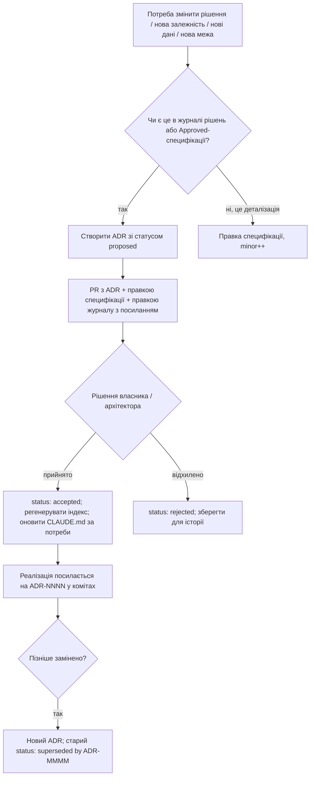
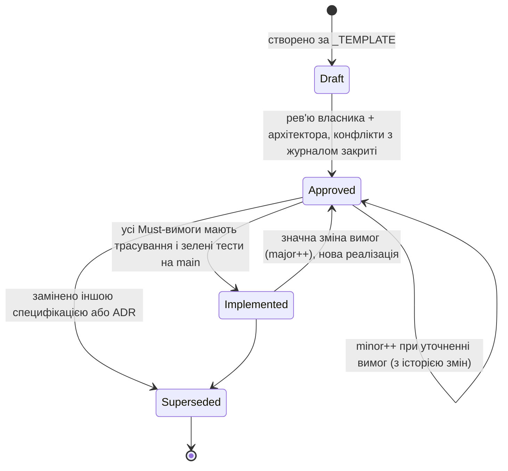

# 16. План документації

| Поле | Значення |
|---|---|
| Статус | Draft |
| Версія | 0.1 |
| Дата | 2026-09-27 |
| Власник | Архітектор |
| Джерела рішень | [Журнал рішень](../decisions/2026-09-25-interview.md): Q7 (мова), Q26 (монорепозиторій), Q29 (соло + ШІ-агенти, ADR, документація як контракт), Q9, Q37 (атрибуції), T22 (журнал рецензування) |
| Пов'язані специфікації | усі `docs/specs/*`; особливо 01-architecture, 09-backend (OpenAPI), 10-security-privacy (політика, інвентар даних), 13-analytics-observability (runbooks, звіти), 14-devops-ci (PR-шаблон у CI, CHANGELOG у релізі), 15-testing-quality (посилання на вимоги з тестів), 17-roadmap |

## 0. Контекст для ШІ-агента

Ти працюєш із документацією проєкту «Реп'ях», де документи — це контракт між власником, архітектором і ШІ-агентами (Q29). Перед будь-якою роботою в репозиторії прочитай `CLAUDE.md`, потім розділ 0 тієї специфікації, якої стосується задача, потім журнал рішень у частині, на яку специфікація посилається.

Правила, які не можна порушувати:
1. Джерело істини — журнал рішень `docs/decisions/`. Специфікація не змінює рішення, лише деталізує. Розбіжність = ADR, а не тиха правка.
2. Мова: документація, специфікації, промти, ADR, runbook-и — українською; ідентифікатори, коментарі в коді, коміти, назви файлів — англійською (Q7).
3. Кожна вимога має ідентифікатор `FR-NN-x` / `NFR-NN-x`; тести, PR і задачі посилаються на нього. Вимога без ідентифікатора не існує.
4. Не створюй документів поза картою 3.1 без запису в цю карту. Не створюй README/summary/report-файлів «про всяк випадок».
5. Діаграми — Mermaid у Markdown; макети — текстовий wireframe + HTML-прев'ю в `design/preview/`. Жодних бінарних діаграм, які не можна зробити diff.
6. Ніколи не записуй у документацію факти про версії, ціни чи політики платформ без посилання; те, що позначене unverified/low у дослідницькому звіті, не цитується як факт.

Де лежить: `CLAUDE.md` у корені, `docs/`, `.github/PULL_REQUEST_TEMPLATE.md`, `.github/ISSUE_TEMPLATE/`, `docs/runbooks/`, `design/preview/`. Як перевірити: `docs-lint` у CI (markdownlint, перевірка посилань, перевірка наявності розділів 0-8 у специфікаціях, скрипт трасування вимог `tools/req-trace`), а також рев'ю за чеклістом 3.7.

## 1. Мета й межі

Мета: щоб один розробник і будь-який ШІ-агент могли за 30 хвилин зрозуміти, що будується, чому саме так і де межі дозволеного, а через рік — відновити хід думки за кожним рішенням. Документація тут не «після коду», а перед ним: специфікація → задача → код → тест із посиланням на вимогу.

**У v1:** карта документації; ADR-процес; життєвий цикл специфікацій із трасуванням вимог; правила діаграм і документації коду; PR-шаблон; каденція переглядів; мовні правила; домовленості з ШІ-агентами; перелік runbook-ів; шаблони; користувацька документація, потрібна для магазинів; CHANGELOG.

**Не в v1:** публічна документація для розробників (SDK, публічний API); wiki поза репозиторієм; автоматична генерація сайту документації (достатньо GitHub-рендерингу Markdown); відеогайди.

**Відкладено:** локалізація користувацької документації іншими мовами, крім uk/en; публічний roadmap; статус-сторінка (13).

## 2. Вимоги

| ID | Вимога | Пріоритет |
|---|---|---|
| FR-16-1 | Кожен документ репозиторію належить до типу з карти 3.1 і має власника, тригер оновлення та формат. Новий тип документа додається до карти в тому ж PR. | Must |
| FR-16-2 | `CLAUDE.md` у корені є проєктним промтом: ≤ 150 рядків, містить призначення, карту репозиторію, заборони, команди перевірки й посилання на розділи 0 усіх специфікацій. Не дублює специфікації. | Must |
| FR-16-3 | `docs/SPEC.md` — головна специфікація-огляд: бачення, межі v1, посилання на всі напрямки, зведена таблиця вимог верхнього рівня; не містить деталей, які є в `docs/specs/*`. | Must |
| FR-16-4 | Кожна специфікація в `docs/specs/` дотримується `_TEMPLATE.md` (розділи 0-8, таблиця статусу), має унікальний номер `NN` і префікс вимог `FR-NN-`/`NFR-NN-`. CI перевіряє структуру. | Must |
| FR-16-5 | ADR ведуться в `docs/adr/` за форматом MADR, нумеруються `NNNN-kebab-title.md` (з `0001`), мають статуси `proposed / accepted / deprecated / superseded by ADR-NNNN`; індекс у `docs/adr/README.md` генерується скриптом. | Must |
| FR-16-6 | ADR обов'язковий для: (a) будь-якої зміни рішення журналу рішень; (b) будь-якої нової зовнішньої залежності (NuGet, SDK, сервіс, API третьої сторони, шрифт, набір даних); (c) будь-якої нової категорії даних, що збирається або зберігається (10, 13); (d) зміни архітектурної межі (модуль, схема БД, контракт API); (e) відмови від рекомендації дослідницького звіту. | Must |
| FR-16-7 | Життєвий цикл специфікації: `Draft → Approved → Implemented → Superseded`; версія у форматі `major.minor`; зміна Approved-специфікації, що зачіпає вимоги, збільшує `minor` і записується у розділ «Історія змін» наприкінці документа. | Must |
| FR-16-8 | Трасування: кожна вимога `FR-NN-x` з пріоритетом Must має принаймні один тест, атрибут або сценарій, що посилається на неї (`[Trait("Requirement","FR-11-22")]` у xunit або тег `@FR-11-22` в Appium/UI-сценаріях); скрипт `tools/req-trace` будує матрицю і CI попереджає про непокриті Must-вимоги Implemented-специфікацій. | Must |
| FR-16-9 | PR-опис створюється з шаблону `.github/PULL_REQUEST_TEMPLATE.md` із чеклістом 3.7; CI перевіряє, що обов'язкові пункти позначені або явно відмічені «н/з». | Must |
| FR-16-10 | Публічний API проєктів `Burdock.Domain` і `Burdock.Application` має XML-документацію (`<summary>`, `<remarks>` з інваріантами, `<exception>`); увімкнено `GenerateDocumentationFile` і попередження CS1591 як помилка для цих двох проєктів. Приватний код — без «шуму» коментарів; коментар пояснює «чому», не «що». | Must |
| FR-16-11 | OpenAPI-специфікація сервера генерується з коду (`Microsoft.AspNetCore.OpenApi`) у CI і комітиться у `docs/api/openapi.v1.json`; PR, що змінює контракт, показує diff; зміна, що ламає сумісність, потребує ADR і версії маршруту. | Must |
| FR-16-12 | `CHANGELOG.md` за Keep a Changelog 1.1.0, наповнюється з Conventional Commits (`feat`, `fix`, `perf`, `docs`, `refactor`, `chore`, `content`, `design`, `legal`) скриптом при релізному тегу; користувацькі нотатки для магазинів (uk/en) пишуться вручну з розділу `Added/Changed/Fixed`. | Must |
| FR-16-13 | Runbook-и в `docs/runbooks/` для кожної операційної процедури з переліку 3.11; кожен має: передумови, кроки з командами, перевірку результату, відкат, час виконання, «коли ескалювати». Алерти (13) посилаються на runbook. | Must |
| FR-16-14 | Користувацькі документи (політика приватності uk/en, умови користування uk/en, сторінка підтримки, FAQ, метадані App Store/Play uk/en, екран «Джерела та ліцензії», сторінка видалення акаунта) зберігаються в `docs/public/` як джерело і публікуються на `burdock.org` через CI; версії політики датуються, попередні зберігаються. | Must |
| FR-16-15 | `docs/glossary.md` містить усі UI-терміни у формі, у якій їх бачить користувач (uk), англійський ідентифікатор і посилання на специфікацію; новий термін у `.resx` без запису в глосарії блокується рев'ю. | Must |
| FR-16-16 | Гайд онбордингу `docs/ONBOARDING.md` дозволяє новому розробнику або агенту за 30 хвилин: зрозуміти продукт, зібрати Android-збірку локально на Windows, запустити тести, знайти правильну специфікацію для задачі. Перевіряється раз на квартал «холодним» проходженням агентом. | Must |
| FR-16-17 | Промти для ролей агентів живуть у розділі 0 кожної специфікації (індекс і шаблон задачі у `docs/prompts/README.md`, без окремих файлів); промти контент-пайплайну (T22) версіонуються у `content/pipeline/prompts/<name>-v<N>.md` і зберігають `prompt_version`, на який посилається провенанс контенту (08 §3.6). | Must |
| FR-16-18 | Відхилення від специфікації, виявлене агентом або людиною під час реалізації, фіксується в PR блоком «Відхилення» (що, чому, пропонована правка специфікації або ADR) і не зливається без рішення власника/архітектора. | Must |
| FR-16-19 | README у папці лише там, де структура неочевидна (`src/` та його підтеки, `content/`, `content/sources/`, `infra/`, `design/`, `tests/`, `.github/workflows/`, `.claude/skills/`); README ≤ 60 рядків, пояснює призначення папки і куди йти далі; не дублює специфікації. | Should |
| FR-16-20 | Щотижневі та щомісячні звіти (13) пишуться у `docs/reports/` за шаблоном; вони інформаційні, не є джерелом рішень. | Should |
| NFR-16-1 | Уся документація рендериться стандартним GitHub Markdown без плагінів (Mermaid підтримується GitHub); жодних локальних розширень синтаксису. | Must |
| NFR-16-2 | `docs-lint` у CI виконується ≤ 2 хв: markdownlint, перевірка внутрішніх посилань, структура специфікацій, наявність ADR-індексу, трасування вимог. | Must |
| NFR-16-3 | Жоден документ у `docs/` не містить секретів, персональних даних користувачів чи сирих ШІ-виводів без позначки перевірки. | Must |

## 3. Проєктування

### 3.1 Карта документації

| Документ | Шлях | Аудиторія | Власник | Тригер оновлення | Формат |
|---|---|---|---|---|---|
| Проєктний промт | `CLAUDE.md` | ШІ-агенти, розробник | Архітектор | Зміна структури репозиторію, заборон, команд перевірки; перегляд щомісяця | Markdown ≤ 150 рядків |
| Головна специфікація | `docs/SPEC.md` | Власник, архітектор, агенти | Архітектор | Додано/вилучено напрямок; зміна меж v1 | Markdown |
| Специфікації напрямків | `docs/specs/NN-name.md` | Агенти, розробник | Власник напрямку (у таблиці статусу) | Зміна вимог, реалізація, нові ризики | Markdown за `_TEMPLATE.md` |
| Шаблон специфікації | `docs/specs/_TEMPLATE.md` | Автори специфікацій | Архітектор | Зміна процесу | Markdown |
| ADR | `docs/adr/NNNN-title.md`, індекс `docs/adr/README.md` | Усі | Автор рішення | Умови FR-16-6 | MADR |
| Журнал рішень | `docs/decisions/YYYY-MM-DD-*.md` | Усі | Власник продукту | Лише через ADR (посилання в обидва боки) | Markdown-таблиці |
| Дослідження | `docs/research/YYYY-MM-DD-*.md` | Архітектор, агенти | Архітектор | Нове дослідження (реклама, друга мова тощо); старі не редагуються, лише доповнюються позначками застарілості | Markdown, англійською допустимо для сирих звітів |
| Глосарій | `docs/glossary.md` | Усі, особливо 12-localization | Дизайн/локалізація | Новий UI-термін | Таблиця |
| Промти агентів | `docs/prompts/*.md` | Агенти | Архітектор / 08 для контенту | Зміна процесу або якості результату; версія в заголовку | Markdown із YAML-фронтматером (`version`, `inputs`, `outputs`) |
| README папок | `README.md` (корінь), `src/README.md`, `src/mobile/README.md`, `src/server/README.md`, `src/shared/README.md`, `content/README.md`, `content/sources/README.md` (реєстр джерел), `infra/README.md`, `design/README.md`, `tests/README.md`, `.github/workflows/README.md`, `.claude/skills/README.md`, `docs/prompts/README.md` | Розробник, агенти | Власник папки | Зміна структури | Markdown ≤ 60 рядків |
| OpenAPI | `docs/api/openapi.v1.json` (+ `docs/api/README.md` про версіонування) | Клієнтські агенти, тести | 09 | Кожна збірка сервера в CI (генерація), PR показує diff | OpenAPI 3.1 JSON |
| Runbook-и | `docs/runbooks/*.md` | Розробник під час інциденту | 14/13 (розділ 3.11) | Після кожного використання (правка неточностей), після інциденту | Markdown, покроково, з командами |
| Політика приватності | `docs/public/privacy/uk.md`, `en.md` + `CHANGELOG.md` політики | Користувачі, магазини | Власник + 10 | Зміна інвентарю даних, нового SDK, нової події (13) | Markdown → HTML на burdock.org |
| Умови користування | `docs/public/terms/uk.md`, `en.md` | Користувачі, магазини | Власник | Зміна підписок, правил контенту | Markdown → HTML |
| Сторінка підтримки та FAQ | `docs/public/support/uk.md`, `en.md` | Користувачі | Власник | Нові типові питання з відгуків | Markdown → HTML |
| Сторінка видалення акаунта | `docs/public/account-deletion/uk.md`, `en.md` | Користувачі, Play | 10 | Зміна процедури | Markdown → HTML (вимога Play) |
| Метадані магазинів | `docs/public/store/app-store/{uk,en}.md`, `docs/public/store/play/{uk,en}.md` | App Review, користувачі | Власник + дизайн | Кожен реліз із помітними змінами; нотатки «Що нового» | Markdown із полями (назва, підзаголовок, опис, ключові слова, нотатки, URL) |
| «Джерела та ліцензії» | `docs/public/licenses/ATTRIBUTIONS.md` → екран у застосунку | Користувачі, правовласники | 08 | Зміна джерел контенту, шрифтів, бібліотек | Markdown, генерується частково з `content_pack.attributions` і `licenses.json` пакетів NuGet |
| CHANGELOG | `CHANGELOG.md` | Розробник, користувачі (через нотатки) | 14 | Кожен релізний тег | Keep a Changelog |
| Гайд онбордингу | `docs/ONBOARDING.md` | Новий розробник, агент | Архітектор | Зміна інструментів; щоквартальна перевірка | Markdown, 30-хвилинний маршрут |
| Звіти | `docs/reports/weekly/YYYY-Www.md`, `docs/reports/monthly/YYYY-MM.md`, `docs/reports/postmortems/YYYY-MM-DD-title.md` | Власник | Агент за шаблоном; власник підписує | Каденція 13 | Markdown за шаблоном |
| Дизайн-прев'ю | `design/preview/*.html`, `design/tokens/tokens.json` | Дизайн, власник | 02 | Зміна токенів або макетів | HTML/JSON |
| Матриця трасування | `docs/traceability.md` (генерується) | Архітектор, 15 | `tools/req-trace` | Кожен CI-прогін на `main` | Markdown-таблиця |

### 3.2 Структура папок документації

```
CLAUDE.md
CHANGELOG.md
docs/
  SPEC.md
  ONBOARDING.md
  glossary.md
  traceability.md            (генерується)
  specs/  _TEMPLATE.md  01-architecture.md … 17-roadmap.md
  adr/    README.md  0000-template.md  0001-…md
  decisions/  2026-09-25-interview.md
  research/   2026-09-25-research-brief.md  …
  prompts/    README.md   # промти ролей = розділ 0 специфікацій; промти контенту в content/pipeline/prompts/
  api/        README.md  openapi.v1.json
  public/     privacy/  terms/  support/  account-deletion/  store/  licenses/
  reports/    weekly/  monthly/  postmortems/
docs/runbooks/ README.md  deploy.md  rollback.md  restore-backup.md  rotate-keys.md  cloud-mac.md
              account-deletion-request.md  content-hotfix.md  incident.md
              store-webhooks.md  analytics-jobs.md  disk.md  client-hotfix.md
.github/      PULL_REQUEST_TEMPLATE.md  ISSUE_TEMPLATE/{bug,feature,content-issue,privacy-review}.md
design/       README.md  tokens/tokens.json  tokens/generate.py  preview/  mascot/
tools/        req-trace/  adr-index/  changelog/
```

### 3.3 ADR-процес

Формат — MADR (шаблон у `docs/adr/0000-template.md`): заголовок, статус, дата, контекст і проблема, рушії рішення, розглянуті варіанти, обране рішення з обґрунтуванням, наслідки (позитивні, негативні), плюси й мінуси варіантів, посилання (на Q/T журналу, специфікації, дослідження, PR).



Правила: один ADR — одне рішення; ADR незмінні після `accepted`, крім поля статусу; нумерація наскрізна, без пропусків; ШІ-агент може створити ADR лише у статусі `proposed`, статус `accepted` ставить людина. Перші ADR, які потрібно створити у Phase 0: вибір шаблону сервера, спосіб збірки WidgetKit-розширення, вибір FSRS-бібліотеки, формат дизайн-токенів, стратегія тестів — усі посилаються на розділ 7 дослідницького звіту.

### 3.4 Життєвий цикл специфікації



- **Версіонування**: `0.x` у Draft; `1.0` при Approved; `1.x` для уточнень; `2.0` при переробці. Історія змін — таблиця наприкінці документа (дата, версія, що змінено, посилання на PR/ADR).
- **Синхронізація з кодом**: (1) задача в беклозі посилається на `FR-NN-x`; (2) гілка й PR у заголовку містять ідентифікатори; (3) тести мають `Trait("Requirement", ...)` або тег; (4) `tools/req-trace` сканує `docs/specs/*` і код, будує `docs/traceability.md` і позначає: Must без тестів, тести з неіснуючими ID, вимоги Implemented-специфікацій, які змінилися після останнього тесту (за git blame дати). (5) Специфікація стає `Implemented` лише коли матриця чиста.
- **Хто може міняти**: Draft — автор; Approved — лише через PR із рев'ю власника напрямку; вимоги Must не можна вилучати без ADR.

### 3.5 Діаграми як код

- Mermaid для всіх діаграм у документах: `flowchart`, `sequenceDiagram`, `stateDiagram-v2`, `classDiagram`, `erDiagram`, `gantt`. Одна діаграма — одна ідея; ≤ 25 вузлів; підписи українською, ідентифікатори англійською.
- Excalidraw (`design/sketches/*.excalidraw`, JSON) — лише для чернеток, які потім або перетворюються на Mermaid, або видаляються після рішення; у специфікації на них не посилаються як на джерело істини.
- Макети екранів: текстовий wireframe у специфікації (як у 11 §3.6) + HTML-прев'ю в `design/preview/` з токенами 02; знімки екрана з CI-симулятора зберігаються як артефакти, не в git (крім еталонів для snapshot-тестів у 15).
- Перевірка: `docs-lint` рендерить Mermaid у CI через `mmdc` і падає при синтаксичній помилці.

### 3.6 Документація коду

| Шар | Правило |
|---|---|
| `Burdock.Domain`, `Burdock.Application` (публічні типи) | XML-документація обов'язкова: що робить, інваріанти, одиниці (хвилини/дні), посилання на `FR-NN-x` у `<remarks>`; CS1591 = помилка |
| `Burdock.Infrastructure`, `Burdock.App`, `Burdock.Server` | XML лише для нетривіальних публічних контрактів; коментар у тілі — лише «чому» (обхід платформного обмеження з посиланням на issue, компроміс з ADR) |
| Swift (`ios-extensions/`) | `///` для публічних типів таймлайну; посилання на 04 і на обмеження WidgetKit із URL |
| Тести | Назва тесту описує поведінку (`HasPro_Returns_False_After_BillingRetryCourtesy`), `Trait("Requirement")`; коментарі не потрібні |
| Заборонено | Коментарі-нотатки «TODO без issue», закоментований код, шапки з автором/датою, автоматично згенеровані описи, що повторюють ім'я методу |

### 3.7 PR-шаблон (чекліст)

```markdown
## Що і навіщо
Посилання на задачу та вимоги: FR-__-__, ADR-____ (якщо є)

## Чекліст
- [ ] Специфікація оновлена (номер, розділ) або «н/з: не змінює вимог»
- [ ] ADR створено/оновлено або «н/з: не підпадає під FR-16-6»
- [ ] Privacy diff: інвентар даних / події аналітики / privacy manifest / labels / політика — без змін або перелічено
- [ ] Тести посилаються на вимоги (Trait/тег); req-trace без нових прогалин
- [ ] UI-зміни: знімки екрана світла + темна тема, iPhone + iPad (і Android, якщо зачеплено), Dynamic Type AX5 для нових екранів
- [ ] Доступність: SemanticProperties, контраст, фокус
- [ ] Локалізація: нові рядки в .resx (uk) + глосарій
- [ ] Контент/ліцензії: атрибуції оновлені (якщо зачеплено)
- [ ] CHANGELOG-сумісний заголовок коміту (Conventional Commits)
- [ ] Runbook оновлено (якщо змінено деплой/операції)

## Відхилення від специфікації
Немає / опис (що, чому, пропозиція)

## Як перевірено
Команди, пристрої, симулятори; посилання на CI-артефакти зі знімками
```

CI (`pr-lint`) перевіряє, що кожен обов'язковий пункт має `[x]` або текст «н/з:» із поясненням; PR без блоку «Відхилення» блокується.

### 3.8 Каденція перегляду

| Що | Коли | Хто | Результат |
|---|---|---|---|
| `CLAUDE.md` | щомісяця, і після кожної зміни структури | Архітектор | Актуальні команди, заборони, посилання |
| Специфікації напрямку | при кожному PR, що її зачіпає; повний перегляд наприкінці фази (17) | Власник напрямку | Оновлений статус/версія |
| ADR-індекс | автоматично при PR | скрипт | `docs/adr/README.md` |
| Runbook-и | після кожного використання; тренувальний прогін відновлення бекапу щомісяця (алерт 13, якщо > 35 днів; T26) | Розробник | Виправлені кроки, час виконання |
| Політика приватності / labels / manifest | перед кожним релізом («privacy diff») | 10 | Підтвердження узгодженості інвентар = маніфест = labels = політика |
| Глосарій | при кожній зміні `.resx` | 12 | Повнота |
| Онбординг | щокварталу «холодний» прохід агентом у чистому середовищі | Архітектор | Список зламаних кроків → виправлення |
| Метадані магазинів | перед кожним релізом | Власник | Нотатки uk/en |
| Дослідницький звіт | не редагується; при використанні факту старшого за 90 днів — повторна перевірка за URL і позначка в специфікації | Автор специфікації | Актуальні цитати |

### 3.9 Мовні правила

| Артефакт | Мова | Примітка |
|---|---|---|
| Специфікації, ADR, журнал, промти, runbook-и, глосарій, звіти | українська | Терміни інтерфейсу — як бачить користувач («Серія», «Колючки», «Реп'яшок») |
| Дослідницькі звіти | українська передмова; тіло може бути англійською | Позначати як довідкові |
| Код, ідентифікатори, XML-документація, коментарі, коміти, назви гілок, PR-заголовки | англійська | Тіло PR може містити українські пояснення для власника |
| UI-рядки | `.resx` з нейтральною мовою `uk`, переклад `en` | 12-localization |
| Користувацькі документи | uk (основна) + en | Українська — за замовчуванням і першою |
| Назви файлів документації | англійська kebab-case | `11-monetization.md`, `restore-backup.md` |
| Помилки й логи сервера | англійська | Ніколи не показуються користувачу без локалізації |

Правопис: український апостроф `'` у документації допускається як `'` або `’`; у даних контенту нормалізується (08). Фемінітиви та звертання — нейтральне «ви» в UI, «ти» лише в репліках Реп'яшка (02/12); остаточна форма звертання — відкрите питання 11 журналу рішень (специфікації 03, 08, 12 поки припускають «ти»).

### 3.10 Робочі домовленості з ШІ-агентами

1. **Промт = розділ 0 специфікації.** Агент, що отримує задачу за напрямком NN, починає з `CLAUDE.md`, потім розділу 0 специфікації NN, потім вимог, на які посилається задача. Промти в `docs/prompts/` лише доповнюють це процесом (як писати звіт, як форматувати PR).
2. **Звіт про відхилення.** Якщо реалізація неможлива або невигідна так, як описано, агент не змінює вимогу: він реалізує найближчий сумісний варіант або зупиняється, і в PR пише блок «Відхилення» з причиною, доказом (URL, лог, тест) і пропозицією (правка специфікації / ADR). Те саме для конфлікту між специфікацією і журналом рішень: перемагає журнал, конфлікт репортується.
3. **Заборонені дії агентів**: змінювати `docs/decisions/*` інакше ніж через ADR-PR; ставити статус `accepted` в ADR; додавати залежність без ADR; додавати подію аналітики без чекліста 13 §3.10; комітити секрети, ключі, `.p8`, JSON сервісних акаунтів; змінювати юридичні тексти (політика, умови, рядок автопродовження) без мітки `legal` і рев'ю власника; створювати документи поза картою 3.1; писати в код дані, що є політикою (ліміти, ціни), замість конфігураційних ключів; використовувати джерела контенту з переліку заборонених у Q37; цитувати факти з позначкою unverified/low.
4. **Формат результату.** Агент завершує роботу PR (не прямим комітом у `main`), з описом за шаблоном 3.7 і посиланням на CI-артефакти; для UI — знімки в обох темах.
5. **Межа автономності.** Агент може створювати Draft-документи, тести, код, ADR у `proposed`, звіти за шаблоном; не може приймати продуктові рішення, змінювати ціни, публікувати контент, деплоїти у production без людини.
6. **Пам'ять між сесіями** — лише через репозиторій: те, чого немає в документах або коді, не існує для наступного агента. Тому будь-яке домовлене «усно» рішення записується в ADR або специфікацію в тому ж PR.
7. **Перевірка перед здачею.** Агент запускає `docs-lint`, `req-trace`, тести відповідного проєкту і додає результати в «Як перевірено».

### 3.11 Runbook-и

| Runbook | Файл | Власник | Тригер | Ключові перевірки |
|---|---|---|---|---|
| Деплой сервера | `docs/runbooks/deploy.md` | 14 | Релізний тег, hotfix | Міграції expand/contract застосовані, `/health/ready` зелений, smoke на staging → prod |
| Відкат | `docs/runbooks/rollback.md` | 14 | Помилка після деплою | Попередній образ, сумісність схеми БД (contract ще не виконано), повідомлення в CHANGELOG |
| Відновлення бекапу | `docs/runbooks/restore-backup.md` | 14 | Втрата даних; тренування щомісяця | pgBackRest PITR, перевірка контрольних сум, час відновлення ≤ цілі 09 |
| Ротація ключів | `docs/runbooks/rotate-keys.md` | 10 | Планово (квартал), компрометація, TLS | Ключі підпису знімків entitlement, JWT, ключ App Store Server API, сервісний акаунт Google, APNs `.p8`, ключ підпису контент-паків |
| Запит на видалення акаунта | `docs/runbooks/account-deletion-request.md` | 10 | Запит із застосунку або з веб-форми | Видалення в межах 30 днів, відкликання токена Sign in with Apple (TN3194), підтвердження користувачу, запис у журнал без персональних даних |
| Контент-hotfix | `docs/runbooks/content-hotfix.md` | 08 | Помилковий/образливий контент у паку | Виправлення у джерелі, новий пак із новою версією, маніфест з ETag, перевірка на пристрої, запис у журнал рецензування |
| Інцидент | `docs/runbooks/incident.md` | 13 | P1/P2 алерт | Тріаж, комунікація (текст у застосунку), таймлайн, post-mortem за 3 дні |
| Вебхуки магазинів | `docs/runbooks/store-webhooks.md` | 11/09 | Помилки обробки, зміна URL | Перевірка підпису, повторна обробка з журналу сирих подій, звірка з App Store Connect / Play |
| Задачі аналітики | `docs/runbooks/analytics-jobs.md` | 13 | Лаг агрегації, помилки | Перезапуск задачі, перерахунок за 30 днів сирих даних |
| Диск | `docs/runbooks/disk.md` | 14 | Алерт диска | Логи, старі партиції, образи Docker, розширення тому |
| Клієнтський hotfix | `docs/runbooks/client-hotfix.md` | 14 | Сплеск крашів | Гілка від тегу, expedited review (лише P1), staged rollout Play, віддалений прапорець для вимкнення функції |
| Відповідь на відгук / скаргу на контент | `docs/runbooks/support-response.md` | Власник | Відгук у магазині, скарга в застосунку | Шаблони відповідей uk/en, SLA 3 дні |
| Хмарний Mac для налагодження iOS | `docs/runbooks/cloud-mac.md` | 14 | Потреба інтерактивного налагодження віджетів або iOS-збірки | Оренда погодинно, підключення з Windows, чекліст завдань, журнал часу й вартості (`cloud-mac-log.md`) |

### 3.12 Шаблони, які потрібно створити у Phase 0

| Шаблон | Шлях | Призначення |
|---|---|---|
| ADR (MADR) | `docs/adr/0000-template.md` | FR-16-5 |
| Специфікація | `docs/specs/_TEMPLATE.md` (є) | FR-16-4 |
| PR | `.github/PULL_REQUEST_TEMPLATE.md` | 3.7 |
| Issue: bug | `.github/ISSUE_TEMPLATE/bug.md` | Кроки, пристрій, версія, знімок, вимога |
| Issue: feature | `.github/ISSUE_TEMPLATE/feature.md` | Проблема користувача, специфікація, вимоги |
| Issue: content | `.github/ISSUE_TEMPLATE/content-issue.md` | Лема, пак, версія, тип помилки; без персональних даних |
| Issue: privacy review | `.github/ISSUE_TEMPLATE/privacy-review.md` | Чекліст 13 §3.10 і privacy diff 10 |
| Runbook | `docs/runbooks/_TEMPLATE.md` | Структура FR-16-13 |
| Post-mortem | `docs/reports/postmortems/_TEMPLATE.md` | Таймлайн, вплив, причини, дії, без пошуку винних |
| Щотижневий звіт | `docs/reports/weekly/_TEMPLATE.md` | 5 чисел + 3 спостереження + guardrail |
| Промт агента | `docs/prompts/_TEMPLATE.md` | Фронтматер `version/inputs/outputs/done-when` |
| Нотатки релізу | `docs/public/store/_release-notes-template.md` | uk/en, ≤ 4 пункти, без маркетингових перебільшень |
| Онбординг | `docs/ONBOARDING.md` | 3.13 |

### 3.13 Онбординг за 30 хвилин (зміст `docs/ONBOARDING.md`)

| Хв | Крок | Документ / команда |
|---|---|---|
| 0-5 | Що таке «Реп'ях», для кого, чому freemium, чому віджети | `docs/SPEC.md` §1, журнал рішень §1-3 (лише таблиці) |
| 5-10 | Як влаштований репозиторій і хто що вирішує | `CLAUDE.md`, ця специфікація §3.1-3.2 |
| 10-15 | Архітектура за 5 хвилин: Domain → Application → Infrastructure; сервер-моноліт; віджети як тонкі презентери | 01-architecture §0, §3 (дві діаграми) |
| 15-22 | Зібрати й запустити Android на Windows; запустити юніт-тести | `dotnet build -f net10.0-android36.0`, `dotnet test`, розділ «Локальне середовище» 14 |
| 22-26 | Як береться задача: вимога → тест → PR; що заборонено агентам | §3.4, §3.7, §3.10 |
| 26-30 | Де шукати відповіді: глосарій, ADR-індекс, дослідницький звіт (з обмеженнями), runbook-и | `docs/glossary.md`, `docs/adr/README.md`, `docs/research/` |

Перевірка гайду: агент у чистому контейнері/ВМ проходить кроки і повертає список кроків, що не спрацювали.

### 3.14 CHANGELOG і нотатки релізу

- Формат Keep a Changelog 1.1.0: `Unreleased`, потім версії `1.0.0 — 2027-06-14`, секції `Added / Changed / Deprecated / Removed / Fixed / Security`; додаткова секція `Content` для версій контент-паків (не зливається з кодом застосунку).
- Джерело — Conventional Commits; скрипт `tools/changelog` групує коміти за типом і scope (`app`, `server`, `widgets`, `content`, `docs`, `ci`), відкидає `chore`/`docs` із користувацької частини.
- Версії: застосунок SemVer `MAJOR.MINOR.PATCH` + build number з CI; сервер — дата-версія `YYYY.MM.DD.N` у образі; контент-паки — власна монотонна версія у маніфесті (08).
- Нотатки для магазинів пишуться людиною з `Added/Changed/Fixed`, uk першою, ≤ 4 пункти, без обіцянок про майбутнє.

### 3.15 Користувацька документація

| Документ | Обов'язковість | Особливості |
|---|---|---|
| Політика приватності (uk/en) | App Store, Play, закон 2297-VI | Генерується з інвентарю даних 10 як джерела; розділи: що збираємо (нічого без згоди), анонімний акаунт, синхронізація, аналітика opt-in, Sentry opt-in, підписки (обробляє магазин), видалення, зберігання (12 місяців неактивності, 30 днів на видалення), контакти; дата версії й історія |
| Умови користування (uk/en) | App Store (посилання з paywall, 11) | Підписки, автопродовження, повернення коштів через магазин, контент «може містити помилки» (ШІ-контент з перевіркою, T22), ліцензія бази слів |
| Сторінка підтримки | App Store (URL підтримки) | Email, форма, FAQ; SLA відповіді 3 дні |
| FAQ | рекомендовано | Віджет не оновлюється; чому тріал через магазин; що є у Free; як видалити акаунт; чому потрібен інтернет при першому запуску |
| Видалення акаунта (веб) | Play | Кроки з застосунку + веб-запит; що видаляється і за скільки |
| Метадані магазинів | обов'язково | Українська як основна локаль, англійська друга; знімки екрана з CI (світла/темна); вікова категорія 12+; чесні Accessibility Nutrition Labels |
| «Джерела та ліцензії» (екран) | Q37, ліцензії CC BY/OFL/ISC/MIT | CEFR-J (точна цитата), Open English WordNet, CMUdict, Fixel, Lucide, NuGet-пакети; генерується з даних, а не пишеться вручну |

### 3.16 Константи

| Ключ | Значення | Де |
|---|---|---|
| `docs.claudeMdMaxLines` | 150 | `docs-lint` |
| `docs.readmeMaxLines` | 60 | `docs-lint` |
| `docs.mermaidMaxNodes` | 25 | рекомендація рев'ю |
| `docs.factMaxAgeDays` | 90 | правило повторної перевірки фактів |
| `docs.onboardingTargetMinutes` | 30 | перевірка щокварталу |
| `docs.supportSlaDays` | 3 | runbook підтримки |
| `docs.postmortemDueDays` | 3 | після інциденту |
| `docs.reviewCadence.claudeMd` | 30 днів | 3.8 |
| `docs.reviewCadence.onboarding` | 90 днів | 3.8 |
| `docs.reviewCadence.restoreDrill` | щомісяця (алерт > 35 днів) | 13, T26 |

## 4. Рішення та компроміси

| Питання | Варіанти | Плюси | Мінуси | Обрано і чому |
|---|---|---|---|---|
| Де живе документація | у репозиторії / wiki / Notion | репозиторій: версії, PR-рев'ю, доступ агентам | менше зручностей редагування | Репозиторій (Q26: монорепозиторій; агенти читають файли) |
| Формат ADR | MADR / Nygard / власний | MADR: варіанти й наслідки явні, широко відомий | багатослівніший | MADR, скорочені секції дозволені |
| Трасування вимог | вручну в таблиці / Trait у тестах + скрипт / зовнішній інструмент | скрипт: завжди актуально, дешево | потребує дисципліни іменування | Trait + `tools/req-trace` |
| OpenAPI | писати вручну (design-first) / генерувати з коду | генерація: не розходиться з кодом | контракт помітний лише після коду | Генерація з коду + diff у PR + ADR на ламкі зміни; для великих нових модулів — чернетка контракту в специфікації 09 перед кодом |
| Мова коментарів у коді | uk / en | en: узгодженість з ідентифікаторами, інструментами | власнику зручніша uk | en (Q7) |
| CLAUDE.md розмір | вичерпний / короткий з посиланнями | короткий: не застаріває, читається щоразу | треба переходити за посиланнями | ≤ 150 рядків + розділи 0 специфікацій |
| Знімки екрана у git | зберігати / лише артефакти CI | артефакти: репозиторій легкий | історія візуальних змін лише в CI | Артефакти + еталони snapshot-тестів 15 (стиснені) |

## 5. Критерії приймання

- [ ] AC-16-1. Given чистий клон, When агент виконує `docs/ONBOARDING.md`, Then за ≤ 30 хв отримує зелену Android-збірку й тести; кроки, що не спрацювали, = 0.
- [ ] AC-16-2. Given PR, що додає NuGet-пакет без ADR, Then `pr-lint` або рев'ю блокує злиття з посиланням на FR-16-6.
- [ ] AC-16-3. Given специфікація зі статусом Implemented, When `tools/req-trace` виконано, Then усі Must-вимоги мають ≥ 1 тест із відповідним Trait/тегом; матриця в `docs/traceability.md` оновлена.
- [ ] AC-16-4. Given новий ADR у статусі `accepted`, Then `docs/adr/README.md` містить його в індексі з датою і статусом; журнал рішень (якщо змінено) містить посилання на ADR і навпаки.
- [ ] AC-16-5. Given PR з UI-зміною без знімків у світлій і темній темі, Then чекліст не пройдено, PR блокується.
- [ ] AC-16-6. Given реліз-тег `v1.0.0`, Then `CHANGELOG.md` має секцію `1.0.0` з датою, згенеровану з комітів, і нотатки для магазинів uk/en існують у `docs/public/store/`.
- [ ] AC-16-7. Given кожен алерт з 13 §3.8, Then посилання на runbook веде на існуючий файл з усіма обов'язковими розділами.
- [ ] AC-16-8. Given `.resx` містить рядок, якого немає в `docs/glossary.md` (за ключем), Then `docs-lint` попереджає; для термінів із позначкою `term` — блокує.
- [ ] AC-16-9. Given `CLAUDE.md`, Then він ≤ 150 рядків, містить посилання на розділ 0 кожної специфікації з `docs/specs/`, і кожне посилання дійсне.
- [ ] AC-16-10. Given будь-який документ у `docs/`, When виконано пошук секретів і email-патернів, Then збігів немає (крім `support@burdock.org`).
- [ ] AC-16-11. Given специфікація Approved змінила Must-вимогу, Then у документі версія збільшена, є запис в історії змін, і PR посилається на ADR або пояснює, чому це уточнення.
- [ ] AC-16-12. Given агент виявив розбіжність специфікації і журналу рішень, Then PR містить блок «Відхилення» і не змінює журнал напряму.

## 6. Ризики

| Ризик | Ймовірність | Вплив | Пом'якшення |
|---|---|---|---|
| Документація відстає від коду (соло-розробник під тиском релізу) | висока | високий | Трасування в CI, чекліст PR, «специфікація в тому ж PR», щофазовий перегляд |
| Надмір процесу гальмує соло-розробника | середня | середній | ADR лише для FR-16-6; короткі MADR; агенти генерують чернетки документів |
| Агенти «галюцинують» факти у документах | середня | високий | Правило посилань, заборона unverified, повторна перевірка фактів > 90 днів, рев'ю людини для ADR |
| Юридичні тексти змінюються без перегляду | низька | високий | Мітка `legal`, окремий власник, privacy diff перед релізом |
| Розростання `CLAUDE.md` до нечитабельного | середня | середній | Ліміт 150 рядків у `docs-lint` |
| Онбординг застаріває через зміну інструментів (.NET 11, Xcode) | висока | середній | Квартальний холодний прохід агентом |
| Runbook-и не перевірені до інциденту | середня | високий | Тренування відновлення щомісяця, деплой лише за runbook |

## 7. Відкриті питання

| # | Питання | Хто вирішує | До коли |
|---|---|---|---|
| 1 | Чи публікувати частину документації (наприклад, ліцензії бази слів, політику) як публічний сайт із того ж репозиторію, чи окремий репозиторій для `burdock.org` | Власник | Phase 5 |
| 2 | Інструмент рендерингу Mermaid у CI (`mmdc` потребує headless Chromium — час CI) | Архітектор | Phase 0 |
| 3 | Чи потрібен окремий «журнал контент-рецензування» як публічний документ для Закону 2811-IX, чи достатньо провенансу в БД (T22) | Власник + 08 | Phase 6 |
| 4 | Формат щотижневого звіту: Markdown у репозиторії чи лише Grafana | Власник | Phase 2 |

## 8. Джерела

З дослідницького звіту (перевірені 2026-09-25):

- Правила App Store щодо приватності, підписок і акаунтів: https://developer.apple.com/app-store/review/guidelines/
- App Privacy Details (джерело для політики й labels): https://developer.apple.com/app-store/app-privacy-details/
- Play: видалення акаунта та Data safety: https://support.google.com/googleplay/android-developer/answer/13327111
- TN3194 (відкликання токенів Sign in with Apple при видаленні): https://developer.apple.com/documentation/technotes/tn3194-handling-account-deletions-and-revoking-tokens-for-sign-in-with-apple
- Закон 2297-VI «Про захист персональних даних»: https://zakon.rada.gov.ua/laws/show/2297-17
- Закон 2811-IX (ШІ-контент, ст. 33): https://zakon.rada.gov.ua/laws/show/2811-20/print
- Комерційні умови Anthropic (права на вивід, позначка «може бути хибним»): https://www.anthropic.com/legal/commercial-terms
- CEFR-J Wordlist (вимога цитування): https://www.cefr-j.org/download_eng
- Порядок обробки персональних даних (Уповноважений ВРУ): https://zakon.rada.gov.ua/laws/show/v1_02715-14

Офіційна документація, додана автором специфікації (перевірити перед використанням):

- MADR: https://adr.github.io/madr/
- Keep a Changelog 1.1.0: https://keepachangelog.com/en/1.1.0/
- Conventional Commits 1.0.0: https://www.conventionalcommits.org/en/v1.0.0/
- XML-документація C#: https://learn.microsoft.com/en-us/dotnet/csharp/language-reference/xmldoc/
- OpenAPI в ASP.NET Core: https://learn.microsoft.com/en-us/aspnet/core/fundamentals/openapi/aspnetcore-openapi
- Шаблони PR у GitHub: https://docs.github.com/en/communities/using-templates-to-encourage-useful-issues-and-pull-requests/creating-a-pull-request-template-for-your-repository
- Mermaid: https://mermaid.js.org/
