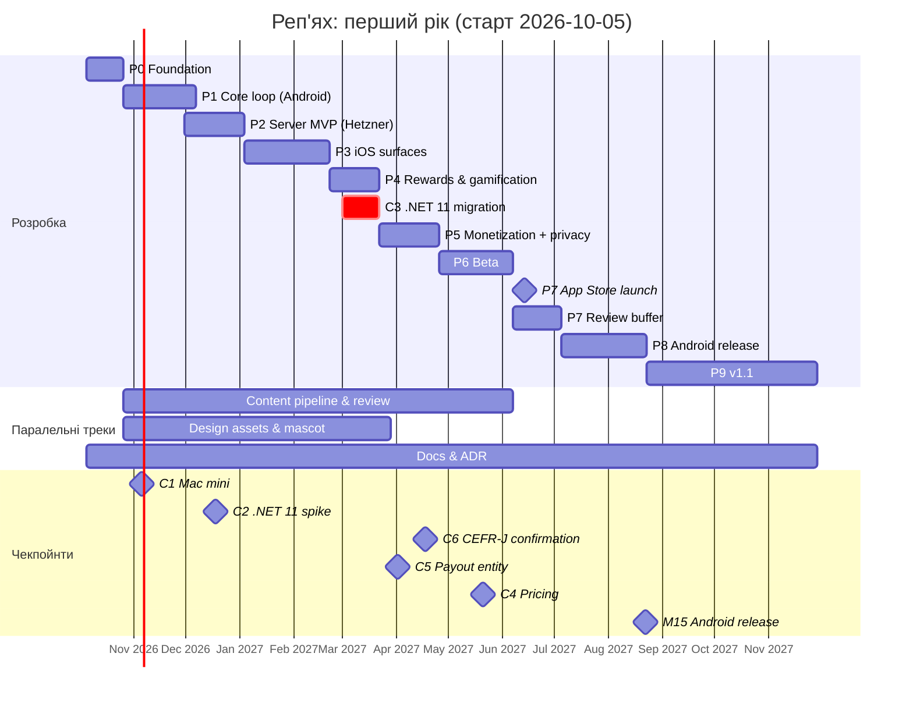

# 17. Дорожня карта

| Поле | Значення |
|---|---|
| Статус | Draft |
| Версія | 0.1 |
| Дата | 2026-09-27 |
| Власник | Власник продукту |
| Джерела рішень | [Журнал рішень](../decisions/2026-09-25-interview.md): Q1, Q3, Q4/Q13, Q6/Q16, Q12, Q17, Q22, Q25, Q29, Q35, Q36, Q37, T1, T8, T18, T21; відкриті питання 1-13 |
| Пов'язані специфікації | усі 01-16; вихідні критерії фаз посилаються на групи вимог відповідних специфікацій |

## 0. Контекст для ШІ-агента

Ти плануєш або звіряєш роботу з дорожньою картою «Реп'яха». Перед роботою прочитай журнал рішень (розділи 1, 4, 5, 6), цю специфікацію та розділ 1 специфікації напрямку, до якого належить задача.

Правила, які не можна порушувати:
1. Порядок фаз відображає залежності: сервер (Phase 2) раніше за iOS-поверхні (Phase 3), бо Live Activity потребує APNs; монетизація (Phase 5) після гейміфікації (Phase 4), бо Free-режим має показувати серію та нагороди.
2. Фаза не закривається без вихідних критеріїв; критерії — це посилання на вимоги інших специфікацій і перевірювані артефакти (CI-збірка, TestFlight, знімки).
3. Дати — оцінки для соло-розробника з ШІ-агентами; вони змінюються через оновлення цієї специфікації (minor++), а не «мовчки». Обсяг не збільшується без вилучення чогось іншого.
4. Нічого з переліку «поза межами першого року» (розділ 3.8) не починається без ADR.
5. .NET 11 міграція має завершитися до 2027-05-11 (T1); якщо реліз v1 припадає пізніше, міграція йде **перед** релізом (розділ 3.5, чекпойнт C3).

Де лежить: беклог у GitHub Projects з полями `phase`, `spec`, `requirement`; ця специфікація — єдине джерело фаз і чекпойнтів. Як перевірити: наприкінці фази — чекліст вихідних критеріїв у issue `Phase N exit review`, підписаний власником.

## 1. Мета й межі

### 1.1 Керівні обмеження

| Обмеження | Наслідок для плану |
|---|---|
| Соло-розробник + ШІ-агенти (Q29) | Одна людина не паралелить фази; агенти паралелять контент, документацію, тести, Swift-код у CI. Оцінки — у тижнях «одного розробника з агентами», повна зайнятість (припущення) |
| Лише Windows; iOS через GitHub Actions на macOS-раннерах (Q6/Q16) | Щоденний цикл на Android-емуляторі; iOS-перевірка партіями через CI-артефакти та TestFlight; повільні iOS-фази мають буфер |
| iOS першим, Android через 1-2 місяці (Q22) | Спільна кодова база з дня 1; Android-віджети й Play Billing — окрема фаза після App Store |
| Сервер обов'язковий (Q4/Q13) | Серверний MVP до iOS-поверхонь; хостинг Hetzner з Phase 2 |
| Сильний акцент на дизайні (Q8/Q19) | Дизайн-система і прев'ю у Phase 0; окремий design QA pass у Phase 6; жодна фаза не закривається з «тимчасовим» UI |
| Контент: 100% ручна перевірка безкоштовного пулу (T21), підтвердження CEFR-J (питання 7) | Контентний трек іде паралельно з Phase 1 до Phase 6; підтвердження CEFR-J — чекпойнт до публікації |
| Бюджет: 2 000 безкоштовних Linux-хвилин/місяць, macOS-хвилини платні | iOS-збірки лише на `main` і релізних гілках, nightly для віджетів; ліміт витрат у 14 |

### 1.2 У межах першого року

Phase 0-9: від порожнього репозиторію до релізу iOS (iPhone + iPad), релізу Android і випуску v1.1 з відкладеними технічними рішеннями.

### 1.3 Поза межами першого року

Apple Watch, клавіатурне розширення, Mac Catalyst, соціальні функції (ліги, друзі), дитяча версія, інші цільові мови (крім підготовки моделі), довічна/сімейна підписка, реклама (лише рішення за дослідженням), Android-режим «при розблокуванні» (лише оцінка), Siri/Shortcuts, iOS Controls, публічний API.

## 2. Вимоги до процесу

| ID | Вимога | Пріоритет |
|---|---|---|
| FR-17-1 | Кожна фаза має issue `Phase N exit review` з чеклістом вихідних критеріїв із розділу 3.2; фаза вважається закритою після позначки власника. | Must |
| FR-17-2 | Чекпойнти рішень (розділ 3.5) мають дату, відповідального й результат у вигляді ADR або запису в журналі рішень. | Must |
| FR-17-3 | Оцінка тривалості фази переглядається наприкінці попередньої фази; відхилення понад 25% від плану фіксується в цій специфікації з причиною. | Must |
| FR-17-4 | Реліз-поїзд після запуску (розділ 3.7) виконується за розкладом; позачергові релізи лише для P1 за runbook `client-hotfix.md`. | Must |
| FR-17-5 | Кожна фаза має 2-4 KPI (розділ 3.6), які вимірюються наявними на той момент засобами (CI, TestFlight, 13). | Should |
| FR-17-6 | Обсяг, доданий у фазу після її початку, компенсується вилученням еквівалентного обсягу або переносом у наступну фазу (запис у exit review). | Must |
| NFR-17-1 | План читається за 10 хвилин: таблиця віх + Gantt + чекпойнти; деталі — у специфікаціях напрямків. | Must |

## 3. Проєктування

### 3.1 Календарні припущення

- Старт: понеділок **2026-10-05** = тиждень W1. Wn починається `2026-10-05 + 7·(n−1)` днів.
- Повна зайнятість розробника (припущення); святкові тижні наприкінці грудня враховано буфером W13.
- «Тиждень» = 5 робочих днів розробника + необмежена паралельна робота агентів у межах бюджету CI/API.
- Терміни платформ, які впливають на план: .NET 11 GA 2026-11-10 (оцінка в грудні, не запускатися на ньому в реліз); кінець підтримки .NET MAUI 10 — 2027-05-11; завантаження в App Store потребують Xcode 26; Play target API 36 (звіт, розділ 1-2).

### 3.2 Фази

#### Phase 0 — Foundation (W1-W3, 3 тижні)

| Аспект | Зміст |
|---|---|
| Мета | Репозиторій, у якому агенти можуть працювати безпечно: зелений CI на Linux і macOS, скелет рішення, дизайн-токени, документаційний каркас |
| Обсяг | Монорепозиторій і структура (01, 16 §3.2); `Directory.Build.props` з quality gates; скелет `Burdock.Domain/Application/Infrastructure/App/Server/Contracts` + тести; архітектурні тести шарів (01, 15); GitHub Actions: Linux (build, test, docs-lint, req-trace), macOS (`macos-26`, pin Xcode 26.6, перша збірка `net10.0-ios` + порожнє WidgetKit-розширення через `AdditionalAppExtensions`, знімок симулятора в артефактах) (14); дизайн-токени `design/tokens/tokens.json` → Colors.xaml/Swift/XML + HTML-прев'ю (02); `CLAUDE.md`, шаблони (16 §3.12); перші 5 ADR (16 §3.3); запит до Tono Lab щодо CEFR-J (питання 7) |
| Вихідні критерії | CI зелений на обох ОС ≥ 3 дні поспіль; iOS-артефакт `.app` для симулятора зібраний із розширенням; `tokens.json` генерує три цілі й прев'ю світла/темна; архітектурні тести падають на навмисному порушенні; `ONBOARDING.md` пройдено агентом ≤ 30 хв; лист до Tono Lab надіслано |
| Оцінка | 3 тижні |
| Залежності | Apple Developer Program активний; секрети підпису в GitHub; домен `burdock.org` |
| Ризики | Перша iOS-збірка на CI без локального Xcode може зайняти більше (буфер 1 тиждень у Phase 1) |

#### Phase 1 — Core loop на Android-емуляторі (W4-W9, 6 тижнів)

| Аспект | Зміст |
|---|---|
| Мета | Повний цикл навчання локально: слово → покази → сесія → FSRS → прогрес |
| Обсяг | Контент-пайплайн v0 і перший пак безкоштовного пулу A1-B1 (08: генерація + ШІ-рецензент; ручна перевірка починається як паралельний трек); WordCard і головний екран за дизайн-системою (03, 02); сесія з трьома режимами Q21 (06); FSRS-6 через Fsrs.Sharp після аудиту або порт із golden-тестами (T3); локальна БД sqlite-net-pcl, навчальний день 04:00 (06); налаштування локально (Q30 діапазони); `IWordRotationTrigger` і локальний планувальник показів (04/05 домен); лічильники `exposureScheduled/Confirmed` (T5); локалізація `.resx` uk/en (12); Android-сповіщення базово (05) |
| Вихідні критерії | На емуляторі: пройти онбординг → вивчити 10 слів за день → повторення наступного дня з коректними інтервалами (golden-тести FSRS проти py-fsrs); Must-вимоги 06 з трасуванням; design QA WordCard/сесії на iPhone-симуляторі через CI-знімки; продуктивність сесії 60 fps на емуляторі API 26 |
| Оцінка | 6 тижнів |
| Залежності | Phase 0; доступ до Anthropic Batches API для контенту; рішення власника з відкритих питань 9 і 11 журналу (онбординг Free, форма звертання) до старту фази; питання 10, 12, 13 (джерело частотності, перевірка тем, псевдотема `general`) до збірки першого пакета |
| Ризики | Аудит Fsrs.Sharp виявить розбіжності → порт (+1 тиждень); якість перекладів пулу нижча за очікувану → більше ручної роботи |

#### Phase 2 — Server MVP на Hetzner (W9-W13, 5 тижнів, старт із перекриттям 1 тиждень)

| Аспект | Зміст |
|---|---|
| Мета | Обов'язковий сервер: анонімна ідентичність, контент-маніфест, синхронізація прогресу й налаштувань, спостережуваність |
| Обсяг | ASP.NET Core 10 Minimal APIs, модульний моноліт (T13) з ardalis-шаблоном (ADR); Identity анонімна з OpenIddict, PKCE, ротація refresh-токенів (09, 10); Content: маніфест з ETag, паки в об'єктному сховищі + CDN (08, T8); LearnerProgress: append-only журнал подій, `server_seq` (T14); SettingsSync LWW; Docker Compose + PostgreSQL 18 + Caddy на Hetzner Falkenstein (Q17); pgBackRest, Hetzner Backups; OTel → Grafana Cloud EU, health checks, перші алерти (13 §3.7-3.8); runbook-и deploy/rollback/restore (16); контракт OpenAPI у репозиторії; клієнт: перший запуск онлайн, кешування контенту, синхронізація у фоні; оцінка .NET 11 у грудні (спайк 2 дні, W10-W11) |
| Вихідні критерії | Два емулятори синхронізують прогрес без втрат при конфлікті; відновлення з бекапу виконано за runbook (тренування №1); p95 API ≤ 300 мс на staging; алерт P1 доставлено на телефон; Must-вимоги 09 щодо Identity/Content/Progress/Settings з трасуванням; звіт спайка .NET 11 |
| Оцінка | 5 тижнів (включно зі святковим буфером W13) |
| Залежності | Phase 1 (модель подій прогресу); Hetzner акаунт і DPA; DNS |
| Ризики | Складність OpenIddict/анонімного злиття акаунтів; недооцінка операційних задач (бекапи, алерти) |

#### Phase 3 — iOS-поверхні (W14-W20, 7 тижнів)

| Аспект | Зміст |
|---|---|
| Мета | Головна цінність продукту на iOS: віджети всіх сімейств, сповіщення, Live Activity «сесія» |
| Обсяг | WidgetKit-розширення у Swift (04): `systemSmall/Medium/Large`, `accessoryRectangular/Circular/Inline`, StandBy (iOS 17+), таймлайни зі спільного App Group-сховища, `WidgetCenter.reloadTimelines`, інтерактивна кнопка «наступне» за `#available(iOS 17)`, iOS 16 — відкриття застосунку (Q25); tinted/clear-режими; `PrivacyInfo.xcprivacy` у застосунку і розширенні; локальні сповіщення з лімітом 64, перепланування при foreground, тихі години (T17); Live Activity «сесія» 1-8 год (Q35): ActivityKit-таргет, старт із застосунку, оновлення через APNs (сервер: токен-автентифікація `.p8`, ендпоінт push-to-update), прогрес і кнопка завершення; iPad-макети (Q12); TestFlight internal через CI; знімки всіх сімейств віджетів у CI-артефактах |
| Вихідні критерії | TestFlight-збірка на реальних iPhone (iOS 16 і 17+/26) та iPad власника: віджет оновлюється за інтервалом, кнопка «наступне» працює на iOS 17+, екран блокування показує слово/переклад без серії; сесія Live Activity триває 2 год із оновленнями при закритому застосунку; сповіщення в тихі години не приходять; Must-вимоги 04; бюджет оновлень віджета не вичерпується за день (перевірка через Console-логи на пристрої) |
| Оцінка | 7 тижнів (найризикованіша фаза через відсутність локального Xcode) |
| Залежності | Phase 2 (APNs і App Group-дані з синхронізованого контенту); Apple Push ключ |
| Ризики | Цикл «зміна → CI → TestFlight → пристрій» 30-60 хв; налагодження Swift без Xcode; App Review 4.5.3 щодо Live Activity — знімки й опис сесії готуються тут |

#### Phase 4 — Нагороди та гейміфікація (W21-W24, 4 тижні)

| Аспект | Зміст |
|---|---|
| Мета | Етична гейміфікація Q34/T11/T17 і маскот як частина досвіду |
| Обсяг | Серія (щоденна за замовчуванням, гнучка в налаштуваннях), заморозки, пауза (07); щоденні нагороди 7/30-денний календар; «колючки» як ledger підписаних подій, згортання `EconomyRules` (T18); косметика: теми віджетів, вбрання Реп'яшка, рамки; стани Реп'яшка (Q20) як Lottie/SkiaSharp з Reduce Motion; режим «без гейміфікації»; серверна звірка ledger (Rewards-модуль 09); події аналітики 07 у таксономії 13 |
| Вихідні критерії | Серія коректна при зміні часового поясу і через 04:00; ledger звіряється сервером без розбіжностей на 1 000 синтетичних подій; усі стани Реп'яшка в прев'ю в обох темах; режим «без гейміфікації» ховає все, крім прогресу навчання; Must-вимоги 07 |
| Оцінка | 4 тижні |
| Залежності | Phase 2 (Rewards-модуль), дизайн-ассети маскота (трек дизайну з Phase 1) |
| Ризики | Ассети маскота затримуються → тимчасові стани заборонені, тому ризик зсуву |

#### Чекпойнт C3 — .NET 11 міграція (W22-W24, у межах Phase 4, 1 тиждень чистої роботи)

Див. 3.5. Якщо «go»: гілка міграції, оновлення workload-ів, CommunityToolkit.Maui ≥ 15, перевірка iOS-збірки й віджетів у CI, злиття до старту Phase 5. Якщо «no-go»: реліз на MAUI 10, міграція одразу після релізу iOS (W38-W39), із задокументованим коротким вікном поза підтримкою.

#### Phase 5 — Монетизація + пакет приватності/юридики (W25-W29, 5 тижнів)

| Аспект | Зміст |
|---|---|
| Мета | Робочі підписки з тріалом і повна готовність за приватністю |
| Обсяг | Спайк StoreKit 2 доступу (11 §4, 1 тиждень) → ADR; продукти й підписна група в App Store Connect; модуль Entitlements на сервері з вебхуками App Store Server Notifications V2 і перевіркою JWS (09, 11); клієнт: `IEntitlementService`, кеш знімка, Free-набір дня, прев'ю з замками, paywall у чотирьох точках, тріал через вступну пропозицію, відновлення, апгрейд; StoreKit Configuration file + UI-тести в CI; Sandbox-прогін на TestFlight; пакет приватності (10): екран згоди, аналітика ingest і черга (13), Sentry (opt-in чи увімкнено за замовчуванням — рішення власника з відкритого питання 8 журналу до цієї фази), політика приватності uk/en, умови, App Privacy labels з інвентарю, видалення акаунта в застосунку + веб-URL, TN3194; `privacy diff` №1 |
| Вихідні критерії | Ручний чекліст 11 §3.11 пройдено на Sandbox (покупка, скасування, відновлення, відшкодування, офлайн); знімок entitlement підписаний і кешований; Free без покупки повністю робочий; paywall відповідає FR-11-33/34 (знімки в артефактах); інвентар = маніфест = labels = політика; Must-вимоги 11, 10, 13 (клієнтська частина) |
| Оцінка | 5 тижнів |
| Залежності | Phase 4 (Free показує серію/нагороди); банківські/податкові реквізити в App Store Connect (чекпойнт C5) |
| Ризики | Спосіб доступу до StoreKit 2 не покриває API; юридичне оформлення виплат затягується |

#### Phase 6 — Beta (W30-W35, 6 тижнів)

| Аспект | Зміст |
|---|---|
| Мета | Продукт, який не соромно показати: зовнішній TestFlight, завершений контент пулу, дизайн і доступність на рівні, готовність до App Review |
| Обсяг | TestFlight external (до 100 запрошених з української аудиторії, припущення); завершення ручної перевірки 100% безкоштовного пулу і 10% стратифіковано (T21), публікація контент-паків з підписом; design QA pass за чеклістом 02 (усі екрани, обидві теми, iPad, tinted-віджети); accessibility pass (VoiceOver/TalkBack, Dynamic Type AX5, контраст, Reduce Motion, Accessibility Nutrition Labels); продуктивність і батарея (бюджет оновлень віджетів); метадані магазину uk/en, знімки, вікова анкета 12+; ціни зафіксовано (C4); експорт-комплаєнс; бета-опитування (5 питань) і виправлення; заморозка функцій на W34 |
| Вихідні критерії | Crash-free ≥ 99.5% на бета за 2 тижні; 0 відкритих P1/P2; recall7 і learning-day rate вимірюються (13); усі Must-вимоги 02/03/12 з трасуванням; чекліст App Review (3.1.2, 4.5.3, 5.1.1, 5.1.2, PrivacyInfo) пройдено; ліцензійні атрибуції на екрані «Джерела та ліцензії»; підтвердження CEFR-J отримано (C6) або пул перебудовано без CEFR-J |
| Оцінка | 6 тижнів |
| Залежності | Усі попередні фази; контентний трек завершено |
| Ризики | Відсутність підтвердження CEFR-J; бета виявляє проблему Live Activity/бюджету віджетів, що потребує переробки |

#### Phase 7 — Реліз в App Store (W36-W37 + буфер W38-W39)

| Аспект | Зміст |
|---|---|
| Мета | Публічний реліз для iPhone + iPad |
| Обсяг | Подача W36; відповіді App Review; фазований випуск (7 днів) з моніторингом крашів і алертів; сторінка підтримки та FAQ онлайн; маркетинг лише на Україну (Q38); нотатки релізу uk/en; CHANGELOG 1.0.0; пост-релізний перегляд на W38 |
| Вихідні критерії | Застосунок доступний у всіх країнах; crash-free ≥ 99.5% за перші 7 днів; жодного P1 без hotfix > 48 год; дашборди 13 наповнюються; перший щотижневий звіт написано |
| Оцінка | 2 тижні + 2 тижні буфера на відхилення рецензії |
| Залежності | Phase 6; реквізити виплат; ціни |
| Ризики | Відхилення App Review (paywall, Live Activity, приватність) — буфер і підготовлені відповіді |

#### Phase 8 — Реліз Android (W40-W46, 7 тижнів; реліз ≈ 2 місяці після iOS)

| Аспект | Зміст |
|---|---|
| Мета | Google Play з рівноцінним досвідом |
| Обсяг | Android-віджети `AppWidgetProvider` + RemoteViews у C#, WorkManager ≥ 15 хв, Material You (T19), keyguard-віджет opt-in (05); сповіщення з `setWindow`, канали (T2); Play Billing: підписка `org.burdock.app.pro` з базовими планами і пропозицією `trial7`, RTDN через Pub/Sub, `purchases.subscriptionsv2` (11, 09); Sign in with Google + збереження SIWA (Q3, 4.8); Data safety форма з інвентарю; веб-URL видалення акаунта; Play policies (target API 36, FGS не використовується, без exact alarms); Android 16.1 `queryAppWidgetEvents` для підтверджених показів (T5); internal → closed → staged rollout 10→50→100% |
| Вихідні критерії | Віджет проходить Widget Quality Tier 1 чекліст; Play Billing чекліст (покупка, тріал, скасування, відновлення) на license testers; Android vitals без порушень порогів «поганої поведінки» за 2 тижні closed-тесту; паритет Must-вимог 05 з 04 там, де платформа дозволяє |
| Оцінка | 7 тижнів |
| Залежності | Phase 7; Google Play Console, Cloud-проєкт для Pub/Sub |
| Ризики | OEM-особливості віджетів (Samsung) — тестування на реальних пристроях; політики Play щодо підписок |

#### Phase 9 — v1.1 (W47-W60, ~14 тижнів, змінний обсяг)

| Аспект | Зміст |
|---|---|
| Мета | Закрити відкладені технічні рішення й підготувати масштабування |
| Обсяг | Push-тригер оновлення контенту через APNs/FCM (T8); серверно-авторитетне нарахування нагород (T18) з міграцією ledger; рішення щодо реклами за дослідженням (11 Додаток A, питання 1) — ADR; оцінка Android-режиму «при розблокуванні» (питання 2) — ADR; готовність до другої мови: аудит захардкоджених припущень, контентний пайплайн з параметром пари мов, `.resx` для другої цільової мови без контенту (Q11, питання 5); .NET 11 — прибирання після міграції або міграція, якщо C3 = no-go; win-back-пропозиції магазину (11 питання 7); перегляд KPI-цілей за 8 тижнями метрик; перегляд представника в ЄС (C7) |
| Вихідні критерії | Push-оновлення контенту доставляється ≤ 15 хв 95% пристроїв з дозволом; нагороди нараховує сервер, клієнт лише показує; ADR щодо реклами і unlock-режиму прийняті; звіт готовності до другої мови з переліком змін |
| Оцінка | 14 тижнів з реліз-поїздом (3.7) |
| Залежності | Метрики за 8+ тижнів після релізу |
| Ризики | Спокуса додати функції замість технічного боргу — обсяг фіксується FR-17-6 |

### 3.3 Таблиця віх

| Віха | Тиждень | Орієнтовна дата | Критерій |
|---|---|---|---|
| M0 Старт | W1 | 2026-10-05 | Репозиторій створено |
| M1 Перша зелена iOS-збірка на GitHub Actions | W2 | 2026-10-16 | Артефакт симулятора з розширенням |
| M2 Foundation закрито | W3 | 2026-10-25 | Exit review Phase 0 |
| C1 Рішення про Mac mini | W5 | 2026-11-06 | ADR |
| M3 Core loop на емуляторі | W9 | 2026-12-06 | Exit review Phase 1 |
| C2 Спайк .NET 11 (оцінка) | W11 | 2026-12-18 | Звіт спайка |
| M4 Server MVP на Hetzner | W13 | 2027-01-03 | Exit review Phase 2; тренування відновлення №1 |
| M5 Перший TestFlight internal з віджетами | W17 | 2027-01-29 | Збірка на пристрої власника |
| M6 iOS-поверхні закрито | W20 | 2027-02-21 | Exit review Phase 3 |
| C3 Go/no-go .NET 11 і міграція | W22-W24 | 2027-03-01 … 03-21 | ADR + злита гілка або план після релізу |
| M7 Гейміфікація закрита | W24 | 2027-03-21 | Exit review Phase 4 |
| C5 Реквізити виплат / юрособа | W26 | 2027-04-02 | Угоди в App Store Connect підписані |
| C6 Підтвердження CEFR-J | W28 | 2027-04-18 | Лист або рішення про заміну джерела |
| M8 Монетизація + приватність закриті | W29 | 2027-04-25 | Exit review Phase 5; privacy diff №1 |
| M9 TestFlight external відкрито | W30 | 2027-04-30 | Перші 20 тестувальників |
| C4 Ціни зафіксовано | W33 | 2027-05-21 | ADR + App Store Connect |
| M10 Заморозка функцій | W34 | 2027-05-28 | Лише виправлення |
| M11 Beta закрито | W35 | 2027-06-06 | Exit review Phase 6 |
| M12 Подача в App Store | W36 | 2027-06-07 | Статус «Waiting for Review» |
| **M13 Реліз iOS** | W37 (буфер до W39) | 2027-06-14 … 07-04 | Доступний у App Store |
| M14 Внутрішній тест Android | W43 | 2027-07-30 | Internal testing track |
| **M15 Реліз Android** | W46 | 2027-08-22 | Production 100% |
| C7 Перегляд представника в ЄС | щомісяця з W38 | — | Частка платних користувачів ЄС |
| M16 v1.1 | W60 | 2027-11-28 | Exit review Phase 9 |

### 3.4 Gantt

### 3.5 Чекпойнти рішень

| # | Рішення | Коли | Вхідні дані | Варіанти | Хто | Результат |
|---|---|---|---|---|---|---|
| C1 | Купівля Mac mini (питання 3) | W5, після місяця роботи з CI-циклом iOS | Хвилини macOS за місяць, кількість «сліпих» ітерацій Swift, вартість Codemagic/MacStadium зі звіту | Лишити CI-only; орендувати погодинно на Phase 3; купити Mac mini як локальний раннер | Власник | ADR |
| C2 | Спайк .NET 11 | W10-W11 (грудень, після GA 2026-11-10) | Збірка гілки на .NET 11 RC/GA: iOS + віджети + Android; список блокерів | Інформаційний, годує C3 | Архітектор | Звіт у `docs/research/` |
| C3 | Go/no-go міграції на .NET 11 до релізу | W22 | Звіт C2, стан блокерів, стабільність MAUI 11.0.x | Go: мігрувати W22-W24; No-go: реліз на MAUI 10, мігрувати W38-W39 (вікно поза підтримкою ≤ 8 тижнів, задокументоване) | Архітектор | ADR |
| C4 | Ціни UAH/USD/EUR (питання 6) | W33, до подачі | Аркуш 11 §3.9, комісія 15%, ПДВ, конкурентні орієнтири | — | Власник | ADR + App Store Connect |
| C5 | Отримувач виплат (ФОП/юрособа), банк, податкові форми | W26 | Консультація бухгалтера | — | Власник | Угоди підписані |
| C6 | Підтвердження CEFR-J (питання 7) | W28, до публікації паків | Відповідь Tono Lab | Підтверджено → публікуємо з цитатою; ні → перебудова пулу на OEWN + власні рівні (обсяг +2 тижні) | Власник | ADR |
| C7 | Представник у ЄС за ст. 27 GDPR (питання 4) | Щомісяця з W38 | Частка платних користувачів з ЄС за звітами магазинів | ≥ 10% → призначити | Власник | Запис у журналі |
| C8 | Реклама у Free (питання 1) | Phase 9 | Дослідження 11 Додаток A, метрики конверсії | Ввести / не вводити | Власник | ADR |
| C9 | Android «при розблокуванні» (питання 2) | Phase 9 | Дані Android-релізу, політики FGS | Прапорець / ніколи | Власник | ADR |
| C10 | Друга цільова мова (питання 5) | Через 6 місяців метрик (≈ W63+) | D30, конверсія, попит | Німецька / польська / ні | Власник | ADR |

### 3.6 KPI за фазами

| Фаза | KPI | Ціль (припущення) |
|---|---|---|
| P0 | Час CI Linux; час iOS-збірки; вартість macOS-хвилин/місяць | ≤ 8 хв; ≤ 35 хв; ≤ $60 |
| P1 | Golden-тести FSRS; покриття Domain; час сесії 10 карток на емуляторі | 100% паритет; ≥ 80%; ≤ 3 хв |
| P2 | p95 API staging; RTO відновлення; успішність синхронізації в тесті конфліктів | ≤ 300 мс; ≤ 60 хв; 100% без втрат |
| P3 | Оновлення віджета вчасно (в межах інтервалу ±5 хв) на пристрої; тривалість циклу зміна→пристрій; Live Activity без обривів 2 год | ≥ 95%; ≤ 45 хв; так |
| P4 | Розбіжності ledger клієнт/сервер; частка станів маскота з ассетами | 0; 100% |
| P5 | Чекліст Sandbox пройдено; privacy diff = 0 розбіжностей; час перевірки знімка з кешу | 100%; 0; ≤ 5 мс |
| P6 | Crash-free (бета); D7 бета; recall7; результати accessibility pass | ≥ 99.5%; ≥ 30%; ≥ 85%; 0 блокерів |
| P7 | Crash-free перші 7 днів; активація віджета; D1 | ≥ 99.5%; ≥ 40%; ≥ 45% |
| P8 | Android vitals у межах порогів; паритет Must 05 | так; ≥ 90% |
| P9 | Доставка push-оновлення контенту ≤ 15 хв; D30; конверсія тріалу | ≥ 95%; ≥ 12%; 35-45% |

### 3.7 Реліз-поїзд після запуску

| Правило | Значення |
|---|---|
| Каденція мінорних релізів застосунку | Кожні `release.cadenceWeeks` = 3 тижні (припущення для соло) з фазованим випуском 7 днів на iOS і staged rollout на Play |
| Заморозка | За 3 робочі дні до подачі; лише виправлення |
| Hotfix (P1: краш > 1% сесій, втрата даних, неможливість покупки, порушення приватності) | Гілка від релізного тегу, подача ≤ 48 год, expedited review лише для P1; віддалений прапорець для вимкнення функції як перша дія |
| Серверні релізи | Безперервно з `main` після зелених тестів, у робочі години, з міграціями expand/contract; жодних деплоїв п'ятниця після 15:00 і в тихі години |
| Контент-паки | Щотижня (четвер) з версією маніфесту; hotfix контенту за runbook у будь-який день |
| Версії | SemVer застосунку; сумісність API з двома останніми мінорними версіями клієнта; примусове оновлення лише при вразливості |
| Комунікація | Нотатки релізу uk/en; для інцидентів — текст у застосунку через віддалену конфігурацію |

### 3.8 Поза межами першого року

| Функція | Причина відкладення | Коли переглянути |
|---|---|---|
| Apple Watch | Окремий Swift-застосунок watchOS; вузька аудиторія | Після 12 місяців метрик |
| Клавіатурне розширення | Read-only без Full Access; сумнівна цінність | Не планується |
| Соціальні функції (ліги, друзі) | Q24; потребують серверно-авторитетних нагород і антифроду | Після T18 і 6 місяців |
| Дитяча версія | Q10/Q15; окрема категорія і правила | За попитом |
| Інші цільові мови | Q11; лише готовність моделі у v1.1 | C10 |
| Довічна / сімейна підписка | Q31 | Після 6 місяців метрик підписок |
| Реклама | Q14; лише дослідження | C8 |
| Android «при розблокуванні» | Q36; FGS, Play-декларація | C9 |
| Siri/Shortcuts, iOS Controls, Mac Catalyst | Не входять у ціннісне ядро | Не планується у першому році |

### 3.9 Константи

| Ключ | Значення | Примітка |
|---|---|---|
| `roadmap.startDate` | 2026-10-05 | W1 |
| `roadmap.weeksToIosLaunch` | 37 (+2 буфер) | |
| `roadmap.androidLagWeeks` | 9 | у межах Q22 «1-2 місяці» від релізу iOS |
| `roadmap.varianceThresholdPct` | 25 | FR-17-3 |
| `roadmap.maui10EndOfSupport` | 2027-05-11 | T1 |
| `release.cadenceWeeks` | 3 | 3.7 |
| `release.freezeDays` | 3 | |
| `release.hotfixSlaHours` | 48 | |
| `release.phasedReleaseDays` | 7 | iOS |
| `release.playRolloutSteps` | 10/50/100 | Android |
| `content.releaseWeekday` | четвер | |
| `beta.externalTesters` | 100 | припущення |

## 4. Рішення та компроміси

| Питання | Варіанти | Плюси | Мінуси | Обрано і чому |
|---|---|---|---|---|
| Порядок сервер ↔ iOS-поверхні | iOS спочатку (швидша демонстрація) / сервер спочатку | сервер спочатку: Live Activity потребує APNs, контент-маніфест потрібен віджетам | пізніше видно «вау»-ефект | Сервер спочатку (Phase 2 → 3); демонстраційні віджети зі статичними даними можливі у Phase 1 як спайк |
| Коли мігрувати на .NET 11 | до релізу / після | до: реліз на підтримуваному стеку, немає міграції під навантаженням | ризик свіжих багів MAUI 11 | Чекпойнт C3 з обома гілками; за замовчуванням «до», якщо спайк без блокерів |
| Тривалість бети | 3 / 6 тижнів | 6: час на дизайн- і accessibility-pass і контент | пізніший реліз | 6 тижнів: акцент власника на якості дизайну |
| Android одразу після iOS чи паралельно | паралельно / послідовно | послідовно: соло-розробник, Q22 | пізніший Android | Послідовно, 9 тижнів лагу |
| Реліз-каденція | 2 / 3 / 4 тижні | 3: соло встигає з QA і нотатками | повільніше за ринок | 3 тижні + hotfix-політика |
| Обсяг v1.1 | функції / технічний борг | борг: T8, T18, .NET 11, друга мова | менше «новин» | Технічний борг і рішення (C8-C10) |

## 5. Критерії приймання

- [ ] AC-17-1. Given будь-яка фаза, Then існує issue `Phase N exit review` з чеклістом із 3.2, посиланнями на вимоги і підписом власника до початку наступної фази (крім дозволених перекриттів P1/P2 і треків).
- [ ] AC-17-2. Given кожен чекпойнт C1-C10, Then до зазначеної дати є ADR або запис у журналі з результатом; прострочений чекпойнт відображається в щотижневому звіті.
- [ ] AC-17-3. Given завершення Phase 2, Then тренування відновлення з бекапу задокументоване з часом RTO.
- [ ] AC-17-4. Given завершення Phase 3, Then у CI-артефактах є знімки всіх сімейств віджетів у світлій, темній і tinted-темах, а TestFlight-збірка встановлена на iPhone і iPad.
- [ ] AC-17-5. Given C3 = go, Then реліз v1 зібрано на .NET 11; Given C3 = no-go, Then ADR містить дату міграції ≤ 2027-07-04 і обґрунтування вікна поза підтримкою.
- [ ] AC-17-6. Given реліз iOS, Then Android production-реліз відбувся не пізніше ніж через 9 тижнів (Q22) або є оновлення цієї специфікації з причиною.
- [ ] AC-17-7. Given відхилення оцінки фази > 25%, Then у цій специфікації є запис у історії змін з причиною і новими датами.
- [ ] AC-17-8. Given щось із розділу 3.8, When з'являється в беклозі, Then воно має посилання на ADR, інакше закривається як out-of-scope.
- [ ] AC-17-9. Given реліз-поїзд, Then кожен реліз має тег, CHANGELOG-секцію, нотатки uk/en і запис про фазований випуск.

## 6. Ризики (топ-10)

| # | Ризик | Ймовірність | Вплив | Пом'якшення | Індикатор |
|---|---|---|---|---|---|
| R1 | Повільний iOS-цикл без локального Mac розтягує Phase 3 | висока | високий | Чекпойнт C1 на W5; знімки симулятора в CI; погодинний хмарний Mac на Phase 3; буфер у P3 | > 3 «сліпих» ітерацій на одну зміну Swift |
| R2 | .NET 11 / MAUI 11 нестабільний, а MAUI 10 виходить з підтримки 2027-05-11 | середня | високий | C2 спайк у грудні, C3 з планом no-go; workload pin | Блокери у спайку |
| R3 | App Review відхиляє Live Activity (4.5.3) або paywall (3.1.2) | середня | високий | HIG-сумісна сесія лише за дією користувача; чекліст paywall; буфер W38-W39; підготовлені відповіді й відео | Перший коментар рецензента |
| R4 | Обсяг ручної перевірки контенту (100% пулу) не встигає до бети | висока | середній | Паралельний трек з W4; курований піднабір пулу як варіант (11 питання 2); ШІ-рецензент знижує навантаження | < 60% пулу перевірено на W26 |
| R5 | Немає підтвердження CEFR-J | середня | високий | Лист у Phase 0; резервний план (OEWN + власні рівні) з оцінкою +2 тижні; C6 | Немає відповіді на W20 |
| R6 | Юридичне оформлення виплат затягується і блокує подачу | середня | високий | C5 на W26, консультація в Phase 2 | Угоди не підписані на W30 |
| R7 | Соло-розробник вигорає / хвороба | середня | високий | Буфери; агенти тримають документацію та тести; жодних нічних деплоїв; план «мінімальний реліз» (без Live Activity) як резерв | Відставання > 25% дві фази поспіль |
| R8 | Бюджет віджетів iOS не дає обіцяного інтервалу 15 хв | середня | середній | Таймлайни з попередньо обчисленими записами; інтервал 15 хв позначено як «до»; тест на пристрої у Phase 3 | Пропуски оновлень у логах |
| R9 | Витрати (macOS-хвилини, Anthropic API, Hetzner, Apple/Google акаунти, шрифти/іконки) перевищують план | середня | середній | Місячний ліміт у 14; Batches API −50%; iOS-збірки лише на main/release | Витрати > плану на 30% |
| R10 | Низька конверсія тріалу через бар'єр картки | висока | середній | Free повністю робочий; чесний paywall; перегляд цін через 8 тижнів; win-back у v1.1 | Старт тріалу < 5% |

## 7. Відкриті питання

| # | Питання | Хто вирішує | До коли |
|---|---|---|---|
| 1 | Зайнятість розробника: повна чи часткова (впливає на всі дати) | Власник | До W1 |
| 2 | Чи робити демо-віджет зі статичними даними у Phase 1 для раннього дизайн-фідбеку | Власник + дизайн | W4 |
| 3 | Кількість зовнішніх бета-тестувальників і канал набору | Власник | W26 |
| 4 | Live Activity-сесія є Must для v1 (Q35, SPEC FR-00-10); «мінімальний реліз» без неї можливий лише окремим рішенням власника при зриві чекпоінтів | Власник | W20 |
| 5 | Дата початку маркетингу (до чи після релізу) і його форма | Власник | W30 |

## 8. Джерела

З дослідницького звіту (перевірені 2026-09-25):

- Політика підтримки .NET (.NET 10 LTS): https://dotnet.microsoft.com/en-us/platform/support/policy/dotnet-core
- Політика підтримки .NET MAUI (MAUI 10 до 2027-05-11): https://dotnet.microsoft.com/en-us/platform/support/policy/maui
- Що нового в .NET MAUI 11 (GA 2026-11-10): https://learn.microsoft.com/en-us/dotnet/maui/whats-new/dotnet-11?view=net-maui-10.0
- Вимоги Apple до завантажень (Xcode 26): https://developer.apple.com/news/upcoming-requirements/
- Play target API 36: https://support.google.com/googleplay/android-developer/answer/11926878
- GitHub Actions: ціни раннерів (macOS $0.062/хв): https://docs.github.com/en/billing/reference/actions-runner-pricing
- GitHub macos-26 образ: https://github.com/actions/runner-images/blob/main/images/macos/macos-26-Readme.md
- Codemagic ціни: https://codemagic.io/pricing/
- MacStadium ціни: https://www.macstadium.com/pricing
- Hot Restart (недоступний у VS 2026): https://learn.microsoft.com/en-us/dotnet/maui/ios/hot-restart?view=net-maui-10.0
- Hetzner білінг: https://docs.hetzner.com/cloud/billing/faq
- WidgetKit: оновлення віджета і бюджет: https://developer.apple.com/documentation/widgetkit/keeping-a-widget-up-to-date
- Live Activities (ліміти 8/12 год): https://developer.apple.com/documentation/activitykit/displaying-live-data-with-live-activities
- HIG Live Activities: https://developer.apple.com/design/human-interface-guidelines/live-activities
- App Store Review Guidelines: https://developer.apple.com/app-store/review/guidelines/
- Android widget quality: https://developer.android.com/docs/quality-guidelines/widget-quality
- Android-віджети з .NET MAUI: https://devblogs.microsoft.com/dotnet/how-to-build-android-widgets-with-dotnet-maui/
- iOS-віджети з .NET MAUI: https://devblogs.microsoft.com/dotnet/how-to-build-ios-widgets-with-dotnet-maui/
- Fsrs.Sharp 2.0.0: https://www.nuget.org/packages/Fsrs.Sharp/2.0.0
- CEFR-J Wordlist: https://www.cefr-j.org/download_eng
- Ціни Anthropic (Batches −50%): https://www.anthropic.com/pricing
